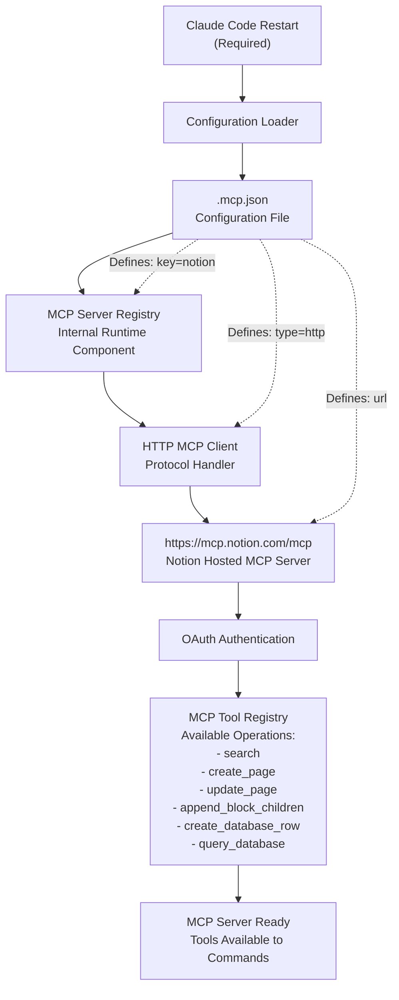
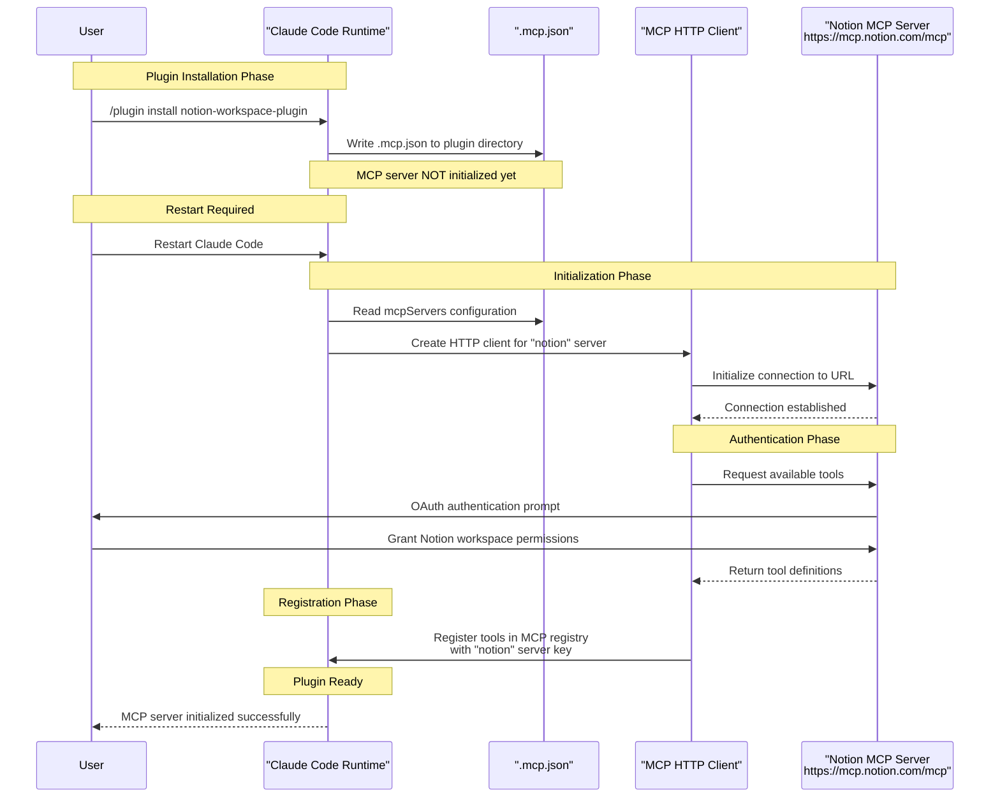
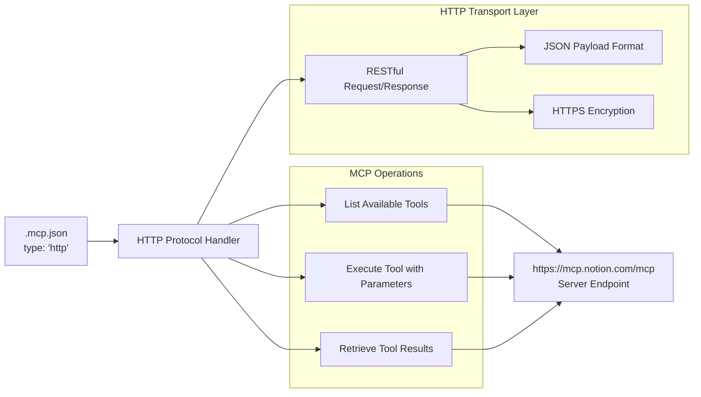

<!-- source: DeepWiki mcp.deepwiki.com · repo makenotion/claude-code-notion-plugin · page 2.2 MCP Server Configuration · fetched 2026-10-26 -->

# MCP Server Configuration

<details>
<summary>Relevant source files</summary>

The following files were used as context for generating this wiki page:

- [.mcp.json](.mcp.json)
- [README.md](README.md)

</details>


This document explains the `.mcp.json` configuration file that enables the plugin to connect to Notion's hosted MCP (Model Context Protocol) server. This configuration is what allows Claude Code to perform actual Notion API operations such as searching, creating pages, and updating databases.

For information about installing the plugin and triggering the initial MCP server setup, see [Installation](#2.1). For details on how the MCP server integrates with Skills and Slash Commands in the overall architecture, see [Core Components](#3.1).

---

## Configuration File Structure

The plugin includes a single configuration file that declares the MCP server connection:

**File: .mcp.json**

```json
{
  "mcpServers": {
    "notion": {
      "type": "http",
      "url": "https://mcp.notion.com/mcp"
    }
  }
}
```

This file follows the Claude Code MCP server specification format and contains the following structure:

| Field | Value | Description |
|-------|-------|-------------|
| `mcpServers` | Object | Top-level container for all MCP server declarations |
| `notion` | Object | Server identifier key used by Claude Code to reference this server |
| `type` | `"http"` | Protocol type indicating this is an HTTP-based MCP server |
| `url` | `"https://mcp.notion.com/mcp"` | Endpoint URL for Notion's hosted MCP server |

The `notion` key serves as the internal identifier that Claude Code uses to route MCP tool calls to the appropriate server. When slash commands or skills invoke Notion operations, they reference tools provided by the server registered under this identifier.

**Sources:** [.mcp.json:1-8](), [README.md:26-30]()

---

## MCP Server Connection Architecture

The following diagram illustrates how Claude Code processes the `.mcp.json` configuration during initialization and establishes the connection to Notion's hosted MCP server:

### MCP Server Initialization Flow



**Key Components:**

- **Configuration Loader**: Claude Code's internal component that parses `.mcp.json` during startup
- **MCP Server Registry**: Runtime registry that maintains connections to all configured MCP servers
- **HTTP MCP Client**: Protocol handler specifically for HTTP-based MCP servers (as specified by `"type": "http"`)
- **Tool Registry**: Collection of available MCP tools that become accessible after successful connection

**Sources:** [.mcp.json:1-8](), [README.md:76-77]()

---

## Connection Initialization Sequence

The MCP server connection follows a specific initialization sequence that requires a Claude Code restart to complete:

### Initialization Sequence Diagram



**Critical Steps:**

1. **Installation**: The `.mcp.json` file is written during plugin installation but is not processed immediately
2. **Restart Trigger**: Claude Code's startup sequence is required to initialize MCP servers
3. **Configuration Parse**: The runtime reads `mcpServers` object and creates appropriate protocol handlers
4. **Connection**: HTTP client connects to the specified `url` endpoint
5. **OAuth Gate**: Notion's MCP server requires OAuth authentication before providing tool definitions
6. **Tool Registration**: Successfully authenticated tools are registered under the `notion` server key

This sequence explains why the installation instructions explicitly require a Claude Code restart ([README.md:76-77]()).

**Sources:** [.mcp.json:1-8](), [README.md:76-77](), [README.md:82-84]()

---

## HTTP-Based MCP Protocol

The plugin uses the HTTP transport variant of the Model Context Protocol. This section details how the `"type": "http"` configuration affects the connection behavior:

### Protocol Configuration Mapping



**Protocol Characteristics:**

The `"type": "http"` declaration specifies:
- **Transport**: Standard HTTPS connections (as opposed to stdio or SSE transports)
- **Request Format**: JSON-encoded MCP protocol messages sent via HTTP POST
- **Authentication**: OAuth 2.0 bearer tokens included in request headers
- **Session Management**: Stateless HTTP requests with authentication on each call

The hosted nature of Notion's MCP server (`https://mcp.notion.com/mcp`) eliminates the need for:
- Local server process management
- Port configuration
- Server lifecycle management
- Manual authentication token configuration

**Sources:** [.mcp.json:1-8](), [README.md:26-30]()

---

## Server Capabilities

Once the MCP server connection is established and authenticated, the following tools become available to slash commands and skills:

| Tool Name | Purpose | Used By |
|-----------|---------|---------|
| `search` | Full-text search across workspace | `/Notion:search`, `/Notion:find` |
| `get_page` | Retrieve page content and properties | All read operations |
| `get_database` | Retrieve database schema and properties | `/Notion:database-query` |
| `create_page` | Create new pages with content | `/Notion:create-page`, `/Notion:create-task` |
| `update_page` | Modify existing page properties | Task status updates, agent communications |
| `append_block_children` | Add content blocks to pages | Knowledge capture, task documentation |
| `create_database_row` | Insert rows into databases | `/Notion:create-database-row`, `/Notion:create-task` |
| `query_database` | Query databases with filters | `/Notion:database-query`, task board queries |

These tools provide the complete CRUD operation set mentioned in [README.md:33-39](). The slash commands documented in section [5](#5) rely entirely on these MCP tools for their Notion interactions.

**Sources:** [README.md:33-39](), [README.md:44-56]()

---

## Configuration Validation

Claude Code performs validation during the MCP server initialization process:

### Validation Checks Performed

1. **File Structure**: Verifies `.mcp.json` is valid JSON with required `mcpServers` object
2. **Server Declaration**: Confirms each server has required `type` and `url` fields
3. **Type Validity**: Ensures `type` value is recognized (e.g., `"http"`, `"stdio"`, `"sse"`)
4. **URL Format**: Validates `url` is a well-formed HTTPS endpoint
5. **Connection Test**: Attempts to connect to the specified endpoint
6. **OAuth Success**: Verifies user completes OAuth authentication flow

If validation fails at any step, the MCP server will not be registered, and slash commands that depend on Notion operations will fail with connection errors.

**Sources:** [.mcp.json:1-8](), [README.md:76-77]()

---

## Troubleshooting

### Common Issues

**Issue: Slash commands fail with "MCP server not found" error**

**Cause**: Claude Code has not initialized the MCP server

**Solution**: Ensure you have restarted Claude Code after plugin installation. The MCP server initialization only occurs during the startup sequence, not during plugin installation.

---

**Issue: OAuth authentication prompt never appears**

**Cause**: Network connectivity issues or invalid URL configuration

**Solution**: Verify the `url` in `.mcp.json` is exactly `https://mcp.notion.com/mcp` and that your network allows HTTPS connections to this endpoint.

---

**Issue: Tools work briefly then fail**

**Cause**: OAuth token expired or was revoked

**Solution**: Re-authenticate by restarting Claude Code, which will trigger a new OAuth flow if the stored token is invalid.

**Sources:** [README.md:76-84](), [.mcp.json:1-8]()

---

## Configuration Immutability

The `.mcp.json` configuration is generated during plugin installation and should not be manually modified. The file is:

- **Read-only in practice**: Changes require plugin reinstallation to take effect properly
- **Version-controlled**: Part of the plugin package structure
- **Validated on load**: Invalid modifications will prevent MCP server initialization

If you need to modify MCP server settings, the recommended approach is to uninstall and reinstall the plugin, which will regenerate the configuration file with correct values.

**Sources:** [.mcp.json:1-8](), [README.md:70-74]()

---

