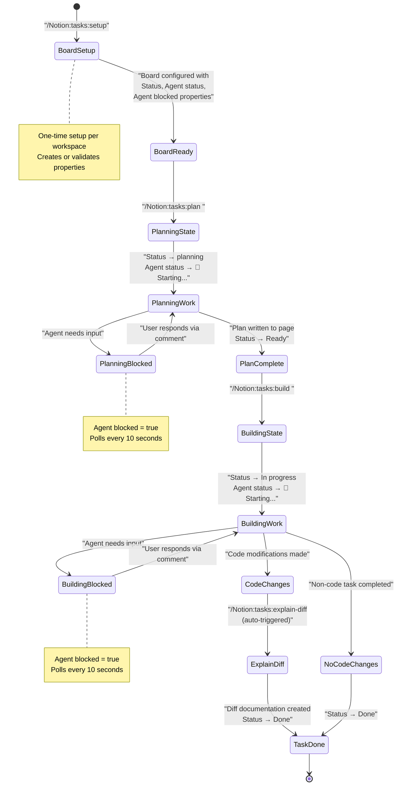
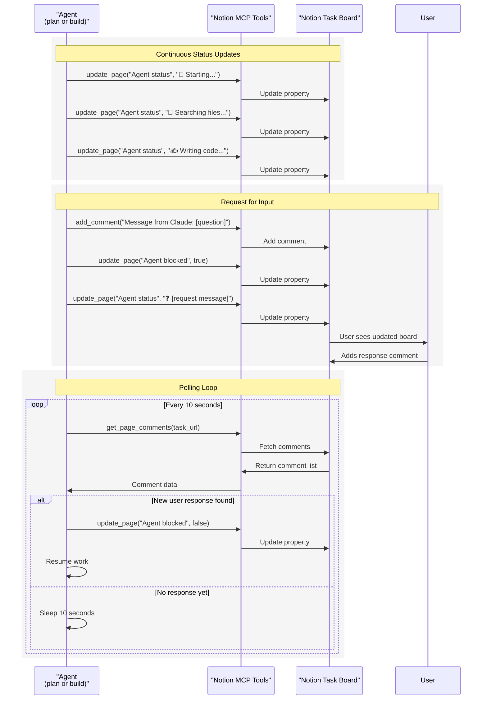
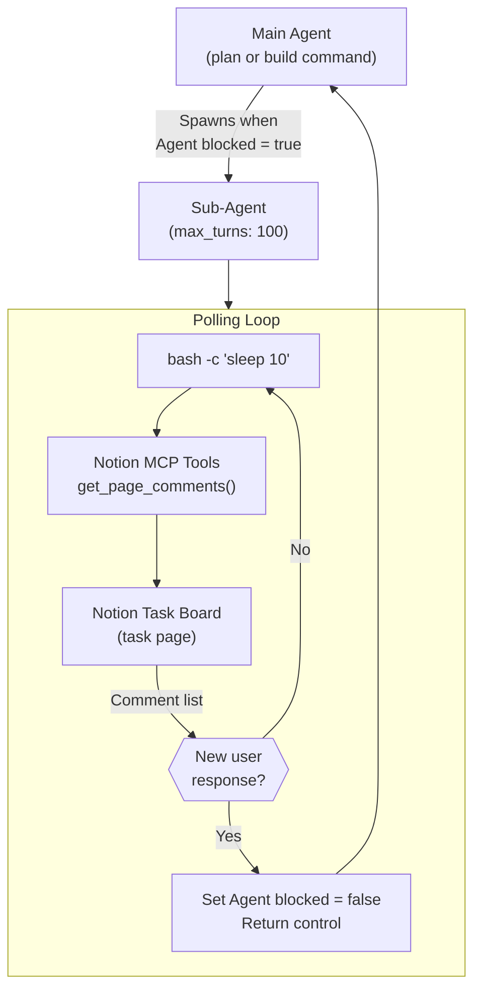

<!-- source: DeepWiki mcp.deepwiki.com · repo makenotion/claude-code-notion-plugin · page 4 Task Management Workflow · fetched 2026-10-26 -->

# Task Management Workflow

<details>
<summary>Relevant source files</summary>

The following files were used as context for generating this wiki page:

- [commands/tasks/build.md](commands/tasks/build.md)
- [commands/tasks/explain-diff.md](commands/tasks/explain-diff.md)
- [commands/tasks/plan.md](commands/tasks/plan.md)
- [commands/tasks/setup.md](commands/tasks/setup.md)

</details>


This document provides a comprehensive overview of the task management system, which enables autonomous agent-driven development workflows tracked through Notion. The system consists of four interconnected slash commands that implement a complete lifecycle from board setup through task planning, execution, and code change documentation.

For detailed command-specific documentation, see [Task Board Setup](#4.1), [Planning Tasks](#4.2), [Building Tasks](#4.3), and [Explaining Code Changes](#4.4). For general slash command reference, see [Slash Commands Reference](#5).

## System Overview

The task management workflow transforms Notion boards into interactive collaboration interfaces where autonomous agents can plan and execute development tasks with periodic user oversight. The system implements an asynchronous communication pattern where users monitor progress through Notion's native interface rather than observing the Claude Code session directly.

**Sources:** [commands/tasks/build.md:1-52](), [commands/tasks/setup.md:1-39](), [commands/tasks/plan.md:1-52]()

## Workflow State Machine

The following diagram illustrates the complete task lifecycle, from initial board setup through task completion:



**Sources:** [commands/tasks/setup.md:1-39](), [commands/tasks/plan.md:1-52](), [commands/tasks/build.md:1-52](), [commands/tasks/explain-diff.md:1-43]()

## Required Notion Board Properties

The task management system requires a Notion database with specific properties to function correctly. These properties enable both agent autonomy and user oversight:

| Property Name | Type | Purpose | Used By |
|--------------|------|---------|---------|
| `Status` | Select | Tracks task lifecycle state | `setup`, `plan`, `build` |
| `Agent status` | Text | Real-time agent activity updates | `plan`, `build` |
| `Agent blocked` | Checkbox | Signals when agent needs user input | `plan`, `build` |

### Status Values

The `Status` property must include these values:

| Status Value | Description | Set By |
|-------------|-------------|--------|
| `planning` | Task plan is being created | `/Notion:tasks:plan` |
| `Ready` | Plan complete, ready for implementation | `/Notion:tasks:plan` |
| `In progress` | Task is being built | `/Notion:tasks:build` |
| `Done` | Task completed | `/Notion:tasks:build` |

**Sources:** [commands/tasks/setup.md:26-29](), [commands/tasks/plan.md:22-33](), [commands/tasks/build.md:21-33]()

## Communication Protocol

Both the planning and building phases implement an identical asynchronous communication protocol that enables human-agent collaboration without requiring users to monitor the agent's execution session. This protocol uses Notion itself as a message bus.

### Protocol Sequence



**Sources:** [commands/tasks/build.md:36-48](), [commands/tasks/plan.md:36-48]()

### Communication Protocol Implementation

The protocol is implemented consistently across both `/Notion:tasks:plan` and `/Notion:tasks:build` commands with the following steps:

1. **Add Comment to Task:** The agent adds a comment prefixed with `"Message from Claude:"` on its own line in bold
2. **Set Blocking State:** The `Agent blocked` property is set to `true`
3. **Update Agent Status:** The `Agent status` property is updated with a short message like `"❓ Choose a color scheme"` or `"❓ Give architecture feedback"`
4. **Poll for Response:** The agent polls every 10 seconds to detect user responses

**Sources:** [commands/tasks/build.md:38-42](), [commands/tasks/plan.md:38-42]()

## Agent Status Updates

During task execution, the agent continuously updates the `Agent status` field to provide transparency into its current activities. These updates follow a consistent format:

```
[emoji] [brief description]
```

### Status Update Examples

| Status Value | Phase | Meaning |
|-------------|-------|---------|
| `🤖 Starting...` | Initialization | Agent beginning work |
| `📂 Searching files...` | Code analysis | Exploring codebase structure |
| `✍️ Writing plan...` | Planning | Generating task plan |
| `🎨 Updating color scheme...` | Implementation | Making specific code changes |
| `🧪 Running tests...` | Verification | Executing test suite |
| `❓ Choose a color scheme` | Blocked | Waiting for user input |

**Sources:** [commands/tasks/build.md:23-27](), [commands/tasks/plan.md:23-27]()

## Sub-Agent Polling Architecture

To prevent context pollution during long-running polling operations, the system uses a sub-agent architecture for the 10-second polling loop. This design pattern isolates the polling mechanism from the main agent's conversation context.



### Polling Implementation Details

The polling mechanism is implemented using two key techniques:

1. **Sub-Agent Isolation:** A sub-agent with `max_turns` set to `100` performs the polling to avoid filling the main agent's context with repeated API calls
2. **Bash Sleep Interleaving:** Each poll cycle uses `bash -c 'sleep 10'` followed by an MCP tool call to `get_page_comments()`

**Sources:** [commands/tasks/build.md:44-47](), [commands/tasks/plan.md:44-47]()

## Workflow Phases

The task management system consists of four distinct phases, each implemented by a dedicated slash command:

### Phase 1: Board Setup (`/Notion:tasks:setup`)

Establishes the Notion workspace infrastructure required for task tracking. This is a one-time setup per workspace that either guides users to duplicate a template or modifies an existing board to add required properties.

**Configuration Paths:**
- Template-based: Duplicates https://notion.notion.site/code-with-notion-board
- Existing board: Adds `Status`, `Agent status`, and `Agent blocked` properties

**See:** [Task Board Setup](#4.1) for detailed documentation

**Sources:** [commands/tasks/setup.md:1-39]()

### Phase 2: Planning (`/Notion:tasks:plan <task_url>`)

Analyzes a task specification and generates a comprehensive implementation plan written directly into the Notion task page. The agent explores the codebase, asks clarifying questions, and produces a structured plan under a "Plan" section.

**Status Transitions:** `(initial)` → `planning` → `Ready`

**Key Behaviors:**
- Fetches task details via MCP tools [commands/tasks/plan.md:16-19]()
- Updates `Agent status` throughout planning process [commands/tasks/plan.md:23-28]()
- Uses Communication Protocol for clarifying questions [commands/tasks/plan.md:28-34]()
- Writes plan to task page in new "Plan" section [commands/tasks/plan.md:32]()

**See:** [Planning Tasks](#4.2) for detailed documentation

**Sources:** [commands/tasks/plan.md:1-52]()

### Phase 3: Building (`/Notion:tasks:build <task_url>`)

Executes the task implementation based on the plan or specification. For code-related tasks, this involves making actual code changes. The agent works autonomously while providing continuous status updates and requesting user input when needed.

**Status Transitions:** `Ready` → `In progress` → `Done`

**Key Behaviors:**
- Fetches task details and specifications [commands/tasks/build.md:16-19]()
- Marks task "In progress" with initial status update [commands/tasks/build.md:21-23]()
- Implements changes with continuous status updates [commands/tasks/build.md:25-28]()
- Auto-triggers `/Notion:tasks:explain-diff` for code changes [commands/tasks/build.md:33]()

**See:** [Building Tasks](#4.3) for detailed documentation

**Sources:** [commands/tasks/build.md:1-52]()

### Phase 4: Code Change Documentation (`/Notion:tasks:explain-diff`)

Generates comprehensive documentation for code changes as a new Notion page. This command is typically auto-triggered by `/Notion:tasks:build` when code modifications are detected, but can also be invoked manually.

**Documentation Structure:**
- **Background:** Existing system context
- **Intuition:** Core concepts with examples and diagrams
- **Code:** High-level walkthrough of changes
- **Verification:** Testing approach and QA guide
- **Alternatives:** Alternative approaches with pros/cons
- **Quiz:** 5 questions to test understanding

**See:** [Explaining Code Changes](#4.4) for detailed documentation

**Sources:** [commands/tasks/explain-diff.md:1-43]()

## Key Architectural Patterns

### Notion as Communication Channel

The system treats Notion not as a passive data store but as an active communication medium. All agent-user interaction flows through Notion's native interface:

- **Agent → User:** Comments prefixed with "Message from Claude:", status field updates, blocked checkbox
- **User → Agent:** Native Notion comments on the task page
- **Polling:** Agent monitors for new user comments via MCP tools

This pattern enables users to monitor and guide agent work without watching the Claude Code session.

**Sources:** [commands/tasks/build.md:8](), [commands/tasks/plan.md:8]()

### Shared Command Infrastructure

Both `/Notion:tasks:plan` and `/Notion:tasks:build` share identical architectural components:

| Component | Implementation | Purpose |
|-----------|---------------|---------|
| Communication Protocol | [commands/tasks/build.md:36-42](), [commands/tasks/plan.md:36-42]() | User-agent interaction |
| Status Updates | [commands/tasks/build.md:23-27](), [commands/tasks/plan.md:23-27]() | Transparency into agent activity |
| Polling Mechanism | [commands/tasks/build.md:44-47](), [commands/tasks/plan.md:44-47]() | Detecting user responses |
| Blocking State | [commands/tasks/build.md:41](), [commands/tasks/plan.md:41]() | Signaling when input needed |

This shared infrastructure provides consistency across the workflow and reduces cognitive load for users.

**Sources:** [commands/tasks/build.md:36-48](), [commands/tasks/plan.md:36-48]()

### Progressive Disclosure

The workflow implements progressive disclosure by separating planning from execution:

1. **Planning Phase:** Clarifies requirements, explores codebase, generates plan
2. **Review Checkpoint:** User reviews plan in Notion before execution
3. **Building Phase:** Executes plan with periodic user guidance

This separation enables users to provide high-level direction during planning and tactical feedback during implementation.

**Sources:** [commands/tasks/plan.md:1-52](), [commands/tasks/build.md:1-52]()

---

