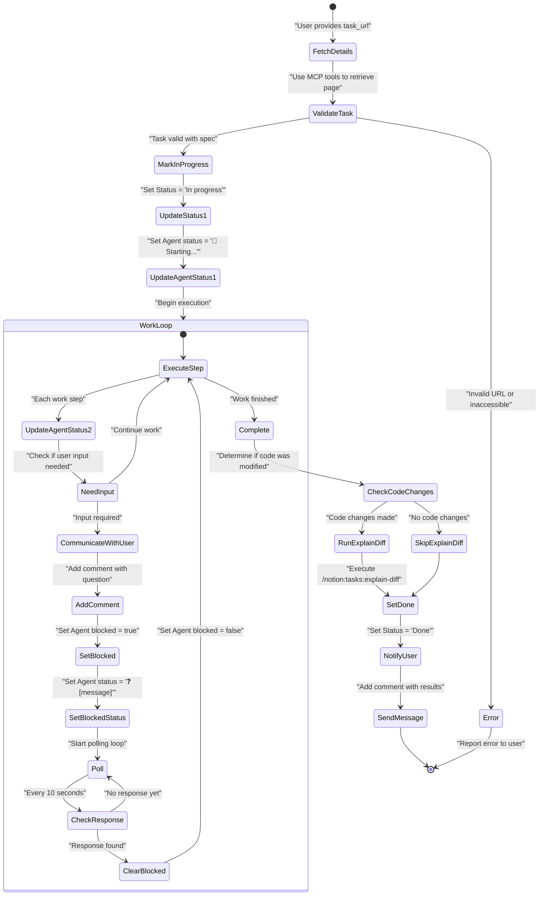
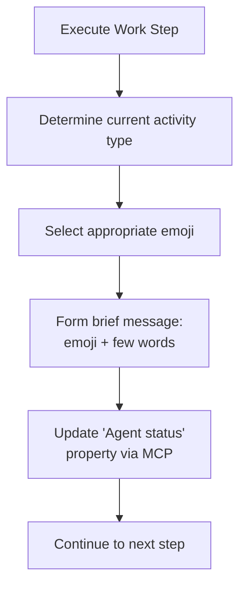
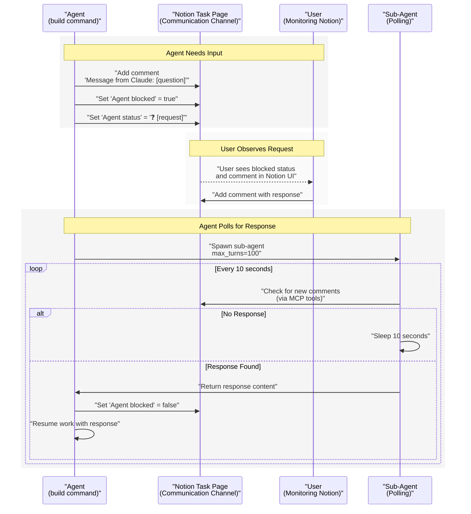
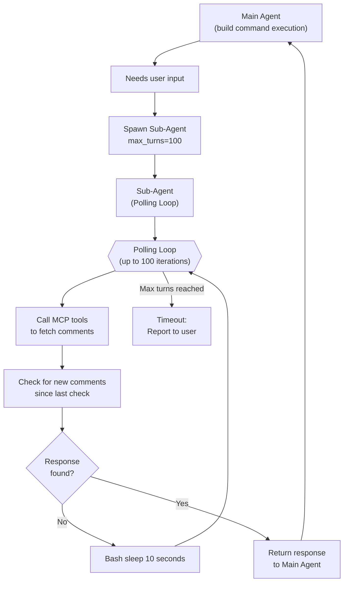
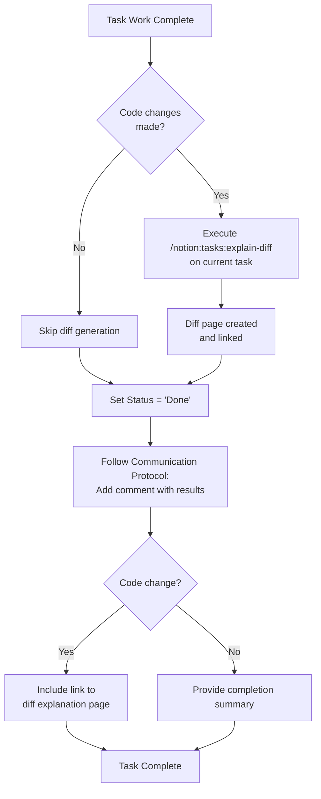

<!-- source: DeepWiki mcp.deepwiki.com · repo makenotion/claude-code-notion-plugin · page 4.3 Building Tasks · fetched 2026-10-26 -->

# Building Tasks

<details>
<summary>Relevant source files</summary>

The following files were used as context for generating this wiki page:

- [commands/tasks/build.md](commands/tasks/build.md)
- [commands/tasks/setup.md](commands/tasks/setup.md)

</details>


This page documents the `/Notion:tasks:build` command, which implements autonomous task execution with user oversight through Notion. This command enables Claude to work on tasks while keeping users informed via continuous status updates in the Notion board. The user monitors progress in Notion without watching the Claude Code session directly.

For setting up the task board infrastructure, see [Task Board Setup](#4.1). For the planning phase that precedes building, see [Planning Tasks](#4.2). For post-build documentation generation, see [Explaining Code Changes](#4.4).

## Command Overview

The `/Notion:tasks:build` command accepts a single argument: the Notion task URL. It fetches the task details, executes the work, and updates the task status throughout the process.

**Command Signature:**
```
/Notion:tasks:build <task_url>
```

**Input:** A Notion page URL that represents a task in a properly configured task board (see [4.1](#4.1) for board requirements).

**Output:** The task is executed, with continuous status updates written to the Notion board. Upon completion, the task status is set to "Done" and a code change explanation is generated if applicable.

**Sources:** [commands/tasks/build.md:1-12]()

## Execution Lifecycle



**Lifecycle Phases:**

1. **Task Retrieval** [commands/tasks/build.md:15-19]() - Fetch page content including title, description, properties, acceptance criteria, and linked references using MCP tools
2. **Status Initialization** [commands/tasks/build.md:21-23]() - Set task `Status` property to `"In progress"` and `Agent status` to `"🤖 Starting..."` or similar
3. **Execution Loop** [commands/tasks/build.md:25-28]() - Implement task specification with continuous `Agent status` updates
4. **Completion** [commands/tasks/build.md:30-34]() - Mark task as `"Done"`, trigger explain-diff if code changed, notify user

**Sources:** [commands/tasks/build.md:6-34]()

## Status Update System

The command continuously updates the `Agent status` property to communicate current activities. Status messages follow a consistent pattern: emoji + brief description.

### Status Message Patterns

| Phase | Example Messages | Purpose |
|-------|-----------------|---------|
| **Initialization** | `🤖 Starting...`, `🤖 Working...` | Signal agent has begun |
| **File Operations** | `📂 Searching relevant files...` | File system navigation |
| **Code Changes** | `✍️ Writing implementation...`, `🎨 Updating color scheme...` | Active development |
| **Testing** | `🧪 Running tests...` | Validation activities |
| **Blocked State** | `❓ Choose a color scheme`, `❓ Give architecture feedback` | Waiting for user input |

### Status Update Implementation



**Key Implementation Details:**
- Updates occur at each significant step [commands/tasks/build.md:27]()
- Messages kept brief for readability
- Emoji provides quick visual categorization
- Property updated via Notion MCP tools

**Sources:** [commands/tasks/build.md:21-28]()

## Communication Protocol Implementation

When the agent needs user input, it follows a structured protocol that uses the Notion board as the communication channel.



### Protocol Steps

**Step 1: Send Message** [commands/tasks/build.md:40]()
- Add a comment to the task page
- Prefix comment with `"Message from Claude:"` on its own line in bold
- Include the question or request

**Step 2: Signal Blocked State** [commands/tasks/build.md:41]()
- Set `Agent blocked` property to `true`
- Update `Agent status` to brief message explaining the request
- Format: `"❓ [brief description]"` (e.g., `"❓ Choose a color scheme"`)

**Step 3: Poll for Response** [commands/tasks/build.md:42]()
- Initiate polling loop to check for user comments
- Continue polling until response is found

**Sources:** [commands/tasks/build.md:36-42]()

## Polling Mechanism

The polling system enables the agent to wait for user responses without blocking the main execution context.

### Sub-Agent Architecture



**Implementation Details:**

1. **Sub-Agent Spawning** [commands/tasks/build.md:46]()
   - Always use a sub-agent to avoid polluting parent context
   - Set `max_turns` to `100` to allow up to ~16 minutes of polling (100 turns × 10 seconds)

2. **Polling Interval** [commands/tasks/build.md:42]()
   - Poll every 10 seconds
   - Implemented with Bash `sleep` command interleaved with MCP tool calls [commands/tasks/build.md:47]()

3. **Context Isolation** [commands/tasks/build.md:46]()
   - Sub-agent prevents polling operations from cluttering main agent's context
   - Main agent remains focused on task execution logic

**Sources:** [commands/tasks/build.md:44-48]()

## Post-Build Actions

Upon task completion, the command performs cleanup and documentation steps.

### Completion Decision Tree



**Completion Steps** [commands/tasks/build.md:30-34]():

1. **Update Status** - Set task `Status` property to `"Done"`
2. **Generate Diff Documentation** - If code changes were made, run `/notion:tasks:explain-diff` to create comprehensive change documentation (see [4.4](#4.4))
3. **Notify User** - Follow Communication Protocol to add a comment with:
   - Summary of task results
   - Link to diff explanation page (if applicable for code changes)

**Sources:** [commands/tasks/build.md:30-34]()

## Error Handling

The command handles several error conditions gracefully.

### Error Scenarios

| Error Type | Detection | Response |
|-----------|-----------|----------|
| **Invalid URL** | MCP tools fail to retrieve page [commands/tasks/build.md:51]() | Ask user to verify URL and Notion connection |
| **Inaccessible Task** | Page exists but lacks proper permissions | Request user check Notion sharing settings |
| **Unclear Requirements** | Task description insufficient for implementation [commands/tasks/build.md:52]() | Use Communication Protocol to ask clarifying questions before implementing |
| **Missing Board Properties** | Task lacks required `Status`, `Agent status`, or `Agent blocked` properties | Report issue and guide user to run `/notion:tasks:setup` (see [4.1](#4.1)) |

**Error Response Pattern:**
1. Detect error condition
2. Set `Agent status` to indicate error state (e.g., `"⚠️ Unable to access task"`)
3. Use Communication Protocol to explain the issue
4. Provide actionable guidance for resolution

**Sources:** [commands/tasks/build.md:49-52]()

## Integration with Task Workflow

The build command is part of a larger task management flow:

**Prerequisites:**
- Task board configured via `/notion:tasks:setup` ([4.1](#4.1))
- Optional: Task plan created via `/notion:tasks:plan` ([4.2](#4.2))

**Workflow Position:**
```
/notion:tasks:setup → [/notion:tasks:plan] → /notion:tasks:build → /notion:tasks:explain-diff
```

**Related Commands:**
- `/notion:tasks:plan` ([4.2](#4.2)) - Creates detailed task plans before building
- `/notion:tasks:explain-diff` ([4.4](#4.4)) - Automatically invoked after code changes to document modifications

**Sources:** [commands/tasks/build.md:1-52](), [commands/tasks/setup.md:1-39]()

---

