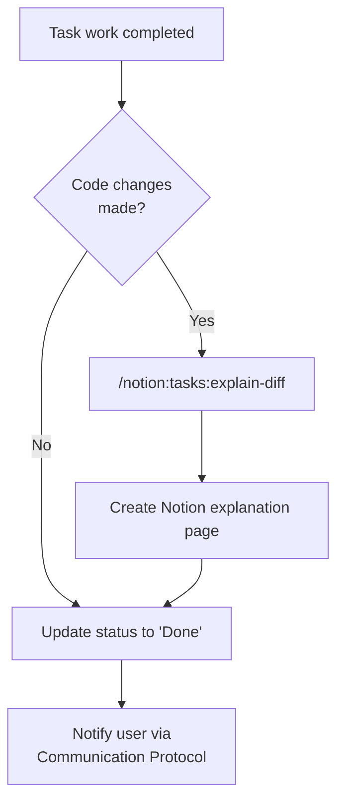
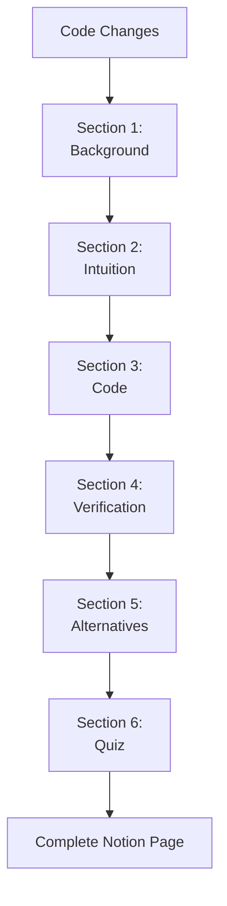
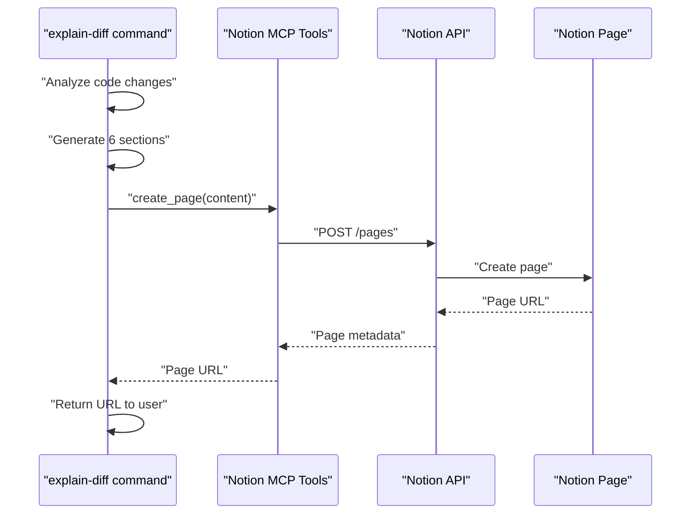
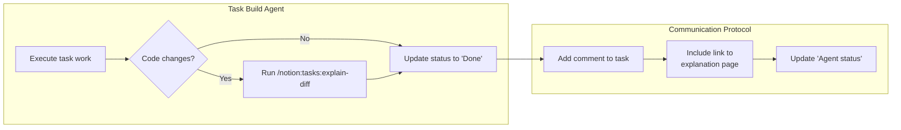

<!-- source: DeepWiki mcp.deepwiki.com · repo makenotion/claude-code-notion-plugin · page 4.4 Explaining Code Changes · fetched 2026-10-26 -->

# Explaining Code Changes

<details>
<summary>Relevant source files</summary>

The following files were used as context for generating this wiki page:

- [commands/tasks/build.md](commands/tasks/build.md)
- [commands/tasks/explain-diff.md](commands/tasks/explain-diff.md)

</details>


## Purpose and Scope

This page documents the `/notion:tasks:explain-diff` command, which automatically generates comprehensive documentation for code changes in Notion. This command creates structured, pedagogical explanations of code modifications, designed to help reviewers and team members understand the reasoning, implementation details, and verification approach for any code change.

For information about the task building workflow that triggers this command, see [Building Tasks](#4.3). For the initial task setup, see [Task Board Setup](#4.1).

**Sources**: [commands/tasks/explain-diff.md:1-52]()

## Overview

The explain-diff command serves as the documentation phase of the task management workflow. When the task build agent completes work that includes code modifications, it automatically invokes this command to create a detailed explanation page in Notion. The command can also be invoked manually to document any code changes from the current conversation.

The generated documentation follows a pedagogical structure inspired by technical writing best practices, transforming raw code diffs into accessible explanations that serve both as review material and permanent documentation.

**Sources**: [commands/tasks/build.md:33-34](), [commands/tasks/explain-diff.md:1-8]()

## Trigger Conditions

### Automatic Triggering

The command is automatically invoked by the task build agent when two conditions are met:

1. The task status is being updated to "Done"
2. Code changes were made during task execution



**Diagram**: Automatic invocation flow during task completion

**Sources**: [commands/tasks/build.md:31-34]()

### Manual Invocation

Users can manually invoke the command with a task URL argument:
```
/notion:tasks:explain-diff <task_url>
```

When no explicit task URL is provided, the command defaults to explaining the most recent batch of changes made in the current conversation.

**Sources**: [commands/tasks/explain-diff.md:3-4](), [commands/tasks/explain-diff.md:11-12]()

## Input Specification

The command accepts the following input parameters:

| Parameter | Type | Required | Description |
|-----------|------|----------|-------------|
| `task_url` | String | No | Notion page URL pointing to the task. If omitted, explains most recent conversation changes |

The command determines the scope of code changes to explain through one of two methods:

1. **Explicit specification**: User provides a task URL or explicitly describes which changes to document
2. **Implicit scope**: Defaults to the most recent batch of changes made in the current conversation session

**Sources**: [commands/tasks/explain-diff.md:3](), [commands/tasks/explain-diff.md:11-12]()

## Generated Documentation Structure

The explain-diff command creates a Notion page with six standardized sections, each serving a specific pedagogical purpose. This structure transforms code diffs into comprehensive learning material.



**Diagram**: Six-section structure of generated documentation

**Sources**: [commands/tasks/explain-diff.md:14-34]()

### Section 1: Background

This section establishes context for readers with varying levels of familiarity with the codebase. It contains two subsections:

1. **Broad context**: Deep background for beginners, including relevant system architecture and existing code structure
2. **Narrow context**: Specific components and code paths directly affected by the change

The agent explores surrounding code extensively to provide comprehensive context, ensuring readers can skip ahead if already familiar or gain full understanding if new to the area.

**Sources**: [commands/tasks/explain-diff.md:16]()

### Section 2: Intuition

This section explains the core reasoning behind the code change, focusing on the essential "why" rather than implementation details. Key characteristics:

- Uses concrete examples with toy data to illustrate concepts
- Employs mermaid diagrams liberally to visualize data flow and system interactions
- Prioritizes clarity over completeness
- Helps readers build mental models before diving into code

**Sources**: [commands/tasks/explain-diff.md:17]()

### Section 3: Code

This section provides a high-level walkthrough of the actual code modifications. The changes are:

- Grouped logically by functionality or component
- Ordered in a way that builds understanding progressively
- Presented at a conceptual level rather than line-by-line diffs

The focus is on explaining what changed and why, not exhaustive enumeration of every modification.

**Sources**: [commands/tasks/explain-diff.md:18]()

### Section 4: Verification

This section documents how the code change was validated for correctness. It includes:

1. **Automated verification**: Description of unit tests, integration tests, or other automated checks performed by the agent
2. **Manual QA guide**: Step-by-step instructions for users to manually verify the change in their environment

This dual approach enables both immediate automated validation and ongoing manual verification.

**Sources**: [commands/tasks/explain-diff.md:19]()

### Section 5: Alternatives

This optional section describes 1-2 alternative implementation approaches, but only if orthogonal solutions exist. For each alternative:

- **Pros/cons comparison**: Two-column layout comparing the alternative to the chosen implementation
- **Orthogonality requirement**: Alternatives must represent fundamentally different problem-solving approaches

If no meaningful alternatives exist, this section is omitted entirely.

**Sources**: [commands/tasks/explain-diff.md:20]()

### Section 6: Quiz

This section contains 5 multiple-choice questions testing reader comprehension. Design principles:

- **Medium difficulty**: Requires understanding the PR substance, not trivial details
- **No gotchas**: Fair questions that assess genuine understanding
- **Toggle format**: Uses Notion toggle blocks to hide/reveal answers

Each answer option includes an explanation of why it is correct or incorrect, enabling self-directed learning.

**Format example structure**:
```markdown
1. Question text
   ▶ Option 1
    ❌ Explanation for incorrect answer
   ▶ Option 2
    ✅ Explanation for correct answer
   ▶ Option 3
    ❌ Explanation for incorrect answer
```

**Sources**: [commands/tasks/explain-diff.md:21-34]()

## Formatting and Style Guidelines

### Writing Style

The command generates documentation with specific stylistic qualities:

- **Clarity and flow**: Inspired by Martin Kleppmann's technical writing
- **Classic style**: Direct, accessible explanations without unnecessary jargon
- **Smooth transitions**: Each section flows naturally into the next
- **Engaging narrative**: Maintains reader interest throughout

**Sources**: [commands/tasks/explain-diff.md:39]()

### Diagram Guidelines

The command strategically uses diagrams to enhance understanding:

| Guideline | Description |
|-----------|-------------|
| **Reusable families** | Pick a small number of diagram types that can be reused to explain various aspects |
| **System diagrams** | Show data flow and component communication with example data |
| **Concrete examples** | Always include sample data in diagrams, not just abstract boxes |
| **Liberal use** | Use diagrams frequently throughout the Intuition section |

**Example diagram type**: System diagram showing data flow between components with example data values

**Sources**: [commands/tasks/explain-diff.md:40-42]()

### Notion-Specific Formatting

The generated page uses Notion's rich formatting capabilities:

- **Callouts**: Highlight key concepts, definitions, and important edge cases
- **Toggle blocks**: Conceal quiz answers and optional details
- **Code blocks**: Display code snippets with syntax highlighting
- **Mermaid diagrams**: Rendered inline within Notion pages

**Sources**: [commands/tasks/explain-diff.md:42]()

## Implementation Details

### MCP Tool Integration

The command uses Notion MCP tools to create the documentation page. The workflow is:



**Diagram**: MCP interaction flow for page creation

The command returns the URL of the newly created Notion page, which can be linked from the task page.

**Sources**: [commands/tasks/explain-diff.md:38]()

### Integration with Task Build Command

The explain-diff command integrates seamlessly into the task completion workflow:



**Diagram**: Integration with task build command workflow

When code changes are detected, the task build agent:

1. Invokes the explain-diff command
2. Waits for the explanation page to be created
3. Updates the task status to "Done"
4. Uses the Communication Protocol to notify the user
5. Includes a link to the explanation page in the notification

**Sources**: [commands/tasks/build.md:31-34](), [commands/tasks/build.md:36-42]()

## Usage Examples

### Automatic Usage After Task Build

When a task with code changes completes:

```markdown
[Task build agent completes work]
→ Detects code modifications
→ Automatically runs /notion:tasks:explain-diff
→ Creates explanation page
→ Links page in completion comment to user
```

The user sees a notification in the Notion task with a link to the full explanation.

### Manual Usage for Recent Changes

To document recent conversation changes:

```markdown
/notion:tasks:explain-diff
```

The command analyzes the most recent code modifications in the current conversation and generates a standalone explanation page.

### Manual Usage for Specific Task

To document a previously completed task:

```markdown
/notion:tasks:explain-diff https://notion.so/workspace/page-id
```

The command retrieves the task details and associated code changes to generate documentation.

**Sources**: [commands/tasks/explain-diff.md:11-12]()

## Document Quality Characteristics

The generated documentation is designed to serve multiple purposes:

| Purpose | How Achieved |
|---------|-------------|
| **Review material** | Comprehensive Background and Code sections provide context for reviewers |
| **Onboarding documentation** | Deep background helps new team members understand changes |
| **Knowledge retention** | Quiz section helps readers verify their understanding |
| **Design rationale** | Intuition and Alternatives sections preserve decision-making context |
| **QA guidance** | Verification section provides manual testing instructions |

The structured format ensures consistency across all code change documentation, making it easier to navigate and understand the codebase's evolution over time.

**Sources**: [commands/tasks/explain-diff.md:14-34]()

---

