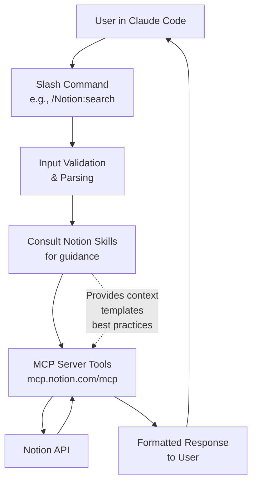
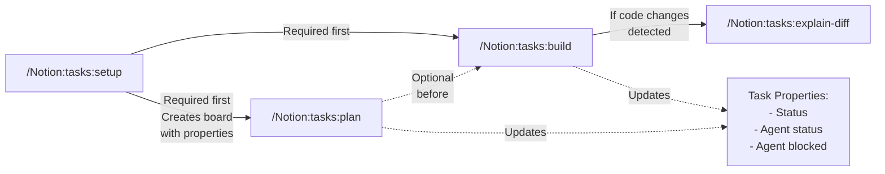
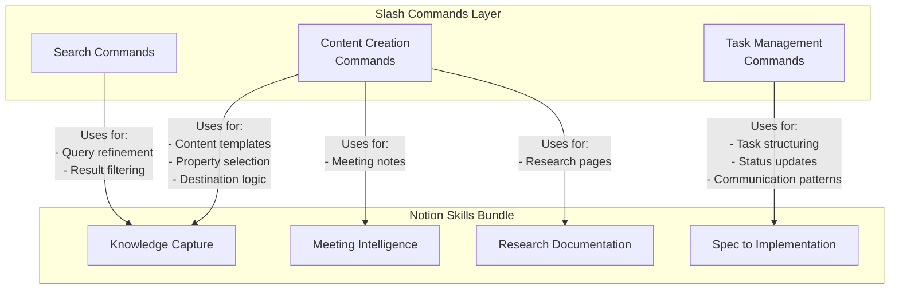

<!-- source: DeepWiki mcp.deepwiki.com · repo makenotion/claude-code-notion-plugin · page 5 Slash Commands Reference · fetched 2026-10-26 -->

# Slash Commands Reference

<details>
<summary>Relevant source files</summary>

The following files were used as context for generating this wiki page:

- [README.md](README.md)

</details>


This page provides a comprehensive reference for all slash commands bundled with the Notion Plugin for Claude Code. These commands serve as the primary user interface for interacting with Notion from within Claude Code sessions.

For detailed information about the task management workflow that several of these commands enable, see [Task Management Workflow](#4). For information about the underlying MCP server tools that these commands utilize, see [MCP Server Configuration](#2.2). For architectural details about how commands interact with Skills and the MCP server, see [Core Components](#3.1).

**Sources**: [README.md:1-92]()

---

## Command Architecture Overview

The slash commands in this plugin operate as orchestration layers that combine Notion Skills (for intelligence and guidance) with MCP server tools (for API operations). Each command is registered in the Claude Code environment and leverages both components to provide functionality.

### Command Execution Model



**Diagram: Command execution flow from user input to Notion API**

This architecture ensures that commands are not merely thin wrappers around API calls. The Notion Skills provide contextual intelligence that guides parameter selection, content structuring, and error handling.

**Sources**: [README.md:5-7](), [README.md:23-57]()

---

## Command Categories

The 10 slash commands are organized into two functional categories:

### Task Management Suite (4 commands)
Commands that implement an agent-driven task execution system with human oversight through Notion boards:
- `/Notion:tasks:setup`
- `/Notion:tasks:plan`
- `/Notion:tasks:build`
- `/Notion:tasks:explain-diff`

### Basic Notion Operations (6 commands)
Commands for fundamental CRUD operations and content discovery:
- `/Notion:search`
- `/Notion:find`
- `/Notion:create-page`
- `/Notion:database-query`
- `/Notion:create-task`
- `/Notion:create-database-row`

**Sources**: [README.md:42-56]()

---

## Command Category Architecture

```mermaid
graph TB
    subgraph TaskMgmt["Task Management Suite"]
        Setup["/Notion:tasks:setup"]
        Plan["/Notion:tasks:plan"]
        Build["/Notion:tasks:build"]
        Diff["/Notion:tasks:explain-diff"]
    end
    
    subgraph BasicOps["Basic Notion Operations"]
        Search["/Notion:search"]
        Find["/Notion:find"]
        CreatePage["/Notion:create-page"]
        DBQuery["/Notion:database-query"]
        CreateTask["/Notion:create-task"]
        CreateRow["/Notion:create-database-row"]
    end
    
    subgraph MCPToolsLayer["MCP Server Tools"]
        SearchTool["search_objects"]
        RetrieveTool["get_page"]
        CreateTool["create_page"]
        AppendTool["append_blocks"]
        UpdateTool["update_page"]
        DBCreateTool["create_database_row"]
        DBQueryTool["query_database"]
    end
    
    Setup --> CreateTool
    Setup --> UpdateTool
    
    Plan --> RetrieveTool
    Plan --> AppendTool
    Plan --> UpdateTool
    
    Build --> RetrieveTool
    Build --> AppendTool
    Build --> UpdateTool
    
    Diff --> CreateTool
    Diff --> AppendTool
    
    Search --> SearchTool
    Find --> SearchTool
    CreatePage --> CreateTool
    DBQuery --> DBQueryTool
    CreateTask --> DBCreateTool
    CreateRow --> DBCreateTool
```



**Diagram: Command mapping to MCP server tools**

This diagram illustrates how each slash command maps to one or more MCP server tools. Task management commands typically use multiple tools in sequence (retrieve, update, append), while basic operations often use a single tool.

**Sources**: [README.md:32-40](), [README.md:42-56]()

---

## Complete Command Reference Table

| Command | Category | Parameters | Primary Purpose | MCP Tools Used |
|---------|----------|------------|-----------------|----------------|
| `/Notion:search` | Search & Discovery | `<query>` | Full-text search across workspace | `search_objects` |
| `/Notion:find` | Search & Discovery | `<title>` | Quick title-based lookup | `search_objects` |
| `/Notion:create-page` | Content Creation | `<parent>` `<content>` | Create page under parent | `create_page` |
| `/Notion:create-task` | Content Creation | `<database>` `<properties>` | Create task in database | `create_database_row` |
| `/Notion:create-database-row` | Content Creation | `<database>` `<properties>` | Insert row in any database | `create_database_row` |
| `/Notion:database-query` | Database Query | `<database>` `<filters>` | Query/filter database | `query_database` |
| `/Notion:tasks:setup` | Task Management | `[board_url]` | Initialize task board structure | `create_page`, `update_page` |
| `/Notion:tasks:plan` | Task Management | `<task_url>` | Agent creates task plan | `get_page`, `append_blocks`, `update_page` |
| `/Notion:tasks:build` | Task Management | `<task_url>` | Agent executes task | `get_page`, `append_blocks`, `update_page` |
| `/Notion:tasks:explain-diff` | Task Management | `[output_page]` | Document code changes | `create_page`, `append_blocks` |

For detailed documentation of each command, see subsections:
- [Search and Discovery Commands](#5.1): `/Notion:search`, `/Notion:find`
- [Content Creation Commands](#5.2): `/Notion:create-page`, `/Notion:create-task`, `/Notion:create-database-row`
- [Database Query Command](#5.3): `/Notion:database-query`
- [Task Board Setup](#4.1): `/Notion:tasks:setup`
- [Planning Tasks](#4.2): `/Notion:tasks:plan`
- [Building Tasks](#4.3): `/Notion:tasks:build`
- [Explaining Code Changes](#4.4): `/Notion:tasks:explain-diff`

**Sources**: [README.md:42-56]()

---

## Task Management Command Dependencies

The task management commands have a specific workflow order and dependency structure:



**Diagram: Task management command workflow and dependencies**

**Key dependency rules:**
1. `/Notion:tasks:setup` must be executed before any other task commands
2. `/Notion:tasks:plan` and `/Notion:tasks:build` can be used independently, but planning before building is recommended
3. `/Notion:tasks:explain-diff` is typically invoked automatically after `/Notion:tasks:build` when code changes are detected
4. All task commands require a Notion board with specific properties (Status, Agent status, Agent blocked)

**Sources**: [README.md:52-55]()

---

## Command Registration and Discovery

Commands are registered in the Claude Code environment through the plugin's manifest structure. Each command is defined with:

- **Command name**: The slash command syntax (e.g., `/Notion:search`)
- **Description**: User-facing explanation of functionality
- **Skill associations**: Which Notion Skills provide guidance
- **MCP tool dependencies**: Which MCP server tools are required

### Command Namespace Convention

All commands use the `Notion:` prefix to:
1. Prevent naming collisions with other plugins
2. Clearly identify Notion-related functionality
3. Enable command grouping in Claude Code's command palette

Task management commands use the `Notion:tasks:` sub-namespace to further organize related functionality.

**Sources**: [README.md:42-56]()

---

## MCP Server Connection Requirements

All slash commands depend on a successful connection to the Notion MCP server. The connection is configured in `.mcp.json` with the following structure:

```json
{
  "mcp_server": {
    "url": "https://mcp.notion.com/mcp",
    "auth": "oauth",
    "required": true
  }
}
```

### Prerequisites for Command Execution

Before any slash command can execute successfully:

1. **Plugin installation** must be complete
2. **Claude Code restart** must have occurred (to initialize MCP server)
3. **OAuth authentication** with Notion must be successful
4. **Network connectivity** to `https://mcp.notion.com/mcp` must be available

If any prerequisite fails, commands will return authentication or connection errors.

**Sources**: [README.md:26-30](), [README.md:76-77](), [README.md:82-84]()

---

## Command Integration with Notion Skills

Each command leverages the bundled Notion Skills to enhance its behavior:



**Diagram: How commands leverage Notion Skills for intelligence**

The Skills provide:
- **Content templates**: Pre-defined structures for different content types
- **Best practices**: Guidance on property naming, database structure
- **Context awareness**: Understanding of workspace organization patterns
- **Error handling**: Intelligent recovery from common mistakes

**Sources**: [README.md:15-23](), [README.md:57]()

---

## Command Output and Response Patterns

Commands follow consistent output patterns:

### Success Responses
- **Confirmation message**: "Created page: [Page Title]"
- **Notion URL**: Direct link to created/modified content
- **Summary of actions**: List of operations performed

### Error Responses
- **Error type**: Authentication, validation, or API error
- **Specific message**: Details about what failed
- **Suggested remediation**: Steps to fix the issue

### Interactive Commands (Task Management)
Task management commands provide ongoing status updates:
- Real-time agent status updates in Notion
- Comments for user interaction
- Polling for user responses
- Final summary upon completion

For detailed information about the interactive communication pattern, see [Communication Protocol](#3.2).

**Sources**: [README.md:42-56]()

---

## Command Availability and Restrictions

All commands are available after successful plugin installation and authentication. However, certain operations may fail based on Notion workspace permissions:

| Permission | Affected Commands | Impact |
|------------|-------------------|--------|
| Read-only access | All commands except search | Cannot create/modify content |
| Database create | `/Notion:tasks:setup` | Cannot create task boards |
| Page create | `/Notion:create-page`, `/Notion:create-task` | Cannot create new content |
| Page edit | Task management commands | Cannot update task status |
| Comment | `/Notion:tasks:plan`, `/Notion:tasks:build` | Cannot use interactive features |

Permission errors are surfaced immediately when commands attempt unauthorized operations.

**Sources**: [README.md:82-84]()

---

## Performance Considerations

### Command Latency
- **Search commands** (`/Notion:search`, `/Notion:find`): 1-3 seconds typical
- **Content creation** (`/Notion:create-page`, etc.): 2-5 seconds typical
- **Task management** commands: Variable (minutes to hours for autonomous execution)

### Rate Limiting
All commands are subject to Notion API rate limits (approximately 3 requests per second). The MCP server handles rate limiting automatically, queuing requests when limits are approached.

### Polling Overhead
Task management commands that use polling (`/Notion:tasks:plan`, `/Notion:tasks:build`) implement a 10-second polling interval to check for user responses. This adds minimal overhead to Claude Code sessions.

**Sources**: [README.md:42-56]()

---

## Summary

The Notion Plugin provides 10 slash commands organized into two categories:

1. **Task Management Suite**: Agent-driven workflow commands for autonomous task execution with human oversight
2. **Basic Notion Operations**: Direct CRUD operations for common Notion interactions

All commands operate through the MCP server at `https://mcp.notion.com/mcp` and leverage the bundled Notion Skills for intelligent behavior. Task management commands implement a sophisticated polling-based communication protocol, while basic operations provide synchronous responses.

For detailed usage instructions, parameter specifications, and examples, refer to the subsection pages linked throughout this document.

**Sources**: [README.md:1-92]()

---

