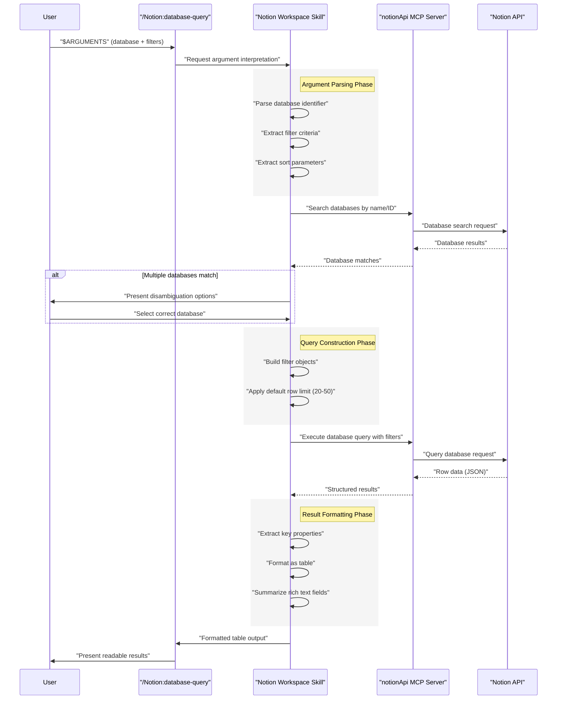
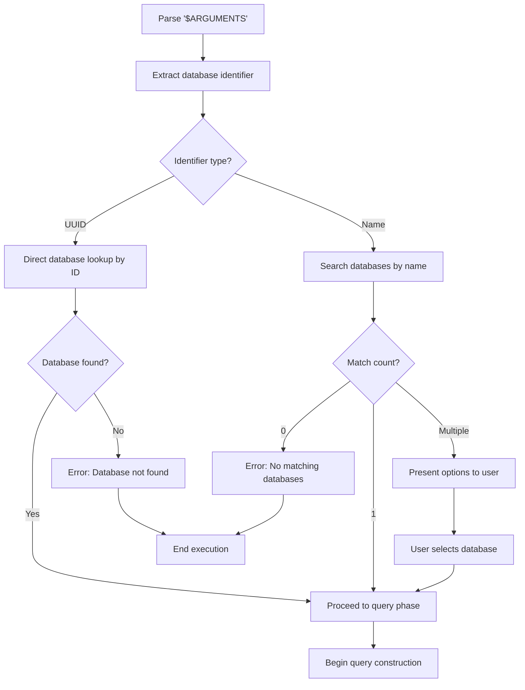
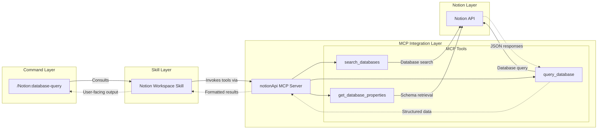

<!-- source: DeepWiki mcp.deepwiki.com · repo makenotion/claude-code-notion-plugin · page 5.3 Database Query Command · fetched 2026-10-26 -->

# Database Query Command

<details>
<summary>Relevant source files</summary>

The following files were used as context for generating this wiki page:

- [commands/database-query.md](commands/database-query.md)

</details>


## Purpose and Scope

This document describes the `/Notion:database-query` slash command, which provides structured querying and filtering capabilities for Notion databases. The command allows users to search databases by name or ID, apply filters and sorts, and receive results in a human-readable table format.

For general search capabilities across all Notion content types, see [Search and Discovery Commands](#5.1). For creating new database entries, see [Content Creation Commands](#5.2).

**Sources**: [commands/database-query.md:1-22]()

---

## Overview

The `/Notion:database-query` command is part of the Basic Notion Operations category within the plugin's slash command suite. It serves as a specialized interface for querying structured data stored in Notion databases, distinguishing itself from general search by providing database-specific filtering, sorting, and tabular result presentation.

The command integrates three core plugin components:
- **Notion Workspace Skill**: Provides intelligent argument interpretation and query construction guidance
- **`notionApi` MCP Server**: Executes the actual database query operations via Notion's API
- **Result Formatter**: Transforms raw API responses into human-readable tables

**Sources**: [commands/database-query.md:1-8]()

---

## Command Syntax

```
/Notion:database-query <database name or ID>; <filters (optional)>
```

### Argument Structure

| Component | Description | Required | Format |
|-----------|-------------|----------|--------|
| Database identifier | Target database name or Notion ID | Yes | String (name) or UUID (ID) |
| Filters | Query constraints and sorting criteria | No | Natural language descriptions |

The argument hint defined in the command specification is `'database name or ID; filters (optional)'`, indicating that filters are separated from the database identifier by a semicolon.

**Sources**: [commands/database-query.md:3,10-12]()

---

## Execution Flow

The following diagram illustrates the complete execution lifecycle of the database query command, from argument parsing through result presentation.

### Database Query Execution Sequence



**Sources**: [commands/database-query.md:8-22]()

---

## Database Resolution Process

When interpreting `$ARGUMENTS`, the command first resolves the target database through a multi-step process:

### Resolution Steps

1. **Identifier Extraction** [commands/database-query.md:10-11]()
   - Parse the first component of `$ARGUMENTS` as database identifier
   - Accept either human-readable name or Notion UUID

2. **Database Search** [commands/database-query.md:8-9]()
   - Query available databases via `notionApi` MCP server
   - Match by exact name or UUID

3. **Disambiguation** [commands/database-query.md:12]()
   - If multiple databases share the same name, present options to user
   - Require explicit selection before proceeding

4. **Validation**
   - Verify user has access permissions to the selected database
   - Confirm database schema supports requested filters

### Database Matching Logic



**Sources**: [commands/database-query.md:10-12]()

---

## Query Construction and Filtering

Once the target database is resolved, the command constructs a structured query based on user-provided filters.

### Filter Interpretation

The command accepts natural language filter descriptions in `$ARGUMENTS` and translates them into Notion's filter syntax. Examples include:

| Natural Language | Interpreted Filter |
|------------------|-------------------|
| "status = Active" | Filter by Status property equals "Active" |
| "owner = Alice" | Filter by Owner property equals person "Alice" |
| "due date this week" | Filter by Due Date property within current week range |

[commands/database-query.md:15]()

### Row Limiting

The command applies intelligent row limiting to ensure readable results:

- **Default limit**: 20-50 rows [commands/database-query.md:16]()
- **Explicit override**: User can request more rows
- **Rationale**: Prevents overwhelming output and maintains decision-making value

### Sort Parameters

While not explicitly detailed in the command specification, the system supports sort criteria extracted from `$ARGUMENTS` alongside filters. [commands/database-query.md:11]()

**Sources**: [commands/database-query.md:11,15-16]()

---

## Result Presentation

The command transforms raw JSON responses from the Notion API into human-readable tabular output, emphasizing clarity and actionability.

### Presentation Format

The command creates a "compact table-like format" with the following characteristics:

1. **Key Properties Display** [commands/database-query.md:18]()
   - Name (if present)
   - Status (if applicable)
   - Owner (if assigned)
   - Due date (if time-sensitive)
   - Additional relevant properties based on database schema

2. **Rich Text Summarization** [commands/database-query.md:19]()
   - Long-form content fields are condensed to short summaries
   - Preserves essential information while maintaining readability

3. **JSON Avoidance** [commands/database-query.md:22]()
   - Explicitly avoids raw JSON dumps
   - Focuses on "readability and decision-making value"

### Empty Result Handling

When no rows match the applied filters, the command:
- Provides clear notification to the user [commands/database-query.md:20]()
- Suggests alternative filter criteria
- Helps users refine their query

**Example Output Structure** (illustrative, not actual output):

```
Query Results: Tasks Database (23 rows)

| Name              | Status      | Owner  | Due Date   |
|-------------------|-------------|--------|------------|
| Implement auth    | In Progress | Alice  | 2024-01-15 |
| Fix pagination    | Active      | Bob    | 2024-01-12 |
| Update docs       | Blocked     | Carol  | 2024-01-18 |
...
```

**Sources**: [commands/database-query.md:17-22]()

---

## MCP Server Integration

The command relies on the `notionApi` MCP server to execute all Notion API operations. This section details the integration architecture.

### MCP Tool Invocation Flow



### MCP Tool Usage

The command typically invokes the following MCP tools in sequence:

1. **`search_databases`**: Locate target database by name or ID
2. **`get_database_properties`**: Retrieve schema to validate filters
3. **`query_database`**: Execute the constructed query with filters and limits

Each tool call flows through the `notionApi` MCP server configured in `.mcp.json`, which handles OAuth authentication and request routing to Notion's API.

**Sources**: [commands/database-query.md:8-9]()

---

## Error Handling and Edge Cases

The command specification defines several error scenarios and their expected handling:

### No Matching Rows

When a query returns zero results:
- Command explicitly states "no rows match" [commands/database-query.md:20]()
- Provides suggestions for alternative filter criteria
- Avoids silent failure

### Ambiguous Database Names

When multiple databases share the same name:
- Command prompts user to select the correct database [commands/database-query.md:12]()
- Does not proceed with query until disambiguation is resolved
- Prevents accidental queries against wrong database

### Permission Errors

While not explicitly detailed in the command specification, permission errors are handled through the MCP server's OAuth layer, which validates access before executing queries.

### Large Result Sets

The command protects against overwhelming output by:
- Applying default row limits (20-50) [commands/database-query.md:16]()
- Requiring explicit user request for larger result sets
- Maintaining focus on "decision-making value" [commands/database-query.md:22]()

**Sources**: [commands/database-query.md:12,16,20,22]()

---

## Usage Examples

The following table illustrates common usage patterns for the `/Notion:database-query` command:

| Use Case | Command Example | Expected Behavior |
|----------|----------------|-------------------|
| Query all rows | `/Notion:database-query Tasks` | Returns up to 50 rows from Tasks database with key properties |
| Filter by status | `/Notion:database-query Projects; status = Active` | Returns only Active projects |
| Filter by assignee | `/Notion:database-query Tasks; owner = Alice` | Returns tasks assigned to Alice |
| Time-based filter | `/Notion:database-query Events; due date this week` | Returns events due within current week |
| Combined filters | `/Notion:database-query Tasks; status = In Progress, owner = Bob` | Returns Bob's in-progress tasks |
| Query by database ID | `/Notion:database-query 1234abcd-5678-90ef-ghij-klmnopqrstuv` | Queries database by UUID, bypassing name resolution |

**Sources**: [commands/database-query.md:10-16]()

---

## Relationship to Other Commands

The `/Notion:database-query` command is part of the broader slash command ecosystem:

- **Complementary Commands**:
  - `/Notion:search`: General content search across pages and databases (see [Search and Discovery Commands](#5.1))
  - `/Notion:find`: Locates specific pages or databases by title
  
- **Downstream Commands**:
  - `/Notion:create-database-row`: Creates new entries in queried databases (see [Content Creation Commands](#5.2))
  - `/Notion:create-task`: Specialized database row creation for task boards

- **Related Skills**:
  - Notion Workspace Skill: Provides query interpretation intelligence
  - Knowledge Capture Skill: May query databases to determine content destination (see [Knowledge Capture Skill](#6.1))

**Sources**: [commands/database-query.md:1-22]()

---

