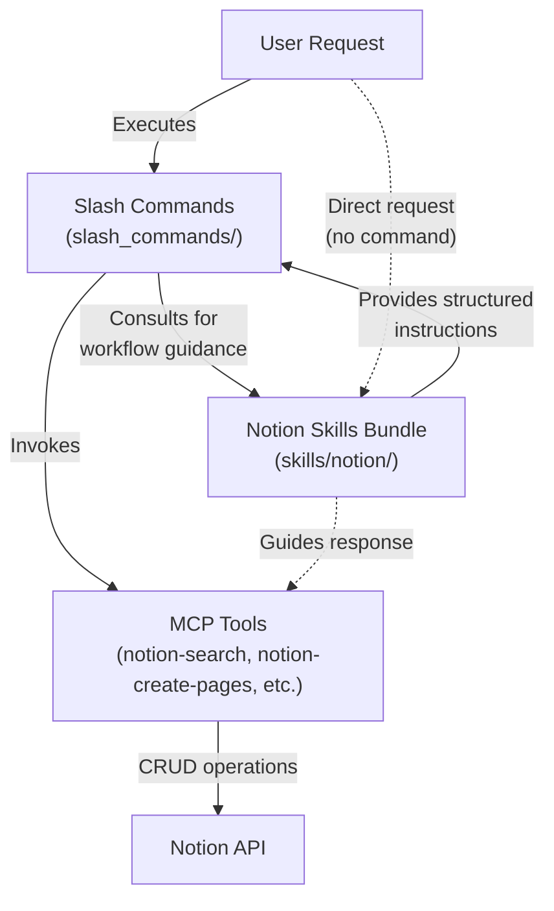
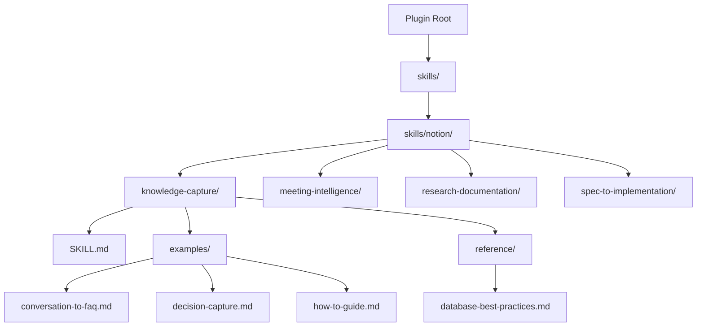
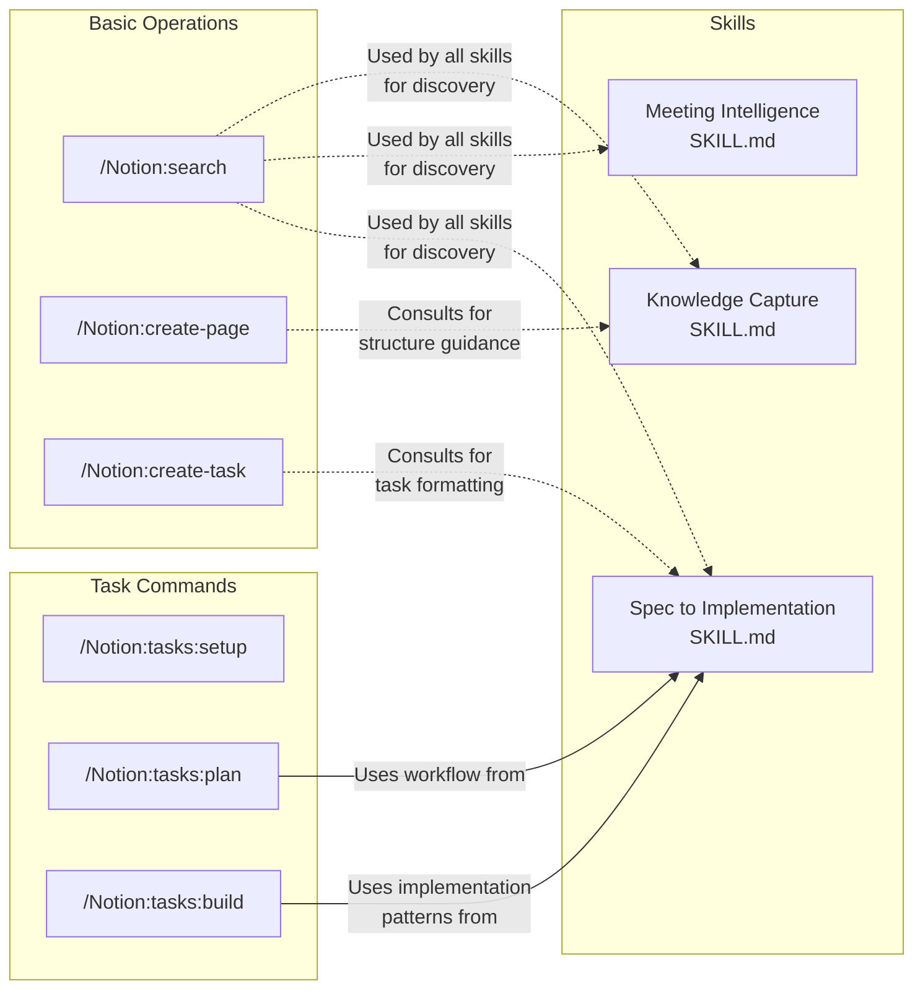
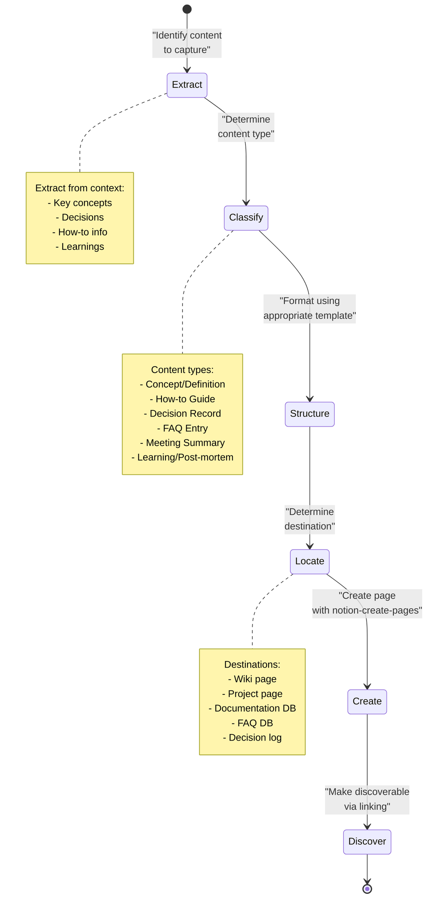
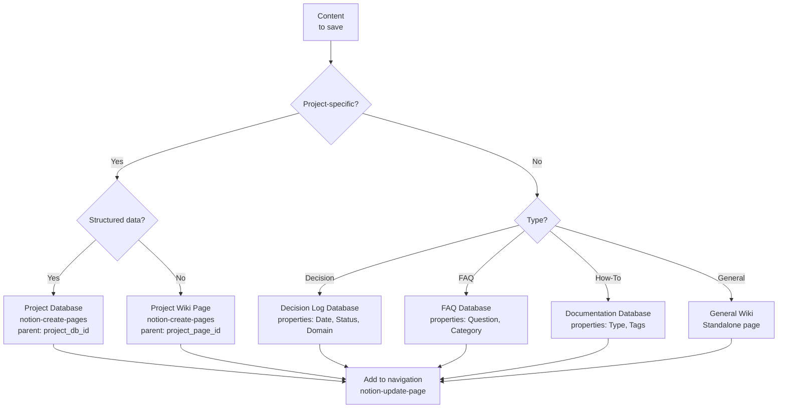

<!-- source: DeepWiki mcp.deepwiki.com · repo makenotion/claude-code-notion-plugin · page 6 Notion Skills · fetched 2026-10-26 -->

# Notion Skills

<details>
<summary>Relevant source files</summary>

The following files were used as context for generating this wiki page:

- [README.md](README.md)
- [skills/notion/knowledge-capture/SKILL.md](skills/notion/knowledge-capture/SKILL.md)

</details>


## Purpose and Scope

This document describes the Notion Skills bundled with the plugin and their role in guiding Claude's behavior when working with Notion workspaces. Skills are structured instruction files that teach Claude how to perform complex Notion workflows intelligently. For information about how to use specific commands that leverage these skills, see [Slash Commands Reference](#5). For the detailed workflow of the Knowledge Capture skill specifically, see [Knowledge Capture Skill](#6.1).

## What are Notion Skills?

Notion Skills are markdown-formatted instruction documents that provide Claude with domain-specific knowledge and procedural guidance for working with Notion. They function as an intelligence layer that sits between user commands and MCP tool execution. When executing slash commands or responding to user requests, Claude consults these skills to determine:

- Appropriate workflows and sequences of operations
- Content structuring patterns and templates
- Best practices for organizing information in Notion
- Decision criteria for routing content to appropriate destinations

Skills do not execute operations directly. Instead, they guide Claude's use of the Notion MCP tools ([skills/notion/knowledge-capture/SKILL.md:1-201]()).

## Architectural Role

**Notion Skills in the System Architecture**



Sources: [README.md:1-92](), Diagram 4 from high-level architecture

Skills serve as the "how-to" layer. While MCP tools provide the "what" (available operations), skills provide the "how" (intelligent sequences, decision trees, and best practices).

## Bundled Skills

The plugin includes four skills from the Notion Cookbook:

| Skill Name | File Location | Primary Purpose |
|------------|---------------|-----------------|
| **Knowledge Capture** | `skills/notion/knowledge-capture/` | Transform conversations and discussions into structured documentation pages with appropriate formatting and organization |
| **Meeting Intelligence** | `skills/notion/meeting-intelligence/` | Extract insights, action items, and decisions from meetings and format them for Notion |
| **Research Documentation** | `skills/notion/research-documentation/` | Structure research findings, sources, and synthesis into comprehensive Notion documents |
| **Spec to Implementation** | `skills/notion/spec-to-implementation/` | Guide the process of translating product/technical specifications into actionable implementation plans |

All skills are sourced from the Notion Cookbook and teach Claude how to "structure, write, summarize, capture, and maintain content" in Notion workspaces ([README.md:15-23]()).

## Skill File Structure

**Directory Organization**



Sources: [skills/notion/knowledge-capture/SKILL.md:1-201]()

Each skill directory contains:

- **SKILL.md**: The primary instruction document with frontmatter metadata
- **examples/**: Concrete workflow examples demonstrating skill application
- **reference/**: Supporting documentation such as database schemas and templates

### Skill Metadata Format

Each skill begins with YAML frontmatter defining its identity:

```yaml
---
name: notion-knowledge-capture
description: Transforms conversations and discussions into structured documentation pages in Notion. Captures insights, decisions, and knowledge from chat context, formats appropriately, and saves to wikis or databases with proper organization and linking for easy discovery.
---
```

This metadata allows Claude Code to index and reference skills appropriately ([skills/notion/knowledge-capture/SKILL.md:1-4]()).

## How Skills Guide Claude

**Skill Consultation Pattern**

```mermaid
sequenceDiagram
    participant User
    participant Claude
    participant Skill["Skill Document<br/>(e.g., SKILL.md)"]
    participant MCP["MCP Tools"]
    
    User->>Claude: "Save this decision to Notion"
    
    Claude->>Skill: "Consult workflow:<br/>What steps for decision capture?"
    Skill->>Claude: "1. Extract decision details<br/>2. Determine content type (Decision Record)<br/>3. Structure using Decision template<br/>4. Find destination (Decision Log DB)<br/>5. Create page with metadata<br/>6. Link from hub pages"
    
    Claude->>MCP: "notion-search: Find 'Decision Log'"
    MCP->>Claude: "database_id: abc123..."
    
    Claude->>MCP: "notion-create-pages:<br/>- parent: abc123<br/>- properties: Decision, Date, Status<br/>- content: [structured blocks]"
    MCP->>Claude: "page_id: xyz789..."
    
    Claude->>MCP: "notion-update-page:<br/>Add link to index page"
    
    Claude->>User: "Decision captured in Decision Log"
```

Sources: [skills/notion/knowledge-capture/SKILL.md:12-109](), [README.md:42-57]()

Skills provide Claude with:

1. **Step-by-step workflows**: Structured procedures for complex operations ([skills/notion/knowledge-capture/SKILL.md:20-109]())
2. **Decision criteria**: Logic for choosing between alternatives (e.g., "Create New" vs "Update Existing") ([skills/notion/knowledge-capture/SKILL.md:164-169]())
3. **Content templates**: Structured formats for different information types ([skills/notion/knowledge-capture/SKILL.md:110-119]())
4. **Destination patterns**: Rules for determining where content should be saved ([skills/notion/knowledge-capture/SKILL.md:120-132]())
5. **Best practices**: Guidelines for maintainability and discoverability ([skills/notion/knowledge-capture/SKILL.md:172-182]())

## Integration with Slash Commands

Slash commands leverage skills for intelligent behavior. The commands provide user-facing interfaces while skills provide the underlying intelligence.

**Command-Skill Interaction Patterns**



Sources: [README.md:42-57]()

For example, when a user executes `/Notion:create-page`, Claude may consult the Knowledge Capture skill to determine:

- How to structure the page content based on its type
- What properties to set if the page is in a database
- What parent page or database to use
- How to make the page discoverable through linking

## Skill Workflow Structure

The Knowledge Capture skill demonstrates the standard workflow pattern used across skills:

**Knowledge Capture Workflow Stages**



Sources: [skills/notion/knowledge-capture/SKILL.md:20-109]()

This six-stage pattern (Extract → Classify → Structure → Locate → Create → Discover) provides a reusable template that ensures comprehensive knowledge management.

## Content Type Classification

Skills define taxonomies for classifying content, which guides routing and formatting decisions:

| Content Type | Structure Pattern | Typical Destination |
|--------------|-------------------|---------------------|
| **Concept/Definition** | Overview → Definition → Characteristics → Examples → Use Cases → Related | General Wiki, Documentation Database |
| **How-To Guide** | Overview → Prerequisites → Steps → Verification → Troubleshooting → Related | Documentation Database, Project Wiki |
| **Decision Record** | Context → Decision → Rationale → Options → Consequences → Implementation | Decision Log Database |
| **FAQ Entry** | Short Answer → Detailed Explanation → Examples → When to Use → Related | FAQ Database |
| **Meeting Summary** | Attendees → Topics → Decisions → Action Items → Follow-ups | Project Page, Meeting Database |
| **Learning/Post-mortem** | What Happened → What Went Well → What Didn't → Root Causes → Actions | Team Wiki, Learning Database |

Sources: [skills/notion/knowledge-capture/SKILL.md:110-119]()

These classifications are used by Claude to automatically select appropriate templates and destinations.

## Destination Patterns

Skills define routing logic for different content types:

**Destination Decision Tree**



Sources: [skills/notion/knowledge-capture/SKILL.md:58-68](), [skills/notion/knowledge-capture/SKILL.md:120-132]()

The final linking step ensures content is "discoverable" by adding references from hub pages, index pages, or table of contents ([skills/notion/knowledge-capture/SKILL.md:81-109]()).

## Best Practices Embedded in Skills

Skills encode institutional knowledge and best practices:

### Formatting Standards

- Use `#` for title, `##` for sections, `###` for subsections consistently
- Start documents with an overview
- Use bullet points and keep paragraphs short
- Include concrete examples to aid understanding
- Add metadata (date, author, tags, status)

([skills/notion/knowledge-capture/SKILL.md:144-154]())

### Linking Strategy

- Link related pages to create a knowledge graph
- Mention people using Notion's mention syntax
- Reference external resources
- Create bidirectional links for related concepts

([skills/notion/knowledge-capture/SKILL.md:150]())

### Searchability Optimization

- Use clear, descriptive titles
- Include natural keywords in content
- Apply consistent tags across similar content
- Add alt-text to images

([skills/notion/knowledge-capture/SKILL.md:154]())

### Update Management

Skills provide decision criteria for when to create new content vs. update existing:

**Create New** when:
- Content is substantive (>2 paragraphs)
- Will be referenced multiple times
- Part of the knowledge base
- Needs independent discovery

**Update Existing** when:
- Adding to an existing topic
- Correcting information
- Expanding a concept
- Updating for changes

([skills/notion/knowledge-capture/SKILL.md:164-169]())

## Example-Based Learning

Skills include concrete examples demonstrating workflow application:

| Example File | Demonstrates |
|--------------|-------------|
| `examples/conversation-to-faq.md` | Extracting Q&A pairs from discussions and formatting as FAQ entries |
| `examples/decision-capture.md` | Documenting architectural or product decisions with rationale |
| `examples/how-to-guide.md` | Converting informal discussions into step-by-step procedures |

Sources: [skills/notion/knowledge-capture/SKILL.md:194-200]()

These examples provide Claude with concrete patterns to follow when encountering similar scenarios.

## Advanced Features

### Database Schema Patterns

Skills reference supporting documentation that defines database schema patterns for different use cases. For the Knowledge Capture skill, this includes:

- Documentation database schemas with properties for Title, Type, Category, Tags, Last Updated, Owner
- Decision log database schemas with properties for Decision, Date, Status, Domain, Deciders, Impact
- FAQ database schemas with properties for Question, Category, Tags, Last Reviewed, Useful Count

([skills/notion/knowledge-capture/SKILL.md:126-131](), [skills/notion/knowledge-capture/SKILL.md:185]())

### Troubleshooting Guidance

Skills include common issues and solutions:

| Issue | Resolution |
|-------|-----------|
| "Not sure where to save" | Default to general wiki, can move later |
| "Content is fragmentary" | Group related fragments into cohesive document |
| "Already exists" | Search first, update existing if appropriate |
| "Too informal" | Clean up language while preserving insights |

Sources: [skills/notion/knowledge-capture/SKILL.md:187-192]()

## Usage by Commands

Slash commands use skills implicitly during execution. When a user runs a command, Claude's context includes all loaded skills, allowing it to make intelligent decisions. For example:

- `/Notion:create-page` may consult Knowledge Capture for page structure
- `/Notion:tasks:plan` consults Spec to Implementation for task breakdown
- `/Notion:create-task` consults Meeting Intelligence for task formatting from meeting notes

The separation between commands (user interface) and skills (intelligence) allows skills to be reused across multiple commands and even in conversational interactions where no explicit command is used ([README.md:42-57]()).

---

