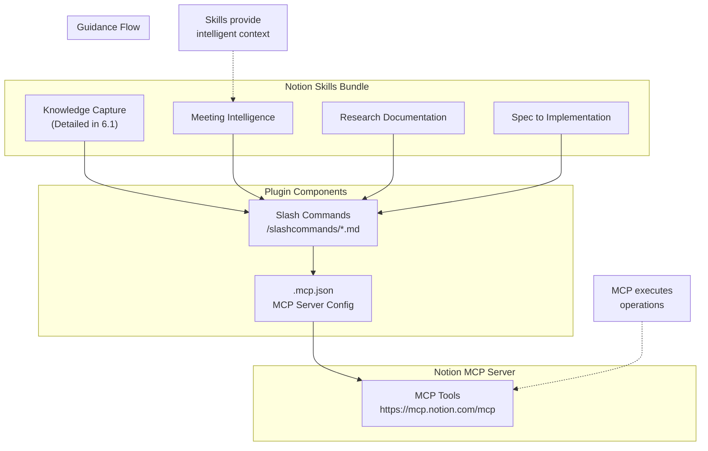
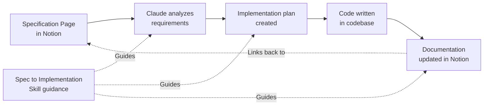
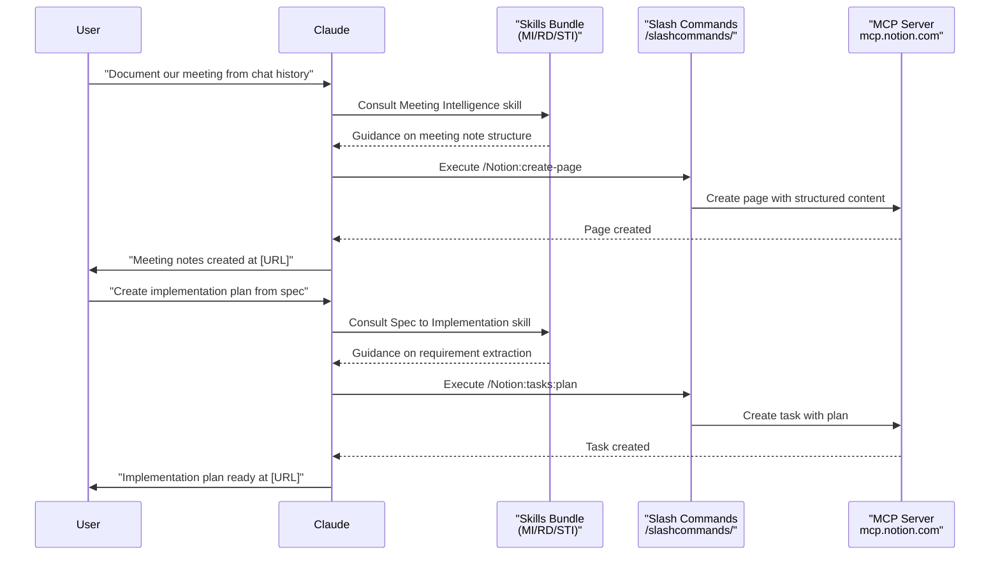
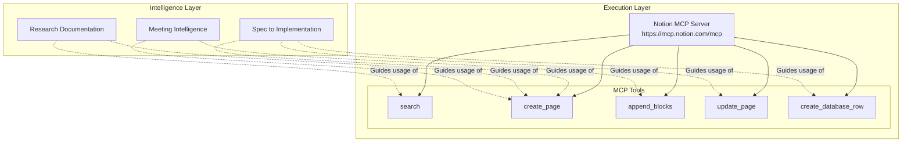

<!-- source: DeepWiki mcp.deepwiki.com · repo makenotion/claude-code-notion-plugin · page 6.2 Other Bundled Skills · fetched 2026-10-26 -->

# Other Bundled Skills

Relevant source files

The following files were used as context for generating this wiki page:

- [README.md](README.md)

## Purpose and Scope

This page documents the three additional Notion Skills bundled with the plugin: Meeting Intelligence, Research Documentation, and Spec to Implementation. These skills complement the Knowledge Capture skill and teach Claude how to structure, write, summarize, and maintain different types of content in Notion workspaces.

For detailed information about the Knowledge Capture skill and its workflow architecture, see [Knowledge Capture Skill](#6.1).

**Sources:** [README.md:16-23]()

---

## Skills Overview

The plugin includes four Notion Skills from the Notion Cookbook, three of which are covered in this document. These skills function as intelligent guidance systems that teach Claude how to work effectively within Notion's content model.

| Skill Name | Primary Function | Target Content Type |
|-----------|------------------|---------------------|
| **Meeting Intelligence** | Structure and capture meeting notes | Meeting notes, action items, decisions |
| **Research Documentation** | Organize research findings | Research pages, analysis documents |
| **Spec to Implementation** | Bridge specifications to code | Technical specifications, implementation plans |

All three skills follow the same architectural pattern as Knowledge Capture: they provide context and guidance to Claude rather than implementing direct functionality themselves. The actual Notion operations are performed through the MCP server connection.

**Sources:** [README.md:15-23]()

---

## Skill Integration Architecture

The following diagram illustrates how the three skills integrate with the plugin's core components and work alongside the Knowledge Capture skill:

**Diagram: Skills Integration with Plugin Components**

The skills are bundled in the plugin package and loaded when Claude Code initializes the plugin. They operate as passive knowledge resources that Claude consults when executing commands or responding to user requests involving Notion content.

**Sources:** [README.md:3-9](), [README.md:15-23]()

---

## Meeting Intelligence

### Purpose

The Meeting Intelligence skill teaches Claude how to structure meeting notes according to common meeting documentation patterns. This skill provides guidance on extracting action items, decisions, attendees, and discussion topics from conversational content and organizing them into structured Notion pages.

### Content Structure Guidance

Meeting Intelligence likely instructs Claude to recognize and extract:

- **Meeting metadata**: Date, time, attendees, duration
- **Agenda items**: Topics discussed in order
- **Action items**: Tasks with assignees and deadlines
- **Decisions**: Key conclusions or choices made
- **Follow-ups**: Items requiring future attention
- **Notes**: Discussion details and context

### Integration with Commands

This skill is leveraged by several slash commands:

| Command | Usage with Meeting Intelligence |
|---------|--------------------------------|
| `/Notion:create-page` | Creates structured meeting notes pages |
| `/Notion:create-task` | Extracts action items as tasks |
| `/Notion:create-database-row` | Adds meetings to a meetings database |

The skill guides Claude to identify meeting-related content from chat history and structure it appropriately when creating Notion pages.

**Sources:** [README.md:16-23](), [README.md:42-56]()

---

## Research Documentation

### Purpose

The Research Documentation skill provides Claude with patterns for organizing research findings, analysis, and investigative work into Notion pages. This skill teaches Claude how to structure research content with proper citations, methodology descriptions, findings summaries, and conclusions.

### Documentation Patterns

Research Documentation instructs Claude on organizing:

- **Research question or hypothesis**: Clear problem statement
- **Methodology**: Approach and sources used
- **Findings**: Data, observations, and analysis
- **Conclusions**: Summary and implications
- **References**: Citations and source links
- **Next steps**: Future research directions

### Use Cases

The skill is particularly valuable for:

1. **Technical investigation**: Documenting exploration of new technologies or frameworks
2. **Competitive analysis**: Structuring research on competitors or market trends
3. **Problem analysis**: Organizing findings from debugging or system investigation
4. **Learning documentation**: Capturing insights from studying new domains

### Command Integration

Research Documentation works with these commands to transform conversational research into structured pages:

- `/Notion:create-page`: Creates research documentation pages
- `/Notion:search`: Locates related existing research
- `/Notion:database-query`: Finds relevant databases for organizing research

**Sources:** [README.md:16-23](), [README.md:42-56]()

---

## Spec to Implementation

### Purpose

The Spec to Implementation skill bridges the gap between written specifications and actual code implementation. This skill teaches Claude how to track the relationship between Notion specification documents and the code that implements them, maintaining bidirectional traceability.

### Workflow Guidance

**Diagram: Spec to Implementation Workflow**

The skill provides guidance for:

- **Requirement extraction**: Identifying functional and non-functional requirements from specs
- **Implementation planning**: Breaking specs into implementable tasks
- **Progress tracking**: Maintaining status of spec implementation
- **Documentation updates**: Recording implementation decisions and changes back to Notion
- **Traceability**: Linking code changes to their originating specifications

### Integration with Task Management

Spec to Implementation works closely with the task management commands:

| Task Command | Spec to Implementation Role |
|-------------|----------------------------|
| `/Notion:tasks:plan` | Extracts requirements from spec pages to create task plans |
| `/Notion:tasks:build` | Maintains context about original specification during implementation |
| `/Notion:tasks:explain-diff` | Documents how code changes fulfill spec requirements |

The skill ensures that when Claude builds tasks from Notion pages containing specifications, it maintains awareness of the original requirements throughout the implementation process.

**Sources:** [README.md:16-23](), [README.md:52-55]()

---

## Skill Interaction Patterns

The following diagram shows how these three skills work together with Claude Code's execution flow:

**Diagram: Skill Consultation During Command Execution**

This interaction pattern demonstrates that skills are consulted during the planning phase of command execution, before any MCP server calls are made. The skills shape Claude's understanding of what content to create and how to structure it.

**Sources:** [README.md:3-9](), [README.md:42-57]()

---

## Common Skill Architecture

### Passive Knowledge Pattern

All three skills follow the same architectural pattern as Knowledge Capture:

1. **No direct execution**: Skills do not call MCP tools themselves
2. **Guidance provision**: Skills teach Claude patterns through examples and instructions
3. **Context enhancement**: Skills improve Claude's understanding of Notion content models
4. **Command amplification**: Skills make slash commands more intelligent by providing domain knowledge

### Skill Loading

Skills are loaded during plugin initialization:

1. Plugin installed via `/plugin install notion-workspace-plugin@notion-plugin-marketplace`
2. Claude Code restart required [README.md:76-77]()
3. Skills loaded into Claude's context as part of plugin bundle
4. Skills available for consultation throughout session

### Content Structure Templates

Each skill provides Claude with template patterns for different content types:

| Skill | Template Types | Typical Properties |
|-------|---------------|-------------------|
| Meeting Intelligence | Meeting notes, action items | Date, Attendees, Status, Priority |
| Research Documentation | Research pages, findings | Source, Date, Tags, Status |
| Spec to Implementation | Specs, implementation docs | Requirements, Status, Implementation notes |

These templates guide Claude in creating consistent, well-structured Notion pages that follow organizational best practices.

**Sources:** [README.md:15-23](), [README.md:3-9]()

---

## Skills and MCP Server Relationship

**Diagram: Skills Guide MCP Tool Usage**

The dashed arrows indicate that skills provide contextual guidance for how to use MCP tools, but do not invoke them directly. The MCP server at `https://mcp.notion.com/mcp` provides the actual execution capabilities for interacting with Notion's API.

**Sources:** [README.md:25-40](), [README.md:15-23]()

---

## Skill Distribution

The skills are packaged as part of the plugin distribution:

- **Source**: Notion Cookbook [README.md:89]()
- **Packaging**: Bundled in `notion-workspace-plugin` package
- **Installation**: Automatic via plugin marketplace [README.md:61-74]()
- **Updates**: Distributed with plugin version updates

The bundling approach ensures users receive a tested, integrated set of skills that work cohesively with the slash commands and MCP server configuration.

**Sources:** [README.md:3-9](), [README.md:15-23](), [README.md:61-74]()

---

