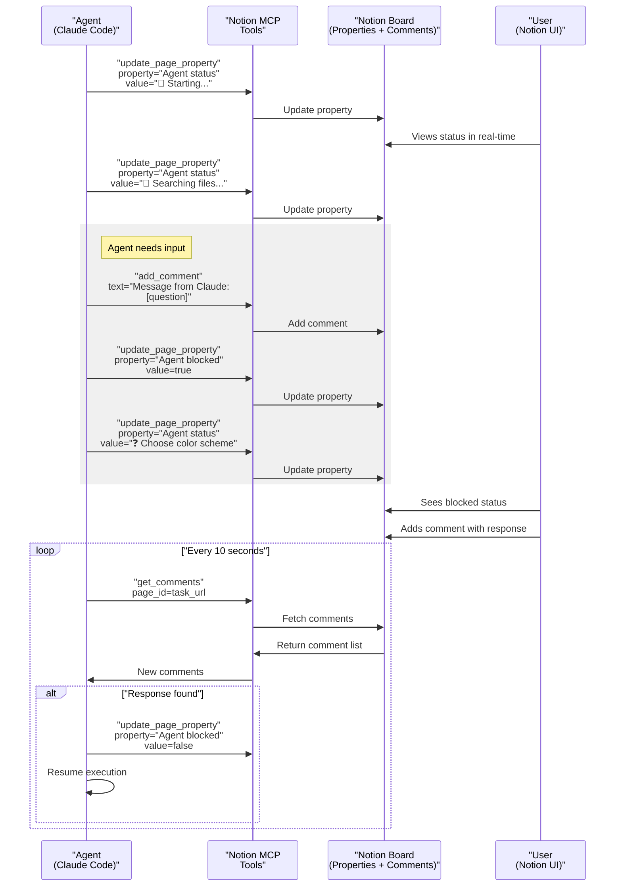
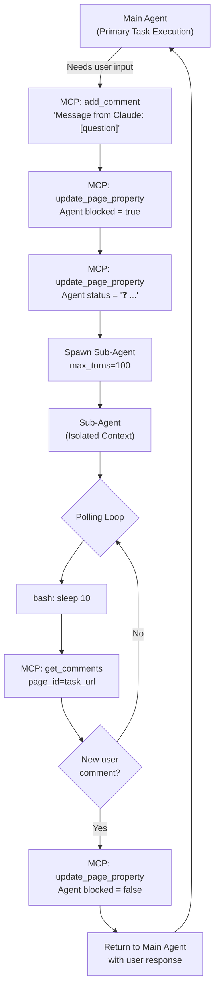
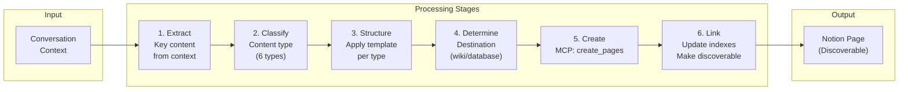
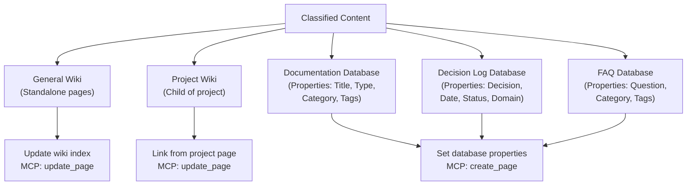
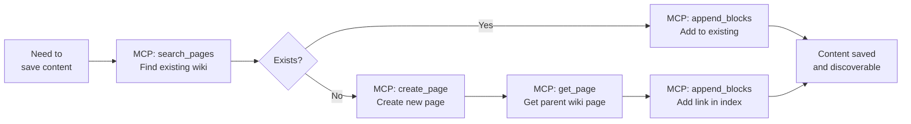
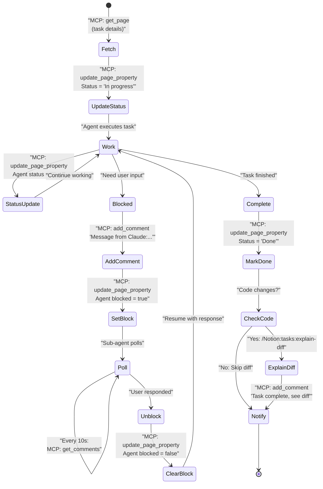

<!-- source: DeepWiki mcp.deepwiki.com · repo makenotion/claude-code-notion-plugin · page 7 Advanced Topics · fetched 2026-10-26 -->

# Advanced Topics

<details>
<summary>Relevant source files</summary>

The following files were used as context for generating this wiki page:

- [commands/tasks/build.md](commands/tasks/build.md)
- [skills/notion/knowledge-capture/SKILL.md](skills/notion/knowledge-capture/SKILL.md)

</details>


This page covers advanced usage patterns, implementation details, and power-user workflows for the Notion plugin. These topics assume familiarity with basic plugin operations. For introductory command usage, see [Slash Commands Reference](#5). For task management basics, see [Task Management Workflow](#4).

The material here focuses on:
- How the agent-user communication protocol works under the hood
- Polling mechanisms and sub-agent architecture (detailed in [Agent Polling and Sub-Agents](#7.1))
- Knowledge capture implementation patterns (detailed in [Knowledge Capture Workflows](#7.2))
- Context management strategies
- Advanced MCP tool usage patterns

## Communication Protocol Implementation

The task management commands (`/Notion:tasks:plan` and `/Notion:tasks:build`) implement an asynchronous communication pattern where Notion itself serves as the message bus between agent and user. This allows users to monitor progress without watching the Claude Code session.

### Protocol Flow



**Sources:** [commands/tasks/build.md:36-48]()

### Required Notion Properties

The communication protocol requires specific properties on the task board:

| Property Name | Type | Purpose | Values |
|--------------|------|---------|--------|
| `Status` | Select/Status | Overall task state | "Planning", "In progress", "Done" |
| `Agent status` | Text | Real-time agent activity | Emoji + brief description |
| `Agent blocked` | Checkbox | Indicates agent awaiting input | `true` when blocked, `false` otherwise |

The [/Notion:tasks:setup](#4.1) command creates these properties automatically.

**Sources:** [commands/tasks/build.md:22-23](), [commands/tasks/build.md:41]()

### Status Update Patterns

The `Agent status` field follows a consistent convention of emoji prefix followed by brief description:

```
Working states:
- "🤖 Starting..."
- "📂 Searching relevant files..."
- "✍️ Writing plan..."
- "🎨 Updating color scheme..."
- "🧪 Running tests..."

Blocked states:
- "❓ Choose a color scheme"
- "❓ Give architecture feedback"
- "❓ Clarify requirement"
```

These updates occur throughout task execution via repeated `update_page_property` MCP calls to the same property.

**Sources:** [commands/tasks/build.md:23](), [commands/tasks/build.md:27](), [commands/tasks/build.md:41]()

## Sub-Agent Architecture for Polling

To prevent context pollution during long-running tasks, the polling mechanism uses a sub-agent pattern. This architectural decision isolates the repetitive polling operations from the main agent's context.

### Polling Implementation Strategy



**Sources:** [commands/tasks/build.md:44-47]()

### Sub-Agent Configuration

The polling sub-agent uses specific parameters:

- **max_turns=100**: Allows up to 100 polling cycles (1000 seconds / ~16.7 minutes)
- **Interleaved operations**: Bash `sleep` commands between MCP `get_comments` calls
- **Context isolation**: Polling history doesn't pollute parent agent's token window

**Implementation pattern:**
```
1. Main agent triggers sub-agent for polling
2. Sub-agent executes: sleep 10 → get_comments → check for response
3. Loop continues until user responds or max_turns reached
4. Sub-agent returns control with user response
5. Main agent continues with response data
```

**Sources:** [commands/tasks/build.md:46-47]()

## Knowledge Capture Architecture

The Knowledge Capture skill ([skills/notion/knowledge-capture/SKILL.md:1-201]()) implements a six-stage pipeline that transforms conversational content into structured Notion documentation.

### Knowledge Capture Pipeline



**Sources:** [skills/notion/knowledge-capture/SKILL.md:20-108]()

### Content Type Classification

The system recognizes six content types, each with specific structure:

| Content Type | Template Structure | Typical Use Case |
|--------------|-------------------|------------------|
| Concept/Definition | Overview → Definition → Characteristics → Examples → Use Cases → Related | Explaining technical terms |
| How-To Guide | Overview → Prerequisites → Steps → Verification → Troubleshooting → Related | Process documentation |
| Decision Record | Context → Decision → Rationale → Options Considered → Consequences → Implementation | Architecture decisions |
| FAQ Entry | Short Answer → Detailed Explanation → Examples → When to Use → Related Questions | Common questions |
| Meeting Summary | Context → Discussion → Decisions → Action Items | Meeting notes |
| Learning/Post-mortem | What Happened → What Went Well → What Didn't → Root Causes → Learnings → Actions | Retrospectives |

**Sources:** [skills/notion/knowledge-capture/SKILL.md:34-45](), [skills/notion/knowledge-capture/SKILL.md:112-119]()

### Destination Routing Patterns

Content is routed to different Notion structures based on type and organizational needs:



**Sources:** [skills/notion/knowledge-capture/SKILL.md:59-68](), [skills/notion/knowledge-capture/SKILL.md:120-131]()

## Context Management Strategies

Long-running agent sessions accumulate context tokens. The plugin employs several strategies to manage context efficiently.

### Context Pollution Prevention

| Strategy | Implementation | Benefit |
|----------|---------------|---------|
| Sub-agent polling | Isolate polling loops in sub-agents with `max_turns=100` | Main agent context stays clean |
| Status field updates | Use same property repeatedly instead of creating new content | Constant memory footprint |
| Comment-based communication | User responses via Notion comments, not chat messages | Context growth controlled |
| Periodic status snapshots | Agent status field shows current state only | No history accumulation |

**Sources:** [commands/tasks/build.md:46]()

### MCP Tool Call Patterns

Efficient MCP usage reduces context bloat:

**Pattern 1: Batch property updates**
```
Instead of:
  update_page_property(status)
  update_page_property(blocked)
  update_page_property(agent_status)

Use single call when possible:
  update_page_properties(status, blocked, agent_status)
```

**Pattern 2: Targeted content fetching**
```
Instead of:
  get_page(full_content=true)

Use:
  get_page_properties(specific_props=['Status', 'Agent blocked'])
```

**Pattern 3: Comment pagination**
```
Use:
  get_comments(page_id, limit=10, since_last_poll=true)

Avoid:
  get_comments(page_id, full_history=true)
```

**Sources:** [commands/tasks/build.md:16-19]()

## Advanced MCP Tool Combinations

Certain workflows benefit from chaining MCP tools in specific sequences.

### Search → Create → Link Pattern

Common pattern for knowledge capture:



**Sources:** [skills/notion/knowledge-capture/SKILL.md:82-108]()

### Query → Filter → Bulk Update Pattern

For database operations:

```
1. database_query(database_id, filters={...})
   → Returns matching pages
   
2. For each page:
   update_page_property(page_id, property, value)
   
3. Optional: add_comment to notify users of bulk change
```

This pattern is useful for task board management, status migrations, and bulk property updates.

**Sources:** [commands/tasks/build.md:16-23]()

### Task Execution Lifecycle

The complete task execution lifecycle combines multiple patterns:



**Sources:** [commands/tasks/build.md:15-34]()

## Best Practices Summary

| Practice | Rationale | Implementation |
|----------|-----------|----------------|
| Use sub-agents for polling | Prevents context pollution | Set `max_turns=100`, isolate polling logic |
| Update same status field | Constant memory usage | Repeatedly call `update_page_property` on `Agent status` |
| Comment-based communication | Out-of-band messaging | Use `add_comment` + poll pattern |
| Emoji conventions | Visual clarity for users | Consistent emoji prefixes in status updates |
| Targeted property fetches | Reduce payload size | Fetch only needed properties |
| Link after creation | Ensure discoverability | Update parent/index pages after creating content |

**Sources:** [commands/tasks/build.md:1-52](), [skills/notion/knowledge-capture/SKILL.md:172-182]()

---

