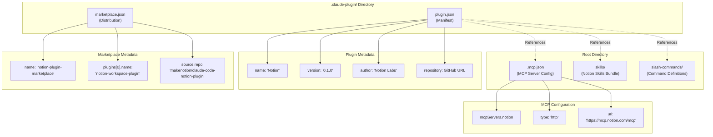
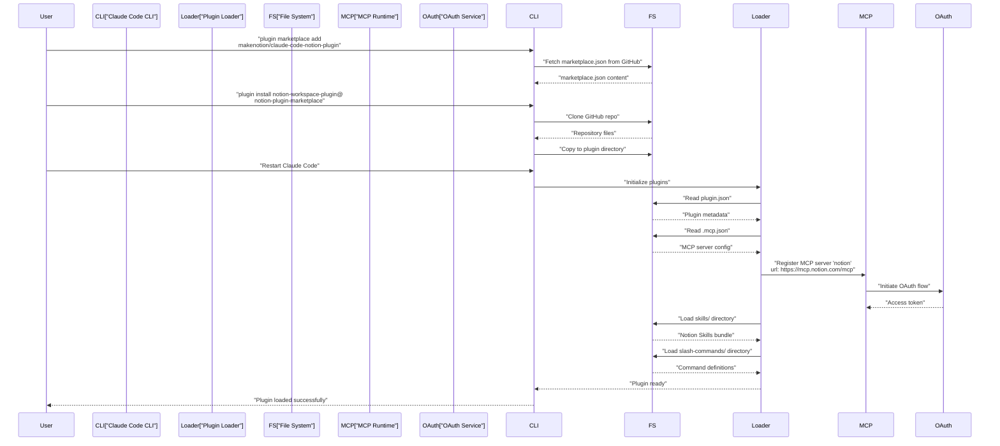
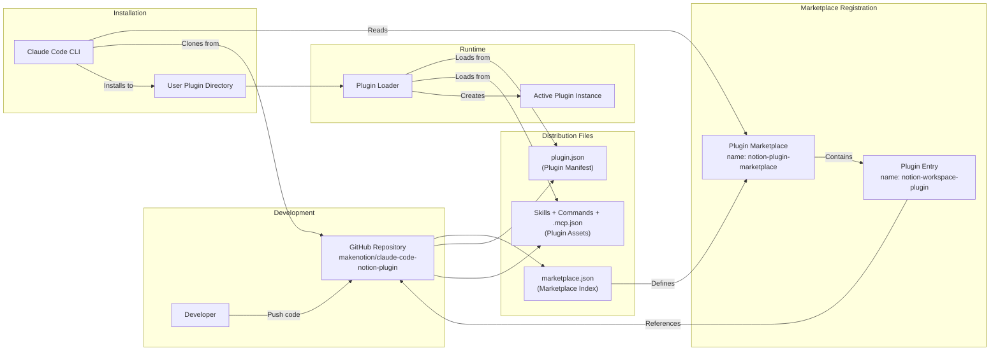

<!-- source: DeepWiki mcp.deepwiki.com · repo makenotion/claude-code-notion-plugin · page 8 Plugin Development · fetched 2026-10-26 -->

# Plugin Development

<details>
<summary>Relevant source files</summary>

The following files were used as context for generating this wiki page:

- [.claude-plugin/marketplace.json](.claude-plugin/marketplace.json)
- [.claude-plugin/plugin.json](.claude-plugin/plugin.json)
- [.mcp.json](.mcp.json)

</details>


This document provides technical information for developers who want to understand, modify, or extend the Notion Plugin for Claude Code. It covers the plugin's file structure, configuration files, component organization, and distribution mechanism.

For detailed information on the plugin manifest format, see [Plugin Manifest Structure](#8.1). For information on marketplace distribution, see [Marketplace Distribution](#8.2). For installation procedures from a user perspective, see [Installation](#2.1).

## Plugin Architecture Overview

The Notion Plugin is a packaged bundle that integrates with Claude Code's plugin system. It consists of three primary component types distributed as a cohesive unit: Notion Skills (bundled AI guidance), Slash Commands (executable user actions), and an MCP Server configuration (external service connection).

### File Structure

The plugin follows Claude Code's standard plugin directory structure:

```
.claude-plugin/
├── plugin.json              # Plugin manifest and metadata
├── marketplace.json         # Marketplace listing configuration
└── (other plugin assets)

.mcp.json                   # MCP server connection config
skills/                     # Notion Skills bundle
slash-commands/             # Command definitions
```

**Sources:** [.claude-plugin/plugin.json:1-12](), [.claude-plugin/marketplace.json:1-18](), [.mcp.json:1-9]()

### Component Mapping



This diagram maps the physical file structure to the logical plugin components. The `.claude-plugin/` directory contains metadata files that describe the plugin itself (`plugin.json`) and how it should be listed in the marketplace (`marketplace.json`). The root directory contains the actual functional components that Claude Code loads at runtime.

**Sources:** [.claude-plugin/plugin.json:1-12](), [.claude-plugin/marketplace.json:1-18](), [.mcp.json:1-9]()

## Core Configuration Files

### Plugin Manifest (plugin.json)

The `plugin.json` file is the primary metadata descriptor located at [.claude-plugin/plugin.json:1-12](). It defines essential plugin properties:

| Field | Type | Purpose |
|-------|------|---------|
| `name` | string | Plugin display name ("Notion") |
| `version` | string | Semantic version identifier ("0.1.0") |
| `description` | string | Human-readable plugin description |
| `author.name` | string | Author organization ("Notion Labs") |
| `author.url` | string | Author website URL |
| `repository` | string | GitHub repository URL for source code |
| `license` | string | License type ("MIT") |

This manifest does not explicitly enumerate the plugin's components (skills, commands, MCP servers). Claude Code discovers these through directory conventions and file patterns.

**Sources:** [.claude-plugin/plugin.json:1-12]()

### Marketplace Configuration (marketplace.json)

The `marketplace.json` file at [.claude-plugin/marketplace.json:1-18]() configures marketplace distribution:

```json
{
  "name": "notion-plugin-marketplace",
  "owner": { ... },
  "plugins": [
    {
      "name": "notion-workspace-plugin",
      "description": "...",
      "source": {
        "source": "github",
        "repo": "makenotion/claude-code-notion-plugin"
      }
    }
  ]
}
```

Key fields:
- **`name`**: Marketplace identifier (`notion-plugin-marketplace`)
- **`owner`**: Marketplace owner metadata
- **`plugins[]`**: Array of plugin entries available in this marketplace
- **`plugins[].name`**: Plugin package name (`notion-workspace-plugin`)
- **`plugins[].source.source`**: Distribution source type (`github`)
- **`plugins[].source.repo`**: GitHub repository path

**Sources:** [.claude-plugin/marketplace.json:1-18]()

### MCP Server Configuration (.mcp.json)

The `.mcp.json` file at [.mcp.json:1-9]() defines external MCP server connections:

```json
{
  "mcpServers": {
    "notion": {
      "type": "http",
      "url": "https://mcp.notion.com/mcp"
    }
  }
}
```

Configuration properties:
- **`mcpServers`**: Object mapping server names to configurations
- **`mcpServers.notion`**: Server identifier used in tool calls
- **`type`**: Connection type (`http` for remote servers)
- **`url`**: Endpoint URL for the MCP server

This configuration establishes a persistent connection to Notion's hosted MCP server, which handles OAuth authentication and provides Notion API operations as MCP tools.

**Sources:** [.mcp.json:1-9]()

## Plugin Lifecycle



This sequence diagram illustrates the complete plugin initialization lifecycle, highlighting the critical restart requirement. The MCP server connection cannot be established during installation; it requires Claude Code's plugin initialization phase to register the server and complete OAuth authentication. Skills and slash commands are loaded after MCP server registration completes.

**Sources:** [.claude-plugin/plugin.json:1-12](), [.claude-plugin/marketplace.json:1-18](), [.mcp.json:1-9]()

## Component Discovery

Claude Code uses convention-based discovery to locate plugin components:

| Component Type | Discovery Method | Example |
|----------------|------------------|---------|
| Plugin Manifest | Fixed location: `.claude-plugin/plugin.json` | [.claude-plugin/plugin.json:1-12]() |
| MCP Servers | Fixed location: `.mcp.json` in plugin root | [.mcp.json:1-9]() |
| Skills | Directory scan: `skills/` directory with `.md` files | `skills/knowledge-capture SKILL.md` |
| Slash Commands | Directory scan: `slash-commands/` directory | `slash-commands/tasks/build.md` |
| Marketplace Config | Fixed location: `.claude-plugin/marketplace.json` | [.claude-plugin/marketplace.json:1-18]() |

This convention-based approach means developers do not need to explicitly register components in the manifest. Adding a new skill requires only placing a properly formatted `.md` file in the `skills/` directory. Similarly, new commands are discovered automatically from the `slash-commands/` directory structure.

**Sources:** [.claude-plugin/plugin.json:1-12](), [.mcp.json:1-9](), [.claude-plugin/marketplace.json:1-18]()

## Distribution Model



The distribution model follows a GitHub-based marketplace pattern. The `marketplace.json` file acts as an index that points to the GitHub repository. When users install the plugin, Claude Code clones the repository and copies files to the user's plugin directory. This approach enables version control, collaborative development, and straightforward updates.

**Sources:** [.claude-plugin/marketplace.json:1-18](), [.claude-plugin/plugin.json:1-12]()

## Plugin Versioning

The plugin uses semantic versioning defined in [.claude-plugin/plugin.json:3](). The current version is `"0.1.0"`, indicating:

- **Major version (0)**: Pre-1.0 development phase, API may change
- **Minor version (1)**: Feature additions and enhancements
- **Patch version (0)**: Bug fixes and minor updates

Version updates should follow semantic versioning conventions. Breaking changes to the plugin API, skill interfaces, or command signatures require a major version increment. New features or non-breaking enhancements increment the minor version. Bug fixes increment the patch version.

**Sources:** [.claude-plugin/plugin.json:3]()

## Development Guidelines

### Adding Components

To extend the plugin with new functionality:

1. **New Skills**: Add `.md` files to `skills/` directory following the Notion Skills format
2. **New Commands**: Add command definition files to `slash-commands/` directory with appropriate subdirectories for organization
3. **MCP Tool Access**: All Notion API operations should route through the MCP server defined in `.mcp.json` rather than direct API calls

### Modifying Configuration

Configuration changes require different approaches:

| Configuration | File | Update Process |
|---------------|------|----------------|
| Plugin metadata | `.claude-plugin/plugin.json` | Update and increment version |
| Marketplace listing | `.claude-plugin/marketplace.json` | Update marketplace entry; users see changes on next marketplace sync |
| MCP server endpoint | `.mcp.json` | Update URL; requires plugin reinstall/restart |

### Repository Structure Requirements

The GitHub repository must maintain the expected structure for Claude Code's plugin loader:

- `.claude-plugin/plugin.json` must exist at repository root
- `.mcp.json` must exist at repository root (if MCP servers are used)
- `skills/` directory for skill bundles
- `slash-commands/` directory for command definitions

Deviating from this structure will cause plugin loading failures.

**Sources:** [.claude-plugin/plugin.json:1-12](), [.mcp.json:1-9](), [.claude-plugin/marketplace.json:1-18]()

## Security Considerations

### OAuth Flow

The plugin relies on the MCP server at `https://mcp.notion.com/mcp` for OAuth authentication. The access token is managed by the MCP runtime, not stored in the plugin configuration. This separation ensures:

1. Credentials are not committed to the plugin repository
2. Token refresh is handled by the MCP server infrastructure
3. Users authorize per-installation, not per-plugin-version

### Marketplace Trust Model

The marketplace configuration points directly to a GitHub repository. Users trust:

1. The marketplace owner (`"Notion Labs, Inc."`)
2. The GitHub repository owner (`makenotion`)
3. The code in the repository at install time

No cryptographic verification occurs beyond GitHub's own authentication. Plugin updates require explicit user action (reinstall).

**Sources:** [.mcp.json:4-5](), [.claude-plugin/marketplace.json:3-6]()

## Extension Points

The plugin architecture provides several extension points for developers:

### Custom MCP Servers

Developers can add additional MCP servers by extending `.mcp.json`:

```json
{
  "mcpServers": {
    "notion": {
      "type": "http",
      "url": "https://mcp.notion.com/mcp"
    },
    "custom-server": {
      "type": "http",
      "url": "https://custom.example.com/mcp"
    }
  }
}
```

Commands and skills can then reference tools from both servers.

### Skill Composition

Skills in the `skills/` directory can reference and build upon each other. The Knowledge Capture skill, for example, can be extended with additional content type classifiers or destination patterns by adding new skill files that complement the existing structure.

### Command Hierarchies

The `slash-commands/` directory supports hierarchical organization through subdirectories. The `tasks/` subdirectory groups related task management commands, demonstrating a pattern that can be replicated for other command families.

**Sources:** [.mcp.json:1-9]()

---

