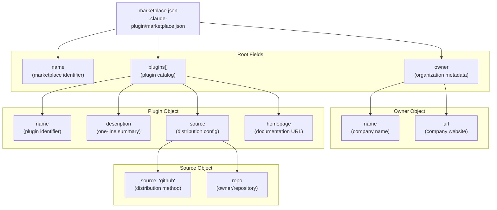
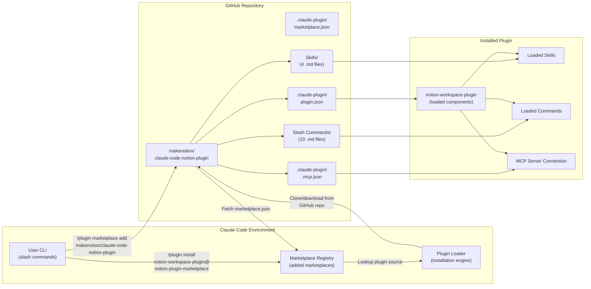
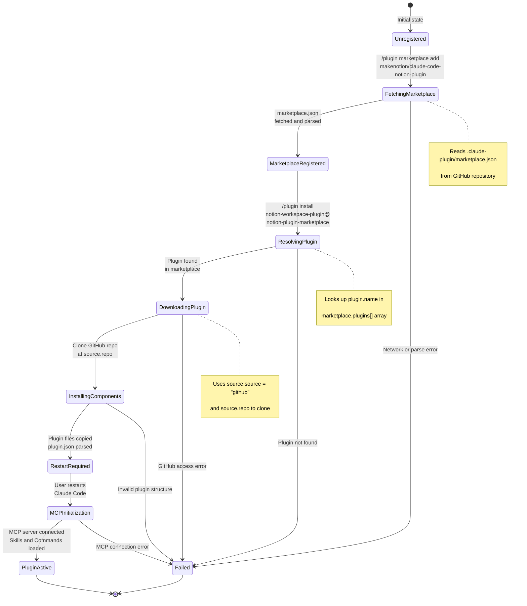
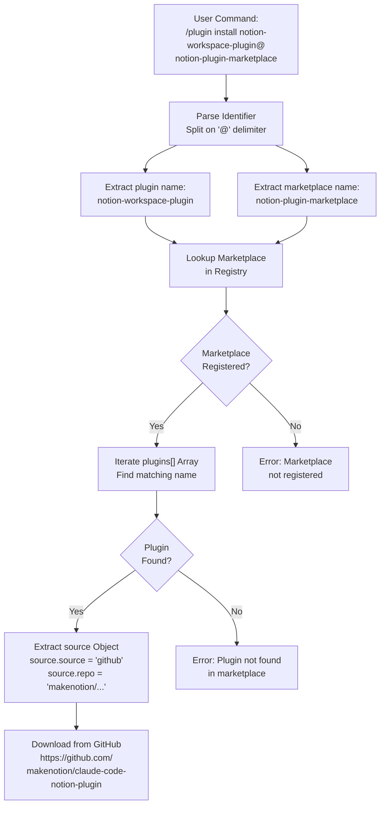

<!-- source: DeepWiki mcp.deepwiki.com · repo makenotion/claude-code-notion-plugin · page 8.2 Marketplace Distribution · fetched 2026-10-26 -->

# Marketplace Distribution

<details>
<summary>Relevant source files</summary>

The following files were used as context for generating this wiki page:

- [.claude-plugin/marketplace.json](.claude-plugin/marketplace.json)
- [README.md](README.md)

</details>


This page explains the Claude Code plugin marketplace system and how the Notion Plugin is distributed to users. It covers the marketplace manifest structure, plugin discovery mechanism, and the GitHub-based distribution model that enables one-click installation of plugins.

For information about the plugin manifest itself, see [Plugin Manifest Structure](#8.1). For installation steps from a user perspective, see [Installation](#2.1).

---

## Overview

The Claude Code plugin marketplace provides a decentralized distribution mechanism where plugin authors can publish marketplace metadata that points to GitHub repositories containing plugin packages. Users add marketplaces by reference, then install specific plugins from those marketplaces using command-line syntax.

The Notion Plugin uses this marketplace system to distribute its bundled components (Skills, Slash Commands, and MCP Server configuration) as a single installable package.

**Sources:** [README.md:1-92](), [.claude-plugin/marketplace.json:1-18]()

---

## Marketplace Manifest Structure

### File Location and Purpose

The marketplace manifest is located at `.claude-plugin/marketplace.json` in the plugin repository. This file defines the marketplace identity, ownership information, and lists all plugins available in the marketplace.

**Sources:** [.claude-plugin/marketplace.json:1-18]()

### Manifest Schema



**Diagram: Marketplace Manifest Schema**

The manifest follows a three-level hierarchy where the marketplace contains metadata and a catalog of plugins, each plugin defines its identity and source location, and the source object specifies the distribution mechanism.

**Sources:** [.claude-plugin/marketplace.json:1-18]()

### Field Reference

| Field Path | Type | Purpose | Example Value |
|------------|------|---------|---------------|
| `name` | string | Unique marketplace identifier | `"notion-plugin-marketplace"` |
| `owner.name` | string | Organization name for attribution | `"Notion Labs, Inc."` |
| `owner.url` | string | Organization homepage | `"https://www.notion.so"` |
| `plugins[]` | array | List of available plugins | Array of plugin objects |
| `plugins[].name` | string | Plugin identifier used in install commands | `"notion-workspace-plugin"` |
| `plugins[].description` | string | Brief description shown to users | `"One-click install for..."` |
| `plugins[].source.source` | string | Distribution method | `"github"` |
| `plugins[].source.repo` | string | GitHub repository path | `"makenotion/claude-code-notion-plugin"` |
| `plugins[].homepage` | string | Plugin documentation URL | `"https://www.notion.so"` |

**Sources:** [.claude-plugin/marketplace.json:1-18]()

### Notion Plugin Marketplace Configuration

```json
{
    "name": "notion-plugin-marketplace",
    "owner": {
      "name": "Notion Labs, Inc.",
      "url": "https://www.notion.so"
    },
    "plugins": [
      {
        "name": "notion-workspace-plugin",
        "description": "One-click install for Notion Skills + Notion MCP server.",
        "source": {
          "source": "github",
          "repo": "makenotion/claude-code-notion-plugin"
        },
        "homepage": "https://www.notion.so"
      }
    ]
  }
```

The Notion marketplace defines a single plugin entry that points to the GitHub repository containing all plugin components.

**Sources:** [.claude-plugin/marketplace.json:1-18]()

---

## Distribution Architecture

### GitHub-Based Distribution Model



**Diagram: GitHub-Based Distribution Flow**

The distribution model uses GitHub as the canonical source. Claude Code fetches the marketplace manifest from the repository, registers it locally, then downloads the complete plugin package during installation.

**Sources:** [README.md:63-78](), [.claude-plugin/marketplace.json:1-18]()

---

## Plugin Discovery and Installation

### Command Sequence

The installation process follows a two-step command sequence:

1. **Marketplace Registration:** `/plugin marketplace add makenotion/claude-code-notion-plugin`
2. **Plugin Installation:** `/plugin install notion-workspace-plugin@notion-plugin-marketplace`

The first command registers the marketplace by fetching `marketplace.json` from the GitHub repository. The second command uses the marketplace identifier (`notion-plugin-marketplace`) to locate the plugin entry (`notion-workspace-plugin`) and initiate installation.

**Sources:** [README.md:63-74]()

### Installation State Machine



**Diagram: Plugin Installation State Machine**

The installation process transitions through distinct states, with error paths at each network or parsing step. The restart requirement between installation and activation is mandatory for MCP server initialization.

**Sources:** [README.md:63-78]()

---

## Marketplace Reference Resolution

### Identifier Syntax

The plugin installation command uses a composite identifier: `<plugin-name>@<marketplace-name>`.

For the Notion Plugin:
- Plugin name: `notion-workspace-plugin` (from `marketplace.json` `plugins[].name`)
- Marketplace name: `notion-plugin-marketplace` (from `marketplace.json` `name`)
- Full identifier: `notion-workspace-plugin@notion-plugin-marketplace`

This syntax allows Claude Code to support multiple marketplaces while disambiguating plugins with identical names across different marketplaces.

**Sources:** [README.md:72-74](), [.claude-plugin/marketplace.json:2,9]()

### Resolution Algorithm



**Diagram: Marketplace Reference Resolution**

The resolution algorithm parses the compound identifier, validates marketplace registration, searches the plugin catalog, and extracts distribution configuration. This enables Claude Code to deterministically locate and download plugin packages.

**Sources:** [README.md:72-74](), [.claude-plugin/marketplace.json:1-18]()

---

## Distribution Metadata

### Ownership and Attribution

The `owner` object in `marketplace.json` provides attribution information displayed to users during installation:

```json
"owner": {
  "name": "Notion Labs, Inc.",
  "url": "https://www.notion.so"
}
```

This metadata ensures users can verify the plugin source and access vendor documentation.

**Sources:** [.claude-plugin/marketplace.json:3-6]()

### Plugin Description

The `description` field provides a concise summary shown in marketplace listings:

```json
"description": "One-click install for Notion Skills + Notion MCP server."
```

This description communicates the plugin's value proposition and bundled components.

**Sources:** [.claude-plugin/marketplace.json:10]()

### Homepage Link

The `homepage` field directs users to plugin documentation:

```json
"homepage": "https://www.notion.so"
```

This link appears in installation prompts and plugin management interfaces.

**Sources:** [.claude-plugin/marketplace.json:15]()

---

## Decentralized Distribution Model

The Claude Code marketplace system implements a decentralized distribution model where:

1. **No central registry exists:** Marketplaces are referenced by GitHub repository paths
2. **Authors control distribution:** Plugin authors maintain their own `marketplace.json` files
3. **Multiple marketplaces coexist:** Users can add multiple marketplaces simultaneously
4. **Direct GitHub integration:** No intermediary hosting infrastructure required

This architecture reduces infrastructure dependencies while maintaining user control over plugin sources. Users explicitly add marketplaces they trust, and plugin resolution occurs through registered marketplace metadata.

**Sources:** [README.md:63-68](), [.claude-plugin/marketplace.json:1-18]()

---

## Relationship to Plugin Manifest

The marketplace manifest (`marketplace.json`) serves a different purpose than the plugin manifest (`plugin.json`):

| Aspect | marketplace.json | plugin.json |
|--------|------------------|-------------|
| **Purpose** | Catalog plugins for discovery | Define plugin contents and metadata |
| **Scope** | Marketplace-level | Plugin-level |
| **Location** | `.claude-plugin/marketplace.json` | `.claude-plugin/plugin.json` |
| **Referenced by** | `/plugin marketplace add` command | Plugin loader after installation |
| **Contains** | List of available plugins | Skills, commands, MCP config |
| **Distribution role** | Discovery and source location | Component definition |

The marketplace manifest points to repositories containing plugin manifests. During installation, Claude Code first reads `marketplace.json` to locate the source, then reads `plugin.json` to understand what components to load.

**Sources:** [.claude-plugin/marketplace.json:1-18](), [README.md:63-78]()