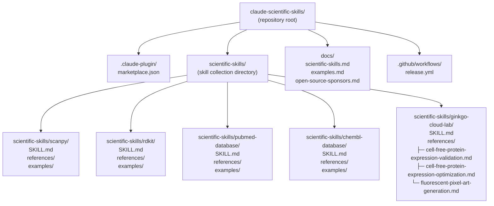
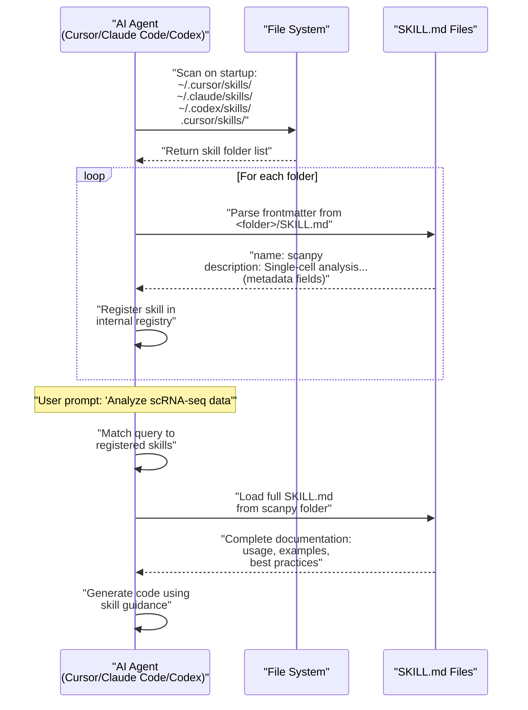
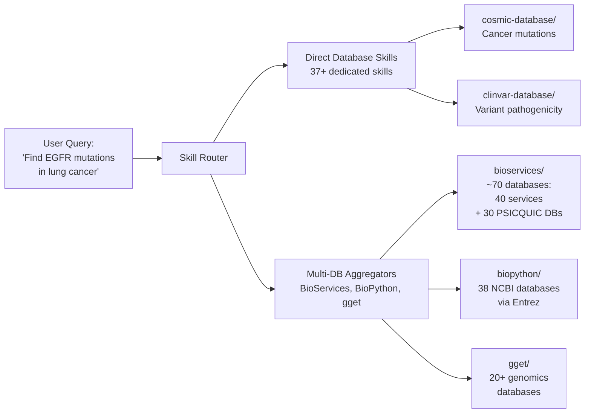
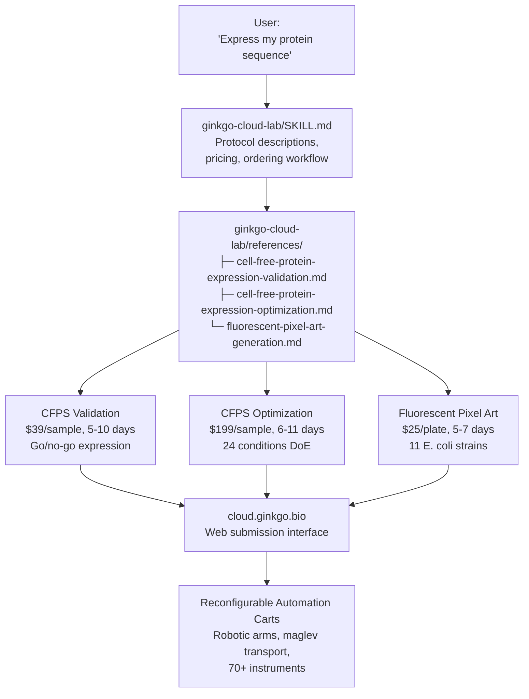
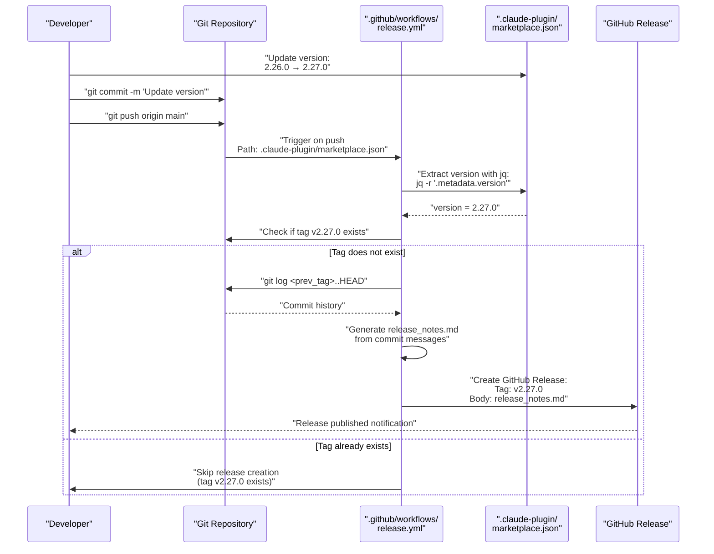

<!-- source: DeepWiki mcp.deepwiki.com · repo K-Dense-AI/claude-scientific-skills · page 1 Home · fetched 2026-10-26 -->

# Home

<details>
<summary>Relevant source files</summary>

The following files were used as context for generating this wiki page:

- [.claude-plugin/marketplace.json](.claude-plugin/marketplace.json)
- [README.md](README.md)
- [docs/scientific-skills.md](docs/scientific-skills.md)
- [scientific-skills/ginkgo-cloud-lab/SKILL.md](scientific-skills/ginkgo-cloud-lab/SKILL.md)
- [scientific-skills/ginkgo-cloud-lab/references/cell-free-protein-expression-optimization.md](scientific-skills/ginkgo-cloud-lab/references/cell-free-protein-expression-optimization.md)
- [scientific-skills/ginkgo-cloud-lab/references/cell-free-protein-expression-validation.md](scientific-skills/ginkgo-cloud-lab/references/cell-free-protein-expression-validation.md)
- [scientific-skills/ginkgo-cloud-lab/references/fluorescent-pixel-art-generation.md](scientific-skills/ginkgo-cloud-lab/references/fluorescent-pixel-art-generation.md)

</details>


## Purpose and Scope

This wiki documents **Claude Scientific Skills**, an open-source collection of 170+ scientific and research skills that implement the [Agent Skills](https://agentskills.io/) standard. The system provides AI agents with structured documentation and examples for scientific Python packages, databases, and laboratory automation platforms across bioinformatics, cheminformatics, clinical research, machine learning, and other domains.

This page provides a technical overview of the system architecture, file structure, and skill organization. For installation instructions, see [Installation and Setup](#2.1). For creating new skills, see [Creating New Skills](#9.3). For complete skill catalog details, see [Complete Skill Catalog](#10.1).

**Sources**: [README.md:1-50]()

---

## System Architecture

Claude Scientific Skills operates as a three-tier system: (1) AI agents that support the Agent Skills standard, (2) a skill registry and documentation layer, and (3) external scientific resources.

```mermaid
graph TB
    subgraph "Tier 1: AI Agent Layer"
        Cursor["Cursor IDE<br/>Reads: ~/.cursor/skills/"]
        ClaudeCode["Claude Code<br/>Reads: ~/.claude/skills/"]
        Codex["Codex<br/>Reads: ~/.codex/skills/"]
    end
    
    subgraph "Tier 2: Skill System"
        Marketplace["marketplace.json<br/>Version: 2.26.0<br/>170 skills registered"]
        
        SkillDirs["scientific-skills/<br/>├─ scanpy/<br/>├─ rdkit/<br/>├─ pubmed-database/<br/>├─ chembl-database/<br/>├─ ginkgo-cloud-lab/<br/>└─ ...]
        
        SkillMD["SKILL.md files<br/>Frontmatter metadata<br/>Markdown content"]
    end
    
    subgraph "Tier 3: External Resources"
        PythonPkgs["Python Packages<br/>60+ optimized:<br/>scanpy, rdkit, pytorch-lightning,<br/>scikit-learn, biopython"]
        
        Databases["Scientific Databases<br/>250+ total via:<br/>• 37+ direct skills<br/>• BioServices ~70 DBs<br/>• BioPython 38 NCBI DBs<br/>• gget 20+ DBs"]
        
        CloudLabs["Laboratory Automation<br/>• Ginkgo Cloud Lab<br/>• Opentrons<br/>• DNAnexus<br/>• LatchBio"]
    end
    
    Cursor --> Marketplace
    ClaudeCode --> Marketplace
    Codex --> Marketplace
    
    Marketplace --> SkillDirs
    SkillDirs --> SkillMD
    
    SkillMD --> PythonPkgs
    SkillMD --> Databases
    SkillMD --> CloudLabs
```

**Tier 1** agents scan standard directories on startup to discover skills. **Tier 2** provides the skill registry (`.claude-plugin/marketplace.json`) and individual skill documentation folders. **Tier 3** represents external scientific resources that skills provide access to.

**Sources**: [README.md:113-162](), [.claude-plugin/marketplace.json:1-194]()

---

## Repository Structure

The repository follows a specific directory layout for Agent Skills compliance:



| Path | Purpose |
|------|---------|
| `.claude-plugin/marketplace.json` | Skill registry containing metadata for all 170 skills, version number (2.26.0), and plugin configuration |
| `scientific-skills/` | Root directory containing all skill folders; copied to agent skill directories during installation |
| `scientific-skills/<skill-name>/SKILL.md` | Required frontmatter + markdown documentation for each skill |
| `scientific-skills/<skill-name>/references/` | Optional detailed guides, API references, protocol documentation |
| `scientific-skills/<skill-name>/examples/` | Optional working code examples and Jupyter notebooks |
| `.github/workflows/release.yml` | Automated release pipeline triggered by marketplace.json version updates |
| `docs/scientific-skills.md` | Human-readable catalog of all skills with descriptions |

**Sources**: [README.md:117-162](), [.claude-plugin/marketplace.json:1-194]()

---

## Skill Discovery and Loading

Agents discover skills by scanning standard directories and parsing `SKILL.md` frontmatter:



**Installation locations** (global and project-level):

| Agent | Global Directory | Project-Level Directory |
|-------|-----------------|------------------------|
| Cursor | `~/.cursor/skills/` | `.cursor/skills/` (project root) |
| Claude Code | `~/.claude/skills/` | `.claude/skills/` (project root) |
| Codex | `~/.codex/skills/` | `.codex/skills/` (project root) |

**Cross-compatibility note**: Cursor reads from `.claude/skills/` and `.codex/skills/` directories as well, and vice versa, enabling skills installed for one agent to work with others.

**Sources**: [README.md:124-162]()

---

## SKILL.md File Structure

Each skill is defined by a `SKILL.md` file with YAML frontmatter and markdown content:

```markdown
---
name: scanpy
description: Single-cell RNA-seq analysis with Scanpy for clustering, visualization, and trajectory inference
version: 1.10.0
author: K-Dense Inc.
license: MIT
compatibility: ["cursor", "claude-code", "codex"]
tools: ["python"]
---

# Scanpy

## Overview

Scanpy is a Python package for single-cell RNA-seq analysis...

## Installation

```bash
uv pip install scanpy
```

## Usage

...
```

**Required frontmatter fields:**
- `name`: Unique skill identifier
- `description`: Brief description for agent matching

**Optional frontmatter fields:**
- `version`: Skill version
- `author`: Skill creator
- `license`: License identifier
- `compatibility`: Compatible agents
- `tools`: Required tools/languages

**Markdown sections** (common patterns):
- **Overview**: Purpose and capabilities
- **Installation**: Dependency installation commands
- **Usage**: Basic usage examples
- **Advanced Topics**: Complex workflows
- **References**: Links to detailed guides in `references/` folder
- **Best Practices**: Recommended patterns

**Sources**: [README.md:60-66](), [.claude-plugin/marketplace.json:11-16]()

---

## Marketplace Registry

The `.claude-plugin/marketplace.json` file serves as the central registry:

```json
{
  "name": "claude-scientific-skills",
  "owner": {
    "name": "K-Dense Inc.",
    "email": "contact@k-dense.ai"
  },
  "metadata": {
    "description": "Claude scientific skills from K-Dense Inc",
    "version": "2.26.0"
  },
  "plugins": [
    {
      "name": "scientific-skills",
      "description": "Collection of scientific skills",
      "source": "./",
      "strict": false,
      "skills": [
        "./scientific-skills/scanpy",
        "./scientific-skills/rdkit",
        "./scientific-skills/pubmed-database",
        ...
      ]
    }
  ]
}
```

**Key fields:**

| Field | Purpose |
|-------|---------|
| `metadata.version` | Current system version (2.26.0); updating triggers automated GitHub release |
| `plugins[].skills[]` | Array of 170 relative paths to skill directories |
| `plugins[].strict` | When `false`, allows skills without complete metadata |
| `owner.name`, `owner.email` | Maintainer contact information |

The `version` field in `marketplace.json` is the **single source of truth** for releases. When updated and pushed to `main`, `.github/workflows/release.yml` automatically creates a GitHub release with that tag.

**Sources**: [.claude-plugin/marketplace.json:1-194]()

---

## Skill Organization by Domain

The 170 skills are organized into domain-specific categories:

### Python Package Skills (60+)

Skills providing curated documentation for scientific Python packages. Agents can use *any* Python package, but these provide optimized guidance.

| Domain | Example Skills | Skill Folders |
|--------|---------------|---------------|
| **Bioinformatics** | BioPython, Scanpy, scVelo, Arboreto, pysam | `biopython/`, `scanpy/`, `scvelo/`, `arboreto/`, `pysam/` |
| **Cheminformatics** | RDKit, DeepChem, DiffDock, DataMol | `rdkit/`, `deepchem/`, `diffdock/`, `datamol/` |
| **Machine Learning** | PyTorch Lightning, scikit-learn, SHAP | `pytorch-lightning/`, `scikit-learn/`, `shap/` |
| **Molecular Dynamics** | OpenMM, MDAnalysis | `molecular-dynamics/` (combined skill) |
| **Visualization** | Matplotlib, Seaborn, Plotly | `matplotlib/`, `seaborn/`, `plotly/` |

**Sources**: [README.md:52-100](), [docs/scientific-skills.md:61-200]()

### Database Skills (37+ direct → 250+ total)

Direct database skills provide optimized access patterns. Multi-database packages (BioServices, BioPython, gget) add ~213 additional databases.

| Database Type | Direct Skills | Skill Folders |
|---------------|---------------|---------------|
| **Protein** | UniProt, PDB, AlphaFold DB, InterPro | `uniprot-database/`, `pdb-database/`, `alphafold-database/`, `interpro-database/` |
| **Chemical** | ChEMBL, PubChem, DrugBank, ZINC | `chembl-database/`, `pubchem-database/`, `drugbank-database/`, `zinc-database/` |
| **Genomic** | Ensembl, NCBI Gene, GEO, gnomAD, GTEx | `ensembl-database/`, `gene-database/`, `geo-database/`, `gnomad-database/`, `gtex-database/` |
| **Clinical** | ClinVar, COSMIC, ClinicalTrials.gov | `clinvar-database/`, `cosmic-database/`, `clinicaltrials-database/` |
| **Literature** | PubMed, bioRxiv, OpenAlex | `pubmed-database/`, `biorxiv-database/`, `openalex-database/` |

**Multi-database aggregators:**
- **BioServices** (`bioservices/`): ~40 bioinformatics services + 30 PSICQUIC interaction databases = ~70 DBs
- **BioPython** (`biopython/`): 38 NCBI sub-databases via Entrez (PubMed, Gene, Protein, Nucleotide, etc.)
- **gget** (`gget/`): 20+ genomics databases (Ensembl, UniProt, PDB, BLAST, Enrichr, etc.)

**Sources**: [README.md:54-55](), [docs/scientific-skills.md:3-36]()

### Laboratory Automation Skills (4)

Skills for physical lab automation and cloud lab platforms:

| Skill | Purpose | Skill Folder | Key Features |
|-------|---------|--------------|--------------|
| **Ginkgo Cloud Lab** | Cell-free protein expression, fluorescent pixel art via RAC infrastructure | `ginkgo-cloud-lab/` | Validation: $39/sample, 5-10 days; Optimization: $199/sample, 6-11 days (24 conditions) |
| **PyLabRobot** | Liquid handling protocol development | `pylabrobot/` | Python API for liquid handling robots |
| **Opentrons** | Protocol creation for Opentrons OT-2/Flex robots | `opentrons-integration/` | Protocol API v2 for automated liquid handling |
| **Protocols.io** | Protocol management and sharing | `protocolsio-integration/` | API for protocol lifecycle management |

**Sources**: [README.md:476-479](), [scientific-skills/ginkgo-cloud-lab/SKILL.md:1-57]()

### Scientific Communication Skills (24+)

Skills for literature, writing, visualization, and documentation:

| Category | Skills | Skill Folders |
|----------|--------|---------------|
| **Literature** | PubMed, bioRxiv, OpenAlex, Literature Review | `pubmed-database/`, `biorxiv-database/`, `openalex-database/`, `literature-review/` |
| **Writing** | Scientific Writing, Peer Review, LaTeX Posters | `scientific-writing/`, `peer-review/`, `latex-posters/` |
| **Visualization** | Generate Image, Scientific Schematics, Infographics | `generate-image/`, `scientific-schematics/`, `infographics/` |
| **Documentation** | Markdown & Mermaid Writing (mandatory standard), Document Skills | `markdown-mermaid-writing/`, `document-skills/` |

**Documentation standard**: The `markdown-mermaid-writing` skill is **mandatory** for all repository documentation, providing 9 templates (research papers, how-to guides, decision records) and 2 style guides (markdown, Mermaid).

**Sources**: [README.md:492-504](), [docs/scientific-skills.md:150-200]()

### Research Methodology Skills (11+)

Skills for hypothesis generation, analysis, and funding:

| Skill | Purpose | Skill Folder |
|-------|---------|--------------|
| **Hypothesis Generation** | AI-assisted hypothesis formulation | `hypothesis-generation/` |
| **Scientific Brainstorming** | Structured ideation workflows | `scientific-brainstorming/` |
| **Consciousness Council** | Multi-perspective deliberation with devil's advocate analysis | `consciousness-council/` |
| **What-If Oracle** | Multi-branch scenario exploration and risk analysis | `what-if-oracle/` |
| **Research Grants** | Grant writing assistance | `research-grants/` |

**Sources**: [README.md:526-535]()

---

## Database Access Architecture

The system achieves 250+ database coverage through a dual strategy:



**Strategy 1: Direct Database Skills (37+)**

Curated skills for high-priority databases with detailed documentation, examples, and best practices. Examples:
- `chembl-database/`: 28M+ bioactivities, compound structures, targets
- `pubmed-database/`: 35M+ citations, MeSH terms, E-utilities API
- `cosmic-database/`: Somatic cancer mutations, mutational signatures
- `clinvar-database/`: Variant pathogenicity, clinical significance

**Strategy 2: Multi-Database Aggregators**

Skills that wrap packages providing unified access to multiple databases:
- **BioServices** (`bioservices/`): ~40 bioinformatics web services + 30 PSICQUIC protein interaction databases
- **BioPython** (`biopython/`): 38 NCBI sub-databases (PubMed, Gene, Protein, Nucleotide, dbSNP, ClinVar, etc.)
- **gget** (`gget/`): 20+ genomics databases (Ensembl, UniProt, PDB, BLAST, Enrichr, COSMIC, etc.)

**Total coverage**: 37 direct + ~70 (BioServices) + 38 (BioPython) + 20+ (gget) = **~165** unique database endpoints, with overlaps reducing to **250+** total accessible databases.

**Sources**: [README.md:54-55](), [README.md:98-99](), [docs/scientific-skills.md:3-36]()

---

## Example: Ginkgo Cloud Lab Skill

The Ginkgo Cloud Lab skill demonstrates integration with physical laboratory automation:



**File structure:**

| File | Purpose |
|------|---------|
| `ginkgo-cloud-lab/SKILL.md` | Overview, available protocols, ordering workflow, EstiMate AI agent |
| `references/cell-free-protein-expression-validation.md` | Validation protocol: $39/sample, 5-10 day turnaround, 3-phase automated workflow |
| `references/cell-free-protein-expression-optimization.md` | Optimization protocol: $199/sample, 6-11 days, DoE across 24 conditions |
| `references/fluorescent-pixel-art-generation.md` | Pixel art protocol: $25/plate, 5-7 days, 11 fluorescent E. coli strains |

**Key protocol parameters from references:**

| Protocol | Price/Sample | Turnaround | Input | Output |
|----------|-------------|------------|-------|--------|
| Validation | $39 | 5-10 days | FASTA (≤1800 bp) | Expression confirmation, baseline titer (mg/L), purity |
| Optimization | $199 | 6-11 days | FASTA | Comparative yield across 24 conditions, optimal formulation |
| Pixel Art | $25/plate | 5-7 days | PNG/SVG (48x48 to 96x96 px) | UV photograph of bacterial artwork |

**Sources**: [scientific-skills/ginkgo-cloud-lab/SKILL.md:1-57](), [scientific-skills/ginkgo-cloud-lab/references/cell-free-protein-expression-validation.md:1-72](), [scientific-skills/ginkgo-cloud-lab/references/cell-free-protein-expression-optimization.md:1-86](), [scientific-skills/ginkgo-cloud-lab/references/fluorescent-pixel-art-generation.md:1-88]()

---

## Version Control and Releases

The system uses automated releases triggered by `marketplace.json` updates:



**Key files:**

| File | Purpose |
|------|---------|
| `.claude-plugin/marketplace.json` | Single source of truth for version number (line 9: `"version": "2.26.0"`) |
| `.github/workflows/release.yml` | Automated release pipeline using GitHub Actions |

**Release process:**
1. Developer updates `metadata.version` in `marketplace.json`
2. Commit and push to `main` branch
3. GitHub Actions workflow triggers on path `.claude-plugin/marketplace.json`
4. Workflow extracts version using `jq -r '.metadata.version'`
5. Checks if corresponding Git tag exists
6. If tag doesn't exist, generates release notes from commit history
7. Creates GitHub Release with tag and release notes

**Sources**: [.claude-plugin/marketplace.json:9]()

---

## System Statistics

| Metric | Count | Details |
|--------|-------|---------|
| **Total Skills** | 170 | Registered in marketplace.json |
| **Python Package Skills** | 60+ | Optimized documentation for scientific packages |
| **Database Skills** | 37+ direct → 250+ total | Direct skills + multi-database aggregators |
| **Laboratory Automation** | 4 | Ginkgo Cloud Lab, PyLabRobot, Opentrons, Protocols.io |
| **Communication Skills** | 24+ | Literature, writing, visualization, documentation |
| **Current Version** | 2.26.0 | From marketplace.json metadata.version |
| **Supported Agents** | 3+ | Cursor, Claude Code, Codex (any Agent Skills-compatible tool) |
| **Repository License** | MIT | Individual skills may have different licenses |

**Domain breakdown:**

| Domain | Skill Count | Example Skills |
|--------|-------------|----------------|
| Bioinformatics & Genomics | 20+ | Scanpy, BioPython, scVelo, Arboreto, TileDB-VCF |
| Cheminformatics | 13+ | RDKit, DeepChem, DiffDock, OpenMM, DataMol |
| Clinical Research | 16+ | ClinVar, COSMIC, cBioPortal, DepMap, Imaging Data Commons |
| Machine Learning | 16+ | PyTorch Lightning, scikit-learn, TimesFM, SHAP |
| Geospatial | 1+ | GeoMaster (remote sensing, GIS, spatial ML) |
| Laboratory Automation | 4 | Ginkgo Cloud Lab, PyLabRobot, Opentrons, Protocols.io |
| Scientific Databases | 37+ | PubMed, ChEMBL, UniProt, AlphaFold DB, KEGG |
| Communication | 24+ | Scientific Writing, LaTeX Posters, Generate Image |
| Research Methodology | 11+ | Hypothesis Generation, Consciousness Council, What-If Oracle |
| Financial & Economic | 5 | edgartools, usfiscaldata, FRED, alpha-vantage |

**Sources**: [README.md:52-59](), [.claude-plugin/marketplace.json:1-194](), [docs/scientific-skills.md:1-200]()

---

## Related Pages

For deeper technical information, see:

- **Installation**: [Installation and Setup](#2.1)
- **Architecture**: [Core Architecture](#3) - Three-tier model, skill discovery, marketplace system
- **Skill Anatomy**: [SKILL.md Anatomy and Structure](#3.4) - Frontmatter schema and content structure
- **Documentation Standards**: [Documentation Standards](#3.5) - Markdown-mermaid-writing mandatory standard
- **Domain Details**: [Scientific Domains](#4) - Deep dives into each domain
- **Database Access**: [Scientific Databases](#5) - Multi-strategy database architecture
- **Workflows**: [Multi-Domain Workflows](#8) - End-to-end workflow examples
- **Contributing**: [Creating New Skills](#9.3) - Skill authoring guide
- **Reference**: [Complete Skill Catalog](#10.1) - Alphabetical listing of all skills

**Sources**: [README.md:69-86]()

---

