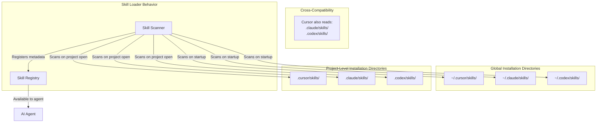
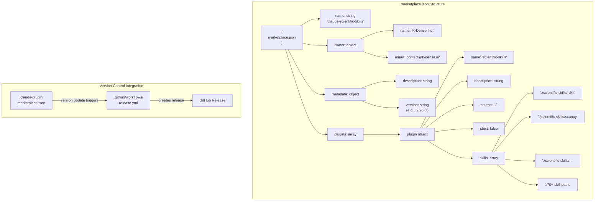
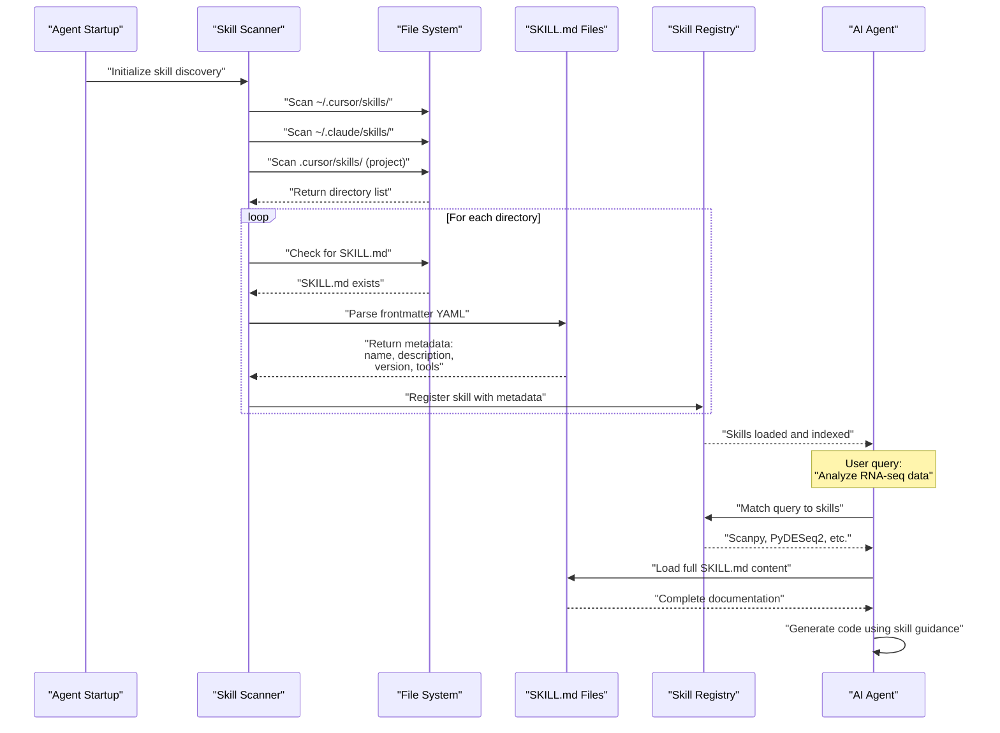
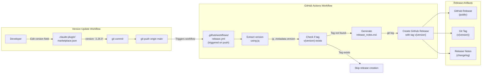

<!-- source: DeepWiki mcp.deepwiki.com · repo K-Dense-AI/claude-scientific-skills · page 10 Reference · fetched 2026-10-26 -->

# Reference

<details>
<summary>Relevant source files</summary>

The following files were used as context for generating this wiki page:

- [.claude-plugin/marketplace.json](.claude-plugin/marketplace.json)
- [README.md](README.md)
- [docs/scientific-skills.md](docs/scientific-skills.md)
- [scientific-skills/ginkgo-cloud-lab/SKILL.md](scientific-skills/ginkgo-cloud-lab/SKILL.md)
- [scientific-skills/ginkgo-cloud-lab/references/cell-free-protein-expression-optimization.md](scientific-skills/ginkgo-cloud-lab/references/cell-free-protein-expression-optimization.md)
- [scientific-skills/ginkgo-cloud-lab/references/cell-free-protein-expression-validation.md](scientific-skills/ginkgo-cloud-lab/references/cell-free-protein-expression-validation.md)
- [scientific-skills/ginkgo-cloud-lab/references/fluorescent-pixel-art-generation.md](scientific-skills/ginkgo-cloud-lab/references/fluorescent-pixel-art-generation.md)

</details>


## Purpose and Scope

This page provides comprehensive reference documentation for the Claude Scientific Skills system, including technical specifications, configuration formats, directory structures, and standards compliance. This material serves as a quick lookup for developers and contributors working with the skill system.

For a complete alphabetical listing of all 170+ skills with descriptions, see [Complete Skill Catalog](#10.1). For detailed marketplace.json schema specification, see [Marketplace Configuration Reference](#10.2). For troubleshooting and common issues, see [Troubleshooting and FAQ](#10.3).

---

## Agent Skills Standard Compliance

Claude Scientific Skills adheres to the [Agent Skills Specification](https://agentskills.io/specification) version 1.0. All skills must comply with the following requirements:

| Requirement | Implementation | Verification |
|-------------|----------------|--------------|
| **SKILL.md frontmatter** | YAML metadata block with required fields | Parsed during skill discovery |
| **Directory structure** | One skill per directory with SKILL.md at root | Scanned by skill loader |
| **Naming conventions** | Lowercase with hyphens (e.g., `scientific-writing`) | Enforced in marketplace.json |
| **Markdown content** | Standard markdown with optional references/ and examples/ folders | Loaded by AI agents |
| **Version format** | Semantic versioning (MAJOR.MINOR.PATCH) | Tracked in marketplace.json:9 |

**Sources**: README.md:585-591, .claude-plugin/marketplace.json:1-194

---

## Directory Structure

### Standard Skill Discovery Paths

Skills are discovered from standardized directories depending on the AI agent and installation scope:



**Directory Priority**: Project-level directories override global directories for skills with the same name.

**Sources**: README.md:125-161

---

## SKILL.md File Structure

Every skill must contain a `SKILL.md` file at the root of its directory. This file serves as both machine-readable metadata (frontmatter) and human-readable documentation (markdown content).

### SKILL.md Anatomy Diagram

```mermaid
graph TB
    subgraph "SKILL.md File Structure"
        File["SKILL.md"]
        
        File --> Frontmatter["Frontmatter Block<br/>(YAML between --- delimiters)"]
        File --> Content["Markdown Content"]
        
        Frontmatter --> Name["name: string<br/>(required, lowercase-with-hyphens)"]
        Frontmatter --> Description["description: string<br/>(required, used for skill matching)"]
        Frontmatter --> Version["version: string<br/>(optional, semantic versioning)"]
        Frontmatter --> Author["author: string<br/>(optional)"]
        Frontmatter --> License["license: string<br/>(optional, per-skill licensing)"]
        Frontmatter --> Tools["tools: array<br/>(optional, required packages)"]
        Frontmatter --> Compatibility["compatibility: object<br/>(optional, agent versions)"]
        
        Content --> Overview["## Overview<br/>(purpose and capabilities)"]
        Content --> Installation["## Installation<br/>(dependency setup)"]
        Content --> Usage["## Usage<br/>(code examples)"]
        Content --> Examples["## Examples<br/>(working code snippets)"]
        Content --> BestPractices["## Best Practices<br/>(recommendations)"]
        Content --> References["## References<br/>(links to docs)"]
    end
    
    subgraph "Supporting Files"
        ReferencesDir["references/ folder<br/>(detailed guides)"]
        ExamplesDir["examples/ folder<br/>(working code)"]
        AssetsDir["assets/ folder<br/>(images, diagrams)"]
    end
    
    File -.->|"Links to"| ReferencesDir
    File -.->|"Links to"| ExamplesDir
    File -.->|"Links to"| AssetsDir
```



**Sources**: README.md:60-65, scientific-skills/ginkgo-cloud-lab/SKILL.md:1-57

---

## SKILL.md Frontmatter Schema

The frontmatter block uses YAML syntax and must appear at the beginning of the file between `---` delimiters:

```yaml
---
name: skill-name
description: Brief description used for skill discovery and matching
version: 1.2.0
author: Author Name or Organization
license: MIT
tools:
  - package-name==1.0.0
  - another-package>=2.0.0
compatibility:
  cursor: ">=0.40.0"
  claude-code: ">=1.0.0"
---
```

### Required Fields

| Field | Type | Description | Example |
|-------|------|-------------|---------|
| `name` | string | Skill identifier (lowercase-with-hyphens) | `"scientific-writing"` |
| `description` | string | Brief description for skill matching | `"Scientific writing and manuscript preparation"` |

### Optional Fields

| Field | Type | Description | Example |
|-------|------|-------------|---------|
| `version` | string | Semantic version (MAJOR.MINOR.PATCH) | `"1.5.2"` |
| `author` | string | Creator or maintainer | `"K-Dense Inc."` |
| `license` | string | License identifier | `"MIT"`, `"Apache-2.0"`, `"GPL-3.0"` |
| `tools` | array | Required Python packages with version specs | `["numpy>=1.20.0", "pandas==1.5.0"]` |
| `compatibility` | object | Minimum agent versions | `{"cursor": ">=0.40.0"}` |

**Sources**: scientific-skills/ginkgo-cloud-lab/SKILL.md:1-4, README.md:653-663

---

## Marketplace.json Configuration

The [.claude-plugin/marketplace.json]() file serves as the central registry for all skills in the repository. It defines the plugin structure and lists all available skills.

### Marketplace.json Schema Diagram



**File Path**: [.claude-plugin/marketplace.json:1-194]()

### Marketplace.json Field Reference

| Field | Type | Required | Description |
|-------|------|----------|-------------|
| `name` | string | Yes | Repository identifier |
| `owner.name` | string | Yes | Organization or author name |
| `owner.email` | string | Yes | Contact email |
| `metadata.description` | string | Yes | Repository description |
| `metadata.version` | string | Yes | Current version (semantic versioning) |
| `plugins` | array | Yes | Array of plugin objects |
| `plugins[].name` | string | Yes | Plugin identifier |
| `plugins[].description` | string | Yes | Plugin description |
| `plugins[].source` | string | Yes | Relative path to plugin root |
| `plugins[].strict` | boolean | Yes | Strict validation mode (typically false) |
| `plugins[].skills` | array | Yes | Array of relative paths to skill directories |

**Example**: [.claude-plugin/marketplace.json:1-194]()

**Sources**: .claude-plugin/marketplace.json:1-194

---

## Skill Discovery and Loading Mechanism

The following diagram maps the skill discovery process to actual file system paths and code entities:



**Skill Registry Behavior**:
- Skills are loaded on agent startup or project opening
- Frontmatter metadata is parsed using YAML parser
- Skills are indexed by `name` field for fast lookup
- `description` field is used for semantic matching to user queries
- Project-level skills override global skills with the same `name`

**Sources**: README.md:125-161

---

## Standard Directory Layout for Skills

Each skill follows a consistent directory structure:

```
skill-name/
├── SKILL.md              # Required: Metadata and documentation
├── references/           # Optional: Detailed guides and API docs
│   ├── guide-1.md
│   └── guide-2.md
├── examples/             # Optional: Working code examples
│   ├── example-1.py
│   ├── example-2.py
│   └── test_examples.py  # Test scripts for validation
└── assets/               # Optional: Images, diagrams, templates
    ├── diagram.png
    └── template.json
```

**File Naming Conventions**:
- Skill directories: `lowercase-with-hyphens`
- SKILL.md: Exact filename required (case-sensitive)
- Reference files: `descriptive-name.md`
- Example files: `example-name.py` or `example_name.py`
- Test files: `test_*.py` for automated testing

**Sources**: README.md:60-65

---

## Database Skills Pattern

Database skills follow a standardized pattern for providing access to external data resources. The following diagram shows the common structure:

```mermaid
graph TB
    subgraph "Database Skill Pattern"
        SKILLMD["database-name/SKILL.md"]
        
        SKILLMD --> Overview["## Overview<br/>Database description,<br/>data types, coverage"]
        SKILLMD --> Authentication["## Authentication<br/>API keys, credentials,<br/>environment variables"]
        SKILLMD --> Access["## Access Methods<br/>REST API, Python SDK,<br/>bulk download"]
        SKILLMD --> RateLimits["## Rate Limits<br/>Requests per second,<br/>daily quotas"]
        SKILLMD --> Examples["## Examples<br/>Query patterns,<br/>search syntax"]
        SKILLMD --> Integration["## Integration<br/>Cross-database queries,<br/>ID mapping"]
    end
    
    subgraph "Common API Patterns"
        RESTAccess["REST API<br/>(requests library)"]
        PythonSDK["Python SDK<br/>(dedicated package)"]
        BioServices["BioServices<br/>(multi-database wrapper)"]
        BioPython["BioPython Entrez<br/>(NCBI databases)"]
        gget["gget<br/>(genomics databases)"]
    end
    
    SKILLMD -.->|"Uses one or more"| RESTAccess
    SKILLMD -.->|"Uses one or more"| PythonSDK
    SKILLMD -.->|"Uses one or more"| BioServices
    SKILLMD -.->|"Uses one or more"| BioPython
    SKILLMD -.->|"Uses one or more"| gget
```



**Database Count**: The system provides access to **250+ databases** through:
- **37+ direct database skills** with dedicated documentation (PubMed, ChEMBL, UniProt, etc.)
- **Multi-database aggregators**:
  - BioServices: ~40 bioinformatics services + 30+ PSICQUIC databases = ~70 databases
  - BioPython Entrez: 38 NCBI sub-databases
  - gget: 20+ genomics databases

**Sources**: README.md:54-55, README.md:98-99, docs/scientific-skills.md:1-36

---

## Authentication and API Key Patterns

Skills requiring authentication follow consistent patterns for credential management:

### Environment Variable Conventions

| Database/Service | Environment Variable | Acquisition Method |
|------------------|---------------------|-------------------|
| OpenAI | `OPENAI_API_KEY` | https://platform.openai.com/api-keys |
| NCBI E-utilities | `NCBI_API_KEY` | https://www.ncbi.nlm.nih.gov/account/ |
| Benchling | `BENCHLING_API_KEY` | Benchling settings → Developer |
| DNAnexus | `DX_API_TOKEN` | `dx login` command |
| LabArchives | `LABARCHIVES_API_KEY` | LabArchives account settings |
| OpenRouter | `OPENROUTER_API_KEY` | https://openrouter.ai/keys |
| Perplexity | `PERPLEXITY_API_KEY` | https://www.perplexity.ai/settings/api |

### Configuration File Patterns

Some skills use configuration files instead of environment variables:

```python
# Example: Benchling configuration
import os
from benchling_sdk.auth.api_key_auth import ApiKeyAuth
from benchling_sdk.benchling import Benchling

auth = ApiKeyAuth(os.environ["BENCHLING_API_KEY"])
benchling = Benchling(url="https://your-tenant.benchling.com", auth=auth)
```

**Best Practice**: Store API keys in environment variables or secure credential management systems, never hardcode in scripts.

**Sources**: README.md:636-645, docs/scientific-skills.md:37-60

---

## Rate Limits Reference

Common rate limits for database and API skills:

| Database/Service | Rate Limit | Authentication | Notes |
|------------------|------------|----------------|-------|
| **PubMed E-utilities** | 3 req/sec (no key)<br/>10 req/sec (with key) | Optional | NCBI_API_KEY recommended |
| **ENA (European Nucleotide Archive)** | 50 req/sec | None | Public API |
| **ClinicalTrials.gov** | ~50 req/min | None | Public API v2 |
| **OpenAlex** | 10 req/sec<br/>100k req/day | None (with email) | Polite pool with email in User-Agent |
| **Ensembl REST API** | 15 req/sec | None | Use retry logic for 429 errors |
| **UniProt REST API** | No published limit | None | Implement exponential backoff |
| **OpenRouter** | Varies by model | Required | Check model-specific limits |
| **Perplexity** | 50 req/min | Required | Check subscription tier |

**Implementation Pattern**: Use retry logic with exponential backoff for rate-limited APIs:

```python
import time
from requests.exceptions import HTTPError

def fetch_with_retry(url, max_retries=3):
    for attempt in range(max_retries):
        try:
            response = requests.get(url)
            response.raise_for_status()
            return response.json()
        except HTTPError as e:
            if e.response.status_code == 429:  # Rate limit
                wait_time = 2 ** attempt  # Exponential backoff
                time.sleep(wait_time)
            else:
                raise
    raise Exception("Max retries exceeded")
```

**Sources**: docs/scientific-skills.md:9-36, README.md:632-645

---

## Version Control and Release Automation

The repository uses automated releases triggered by marketplace.json version updates:



**Workflow File**: [.github/workflows/release.yml:1-98]()

**Version Format**: Semantic versioning (MAJOR.MINOR.PATCH)
- MAJOR: Breaking changes
- MINOR: New features, new skills added
- PATCH: Bug fixes, documentation updates

**Example Version Progression**:
- `2.26.0` → `2.27.0` (new skills added)
- `2.27.0` → `2.27.1` (bug fix)
- `2.27.1` → `3.0.0` (breaking change to skill format)

**Sources**: .claude-plugin/marketplace.json:9, README.md:665-667

---

## Python Package Management

Skills use `uv` as the package manager for dependency installation:

### Installation Commands

```bash
# Install uv (macOS/Linux)
curl -LsSf https://astral.sh/uv/install.sh | sh

# Install uv (Windows)
powershell -ExecutionPolicy ByPass -c "irm https://astral.sh/uv/install.ps1 | iex"

# Install uv via pip
pip install uv

# Verify installation
uv --version
```

### Dependency Installation Pattern

Skills typically document dependencies in their SKILL.md files:

```bash
# Install a single package
uv pip install package-name

# Install with version constraint
uv pip install "package-name>=1.0.0,<2.0.0"

# Install from requirements file
uv pip install -r requirements.txt

# Install from pyproject.toml
uv pip install -e .
```

**Sources**: README.md:188-212

---

## Documentation Standards

All skills must follow the **markdown-mermaid-writing** skill standards:

### Required Documentation Elements

| Element | Description | Location |
|---------|-------------|----------|
| **Templates** | 9 document templates (research_paper.md, how_to_guide.md, decision_record.md, etc.) | Referenced in SKILL.md |
| **Mermaid Diagrams** | Text-based diagrams using Mermaid syntax | Embedded in markdown |
| **Style Guides** | markdown_style_guide.md and mermaid_style_guide.md | Repository root |
| **Citations** | References to official documentation and sources | End of each section |
| **Code Examples** | Tested, working code snippets | examples/ folder |

### Quality Checklist

Every skill should meet the following criteria:

- [ ] Valid SKILL.md with required frontmatter fields
- [ ] Template-based documentation structure
- [ ] At least one Mermaid diagram explaining architecture
- [ ] Citations to official documentation
- [ ] Tested code examples in examples/ folder
- [ ] Clear installation instructions
- [ ] Use cases section with practical examples
- [ ] Best practices section

**Sources**: README.md:576-591

---

## File Format Reference

### SKILL.md Frontmatter Format

```yaml
---
name: skill-name
description: Brief description for skill discovery
version: 1.0.0
author: Author Name
license: MIT
tools:
  - package-name>=1.0.0
  - another-package==2.3.1
compatibility:
  cursor: ">=0.40.0"
  claude-code: ">=1.0.0"
  codex: ">=1.0.0"
---
```

### Marketplace.json Format

```json
{
  "name": "claude-scientific-skills",
  "owner": {
    "name": "K-Dense Inc.",
    "email": "contact@k-dense.ai"
  },
  "metadata": {
    "description": "Claude scientific skills from K-Dense Inc",
    "version": "2.26.0"
  },
  "plugins": [
    {
      "name": "scientific-skills",
      "description": "Collection of scientific skills",
      "source": "./",
      "strict": false,
      "skills": [
        "./scientific-skills/skill-name-1",
        "./scientific-skills/skill-name-2"
      ]
    }
  ]
}
```

**Sources**: .claude-plugin/marketplace.json:1-194, scientific-skills/ginkgo-cloud-lab/SKILL.md:1-4

---

## Skill Categories and Organization

Skills are organized into 15 major categories in the repository:

```mermaid
graph TB
    subgraph "170+ Skills Organized by Domain"
        Bio["Bioinformatics &<br/>Genomics<br/>(20+ skills)"]
        Chem["Cheminformatics &<br/>Drug Discovery<br/>(13+ skills)"]
        Clinical["Clinical Research &<br/>Precision Medicine<br/>(16+ skills)"]
        ML["Machine Learning<br/>& AI<br/>(16+ skills)"]
        Proteomics["Proteomics &<br/>Mass Spec<br/>(2 skills)"]
        Imaging["Medical Imaging &<br/>Digital Pathology<br/>(3 skills)"]
        Neuro["Neuroscience<br/>(1 skill)"]
        Materials["Materials Science<br/>& Physics<br/>(7 skills)"]
        Engineering["Engineering &<br/>Simulation<br/>(4 skills)"]
        DataViz["Data Analysis &<br/>Visualization<br/>(17+ skills)"]
        Lab["Laboratory<br/>Automation<br/>(4 skills)"]
        Multiomics["Multi-omics &<br/>Systems Biology<br/>(5+ skills)"]
        Protein["Protein Engineering<br/>& Design<br/>(3 skills)"]
        Comm["Scientific<br/>Communication<br/>(24+ skills)"]
        Research["Research<br/>Methodology<br/>(11+ skills)"]
    end
    
    subgraph "Database Skills (37+ direct → 250+ total)"
        Databases["250+ Databases<br/>via direct skills<br/>+ aggregators"]
    end
    
    subgraph "Integration Skills (6+)"
        Integrations["Cloud Platforms<br/>LIMS, ELN, etc."]
    end
    
    Root["scientific-skills/<br/>(root directory)"]
    
    Root --> Bio
    Root --> Chem
    Root --> Clinical
    Root --> ML
    Root --> Proteomics
    Root --> Imaging
    Root --> Neuro
    Root --> Materials
    Root --> Engineering
    Root --> DataViz
    Root --> Lab
    Root --> Multiomics
    Root --> Protein
    Root --> Comm
    Root --> Research
    Root --> Databases
    Root --> Integrations
```



**Directory Naming**: All skill directories use `lowercase-with-hyphens` format and are located at `scientific-skills/{skill-name}/`

**Sources**: README.md:398-546, docs/scientific-skills.md:1-194

---

## Cross-Platform Compatibility

Skills are compatible across multiple AI agent platforms:

| Platform | Discovery Path | Global Directory | Project Directory |
|----------|---------------|------------------|-------------------|
| **Cursor** | Scans on startup | `~/.cursor/skills/` | `.cursor/skills/` |
| **Claude Code** | Scans on startup | `~/.claude/skills/` | `.claude/skills/` |
| **Codex** | Scans on startup | `~/.codex/skills/` | `.codex/skills/` |

**Cross-Compatibility Note**: Cursor also reads from `.claude/skills/` and `.codex/skills/` directories, making skills portable across tools.

**Sources**: README.md:125-161

---

## Security Scanning

All skills are scanned using [Cisco AI Defense Skill Scanner](https://github.com/cisco-ai-defense/skill-scanner):

```bash
# Install scanner
uv pip install cisco-ai-skill-scanner

# Scan a skill directory
skill-scanner scan /path/to/skill --use-behavioral

# Scan entire repository
skill-scanner scan scientific-skills/ --use-behavioral
```

**Scanned Threats**:
- Prompt injection patterns
- Data exfiltration attempts
- Malicious code patterns
- Unauthorized API calls
- Credential leakage

**Sources**: README.md:593-604

---

## Common Configuration Patterns

### API Authentication Configuration

```python
import os

# Environment variable pattern (preferred)
api_key = os.environ.get("SERVICE_API_KEY")
if not api_key:
    raise ValueError("SERVICE_API_KEY environment variable not set")

# Configuration file pattern (alternative)
import json
with open("config.json") as f:
    config = json.load(f)
api_key = config["api_key"]
```

### Rate Limiting Implementation

```python
import time
from functools import wraps

def rate_limit(calls_per_second=10):
    min_interval = 1.0 / calls_per_second
    last_called = [0.0]
    
    def decorator(func):
        @wraps(func)
        def wrapper(*args, **kwargs):
            elapsed = time.time() - last_called[0]
            wait_time = min_interval - elapsed
            if wait_time > 0:
                time.sleep(wait_time)
            result = func(*args, **kwargs)
            last_called[0] = time.time()
            return result
        return wrapper
    return decorator

@rate_limit(calls_per_second=10)
def fetch_data(url):
    response = requests.get(url)
    return response.json()
```

### Error Handling Pattern

```python
from requests.exceptions import HTTPError, Timeout, RequestException

def robust_api_call(url, max_retries=3):
    for attempt in range(max_retries):
        try:
            response = requests.get(url, timeout=30)
            response.raise_for_status()
            return response.json()
        except HTTPError as e:
            if e.response.status_code == 429:
                wait_time = 2 ** attempt
                time.sleep(wait_time)
            elif 500 <= e.response.status_code < 600:
                time.sleep(1)
            else:
                raise
        except Timeout:
            time.sleep(1)
        except RequestException as e:
            raise
    raise Exception(f"Failed after {max_retries} retries")
```

**Sources**: README.md:632-645

---

## Contributing Standards

### Pull Request Checklist

Before submitting a pull request for a new skill:

- [ ] Skill follows Agent Skills specification
- [ ] SKILL.md has valid frontmatter with required fields
- [ ] Skill name uses lowercase-with-hyphens format
- [ ] Added to marketplace.json skills array
- [ ] Documentation follows markdown-mermaid-writing standards
- [ ] Code examples are tested and functional
- [ ] References to official documentation included
- [ ] Passed Cisco AI Defense Skill Scanner
- [ ] Version number follows semantic versioning

### Skill Scanner Integration

```bash
# Run scanner locally before submitting PR
uv pip install cisco-ai-skill-scanner
skill-scanner scan scientific-skills/your-new-skill/ --use-behavioral
```

**Sources**: README.md:552-618

---

## Licensing Reference

The repository itself is MIT licensed, but individual skills may have different licenses:

| License Type | Common Uses | Example Skills |
|--------------|-------------|----------------|
| **MIT** | Permissive, commercial use allowed | Most skills |
| **Apache-2.0** | Permissive with patent grant | Some ML/AI skills |
| **GPL-3.0** | Copyleft, requires derivative works to be GPL | Certain scientific packages |
| **BSD-3-Clause** | Permissive, similar to MIT | BioPython-based skills |
| **Proprietary** | Requires commercial license | Some database access skills |

**Important**: Check the `license` field in each skill's SKILL.md frontmatter before using in commercial projects.

**Example License Declaration**:
```yaml
---
name: example-skill
description: Example skill
license: MIT
---
```

**Sources**: README.md:653-663

---

## Related Pages

For detailed information on specific reference topics, see:

- [Complete Skill Catalog](#10.1) - Alphabetical listing of all 170+ skills with descriptions
- [Marketplace Configuration Reference](#10.2) - Complete marketplace.json schema specification
- [Troubleshooting and FAQ](#10.3) - Common issues, error messages, and solutions

For development and contribution guidelines, see:

- [Project Structure and Configuration](#9.1) - Repository organization and configuration files
- [Release Automation and Versioning](#9.2) - GitHub Actions workflow details
- [Creating New Skills](#9.3) - Step-by-step skill authoring guide

**Sources**: README.md:1-933

---

