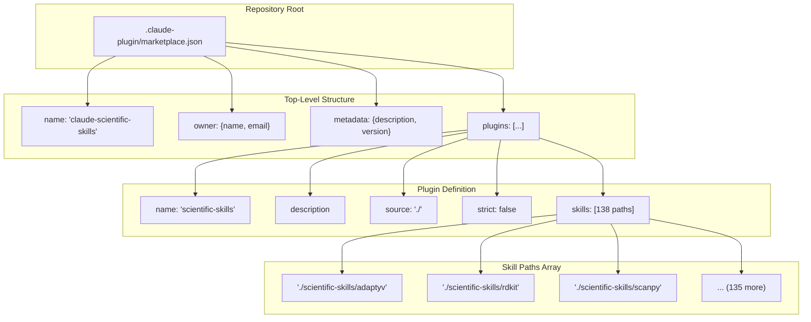

<!-- source: DeepWiki mcp.deepwiki.com · repo K-Dense-AI/claude-scientific-skills · page 10.2 Marketplace Configuration Reference · fetched 2026-10-26 -->

# Marketplace Configuration Reference

<details>
<summary>Relevant source files</summary>

The following files were used as context for generating this wiki page:

- [.claude-plugin/marketplace.json](.claude-plugin/marketplace.json)
- [.github/workflows/release.yml](.github/workflows/release.yml)
- [README.md](README.md)
- [docs/k-dense-web.gif](docs/k-dense-web.gif)
- [docs/scientific-skills.md](docs/scientific-skills.md)
- [scientific-skills/ginkgo-cloud-lab/SKILL.md](scientific-skills/ginkgo-cloud-lab/SKILL.md)
- [scientific-skills/ginkgo-cloud-lab/references/cell-free-protein-expression-optimization.md](scientific-skills/ginkgo-cloud-lab/references/cell-free-protein-expression-optimization.md)
- [scientific-skills/ginkgo-cloud-lab/references/cell-free-protein-expression-validation.md](scientific-skills/ginkgo-cloud-lab/references/cell-free-protein-expression-validation.md)
- [scientific-skills/ginkgo-cloud-lab/references/fluorescent-pixel-art-generation.md](scientific-skills/ginkgo-cloud-lab/references/fluorescent-pixel-art-generation.md)

</details>


This page documents the `marketplace.json` file structure and configuration system used to register and distribute Claude Scientific Skills. This file serves as the plugin registry that Claude Code reads to discover and install the 138 scientific skills as a single bundled plugin.

**Related pages:** For installation procedures, see [Installation and Setup](#2.1). For the complete list of available skills, see [Complete Skill Catalog](#16.1). For the plugin architecture that reads this configuration, see [Plugin and Distribution Model](#3.1).

---

## Purpose and Scope

The `.claude-plugin/marketplace.json` file is the central configuration file that:
- Defines plugin metadata (name, owner, version)
- Registers all 138 skill directories in a single bundle
- Enables Claude Code to discover and install skills
- Manages versioning for coordinated updates
- Specifies the plugin structure and installation behavior

This configuration enables the "single-bundle" approach where users install one plugin (`scientific-skills`) that provides access to all 138 skills, rather than installing each skill individually.

**Sources:** [.claude-plugin/marketplace.json:1-160](), [README.md:119-133]()

---

## File Location and Structure

The marketplace configuration file resides at `.claude-plugin/marketplace.json` in the repository root and follows a hierarchical JSON schema:



**Sources:** [.claude-plugin/marketplace.json:1-160]()

---

## Top-Level Schema

The root object contains four required fields:

| Field | Type | Purpose | Example Value |
|-------|------|---------|---------------|
| `name` | string | Marketplace identifier used in installation commands | `"claude-scientific-skills"` |
| `owner` | object | Organization/maintainer information | `{name: "K-Dense Inc.", email: "contact@k-dense.ai"}` |
| `metadata` | object | Version and description information | `{description: "...", version: "2.11.0"}` |
| `plugins` | array | List of plugin definitions (typically one) | `[{...}]` |

### Marketplace Name

The `name` field (`"claude-scientific-skills"`) is used in the installation command:

```bash
/plugin marketplace add K-Dense-AI/claude-scientific-skills
```

This name must match the GitHub repository name for the registration to work correctly.

**Sources:** [.claude-plugin/marketplace.json:2](), [README.md:122]()

---

## Owner Metadata

The `owner` object identifies the maintainer and provides contact information:

```json
{
  "name": "K-Dense Inc.",
  "email": "contact@k-dense.ai"
}
```

| Field | Purpose |
|-------|---------|
| `name` | Organization or individual name displayed in Claude Code UI |
| `email` | Contact email for support and inquiries |

This information appears in the plugin browser interface and provides attribution for the skill collection.

**Sources:** [.claude-plugin/marketplace.json:3-6]()

---

## Metadata Object

The `metadata` object contains versioning and descriptive information:

```json
{
  "description": "Claude scientific skills from K-Dense Inc",
  "version": "2.11.0"
}
```

### Version Field

The `version` follows semantic versioning (MAJOR.MINOR.PATCH):
- **MAJOR (2)**: Breaking changes to skill APIs or structure
- **MINOR (11)**: New skills added or significant enhancements
- **PATCH (0)**: Bug fixes and minor updates

Current version `2.11.0` indicates:
- Generation 2 of the skill architecture
- 11 feature releases with new skills or capabilities
- No pending patches since last minor release

**Sources:** [.claude-plugin/marketplace.json:7-10](), [README.md:4]()

---

## Plugin Definition Schema

The `plugins` array contains plugin objects. For Claude Scientific Skills, there is one plugin named `scientific-skills`:

```json
{
  "name": "scientific-skills",
  "description": "Collection of scientific skills",
  "source": "./",
  "strict": false,
  "skills": [...]
}
```

### Plugin Fields

| Field | Type | Default | Purpose |
|-------|------|---------|---------|
| `name` | string | (required) | Plugin identifier shown in Claude Code UI |
| `description` | string | (required) | Brief description displayed during installation |
| `source` | string | `"./"` | Base path for resolving skill directories |
| `strict` | boolean | `false` | If true, fails installation if any skill fails to load |
| `skills` | array | (required) | List of skill directory paths relative to `source` |

### Strict Mode

The `strict: false` setting means:
- If a skill fails to load (e.g., missing dependency), Claude Code skips it
- Other skills remain available
- Installation completes successfully even with partial failures

Setting `strict: true` would cause the entire plugin installation to fail if any single skill cannot be loaded.

**Sources:** [.claude-plugin/marketplace.json:11-16]()

---

## Skill Registration Array

The `skills` array lists all 138 skill directory paths. Each entry is a relative path from the repository root:

```mermaid
graph TB
    subgraph "Skills Array Structure"
        SkillsArray["skills: [...]"]
    end
    
    subgraph "Python Package Skills (55+)"
        Adaptyv["'./scientific-skills/adaptyv'"]
        RDKit["'./scientific-skills/rdkit'"]
        Scanpy["'./scientific-skills/scanpy'"]
        PyTorch["'./scientific-skills/pytorch-lightning'"]
        Qiskit["'./scientific-skills/qiskit'"]
    end
    
    subgraph "Database Skills (28+)"
        PubMed["'./scientific-skills/pubmed-database'"]
        ChEMBL["'./scientific-skills/chembl-database'"]
        UniProt["'./scientific-skills/uniprot-database'"]
        ClinVar["'./scientific-skills/clinvar-database'"]
    end
    
    subgraph "Analysis Skills (20+)"
        LitReview["'./scientific-skills/literature-review'"]
        ScientificWriting["'./scientific-skills/scientific-writing'"]
        EDA["'./scientific-skills/exploratory-data-analysis'"]
    end
    
    subgraph "Integration Skills (15+)"
        Benchling["'./scientific-skills/benchling-integration'"]
        Opentrons["'./scientific-skills/opentrons-integration'"]
    end
    
    SkillsArray --> Adaptyv
    SkillsArray --> RDKit
    SkillsArray --> Scanpy
    SkillsArray --> PyTorch
    SkillsArray --> Qiskit
    SkillsArray --> PubMed
    SkillsArray --> ChEMBL
    SkillsArray --> UniProt
    SkillsArray --> ClinVar
    SkillsArray --> LitReview
    SkillsArray --> ScientificWriting
    SkillsArray --> EDA
    SkillsArray --> Benchling
    SkillsArray --> Opentrons
```



### Skill Path Format

Each skill path follows the pattern:
```
./scientific-skills/<skill-name>
```

For document skills with subdirectories:
```
./scientific-skills/document-skills/xlsx
./scientific-skills/document-skills/pdf
```

All paths are relative to the `source` field (which is `"./"`, the repository root).

**Sources:** [.claude-plugin/marketplace.json:17-157]()

---

## Complete Skill Listing

The marketplace.json registers exactly 138 skills. Here is the complete categorized list:

### Python Package Skills (Lines 18-92)

Bioinformatics: `adaptyv`, `aeon`, `anndata`, `arboreto`, `biopython`, `bioservices`, `cellxgene-census`, `deeptools`, `esm`, `etetoolkit`, `flowio`, `geniml`, `gget`, `gtars`, `pysam`, `scanpy`, `scikit-bio`, `scvi-tools`, `zarr-python`

Cheminformatics: `cirq`, `cobrapy`, `datamol`, `deepchem`, `diffdock`, `medchem`, `molfeat`, `pennylane`, `pymatgen`, `pytdc`, `qiskit`, `qutip`, `rdkit`, `torchdrug`

Machine Learning: `pytorch-lightning`, `pufferlib`, `scikit-learn`, `scikit-survival`, `shap`, `stable-baselines3`, `torch_geometric`, `transformers`, `umap-learn`

Data & Analysis: `astropy`, `dask`, `datacommons-client`, `geopandas`, `histolab`, `lamindb`, `matchms`, `matplotlib`, `networkx`, `neurokit2`, `pathml`, `plotly`, `polars`, `pydeseq2`, `pydicom`, `pyhealth`, `pylabrobot`, `pymc`, `pymoo`, `pyopenms`, `seaborn`, `simpy`, `statsmodels`, `sympy`, `vaex`

Infrastructure: `denario`, `fluidsim`, `hypogenic`, `markitdown`, `modal`, `paper-2-web`, `perplexity-search`

### Database Skills (Lines 93-120)

`alphafold-database`, `biorxiv-database`, `brenda-database`, `chembl-database`, `clinicaltrials-database`, `clinpgx-database`, `clinvar-database`, `cosmic-database`, `drugbank-database`, `ena-database`, `ensembl-database`, `fda-database`, `gene-database`, `geo-database`, `gwas-database`, `hmdb-database`, `kegg-database`, `metabolomics-workbench-database`, `openalex-database`, `opentargets-database`, `pdb-database`, `pubchem-database`, `pubmed-database`, `reactome-database`, `string-database`, `uniprot-database`, `uspto-database`, `zinc-database`

### Analysis & Communication Skills (Lines 121-148)

Research: `exploratory-data-analysis`, `hypothesis-generation`, `literature-review`, `peer-review`, `scholar-evaluation`, `scientific-brainstorming`, `scientific-critical-thinking`, `scientific-writing`, `statistical-analysis`, `scientific-visualization`, `citation-management`

Clinical: `clinical-decision-support`, `clinical-reports`, `treatment-plans`

Visual: `generate-image`, `latex-posters`, `pptx-posters`, `scientific-schematics`, `scientific-slides`, `venue-templates`

Business: `market-research-reports`, `research-grants`, `research-lookup`

Document: `document-skills/docx`, `document-skills/pdf`, `document-skills/pptx`, `document-skills/xlsx`

### Integration Skills (Lines 149-157)

`benchling-integration`, `dnanexus-integration`, `labarchive-integration`, `latchbio-integration`, `omero-integration`, `opentrons-integration`, `protocolsio-integration`, `get-available-resources`, `iso-13485-certification`

**Sources:** [.claude-plugin/marketplace.json:17-157]()

---

## Installation and Discovery Flow

This diagram shows how Claude Code reads marketplace.json and installs skills:

```mermaid
sequenceDiagram
    participant User
    participant ClaudeCode["Claude Code Client"]
    participant GitHubRepo["GitHub Repository<br/>K-Dense-AI/claude-scientific-skills"]
    participant LocalFS["Local Filesystem"]
    participant SkillDirs["Skill Directories<br/>(138 locations)"]
    
    User->>ClaudeCode: /plugin marketplace add<br/>K-Dense-AI/claude-scientific-skills
    
    ClaudeCode->>GitHubRepo: Fetch repository
    GitHubRepo-->>ClaudeCode: Repository contents
    
    ClaudeCode->>GitHubRepo: Read .claude-plugin/marketplace.json
    GitHubRepo-->>ClaudeCode: JSON content
    
    Note over ClaudeCode: Parse marketplace.json<br/>Extract plugin definition
    
    ClaudeCode->>User: Display plugin in browser:<br/>"scientific-skills"<br/>v2.11.0<br/>by K-Dense Inc.
    
    User->>ClaudeCode: Click "Install now"
    
    ClaudeCode->>LocalFS: Clone/download repository
    LocalFS-->>ClaudeCode: Repository downloaded
    
    Note over ClaudeCode: Read plugins[0].skills array<br/>(138 paths)
    
    loop For each skill path
        ClaudeCode->>SkillDirs: Check ./scientific-skills/<skill-name>
        SkillDirs-->>ClaudeCode: Directory exists
        
        ClaudeCode->>SkillDirs: Read SKILL.md
        SkillDirs-->>ClaudeCode: Skill metadata
        
        Note over ClaudeCode: Register skill with Claude<br/>(if strict=false, skip on error)
    end
    
    ClaudeCode->>User: Installation complete<br/>138 skills available
```

### Discovery Process

1. **Marketplace Registration**: User runs `/plugin marketplace add K-Dense-AI/claude-scientific-skills`
2. **Fetch marketplace.json**: Claude Code reads [.claude-plugin/marketplace.json:1-160]() from GitHub
3. **Parse Plugin Metadata**: Extracts `name`, `owner`, `version` from lines 2-10
4. **Display in UI**: Shows "scientific-skills" plugin with description and version
5. **User Installs**: Clicks "Install now" in Claude Code UI
6. **Download Repository**: Claude Code clones/downloads the repository to local storage
7. **Process Skills Array**: Iterates through all 138 paths in `skills` array (lines 17-157)
8. **Load Each Skill**: For each path, reads the corresponding `SKILL.md` file
9. **Register with Claude**: Makes skills available for Claude to execute

**Sources:** [.claude-plugin/marketplace.json:1-160](), [README.md:119-133]()

---

## Version Management

### Semantic Versioning Strategy

The `version` field follows semantic versioning principles:

```
MAJOR.MINOR.PATCH
  2  . 11  .  0
```

**MAJOR version (2)**: Incremented for:
- Breaking changes to skill APIs
- Restructuring of skill directory layout
- Incompatible changes to marketplace.json schema
- Changes requiring user migration

**MINOR version (11)**: Incremented for:
- Adding new skills to the collection
- Significant enhancements to existing skills
- New features that don't break compatibility
- Documented API additions

**PATCH version (0)**: Incremented for:
- Bug fixes in skill scripts
- Documentation updates
- Dependency version updates
- Performance improvements

### Version History Context

Current version `2.11.0` represents:
- Second major iteration of plugin architecture
- 11 feature releases adding skills and capabilities
- Latest stable release with all 138 skills

**Sources:** [.claude-plugin/marketplace.json:9](), [README.md:4]()

---

## Update Procedures

### For Users

To update to the latest version:

```bash
# Check current version
# (visible in Claude Code plugin browser)

# Update plugin
# Claude Code automatically checks for updates
# Or manually reinstall to force update
```

When marketplace.json version changes, Claude Code:
1. Detects version mismatch during periodic checks
2. Notifies user that update is available
3. User clicks update button
4. Claude Code downloads new repository version
5. Reprocesses skills array from updated marketplace.json
6. New skills become available immediately

### For Contributors

To release a new version:

1. **Update marketplace.json version**
   - Edit [.claude-plugin/marketplace.json:9]()
   - Increment version according to change type
   - Commit: `git commit -m "Bump version to X.Y.Z"`

2. **Add new skills to array**
   - Insert new path in `skills` array (lines 17-157)
   - Maintain alphabetical order within categories
   - Update total count in documentation

3. **Test locally**
   - Clone repository
   - Verify marketplace.json parses correctly
   - Check all skill paths exist
   - Confirm new skills have valid SKILL.md files

4. **Create GitHub release**
   - Tag: `vX.Y.Z`
   - Release notes listing changes
   - Users will auto-discover update

**Sources:** [.claude-plugin/marketplace.json:9](), [README.md:555-556]()

---

## Validation and Schema Constraints

### Required Fields Validation

Claude Code validates the following when reading marketplace.json:

| Field Path | Type | Validation Rules |
|------------|------|------------------|
| `name` | string | Non-empty, matches GitHub repo name |
| `owner.name` | string | Non-empty |
| `owner.email` | string | Valid email format |
| `metadata.description` | string | Non-empty |
| `metadata.version` | string | Semantic version format (X.Y.Z) |
| `plugins` | array | Non-empty, at least one plugin |
| `plugins[].name` | string | Non-empty, unique |
| `plugins[].skills` | array | Non-empty, valid file paths |

### Skill Path Validation

Each path in the `skills` array must:
- Be a relative path starting with `./scientific-skills/`
- Point to an existing directory
- Contain a `SKILL.md` file with valid frontmatter
- Use lowercase and hyphens (no spaces or underscores)

### Error Handling

With `strict: false` (line 16):
- Missing skill directories are logged as warnings
- Invalid SKILL.md files are skipped
- Plugin installation continues with available skills
- Users see partial skill set if some fail

With `strict: true`:
- First validation error aborts installation
- No skills are registered
- User sees error message with details

**Sources:** [.claude-plugin/marketplace.json:16]()

---

## Best Practices

### Adding New Skills

When adding a skill to marketplace.json:

1. **Create skill directory first**
   ```bash
   mkdir -p scientific-skills/new-skill
   touch scientific-skills/new-skill/SKILL.md
   ```

2. **Add to skills array in alphabetical order**
   - Python packages: lines 18-92
   - Databases: lines 93-120
   - Analysis: lines 121-148
   - Integrations: lines 149-157

3. **Update version**
   - MINOR if adding skill (2.11.0 → 2.12.0)
   - PATCH if fixing existing skill (2.11.0 → 2.11.1)

4. **Test before committing**
   ```bash
   # Validate JSON syntax
   cat .claude-plugin/marketplace.json | jq .
   
   # Check all paths exist
   jq -r '.plugins[0].skills[]' .claude-plugin/marketplace.json | \
     xargs -I {} test -d {} || echo "Missing: {}"
   ```

### Maintaining Consistency

- Keep all skill paths lowercase with hyphens
- Group related skills together in the array
- Document major version changes in release notes
- Maintain backward compatibility within major versions

**Sources:** [.claude-plugin/marketplace.json:17-157]()

---

## File Reference Summary

Complete marketplace.json structure:

```json
{
  "name": "claude-scientific-skills",
  "owner": {
    "name": "K-Dense Inc.",
    "email": "contact@k-dense.ai"
  },
  "metadata": {
    "description": "Claude scientific skills from K-Dense Inc",
    "version": "2.11.0"
  },
  "plugins": [
    {
      "name": "scientific-skills",
      "description": "Collection of scientific skills",
      "source": "./",
      "strict": false,
      "skills": [
        "./scientific-skills/adaptyv",
        "./scientific-skills/rdkit",
        "./scientific-skills/scanpy",
        "... (135 more paths)"
      ]
    }
  ]
}
```

**Key Configuration Points:**
- Single plugin bundle containing 138 skills
- Version 2.11.0 managed via semantic versioning
- Non-strict loading allows partial failures
- Skills organized by category within array
- Relative paths from repository root

**Sources:** [.claude-plugin/marketplace.json:1-160]()

---

## Integration with MCP Server

For self-hosted deployments, the marketplace.json structure informs the MCP server configuration. The hosted MCP server at `https://mcp.k-dense.ai/claude-scientific-skills/mcp` reads this same configuration to serve skills via the MCP protocol.

For self-hosting details, see [MCP Server Deployment](#15.1).

**Sources:** [README.md:155-162]()

---

