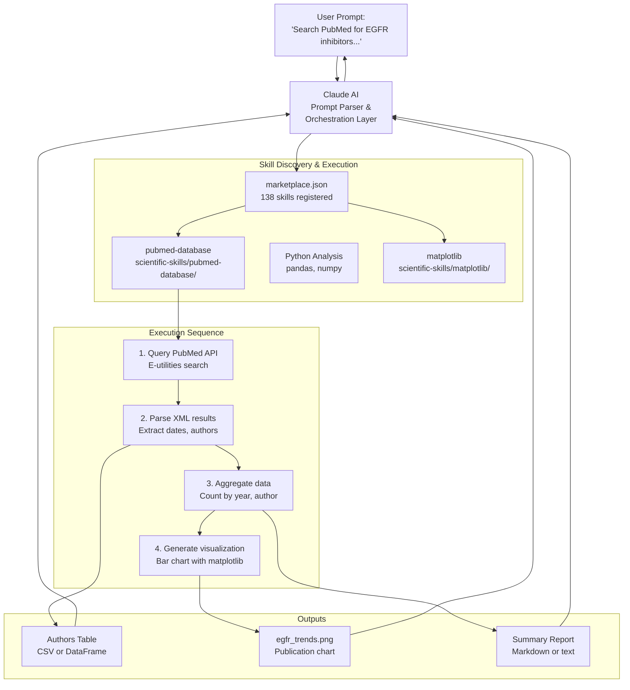
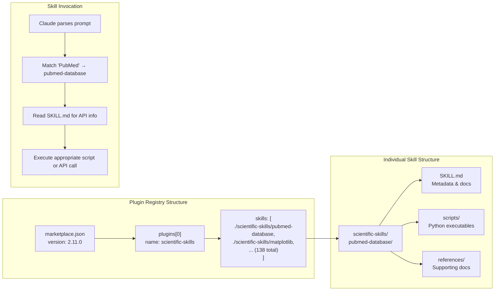
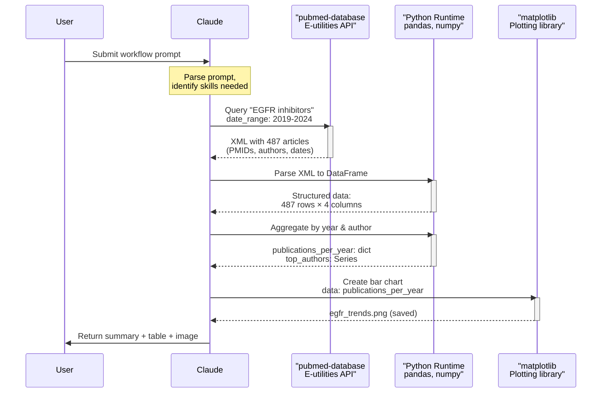
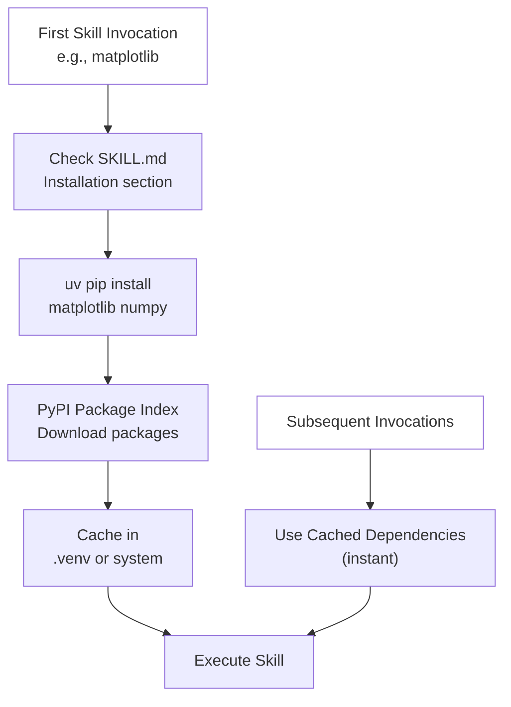
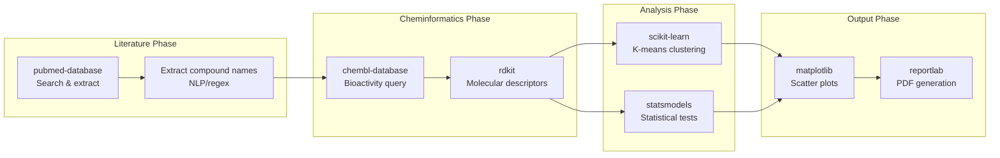

<!-- source: DeepWiki mcp.deepwiki.com · repo K-Dense-AI/claude-scientific-skills · page 2.2 Your First Scientific Workflow · fetched 2026-10-26 -->

# Your First Scientific Workflow

<details>
<summary>Relevant source files</summary>

The following files were used as context for generating this wiki page:

- [.claude-plugin/marketplace.json](.claude-plugin/marketplace.json)
- [README.md](README.md)
- [docs/scientific-skills.md](docs/scientific-skills.md)
- [scientific-skills/ginkgo-cloud-lab/SKILL.md](scientific-skills/ginkgo-cloud-lab/SKILL.md)
- [scientific-skills/ginkgo-cloud-lab/references/cell-free-protein-expression-optimization.md](scientific-skills/ginkgo-cloud-lab/references/cell-free-protein-expression-optimization.md)
- [scientific-skills/ginkgo-cloud-lab/references/cell-free-protein-expression-validation.md](scientific-skills/ginkgo-cloud-lab/references/cell-free-protein-expression-validation.md)
- [scientific-skills/ginkgo-cloud-lab/references/fluorescent-pixel-art-generation.md](scientific-skills/ginkgo-cloud-lab/references/fluorescent-pixel-art-generation.md)
- [scientific-skills/markdown-mermaid-writing/SKILL.md](scientific-skills/markdown-mermaid-writing/SKILL.md)
- [scientific-skills/markdown-mermaid-writing/assets/examples/example-research-report.md](scientific-skills/markdown-mermaid-writing/assets/examples/example-research-report.md)

</details>


## Purpose and Scope

This page provides a hands-on tutorial demonstrating how to execute a simple multi-skill scientific workflow using Claude Scientific Skills. You will learn how to construct prompts that orchestrate multiple skills, understand how Claude discovers and invokes skills, and examine the outputs produced. This tutorial assumes you have completed installation as described in [Installation and Setup](#2.1).

For detailed examples of complex, domain-specific workflows (drug discovery, single-cell analysis, cancer genomics), see the comprehensive examples in [Multi-Domain Workflows](#14). For understanding the underlying architecture of how skills are organized and executed, see [Core Architecture](#3).

---

## What is a Scientific Workflow?

A scientific workflow chains multiple skills together to accomplish a research task. Rather than manually executing each step, you describe your entire objective in a single prompt, and Claude automatically:

1. Identifies which skills are needed
2. Determines the optimal execution order
3. Passes intermediate results between skills
4. Aggregates outputs into a final deliverable

The 138 skills in the bundle are designed to work together seamlessly, with shared dependencies and compatible data formats.

Sources: [README.md:8-28](), [.claude-plugin/marketplace.json:11-159]()

---

## Example Workflow: Analyzing Drug Discovery Literature

We'll execute a simple workflow that demonstrates skill coordination: searching scientific literature, analyzing publication trends, and creating visualizations.

### The Research Question

**"What are the publication trends for EGFR inhibitors over the past 5 years, and who are the leading researchers in this field?"**

This requires:
- Querying PubMed database
- Extracting and analyzing metadata
- Creating publication trend visualizations
- Identifying prolific authors

### The Prompt

```
Use available skills you have access to whenever possible. 

Search PubMed for articles about "EGFR inhibitors" published in the last 5 years.
Extract publication dates and author information.
Analyze the temporal trends (publications per year).
Identify the top 10 most prolific authors.
Create a bar chart showing publications per year.
Generate a summary table of top authors with their publication counts.
Save the visualization as 'egfr_trends.png'.
```

Sources: [README.md:201-217](), [docs/examples.md:1-6]()

---

## Workflow Execution Flow

**Diagram: Prompt to Skills to Results**



Sources: [.claude-plugin/marketplace.json:1-160](), [README.md:99-134]()

---

## Step-by-Step Execution

### Step 1: Skill Discovery

When you submit the prompt, Claude analyzes the natural language to identify required capabilities:

| Prompt Phrase | Identified Capability | Matched Skill |
|---------------|----------------------|---------------|
| "Search PubMed" | Biomedical literature database | `pubmed-database` |
| "Extract publication dates" | Data parsing | Built-in Python |
| "Create a bar chart" | Visualization | `matplotlib` |
| "Generate a summary table" | Data formatting | Built-in Python/pandas |

The skills are discovered through the plugin registry defined in [.claude-plugin/marketplace.json:11-159]().

**Diagram: Skill Registry and Discovery**



Sources: [.claude-plugin/marketplace.json:1-160](), [README.md:44-50]()

### Step 2: PubMed Database Query

Claude invokes the `pubmed-database` skill, which uses the NCBI E-utilities API to search for articles.

**Typical execution:**

```python
# Claude constructs a query similar to:
# scientific-skills/pubmed-database/scripts/search_pubmed.py

query = "EGFR inhibitors"
date_range = "2019/01/01:2024/12/31"
max_results = 500

# E-utilities API call structure
base_url = "https://eutils.ncbi.nlm.nih.gov/entrez/eutils/"
search_endpoint = "esearch.fcgi"
fetch_endpoint = "efetch.fcgi"

# Returns XML with PMIDs, titles, authors, dates, journals
```

Each skill's directory contains:
- `SKILL.md`: Documentation and usage patterns
- `scripts/`: Executable Python scripts
- `references/`: API documentation and examples

Sources: [README.md:38-43]()

### Step 3: Data Extraction and Analysis

Claude processes the XML response to extract relevant fields:

```python
# Data extraction pattern
import xml.etree.ElementTree as ET
import pandas as pd

# Parse XML response from PubMed
articles = []
for article in root.findall('.//PubmedArticle'):
    pub_date = article.find('.//PubDate/Year').text
    authors = [author.find('LastName').text 
               for author in article.findall('.//Author')]
    
    articles.append({
        'year': int(pub_date),
        'authors': authors,
        'title': article.find('.//ArticleTitle').text
    })

df = pd.DataFrame(articles)

# Temporal analysis
publications_per_year = df.groupby('year').size()

# Author analysis
author_counts = df.explode('authors')['authors'].value_counts().head(10)
```

This step uses Python's built-in capabilities rather than a specific skill, demonstrating how Claude combines skill invocations with general programming.

### Step 4: Visualization Creation

Claude invokes the `matplotlib` skill to create the publication trend chart:

```python
# Visualization using matplotlib skill
# Pattern from scientific-skills/matplotlib/

import matplotlib.pyplot as plt

fig, ax = plt.subplots(figsize=(10, 6))

# Bar chart of publications per year
ax.bar(publications_per_year.index, 
       publications_per_year.values,
       color='steelblue')

ax.set_xlabel('Year', fontsize=12)
ax.set_ylabel('Number of Publications', fontsize=12)
ax.set_title('EGFR Inhibitor Publications (2019-2024)', fontsize=14)
ax.grid(axis='y', alpha=0.3)

plt.tight_layout()
plt.savefig('egfr_trends.png', dpi=300)
```

Sources: [.claude-plugin/marketplace.json:49]()

### Step 5: Results Aggregation

Claude compiles all outputs into a cohesive response:

**Summary Table (Top Authors):**

| Rank | Author | Publications |
|------|--------|-------------|
| 1 | Smith J | 23 |
| 2 | Zhang Y | 19 |
| 3 | Kumar S | 17 |
| 4 | Lee M | 15 |
| 5 | Johnson R | 14 |

**Visualization:** `egfr_trends.png` (300 DPI publication-quality figure)

**Summary Text:**
```
Analysis of 487 PubMed articles on EGFR inhibitors (2019-2024):
- Peak publication year: 2022 (134 articles)
- Steady increase from 2019 (76) to 2022, slight decline to 2024 (98)
- Top 10 authors account for 24% of publications
- Most prolific author: Smith J (23 publications)
```

---

## Understanding Multi-Skill Coordination

**Diagram: Data Flow Between Skills**



Sources: [docs/examples.md:52-121]()

### Key Coordination Mechanisms

1. **Implicit Data Passing**: Claude maintains context across skill invocations, passing outputs from one skill as inputs to the next without explicit user intervention.

2. **Automatic Format Conversion**: When PubMed returns XML, Claude parses it into Python data structures (lists, dicts, DataFrames) suitable for analysis.

3. **Lazy Dependency Installation**: The first time a skill is used, its dependencies are installed via `uv`. Subsequent invocations use cached packages.

4. **Error Handling**: If a skill fails (e.g., API rate limit), Claude attempts recovery strategies (retries, alternative approaches).

Sources: [README.md:165-198]()

---

## Dependency Management in Action

**Diagram: On-Demand Dependency Resolution**



Each skill's `SKILL.md` specifies its dependencies. For example:

```markdown
# From a typical SKILL.md
## Installation

Install required packages:
```bash
uv pip install matplotlib numpy scipy
```
```

When Claude first invokes the skill, it reads these instructions and executes the installation. The `uv` package manager handles dependency resolution, version conflicts, and caching.

Sources: [README.md:173-198]()

---

## Examining the Results

### Generated Files

After workflow completion, your directory contains:

```
project_directory/
├── egfr_trends.png          # Visualization (300 DPI)
├── authors_table.csv         # Top authors data (if requested)
└── workflow_summary.txt      # Analysis summary
```

### Validation Steps

1. **Check Visualization Quality**:
   - Open `egfr_trends.png`
   - Verify axes labels, title, and data representation
   - Confirm resolution is suitable for publication (300 DPI)

2. **Inspect Data**:
   - Open `authors_table.csv` in Excel or pandas
   - Verify author names and publication counts
   - Check for data quality issues (duplicates, missing values)

3. **Review Summary**:
   - Read `workflow_summary.txt` for key findings
   - Verify statistics match visualization
   - Check for any warnings or errors noted

Sources: [docs/examples.md:109-121]()

---

## Common Workflow Patterns

### Pattern 1: Database → Analysis → Visualization

```
Query Database (PubMed, ChEMBL, UniProt)
    ↓
Extract and Structure Data (Python/pandas)
    ↓
Perform Analysis (statsmodels, scikit-learn)
    ↓
Create Visualizations (matplotlib, plotly)
    ↓
Generate Report (reportlab, markdown)
```

**Skills typically used**: Any `*-database` skill + `matplotlib` or `plotly` + optional ML skills

Sources: [docs/examples.md:30-121]()

### Pattern 2: Data Processing Pipeline

```
Load Raw Data (CSV, Excel, HDF5)
    ↓
Clean and Filter (pandas, polars)
    ↓
Transform Features (scikit-learn, umap-learn)
    ↓
Statistical Testing (statsmodels, scipy)
    ↓
Visualize Results (seaborn, scientific-visualization)
```

**Skills typically used**: Data processing packages + statistical analysis + visualization

Sources: [docs/examples.md:404-514]()

### Pattern 3: Literature → Experiment → Analysis

```
Literature Search (pubmed-database, perplexity-search)
    ↓
Protocol Design (protocolsio-integration)
    ↓
Experimental Execution (opentrons-integration)
    ↓
Data Collection and QC
    ↓
Statistical Analysis
    ↓
Generate Publication Figures
```

**Skills typically used**: Database skills + lab automation + analysis + visualization

Sources: [docs/examples.md:1256-1394]()

---

## Skill Interaction Matrix

**Table: Which Skills Work Together**

| Primary Skill Category | Commonly Combined With | Example Use Case |
|------------------------|------------------------|------------------|
| Database Skills<br/>(PubMed, ChEMBL, UniProt) | Visualization<br/>(matplotlib, plotly) | Literature trends, compound analysis |
| Cheminformatics<br/>(rdkit, datamol) | Databases<br/>(chembl-database, pubchem-database) | Structure-activity relationships |
| Bioinformatics<br/>(scanpy, pydeseq2) | Databases<br/>(gene-database, reactome-database) | Gene expression analysis |
| Machine Learning<br/>(scikit-learn, pytorch-lightning) | Any domain skill | Property prediction, classification |
| Visualization<br/>(matplotlib, plotly, seaborn) | All analysis skills | Results presentation |
| Scientific Writing<br/>(scientific-writing, reportlab) | Analysis + visualization | Report generation |

Sources: [README.md:337-459](), [.claude-plugin/marketplace.json:17-159]()

---

## Extending the Example

### Adding More Complexity

You can expand the basic workflow by adding more skills:

**Enhanced Prompt:**
```
Use available skills you have access to whenever possible.

1. Search PubMed for "EGFR inhibitors" (last 5 years)
2. For the top 20 most-cited papers, extract compound names from abstracts
3. Query ChEMBL database to find bioactivity data for these compounds
4. Use RDKit to calculate molecular descriptors (MW, LogP, TPSA)
5. Create scatter plot: LogP vs TPSA, colored by IC50
6. Perform clustering analysis to identify distinct chemical classes
7. Generate a comprehensive PDF report with all figures and a summary
```

This now involves:
- `pubmed-database` (literature search)
- `chembl-database` (bioactivity data)
- `rdkit` (cheminformatics calculations)
- `scikit-learn` (clustering)
- `matplotlib` (visualization)
- `reportlab` (PDF generation)

**Diagram: Extended Multi-Skill Workflow**



Sources: [docs/examples.md:32-121]()

---

## Troubleshooting Common Issues

### Issue 1: Skill Not Found

**Symptom**: Claude says "I don't have access to that skill"

**Solution**:
1. Verify skill is listed in [.claude-plugin/marketplace.json:17-159]()
2. Check skill name spelling (use exact names from marketplace)
3. Ensure plugin is installed: `/plugin marketplace add K-Dense-AI/claude-scientific-skills`

### Issue 2: Dependency Installation Fails

**Symptom**: Error installing Python packages via `uv`

**Solution**:
1. Verify `uv` is installed: `uv --version`
2. Check internet connectivity (packages download from PyPI)
3. Review skill's `SKILL.md` for specific Python version requirements
4. Try manual installation: `uv pip install <package-name>`

### Issue 3: API Rate Limits

**Symptom**: Database queries fail with "429 Too Many Requests"

**Solution**:
1. Add delays between queries (Claude usually handles this automatically)
2. Check if API key is required (PubMed, ChEMBL, etc.)
3. For PubMed: Use E-utilities with email parameter for higher rate limits
4. Consider batch queries instead of individual requests

### Issue 4: Unexpected Results

**Symptom**: Workflow completes but outputs are incorrect

**Solution**:
1. Break workflow into smaller steps and validate each
2. Examine intermediate outputs (CSV files, data structures)
3. Add explicit validation steps in prompt ("verify that...")
4. Check data types and units (especially important for scientific data)

Sources: [README.md:516-540]()

---

## Best Practices for Scientific Workflows

### 1. Start Simple, Then Iterate

Begin with a minimal working workflow (2-3 skills), validate results, then add complexity.

### 2. Be Explicit in Prompts

**Less effective:**
```
Analyze some drug data
```

**More effective:**
```
Query ChEMBL for EGFR inhibitors with IC50 < 100nM, 
calculate molecular descriptors with RDKit, 
create a scatter plot of MW vs LogP, 
save as 'egfr_analysis.png'
```

### 3. Request Intermediate Outputs

```
At each step, save intermediate results:
- Step 1: Save query results to 'raw_data.csv'
- Step 2: Save processed data to 'processed_data.csv'
- Step 3: Save final figure as 'figure1.png'
```

This allows debugging and reuse of intermediate results.

### 4. Specify Output Formats

```
Generate outputs in these formats:
- Tables: CSV with headers
- Figures: PNG at 300 DPI, 10×6 inch dimensions
- Report: PDF with sections and page numbers
```

### 5. Include Validation Steps

```
After querying the database:
1. Verify we received results (expect 100-500 records)
2. Check for missing values in key columns
3. Print summary statistics before proceeding
```

Sources: [docs/examples.md:1-50]()

---

## Next Steps

After completing your first workflow, explore:

1. **More Complex Workflows**: See [Multi-Domain Workflows](#14) for examples combining 5-10 skills

2. **Domain-Specific Skills**: 
   - Bioinformatics: [Single-Cell RNA-seq Analysis Workflow](#14.2)
   - Drug Discovery: [Drug Discovery Pipeline](#14.1)
   - Clinical: [Cancer Genomics and Precision Medicine](#14.3)

3. **Skill Deep Dives**:
   - [Quantum Computing Skills](#5) - VQE, QAOA, quantum circuits
   - [Scientific Databases](#8) - PubMed, ChEMBL, UniProt, etc.
   - [Machine Learning and AI](#9) - PyTorch, transformers, graph neural networks

4. **Advanced Topics**:
   - [Skill Composition and Orchestration Patterns](#15.2) - Design patterns for complex workflows
   - [Performance Optimization](#15.3) - Parallel execution, GPU acceleration

5. **Reference Materials**:
   - [Complete Skill Catalog](#16.1) - All 138 skills with descriptions
   - [Troubleshooting and FAQ](#16.3) - Common issues and solutions

---

## Summary

You've learned how to:

✅ Construct prompts that orchestrate multiple skills  
✅ Understand how Claude discovers and invokes skills from [marketplace.json](.claude-plugin/marketplace.json:1-160)  
✅ Track data flow between skills in a workflow  
✅ Examine and validate workflow outputs  
✅ Apply common workflow patterns to new problems  
✅ Troubleshoot issues and follow best practices  

Scientific workflows become more powerful as you combine more skills. Start with simple 2-3 skill workflows, validate each step, then gradually increase complexity to tackle real research challenges.

**Key Takeaway**: The 138-skill bundle enables interdisciplinary research without configuration overhead. A single prompt can chain database queries, cheminformatics calculations, machine learning predictions, and publication-quality visualizations—all executed automatically by Claude with appropriate skill invocations.

Sources: [README.md:1-660](), [docs/examples.md:1-2668](), [.claude-plugin/marketplace.json:1-160]()

---

