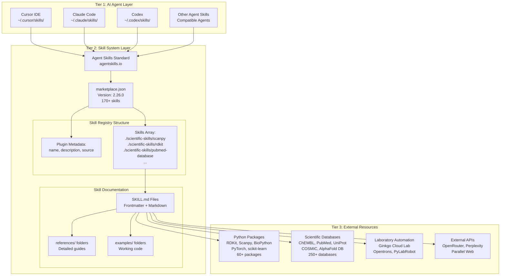
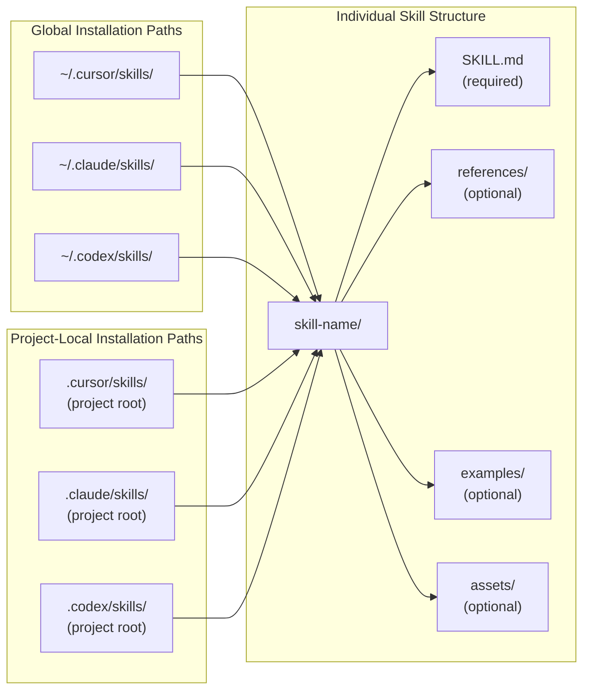
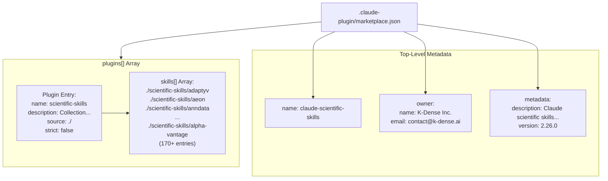
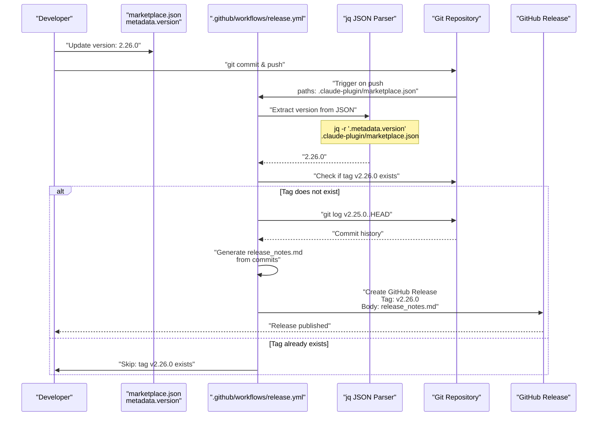
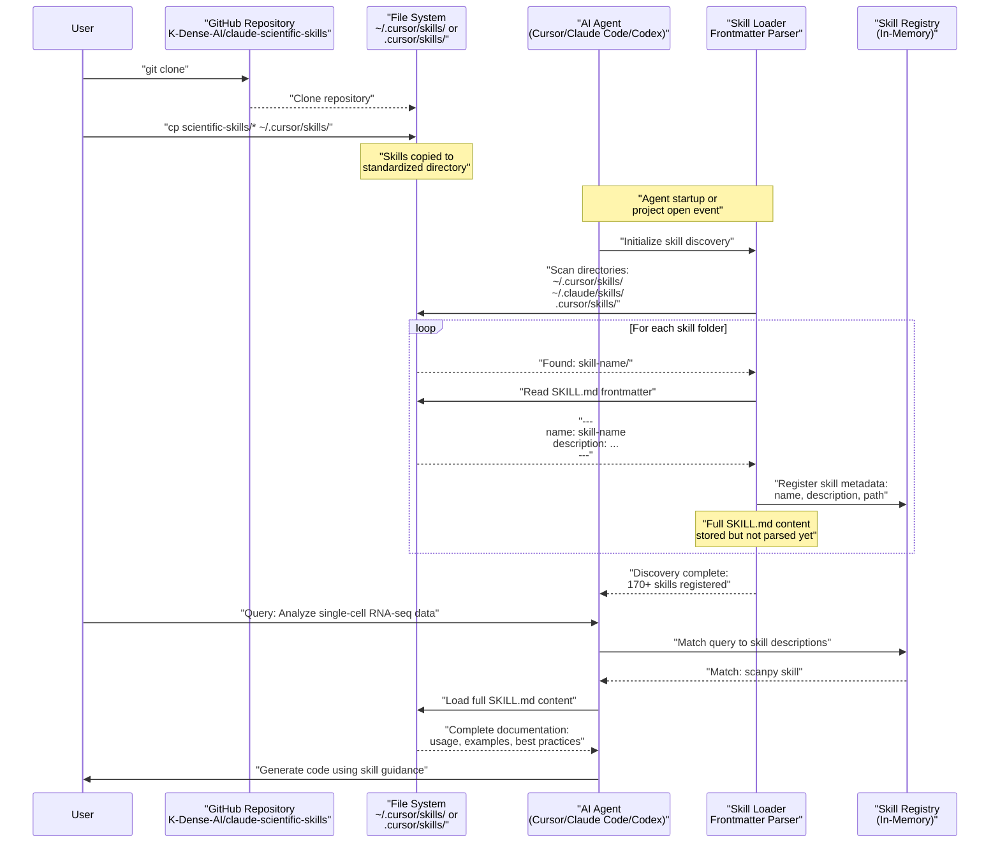
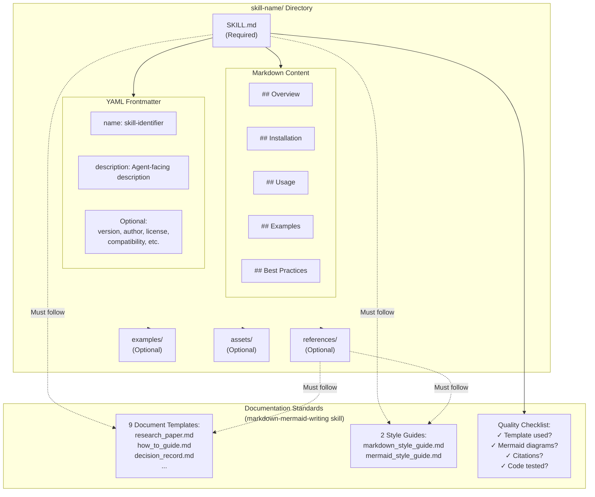
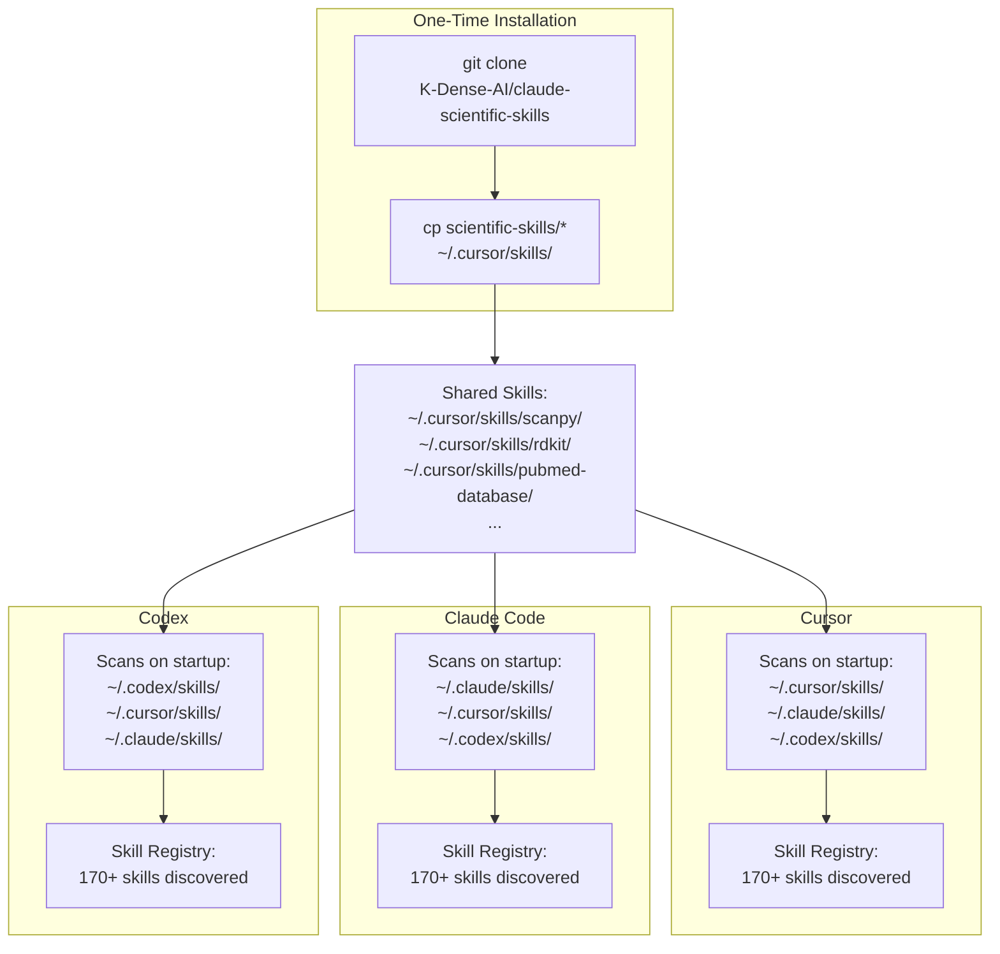

<!-- source: DeepWiki mcp.deepwiki.com · repo K-Dense-AI/claude-scientific-skills · page 3 Core Architecture · fetched 2026-10-26 -->

# Core Architecture

<details>
<summary>Relevant source files</summary>

The following files were used as context for generating this wiki page:

- [.claude-plugin/marketplace.json](.claude-plugin/marketplace.json)
- [README.md](README.md)
- [docs/scientific-skills.md](docs/scientific-skills.md)
- [scientific-skills/ginkgo-cloud-lab/SKILL.md](scientific-skills/ginkgo-cloud-lab/SKILL.md)
- [scientific-skills/ginkgo-cloud-lab/references/cell-free-protein-expression-optimization.md](scientific-skills/ginkgo-cloud-lab/references/cell-free-protein-expression-optimization.md)
- [scientific-skills/ginkgo-cloud-lab/references/cell-free-protein-expression-validation.md](scientific-skills/ginkgo-cloud-lab/references/cell-free-protein-expression-validation.md)
- [scientific-skills/ginkgo-cloud-lab/references/fluorescent-pixel-art-generation.md](scientific-skills/ginkgo-cloud-lab/references/fluorescent-pixel-art-generation.md)

</details>


## Purpose and Scope

This document describes the core architecture of the Claude Scientific Skills system, including the three-tier model, the Agent Skills standard compliance, skill distribution mechanisms, and the plugin system. For detailed information about specific aspects:

- For step-by-step installation and directory configuration, see [Installation and Setup](#2.1)
- For how the skill discovery mechanism parses and registers skills, see [Skill Discovery and Loading Mechanism](#3.2)
- For the complete schema and validation rules for `marketplace.json`, see [Marketplace Configuration Reference](#10.2)
- For requirements and best practices when creating new skills, see [Creating New Skills](#9.3)

## System Architecture Overview

The Claude Scientific Skills system implements a three-tier architecture that decouples AI agents from scientific tooling, enabling cross-platform compatibility and extensibility.

### Three-Tier Architecture



**Sources:** [README.md:1-50](), [.claude-plugin/marketplace.json:1-194]()

The architecture separates concerns into three distinct tiers:

| Tier | Responsibility | Key Components |
|------|---------------|----------------|
| **Tier 1: AI Agent Layer** | Provides user interface and code generation capabilities | Cursor, Claude Code, Codex, and other Agent Skills-compatible tools |
| **Tier 2: Skill System Layer** | Manages skill discovery, documentation, and metadata | `marketplace.json`, `SKILL.md` files, Agent Skills standard |
| **Tier 3: External Resources** | Executes actual scientific workflows | Python packages, databases, cloud platforms, APIs |

This decoupling enables agents to be upgraded or switched without modifying skills, and new scientific tools can be added by creating new skill documentation without changing the agent layer.

**Sources:** [README.md:12-42](), High-Level System Architecture Diagram 1

## Agent Skills Standard Compliance

Claude Scientific Skills implements the open [Agent Skills standard](https://agentskills.io/specification) for cross-platform skill interoperability.

### Directory Structure Conventions



**Sources:** [README.md:117-162]()

Each AI agent scans these standardized directories on startup to discover available skills. The convention enables **cross-platform portability**—a skill installed in `~/.cursor/skills/` is automatically discovered by all three major agents (Cursor reads from `.claude/skills/` and `.codex/skills/` directories as well, and vice versa).

### SKILL.md File Structure

Every skill must contain a `SKILL.md` file with YAML frontmatter followed by Markdown content:

```markdown
---
name: skill-identifier
description: Brief description used by agents for skill matching
---

# Skill Name

## Overview
[Markdown content with usage examples, best practices, etc.]
```

The frontmatter provides machine-readable metadata for skill discovery, while the Markdown body provides human-readable documentation that agents can reference when generating code.

**Sources:** [README.md:585-591](), High-Level System Architecture Diagram 5

For the complete specification of `SKILL.md` structure and required fields, see [SKILL.md Anatomy and Structure](#3.4).

## Marketplace and Plugin System

The `.claude-plugin/marketplace.json` file serves as the **single source of truth** for skill versioning, packaging, and distribution.

### Marketplace Configuration Structure



**Sources:** [.claude-plugin/marketplace.json:1-194]()

The `marketplace.json` structure contains:

| Field | Purpose | Example Value |
|-------|---------|---------------|
| `name` | Repository identifier | `"claude-scientific-skills"` |
| `owner.name` | Maintainer organization | `"K-Dense Inc."` |
| `owner.email` | Contact for support | `"contact@k-dense.ai"` |
| `metadata.version` | Semantic version for releases | `"2.26.0"` |
| `plugins[].name` | Plugin collection name | `"scientific-skills"` |
| `plugins[].source` | Base directory for skills | `"./"` |
| `plugins[].skills[]` | Array of skill paths | `["./scientific-skills/scanpy", ...]` |

### Version-Driven Release Automation

The `metadata.version` field in `marketplace.json` triggers automated GitHub releases:



**Sources:** [.github/workflows/release.yml:1-98]() (file not provided but referenced in diagrams), High-Level System Architecture Diagram 7

The automated release workflow extracts the version from `marketplace.json` using `jq`, checks if a corresponding Git tag exists, generates release notes from commit history, and creates a GitHub release. This ensures every version bump automatically produces a tagged release.

For complete details on the release automation logic, see [Release Automation and Versioning](#9.2).

## Skill Discovery Flow

The following diagram shows how skills transition from repository files to registered capabilities within an AI agent:



**Sources:** [README.md:117-162](), High-Level System Architecture Diagram 2

The skill discovery process operates in two phases:

1. **Startup Discovery (Lazy)**: The agent scans skill directories and parses only the YAML frontmatter to build a registry of available skills. Full documentation is not loaded into memory.

2. **On-Demand Loading (Just-in-Time)**: When a user query matches a skill (based on `name` and `description` metadata), the agent loads the complete `SKILL.md` file, including examples and best practices, to guide code generation.

This lazy loading strategy minimizes memory footprint while providing fast skill matching.

For implementation details of the skill loading mechanism, see [Skill Discovery and Loading Mechanism](#3.2).

## Skill Documentation Architecture

All skills follow a standardized documentation architecture enforced by the `markdown-mermaid-writing` skill:



**Sources:** [scientific-skills/ginkgo-cloud-lab/SKILL.md:1-57](), [scientific-skills/ginkgo-cloud-lab/references/cell-free-protein-expression-validation.md:1-72](), High-Level System Architecture Diagram 5

### Required vs. Optional Components

| Component | Required? | Purpose |
|-----------|----------|---------|
| `SKILL.md` | **Yes** | Core skill documentation with frontmatter and usage examples |
| `references/` | No | Additional detailed guides, API references, advanced topics |
| `examples/` | No | Working code samples, Jupyter notebooks, output files |
| `assets/` | No | Images, diagrams, templates, data files |

### Cross-Referencing Structure

Skills link to supporting documentation using relative paths:

```markdown
## Overview
Brief introduction here.

For detailed protocol parameters, see [references/protocol-details.md](references/protocol-details.md).

For working code examples, see [examples/basic-usage.py](examples/basic-usage.py).
```

This structure enables modular documentation where `SKILL.md` provides a concise overview, while `references/` and `examples/` contain comprehensive details that would clutter the main file.

**Example:** The Ginkgo Cloud Lab skill demonstrates this pattern:

- [scientific-skills/ginkgo-cloud-lab/SKILL.md:1-57]() — Overview with pricing and protocol selection
- [scientific-skills/ginkgo-cloud-lab/references/cell-free-protein-expression-validation.md:1-72]() — Detailed validation protocol workflow
- [scientific-skills/ginkgo-cloud-lab/references/cell-free-protein-expression-optimization.md:1-86]() — DoE-based optimization protocol details

For complete requirements on `SKILL.md` structure, see [SKILL.md Anatomy and Structure](#3.4). For documentation quality enforcement, see [Documentation Standards](#3.5).

## Cross-Platform Skill Compatibility

The standardized directory structure enables write-once, use-everywhere skill portability:



**Sources:** [README.md:117-162]()

Key compatibility features:

1. **Cross-Directory Scanning**: Cursor reads from `.claude/skills/` and `.codex/skills/` in addition to `.cursor/skills/`, and vice versa for other agents.

2. **Global vs. Project-Local**: Skills can be installed globally (`~/.cursor/skills/`) for all projects or per-project (`.cursor/skills/` in project root).

3. **No Agent-Specific Modifications**: Skills contain no agent-specific code or configuration. The same `SKILL.md` file works identically across all Agent Skills-compatible tools.

This design ensures that installing skills for one agent automatically makes them available to all other compatible agents on the system.

**Sources:** [README.md:128-162]()

## Skill Catalog Size and Organization

The `marketplace.json` currently catalogs **170+ skills** across 8 major scientific domains:

| Domain | Skill Count | Example Skills |
|--------|-------------|----------------|
| Bioinformatics & Genomics | 20+ | `scanpy`, `arboreto`, `scvelo`, `tiledbvcf`, `cellxgene-census` |
| Cheminformatics & Drug Discovery | 13+ | `rdkit`, `deepchem`, `diffdock`, `molecular-dynamics` |
| Clinical Research | 16+ | `clinvar-database`, `cosmic-database`, `cbioportal-database` |
| Machine Learning & AI | 16+ | `pytorch-lightning`, `scikit-learn`, `timesfm-forecasting` |
| Scientific Databases | 37+ direct<br/>250+ total | `pubmed-database`, `chembl-database`, `uniprot-database` |
| Laboratory Automation | 4 | `ginkgo-cloud-lab`, `opentrons-integration`, `pylabrobot` |
| Scientific Communication | 24+ | `markdown-mermaid-writing`, `generate-image`, `latex-posters` |
| Research Methodology | 11+ | `hypothesis-generation`, `consciousness-council`, `research-lookup` |

The distinction between "37+ direct" and "250+ total" for databases reflects the **dual-strategy database access architecture**: 37 dedicated database skills provide curated documentation for high-priority resources, while multi-database aggregator skills (`bioservices`, `biopython`, `gget`) provide access to hundreds of additional databases through unified interfaces.

**Sources:** [README.md:52-59](), [docs/scientific-skills.md:1-100](), [.claude-plugin/marketplace.json:11-191]()

For a complete catalog with descriptions, see [Complete Skill Catalog](#10.1). For how the multi-database architecture works, see [Database Access Architecture](#5.1).

---

**Summary**: The Claude Scientific Skills system implements a three-tier architecture with standardized skill discovery (Agent Skills standard), centralized versioning (`marketplace.json`), and modular documentation (`SKILL.md` with `references/` and `examples/` folders). This design enables cross-platform compatibility, automated release management, and extensibility through a plugin model that currently supports 170+ scientific skills across 8 domains.

---

