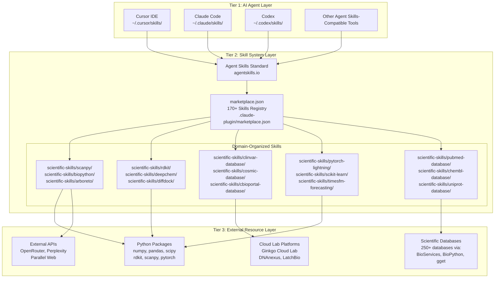
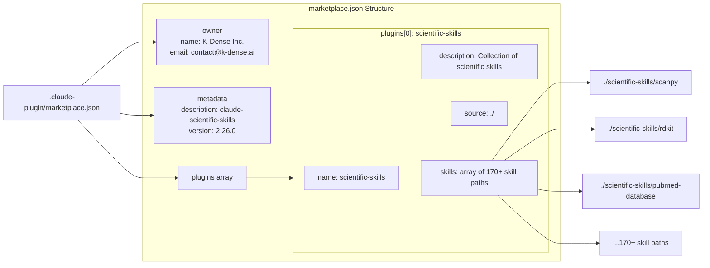
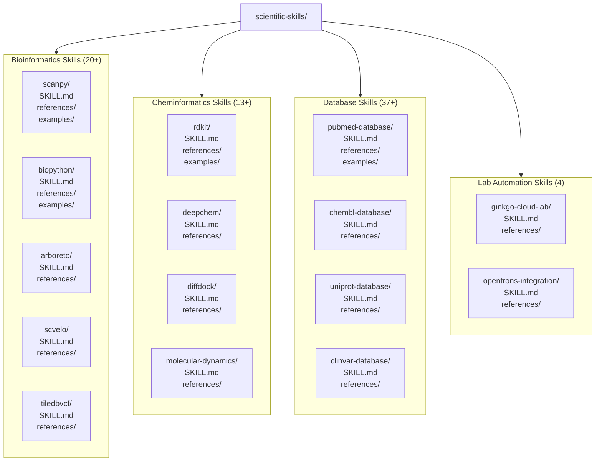
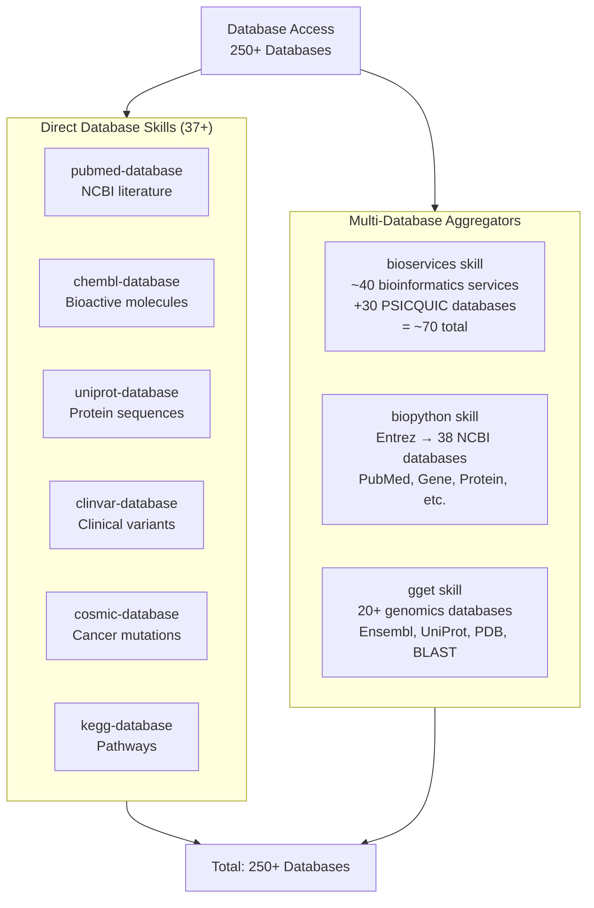
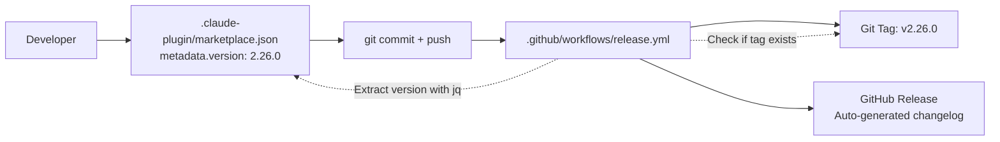

<!-- source: DeepWiki mcp.deepwiki.com · repo K-Dense-AI/claude-scientific-skills · page 3.1 System Overview and Three-Tier Architecture · fetched 2026-10-26 -->

# System Overview and Three-Tier Architecture

<details>
<summary>Relevant source files</summary>

The following files were used as context for generating this wiki page:

- [.claude-plugin/marketplace.json](.claude-plugin/marketplace.json)
- [README.md](README.md)
- [docs/scientific-skills.md](docs/scientific-skills.md)
- [scientific-skills/ginkgo-cloud-lab/SKILL.md](scientific-skills/ginkgo-cloud-lab/SKILL.md)
- [scientific-skills/ginkgo-cloud-lab/references/cell-free-protein-expression-optimization.md](scientific-skills/ginkgo-cloud-lab/references/cell-free-protein-expression-optimization.md)
- [scientific-skills/ginkgo-cloud-lab/references/cell-free-protein-expression-validation.md](scientific-skills/ginkgo-cloud-lab/references/cell-free-protein-expression-validation.md)
- [scientific-skills/ginkgo-cloud-lab/references/fluorescent-pixel-art-generation.md](scientific-skills/ginkgo-cloud-lab/references/fluorescent-pixel-art-generation.md)

</details>


## Purpose and Scope

This document describes the overall system architecture of Claude Scientific Skills, focusing on the three-tier design that separates AI agents, skill definitions, and external resources. It covers how the layers interact, where skill files are stored, and how the marketplace.json registry organizes 170+ skills across scientific domains.

For details on how skills are discovered and loaded at runtime, see [Skill Discovery and Loading Mechanism](#3.2). For the internal structure of SKILL.md files, see [SKILL.md Anatomy and Structure](#3.4). For documentation quality standards, see [Documentation Standards](#3.5).

**Sources:** [README.md:1-50](), [README.md:89-162]()

---

## Three-Tier Architecture Overview

Claude Scientific Skills implements a decoupled three-tier architecture that separates AI agents from scientific tooling. This design enables cross-tool compatibility, seamless upgrades, and provider switching without rewriting skills.



**Diagram: Three-Tier Architecture with File Path Mappings**

The three tiers are:

| Tier | Purpose | Key Components |
|------|---------|----------------|
| **Tier 1: AI Agent Layer** | Provides the user interface and AI orchestration | Cursor, Claude Code, Codex, and other Agent Skills-compatible tools |
| **Tier 2: Skill System Layer** | Defines scientific capabilities as portable, documented skills | marketplace.json registry, SKILL.md files, skill directories organized by domain |
| **Tier 3: External Resource Layer** | Implements actual scientific functionality | 60+ Python packages, 250+ databases, cloud platforms, APIs |

**Sources:** [README.md:12-58](), [.claude-plugin/marketplace.json:1-194](), Diagram 1 from high-level architecture

---

## Tier 1: AI Agent Layer

The AI Agent Layer consists of AI coding assistants that support the [Agent Skills](https://agentskills.io/) standard. These agents read skill directories, parse SKILL.md files, and use the documentation to generate domain-specific code.

### Compatible Agents

The system currently supports three primary agents:

| Agent | Skill Directory | Cross-Compatibility |
|-------|----------------|---------------------|
| **Cursor** | `~/.cursor/skills/` (global)<br/>`.cursor/skills/` (project-local) | Also reads `.claude/skills/` and `.codex/skills/` |
| **Claude Code** | `~/.claude/skills/` (global)<br/>`.claude/skills/` (project-local) | Also reads `.cursor/skills/` and `.codex/skills/` |
| **Codex** | `~/.codex/skills/` (global)<br/>`.codex/skills/` (project-local) | Also reads `.cursor/skills/` and `.claude/skills/` |

All agents that implement the Agent Skills standard can use these skills without modification. The write-once, use-everywhere design means installing skills for Cursor automatically makes them available to Claude Code and Codex.

### Agent Responsibilities

Each agent in Tier 1 is responsible for:

1. **Skill Discovery**: Scanning standardized directories for skill folders at startup
2. **Metadata Parsing**: Extracting frontmatter from SKILL.md files to build a skill registry
3. **Relevance Matching**: Mapping user prompts to registered skills based on descriptions and keywords
4. **Documentation Loading**: Reading full SKILL.md content when a skill is invoked
5. **Code Generation**: Using skill documentation to generate scientifically accurate code

**Sources:** [README.md:113-162](), [README.md:669-670]()

---

## Tier 2: Skill System Layer

The Skill System Layer is the heart of Claude Scientific Skills, providing 170+ documented scientific capabilities organized by domain. It consists of three key components: the marketplace.json registry, the skill directory structure, and individual SKILL.md files.

### marketplace.json Registry

The `marketplace.json` file serves as the central skill registry and version control manifest. Located at [.claude-plugin/marketplace.json](), it defines the plugin structure, metadata, and paths to all skill directories.



**Diagram: marketplace.json Structure and Skill Path Registration**

Key fields in marketplace.json:

| Field | Purpose | Example |
|-------|---------|---------|
| `name` | Unique identifier for the plugin collection | `"claude-scientific-skills"` |
| `owner.name` | Organization maintaining the skills | `"K-Dense Inc."` |
| `metadata.version` | Current version (triggers automated releases) | `"2.26.0"` |
| `plugins[].skills[]` | Array of relative paths to skill directories | `"./scientific-skills/scanpy"` |

**Sources:** [.claude-plugin/marketplace.json:1-194]()

### Skill Directory Structure

Skills are organized in the `scientific-skills/` directory with one folder per skill. Each skill folder contains:

- **SKILL.md** (required): Skill definition with frontmatter metadata and documentation
- **references/** (optional): Detailed guides, API references, advanced topics
- **examples/** (optional): Working code, Jupyter notebooks, output files
- **assets/** (optional): Images, diagrams, templates



**Diagram: Skill Directory Organization by Domain**

**Sources:** [.claude-plugin/marketplace.json:17-191](), [README.md:50-59]()

### Domain Organization

Skills are organized into eight major scientific domains:

| Domain | Skill Count | Examples |
|--------|-------------|----------|
| **Bioinformatics & Genomics** | 20+ | scanpy, biopython, arboreto, scvelo, tiledbvcf, cellxgene-census |
| **Cheminformatics & Drug Discovery** | 13+ | rdkit, deepchem, diffdock, molecular-dynamics, datamol |
| **Clinical Research & Precision Medicine** | 16+ | clinvar-database, cosmic-database, cbioportal-database, depmap |
| **Machine Learning & AI** | 16+ | pytorch-lightning, scikit-learn, timesfm-forecasting, torch_geometric |
| **Scientific Databases** | 37+ | pubmed-database, chembl-database, uniprot-database, kegg-database |
| **Laboratory Automation** | 4 | ginkgo-cloud-lab, opentrons-integration, pylabrobot |
| **Scientific Communication** | 24+ | markdown-mermaid-writing, generate-image, scientific-writing |
| **Research Methodology** | 11+ | hypothesis-generation, scientific-brainstorming, research-grants |

**Sources:** [README.md:24-41](), [README.md:398-546](), [docs/scientific-skills.md:1-50]()

---

## Tier 3: External Resource Layer

The External Resource Layer implements the actual scientific functionality that skills document and invoke. It consists of four categories of resources:

### Python Packages (60+ Skills)

The system provides explicitly defined skills for 60+ Python packages. These skills include curated documentation, examples, and best practices. The AI agent can use any Python package, but these 60+ have optimized skill definitions.

**Example packages with dedicated skills:**
- **Bioinformatics**: scanpy, biopython, pysam, arboreto, scvelo
- **Cheminformatics**: rdkit, deepchem, datamol, molfeat
- **Machine Learning**: pytorch-lightning, scikit-learn, transformers
- **Molecular Dynamics**: OpenMM (molecular-dynamics skill), MDAnalysis
- **Data Science**: matplotlib, seaborn, plotly, networkx, polars

**Sources:** [README.md:55-56](), [docs/scientific-skills.md:61-200]()

### Scientific Databases (250+ Total)

The system provides access to 250+ scientific databases through two strategies:

1. **37+ Direct Database Skills**: Dedicated skills with curated documentation for high-priority databases
2. **Multi-Database Aggregator Skills**: Skills that wrap packages providing access to hundreds of additional databases



**Diagram: Dual-Strategy Database Access Architecture**

**Sources:** [README.md:52-54](), [README.md:97-99](), [docs/scientific-skills.md:3-36]()

### Cloud Lab Platforms

Laboratory automation skills bridge computational design to physical wet-lab execution:

| Platform | Skill | Capabilities |
|----------|-------|-------------|
| **Ginkgo Cloud Lab** | ginkgo-cloud-lab | Cell-free protein expression ($39-$199/sample), fluorescent pixel art ($25/plate) |
| **DNAnexus** | dnanexus-integration | Genomics pipelines, FASTQ/BAM/VCF processing |
| **LatchBio** | latchbio-integration | Serverless bioinformatics workflows, Nextflow/Snakemake |
| **Opentrons** | opentrons-integration | Liquid handling protocols for OT-2 and Flex robots |

**Example: Ginkgo Cloud Lab pricing and protocols**

From [scientific-skills/ginkgo-cloud-lab/SKILL.md:1-57]() and [scientific-skills/ginkgo-cloud-lab/references/cell-free-protein-expression-validation.md:1-72]():

- **CFPS Validation**: $39/sample, 5-10 day turnaround, go/no-go expression screening
- **CFPS Optimization**: $199/sample, 6-11 days, 24-condition DoE with chaperones and cofactors
- **Fluorescent Pixel Art**: $25/plate, 5-7 days, 11 fluorescent E. coli strains

**Sources:** [scientific-skills/ginkgo-cloud-lab/SKILL.md:1-57](), [scientific-skills/ginkgo-cloud-lab/references/cell-free-protein-expression-validation.md:1-72](), [scientific-skills/ginkgo-cloud-lab/references/cell-free-protein-expression-optimization.md:1-86]()

### External APIs

Several skills provide access to AI-powered services and external APIs:

| API | Skill | Use Case |
|-----|-------|----------|
| **OpenRouter** | generate-image | AI image generation with FLUX.2 Pro |
| **Perplexity** | perplexity-search | AI-powered web search with citations |
| **Parallel Web** | parallel-web | Synthesized research summaries |
| **FRED** | fred-economic-data | 800K+ economic time series from Federal Reserve |

**Sources:** [.claude-plugin/marketplace.json:65-67](), [.claude-plugin/marketplace.json:121](), [.claude-plugin/marketplace.json:159]()

---

## System Interaction Flow

The following diagram shows how a user query flows through all three tiers to produce scientific results:

```mermaid
sequenceDiagram
    participant User
    participant Agent["AI Agent<br/>(Cursor/Claude Code/Codex)"]
    participant SkillRegistry["Skill Registry<br/>(in-memory from marketplace.json)"]
    participant SkillFile["SKILL.md<br/>(filesystem)"]
    participant PythonPkg["Python Package<br/>(Tier 3 Resource)"]
    participant Database["Scientific Database<br/>(Tier 3 Resource)"]
    
    Note over User,Agent: User asks scientific question
    User->>Agent: "Analyze EGFR inhibitors from ChEMBL<br/>with IC50 < 50nM using RDKit"
    
    Note over Agent,SkillRegistry: Agent startup (skill discovery)
    Agent->>SkillRegistry: Scan ~/.cursor/skills/<br/>Parse SKILL.md frontmatter
    SkillRegistry-->>Agent: Register: chembl-database, rdkit
    
    Note over Agent,SkillFile: Query execution
    Agent->>SkillRegistry: Match query to skills:<br/>"chembl-database", "rdkit"
    SkillRegistry-->>Agent: Skill metadata:<br/>name, description, tools
    
    Agent->>SkillFile: Load scientific-skills/chembl-database/SKILL.md
    SkillFile-->>Agent: Full documentation:<br/>API endpoints, query syntax, examples
    
    Agent->>SkillFile: Load scientific-skills/rdkit/SKILL.md
    SkillFile-->>Agent: Full documentation:<br/>molecular descriptors, substructure search
    
    Note over Agent,PythonPkg: Code generation
    Agent->>Agent: Generate code using skill guidance
    Agent->>PythonPkg: Execute: import rdkit.Chem<br/>from chembl_webresource_client...
    
    Note over PythonPkg,Database: External resource execution
    PythonPkg->>Database: HTTP GET https://www.ebi.ac.uk/chembl/api/...<br/>Query: EGFR + IC50 < 50nM
    Database-->>PythonPkg: JSON response: compounds list
    
    PythonPkg->>PythonPkg: RDKit analysis:<br/>MolFromSmiles(), Descriptors.MolWt()
    PythonPkg-->>Agent: Results: 47 compounds,<br/>molecular properties, structures
    
    Agent-->>User: Display results + generated code
```

**Diagram: End-to-End Query Execution Flow Across Three Tiers**

**Sources:** [README.md:113-162](), Diagram 2 from high-level architecture

---

## Installation and Directory Conventions

Users install skills by copying the `scientific-skills/` directory to standardized locations. The Agent Skills standard defines both global and project-local installation paths.

### Global Installation (Skills Available System-Wide)

```
~/.cursor/skills/scanpy/SKILL.md
~/.cursor/skills/rdkit/SKILL.md
~/.cursor/skills/pubmed-database/SKILL.md
...

~/.claude/skills/scanpy/SKILL.md
~/.claude/skills/rdkit/SKILL.md
...

~/.codex/skills/scanpy/SKILL.md
~/.codex/skills/rdkit/SKILL.md
...
```

### Project-Local Installation (Skills Scoped to Single Project)

```
/path/to/project/.cursor/skills/scanpy/SKILL.md
/path/to/project/.cursor/skills/rdkit/SKILL.md
...
```

### Cross-Compatibility

All agents read all three directory names (`.cursor/skills/`, `.claude/skills/`, `.codex/skills/`) regardless of which agent is running. This enables write-once, use-everywhere portability.

**Sources:** [README.md:123-162]()

---

## Version Control and Release Automation

The marketplace.json file serves as the single source of truth for versioning. When the version field is updated, a GitHub Actions workflow automatically creates a tagged release.



**Diagram: Automated Release Pipeline Triggered by marketplace.json**

The workflow [.github/workflows/release.yml:1-98]() performs:
1. Extract version from `.claude-plugin/marketplace.json` using `jq`
2. Check if tag exists (skip if duplicate)
3. Generate release notes from git commit history
4. Create GitHub release with auto-generated changelog

**Sources:** [.claude-plugin/marketplace.json:9](), Diagram 7 from high-level architecture

---

## Summary

The three-tier architecture achieves several key design goals:

| Goal | Implementation |
|------|----------------|
| **Cross-Tool Compatibility** | Agent Skills standard enables Cursor, Claude Code, Codex, and future tools to share skills |
| **Separation of Concerns** | Agents (Tier 1) focus on UI/AI, skills (Tier 2) provide documentation, resources (Tier 3) implement functionality |
| **Scalability** | Adding new skills requires only creating SKILL.md files and updating marketplace.json |
| **Version Control** | marketplace.json version field triggers automated releases via GitHub Actions |
| **Maintainability** | Skill documentation is decoupled from Python packages, enabling independent updates |
| **Discoverability** | Standardized directory structure and frontmatter parsing enable automatic skill registration |

The system currently provides 170+ skills organized across 8 scientific domains, collectively accessing 60+ Python packages, 250+ databases, cloud lab platforms, and external APIs.

**Sources:** [README.md:1-112](), [README.md:398-546](), [.claude-plugin/marketplace.json:1-194]()

---

