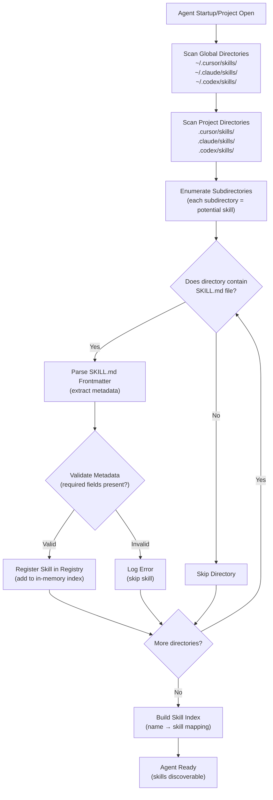
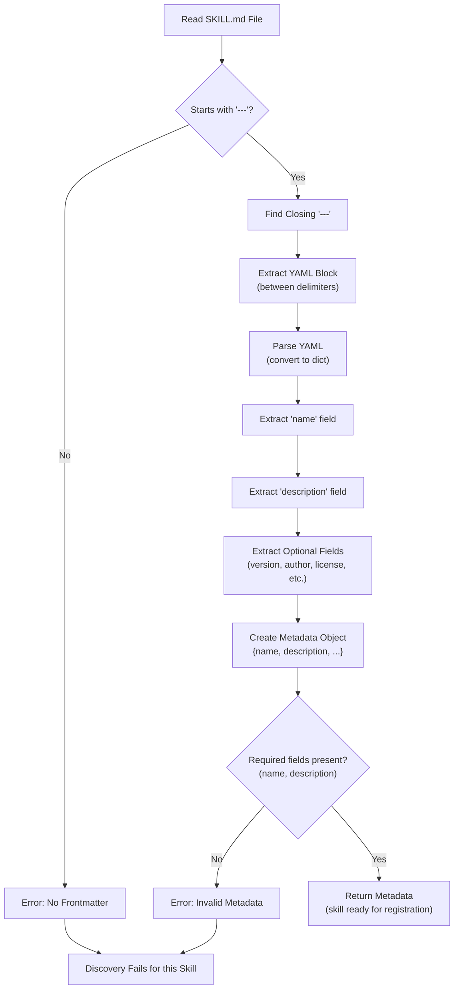
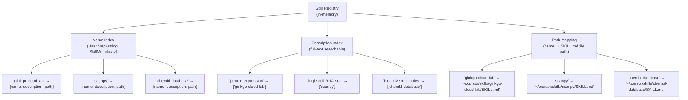
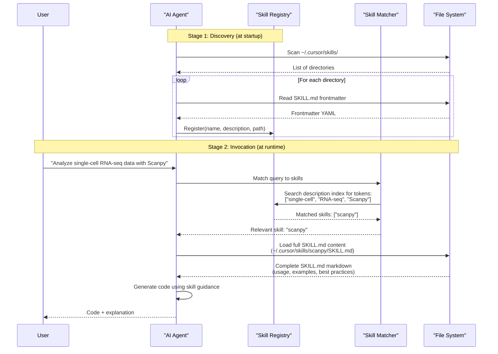
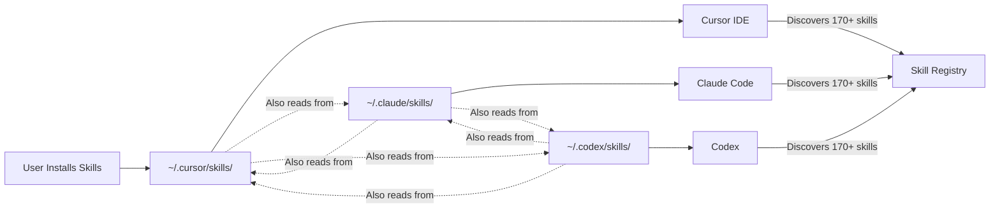

<!-- source: DeepWiki mcp.deepwiki.com · repo K-Dense-AI/claude-scientific-skills · page 3.2 Skill Discovery and Loading Mechanism · fetched 2026-10-26 -->

# Skill Discovery and Loading Mechanism

<details>
<summary>Relevant source files</summary>

The following files were used as context for generating this wiki page:

- [.claude-plugin/marketplace.json](.claude-plugin/marketplace.json)
- [README.md](README.md)
- [docs/scientific-skills.md](docs/scientific-skills.md)
- [scientific-skills/ginkgo-cloud-lab/SKILL.md](scientific-skills/ginkgo-cloud-lab/SKILL.md)
- [scientific-skills/ginkgo-cloud-lab/references/cell-free-protein-expression-optimization.md](scientific-skills/ginkgo-cloud-lab/references/cell-free-protein-expression-optimization.md)
- [scientific-skills/ginkgo-cloud-lab/references/cell-free-protein-expression-validation.md](scientific-skills/ginkgo-cloud-lab/references/cell-free-protein-expression-validation.md)
- [scientific-skills/ginkgo-cloud-lab/references/fluorescent-pixel-art-generation.md](scientific-skills/ginkgo-cloud-lab/references/fluorescent-pixel-art-generation.md)

</details>


## Purpose and Scope

This page documents the technical mechanism by which AI agents discover, parse, register, and load skills from the filesystem. It covers directory scanning, SKILL.md frontmatter extraction, skill registration, and the two-stage loading process that enables efficient skill matching and invocation.

For information about the marketplace.json structure and plugin distribution model, see [Marketplace and Plugin System](#3.3). For details on SKILL.md file structure and required sections, see [SKILL.md Anatomy and Structure](#3.4).

---

## Directory Structure and Skill Locations

Skills are discovered from standardized directories in the filesystem. The system supports both **global installation** (skills available across all projects) and **project-level installation** (skills scoped to a single project).

### Standard Skill Directories

| Installation Scope | Tool | Directory Path | Description |
|-------------------|------|----------------|-------------|
| Global | Cursor | `~/.cursor/skills/` | User-wide skills for Cursor IDE |
| Global | Claude Code | `~/.claude/skills/` | User-wide skills for Claude Code |
| Global | Codex | `~/.codex/skills/` | User-wide skills for Codex |
| Project | Cursor | `.cursor/skills/` | Project-specific skills (in project root) |
| Project | Claude Code | `.claude/skills/` | Project-specific skills (in project root) |
| Project | Codex | `.codex/skills/` | Project-specific skills (in project root) |

**Cross-Platform Compatibility**: Cursor also scans `.claude/skills/` and `.codex/skills/` directories (and vice versa), enabling write-once, use-everywhere portability. Skills installed for one tool automatically work with others.

### Repository Skill Organization

Within the `claude-scientific-skills` repository, skills are organized in the `scientific-skills/` directory:

```
scientific-skills/
├── adaptyv/
│   └── SKILL.md
├── scanpy/
│   ├── SKILL.md
│   ├── references/
│   └── examples/
├── chembl-database/
│   └── SKILL.md
└── ... (170+ skill directories)
```

Each skill directory must contain a `SKILL.md` file with frontmatter metadata for discovery and registration.

**Sources**: [README.md:125-162]()

---

## Skill Discovery Process

### Discovery Timing and Triggers

Skill discovery occurs:
1. **Agent startup** - When Cursor, Claude Code, or Codex initializes
2. **Project open** - When a project containing `.cursor/skills/`, `.claude/skills/`, or `.codex/skills/` is opened
3. **Directory change** - When skills are added/removed from skill directories (may require agent restart)

### Directory Scanning Algorithm



**Discovery Characteristics**:
- **Recursive scanning**: Only one level deep (subdirectories of skill directories)
- **Filename requirement**: Must be named `SKILL.md` (case-sensitive)
- **Lazy content loading**: Only frontmatter is parsed during discovery; full content loaded on-demand
- **Error tolerance**: Invalid skills are logged but don't prevent other skills from loading

**Sources**: [README.md:125-162](), Diagram 2 from High-Level System Architecture

---

## SKILL.md Frontmatter Parsing

### Frontmatter Structure

Each `SKILL.md` file begins with YAML frontmatter delimited by `---` markers. The frontmatter contains metadata used for skill registration and discovery.

**Example from ginkgo-cloud-lab**:
```yaml
---
name: ginkgo-cloud-lab
description: Submit and manage protocols on Ginkgo Bioworks Cloud Lab (cloud.ginkgo.bio), a web-based interface for autonomous lab execution on Reconfigurable Automation Carts (RACs). Use when the user wants to run cell-free protein expression (validation or optimization), generate fluorescent pixel art, or interact with Ginkgo Cloud Lab services. Covers protocol selection, input preparation, pricing, and ordering workflows.
---
```

### Frontmatter Extraction Process



### Required and Optional Metadata Fields

| Field | Required | Type | Purpose | Example |
|-------|----------|------|---------|---------|
| `name` | ✅ Yes | string | Unique skill identifier | `ginkgo-cloud-lab` |
| `description` | ✅ Yes | string | Skill purpose and use cases | "Submit and manage protocols..." |
| `version` | ❌ No | string | Skill version | `1.0.0` |
| `author` | ❌ No | string | Skill author/maintainer | `K-Dense Inc.` |
| `license` | ❌ No | string | License type | `MIT` |
| `tools` | ❌ No | array | Required dependencies | `["ginkgo-sdk"]` |

The `name` field must match the directory name convention and be unique across all discovered skills. The `description` field is used for skill matching when users ask questions.

**Sources**: [scientific-skills/ginkgo-cloud-lab/SKILL.md:1-4](), Diagram 2 from High-Level System Architecture

---

## Skill Registration

After successful frontmatter parsing, skills are registered in an in-memory registry that enables fast lookup and matching.

### Registration Data Structure



**Registry Components**:
1. **Name Index**: Hash map for O(1) lookup by skill name
2. **Description Index**: Full-text searchable index for keyword-based matching
3. **Path Mapping**: Maps skill names to absolute file paths for content retrieval

**Registration Process**:
1. Create `SkillMetadata` object from parsed frontmatter
2. Insert into name index (key: `name` field, value: metadata)
3. Tokenize `description` field and update description index
4. Store absolute path to `SKILL.md` file in path mapping
5. Increment registered skill count

**Sources**: [README.md:161-162](), Diagram 2 from High-Level System Architecture

---

## Skill Loading and Invocation

The system uses a **two-stage loading mechanism** to optimize memory usage and performance:

1. **Stage 1 (Discovery)**: Parse frontmatter only, register metadata
2. **Stage 2 (Invocation)**: Load full SKILL.md content on-demand

### Two-Stage Loading Architecture



### Skill Matching Algorithm

When a user asks a question, the agent matches the query to registered skills using:

1. **Keyword extraction**: Extract key terms from user query (e.g., "single-cell", "RNA-seq", "Scanpy")
2. **Description index lookup**: Search description index for matching skills
3. **Ranking**: Rank skills by relevance score (number of matched keywords, TF-IDF, etc.)
4. **Selection**: Select top-ranked skills for full content loading
5. **Content retrieval**: Read full SKILL.md from filesystem using path mapping
6. **Context injection**: Inject full skill documentation into agent context for code generation

**Matching Performance**:
- **Discovery overhead**: O(n) where n = number of skill directories (occurs once at startup)
- **Lookup overhead**: O(1) for name-based lookup, O(k) for keyword matching where k = number of indexed tokens
- **Content loading**: O(1) filesystem read (only when skill is invoked)

**Sources**: Diagram 2 from High-Level System Architecture

---

## Marketplace Integration

The `.claude-plugin/marketplace.json` file provides a **manifest of available skills** for plugin distribution and versioning, but it is **not used for runtime skill discovery**. Discovery is filesystem-based.

### Marketplace.json Structure

```json
{
  "name": "claude-scientific-skills",
  "owner": {
    "name": "K-Dense Inc.",
    "email": "contact@k-dense.ai"
  },
  "metadata": {
    "description": "Claude scientific skills from K-Dense Inc",
    "version": "2.26.0"
  },
  "plugins": [
    {
      "name": "scientific-skills",
      "description": "Collection of scientific skills",
      "source": "./",
      "strict": false,
      "skills": [
        "./scientific-skills/adaptyv",
        "./scientific-skills/scanpy",
        "./scientific-skills/chembl-database"
      ]
    }
  ]
}
```

**Role in Discovery**:
- **Distribution**: Used by plugin distribution systems to package skills
- **Versioning**: Tracks overall skill collection version (`2.26.0`)
- **Catalog**: Provides complete list of included skills
- **Not runtime-critical**: Agents do **not** parse marketplace.json for discovery; they scan directories directly

For detailed information on marketplace.json structure, see [Marketplace and Plugin System](#3.3).

**Sources**: [.claude-plugin/marketplace.json:1-194]()

---

## Cross-Platform Compatibility Model

The skill discovery mechanism achieves **write-once, use-everywhere** portability through directory aliasing.

### Directory Aliasing Behavior



**Compatibility Features**:
1. **Multi-directory scanning**: Each agent scans its own directory plus other tools' directories
2. **Deduplication**: If the same skill appears in multiple directories, only one instance is registered (first-found wins)
3. **No configuration required**: Cross-compatibility is automatic; users install once
4. **Shared global directories**: `~/.cursor/skills/`, `~/.claude/skills/`, `~/.codex/skills/` are all recognized by all tools

**Installation Pattern**:
```bash
# Install once to Cursor directory
cp -r claude-scientific-skills/scientific-skills/* ~/.cursor/skills/

# Works automatically in:
# - Cursor IDE (primary)
# - Claude Code (via directory aliasing)
# - Codex (via directory aliasing)
```

**Sources**: [README.md:142-143]()

---

## Performance Characteristics

| Operation | Complexity | Timing | Notes |
|-----------|-----------|--------|-------|
| **Directory scanning** | O(n) | Agent startup | n = number of skill directories (~170) |
| **Frontmatter parsing** | O(n × m) | Agent startup | m = average frontmatter size (small) |
| **Skill registration** | O(n) | Agent startup | Hash map insertions |
| **Name-based lookup** | O(1) | Runtime | Hash map lookup |
| **Keyword matching** | O(k) | Runtime | k = number of indexed tokens in query |
| **Full content loading** | O(1) | First use of skill | Filesystem read (~10-50 KB per skill) |
| **Memory footprint** | ~2-5 MB | Persistent | Metadata only; full content loaded on-demand |

**Optimization Strategies**:
1. **Lazy loading**: Only frontmatter parsed at startup; full content loaded on first use
2. **In-memory caching**: Once loaded, full SKILL.md content may be cached for session
3. **Indexed search**: Description index enables fast keyword-based matching without loading all skills
4. **Parallel scanning**: Directory scanning can be parallelized across global/project directories

**Sources**: Diagram 2 from High-Level System Architecture

---

## Error Handling and Edge Cases

### Common Discovery Failures

| Scenario | Agent Behavior | User Impact | Resolution |
|----------|---------------|-------------|------------|
| **Missing SKILL.md** | Skip directory, log warning | Skill not available | Add SKILL.md file |
| **Invalid YAML frontmatter** | Skip skill, log error | Skill not available | Fix YAML syntax |
| **Missing `name` field** | Skip skill, log error | Skill not available | Add required `name` field |
| **Missing `description` field** | Skip skill, log error | Skill not available | Add required `description` field |
| **Duplicate skill names** | First-found registered, log warning | Only one instance available | Rename duplicate or remove |
| **Permission denied** | Skip directory, log error | Skill not available | Fix directory permissions |
| **Non-UTF-8 encoding** | Skip skill, log error | Skill not available | Convert to UTF-8 encoding |

**Error Tolerance**: The discovery mechanism is designed to be fault-tolerant. Invalid or missing skills do not prevent other skills from loading, ensuring partial functionality even with configuration issues.

**Debugging Tips**:
- Check agent logs for discovery errors (location varies by tool)
- Verify `SKILL.md` exists in skill directory
- Validate YAML frontmatter syntax (use online YAML validator)
- Confirm directory permissions allow read access
- Restart agent after fixing issues

**Sources**: [README.md:625-629]()

---

## Implementation Example

### Typical User Workflow

```bash
# 1. Clone repository
git clone https://github.com/K-Dense-AI/claude-scientific-skills.git

# 2. Install skills globally for Cursor
cp -r claude-scientific-skills/scientific-skills/* ~/.cursor/skills/

# 3. (Optional) Verify installation
ls ~/.cursor/skills/
# Expected output: 170+ skill directories, each with SKILL.md

# 4. Start Cursor IDE
# → Agent scans ~/.cursor/skills/
# → Parses frontmatter from each SKILL.md
# → Registers 170+ skills in memory
# → Agent ready to use skills

# 5. Use skill in prompt
# User: "Query ChEMBL for EGFR inhibitors with IC50 < 50nM"
# → Agent matches "ChEMBL" → chembl-database skill
# → Loads full SKILL.md content
# → Generates code using skill guidance
```

### Project-Level Installation

```bash
# 1. Create project-level skills directory
mkdir -p .cursor/skills

# 2. Copy specific skills for project
cp -r claude-scientific-skills/scientific-skills/scanpy .cursor/skills/
cp -r claude-scientific-skills/scientific-skills/chembl-database .cursor/skills/

# 3. Open project in Cursor
# → Agent scans both ~/.cursor/skills/ (global) and .cursor/skills/ (project)
# → Project-level skills override global if duplicates exist
# → Project-specific skills available only in this project
```

**Sources**: [README.md:117-162]()

---

