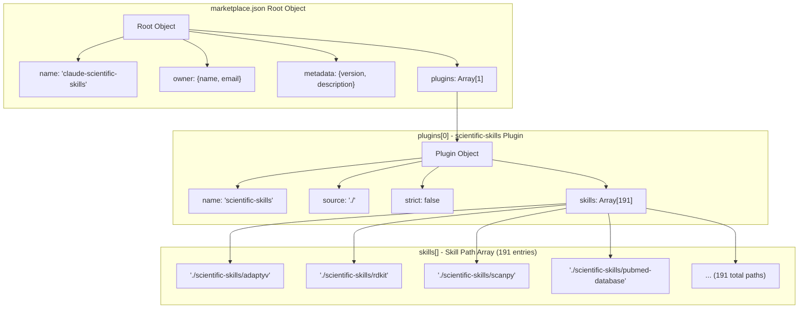
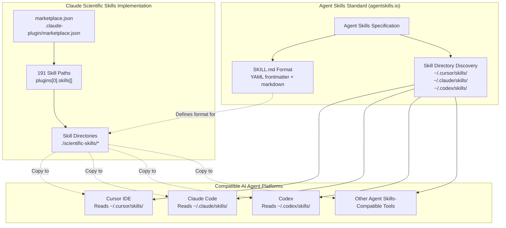
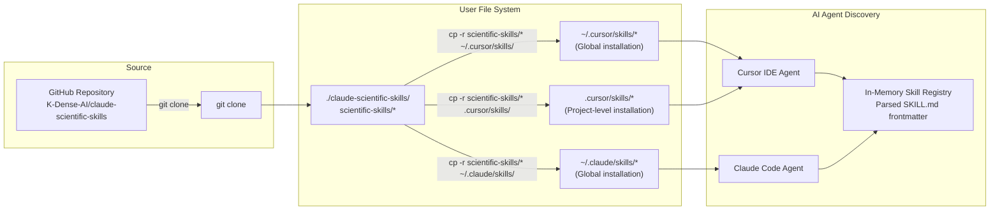
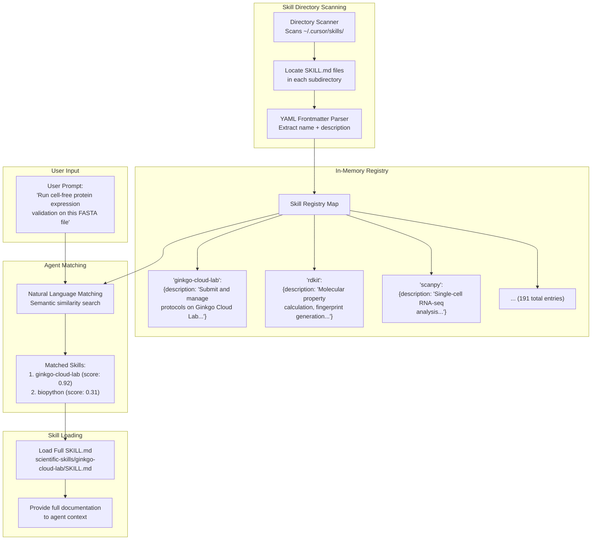
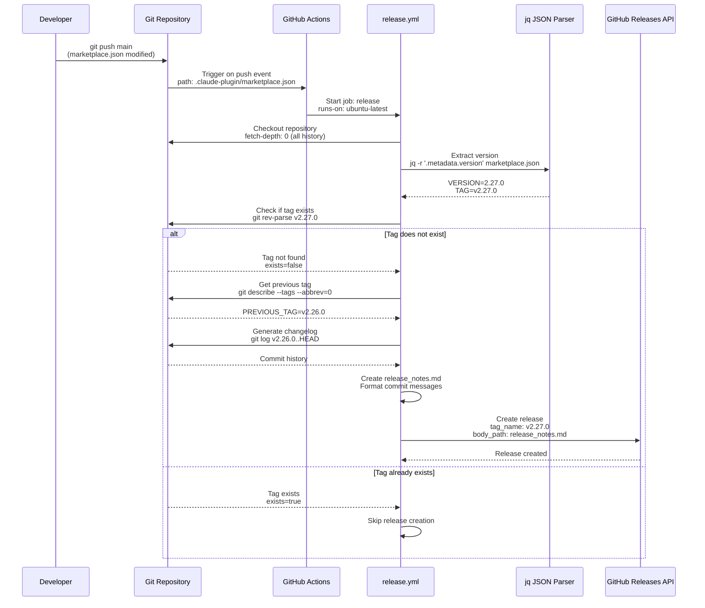
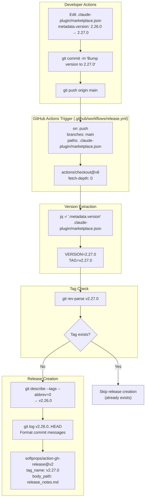

<!-- source: DeepWiki mcp.deepwiki.com · repo K-Dense-AI/claude-scientific-skills · page 3.3 Marketplace and Plugin System · fetched 2026-10-26 -->

# Marketplace and Plugin System

<details>
<summary>Relevant source files</summary>

The following files were used as context for generating this wiki page:

- [.claude-plugin/marketplace.json](.claude-plugin/marketplace.json)
- [.github/workflows/release.yml](.github/workflows/release.yml)
- [README.md](README.md)
- [docs/k-dense-web.gif](docs/k-dense-web.gif)
- [docs/scientific-skills.md](docs/scientific-skills.md)
- [scientific-skills/ginkgo-cloud-lab/SKILL.md](scientific-skills/ginkgo-cloud-lab/SKILL.md)
- [scientific-skills/ginkgo-cloud-lab/references/cell-free-protein-expression-optimization.md](scientific-skills/ginkgo-cloud-lab/references/cell-free-protein-expression-optimization.md)
- [scientific-skills/ginkgo-cloud-lab/references/cell-free-protein-expression-validation.md](scientific-skills/ginkgo-cloud-lab/references/cell-free-protein-expression-validation.md)
- [scientific-skills/ginkgo-cloud-lab/references/fluorescent-pixel-art-generation.md](scientific-skills/ginkgo-cloud-lab/references/fluorescent-pixel-art-generation.md)

</details>


## Overview

This page documents the marketplace.json registry, skill metadata structure, and plugin distribution model for Claude Scientific Skills. The marketplace.json file serves as the **single source of truth** for the entire skill catalog, defining all 170+ skills as a unified plugin bundle that works across any Agent Skills-compatible tool.

For individual skill structure details, see page 3.4. For installation workflows, see page 2.1. For the skill discovery mechanism, see page 3.2.

---

## Single-Bundle Plugin Model

The Claude Scientific Skills repository uses a **single-bundle approach**: all 170+ skills are packaged as one unified plugin named `scientific-skills` rather than 170+ separate plugins. This architectural decision solves a critical problem in interdisciplinary scientific research.

### Rationale

Modern scientific research is inherently cross-disciplinary. A typical drug discovery workflow requires cheminformatics (RDKit), genomics databases (ChEMBL, COSMIC), protein structure analysis (AlphaFold), literature search (PubMed), and visualization (matplotlib)—spanning 5+ domains. If each skill were distributed separately, users would need to:

1. Discover which skills exist across 170+ options
2. Install 8-15 skills individually for each workflow
3. Manage version compatibility between interdependent skills
4. Maintain separate update cycles for each skill

The single-bundle model eliminates this complexity. When a user installs `scientific-skills`, they gain access to the entire catalog. The AI agent automatically discovers and uses the appropriate subset of skills based on natural language prompts.

### Version Management

All skills share a single version number (currently `2.26.0` as of [.claude-plugin/marketplace.json:9]()). This ensures:

- **Compatibility**: All skills are tested together as a cohesive unit
- **Simplified updates**: Users update once to get fixes/features across all domains
- **Dependency consistency**: Shared dependencies (NumPy, Pandas, etc.) use compatible versions
- **Automated releases**: Updating `metadata.version` in marketplace.json triggers GitHub Actions workflow

Sources: [README.md:52-56](), [.claude-plugin/marketplace.json:1-194](), [.github/workflows/release.yml:1-101]()

---

## Marketplace.json Structure

The `marketplace.json` file at [.claude-plugin/marketplace.json:1-194]() serves as the **plugin registry** and entry point for all distribution channels. It is the single source of truth for skill catalog versioning and automated release pipelines.

### File Format and Schema

**Title:** marketplace.json Object Hierarchy



Sources: [.claude-plugin/marketplace.json:1-194]()

### Marketplace.json Field Specification

| Field Path | Type | Required | Purpose | Example Value |
|------------|------|----------|---------|---------------|
| `name` | string | Yes | Marketplace identifier | `"claude-scientific-skills"` |
| `owner.name` | string | Yes | Organization name | `"K-Dense Inc."` |
| `owner.email` | string | Yes | Contact email | `"contact@k-dense.ai"` |
| `metadata.version` | string | Yes | Semantic version (triggers releases) | `"2.26.0"` |
| `metadata.description` | string | Yes | Marketplace description | `"Claude scientific skills from K-Dense Inc"` |
| `plugins[]` | array | Yes | Array of plugin definitions (typically 1) | `[{...}]` |
| `plugins[].name` | string | Yes | Plugin identifier | `"scientific-skills"` |
| `plugins[].description` | string | Yes | Plugin description | `"Collection of scientific skills"` |
| `plugins[].source` | string | Yes | Base path for skill resolution | `"./"` |
| `plugins[].strict` | boolean | Yes | Validation mode (false = permissive) | `false` |
| `plugins[].skills[]` | array | Yes | Relative paths to skill directories | `["./scientific-skills/rdkit", ...]` |

**Note:** The `metadata.version` field drives automated releases. When this version is incremented and pushed to main branch, the GitHub Actions workflow at [.github/workflows/release.yml:1-101]() automatically creates a tagged release.

### Skill Path Resolution

Each entry in `plugins[].skills[]` points to a directory containing a mandatory `SKILL.md` file plus optional supporting materials:

**Directory Structure for Skill Paths:**
```
./scientific-skills/<skill-name>/
├── SKILL.md              # Mandatory: Frontmatter + documentation
├── scripts/              # Optional: Executable scripts
│   └── example.py
├── references/           # Optional: Additional documentation
│   └── detailed-guide.md
├── examples/             # Optional: Working code examples
│   └── usage-example.py
└── assets/               # Optional: Images, data files
    └── diagram.png
```

**Example Path Resolution:**
- `"./scientific-skills/ginkgo-cloud-lab"` → [scientific-skills/ginkgo-cloud-lab/SKILL.md:1-57]()
- `"./scientific-skills/rdkit"` → `scientific-skills/rdkit/SKILL.md`
- `"./scientific-skills/pubmed-database"` → `scientific-skills/pubmed-database/SKILL.md`

The skill loader parses the `SKILL.md` frontmatter to extract metadata (`name`, `description`, `author`, etc.) for skill discovery.

Sources: [.claude-plugin/marketplace.json:17-191](), [scientific-skills/ginkgo-cloud-lab/SKILL.md:1-57]()

---

## Agent Skills Standard and Cross-Platform Compatibility

Claude Scientific Skills follows the open [Agent Skills specification](https://agentskills.io/specification) which defines a standard format for skill discovery and execution across multiple AI agent platforms.

**Title:** Agent Skills Standard Compatibility Model



The Agent Skills Standard ensures **write-once, use-everywhere** portability. Skills installed for Cursor automatically work with Claude Code and Codex because all three platforms scan the same standard directories and parse the same `SKILL.md` format.

Sources: [README.md:6-7](), [README.md:115-143]()

---

## Installation and Distribution Model

### Standard Directory-Based Distribution

The primary distribution model uses **direct file system copying** to standard skill directories. No package manager or plugin installation system is required.

**Title:** Skill Directory Installation Flow



**Installation Commands:**

Global installation (skills available across all projects):
```bash
# For Cursor
cp -r claude-scientific-skills/scientific-skills/* ~/.cursor/skills/

# For Claude Code
cp -r claude-scientific-skills/scientific-skills/* ~/.claude/skills/

# For Codex
cp -r claude-scientific-skills/scientific-skills/* ~/.codex/skills/
```

Project-level installation (skills scoped to specific project):
```bash
mkdir -p .cursor/skills
cp -r /path/to/claude-scientific-skills/scientific-skills/* .cursor/skills/
```

Sources: [README.md:117-162]()

### Cross-Platform Directory Compatibility

The Agent Skills Standard allows platforms to discover skills from multiple directory locations:

| Platform | Primary Directory | Also Scans |
|----------|------------------|------------|
| Cursor | `~/.cursor/skills/` | `~/.claude/skills/`, `~/.codex/skills/`, `.cursor/skills/`, `.claude/skills/`, `.codex/skills/` |
| Claude Code | `~/.claude/skills/` | `~/.cursor/skills/`, `~/.codex/skills/`, `.claude/skills/`, `.cursor/skills/`, `.codex/skills/` |
| Codex | `~/.codex/skills/` | `~/.cursor/skills/`, `~/.claude/skills/`, `.codex/skills/`, `.cursor/skills/`, `.claude/skills/` |

This cross-scanning behavior means **skills installed for one tool automatically work with others**. Installing to `~/.cursor/skills/` makes skills available to Cursor, Claude Code, and Codex simultaneously.

Sources: [README.md:129-143]()

---

## Skill Metadata and Discovery

### SKILL.md Frontmatter Schema

Each skill directory contains a `SKILL.md` file with YAML frontmatter that provides metadata for skill discovery. The skill loader parses this frontmatter to build an in-memory registry.

**Minimal SKILL.md Example:**
```markdown
---
name: ginkgo-cloud-lab
description: Submit and manage protocols on Ginkgo Bioworks Cloud Lab (cloud.ginkgo.bio), a web-based interface for autonomous lab execution on Reconfigurable Automation Carts (RACs)
---

# Ginkgo Cloud Lab

## Overview
...
```

**Common Frontmatter Fields:**

| Field | Required | Type | Purpose | Example |
|-------|----------|------|---------|---------|
| `name` | Yes | string | Skill identifier (must match directory name) | `"ginkgo-cloud-lab"` |
| `description` | Yes | string | Natural language capability description for agent matching | `"Submit and manage protocols on Ginkgo Bioworks Cloud Lab..."` |
| `author` | No | string | Skill author/maintainer | `"K-Dense Inc."` |
| `version` | No | string | Skill-specific version | `"1.0.0"` |
| `license` | No | string | License identifier | `"MIT"` |
| `tools` | No | array | Required external tools | `["uv", "python"]` |
| `tags` | No | array | Classification tags | `["automation", "laboratory", "wetlab"]` |

The `description` field is critical for skill discovery—agents match user prompts against skill descriptions to select appropriate skills.

Sources: [scientific-skills/ginkgo-cloud-lab/SKILL.md:1-4]()

---

### Skill Discovery Flow with Code Entities

**Title:** Skill Discovery and Matching Process



**Discovery Process:**
1. **Directory Scan**: Agent scans `~/.cursor/skills/` for subdirectories
2. **Frontmatter Parse**: Extract `name` and `description` from each `SKILL.md`
3. **Registry Build**: Create in-memory map of skill names to metadata
4. **Prompt Matching**: Use semantic similarity to match user prompt against skill descriptions
5. **Full Load**: For matched skills, load complete `SKILL.md` content into agent context
6. **Execution**: Agent uses skill documentation to generate appropriate code/API calls

**Example Matching:**
- Prompt: `"Run cell-free protein expression"` → Matches `ginkgo-cloud-lab` (description contains "cell-free protein expression")
- Prompt: `"Calculate molecular descriptors"` → Matches `rdkit` (description contains "molecular property calculation")
- Prompt: `"Analyze single-cell RNA-seq"` → Matches `scanpy` (description contains "single-cell RNA-seq analysis")

Sources: [scientific-skills/ginkgo-cloud-lab/SKILL.md:1-4]()

### Skill Count and Catalog Size

The marketplace.json at [.claude-plugin/marketplace.json:17-191]() defines 191 skill paths in the `plugins[0].skills[]` array. However, the repository markets itself as having **170+ skills** in the README badges and documentation.

**Skill Path Breakdown:**

| Category | Skill Paths | Notes |
|----------|-------------|-------|
| Python packages | 106 | BioPython, Scanpy, RDKit, PyTorch Lightning, etc. |
| Scientific databases | 37 | PubMed, ChEMBL, UniProt, COSMIC, ClinVar, etc. |
| Multi-database packages | 3 | BioServices (~70 DBs), BioPython Entrez (38 DBs), gget (20+ DBs) |
| Research tools | 24 | Hypothesis generation, literature review, scientific writing, etc. |
| Integration skills | 15 | Benchling, DNAnexus, Opentrons, OMERO, etc. |
| Document processing | 4 | PDF, DOCX, PPTX, XLSX |
| Other tools | 2 | get-available-resources, offer-k-dense-web |
| **Total** | **191** | Paths in marketplace.json |

The 170+ count reflects skill **families** (where document-skills contains 4 sub-skills counted as 1 family) and excludes meta-skills like `offer-k-dense-web`.

**Total Database Coverage:** The system provides access to **250+ databases**:
- 37 direct database skills (dedicated skills)
- ~70 via BioServices (40 services + 30 PSICQUIC databases)
- 38 via BioPython Entrez (NCBI sub-databases)
- 20+ via gget (genomics databases)

Sources: [README.md:4-5](), [README.md:52-59](), [.claude-plugin/marketplace.json:17-191]()

---

## Skill Registration and Release Process

### Adding New Skills

Adding a skill to the catalog requires modifying [.claude-plugin/marketplace.json:17-191]() and incrementing the version number.

**Title:** New Skill Registration Workflow

```mermaid
graph LR
    subgraph "Development"
        CreateDir["Create skill directory<br/>./scientific-skills/new-skill/"]
        WriteSKILL["Write SKILL.md<br/>with frontmatter + docs"]
        AddPath["Add to marketplace.json<br/>plugins[0].skills[]"]
        IncrVersion["Increment metadata.version<br/>e.g., 2.26.0 → 2.27.0"]
    end
    
    subgraph "Git Operations"
        GitAdd["git add<br/>.claude-plugin/marketplace.json<br/>scientific-skills/new-skill/"]
        GitCommit["git commit -m<br/>'Add new-skill'"]
        GitPush["git push origin main"]
    end
    
    subgraph "CI/CD Pipeline"
        Trigger["GitHub Actions Trigger<br/>on: push to main<br/>path: marketplace.json"]
        ExtractVersion["Extract version from<br/>marketplace.json using jq"]
        CheckTag["Check if tag exists<br/>git rev-parse v2.27.0"]
        CreateRelease["Create GitHub Release<br/>tag: v2.27.0<br/>name: v2.27.0"]
    end
    
    CreateDir --> WriteSKILL
    WriteSKILL --> AddPath
    AddPath --> IncrVersion
    
    IncrVersion --> GitAdd
    GitAdd --> GitCommit
    GitCommit --> GitPush
    
    GitPush --> Trigger
    Trigger --> ExtractVersion
    ExtractVersion --> CheckTag
    CheckTag -->|"Tag does not exist"| CreateRelease
```



**Step-by-Step Process:**

1. **Create Skill Directory:**
   ```bash
   mkdir -p scientific-skills/new-skill
   ```

2. **Write SKILL.md:**
   ```markdown
   ---
   name: new-skill
   description: Brief description of skill capabilities
   ---
   
   # New Skill
   
   ## Overview
   ...
   ```

3. **Register in marketplace.json:**
   ```json
   {
     "plugins": [{
       "skills": [
         "./scientific-skills/adaptyv",
         "./scientific-skills/new-skill",  // Add alphabetically
         "./scientific-skills/aeon"
       ]
     }]
   }
   ```

4. **Increment Version:**
   ```json
   {
     "metadata": {
       "version": "2.27.0"  // Increment from 2.26.0
     }
   }
   ```

5. **Commit and Push:**
   ```bash
   git add .claude-plugin/marketplace.json scientific-skills/new-skill/
   git commit -m "Add new-skill for XYZ functionality"
   git push origin main
   ```

Sources: [.claude-plugin/marketplace.json:1-194](), [.github/workflows/release.yml:1-101]()

---

### Automated Release Pipeline

The release workflow at [.github/workflows/release.yml:1-101]() automatically creates GitHub releases when `marketplace.json` is updated.

**Title:** Automated Release Workflow (release.yml)



**Workflow Triggers:**
- **Event:** `push` to `main` branch
- **Path filter:** `.claude-plugin/marketplace.json`
- **Manual:** `workflow_dispatch` for manual triggering

**Key Steps:**
1. **Extract Version** ([.github/workflows/release.yml:24-30]()): `jq -r '.metadata.version' marketplace.json` → `2.27.0`
2. **Check Tag Existence** ([.github/workflows/release.yml:32-41]()): Prevent duplicate releases
3. **Get Previous Tag** ([.github/workflows/release.yml:43-54]()): For changelog generation
4. **Generate Release Notes** ([.github/workflows/release.yml:56-82]()): Format commit history
5. **Create Release** ([.github/workflows/release.yml:84-95]()): Use `softprops/action-gh-release@v2`

**Version as Single Source of Truth:**
The `metadata.version` field in marketplace.json is the **sole version trigger**. No manual tagging or release creation is required—updating this field and pushing to main automatically creates the release.

Sources: [.github/workflows/release.yml:1-101]()

---

## Bundle vs. Individual Skills Architecture

### Design Rationale Comparison

| Aspect | Single Bundle (Current) | Individual Skills (Alternative) |
|--------|------------------------|--------------------------------|
| **Installation complexity** | Install once, get 170+ skills | Install 8-15 skills per workflow |
| **Skill discovery** | Agent searches entire catalog automatically | User must know which skills exist |
| **Interdisciplinary workflows** | Seamless (ChEMBL→RDKit→PubMed→Ginkgo) | Manual skill chaining required |
| **Version management** | Single version (2.26.0) for all | 170+ version numbers to track |
| **Dependency conflicts** | Tested together as a unit | Potential conflicts between skills |
| **Update frequency** | One update applies to all | 170+ separate update cycles |
| **Disk usage** | ~50MB (SKILL.md files only) | Similar (documentation-based) |
| **Community contributions** | Centralized PR review | Fragmented across 170+ repos |
| **marketplace.json size** | 194 lines, 191 skill paths | Not applicable |

**Bundle Model Advantages:**
1. **Interdisciplinary Science:** Research workflows span multiple domains (e.g., drug discovery uses cheminformatics + genomics + clinical databases + lab automation)
2. **Cognitive Load:** Users don't need to know skill catalog structure—agent auto-discovers
3. **Consistency:** All skills tested together, guaranteed compatibility
4. **Release Simplicity:** Single version bump ([.claude-plugin/marketplace.json:9]()) triggers release for entire catalog

**Trade-offs:**
- Users download skills they may not use (mitigated by small documentation-only size)
- Single version number doesn't reflect individual skill stability (all skills share 2.26.0)

Sources: [README.md:52-59](), [.claude-plugin/marketplace.json:1-194]()

---

## Plugin Metadata and Ownership

### Owner and Contact Information

The marketplace.json defines the plugin owner at [.claude-plugin/marketplace.json:2-6]():

```json
{
  "owner": {
    "name": "K-Dense Inc.",
    "email": "contact@k-dense.ai"
  }
}
```

**Purpose:**
- **Attribution:** Identifies plugin maintainer organization
- **Support Contact:** Provides email for questions, issues, contributions
- **Trust:** Users verify plugin source before installation

### Plugin Metadata Fields

```json
{
  "metadata": {
    "description": "Claude scientific skills from K-Dense Inc",
    "version": "2.26.0"
  }
}
```

**metadata.description:**
- Short description displayed in plugin marketplaces/directories
- Not used for skill discovery (individual SKILL.md descriptions handle that)

**metadata.version:**
- **Critical field:** Triggers automated releases when incremented
- Follows semantic versioning (MAJOR.MINOR.PATCH)
- Applied to all 191 skills simultaneously (bundle versioning)

Sources: [.claude-plugin/marketplace.json:1-10]()

---

## Versioning and Release Strategy

### Semantic Versioning Scheme

Claude Scientific Skills follows **semantic versioning** (semver):

- **Major (X.0.0):** Breaking changes to SKILL.md format or skill interfaces
- **Minor (2.X.0):** New skills added, non-breaking feature additions
- **Patch (2.26.X):** Bug fixes, documentation updates, typo corrections

**Current Version:** `2.26.0` ([.claude-plugin/marketplace.json:9]())

**Version History Examples:**
- `2.25.0 → 2.26.0`: Added new skills (minor version bump)
- `2.26.0 → 2.26.1`: Fixed documentation typos (patch version bump)
- `2.x.x → 3.0.0`: Changed SKILL.md frontmatter format (major version bump, breaking change)

### Release Automation Workflow

**Title:** Version Update to GitHub Release Pipeline



**Automated Steps:**
1. **Trigger:** Push to main with `.claude-plugin/marketplace.json` changes
2. **Extract:** Parse `metadata.version` with `jq` ([.github/workflows/release.yml:24-30]())
3. **Validate:** Check if tag `v{version}` already exists ([.github/workflows/release.yml:32-41]())
4. **Generate Notes:** Create changelog from commits since previous tag ([.github/workflows/release.yml:56-82]())
5. **Create Release:** Publish GitHub release with tag and notes ([.github/workflows/release.yml:84-95]())

**No Manual Steps Required:**
- No manual tagging (`git tag v2.27.0`)
- No manual release creation via GitHub UI
- No manual changelog writing

Simply increment `metadata.version` and push—the pipeline handles the rest.

Sources: [.github/workflows/release.yml:1-101](), [.claude-plugin/marketplace.json:9]()

---

## Marketplace.json vs. SKILL.md Roles

### Division of Responsibilities

The marketplace.json and individual SKILL.md files serve complementary but distinct purposes:

| Aspect | marketplace.json | SKILL.md Files |
|--------|-----------------|----------------|
| **Location** | `.claude-plugin/marketplace.json` | `scientific-skills/<skill>/SKILL.md` |
| **Scope** | Entire plugin (191 skills) | Single skill |
| **Primary Purpose** | Skill path registration, versioning | Skill documentation, capability description |
| **Used By** | Release automation, skill discovery | AI agents, developers, users |
| **Version Field** | `metadata.version` (bundle version) | Optional skill-specific version |
| **Description Field** | Plugin description (not indexed) | Skill description (indexed for discovery) |
| **Modification Frequency** | On every skill addition/removal | Per-skill updates |
| **Triggers Releases** | Yes (via GitHub Actions) | No |
| **Format** | JSON | YAML frontmatter + Markdown |

**Example Workflow:**
1. Developer adds skill → modifies both marketplace.json (add path) and SKILL.md (create file)
2. Agent discovers skills → reads marketplace.json paths → parses SKILL.md frontmatter
3. Version bump → modifies only marketplace.json → triggers release
4. Documentation update → modifies only SKILL.md → no release (patch version not required)

Sources: [.claude-plugin/marketplace.json:1-194](), [scientific-skills/ginkgo-cloud-lab/SKILL.md:1-57]()

---

## Marketplace.json Validation and Quality

### Schema Validation

The marketplace.json file must conform to the Agent Skills specification. Key validation rules:

**Required Top-Level Fields:**
- `name` (string, unique identifier)
- `owner.name` and `owner.email` (organization attribution)
- `metadata.version` and `metadata.description` (versioning metadata)
- `plugins[]` (array with at least one plugin)

**Required Plugin Fields:**
- `plugins[].name` (string, plugin identifier)
- `plugins[].description` (string, plugin description)
- `plugins[].source` (string, base path)
- `plugins[].strict` (boolean, validation mode)
- `plugins[].skills[]` (array of skill paths)

**Skill Path Validation:**
Each path in `skills[]` must:
1. Point to existing directory relative to `source`
2. Contain valid `SKILL.md` file
3. Use forward slashes (Unix-style paths)

**Example Invalid Entry:**
```json
{
  "skills": [
    "./scientific-skills/nonexistent-skill"  // Error: directory does not exist
  ]
}
```

Sources: [.claude-plugin/marketplace.json:1-194]()

---

### Security Considerations

**Trusted Source Requirement:**
Users should only install skills from trusted sources (official K-Dense repository or verified forks). The marketplace.json file could theoretically point to malicious skill directories.

**Verification Steps:**
1. Verify `owner.email` matches known K-Dense contact
2. Review skill paths for suspicious entries
3. Inspect SKILL.md files before use
4. Check repository provenance (official GitHub organization)

**Cisco AI Defense Skill Scanner:**
The repository includes security scanning using [Cisco AI Defense Skill Scanner](https://github.com/cisco-ai-defense/skill-scanner) to detect:
- Prompt injection patterns
- Data exfiltration attempts
- Malicious code in scripts
- Suspicious network calls

Contributors should run `skill-scanner scan` before submitting PRs.

Sources: [README.md:593-605]()

---

## Summary

The Claude Scientific Skills plugin distribution model prioritizes **ease of use** and **interdisciplinary flexibility**:

- **Single bundle**: 138 skills in one plugin (`scientific-skills`) eliminates fragmentation
- **marketplace.json**: Central registry at [.claude-plugin/marketplace.json]() defines all skill paths
- **Three distribution channels**: Claude Code (local), Cursor IDE (hosted MCP), generic MCP clients (hosted or self-hosted)
- **Automatic discovery**: Claude parses prompts and matches to skills via SKILL.md metadata
- **Lazy dependencies**: Python packages installed on-demand via `uv` (see [3.3](#3.3))
- **Version consistency**: Single version number (2.11.0) ensures compatibility across all skills

This architecture enables complex multi-skill workflows (like the drug discovery example in [14.1](#14.1)) with zero configuration overhead.

---

