<!-- source: DeepWiki mcp.deepwiki.com · repo K-Dense-AI/claude-scientific-skills · page 3.5 Documentation Standards · fetched 2026-10-26 -->

# Documentation Standards

<details>
<summary>Relevant source files</summary>

The following files were used as context for generating this wiki page:

- [scientific-skills/markdown-mermaid-writing/SKILL.md](scientific-skills/markdown-mermaid-writing/SKILL.md)
- [scientific-skills/markdown-mermaid-writing/assets/examples/example-research-report.md](scientific-skills/markdown-mermaid-writing/assets/examples/example-research-report.md)

</details>


## Purpose and Scope

This document defines the mandatory documentation standards enforced across all 170+ skills in the Claude Scientific Skills ecosystem. All skills, supporting documentation, and user-generated scientific outputs must follow these standards to ensure consistency, version control compatibility, and cross-platform compatibility.

These standards are implemented and enforced by the `markdown-mermaid-writing` skill. For information about the broader SKILL.md file structure (frontmatter, metadata), see [SKILL.md Anatomy and Structure](#3.4). For information about skill discovery and loading, see [Skill Discovery and Loading Mechanism](#3.2).

---

## Overview

The documentation standards system establishes **text-based diagrams as the default documentation format** across the entire skill ecosystem. All structural, relational, and workflow diagrams must be created as Mermaid diagrams embedded in Markdown files, which serve as the source of truth for version control.

### Why Text-Based Documentation

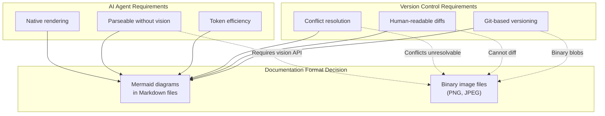

**Sources:** [scientific-skills/markdown-mermaid-writing/SKILL.md:63-75]()

---

## The markdown-mermaid-writing Skill

The `markdown-mermaid-writing` skill is the **mandatory enforcement mechanism** for all documentation standards. Every skill author and user must apply this skill when creating any documentation.

### Directory Structure

```
scientific-skills/markdown-mermaid-writing/
├── SKILL.md                          # Skill definition and overview
├── references/
│   ├── markdown_style_guide.md       # ~733 lines: markdown formatting rules
│   ├── mermaid_style_guide.md        # ~458 lines: mermaid diagram rules
│   └── diagrams/                     # 24 diagram type guides
│       ├── flowchart.md
│       ├── sequence.md
│       ├── er.md
│       ├── state.md
│       ├── gantt.md
│       ├── pie.md
│       ├── c4.md
│       ├── mindmap.md
│       ├── timeline.md
│       ├── class.md
│       ├── user_journey.md
│       ├── quadrant.md
│       ├── requirement.md
│       ├── sankey.md
│       ├── xy_chart.md
│       ├── block.md
│       ├── kanban.md
│       ├── architecture.md
│       ├── radar.md
│       ├── treemap.md
│       ├── packet.md
│       ├── git_graph.md
│       ├── zenuml.md
│       └── complex_examples.md
├── templates/                        # 9 document templates
│   ├── decision_record.md
│   ├── how_to_guide.md
│   ├── issue.md
│   ├── kanban.md
│   ├── presentation.md
│   ├── project_documentation.md
│   ├── pull_request.md
│   ├── research_paper.md
│   └── status_report.md
└── assets/
    └── examples/
        └── example-research-report.md  # Complete example demonstrating all standards
```

**Sources:** [scientific-skills/markdown-mermaid-writing/SKILL.md:1-335]()

### Three-Phase Documentation Workflow

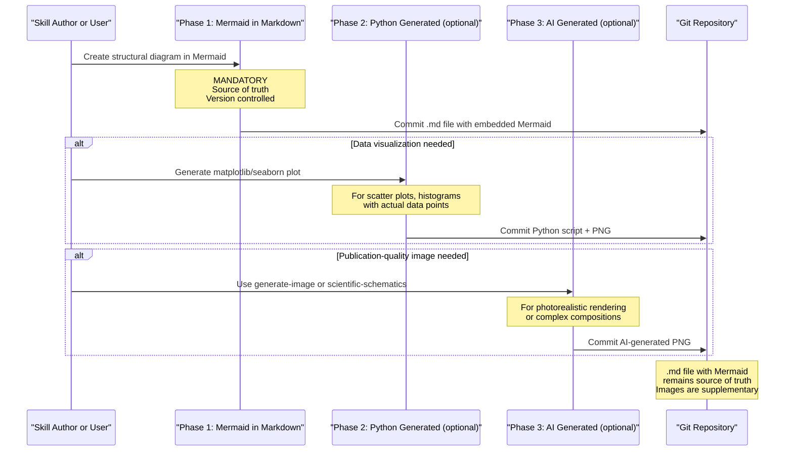

The workflow enforces that **Phase 1 (Mermaid in Markdown) is always required** and committed to the repository. Phases 2 and 3 are optional enhancements that supplement, not replace, the text-based source.

**Sources:** [scientific-skills/markdown-mermaid-writing/SKILL.md:76-104]()

---

## Markdown Style Guide Requirements

All Markdown files must follow the rules defined in [references/markdown_style_guide.md:1-733](). Key requirements:

### Heading Hierarchy

| Rule | Requirement | Example |
|------|-------------|---------|
| One H1 per document | Document title only | `# CRISPR Editing Efficiency` |
| Emoji on H2 only | One emoji per H2 section heading | `## 🔬 Methods` |
| No emoji on H3/H4 | Clean subsection headings | `### Cell lines and culture` |
| No H5/H6 | Use lists instead of excessive nesting | N/A |

### Formatting Rules

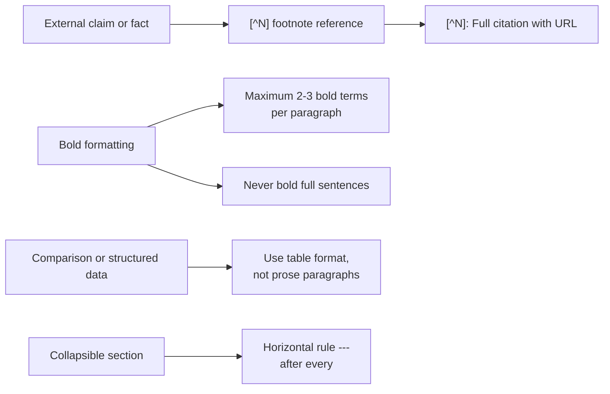

### Mandatory Citations

Every external claim must have a footnote citation with a full URL:

```markdown
CRISPR-Cas9 achieves >75% editing efficiency in HEK293T cells[^1].

[^1]: Ran, F.A. et al. (2013). "Genome engineering using the CRISPR-Cas9 system." 
      Nature Protocols, 8(11), 2281–2308. https://doi.org/10.1038/nprot.2013.143
```

**Sources:** [scientific-skills/markdown-mermaid-writing/SKILL.md:162-173](), [scientific-skills/markdown-mermaid-writing/assets/examples/example-research-report.md:215-221]()

---

## Mermaid Style Guide Requirements

All Mermaid diagrams must follow the rules defined in [references/mermaid_style_guide.md:1-458](). Key requirements:

### Accessibility Annotations

Every diagram (except `radar-beta` and a few other types that don't support it) must include:

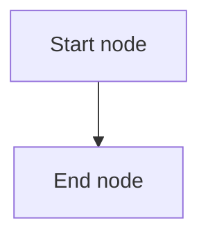

For diagram types that don't support `accTitle`/`accDescr` (like `radar-beta`), place an italic descriptive paragraph immediately above the code block:

```markdown
_Radar chart comparing three methods across five performance dimensions. 
Note: Radar charts do not support accTitle/accDescr._


```

**Sources:** [scientific-skills/markdown-mermaid-writing/SKILL.md:182-189](), [scientific-skills/markdown-mermaid-writing/SKILL.md:236-244]()

### Node ID and Label Rules

| Rule | Requirement | Correct | Incorrect |
|------|-------------|---------|-----------|
| Node IDs | `snake_case` matching label | `cell_culture["Cell Culture"]` | `A["Cell Culture"]` |
| Labels | Quoted, emoji at start (max 1) | `"🔬 Stage 1<br/>Design"` | `Stage 1: Design` |
| Emoji limit | One emoji per node maximum | `"🧬 DNA Synthesis"` | `"🧬🔬 DNA Synthesis"` |

### Forbidden Constructs

```mermaid
graph TB
    Avoid1["%%{init} directives"]
    Reason1["Breaks GitHub dark mode"]
    
    Avoid2["Inline style attributes"]
    Reason2["Use classDef only"]
    
    Avoid3["Hardcoded colors"]
    Reason3["Theme neutrality required"]
    
    Avoid1 -.->|"Never use"| Reason1
    Avoid2 -.->|"Never use"| Reason2
    Avoid3 -.->|"Never use"| Reason3
```

Example of correct styling:

```markdown
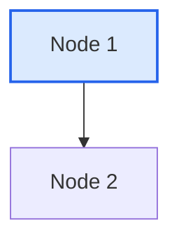
```

**Sources:** [scientific-skills/markdown-mermaid-writing/SKILL.md:182-191]()

---

## 24 Diagram Type Catalog

The system provides detailed guides for 24 Mermaid diagram types. Each guide includes a production-quality exemplar, type-specific tips, and a copy-paste template.

### Diagram Type Selection

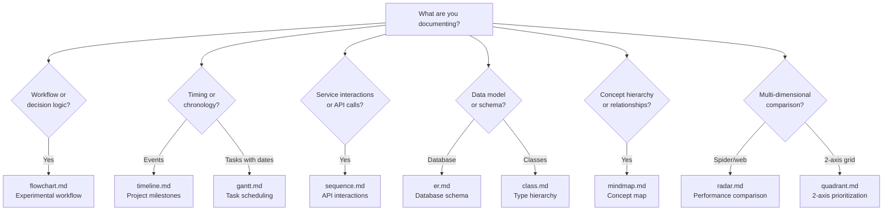

### Complete Type List

| Use Case | Type | File Path |
|----------|------|-----------|
| Experimental workflow, decision logic | Flowchart | `references/diagrams/flowchart.md` |
| Service interactions, API calls, messaging | Sequence | `references/diagrams/sequence.md` |
| Data model, database schema | ER diagram | `references/diagrams/er.md` |
| State machine, lifecycle | State | `references/diagrams/state.md` |
| Project timeline, roadmap | Gantt | `references/diagrams/gantt.md` |
| Proportions, composition | Pie | `references/diagrams/pie.md` |
| System architecture (zoom levels) | C4 | `references/diagrams/c4.md` |
| Concept hierarchy, brainstorm | Mindmap | `references/diagrams/mindmap.md` |
| Chronological events, history | Timeline | `references/diagrams/timeline.md` |
| Class hierarchy, type relationships | Class | `references/diagrams/class.md` |
| User journey, satisfaction map | User Journey | `references/diagrams/user_journey.md` |
| Two-axis comparison, prioritization | Quadrant | `references/diagrams/quadrant.md` |
| Requirements traceability | Requirement | `references/diagrams/requirement.md` |
| Flow magnitude, resource distribution | Sankey | `references/diagrams/sankey.md` |
| Numeric trends, bar + line charts | XY Chart | `references/diagrams/xy_chart.md` |
| Component layout, spatial arrangement | Block | `references/diagrams/block.md` |
| Work item status, task columns | Kanban | `references/diagrams/kanban.md` |
| Cloud infrastructure, service topology | Architecture | `references/diagrams/architecture.md` |
| Multi-dimensional comparison, skills radar | Radar | `references/diagrams/radar.md` |
| Hierarchical proportions, budget | Treemap | `references/diagrams/treemap.md` |
| Binary protocol, data format | Packet | `references/diagrams/packet.md` |
| Git branching, merge strategy | Git Graph | `references/diagrams/git_graph.md` |
| Code-style sequence (programming syntax) | ZenUML | `references/diagrams/zenuml.md` |
| Multi-diagram compositions | Complex Examples | `references/diagrams/complex_examples.md` |

**Sources:** [scientific-skills/markdown-mermaid-writing/SKILL.md:105-135]()

---

## Document Templates

Nine document templates are provided in `templates/` directory. Every template follows markdown and mermaid style guides.

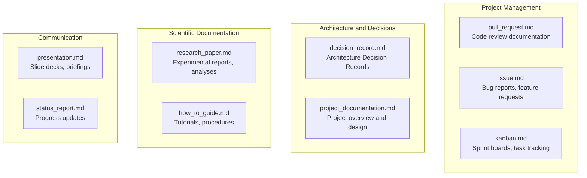

### Template Selection Table

| Document Type | Template File | When to Use |
|---------------|---------------|-------------|
| Pull request | `pull_request.md` | Documenting code changes for review |
| Issue / Bug / Feature | `issue.md` | Creating GitHub issues or feature requests |
| Sprint / Task board | `kanban.md` | Visualizing work items across columns |
| Architecture decision | `decision_record.md` | Recording significant design decisions (ADR) |
| Presentation | `presentation.md` | Creating slide-based content |
| Research paper | `research_paper.md` | Scientific reports, experimental analyses |
| Project overview | `project_documentation.md` | High-level project design and organization |
| Tutorial / How-to | `how_to_guide.md` | Step-by-step procedural guides |
| Status report | `status_report.md` | Regular progress updates to stakeholders |

**Sources:** [scientific-skills/markdown-mermaid-writing/SKILL.md:144-158](), [scientific-skills/markdown-mermaid-writing/SKILL.md:310-312]()

---

## Quality Enforcement System

Documentation quality is enforced through a mandatory checklist that must be applied before finalizing any document.

### Documentation Quality Checklist

```mermaid
flowchart TD
    Start["Document created or updated"]
    
    Q1{"Template used?"}
    Q2{"All diagrams in Mermaid?"}
    Q3{"accTitle + accDescr present?"}
    Q4{"No %%{init} or inline style?"}
    Q5{"All claims cited?"}
    Q6{"One H1, emoji on H2 only?"}
    Q7{"Horizontal rule after </details>?"}
    
    Fix1["Select appropriate template<br/>from templates/ directory"]
    Fix2["Convert binary images<br/>to Mermaid diagrams"]
    Fix3["Add accessibility annotations<br/>or italic description"]
    Fix4["Remove forbidden constructs<br/>Use classDef only"]
    Fix5["Add [^N] footnotes<br/>with full URLs"]
    Fix6["Restructure headings<br/>Add/remove emoji"]
    Fix7["Add --- after all<br/>collapsible sections"]
    
    Pass["Document passes<br/>quality standards"]
    
    Start --> Q1
    Q1 -->|"No"| Fix1
    Q1 -->|"Yes"| Q2
    Fix1 --> Q2
    
    Q2 -->|"No"| Fix2
    Q2 -->|"Yes"| Q3
    Fix2 --> Q3
    
    Q3 -->|"No"| Fix3
    Q3 -->|"Yes"| Q4
    Fix3 --> Q4
    
    Q4 -->|"No"| Fix4
    Q4 -->|"Yes"| Q5
    Fix4 --> Q5
    
    Q5 -->|"No"| Fix5
    Q5 -->|"Yes"| Q6
    Fix5 --> Q6
    
    Q6 -->|"No"| Fix6
    Q6 -->|"Yes"| Q7
    Fix6 --> Q7
    
    Q7 -->|"No"| Fix7
    Q7 -->|"Yes"| Pass
    Fix7 --> Pass
```

**Sources:** [scientific-skills/markdown-mermaid-writing/SKILL.md:284-291]()

### Checklist Items

The complete checklist as defined in [SKILL.md:284-291]():

- [ ] Does the document use a template? If so, did I start from the right one?
- [ ] Are all diagrams in Mermaid with `accTitle` + `accDescr`?
- [ ] No `%%{init}`, no inline `style`, only `classDef`?
- [ ] Are all external claims cited with `[^N]`?
- [ ] One H1, emoji on H2 only?
- [ ] Horizontal rules after every `</details>`?

---

## Integration with Skill System

The documentation standards integrate with the broader skill ecosystem through several mechanisms.

### Applying Standards to SKILL.md Files

Every skill's `SKILL.md` file must follow these documentation standards:

```mermaid
graph TB
    subgraph "SKILL.md File Structure"
        Frontmatter["Frontmatter metadata<br/>(name, description, etc.)"]
        Content["Markdown content body"]
    end
    
    subgraph "Content Requirements"
        MarkdownGuide["Follow markdown_style_guide.md:<br/>• One H1 (skill name)<br/>• Emoji on H2 sections<br/>• Citations with [^N]<br/>• Tables for structured data"]
        
        MermaidGuide["Follow mermaid_style_guide.md:<br/>• All diagrams in Mermaid<br/>• accTitle + accDescr<br/>• No %%{init} or inline style<br/>• classDef for styling"]
    end
    
    subgraph "Supporting Documentation"
        References["references/ folder<br/>Detailed guides with diagrams"]
        Examples["examples/ folder<br/>Working code examples"]
        Assets["assets/ folder<br/>Images, templates"]
    end
    
    Content --> MarkdownGuide
    Content --> MermaidGuide
    
    MarkdownGuide --> References
    MermaidGuide --> References
    
    References -.->|"Links to"| Examples
    References -.->|"Links to"| Assets
```

### Integration Workflow

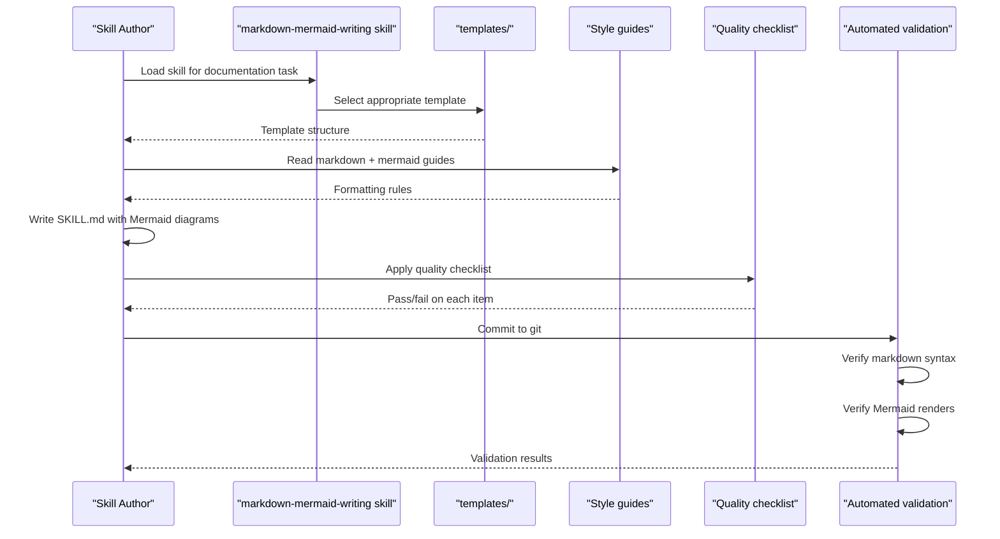

**Sources:** [scientific-skills/markdown-mermaid-writing/SKILL.md:247-291]()

---

## Common Pitfalls and Corrections

### Radar Chart Syntax Error

**INCORRECT:**
```mermaid
radar
title "Example"
x-axis ["A", "B", "C"]
"Series" : [1, 2, 3]
```

**CORRECT:**
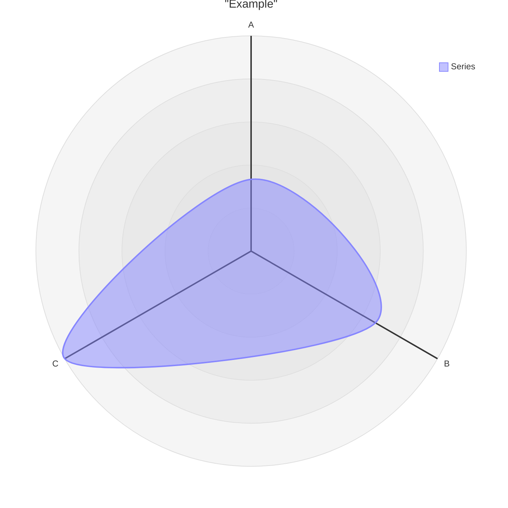

Key differences:
- Use `radar-beta` not `radar` (bare keyword doesn't exist)
- Use `axis` to define dimensions, not `x-axis`
- Use `curve` to define data series, not quoted labels with colon
- No `accTitle`/`accDescr` support — add italic paragraph above

**Sources:** [scientific-skills/markdown-mermaid-writing/SKILL.md:204-227]()

### XY Chart vs Radar Confusion

| Diagram Type | Keyword | Axis Syntax | Data Syntax |
|--------------|---------|-------------|-------------|
| **XY Chart** (bars/lines) | `xychart-beta` | `x-axis ["Label1", "Label2"]` | `bar [10, 20]` or `line [10, 20]` |
| **Radar** (spider/web) | `radar-beta` | `axis id["Label"]` | `curve id["Label"]{10, 20}` |

**Sources:** [scientific-skills/markdown-mermaid-writing/SKILL.md:228-234]()

### Missing Accessibility Annotations

When using diagram types that support `accTitle`/`accDescr`, always include them:

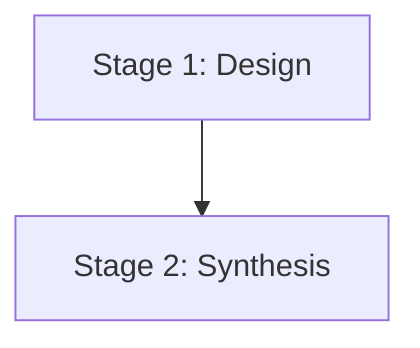

For types that don't support these annotations (like `radar-beta`), place an italic descriptive paragraph immediately above:

```markdown
_Radar chart comparing three methods across five performance dimensions. 
Note: Radar charts do not support accTitle/accDescr._
```

**Sources:** [scientific-skills/markdown-mermaid-writing/SKILL.md:236-244]()

---

## Example Implementation

The [assets/examples/example-research-report.md:1-222]() file demonstrates all documentation standards in a complete scientific research report.

### Example Structure

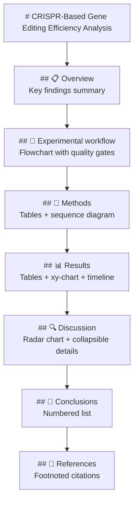

The example demonstrates:
- One H1 (document title)
- Emoji on H2 sections only
- Multiple diagram types (flowchart, sequence, xychart-beta, timeline, radar-beta)
- Proper `accTitle`/`accDescr` annotations
- Tables for structured data
- Footnoted citations with full URLs
- Collapsible `<details>` sections with horizontal rules
- No `%%{init}` or inline styling

**Sources:** [scientific-skills/markdown-mermaid-writing/SKILL.md:314-317](), [scientific-skills/markdown-mermaid-writing/assets/examples/example-research-report.md:1-222]()

---

## Enforcement in Skill Ecosystem

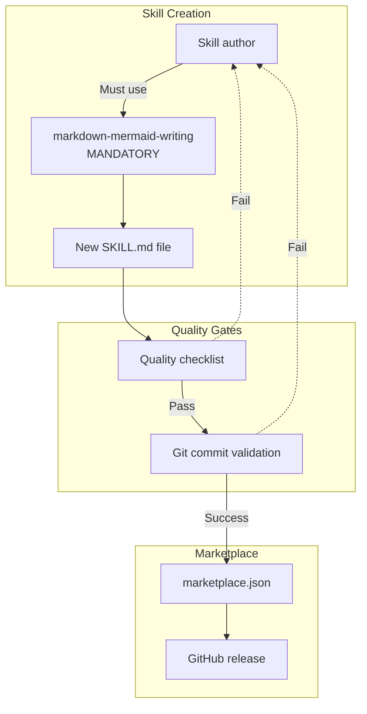

The documentation standards are enforced at multiple stages:

1. **Skill creation**: Authors must use `markdown-mermaid-writing` skill
2. **Quality checklist**: Manual verification before commit
3. **Git validation**: Markdown syntax and Mermaid rendering checked
4. **Marketplace registration**: Only skills with proper documentation are added to [.claude-plugin/marketplace.json:1-180]()
5. **Release automation**: [.github/workflows/release.yml:1-98]() requires valid marketplace.json

This multi-stage enforcement ensures all 170+ skills maintain consistent, high-quality documentation that works across Cursor, Claude Code, Codex, and other Agent Skills-compatible tools.

**Sources:** [scientific-skills/markdown-mermaid-writing/SKILL.md:1-335](), [.github/workflows/release.yml:1-98](), [.claude-plugin/marketplace.json:1-180]()

---

