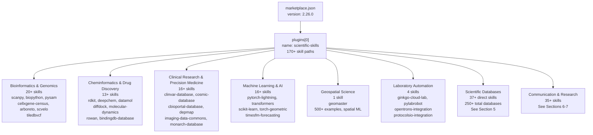
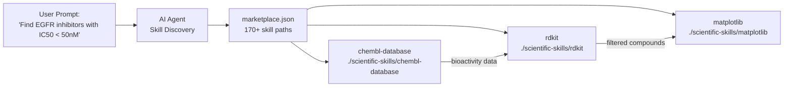
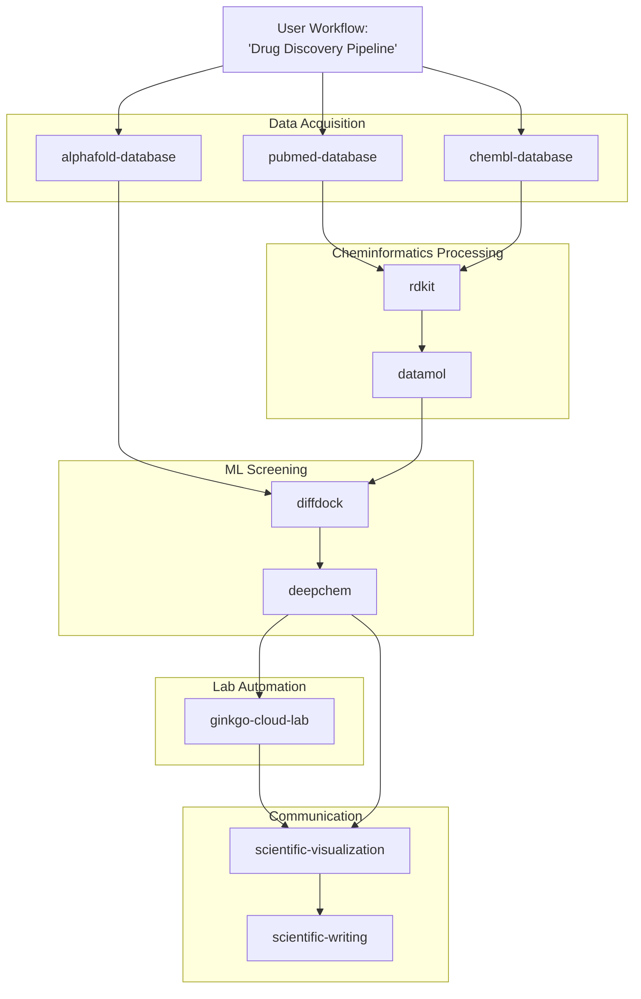
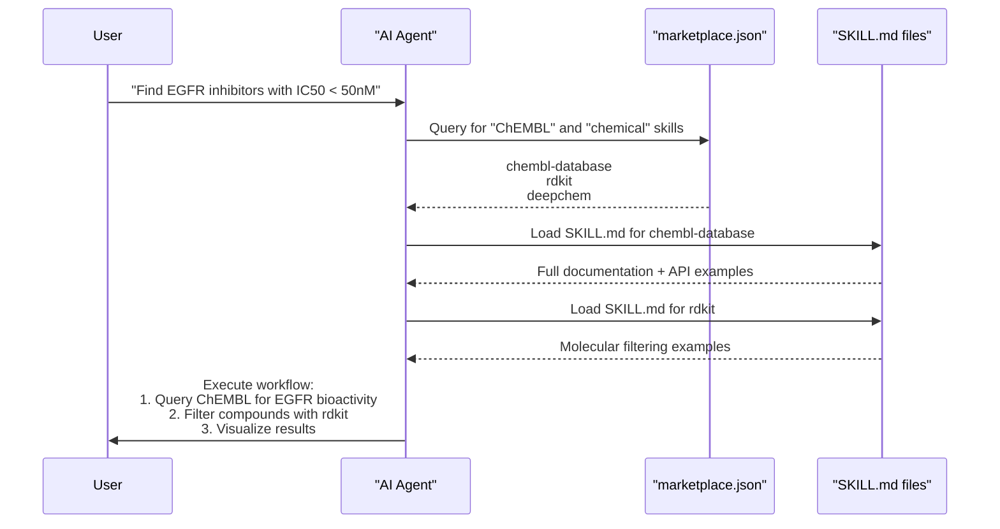

<!-- source: DeepWiki mcp.deepwiki.com · repo K-Dense-AI/claude-scientific-skills · page 4 Scientific Domains · fetched 2026-10-26 -->

# Scientific Domains

<details>
<summary>Relevant source files</summary>

The following files were used as context for generating this wiki page:

- [.claude-plugin/marketplace.json](.claude-plugin/marketplace.json)
- [README.md](README.md)
- [docs/scientific-skills.md](docs/scientific-skills.md)
- [scientific-skills/ginkgo-cloud-lab/SKILL.md](scientific-skills/ginkgo-cloud-lab/SKILL.md)
- [scientific-skills/ginkgo-cloud-lab/references/cell-free-protein-expression-optimization.md](scientific-skills/ginkgo-cloud-lab/references/cell-free-protein-expression-optimization.md)
- [scientific-skills/ginkgo-cloud-lab/references/cell-free-protein-expression-validation.md](scientific-skills/ginkgo-cloud-lab/references/cell-free-protein-expression-validation.md)
- [scientific-skills/ginkgo-cloud-lab/references/fluorescent-pixel-art-generation.md](scientific-skills/ginkgo-cloud-lab/references/fluorescent-pixel-art-generation.md)

</details>


## Overview

The Claude Scientific Skills system provides 170+ skills organized into eight major scientific domains, enabling comprehensive coverage of computational biology, chemistry, medicine, machine learning, and research workflows. This page provides a high-level overview of these domains and their relationships.

**The eight major domains are:**

1. **Bioinformatics & Genomics** (20+ skills) - Sequence analysis, single-cell RNA-seq, gene regulatory networks, variant annotation
2. **Cheminformatics & Drug Discovery** (13+ skills) - Molecular modeling, docking, ADMET prediction, drug design
3. **Clinical Research & Precision Medicine** (16+ skills) - Clinical databases, variant interpretation, cancer genomics
4. **Machine Learning & AI** (16+ skills) - Deep learning, classical ML, time series forecasting, graph neural networks
5. **Geospatial Science** (1 comprehensive skill) - Remote sensing, GIS, spatial analysis
6. **Laboratory Automation** (4 skills) - Cloud lab protocols, liquid handling automation
7. **Scientific Databases** (37+ direct skills → 250+ total databases) - Covered in Section 5
8. **Scientific Communication & Research Methodology** (35+ skills) - Covered in Sections 6-7

This section focuses on domains 1-6 (computational and experimental domains). Databases, communication, and research methodology are covered in dedicated sections due to their cross-cutting nature.

Sources: [README.md:50-56](), [.claude-plugin/marketplace.json:11-191]()

## Domain Architecture and Skill Distribution

The skill ecosystem uses a hierarchical organization optimized for both discovery and composition:

**Three-tier hierarchy:**
1. **8 Major Domains** - Top-level scientific disciplines
2. **Domain-specific subcategories** - Specialized capabilities within each domain
3. **170+ Individual Skills** - Specific Python packages, databases, platforms, and workflows

**Distribution model:**
The entire collection is distributed as a single bundled plugin (`scientific-skills` in the `claude-scientific-skills` marketplace). This ensures zero-friction interdisciplinary workflows: install once, access all 170+ skills without dependency conflicts.

**Skill discovery mechanism:**
Skills are registered in [.claude-plugin/marketplace.json:17-191]() as relative paths (e.g., `./scientific-skills/scanpy`, `./scientific-skills/chembl-database`). AI agents automatically discover and invoke relevant skills based on natural language prompts.

Sources: [README.md:52-56](), [.claude-plugin/marketplace.json:1-194]()

## Domain Organization and Marketplace Structure



**Domain Hierarchy in marketplace.json**

The marketplace structure defines all skills as paths under the `scientific-skills` plugin. Each domain maps to a set of skill directories (e.g., `./scientific-skills/scanpy` for bioinformatics, `./scientific-skills/chembl-database` for databases).

Sources: [.claude-plugin/marketplace.json:1-194](), [README.md:398-546]()

## Domain 1: Bioinformatics and Genomics

This domain provides 20+ skills for sequence analysis, single-cell RNA-seq, gene regulatory networks, variant annotation, and phylogenetic analysis.

**Core capabilities:**

| Subcategory | Representative Skills | Key Functionality |
|-------------|---------------------|-------------------|
| Sequence Analysis | `biopython`, `pysam`, `scikit-bio`, `bioservices` | DNA/RNA/protein manipulation, SAM/BAM/VCF processing, alignment |
| Single-Cell RNA-seq | `scanpy`, `anndata`, `scvi-tools`, `scvelo`, `arboreto`, `cellxgene-census` | QC, normalization, clustering, RNA velocity, GRN inference, 50M+ cell access |
| Genomic Tools | `gget`, `geniml`, `gtars`, `deeptools`, `flowio`, `zarr-python`, `tiledbvcf` | Database queries, ML tokenization, coverage tracks, VCF storage |
| Phylogenetics | `etetoolkit`, `phylogenetics` | Tree construction, MAFFT/IQ-TREE/FastTree integration |

**Marketplace paths:**
- [.claude-plugin/marketplace.json:23]() - `./scientific-skills/biopython`
- [.claude-plugin/marketplace.json:87]() - `./scientific-skills/scanpy`
- [.claude-plugin/marketplace.json:91]() - `./scientific-skills/scvelo`
- [.claude-plugin/marketplace.json:99]() - `./scientific-skills/tiledbvcf`
- [.claude-plugin/marketplace.json:26]() - `./scientific-skills/cellxgene-census`

**Detailed documentation:** See [Bioinformatics and Genomics](#4.1)

Sources: [README.md:406-410](), [.claude-plugin/marketplace.json:20-106](), [docs/scientific-skills.md:64-73]()

## Domain 2: Cheminformatics and Drug Discovery

This domain provides 13+ skills for molecular modeling, virtual screening, ADMET prediction, molecular dynamics, and drug design workflows.

**Core capabilities:**

| Subcategory | Representative Skills | Key Functionality |
|-------------|---------------------|-------------------|
| Molecular Manipulation | `rdkit`, `datamol`, `molfeat` | SMILES/InChI parsing, fingerprints, descriptors, substructure search |
| Deep Learning for Chemistry | `deepchem`, `torchdrug` | QSAR models, ADMET prediction, molecular generation |
| Molecular Docking | `diffdock` | Protein-ligand docking, binding pose prediction |
| Molecular Dynamics | `molecular-dynamics` (OpenMM + MDAnalysis) | MD simulations, trajectory analysis, conformational sampling |
| Cloud Quantum Chemistry | `rowan` | pKa prediction, docking, cofolding via cloud API |
| Drug-Likeness | `medchem` | Lipinski rules, ADMET filters, medicinal chemistry rules |
| Binding Affinities | `bindingdb-database` | Ki, Kd, IC50, EC50 data for drug-target pairs |
| Benchmarking | `pytdc` | Therapeutics Data Commons, standardized benchmarks |

**Marketplace paths:**
- [.claude-plugin/marketplace.json:85]() - `./scientific-skills/rdkit`
- [.claude-plugin/marketplace.json:31]() - `./scientific-skills/deepchem`
- [.claude-plugin/marketplace.json:35]() - `./scientific-skills/diffdock`
- [.claude-plugin/marketplace.json:57]() - `./scientific-skills/molecular-dynamics`
- [.claude-plugin/marketplace.json:86]() - `./scientific-skills/rowan`
- [.claude-plugin/marketplace.json:108]() - `./scientific-skills/bindingdb-database`

**Detailed documentation:** See [Cheminformatics and Drug Discovery](#4.2)

Sources: [README.md:412-420](), [.claude-plugin/marketplace.json:30-86](), [docs/scientific-skills.md:6-20]()

## Domain 3: Clinical Research and Precision Medicine

This domain provides 16+ skills for clinical databases, variant interpretation, cancer genomics, medical imaging, and healthcare AI.

**Core capabilities:**

| Subcategory | Representative Skills | Key Functionality |
|-------------|---------------------|-------------------|
| Clinical Databases | `clinicaltrials-database`, `clinvar-database`, `clinpgx-database`, `fda-database` | Trial search, variant pathogenicity, pharmacogenomics, drug safety |
| Cancer Genomics | `cosmic-database`, `cbioportal-database`, `depmap` | Somatic mutations, cancer cell line dependencies, 400+ cancer studies |
| Disease-Gene Associations | `monarch-database` | OMIM, ORPHANET, HPO, ClinVar, model organism data integration |
| Cancer Imaging | `imaging-data-commons` | Radiology & pathology datasets via idc-index |
| Healthcare AI | `pyhealth`, `neurokit2` | EHR analysis, physiological signal processing |
| Clinical Documentation | `clinical-decision-support`, `clinical-reports`, `treatment-plans` | Clinical predictions, report generation, treatment planning |

**Marketplace paths:**
- [.claude-plugin/marketplace.json:113-117]() - Clinical database skills (`clinicaltrials-database`, `clinpgx-database`, `clinvar-database`, `cosmic-database`, `fda-database`)
- [.claude-plugin/marketplace.json:111]() - `./scientific-skills/cbioportal-database`
- [.claude-plugin/marketplace.json:34]() - `./scientific-skills/depmap`
- [.claude-plugin/marketplace.json:48]() - `./scientific-skills/imaging-data-commons`
- [.claude-plugin/marketplace.json:72]() - `./scientific-skills/pyhealth`
- [.claude-plugin/marketplace.json:157]() - `./scientific-skills/clinical-decision-support`

**Detailed documentation:** See [Clinical Research and Precision Medicine](#4.3)

Sources: [README.md:425-432](), [.claude-plugin/marketplace.json:34-157](), [docs/scientific-skills.md:9-11]()

## Domain 4: Machine Learning and AI

This domain provides 16+ skills for deep learning, classical ML, time series forecasting, Bayesian methods, and graph neural networks.

**Core capabilities:**

| Subcategory | Representative Skills | Key Functionality |
|-------------|---------------------|-------------------|
| Deep Learning | `pytorch-lightning`, `transformers`, `stable-baselines3`, `pufferlib` | Training loops, model organization, NLP, reinforcement learning |
| Classical ML | `scikit-learn`, `scikit-survival`, `shap` | Classification, regression, survival analysis, model interpretation |
| Time Series | `aeon`, `timesfm-forecasting` | Time series classification/clustering, zero-shot forecasting with Google TimesFM |
| Bayesian Methods | `pymc` | Probabilistic programming, Bayesian inference |
| Optimization | `pymoo` | Multi-objective optimization, evolutionary algorithms |
| Graph ML | `torch_geometric` | Graph neural networks, molecular graphs, biological networks |
| Dimensionality Reduction | `umap-learn` | Non-linear dimensionality reduction, visualization |
| Statistical Modeling | `statsmodels` | Regression, time series, hypothesis testing |

**Marketplace paths:**
- [.claude-plugin/marketplace.json:81]() - `./scientific-skills/pytorch-lightning`
- [.claude-plugin/marketplace.json:103]() - `./scientific-skills/transformers`
- [.claude-plugin/marketplace.json:89-90]() - `./scientific-skills/scikit-learn`, `./scientific-skills/scikit-survival`
- [.claude-plugin/marketplace.json:100]() - `./scientific-skills/timesfm-forecasting`
- [.claude-plugin/marketplace.json:101]() - `./scientific-skills/torch_geometric`

**Detailed documentation:** See [Machine Learning and AI](#4.4)

Sources: [README.md:441-449](), [.claude-plugin/marketplace.json:19-104](), [docs/scientific-skills.md:44-49]()

## Domain 5: Geospatial Science

This domain provides the `geomaster` skill, a comprehensive package for remote sensing, GIS, spatial analysis, and geospatial machine learning.

**Core capabilities:**

| Feature | Functionality |
|---------|--------------|
| Remote Sensing | Satellite imagery processing, multispectral analysis, change detection |
| GIS Operations | Spatial queries, overlay analysis, geocoding, coordinate transformations |
| Spatial Analysis | Hotspot detection, spatial autocorrelation, proximity analysis |
| Geospatial ML | Land cover classification, object detection, segmentation |
| Data Sources | Integration with major satellite missions and geospatial databases |
| Examples | 500+ code examples covering common geospatial workflows |

**Marketplace path:**
- [.claude-plugin/marketplace.json:42]() - `./scientific-skills/geomaster`

**Detailed documentation:** See [Geospatial Science](#4.5)

Sources: [README.md:465](), [.claude-plugin/marketplace.json:42](), [docs/scientific-skills.md:117]()

## Domain 6: Laboratory Automation

This domain provides 4 skills for cloud lab protocols, liquid handling automation, and protocol management.

**Core capabilities:**

| Skill | Functionality |
|-------|--------------|
| `ginkgo-cloud-lab` | Cell-free protein expression (validation $39/sample, optimization $199/sample), fluorescent pixel art ($25/plate), autonomous RAC infrastructure |
| `pylabrobot` | Python library for liquid handling robot control, protocol development |
| `opentrons-integration` | Opentrons Protocol API v2 for Flex and OT-2 robots, hardware module control |
| `protocolsio-integration` | protocols.io API for protocol discovery, lifecycle management, collaboration |

**Marketplace paths:**
- [.claude-plugin/marketplace.json:44]() - `./scientific-skills/ginkgo-cloud-lab`
- [.claude-plugin/marketplace.json:73]() - `./scientific-skills/pylabrobot`
- [.claude-plugin/marketplace.json:182]() - `./scientific-skills/opentrons-integration`
- [.claude-plugin/marketplace.json:184]() - `./scientific-skills/protocolsio-integration`

**Detailed documentation:** See [Laboratory Automation](#4.6)

**Ginkgo Cloud Lab protocols:**
See [Cell Free Protein Expression Validation](scientific-skills/ginkgo-cloud-lab/references/cell-free-protein-expression-validation.md:1-72), [Cell Free Protein Expression Optimization](scientific-skills/ginkgo-cloud-lab/references/cell-free-protein-expression-optimization.md:1-95), [Fluorescent Pixel Art Generation](scientific-skills/ginkgo-cloud-lab/references/fluorescent-pixel-art-generation.md:1-88)

Sources: [README.md:475-479](), [.claude-plugin/marketplace.json:44-184](), [scientific-skills/ginkgo-cloud-lab/SKILL.md:1-57]()

## Cross-Cutting Domains

The following domains are covered in dedicated sections due to their cross-cutting nature across all scientific disciplines:

### Scientific Databases (Section 5)

37+ direct database skills providing access to 250+ total databases through direct API skills and multi-database aggregators (`bioservices`, `biopython`, `gget`).

**Coverage includes:**
- Literature: PubMed, OpenAlex, bioRxiv
- Protein: UniProt, PDB, AlphaFold DB
- Chemical: ChEMBL, PubChem, DrugBank, ZINC
- Genomic: Ensembl, NCBI Gene, GEO, GWAS Catalog
- Clinical: ClinVar, COSMIC, ClinicalTrials.gov, cBioPortal
- Pathways: KEGG, Reactome, STRING
- Financial: FRED, edgartools, alpha-vantage

See [Scientific Databases](#5) for detailed coverage.

### Scientific Communication (Section 7)

24+ skills for literature review, scientific writing, visualization, document processing, and content creation.

**Coverage includes:**
- Literature: `literature-review`, `peer-review`, `bgpt-paper-search`
- Writing: `scientific-writing`, `markdown-mermaid-writing`
- Visualization: `matplotlib`, `seaborn`, `plotly`, `scientific-visualization`
- Presentation: `scientific-slides`, `latex-posters`, `pptx-posters`, `scientific-schematics`
- Illustration: `generate-image`, `infographics`
- Document Processing: `markitdown`, `xlsx`, `docx`, `pdf`, `pptx`

See [Scientific Communication](#7) for detailed coverage.

### Research Methodology (Sections 6-7)

11+ skills for hypothesis generation, grant writing, research lookup, and critical analysis.

**Coverage includes:**
- Ideation: `scientific-brainstorming`, `hypothesis-generation`
- Critical Analysis: `scientific-critical-thinking`, `scholar-evaluation`
- Scenario Analysis: `what-if-oracle`, `consciousness-council`, `dhdna-profiler`
- Research Discovery: `research-lookup`, `open-notebook`
- Funding: `research-grants`

See [Research Workflows and Tools](#6) for detailed coverage.

Sources: [README.md:505-544](), [.claude-plugin/marketplace.json:107-191]()

## Skill Discovery and Composition

### How AI Agents Discover Skills

AI agents automatically discover and invoke skills from the marketplace registry based on natural language prompts:



**Skill discovery flow:**
1. User provides natural language prompt
2. Agent parses prompt to identify required capabilities
3. Agent queries [.claude-plugin/marketplace.json:17-191]() for relevant skills
4. Agent loads skill documentation (SKILL.md files)
5. Agent executes skills in sequence, passing data between them
6. Agent aggregates results and presents to user

Sources: [README.md:88-90](), [.claude-plugin/marketplace.json:11-191]()

### Cross-Domain Skill Composition Pattern

Complex workflows typically require 6-15 skills from 3-5 different domains:



**Common multi-domain patterns:**

| Workflow Type | Domains Involved | Typical Skill Count |
|---------------|-----------------|---------------------|
| Drug Discovery | Databases, Cheminformatics, ML, Lab, Communication | 6-10 skills |
| Cancer Genomics | Databases, Bioinformatics, Clinical, Communication | 8-12 skills |
| Single-Cell Analysis | Databases, Bioinformatics, ML, Communication | 5-8 skills |
| Clinical Variant Interpretation | Databases, Bioinformatics, Clinical, Communication | 8-10 skills |

Sources: [README.md:206-320](), [docs/scientific-skills.md:1-200]()

## Skill Distribution by Category

### Quantitative Skill Breakdown

| Domain Category | Skill Count | % of Total | Representative Skills |
|----------------|-------------|------------|---------------------|
| Scientific Databases | 37+ | 21.8% | `pubmed-database`, `chembl-database`, `uniprot-database`, `clinvar-database` |
| Scientific Communication | 24+ | 14.1% | `scientific-writing`, `literature-review`, `matplotlib`, `plotly` |
| Bioinformatics & Genomics | 20+ | 11.8% | `scanpy`, `biopython`, `scvelo`, `cellxgene-census` |
| Machine Learning & AI | 16+ | 9.4% | `pytorch-lightning`, `scikit-learn`, `transformers`, `timesfm-forecasting` |
| Clinical Research | 16+ | 9.4% | `clinvar-database`, `cosmic-database`, `cbioportal-database`, `pyhealth` |
| Cheminformatics | 13+ | 7.6% | `rdkit`, `deepchem`, `diffdock`, `molecular-dynamics` |
| Research Methodology | 11+ | 6.5% | `hypothesis-generation`, `scientific-brainstorming`, `research-grants` |
| Infrastructure & Platforms | 6+ | 3.5% | `modal`, `dnanexus-integration`, `latchbio-integration` |
| Financial & SEC Research | 5 | 2.9% | `edgartools`, `fred-economic-data`, `alpha-vantage` |
| Laboratory Automation | 4 | 2.4% | `ginkgo-cloud-lab`, `pylabrobot`, `opentrons-integration` |
| Other Specialized | 18+ | 10.6% | `geomaster`, `pymatgen`, `qiskit`, `pennylane`, `astropy` |
| **Total** | **170+** | **100%** | |

The database category is largest because it provides API access to 37+ distinct resources (expanding to 250+ databases through multi-database aggregators). The communication category is second-largest, reflecting the critical role of scientific writing, visualization, and documentation in research workflows.

Sources: [README.md:50-56](), [.claude-plugin/marketplace.json:11-191](), [docs/scientific-skills.md:1-200]()

### File Structure in Marketplace Registry

Each skill is registered as a relative path in [.claude-plugin/marketplace.json:17-191]():

```mermaid
graph TB
    Root["marketplace.json<br/>plugins[0].skills array"]
    
    Python["Python Package Skills<br/>~60 skills"]
    Database["Database Skills<br/>37+ skills"]
    Integration["Platform Integration Skills<br/>~15 skills"]
    Workflow["Workflow & Analysis Skills<br/>~35 skills"]
    Document["Document Skills<br/>4 skills"]
    Financial["Financial Skills<br/>5 skills"]
    
    Root --> Python
    Root --> Database
    Root --> Integration
    Root --> Workflow
    Root --> Document
    Root --> Financial
    
    Python --> P1["./scientific-skills/scanpy"]
    Python --> P2["./scientific-skills/rdkit"]
    Python --> P3["./scientific-skills/pytorch-lightning"]
    
    Database --> D1["./scientific-skills/pubmed-database"]
    Database --> D2["./scientific-skills/chembl-database"]
    Database --> D3["./scientific-skills/uniprot-database"]
    
    Integration --> I1["./scientific-skills/benchling-integration"]
    Integration --> I2["./scientific-skills/ginkgo-cloud-lab"]
    Integration --> I3["./scientific-skills/dnanexus-integration"]
    
    Workflow --> W1["./scientific-skills/literature-review"]
    Workflow --> W2["./scientific-skills/scientific-writing"]
    Workflow --> W3["./scientific-skills/exploratory-data-analysis"]
    
    Document --> Doc1["./scientific-skills/document-skills/xlsx"]
    Document --> Doc2["./scientific-skills/document-skills/pdf"]
    
    Financial --> F1["./scientific-skills/edgartools"]
    Financial --> F2["./scientific-skills/fred-economic-data"]
```



**Path pattern conventions:**
- Python packages: `./scientific-skills/<package-name>` (e.g., `scanpy`, `rdkit`)
- Databases: `./scientific-skills/<database-name>-database` (e.g., `pubmed-database`)
- Integrations: `./scientific-skills/<platform-name>-integration` (e.g., `benchling-integration`)
- Workflows: `./scientific-skills/<workflow-name>` (e.g., `literature-review`)
- Nested skills: `./scientific-skills/<category>/<skill-name>` (e.g., `document-skills/xlsx`)

Sources: [.claude-plugin/marketplace.json:1-194]()

## Bundled Plugin Architecture

### Why Bundle All Skills Together?

The system distributes all 170+ skills as a single plugin (`scientific-skills`) rather than individual packages:

**Advantages of bundled approach:**

| Benefit | Explanation |
|---------|-------------|
| Zero-friction interdisciplinary research | Install once, access all domains without managing dependencies |
| Guaranteed compatibility | All skills tested together in each release, no version conflicts |
| Automatic skill discovery | AI agents have full visibility into all 170+ capabilities |
| Simplified versioning | Single version number for entire collection |
| Reduced cognitive load | No need to discover and install 170 individual skills |

**Alternative (individual plugins) would create:**
- Dependency conflicts between skills (e.g., incompatible NumPy versions)
- Installation friction (users must know which skills exist)
- Difficulty discovering cross-domain capabilities
- Version incompatibility issues

Sources: [README.md:54-56](), [.claude-plugin/marketplace.json:8-9]()

### Marketplace Version and Metadata

Current version from [.claude-plugin/marketplace.json:1-10]():

```json
{
  "name": "claude-scientific-skills",
  "owner": {
    "name": "K-Dense Inc.",
    "email": "contact@k-dense.ai"
  },
  "metadata": {
    "description": "Claude scientific skills from K-Dense Inc",
    "version": "2.26.0"
  }
}
```

Version `2.26.0` applies to the entire 170+ skill collection. When skills are updated or added, the version is incremented via [.github/workflows/release.yml:1-98]() and all skills are released together as a tested unit.

Sources: [.claude-plugin/marketplace.json:1-10]()

### Installation Pathways

Users install the skill bundle through standard Agent Skills directories:

**Global installation (recommended):**
```bash
# For Cursor
cp -r claude-scientific-skills/scientific-skills/* ~/.cursor/skills/

# For Claude Code
cp -r claude-scientific-skills/scientific-skills/* ~/.claude/skills/

# For Codex
cp -r claude-scientific-skills/scientific-skills/* ~/.codex/skills/
```

**Project-level installation:**
```bash
# Create project-local skills directory
mkdir -p .cursor/skills/
cp -r /path/to/claude-scientific-skills/scientific-skills/* .cursor/skills/
```

AI agents automatically scan these directories on startup, parse SKILL.md frontmatter, and register capabilities. No manual skill selection required.

Sources: [README.md:113-161]()

## Skill Naming Conventions and Discovery

### Standardized Naming Patterns

Skills follow consistent naming conventions that aid automatic discovery:

| Pattern | Example Skills | Purpose |
|---------|---------------|---------|
| `<package-name>` | `scanpy`, `rdkit`, `pytorch-lightning`, `biopython` | Python package skills |
| `<database-name>-database` | `pubmed-database`, `chembl-database`, `uniprot-database`, `clinvar-database` | Database API skills |
| `<platform-name>-integration` | `benchling-integration`, `opentrons-integration`, `dnanexus-integration` | External platform integrations |
| `<workflow-name>` | `literature-review`, `scientific-writing`, `hypothesis-generation`, `exploratory-data-analysis` | Workflow/process skills |
| `document-skills/<format>` | `document-skills/xlsx`, `document-skills/pdf`, `document-skills/pptx` | Document format handlers |
| `<domain>-<tool>` | `ginkgo-cloud-lab`, `imaging-data-commons`, `timesfm-forecasting` | Specialized domain tools |

This convention enables:
- **Automatic skill purpose inference** - AI agents infer capability from name
- **Improved search and filtering** - Users can easily find related skills
- **Reduced naming conflicts** - Clear namespacing (e.g., `-database` suffix)

Sources: [.claude-plugin/marketplace.json:17-191]()

### Example Skill Discovery Flow



**Discovery sequence:**
1. User provides natural language prompt
2. AI agent parses prompt to identify required capabilities
3. Agent queries [.claude-plugin/marketplace.json:17-191]() for skill paths
4. Agent loads full documentation from SKILL.md files
5. Agent executes skills in sequence, passing data between them
6. Agent aggregates results and presents to user

Sources: [README.md:88-90](), [README.md:216-232]()

## Specialized and Emerging Domains

### Quantum Computing (4 skills)

Quantum computing skills span multiple quantum frameworks:

- `qiskit` - IBM Quantum hardware access, circuit transpilation, quantum algorithms
- `pennylane` - Differentiable quantum computing, quantum ML, gradient-based optimization
- `cirq` - Google Quantum AI, Sycamore processor access
- `qutip` - Open quantum systems, quantum dynamics simulations

**Integration with chemistry:** These skills integrate with `deepchem` and `rdkit` for quantum chemistry simulations and molecular property prediction.

Sources: [README.md:455](), [docs/scientific-skills.md:50-51]()

### Proteomics and Mass Spectrometry (2 skills)

Specialized LC-MS/MS data processing:

- `matchms` - Spectral similarity, MS/MS library matching, metabolomics
- `pyopenms` - Peptide identification, protein quantification, raw data processing

**Integration:** These skills connect with `uniprot-database`, `pdb-database`, and `biopython` for end-to-end proteomics workflows.

Sources: [README.md:422-423](), [docs/scientific-skills.md:104-105]()

### Financial and SEC Research (5 skills)

Financial data access for biopharma and healthcare sector analysis:

- `edgartools` - SEC filings (10-K, 10-Q, 8-K, 13F, Form 4, XBRL, insider trading)
- `usfiscaldata` - U.S. Treasury data (national debt, Treasury auctions, interest rates)
- `fred-economic-data` - 800,000+ economic time series from Federal Reserve
- `hedgefundmonitor` - OFR hedge fund data (Form PF, systemic risk metrics)
- `alpha-vantage` - Real-time stocks, forex, crypto, commodities, technical indicators

**Use cases:** Biopharma competitive intelligence, healthcare sector analysis, R&D investment tracking, clinical trial economic impact.

Sources: [README.md:539-544](), [docs/scientific-skills.md:16-18]()

### Materials Science (7 skills)

Computational materials science and quantum computing:

- `pymatgen` - Crystal structures, phase diagrams, materials informatics
- `cobrapy` - Metabolic modeling, flux balance analysis
- `astropy` - Astronomical data analysis, coordinate transformations
- Plus 4 quantum computing skills (see above)

Sources: [README.md:455-456](), [docs/scientific-skills.md:50-52]()

## Domain Expansion and Maintenance

### Adding New Domains and Skills

The domain organization is extensible. New skills are added by:

1. **Determine domain placement** - Assign to existing domain or propose new domain
2. **Create skill directory** - `./scientific-skills/<skill-name>/`
3. **Write SKILL.md** - Mandatory frontmatter + documentation (see [SKILL.md Anatomy and Structure](#3.4))
4. **Add supporting files** - Optional `scripts/`, `references/`, `assets/`, `examples/`
5. **Register in marketplace** - Add path to [.claude-plugin/marketplace.json:17-191]()
6. **Increment version** - Update [.claude-plugin/marketplace.json:9]() version number
7. **Submit PR** - Automated release workflow creates GitHub release

See [Creating New Skills](#9.3) for detailed guidelines.

Sources: [README.md:552-618]()

### Skill Dependency Management

Individual skills declare Python dependencies in SKILL.md files. Dependencies are installed lazily using `uv pip install` when skills are first invoked.

**No global dependencies required** beyond:
- Python 3.9+ (3.12+ recommended)
- `uv` package manager
- AI agent supporting Agent Skills standard (Cursor, Claude Code, Codex)

This decentralized dependency model prevents version conflicts and allows skills to specify exact package versions independently.

Sources: [README.md:180-213]()

### Domain Evolution

Historical domain evolution:

| Version | Total Skills | Major Additions |
|---------|-------------|----------------|
| 1.0 | ~50 | Core bioinformatics, cheminformatics |
| 2.0 | ~100 | Clinical databases, ML frameworks |
| 2.10 | ~150 | Laboratory automation, communication |
| 2.26.0 | 170+ | Financial data, geospatial science, time series forecasting |

Future domain expansion areas:
- Quantum biology and quantum sensing
- Synthetic biology design automation
- Multi-modal foundation models for science
- Advanced laboratory robotics

Sources: [.claude-plugin/marketplace.json:9]()

## Summary

The 138-skill collection is organized into:

- **7 major domains** for top-level navigation (Bioinformatics, Cheminformatics, Databases, ML, Analysis/Communication, Clinical, Infrastructure)
- **18 detailed categories** for precise capability discovery
- **138 individual skills** spanning Python packages, databases, integrations, and workflows

The **single bundled plugin** architecture (`scientific-skills` in `claude-scientific-skills` marketplace) enables zero-friction interdisciplinary workflows where Claude automatically discovers and chains skills from multiple domains based on natural language prompts.

This organization balances:
- **Breadth**: Coverage of all major scientific computing domains
- **Depth**: Specialized tools within each domain
- **Usability**: Simple installation and automatic skill discovery
- **Maintainability**: Coordinated versioning and testing

Sources: [README.md:1-660](), [.claude-plugin/marketplace.json:1-160]()

---

