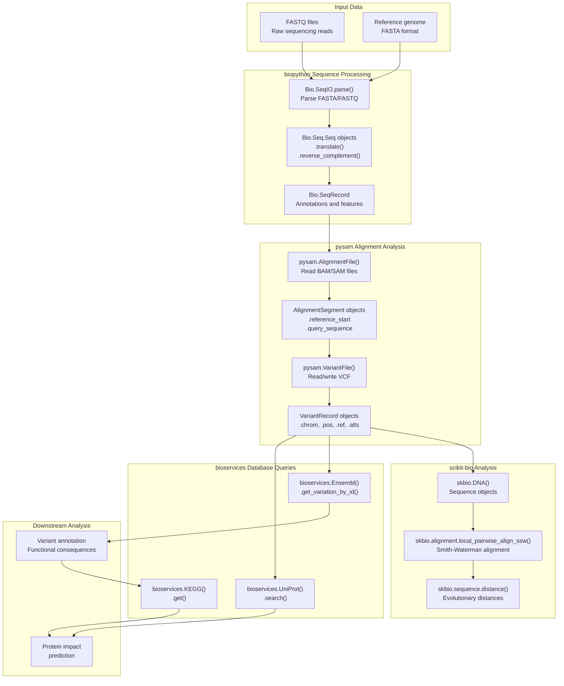
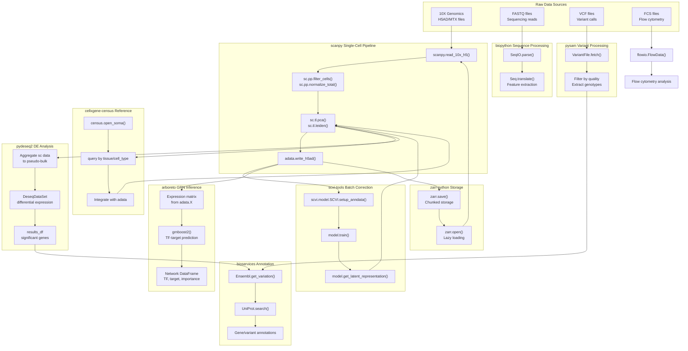

<!-- source: DeepWiki mcp.deepwiki.com · repo K-Dense-AI/claude-scientific-skills · page 4.1 Bioinformatics and Genomics · fetched 2026-10-26 -->

# Bioinformatics and Genomics

<details>
<summary>Relevant source files</summary>

The following files were used as context for generating this wiki page:

- [.claude-plugin/marketplace.json](.claude-plugin/marketplace.json)
- [README.md](README.md)
- [docs/scientific-skills.md](docs/scientific-skills.md)
- [scientific-skills/ginkgo-cloud-lab/SKILL.md](scientific-skills/ginkgo-cloud-lab/SKILL.md)
- [scientific-skills/ginkgo-cloud-lab/references/cell-free-protein-expression-optimization.md](scientific-skills/ginkgo-cloud-lab/references/cell-free-protein-expression-optimization.md)
- [scientific-skills/ginkgo-cloud-lab/references/cell-free-protein-expression-validation.md](scientific-skills/ginkgo-cloud-lab/references/cell-free-protein-expression-validation.md)
- [scientific-skills/ginkgo-cloud-lab/references/fluorescent-pixel-art-generation.md](scientific-skills/ginkgo-cloud-lab/references/fluorescent-pixel-art-generation.md)

</details>


## Purpose and Scope

This page documents the bioinformatics and genomics capabilities within Claude Scientific Skills. The skills in this category enable analysis of biological sequence data, single-cell transcriptomics, variant calling, differential expression, phylogenetic analysis, and integration with genomic databases. These 16+ skills cover the complete workflow from raw sequencing data to publication-ready results.

For machine learning applications in bioinformatics (e.g., graph neural networks for protein structures), see [Machine Learning and AI](#9). For database access to genomic resources (Ensembl, NCBI Gene, UniProt), see [Scientific Databases](#8).

Sources: [README.md:344-348](), [.claude-plugin/marketplace.json:17-92]()

---

## Skill Categories and Directory Structure

The bioinformatics skills are organized into six functional categories, each corresponding to specific directories in the codebase:

| Category | Skills | Directory Paths |
|----------|--------|-----------------|
| **Sequence Analysis** | biopython, pysam, scikit-bio, bioservices | `./scientific-skills/biopython/`<br>`./scientific-skills/pysam/`<br>`./scientific-skills/scikit-bio/`<br>`./scientific-skills/bioservices/` |
| **Single-Cell RNA-seq** | scanpy, anndata, scvi-tools, cellxgene-census, arboreto | `./scientific-skills/scanpy/`<br>`./scientific-skills/anndata/`<br>`./scientific-skills/scvi-tools/`<br>`./scientific-skills/cellxgene-census/`<br>`./scientific-skills/arboreto/` |
| **Differential Expression** | pydeseq2 | `./scientific-skills/pydeseq2/` |
| **Genomic Utilities** | gget, geniml, gtars, deeptools | `./scientific-skills/gget/`<br>`./scientific-skills/geniml/`<br>`./scientific-skills/gtars/`<br>`./scientific-skills/deeptools/` |
| **Data Formats** | flowio, zarr-python | `./scientific-skills/flowio/`<br>`./scientific-skills/zarr-python/` |
| **Phylogenetics** | etetoolkit | `./scientific-skills/etetoolkit/` |

Each skill directory contains:
- `SKILL.md` - Comprehensive documentation with installation instructions, usage examples, and best practices
- `scripts/` - Executable Python scripts for common tasks
- `references/` - Reference materials and external documentation links
- `assets/` - Supporting files (schemas, example data)

Sources: [.claude-plugin/marketplace.json:17-92](), [README.md:344-348]()

---

## Bioinformatics Skills Taxonomy

The following diagram maps natural language descriptions to actual skill directory names in the repository:

```mermaid
graph TB
    subgraph "Sequence Analysis Tools"
        BioPython["./scientific-skills/biopython<br/>Seq objects, SeqIO, SeqRecord<br/>FASTA/GenBank parsing"]
        Pysam["./scientific-skills/pysam<br/>AlignmentFile, VariantFile<br/>BAM/VCF processing"]
        ScikitBio["./scientific-skills/scikit-bio<br/>DNA/RNA/Protein sequences<br/>Alignment algorithms"]
        BioServices["./scientific-skills/bioservices<br/>UniProt/KEGG/Ensembl APIs<br/>Programmatic database access"]
    end
    
    subgraph "Single-Cell RNA-seq Pipeline"
        Scanpy["./scientific-skills/scanpy<br/>sc.read_10x_h5(), sc.pp.*, sc.tl.*<br/>QC, normalization, clustering"]
        AnnData["./scientific-skills/anndata<br/>AnnData objects<br/>.obs, .var, .X matrices"]
        ScviTools["./scientific-skills/scvi-tools<br/>scvi.model.SCVI<br/>Batch correction, integration"]
        CellxgeneCensus["./scientific-skills/cellxgene-census<br/>cellxgene_census.open_soma()<br/>Reference atlas access"]
        Arboreto["./scientific-skills/arboreto<br/>GRNBoost2, GENIE3<br/>Gene regulatory networks"]
    end
    
    subgraph "Differential Expression"
        PyDESeq2["./scientific-skills/pydeseq2<br/>DeseqDataSet, DeseqStats<br/>RNA-seq DE analysis"]
    end
    
    subgraph "Genomic Utilities"
        Gget["./scientific-skills/gget<br/>gget.ref(), gget.seq()<br/>CLI genomic queries"]
        Geniml["./scientific-skills/geniml<br/>Gene imputation<br/>Missing data handling"]
        Gtars["./scientific-skills/gtars<br/>TAR archives<br/>Genomic data packaging"]
        DeepTools["./scientific-skills/deeptools<br/>BAM/bigWig processing<br/>Coverage analysis"]
    end
    
    subgraph "Data Formats"
        FlowIO["./scientific-skills/flowio<br/>FCS file parsing<br/>Flow cytometry data"]
        Zarr["./scientific-skills/zarr-python<br/>zarr.open(), zarr.array()<br/>Chunked array storage"]
    end
    
    subgraph "Phylogenetics"
        ETE["./scientific-skills/etetoolkit<br/>Tree(), TreeNode<br/>Phylogenetic tree analysis"]
    end
    
    SeqAnalysis["Sequence Analysis<br/>FASTA/BAM/VCF"] --> BioPython
    SeqAnalysis --> Pysam
    SeqAnalysis --> ScikitBio
    
    DatabaseQuery["External Database<br/>Queries"] --> BioServices
    
    SingleCell["Single-Cell<br/>Analysis"] --> Scanpy
    SingleCell --> AnnData
    SingleCell --> ScviTools
    
    ReferenceData["Reference<br/>Atlas Data"] --> CellxgeneCensus
    
    GRN["Gene Regulatory<br/>Networks"] --> Arboreto
    
    BulkRNA["Bulk RNA-seq<br/>DE Analysis"] --> PyDESeq2
    
    GenomicQuery["Genomic<br/>Annotation"] --> Gget
    
    PhyloTree["Phylogenetic<br/>Analysis"] --> ETE
```



Sources: [.claude-plugin/marketplace.json:24-92](), [README.md:344-348]()

---

## Single-Cell RNA-seq Analysis Workflow

This diagram illustrates a complete single-cell analysis pipeline, mapping each step to specific skill directories and key functions:

```mermaid
graph LR
    subgraph "Data Loading"
        RawData["10X Genomics<br/>H5/MTX files"]
        LoadFunc["scanpy.read_10x_h5()<br/>scanpy.read_10x_mtx()"]
        AnnDataObj["AnnData object<br/>.X: expression matrix<br/>.obs: cell metadata<br/>.var: gene metadata"]
    end
    
    subgraph "Quality Control"
        QCMetrics["sc.pp.calculate_qc_metrics()<br/>n_genes_by_counts<br/>pct_counts_mt"]
        FilterCells["sc.pp.filter_cells()<br/>sc.pp.filter_genes()"]
        QCPlots["sc.pl.violin()<br/>sc.pl.scatter()"]
    end
    
    subgraph "Normalization"
        Normalize["sc.pp.normalize_total()<br/>target_sum=1e4"]
        LogTransform["sc.pp.log1p()"]
        HVG["sc.pp.highly_variable_genes()<br/>n_top_genes=3000"]
    end
    
    subgraph "Batch Correction"
        ScviModel["scvi.model.SCVI.setup_anndata()<br/>scvi.model.SCVI.train()"]
        GetLatent["model.get_latent_representation()"]
    end
    
    subgraph "Dimensionality Reduction"
        PCA["sc.tl.pca()<br/>n_comps=50"]
        Neighbors["sc.pp.neighbors()<br/>n_neighbors=15"]
        UMAP["sc.tl.umap()"]
    end
    
    subgraph "Clustering"
        Leiden["sc.tl.leiden()<br/>resolution=0.5"]
        FindMarkers["sc.tl.rank_genes_groups()<br/>method='wilcoxon'"]
    end
    
    subgraph "Annotation"
        CensusRef["cellxgene_census.open_soma()<br/>query reference atlas"]
        AssignTypes["Assign cell type labels<br/>based on markers"]
    end
    
    subgraph "Gene Regulatory Networks"
        GRN["arboreto.algo.grnboost2()<br/>TF-target predictions"]
        NetworkViz["Network visualization<br/>and analysis"]
    end
    
    subgraph "Differential Expression"
        DETest["sc.tl.rank_genes_groups()<br/>between clusters/conditions"]
        Volcano["sc.pl.rank_genes_groups_volcano()"]
    end
    
    RawData --> LoadFunc
    LoadFunc --> AnnDataObj
    AnnDataObj --> QCMetrics
    QCMetrics --> FilterCells
    FilterCells --> QCPlots
    QCPlots --> Normalize
    Normalize --> LogTransform
    LogTransform --> HVG
    HVG --> ScviModel
    ScviModel --> GetLatent
    GetLatent --> PCA
    PCA --> Neighbors
    Neighbors --> UMAP
    UMAP --> Leiden
    Leiden --> FindMarkers
    FindMarkers --> CensusRef
    CensusRef --> AssignTypes
    AssignTypes --> GRN
    GRN --> NetworkViz
    AssignTypes --> DETest
    DETest --> Volcano
```



**Key Data Objects:**
- `AnnData`: Core data structure used throughout the pipeline (from `./scientific-skills/anndata/`)
- `adata.X`: Expression matrix (cells × genes)
- `adata.obs`: Cell-level annotations (QC metrics, cluster assignments, cell types)
- `adata.var`: Gene-level annotations (highly variable genes, differential expression results)
- `adata.obsm`: Multi-dimensional annotations (PCA, UMAP embeddings, scVI latent space)
- `adata.uns`: Unstructured annotations (clustering parameters, neighbor graph)

Sources: [docs/examples.md:405-514](), [README.md:344-348]()

---

## Sequence Analysis and Variant Calling Workflow

This diagram shows the workflow for processing sequencing data from raw reads to annotated variants:



**Common pysam Operations:**
- Reading alignments: `pysam.AlignmentFile("file.bam", "rb")`
- Filtering variants: `for record in vcf.fetch(chrom, start, end)`
- Accessing genotypes: `record.samples["sample_id"]["GT"]`
- Writing VCF: `pysam.VariantFile("output.vcf", "w", header=header)`

**Common biopython Operations:**
- Parsing sequences: `SeqIO.parse("file.fasta", "fasta")`
- Translation: `seq.translate(table="Standard")`
- Feature extraction: `record.features` (from GenBank files)
- Sequence alignment: `Bio.Align.PairwiseAligner()`

Sources: [docs/examples.md:210-308](), [README.md:344-348]()

---

## Differential Expression Analysis with PyDESeq2

The `./scientific-skills/pydeseq2/` skill provides RNA-seq differential expression analysis following the DESeq2 methodology. The workflow follows this pattern:

```mermaid
graph LR
    subgraph "Input Data"
        CountMat["Count matrix<br/>genes × samples<br/>Raw integer counts"]
        Metadata["Sample metadata<br/>Conditions, replicates<br/>Batch variables"]
    end
    
    subgraph "DeseqDataSet Construction"
        DDS["dds = DeseqDataSet(<br/>counts=counts,<br/>metadata=metadata,<br/>design_factors='condition')"]
        DesignMatrix["Design matrix<br/>~condition or<br/>~batch + condition"]
    end
    
    subgraph "Normalization and Dispersion"
        SizeFactors["dds.fit_size_factors()<br/>Median-of-ratios<br/>normalization"]
        GenewiseDisp["dds.fit_genewise_dispersions()<br/>Maximum likelihood"]
        DispTrend["dds.fit_dispersion_trend()<br/>Fit parametric curve"]
        DispPrior["dds.fit_dispersion_prior()<br/>Empirical Bayes shrinkage"]
    end
    
    subgraph "Statistical Testing"
        FitLFC["dds.fit_LFC()<br/>Log fold change<br/>estimation"]
        CalcStats["dds.calculate_wald_test()<br/>Wald test or<br/>Likelihood ratio test"]
        DeseqStats["DeseqStats object<br/>results_df attribute"]
    end
    
    subgraph "Results"
        DETable["Differential expression table<br/>log2FoldChange, pvalue,<br/>padj, baseMean"]
        Filtering["Filter: padj < 0.05<br/>abs(log2FC) > 1"]
        Visualization["Volcano plots<br/>MA plots<br/>Heatmaps"]
    end
    
    CountMat --> DDS
    Metadata --> DDS
    DDS --> DesignMatrix
    DesignMatrix --> SizeFactors
    SizeFactors --> GenewiseDisp
    GenewiseDisp --> DispTrend
    DispTrend --> DispPrior
    DispPrior --> FitLFC
    FitLFC --> CalcStats
    CalcStats --> DeseqStats
    DeseqStats --> DETable
    DETable --> Filtering
    Filtering --> Visualization
```



**Key Classes and Methods:**
- `DeseqDataSet`: Main container for count data and design
  - `.fit_size_factors()`: Calculate normalization factors
  - `.deseq2()`: Run complete DESeq2 pipeline (convenience method)
  - `.vst()`: Variance-stabilizing transformation for visualization
- `DeseqStats`: Results container
  - `.summary()`: Generate results summary
  - `.results_df`: pandas DataFrame with DE statistics
  - `.lfc_shrink()`: Apply log fold change shrinkage

**Integration with Other Skills:**
- Load counts from `scanpy` single-cell pseudo-bulk aggregation
- Query `gene-database` for gene annotations of DE genes
- Submit DE gene lists to `reactome-database` for pathway enrichment
- Visualize with `matplotlib` and `seaborn`

Sources: [docs/examples.md:318-400](), [README.md:344-348]()

---

## Data Flow Between Bioinformatics Skills

This diagram illustrates how data typically flows between different bioinformatics skills in multi-step analyses:



**Common Integration Patterns:**

1. **Single-cell to DE analysis**: `scanpy` → pseudo-bulk aggregation → `pydeseq2`
2. **Batch correction**: `scanpy` → `scvi-tools` → `scanpy` (with corrected embeddings)
3. **Reference integration**: `scanpy` → `cellxgene-census` → `scanpy` (with cell type labels)
4. **GRN inference**: `scanpy` (normalized counts) → `arboreto` → network analysis
5. **Variant annotation**: `pysam` (VCF) → `bioservices` (Ensembl API) → annotated variants
6. **Scalable storage**: `scanpy` → `zarr-python` (chunked storage) → `scanpy` (lazy loading)

Sources: [docs/examples.md:405-514](), [README.md:344-348]()

---

## Integration with Database Skills

Bioinformatics skills frequently query external databases for annotations and reference data. The following table shows common integration patterns:

| Database Skill | Query Source | Common Use Cases | Example Integration |
|---------------|--------------|------------------|---------------------|
| `gene-database` | NCBI Gene | Gene annotations, cell type markers | `scanpy` clusters → query markers → annotate cell types |
| `ensembl-database` | Ensembl REST API | Variant annotation, gene IDs | `pysam` VCF variants → VEP annotation → functional consequences |
| `uniprot-database` | UniProt | Protein sequences, domains | `biopython` translated CDS → UniProt search → domain annotations |
| `string-database` | STRING | Protein-protein interactions | `pydeseq2` DE genes → STRING network → pathway modules |
| `reactome-database` | Reactome | Pathway enrichment | `pydeseq2` DE genes → pathway analysis → biological processes |
| `kegg-database` | KEGG | Metabolic pathways, orthologs | `bioservices.KEGG` → map genes to pathways → metabolic networks |
| `cosmic-database` | COSMIC | Cancer mutations | `pysam` somatic variants → COSMIC lookup → known cancer drivers |
| `clinvar-database` | ClinVar | Variant pathogenicity | `pysam` germline variants → ClinVar → clinical significance |
| `geo-database` | GEO | Public expression data | Download datasets → `scanpy` integration → validation cohorts |
| `cellxgene-census` | CZI Single Cell | Reference single-cell data | `scanpy` query → census integration → cell type reference |

**Example Workflow: Single-cell analysis with annotation**
1. Load data with `scanpy.read_10x_h5()`
2. Perform QC, normalization, clustering with `scanpy`
3. Identify marker genes per cluster with `sc.tl.rank_genes_groups()`
4. Query `gene-database` for canonical cell type markers (CD3D, CD4, CD8A for T cells)
5. Query `cellxgene-census` for reference atlas matching tissue type
6. Transfer labels from reference to query dataset
7. Query `reactome-database` with cluster-specific DE genes for pathway enrichment

Sources: [docs/examples.md:210-514](), [README.md:38-40]()

---

## Common Workflow Examples

### Single-Cell RNA-seq Analysis (End-to-End)

**Objective**: Analyze 10X Genomics single-cell data, identify cell types, find markers, and infer gene regulatory networks.

**Skills Used**: `scanpy`, `anndata`, `scvi-tools`, `cellxgene-census`, `arboreto`, `gene-database`, `reactome-database`

**Steps**:
1. Load data: `adata = scanpy.read_10x_h5("filtered_feature_bc_matrix.h5")`
2. QC filtering: `sc.pp.filter_cells(adata, min_genes=200)`, `sc.pp.filter_genes(adata, min_cells=3)`
3. Normalization: `sc.pp.normalize_total(adata, target_sum=1e4)`, `sc.pp.log1p(adata)`
4. Batch correction with scVI: `scvi.model.SCVI.setup_anndata()`, `model.train()`
5. Dimensionality reduction: `sc.tl.pca()`, `sc.pp.neighbors()`, `sc.tl.umap()`
6. Clustering: `sc.tl.leiden(adata, resolution=0.5)`
7. Marker identification: `sc.tl.rank_genes_groups(adata, groupby='leiden')`
8. Cell type annotation: Query `cellxgene-census` for reference, transfer labels
9. GRN inference: `grnboost2(adata.to_df(), tf_names=tf_list)`
10. Pathway analysis: Submit DE genes to `reactome-database` for enrichment

**Output**: Annotated `AnnData` object with cell types, UMAP visualization, marker gene lists, GRN network, pathway enrichment results

Sources: [docs/examples.md:405-514]()

---

### Variant Calling and Annotation Pipeline

**Objective**: Process sequencing reads to identify and annotate genomic variants.

**Skills Used**: `biopython`, `pysam`, `bioservices`, `ensembl-database`, `clinvar-database`, `cosmic-database`

**Steps**:
1. Load reference genome: `ref = SeqIO.to_dict(SeqIO.parse("reference.fa", "fasta"))`
2. Open BAM file: `bamfile = pysam.AlignmentFile("aligned_reads.bam", "rb")`
3. Call variants: Use pysam to extract variant positions (or load pre-called VCF)
4. Load VCF: `vcf = pysam.VariantFile("variants.vcf")`
5. Filter variants: `for record in vcf.fetch(): if record.qual > 30 and record.info["DP"] > 20`
6. Annotate with Ensembl: Query `ensembl-database` VEP API for functional consequences
7. Query ClinVar: Check `clinvar-database` for pathogenicity classifications
8. Query COSMIC: Check `cosmic-database` for known cancer mutations
9. Extract protein changes: Use `biopython` to translate coding sequences
10. Generate report: Create variant annotation table with clinical significance

**Output**: Annotated VCF file, variant classification table, protein impact predictions

Sources: [docs/examples.md:210-308]()

---

### Bulk RNA-seq Differential Expression

**Objective**: Identify differentially expressed genes between conditions from RNA-seq count data.

**Skills Used**: `pydeseq2`, `gene-database`, `reactome-database`, `kegg-database`, `matplotlib`

**Steps**:
1. Load count matrix: `counts = pd.read_csv("counts.csv", index_col=0)`
2. Create metadata: `metadata = pd.DataFrame({"condition": ["control"]*3 + ["treated"]*3})`
3. Construct DESeqDataSet: `dds = DeseqDataSet(counts=counts, metadata=metadata, design_factors="condition")`
4. Run DESeq2: `dds.deseq2()`
5. Extract results: `stats = DeseqStats(dds, contrast=["condition", "treated", "control"])`
6. Filter significant genes: `de_genes = stats.results_df.query("padj < 0.05 & abs(log2FoldChange) > 1")`
7. Annotate genes: Query `gene-database` for gene names and descriptions
8. Pathway enrichment: Submit DE genes to `reactome-database` and `kegg-database`
9. Visualization: Volcano plot, MA plot, heatmap with `matplotlib`/`seaborn`
10. Generate report: Create summary with top DE genes, enriched pathways, visualizations

**Output**: DE gene table, enriched pathways, publication-quality plots

Sources: [docs/examples.md:318-400]()

---

## Skill-Specific Details

### scanpy (`./scientific-skills/scanpy/`)

**Purpose**: Single-cell RNA-seq analysis toolkit

**Key Modules**:
- `sc.pp.*`: Preprocessing (filtering, normalization, scaling)
- `sc.tl.*`: Tools (PCA, clustering, DE, PAGA)
- `sc.pl.*`: Plotting functions

**Common Patterns**:
```python
import scanpy as sc
adata = sc.read_10x_h5("data.h5")
sc.pp.filter_cells(adata, min_genes=200)
sc.pp.normalize_total(adata, target_sum=1e4)
sc.pp.log1p(adata)
sc.pp.highly_variable_genes(adata)
sc.tl.pca(adata)
sc.pp.neighbors(adata)
sc.tl.umap(adata)
sc.tl.leiden(adata)
```

**Installation**: `uv pip install scanpy`

Sources: [README.md:344-348](), [docs/examples.md:405-514]()

---

### biopython (`./scientific-skills/biopython/`)

**Purpose**: Biological sequence manipulation and file I/O

**Key Modules**:
- `Bio.SeqIO`: Parse/write FASTA, GenBank, etc.
- `Bio.Seq`: Sequence objects with biological methods
- `Bio.Align`: Sequence alignment
- `Bio.SeqRecord`: Annotated sequences

**Common Patterns**:
```python
from Bio import SeqIO
from Bio.Seq import Seq

# Parse FASTA
for record in SeqIO.parse("sequences.fasta", "fasta"):
    print(record.id, len(record.seq))

# Translate DNA to protein
dna = Seq("ATGGCCATTGTAATGGGC")
protein = dna.translate()

# Reverse complement
rc = dna.reverse_complement()
```

**Installation**: `uv pip install biopython`

Sources: [README.md:344-348]()

---

### pysam (`./scientific-skills/pysam/`)

**Purpose**: Read/write BAM, SAM, VCF, BCF files

**Key Classes**:
- `AlignmentFile`: BAM/SAM I/O
- `VariantFile`: VCF/BCF I/O
- `AlignmentSegment`: Single alignment record
- `VariantRecord`: Single variant record

**Common Patterns**:
```python
import pysam

# Read BAM
bam = pysam.AlignmentFile("alignments.bam", "rb")
for read in bam.fetch("chr1", 1000, 2000):
    print(read.query_name, read.reference_start)

# Read VCF
vcf = pysam.VariantFile("variants.vcf")
for record in vcf.fetch():
    print(record.chrom, record.pos, record.ref, record.alts)
```

**Installation**: `uv pip install pysam`

Sources: [README.md:344-348](), [docs/examples.md:210-308]()

---

### pydeseq2 (`./scientific-skills/pydeseq2/`)

**Purpose**: Differential expression analysis for RNA-seq

**Key Classes**:
- `DeseqDataSet`: Main data container
- `DeseqStats`: Results container

**Common Patterns**:
```python
from pydeseq2.dds import DeseqDataSet
from pydeseq2.ds import DeseqStats

# Create dataset
dds = DeseqDataSet(
    counts=count_df,
    metadata=sample_metadata,
    design_factors="condition"
)

# Run analysis
dds.deseq2()

# Get results
stats = DeseqStats(dds, contrast=["condition", "treatment", "control"])
results_df = stats.results_df
```

**Installation**: `uv pip install pydeseq2`

Sources: [README.md:344-348]()

---

### anndata (`./scientific-skills/anndata/`)

**Purpose**: Annotated data matrices for single-cell analysis

**Key Structure**:
- `.X`: Main data matrix (cells × genes)
- `.obs`: Cell metadata (DataFrame)
- `.var`: Gene metadata (DataFrame)
- `.obsm`: Multi-dimensional cell annotations (PCA, UMAP)
- `.varm`: Multi-dimensional gene annotations
- `.uns`: Unstructured metadata

**Common Patterns**:
```python
import anndata as ad

# Create AnnData object
adata = ad.AnnData(X=expression_matrix)
adata.obs["cell_type"] = cell_labels
adata.var["gene_name"] = gene_names

# Save/load
adata.write_h5ad("data.h5ad")
adata = ad.read_h5ad("data.h5ad")

# Subset
adata_subset = adata[adata.obs["cell_type"] == "T cell", :]
```

**Installation**: `uv pip install anndata`

Sources: [README.md:344-348]()

---

### arboreto (`./scientific-skills/arboreto/`)

**Purpose**: Gene regulatory network inference

**Key Functions**:
- `grnboost2()`: Gradient boosting-based GRN inference
- `genie3()`: Random forest-based GRN inference

**Common Patterns**:
```python
from arboreto.algo import grnboost2
import pandas as pd

# Expression matrix: cells × genes
expression_df = adata.to_df()

# TF list (optional)
tf_names = ["TF1", "TF2", "TF3"]

# Infer GRN
network = grnboost2(
    expression_data=expression_df,
    tf_names=tf_names
)

# network is DataFrame with columns: TF, target, importance
```

**Installation**: `uv pip install arboreto`

Sources: [README.md:344-348](), [docs/examples.md:405-514]()

---

### cellxgene-census (`./scientific-skills/cellxgene-census/`)

**Purpose**: Access CZI single-cell reference atlas

**Key Functions**:
- `cellxgene_census.open_soma()`: Open census data
- Query by tissue, cell type, dataset

**Common Patterns**:
```python
import cellxgene_census

# Open census
census = cellxgene_census.open_soma()

# Query specific tissue
query = census["census_data"]["homo_sapiens"].axis_query(
    measurement_name="RNA",
    obs_query=cellxgene_census.Value("tissue").isin(["lung", "blood"])
)

# Get as AnnData
adata_ref = query.to_anndata()
```

**Installation**: `uv pip install cellxgene-census`

Sources: [README.md:344-348]()

---

## Installation and Dependencies

All bioinformatics skills use the `uv` package manager for dependency installation. Dependencies are installed on-demand when a skill is first used.

**Common dependencies across skills**:
- `numpy`, `pandas`, `scipy` (numerical computing)
- `matplotlib`, `seaborn` (visualization)
- `scikit-learn` (machine learning utilities)

**Skill-specific dependencies** are listed in each `SKILL.md` file under the "Installation" section.

**Example installation commands**:
```bash
# Single-cell analysis stack
uv pip install scanpy anndata scvi-tools cellxgene-census arboreto

# Sequence analysis stack
uv pip install biopython pysam scikit-bio

# Differential expression
uv pip install pydeseq2

# Genomic utilities
uv pip install gget deeptools
```

**System requirements**:
- Python 3.9+ (3.12+ recommended)
- For large datasets: 32GB+ RAM
- For scVI models: GPU recommended (CUDA support)

Sources: [README.md:165-197]()

---

## Performance Considerations

### Memory Management for Large Datasets

**Problem**: Single-cell datasets with millions of cells exceed RAM limits.

**Solutions**:
1. **Chunked storage with zarr**: Use `zarr-python` skill to store AnnData in chunked format
   ```python
   adata.write_zarr("data.zarr", chunks=(10000, 100))
   adata = ad.read_zarr("data.zarr")
   ```

2. **Sparse matrices**: Scanpy automatically uses sparse matrices for efficiency
   ```python
   from scipy.sparse import csr_matrix
   adata.X = csr_matrix(adata.X)
   ```

3. **Subsampling**: Downsample for exploratory analysis
   ```python
   adata_subset = sc.pp.subsample(adata, n_obs=10000, copy=True)
   ```

### Parallel Processing

**scanpy parallel operations**:
```python
sc.settings.n_jobs = 8  # Use 8 cores
sc.tl.rank_genes_groups(adata, groupby='leiden', n_jobs=8)
```

**pysam parallel BAM processing**:
```python
import pysam
import multiprocessing as mp

def process_region(args):
    chrom, start, end = args
    bamfile = pysam.AlignmentFile("data.bam", "rb")
    return bamfile.count(chrom, start, end)

with mp.Pool(8) as pool:
    results = pool.map(process_region, regions)
```

### GPU Acceleration

**scvi-tools GPU usage**:
```python
scvi.model.SCVI.setup_anndata(adata)
model = scvi.model.SCVI(adata)
model.train(use_gpu=True)
```

Sources: [README.md:165-197]()

---

## Error Handling and Troubleshooting

### Common Issues

**1. Low cell/gene counts after QC**
- Check QC thresholds are appropriate for your data
- Visualize QC distributions: `sc.pl.violin(adata, ['n_genes_by_counts', 'pct_counts_mt'])`

**2. Poor clustering results**
- Try different resolutions: `sc.tl.leiden(adata, resolution=0.3)`
- Check batch effects: visualize by batch in UMAP
- Consider batch correction with `scvi-tools`

**3. VCF parsing errors with pysam**
- Verify VCF is properly formatted: `bcftools view file.vcf | head`
- Check file is indexed: `tabix -p vcf file.vcf.gz`

**4. Memory errors with large BAM files**
- Process by chromosome: `bam.fetch("chr1")`
- Use streaming instead of loading entire file

**5. DESeq2 convergence issues**
- Check for very low counts: filter genes with low mean expression
- Verify sample size is adequate (n ≥ 3 per group)
- Check for outlier samples

Sources: [README.md:516-540]()

---

## Cross-References

For related capabilities, see:
- [Single-Cell RNA-seq Analysis Workflow](#6.1) - Detailed single-cell analysis guide
- [Sequence Analysis and Genomics](#6.2) - Sequence processing and variant calling
- [Scientific Databases](#8) - Database skills for genomic data (Ensembl, NCBI Gene, UniProt)
- [Machine Learning and AI](#9) - ML models for genomic predictions
- [Data Analysis and Visualization](#10) - Visualization tools for genomic data
- [Multi-Domain Workflows](#14) - Example end-to-end bioinformatics workflows

Sources: [README.md:53-72]()

---

