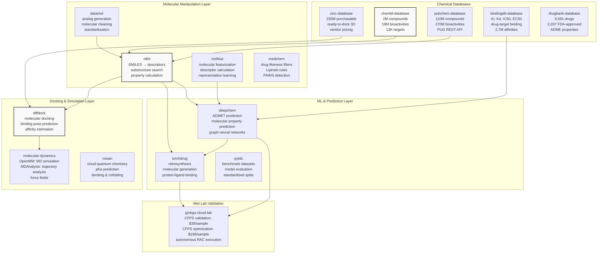
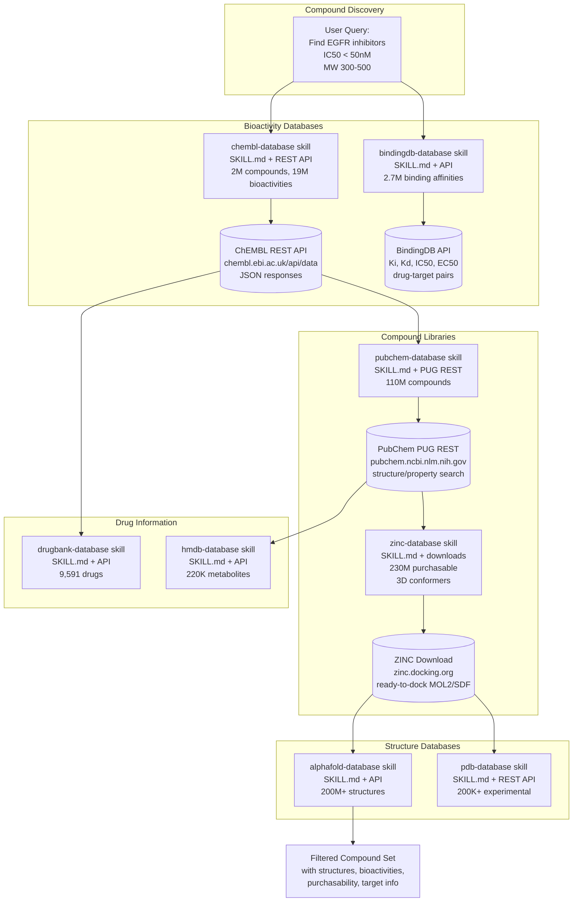
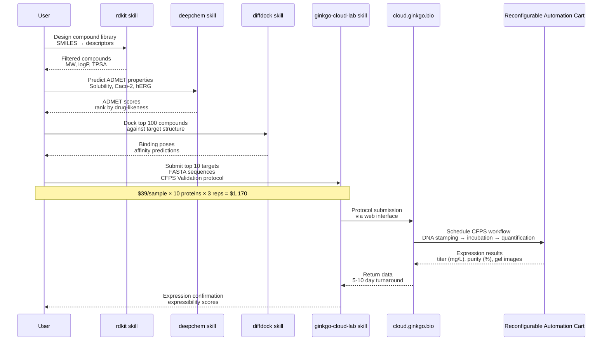

<!-- source: DeepWiki mcp.deepwiki.com · repo K-Dense-AI/claude-scientific-skills · page 4.2 Cheminformatics and Drug Discovery · fetched 2026-10-26 -->

# Cheminformatics and Drug Discovery

Relevant source files

The following files were used as context for generating this wiki page:

- [.claude-plugin/marketplace.json](.claude-plugin/marketplace.json)
- [README.md](README.md)
- [docs/scientific-skills.md](docs/scientific-skills.md)
- [scientific-skills/ginkgo-cloud-lab/SKILL.md](scientific-skills/ginkgo-cloud-lab/SKILL.md)
- [scientific-skills/ginkgo-cloud-lab/references/cell-free-protein-expression-optimization.md](scientific-skills/ginkgo-cloud-lab/references/cell-free-protein-expression-optimization.md)
- [scientific-skills/ginkgo-cloud-lab/references/cell-free-protein-expression-validation.md](scientific-skills/ginkgo-cloud-lab/references/cell-free-protein-expression-validation.md)
- [scientific-skills/ginkgo-cloud-lab/references/fluorescent-pixel-art-generation.md](scientific-skills/ginkgo-cloud-lab/references/fluorescent-pixel-art-generation.md)

## Purpose and Scope

This page provides an overview of the cheminformatics and drug discovery capabilities within the Claude Scientific Skills ecosystem. It covers the 13+ computational chemistry skills for molecular structure analysis, property prediction, virtual screening, molecular docking, ADMET prediction, and molecular dynamics simulation, plus 8+ chemical database skills providing access to compounds, bioactivity data, and drug information. 

For detailed documentation of specific molecular modeling tools (RDKit, DeepChem, DiffDock, OpenMM, MDAnalysis), see [Molecular Modeling and Simulation](#4.2.1). For complete end-to-end drug discovery workflow examples, see [AI-Driven Drug Discovery Workflows](#4.2.2). For laboratory automation bridging computational design to wet-lab validation, see [Laboratory Automation](#4.6) and [Ginkgo Cloud Lab Protocols](#4.6.1).

**Sources**: [README.md:1-50](), [README.md:398-424](), [docs/scientific-skills.md:1-36]()

---

## Cheminformatics Skill Architecture

The cheminformatics domain comprises three layers: molecular manipulation libraries, machine learning frameworks for property prediction and drug design, and chemical databases for compound discovery and bioactivity mining.

**Diagram: Cheminformatics Skill Integration Architecture**

**Sources**: [README.md:412-420](), [docs/scientific-skills.md:7-34](), [.claude-plugin/marketplace.json:30-143]()

---

## Skill Categories

The following table organizes the 13+ cheminformatics skills by functional category, mapping each to its skill directory in the codebase.

| Category | Skills | Skill Directories | Key Capabilities |
|----------|--------|-------------------|------------------|
| **Molecular Manipulation** | RDKit, Datamol, Molfeat, MedChem | `scientific-skills/rdkit/` `scientific-skills/datamol/` `scientific-skills/molfeat/` `scientific-skills/medchem/` | SMILES parsing, substructure search, descriptor calculation, analog generation, molecular standardization, featurization, drug-likeness filtering |
| **Machine Learning** | DeepChem, TorchDrug, PyTDC | `scientific-skills/deepchem/` `scientific-skills/torchdrug/` `scientific-skills/pytdc/` | ADMET prediction, molecular property prediction, graph neural networks, retrosynthesis, molecular generation, benchmark datasets |
| **Docking & Simulation** | DiffDock, Molecular Dynamics, Rowan | `scientific-skills/diffdock/` `scientific-skills/molecular-dynamics/` `scientific-skills/rowan/` | Binding pose prediction, affinity estimation, MD simulation, trajectory analysis, quantum chemistry, pKa prediction |
| **Chemical Databases** | ChEMBL, PubChem, ZINC, BindingDB, DrugBank, HMDB, AlphaFold DB | `scientific-skills/chembl-database/` `scientific-skills/pubchem-database/` `scientific-skills/zinc-database/` `scientific-skills/bindingdb-database/` `scientific-skills/drugbank-database/` `scientific-skills/hmdb-database/` `scientific-skills/alphafold-database/` | Compound search, bioactivity queries, purchasable compound libraries, binding affinity data, drug properties, metabolite information, protein structures |
| **Wet Lab Automation** | Ginkgo Cloud Lab | `scientific-skills/ginkgo-cloud-lab/` | Cell-free protein expression validation ($39/sample), optimization ($199/sample), autonomous robotic execution |

**Sources**: [.claude-plugin/marketplace.json:30-86](), [.claude-plugin/marketplace.json:107-142](), [.claude-plugin/marketplace.json:44]()

---

## Chemical Database Access Architecture

The system provides access to 8+ dedicated chemical databases plus protein structure databases for drug discovery workflows. Each database skill includes REST API access, query optimization, and result parsing.

**Diagram: Multi-Database Query Flow for Compound Discovery**

This architecture demonstrates the typical flow for compound discovery: starting with bioactivity queries (ChEMBL, BindingDB), expanding to larger compound libraries (PubChem, ZINC), enriching with drug/metabolite information (DrugBank, HMDB), and retrieving target structures (AlphaFold DB, PDB) for docking.

**Sources**: [docs/scientific-skills.md:7-34](), [README.md:53-54](), [.claude-plugin/marketplace.json:107-142]()

---

## Computational-to-Experimental Integration

The Ginkgo Cloud Lab skill bridges computational drug design to wet-lab validation, enabling automated protein expression for screening computationally designed compounds.

**Diagram: Computational Drug Design to Wet Lab Validation Workflow**

**Sources**: [scientific-skills/ginkgo-cloud-lab/SKILL.md:1-57](), [scientific-skills/ginkgo-cloud-lab/references/cell-free-protein-expression-validation.md:1-72](), [README.md:220-233]()

---

## Key Computational Capabilities

### Molecular Structure Processing

The `rdkit` skill ([scientific-skills/rdkit/]()) provides core cheminformatics functionality:
- **SMILES parsing and validation**: Convert string representations to molecular objects
- **Substructure search**: Query compounds by structural motifs
- **Descriptor calculation**: MW, logP, TPSA, H-bond donors/acceptors, rotatable bonds
- **Fingerprint generation**: Morgan, MACCS, RDKit fingerprints for similarity searches
- **2D/3D conformer generation**: Spatial coordinates for docking

The `datamol` skill ([scientific-skills/datamol/]()) extends RDKit with:
- **Molecular standardization**: Salt stripping, tautomer enumeration, charge neutralization
- **Analog generation**: Scaffold hopping, R-group enumeration, bioisostere replacement
- **Molecular cleaning**: Remove invalid structures, duplicates, reactive groups

**Sources**: [README.md:412-420](), [docs/scientific-skills.md:7-13]()

### ADMET Prediction

The `deepchem` skill ([scientific-skills/deepchem/]()) provides machine learning models for:
- **Absorption**: Caco-2 permeability, solubility, lipophilicity
- **Distribution**: Volume of distribution, plasma protein binding
- **Metabolism**: CYP450 substrate/inhibitor prediction
- **Excretion**: Half-life, clearance
- **Toxicity**: hERG cardiotoxicity, AMES mutagenicity, hepatotoxicity

Graph neural networks (GCN, GAT, MPNN) trained on public datasets enable zero-shot prediction for novel compounds.

**Sources**: [README.md:414](), [docs/scientific-skills.md:7]()

### Molecular Docking

The `diffdock` skill ([scientific-skills/diffdock/]()) uses diffusion models for:
- **Blind docking**: No binding site specification required
- **Binding pose prediction**: Multiple conformations per ligand
- **Confidence scoring**: Rank poses by predicted accuracy
- **Batch processing**: High-throughput virtual screening

Integrates with AlphaFold DB and PDB skills for target structure retrieval.

**Sources**: [README.md:416](), [README.md:272-283]()

### Molecular Dynamics Simulation

The `molecular-dynamics` skill ([scientific-skills/molecular-dynamics/]()) combines:
- **OpenMM**: GPU-accelerated MD simulation engine, force field support (AMBER, CHARMM, OPLS)
- **MDAnalysis**: Trajectory analysis, RMSD, RMSF, hydrogen bonds, distance calculations

Enables protein-ligand complex stability assessment and binding mechanism investigation.

**Sources**: [README.md:416](), [docs/scientific-skills.md:7]()

---

## Ginkgo Cloud Lab Protocols

The `ginkgo-cloud-lab` skill ([scientific-skills/ginkgo-cloud-lab/]()) provides programmatic access to automated wet-lab protocols:

### Cell-Free Protein Expression Validation
- **Price**: $39/sample
- **Turnaround**: 5-10 days
- **Workflow**: DNA stamping → CFPS reaction → LabChip quantification
- **Output**: Expression confirmation, baseline titer (mg/L), purity percentage
- **Reference**: [scientific-skills/ginkgo-cloud-lab/references/cell-free-protein-expression-validation.md:1-72]()

### Cell-Free Protein Expression Optimization  
- **Price**: $199/sample
- **Turnaround**: 6-11 days
- **DoE Matrix**: 24 conditions per protein (lysates, temperatures, chaperones, cofactors)
- **Output**: Comparative yield, purity profiling, optimal conditions
- **Reference**: [scientific-skills/ginkgo-cloud-lab/references/cell-free-protein-expression-optimization.md:1-95]()

Both protocols execute on Reconfigurable Automation Carts (RACs) with 70+ integrated instruments, orchestrated by Catalyst software.

**Sources**: [scientific-skills/ginkgo-cloud-lab/SKILL.md:14-35](), [README.md:475-477]()

---

## Example Use Case: EGFR Inhibitor Discovery

The following table maps a complete drug discovery workflow to specific skills:

| Step | Skill | Directory | Operation |
|------|-------|-----------|-----------|
| 1. Target validation | `pubmed-database` | `scientific-skills/pubmed-database/` | Literature search: EGFR + lung cancer |
| 2. Structure retrieval | `alphafold-database` | `scientific-skills/alphafold-database/` | Download EGFR kinase domain structure |
| 3. Bioactivity mining | `chembl-database` | `scientific-skills/chembl-database/` | Query: EGFR inhibitors IC50 < 50nM |
| 4. Hit filtering | `rdkit` | `scientific-skills/rdkit/` | Calculate MW, logP, TPSA, Lipinski rules |
| 5. Analog generation | `datamol` | `scientific-skills/datamol/` | Generate 1000 analogs per hit |
| 6. ADMET prediction | `deepchem` | `scientific-skills/deepchem/` | Predict solubility, Caco-2, hERG |
| 7. Virtual screening | `diffdock` | `scientific-skills/diffdock/` | Dock top 500 against EGFR structure |
| 8. MD simulation | `molecular-dynamics` | `scientific-skills/molecular-dynamics/` | 100ns MD on top 10 complexes |
| 9. Wet lab validation | `ginkgo-cloud-lab` | `scientific-skills/ginkgo-cloud-lab/` | CFPS validation of EGFR constructs |

This workflow demonstrates end-to-end skill composition from literature mining through computational prediction to wet-lab automation.

**Sources**: [README.md:220-233](), [README.md:358-364](), [docs/scientific-skills.md:7-34]()

---

## Integration with Other Domains

Cheminformatics skills integrate with:

- **Bioinformatics** ([#4.1](#4.1)): `biopython` for protein sequence analysis, `uniprot-database` for target information
- **Clinical Research** ([#4.3](#4.3)): `clinvar-database` and `cosmic-database` for mutation-driven drug design  
- **Machine Learning** ([#4.4](#4.4)): `pytorch-lightning` for training custom QSAR models, `torch_geometric` for graph neural networks
- **Scientific Databases** ([#5](#5)): Access to 250+ databases including protein (UniProt, PDB), genomics (Ensembl, NCBI Gene), and pathway (KEGG, Reactome) resources

**Sources**: [README.md:24-41](), [README.md:96-99]()

---

## Skill Discovery and Usage

All cheminformatics skills follow the Agent Skills standard and are automatically discovered from skill directories. Each skill folder contains:

- `SKILL.md`: Frontmatter metadata + usage documentation
- `references/`: Detailed guides and API references  
- `examples/`: Working code and Jupyter notebooks

Users install skills by copying folders to `~/.cursor/skills/`, `~/.claude/skills/`, or `.cursor/skills/` (project-local). Skills are registered at agent startup via SKILL.md frontmatter parsing.

**Skill invocation examples**:
- *"Query ChEMBL for EGFR inhibitors with IC50 < 50nM"* → Loads `chembl-database` skill
- *"Predict ADMET properties for these SMILES"* → Loads `deepchem` skill  
- *"Dock these compounds against PDB 1M17"* → Loads `diffdock` and `pdb-database` skills

**Sources**: [README.md:113-162](), [.claude-plugin/marketplace.json:1-194]()

---

