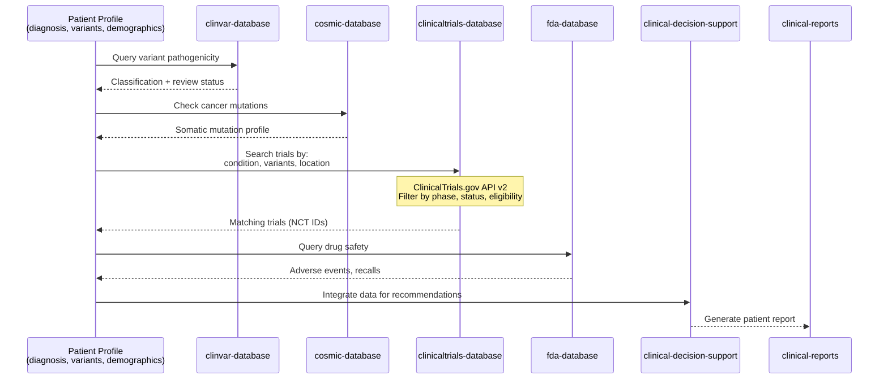
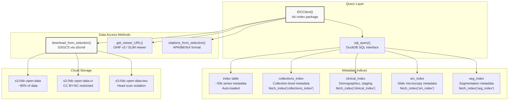
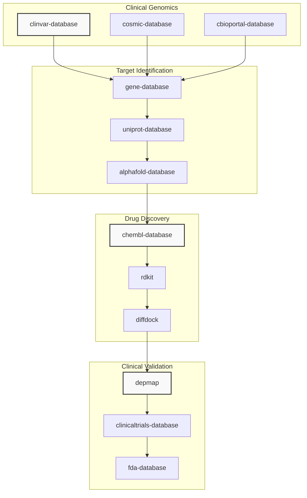

<!-- source: DeepWiki mcp.deepwiki.com · repo K-Dense-AI/claude-scientific-skills · page 4.3 Clinical Research and Precision Medicine · fetched 2026-10-26 -->

# Clinical Research and Precision Medicine

<details>
<summary>Relevant source files</summary>

The following files were used as context for generating this wiki page:

- [.claude-plugin/marketplace.json](.claude-plugin/marketplace.json)
- [README.md](README.md)
- [docs/scientific-skills.md](docs/scientific-skills.md)
- [scientific-skills/ginkgo-cloud-lab/SKILL.md](scientific-skills/ginkgo-cloud-lab/SKILL.md)
- [scientific-skills/ginkgo-cloud-lab/references/cell-free-protein-expression-optimization.md](scientific-skills/ginkgo-cloud-lab/references/cell-free-protein-expression-optimization.md)
- [scientific-skills/ginkgo-cloud-lab/references/cell-free-protein-expression-validation.md](scientific-skills/ginkgo-cloud-lab/references/cell-free-protein-expression-validation.md)
- [scientific-skills/ginkgo-cloud-lab/references/fluorescent-pixel-art-generation.md](scientific-skills/ginkgo-cloud-lab/references/fluorescent-pixel-art-generation.md)
- [scientific-skills/imaging-data-commons/SKILL.md](scientific-skills/imaging-data-commons/SKILL.md)
- [scientific-skills/imaging-data-commons/references/bigquery_guide.md](scientific-skills/imaging-data-commons/references/bigquery_guide.md)
- [scientific-skills/imaging-data-commons/references/cli_guide.md](scientific-skills/imaging-data-commons/references/cli_guide.md)
- [scientific-skills/imaging-data-commons/references/clinical_data_guide.md](scientific-skills/imaging-data-commons/references/clinical_data_guide.md)
- [scientific-skills/imaging-data-commons/references/cloud_storage_guide.md](scientific-skills/imaging-data-commons/references/cloud_storage_guide.md)
- [scientific-skills/imaging-data-commons/references/dicomweb_guide.md](scientific-skills/imaging-data-commons/references/dicomweb_guide.md)
- [scientific-skills/imaging-data-commons/references/digital_pathology_guide.md](scientific-skills/imaging-data-commons/references/digital_pathology_guide.md)
- [scientific-skills/imaging-data-commons/references/index_tables_guide.md](scientific-skills/imaging-data-commons/references/index_tables_guide.md)
- [scientific-skills/imaging-data-commons/references/sql_patterns.md](scientific-skills/imaging-data-commons/references/sql_patterns.md)
- [scientific-skills/imaging-data-commons/references/use_cases.md](scientific-skills/imaging-data-commons/references/use_cases.md)

</details>


## Purpose and Scope

This section covers the 16+ skills in the Claude Scientific Skills ecosystem that support clinical research and precision medicine workflows. These skills enable comprehensive analysis spanning clinical trial discovery, genomic variant interpretation, cancer genomics, medical imaging analysis, healthcare AI, and clinical documentation generation.

The domain encompasses:
- **Clinical databases**: Access to ClinicalTrials.gov, ClinVar, ClinPGx, COSMIC, FDA databases for trial discovery, variant interpretation, and drug safety
- **Cancer genomics**: cBioPortal and DepMap for somatic mutations, copy number alterations, gene expression, and drug sensitivity across 400+ cancer studies
- **Disease-gene associations**: Monarch Initiative for rare disease phenotypes and cross-species model organism data
- **Medical imaging**: NCI Imaging Data Commons providing 50,000+ radiology and pathology datasets
- **Healthcare AI**: PyHealth and NeuroKit2 for EHR analysis and physiological signal processing
- **Clinical documentation**: Automated generation of clinical reports and treatment plans

**Related sections**: For detailed coverage of specific database skills (ClinVar, COSMIC, cBioPortal, DepMap), see [Clinical Databases and Variant Interpretation](#4.3.1). For comprehensive medical imaging workflows using the NCI Imaging Data Commons, see [Imaging Data Commons](#4.3.2). For drug discovery workflows integrating clinical data with cheminformatics, see [AI-Driven Drug Discovery Workflows](#4.2.2).

**Sources**: [README.md:424-433](), [docs/scientific-skills.md:425-432]()

---

## System Architecture

The clinical research and precision medicine domain is organized into six functional layers, each containing skills that access specific data types or provide analytical capabilities.

```mermaid
graph TB
    subgraph "Clinical Trial Discovery"
        ClinicalTrials["clinicaltrials-database<br/>ClinicalTrials.gov API v2<br/>Search by condition/intervention/phase<br/>Eligibility criteria analysis"]
        FDA["fda-database<br/>openFDA API<br/>Drug adverse events, recalls<br/>Medical device 510k clearances"]
    end
    
    subgraph "Variant Interpretation"
        ClinVar["clinvar-database<br/>NCBI E-utilities API<br/>Pathogenic/benign classifications<br/>VUS interpretation"]
        ClinPGx["clinpgx-database<br/>Gene-drug interactions<br/>CPIC clinical guidelines<br/>Pharmacogenomics annotations"]
        Ensembl["ensembl-database<br/>REST API (Release 115)<br/>VEP: variant effect prediction<br/>250+ vertebrate species"]
        NCBIGene["gene-database<br/>NCBI Gene API<br/>Gene nomenclature, function<br/>Cross-references to 200+ databases"]
    end
    
    subgraph "Cancer Genomics"
        COSMIC["cosmic-database<br/>Somatic cancer mutations<br/>Cancer Gene Census<br/>Mutational signatures"]
        cBioPortal["cbioportal-database<br/>400+ cancer studies<br/>Somatic mutations, CNAs<br/>Expression, survival data"]
        DepMap["depmap<br/>Cancer cell line dependencies<br/>Drug sensitivity screens<br/>CRISPR knockout data"]
    end
    
    subgraph "Disease-Gene Associations"
        Monarch["monarch-database<br/>OMIM, ORPHANET, HPO<br/>Rare disease phenotypes<br/>Cross-species model data"]
    end
    
    subgraph "Medical Imaging"
        IDC["imaging-data-commons<br/>idc-index Python package<br/>50,000+ radiology studies<br/>Pathology slide microscopy"]
    end
    
    subgraph "Healthcare AI & Clinical Docs"
        PyHealth["pyhealth<br/>EHR data processing<br/>Clinical prediction models<br/>Multi-modal healthcare data"]
        NeuroKit2["neurokit2<br/>ECG, EDA, RSP processing<br/>Heart rate variability<br/>Event-related analysis"]
        ClinicalReports["clinical-reports<br/>Automated report generation<br/>Template-based formatting"]
        TreatmentPlans["treatment-plans<br/>Evidence-based planning<br/>Guideline integration"]
        ClinicalDecision["clinical-decision-support<br/>Risk stratification<br/>Treatment recommendations"]
    end
    
    ClinicalTrials --> ClinicalDecision
    ClinVar --> ClinicalDecision
    ClinPGx --> ClinicalDecision
    COSMIC --> cBioPortal
    cBioPortal --> ClinicalReports
    DepMap --> ClinicalReports
    Ensembl --> ClinVar
    NCBIGene --> Ensembl
    Monarch --> ClinicalDecision
    IDC --> ClinicalReports
    PyHealth --> ClinicalDecision
    NeuroKit2 --> PyHealth
    
    style ClinicalTrials fill:#f9f9f9,stroke:#333,stroke-width:2px
    style ClinVar fill:#f9f9f9,stroke:#333,stroke-width:2px
    style COSMIC fill:#f9f9f9,stroke:#333,stroke-width:2px
    style cBioPortal fill:#f9f9f9,stroke:#333,stroke-width:2px
    style IDC fill:#f9f9f9,stroke:#333,stroke-width:2px
    style ClinicalDecision fill:#f9f9f9,stroke:#333,stroke-width:2px
```



**Diagram 1: Clinical Research Skills Architecture**

The architecture separates concerns by data type and clinical workflow phase. Each box represents a skill accessible in the `scientific-skills/` directory, with the skill name matching the folder name (e.g., `scientific-skills/clinvar-database/`, `scientific-skills/cbioportal-database/`).

**Sources**: [.claude-plugin/marketplace.json:113-122](), [README.md:425-432](), [docs/scientific-skills.md:425-432]()

---

## Skill Capabilities by Clinical Use Case

### Variant Interpretation Workflow

The variant interpretation pipeline combines multiple database skills to classify genomic variants and assess clinical significance:

```mermaid
graph LR
    VCF["VCF File<br/>Patient variants"]
    
    VCF --> Ensembl
    Ensembl["ensembl-database<br/>VEP annotation<br/>Consequence prediction"]
    
    Ensembl --> ClinVar
    ClinVar["clinvar-database<br/>Pathogenicity classification<br/>Review status"]
    
    ClinVar --> COSMIC
    COSMIC["cosmic-database<br/>Somatic vs germline<br/>Cancer associations"]
    
    COSMIC --> ClinPGx
    ClinPGx["clinpgx-database<br/>Drug-gene interactions<br/>Dosing guidelines"]
    
    ClinPGx --> NCBIGene
    NCBIGene["gene-database<br/>Gene function<br/>Pathway context"]
    
    NCBIGene --> Report["clinical-reports<br/>Integrated report generation"]
    
    style VCF fill:#f9f9f9,stroke:#333,stroke-width:2px
    style Report fill:#f9f9f9,stroke:#333,stroke-width:2px
```



**Diagram 2: Variant Interpretation Pipeline**

**Key integration points**:
- **ensembl-database**: Annotates variants with consequence predictions (missense, nonsense, splice site). REST API access to Ensembl Release 115 covering 250+ vertebrate species [docs/scientific-skills.md:14]()
- **clinvar-database**: Queries NCBI's variant archive for clinical significance classifications (pathogenic, benign, VUS) using E-utilities API [docs/scientific-skills.md:9]()
- **cosmic-database**: Distinguishes somatic cancer mutations from germline variants using the Cancer Gene Census and mutational signature database [docs/scientific-skills.md:11]()
- **clinpgx-database**: Retrieves pharmacogenomics guidelines from CPIC for drug dosing and contraindications [docs/scientific-skills.md:8]()
- **gene-database**: Provides gene function, pathways, and cross-references to 200+ external databases via NCBI Gene API [docs/scientific-skills.md:26]()

**Sources**: [docs/scientific-skills.md:8-26](), [README.md:425-432]()

---

### Cancer Genomics and Drug Sensitivity Analysis

Cancer research workflows integrate somatic mutation databases with drug sensitivity screens:

| Skill | Data Type | API Access | Primary Use Case |
|-------|-----------|------------|------------------|
| `cosmic-database` | Somatic mutations, structural variants, mutational signatures | Web API | Cancer mutation profiling, driver gene identification |
| `cbioportal-database` | Multi-omics (mutations, CNAs, expression), survival data | REST API, Python SDK | Cross-study comparisons, survival analysis across 400+ studies |
| `depmap` | Cancer cell line dependencies, drug sensitivity, CRISPR screens | Python API | Target validation, drug response prediction |
| `monarch-database` | Disease-gene associations, phenotypes, model organisms | Monarch API | Rare cancer phenotypes, cross-species data integration |

**Table 1: Cancer Genomics Skills and Data Types**

**cBioPortal integration pattern**: The `cbioportal-database` skill provides access to over 400 cancer studies with standardized data formats. Query somatic mutations, copy number alterations, and gene expression data across multiple tumor types, enabling meta-analysis and biomarker discovery [docs/scientific-skills.md:111]().

**DepMap drug sensitivity**: The `depmap` skill accesses Cancer Dependency Map data including CRISPR knockout screens and drug sensitivity measurements across 1000+ cancer cell lines. Use for target validation and predicting therapeutic vulnerabilities [docs/scientific-skills.md:34]().

**Sources**: [docs/scientific-skills.md:11](), [docs/scientific-skills.md:111](), [docs/scientific-skills.md:34](), [docs/scientific-skills.md:132]()

---

### Clinical Trial Matching and Patient Enrollment

The clinical trial discovery workflow combines patient data with trial eligibility criteria:



**Diagram 3: Clinical Trial Matching Workflow**

**clinicaltrials-database capabilities**:
- Search by condition, intervention, location, sponsor, study status, and phase
- Retrieve detailed trial information including eligibility criteria, outcomes, contacts, and locations
- Export to CSV/JSON for batch processing
- Public API with ~50 requests/minute rate limit, no authentication required [docs/scientific-skills.md:10]()

**fda-database integration**:
- Query FDA databases for drug adverse events (FAERS), labeling information, and recalls
- Access medical device 510k clearances and PMA approvals
- Cross-reference with trial interventions for safety assessment
- openFDA API covering drugs, medical devices, foods, and veterinary products [docs/scientific-skills.md:15]()

**Sources**: [docs/scientific-skills.md:10](), [docs/scientific-skills.md:15](), [README.md:425-432]()

---

## Medical Imaging Integration

The NCI Imaging Data Commons provides programmatic access to 50,000+ radiology and pathology datasets for AI training and research.

### Imaging Data Commons Architecture



**Diagram 4: Imaging Data Commons Skill Architecture**

The `imaging-data-commons` skill uses the `idc-index` Python package to provide SQL-queryable metadata and efficient downloads from public cloud storage. The `IDCClient` class [scientific-skills/imaging-data-commons/SKILL.md:24-38]() provides the primary interface.

**Core workflow pattern**:
1. Query metadata with `client.sql_query()` using DuckDB SQL syntax
2. Filter by modality, body part, collection, or clinical attributes
3. Download selected series with `client.download_from_selection()`
4. Visualize in browser with `client.get_viewer_URL()` before downloading

**Index tables**: The primary `index` table is auto-loaded and contains ~50k series metadata. Additional indices require `client.fetch_index("table_name")` before querying:
- `collections_index`: Collection-level cancer types, tumor locations, subject counts
- `clinical_index`: Clinical data dictionary mapping collections to available clinical attributes
- `sm_index`: Slide microscopy metadata (objective lens power, pixel spacing)
- `seg_index`: DICOM Segmentation metadata (algorithm, segment count, source series reference)

**License handling**: Query `license_short_name` column to filter by license. ~97% is CC BY (commercial use allowed), ~3% is CC BY-NC (non-commercial only) [scientific-skills/imaging-data-commons/SKILL.md:543-547]().

**Sources**: [scientific-skills/imaging-data-commons/SKILL.md:1-230](), [scientific-skills/imaging-data-commons/SKILL.md:241-669]()

---

### Medical Imaging Use Cases

**Training dataset creation**:
```python
from idc_index import IDCClient

client = IDCClient()

# Query for lung CT scans with license verification
query = """
SELECT SeriesInstanceUID, PatientID, collection_id
FROM index
WHERE Modality = 'CT'
  AND BodyPartExamined = 'CHEST'
  AND license_short_name = 'CC BY 4.0'
LIMIT 100
"""
results = client.sql_query(query)

# Download organized by patient
client.download_from_selection(
    seriesInstanceUID=list(results['SeriesInstanceUID'].values),
    downloadDir="./training_data",
    dirTemplate="%collection_id/%PatientID/%SeriesInstanceUID"
)
```

**Clinical data integration**:
```python
# Fetch clinical index and join with imaging data
client.fetch_index('clinical_index')

# Find collections with staging information
staging_query = """
SELECT DISTINCT collection_id, table_name, column_label
FROM clinical_index
WHERE column_label LIKE '%stage%'
"""
staging_collections = client.sql_query(staging_query)

# Load clinical table and join with imaging
clinical_df = client.get_clinical_table("nlst_canc")
imaging_df = client.index[client.index['collection_id'] == 'nlst']

# Merge on dicom_patient_id = PatientID
merged = imaging_df.merge(
    clinical_df,
    left_on='PatientID',
    right_on='dicom_patient_id'
)
```

**Pathology slide microscopy**:
```python
# Query slide microscopy with annotation data
client.fetch_index('sm_index')
client.fetch_index('ann_group_index')

query = """
SELECT 
    s.SeriesInstanceUID,
    s.ObjectiveLensPower,
    s.min_PixelSpacing_2sf,
    a.AnnotationGroupLabel,
    a.NumberOfAnnotations
FROM sm_index s
JOIN ann_group_index a ON s.SeriesInstanceUID = a.SeriesInstanceUID
WHERE s.ObjectiveLensPower >= 40
"""
slides = client.sql_query(query)
```

**Sources**: [scientific-skills/imaging-data-commons/SKILL.md:217-305](), [scientific-skills/imaging-data-commons/references/clinical_data_guide.md:69-217](), [scientific-skills/imaging-data-commons/references/digital_pathology_guide.md:1-255]()

---

## Healthcare AI and Signal Processing

### PyHealth for EHR Analysis

The `pyhealth` skill provides machine learning pipelines for electronic health record data:

| Capability | Description |
|------------|-------------|
| Data loading | Support for MIMIC-III, MIMIC-IV, eICU datasets |
| Preprocessing | Visit merging, feature extraction, medication encoding |
| Task modules | Mortality prediction, readmission, length of stay, drug recommendation |
| Model zoo | RNN, LSTM, Transformer, GRU, RETAIN architectures |

**Integration pattern**: Load EHR data, define prediction tasks, train models with standardized evaluation metrics. Supports multi-modal healthcare data including diagnoses, procedures, medications, and lab tests.

**Sources**: [docs/scientific-skills.md:431](), [README.md:429]()

---

### NeuroKit2 for Physiological Signals

The `neurokit2` skill processes biosignals for clinical research:

**Supported signal types**:
- **ECG**: R-peak detection, heart rate variability (HRV) analysis, QRS complex identification
- **EDA**: Skin conductance response (SCR) extraction, phasic/tonic decomposition
- **RSP**: Respiratory rate estimation, respiratory sinus arrhythmia (RSA)
- **EMG**: Electromyography signal processing and muscle activation detection
- **PPG**: Photoplethysmography for pulse rate and blood volume analysis

**Event-related analysis**: Epoch physiological signals around experimental events (e.g., stimulus presentation) for event-related potential (ERP) studies.

**Sources**: [docs/scientific-skills.md:439](), [README.md:429]()

---

## Clinical Documentation Generation

### Automated Report Creation

The `clinical-reports` and `treatment-plans` skills generate structured clinical documents:

**clinical-reports capabilities**:
- Template-based report generation with standardized sections
- Integration of multi-source data (variants, imaging, lab results)
- Automatic citation of evidence sources
- Export to PDF, DOCX, or HTML formats

**treatment-plans capabilities**:
- Evidence-based treatment planning using clinical guidelines
- Drug-drug interaction checking
- Dosing recommendations based on pharmacogenomics
- Treatment timeline visualization

**Integration with clinical-decision-support**: The `clinical-decision-support` skill provides risk stratification algorithms and treatment recommendations that feed into automated report generation.

**Sources**: [docs/scientific-skills.md:431](), [README.md:430]()

---

## End-to-End Precision Medicine Workflow

This workflow demonstrates skill composition across the clinical research domain:

```mermaid
graph LR
    VCF["VCF File<br/>Patient genomic data"]
    
    VCF --> Phase1
    
    subgraph Phase1["Phase 1: Variant Annotation"]
        Ensembl["ensembl-database<br/>VEP annotation"]
        ClinVar["clinvar-database<br/>Pathogenicity"]
        COSMIC["cosmic-database<br/>Somatic mutations"]
    end
    
    Phase1 --> Phase2
    
    subgraph Phase2["Phase 2: Clinical Context"]
        NCBIGene["gene-database<br/>Gene function"]
        ClinPGx["clinpgx-database<br/>Drug interactions"]
        Monarch["monarch-database<br/>Disease phenotypes"]
    end
    
    Phase2 --> Phase3
    
    subgraph Phase3["Phase 3: Cancer Analysis"]
        cBioPortal["cbioportal-database<br/>Multi-omics data"]
        DepMap["depmap<br/>Drug sensitivity"]
    end
    
    Phase3 --> Phase4
    
    subgraph Phase4["Phase 4: Trial & Treatment"]
        ClinicalTrials["clinicaltrials-database<br/>Matching trials"]
        FDA["fda-database<br/>Drug safety"]
    end
    
    Phase4 --> Phase5
    
    subgraph Phase5["Phase 5: Imaging & Reporting"]
        IDC["imaging-data-commons<br/>Medical imaging"]
        ClinicalDecision["clinical-decision-support<br/>Recommendations"]
        Reports["clinical-reports<br/>Final report"]
    end
    
    style VCF fill:#f9f9f9,stroke:#333,stroke-width:2px
    style Reports fill:#f9f9f9,stroke:#333,stroke-width:2px
```



**Diagram 5: Complete Precision Medicine Pipeline**

This five-phase workflow integrates 12 clinical research skills to move from raw genomic data to actionable clinical recommendations:

1. **Variant annotation**: Ensembl VEP predicts variant consequences, ClinVar provides clinical significance, COSMIC distinguishes somatic vs germline
2. **Clinical context**: NCBI Gene adds functional information, ClinPGx provides drug-gene interactions, Monarch links to disease phenotypes
3. **Cancer analysis**: cBioPortal queries multi-omics data across 400+ cancer studies, DepMap predicts drug sensitivity
4. **Trial matching**: ClinicalTrials.gov finds eligible clinical trials, FDA database checks drug safety
5. **Imaging and reporting**: IDC retrieves relevant medical imaging, clinical-decision-support synthesizes recommendations, clinical-reports generates final documentation

**Key integration points**:
- Variant UIDs (e.g., rsIDs from ClinVar) link across databases
- Gene symbols provide common identifiers between gene-database, cBioPortal, and DepMap
- Patient demographics enable clinical trial filtering
- Cancer staging data from imaging-data-commons clinical tables inform treatment plans

**Sources**: [README.md:288-301](), [docs/scientific-skills.md:425-432]()

---

## Data Flow and API Access Patterns

### Database API Authentication Requirements

| Skill | API Type | Authentication | Rate Limit | Free Tier |
|-------|----------|----------------|------------|-----------|
| `clinicaltrials-database` | REST API v2 | None required | ~50 req/min | Unlimited |
| `clinvar-database` | NCBI E-utilities | None (recommended email) | 3 req/sec (10 with key) | Unlimited |
| `cosmic-database` | Web API | Registration required | Tier-dependent | Limited |
| `fda-database` | openFDA REST | None required | 1000 req/min (no key), 240,000/day (with key) | Unlimited |
| `cbioportal-database` | REST API | None required | No published limit | Unlimited |
| `depmap` | Python API | None required | N/A (download-based) | Unlimited |
| `ensembl-database` | REST API | None required | 15 req/sec | Unlimited |
| `imaging-data-commons` | idc-index / S3 | None required (anonymous S3) | Bucket-dependent | Free egress via AWS Open Data |

**Table 2: API Access and Authentication**

**NCBI E-utilities best practices**: While authentication is not required for ClinVar and NCBI Gene queries, providing an email in the API call (or registering for an API key) increases rate limits from 3 to 10 requests/second [docs/scientific-skills.md:9]().

**openFDA API key benefits**: Without a key, openFDA limits to 1000 requests per minute and 240,000 per day. With a free API key, per-minute limits are removed (daily limit remains) [docs/scientific-skills.md:15]().

**Sources**: [docs/scientific-skills.md:8-26](), [scientific-skills/imaging-data-commons/SKILL.md:184-203]()

---

## Integration with Other Domains

### Cross-Domain Workflow: Clinical Research + Drug Discovery

Clinical research skills frequently compose with cheminformatics skills for translational research:



**Diagram 6: Clinical-to-Drug Discovery Integration**

This cross-domain integration demonstrates how clinical research skills feed into drug discovery pipelines:

1. **Clinical genomics layer**: ClinVar, COSMIC, and cBioPortal identify disease-associated genes and cancer driver mutations
2. **Target identification layer**: NCBI Gene provides functional context, UniProt supplies protein sequences, AlphaFold DB provides predicted structures
3. **Drug discovery layer**: ChEMBL queries known bioactivity, RDKit analyzes structure-activity relationships, DiffDock performs molecular docking
4. **Clinical validation layer**: DepMap validates targets using cancer cell line data, ClinicalTrials.gov finds existing trials, FDA database checks drug safety

For complete drug discovery workflows, see [AI-Driven Drug Discovery Workflows](#4.2.2).

**Sources**: [README.md:220-233](), [README.md:288-301]()

---

### Integration with Laboratory Automation

Clinical research workflows can extend to wet-lab validation using laboratory automation skills:

**Ginkgo Cloud Lab integration**: The `ginkgo-cloud-lab` skill enables automated protein expression validation for variant analysis:
- **Cell-Free Protein Expression Validation**: $39/sample, 5-10 day turnaround for rapid go/no-go screening of variant constructs [scientific-skills/ginkgo-cloud-lab/SKILL.md:16-22]()
- **Cell-Free Protein Expression Optimization**: $199/sample, Design of Experiment across 24 conditions for difficult-to-express mutant proteins [scientific-skills/ginkgo-cloud-lab/SKILL.md:24-28]()

**Use case**: After identifying potentially pathogenic variants via ClinVar and predicting structural impacts via AlphaFold, validate expression and folding using Ginkgo's automated CFPS protocols.

**Sources**: [scientific-skills/ginkgo-cloud-lab/SKILL.md:1-57](), [scientific-skills/ginkgo-cloud-lab/references/cell-free-protein-expression-validation.md:1-72]()

---

## Troubleshooting Common Integration Issues

### Variant Identifier Mapping

**Issue**: Different databases use different variant identifiers (rsID, HGVS, genomic coordinates).

**Solution**: Use NCBI's Variation Services API or Ensembl's variant lookup to map between identifier types:
1. Query `ensembl-database` with genomic coordinates to get Ensembl variant IDs
2. Cross-reference Ensembl IDs to rsIDs in ClinVar
3. Use rsIDs for ClinPGx and FDA database queries

### Clinical Data Availability

**Issue**: Not all IDC collections have clinical data.

**Solution**: Query `clinical_index` to discover available clinical attributes before attempting to load tables:
```python
client.fetch_index('clinical_index')
collections = client.sql_query("""
    SELECT DISTINCT collection_id, COUNT(DISTINCT column) as attributes
    FROM clinical_index
    GROUP BY collection_id
""")
```

[scientific-skills/imaging-data-commons/references/clinical_data_guide.md:69-100]()

### API Rate Limits

**Issue**: Exceeding rate limits when batch processing variants.

**Solution**:
- For NCBI E-utilities (ClinVar, NCBI Gene): Request API key for 10 req/sec instead of 3
- For openFDA: Request free API key to remove per-minute limits
- Implement exponential backoff with retry logic
- Use bulk download options where available (ClinVar FTP, COSMIC downloads)

### License Compliance for Medical Imaging

**Issue**: Mixing CC BY and CC BY-NC data in training datasets.

**Solution**: Always filter by `license_short_name` when querying IDC:
```python
# For commercial use, exclude CC BY-NC data
query = """
SELECT * FROM index
WHERE license_short_name LIKE 'CC BY%'
  AND license_short_name NOT LIKE '%NC%'
"""
```

[scientific-skills/imaging-data-commons/SKILL.md:543-547]()

**Sources**: [scientific-skills/imaging-data-commons/SKILL.md:521-592](), [scientific-skills/imaging-data-commons/references/clinical_data_guide.md:268-309]()

---

## Summary

The Clinical Research and Precision Medicine domain provides 16+ skills organized into six functional layers:

1. **Clinical Trial Discovery**: `clinicaltrials-database`, `fda-database` for trial matching and drug safety
2. **Variant Interpretation**: `clinvar-database`, `clinpgx-database`, `ensembl-database`, `gene-database` for genomic variant analysis
3. **Cancer Genomics**: `cosmic-database`, `cbioportal-database`, `depmap` for somatic mutation profiling and drug sensitivity
4. **Disease-Gene Associations**: `monarch-database` for rare disease phenotypes and model organism data
5. **Medical Imaging**: `imaging-data-commons` for radiology and pathology datasets via idc-index
6. **Healthcare AI & Documentation**: `pyhealth`, `neurokit2`, `clinical-decision-support`, `clinical-reports`, `treatment-plans` for EHR analysis and report generation

These skills compose to enable end-to-end precision medicine workflows from variant interpretation through clinical trial matching to automated report generation. For detailed database skill documentation, see [Clinical Databases and Variant Interpretation](#4.3.1). For comprehensive medical imaging workflows, see [Imaging Data Commons](#4.3.2).

**Sources**: [README.md:424-432](), [docs/scientific-skills.md:425-432](), [.claude-plugin/marketplace.json:113-122]()

---

