<!-- source: DeepWiki mcp.deepwiki.com · repo K-Dense-AI/claude-scientific-skills · page 4.4 Machine Learning and AI · fetched 2026-10-26 -->

# Machine Learning and AI

<details>
<summary>Relevant source files</summary>

The following files were used as context for generating this wiki page:

- [.claude-plugin/marketplace.json](.claude-plugin/marketplace.json)
- [README.md](README.md)
- [docs/scientific-skills.md](docs/scientific-skills.md)
- [scientific-skills/ginkgo-cloud-lab/SKILL.md](scientific-skills/ginkgo-cloud-lab/SKILL.md)
- [scientific-skills/ginkgo-cloud-lab/references/cell-free-protein-expression-optimization.md](scientific-skills/ginkgo-cloud-lab/references/cell-free-protein-expression-optimization.md)
- [scientific-skills/ginkgo-cloud-lab/references/cell-free-protein-expression-validation.md](scientific-skills/ginkgo-cloud-lab/references/cell-free-protein-expression-validation.md)
- [scientific-skills/ginkgo-cloud-lab/references/fluorescent-pixel-art-generation.md](scientific-skills/ginkgo-cloud-lab/references/fluorescent-pixel-art-generation.md)

</details>


This page provides an overview of the machine learning and artificial intelligence skills available in the Claude Scientific Skills repository. These skills enable sophisticated data analysis, predictive modeling, and intelligent decision-making across scientific domains.

**Scope**: This page covers classical machine learning (scikit-learn, scikit-survival), deep learning frameworks (PyTorch Lightning, Transformers), specialized ML methods (graph neural networks, Bayesian inference, reinforcement learning), optimization algorithms, and model interpretability tools. For detailed documentation on deep learning frameworks and training workflows, see [Deep Learning Frameworks](#9.1). For natural language processing and protein language models, see [Natural Language Processing](#9.2).

---

## Overview of ML and AI Skills

The ML and AI category contains **15+ skills** spanning the complete machine learning lifecycle: data preprocessing, feature engineering, model training, hyperparameter tuning, inference, and interpretation. These skills are designed to integrate seamlessly with domain-specific tools from bioinformatics ([Bioinformatics and Genomics](#6)), cheminformatics ([Cheminformatics and Drug Discovery](#7)), and clinical research ([Clinical and Healthcare Databases](#8.6)).

### Skill Organization

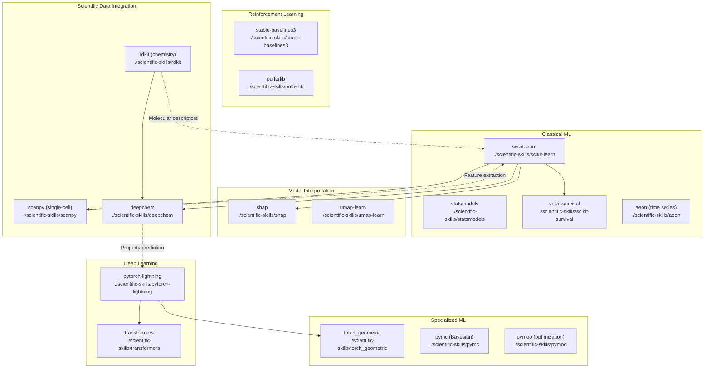

**Diagram: ML and AI Skill Structure**

Sources: [.claude-plugin/marketplace.json:17-157](), [README.md:373-401]()

---

## Classical Machine Learning Skills

### scikit-learn

**Purpose**: General-purpose machine learning for classification, regression, clustering, and dimensionality reduction.

**Location**: `./scientific-skills/scikit-learn`

**Common Use Cases**:
- **Classification**: Predict patient outcomes, disease subtypes, compound activity
- **Regression**: Property prediction (drug ADMET, material properties)
- **Clustering**: Identify cancer subtypes, cell populations, chemical scaffolds
- **Feature selection**: Identify biomarkers and important variables
- **Cross-validation**: Model evaluation and hyperparameter tuning

**Key Algorithms**:
| Algorithm Type | Methods | Typical Applications |
|----------------|---------|---------------------|
| Supervised Learning | Random Forest, Gradient Boosting, SVM, Logistic Regression | Cancer classification, toxicity prediction |
| Unsupervised Learning | K-Means, Hierarchical Clustering, DBSCAN | Patient stratification, compound clustering |
| Dimensionality Reduction | PCA, t-SNE | Visualization, feature extraction |
| Ensemble Methods | Voting, Bagging, Stacking | High-stakes predictions (clinical outcomes) |

**Integration Pattern**:
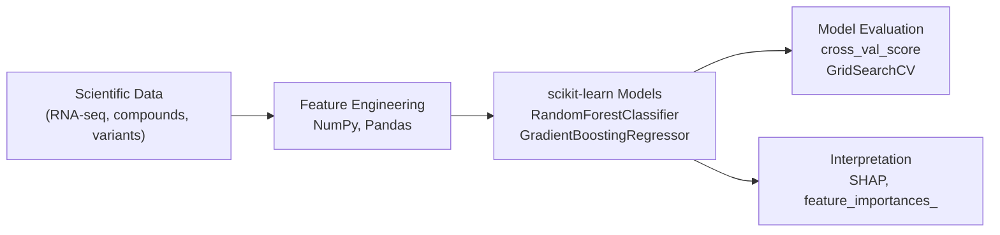

**Example: Cancer Subtype Classification**

From [docs/examples.md:320-400](), scikit-learn is used to:
1. Train Random Forest classifier on PAM50 genes
2. Perform 10-fold cross-validation
3. Predict breast cancer subtypes (Luminal A/B, HER2+, Basal)
4. Extract feature importances to identify key genes

Sources: [README.md:376-380](), [docs/examples.md:320-400](), [.claude-plugin/marketplace.json:78]()

---

### statsmodels

**Purpose**: Statistical modeling, hypothesis testing, and time series analysis.

**Location**: `./scientific-skills/statsmodels`

**Capabilities**:
- **Regression models**: Linear, generalized linear (GLM), mixed-effects models
- **Hypothesis testing**: t-tests, ANOVA, Mann-Whitney, chi-square
- **Survival analysis**: Cox proportional hazards, Kaplan-Meier curves
- **Time series**: ARIMA, SARIMAX, state space models
- **Correlation analysis**: Spearman, Pearson, partial correlations

**Workflow Integration**:

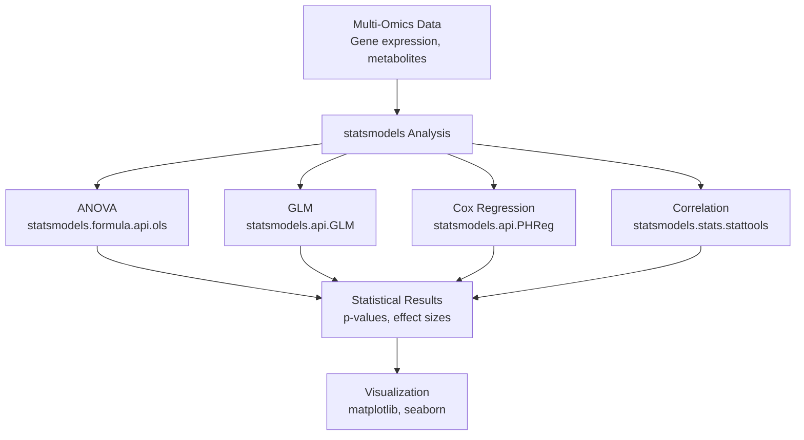

**Example: Multi-Omics Correlation Analysis**

From [docs/examples.md:890-1003](), statsmodels calculates Spearman correlations between:
- Gene expression ↔ protein abundance
- Protein abundance ↔ metabolite levels
- Enzyme expression ↔ product metabolites

Sources: [README.md:381](), [docs/examples.md:962-969](), [.claude-plugin/marketplace.json:85]()

---

### scikit-survival

**Purpose**: Survival analysis and time-to-event modeling for clinical research.

**Location**: `./scientific-skills/scikit-survival`

**Key Features**:
- Cox proportional hazards regression
- Random survival forests
- Gradient boosting survival models
- Concordance index (C-index) calculation
- Kaplan-Meier survival curves

**Clinical Workflow**:

From [docs/examples.md:2060-2070](), survival analysis workflow:
1. Load patient data with survival times and events
2. Fit Cox model with clinical covariates (stage, age, treatment)
3. Generate Kaplan-Meier curves by subtype
4. Calculate hazard ratios and log-rank test
5. Identify prognostic biomarkers

Sources: [README.md:379](), [docs/examples.md:2060-2070](), [.claude-plugin/marketplace.json:79]()

---

## Deep Learning Frameworks

### pytorch-lightning

**Purpose**: Structured deep learning training with PyTorch, designed for reproducibility and scalability.

**Location**: `./scientific-skills/pytorch-lightning`

**Architecture**:

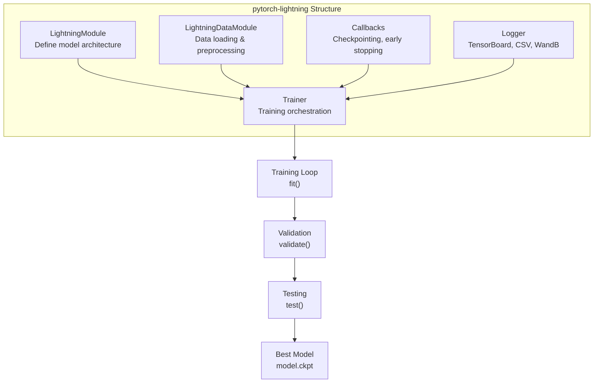

**Key Components**:
- `LightningModule`: Defines model architecture, loss functions, optimizers
- `LightningDataModule`: Handles data splits, batching, augmentation
- `Trainer`: Manages GPU acceleration, distributed training, mixed precision
- `Callbacks`: ModelCheckpoint, EarlyStopping, LearningRateMonitor
- Built-in support for TPU, multi-GPU, mixed precision (16-bit)

**Example: Whole Slide Image Classification**

From [docs/examples.md:1155-1200]():
```python
# Define model in LightningModule
class PathologyModel(pl.LightningModule):
    def __init__(self):
        self.backbone = torchvision.models.resnet50()
        self.classifier = nn.Linear(2048, 4)  # 4 tissue classes
    
    def training_step(self, batch, batch_idx):
        x, y = batch
        logits = self(x)
        loss = F.cross_entropy(logits, y)
        return loss
    
    def configure_optimizers(self):
        return torch.optim.Adam(self.parameters(), lr=1e-4)

# Train with Trainer
trainer = pl.Trainer(
    max_epochs=50,
    callbacks=[EarlyStopping(monitor='val_loss')],
    accelerator='gpu',
    precision=16
)
trainer.fit(model, datamodule)
```

Sources: [README.md:374](), [docs/examples.md:1155-1200](), [.claude-plugin/marketplace.json:72]()

---

### transformers (Hugging Face)

**Purpose**: Pre-trained transformer models for NLP and protein language modeling.

**Location**: `./scientific-skills/transformers`

**Coverage**: Detailed documentation for scientific text analysis and protein models is available at [Natural Language Processing](#9.2).

**Scientific Applications**:
- **Literature analysis**: BERT, SciBERT for PubMed abstracts
- **Protein language models**: ESM-2, ProtBERT for sequence embeddings
- **Chemical language models**: ChemBERTa, MolFormer for SMILES
- **Fine-tuning**: Adapt pre-trained models to domain-specific tasks

Sources: [README.md:375](), [.claude-plugin/marketplace.json:89]()

---

## Specialized ML Skills

### torch_geometric (Graph Neural Networks)

**Purpose**: Graph neural networks for molecular, biological, and network data.

**Location**: `./scientific-skills/torch_geometric`

**Architecture**:

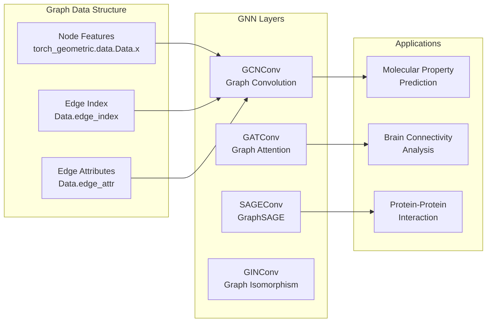

**Use Cases**:

1. **Molecular Property Prediction** ([docs/examples.md:83-90]()):
   - Nodes: atoms with features (atomic number, charge)
   - Edges: chemical bonds with bond types
   - Task: predict solubility, toxicity, binding affinity

2. **Brain Connectivity Analysis** ([docs/examples.md:1619-1625]()):
   - Nodes: brain regions with time series features
   - Edges: functional connectivity strengths
   - Task: classify patients vs controls from fMRI data

3. **Multi-Omics Integration** ([docs/examples.md:2080-2092]()):
   - Heterogeneous graph: genes, proteins, metabolites
   - Edges: regulatory relationships, interactions
   - Task: predict disease subtype from integrated data

**Key Classes**:
- `torch_geometric.data.Data`: Graph data container
- `torch_geometric.nn.MessagePassing`: Base class for GNN layers
- `torch_geometric.loader.DataLoader`: Batch multiple graphs
- `torch_geometric.utils`: Graph utilities (add self-loops, to undirected)

Sources: [README.md:377](), [docs/examples.md:1619-1625](), [docs/examples.md:2080-2092](), [.claude-plugin/marketplace.json:87]()

---

### pymc (Bayesian Inference)

**Purpose**: Probabilistic programming and Bayesian statistical modeling.

**Location**: `./scientific-skills/pymc`

**Bayesian Workflow**:

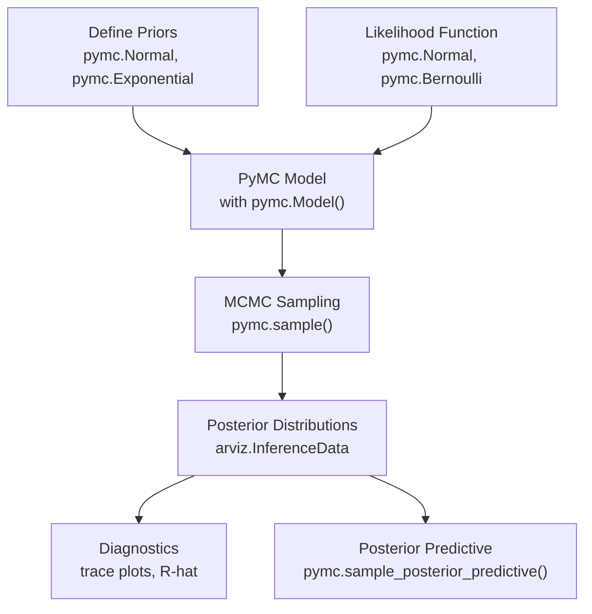

**Applications**:

1. **Parameter Estimation** ([docs/examples.md:2330-2338]()):
   - Estimate kinetic parameters (activation energy, rate constants)
   - Incorporate prior knowledge from literature
   - Quantify parameter uncertainty

2. **Hierarchical Models**:
   - Multi-level structures (patients within hospitals)
   - Partially pooled estimates
   - Shrinkage for small sample sizes

3. **Bayesian Network Modeling** ([docs/examples.md:1626-1633]()):
   - Directed graphical models of brain networks
   - Effective connectivity (directional influence)
   - Causal inference

**Key PyMC Constructs**:
- `pymc.Model()`: Context manager for model definition
- `pymc.Normal()`, `pymc.HalfNormal()`: Probability distributions
- `pymc.sample()`: MCMC inference with NUTS sampler
- `pymc.sample_prior_predictive()`: Sample from prior
- `arviz`: Posterior analysis and visualization

Sources: [README.md:377](), [docs/examples.md:2330-2338](), [docs/examples.md:1626-1633](), [.claude-plugin/marketplace.json:66]()

---

### pymoo (Multi-Objective Optimization)

**Purpose**: Multi-objective optimization for engineering and scientific problems.

**Location**: `./scientific-skills/pymoo`

**Optimization Framework**:

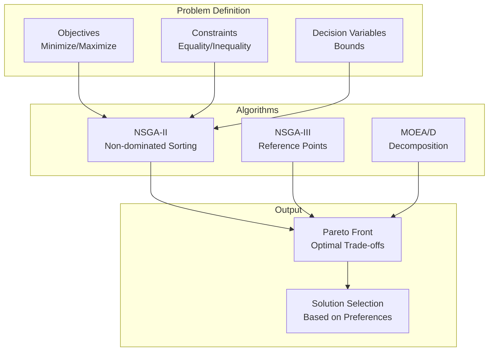

**Example: Drug Discovery Multi-Objective Optimization**

Optimize three competing objectives:
1. **Maximize binding affinity** (predicted ΔG)
2. **Minimize toxicity risk** (predicted hERG IC50)
3. **Maximize drug-likeness** (QED score)

Constraints:
- Molecular weight: 300-500 Da
- LogP: 0-5
- Synthetic accessibility: < 4

**Example: Chemical Reactor Optimization** ([docs/examples.md:2371-2383]()):
```python
from pymoo.algorithms.moo.nsga2 import NSGA2
from pymoo.core.problem import Problem

class ReactorProblem(Problem):
    def __init__(self):
        super().__init__(
            n_var=4,  # T, P, residence_time, feed_ratio
            n_obj=4,  # yield, energy, cost, productivity
            n_constr=3  # safety limits
        )
    
    def _evaluate(self, x, out, *args, **kwargs):
        # x: [T, P, tau, ratio]
        # Simulate reactor, calculate objectives
        out["F"] = [yield, energy, cost, productivity]
        out["G"] = [constraints]

algorithm = NSGA2(pop_size=100)
result = minimize(ReactorProblem(), algorithm, termination=('n_gen', 200))
pareto_front = result.F  # Pareto-optimal solutions
```

Sources: [README.md:378](), [docs/examples.md:2371-2383](), [.claude-plugin/marketplace.json:67]()

---

## Reinforcement Learning Skills

### stable-baselines3

**Purpose**: Deep reinforcement learning algorithms for control and optimization.

**Location**: `./scientific-skills/stable-baselines3`

**Available Algorithms**:

| Algorithm | Type | Use Case |
|-----------|------|----------|
| PPO | On-policy | General-purpose, stable |
| A2C | On-policy | Fast training, multiple envs |
| SAC | Off-policy | Continuous control |
| TD3 | Off-policy | Robotic control |
| DQN | Off-policy | Discrete action spaces |

**RL Workflow**:


**Scientific Applications**:

1. **Process Control** ([docs/examples.md:2408-2417]()):
   - Environment: chemical reactor simulation
   - State: temperature, pressure, concentrations
   - Actions: adjust flow rates, heating/cooling
   - Reward: maximize yield - energy cost

2. **Experimental Design**:
   - Environment: lab automation system
   - State: current experimental parameters
   - Actions: next experiment to run
   - Reward: information gain per experiment

3. **Detector Optimization** ([docs/examples.md:2225-2230]()):
   - Environment: particle detector simulator
   - State: detector readout
   - Actions: trigger thresholds
   - Reward: signal efficiency - background rate

Sources: [README.md:374](), [docs/examples.md:2408-2417](), [docs/examples.md:2225-2230](), [.claude-plugin/marketplace.json:84]()

---

### pufferlib

**Purpose**: High-performance reinforcement learning for multi-agent systems.

**Location**: `./scientific-skills/pufferlib`

**Features**:
- Vectorized environments for parallel training
- Optimized for large-scale RL experiments
- Integration with Stable-Baselines3
- Support for custom observation/action spaces

Sources: [README.md:374](), [.claude-plugin/marketplace.json:69]()

---

## Model Interpretation and Explainability

### SHAP (SHapley Additive exPlanations)

**Purpose**: Unified framework for interpreting machine learning model predictions.

**Location**: `./scientific-skills/shap`

**SHAP Architecture**:

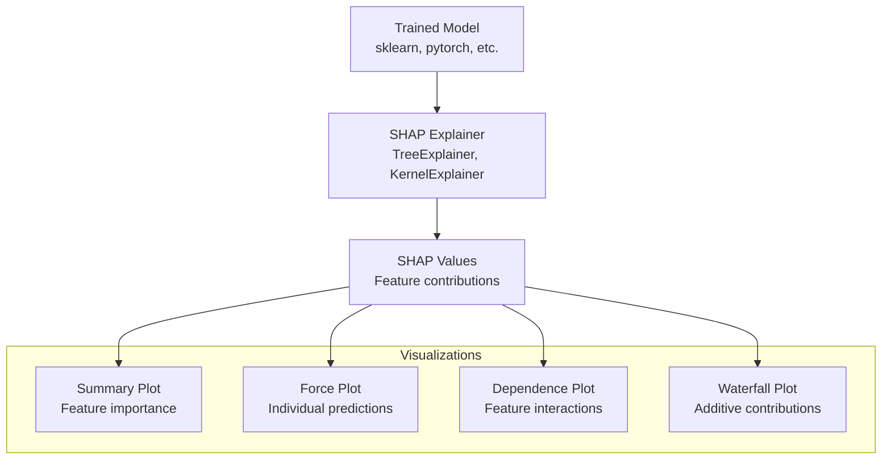

**Use Cases**:

1. **Toxicity Prediction Interpretation** ([docs/examples.md:707-708]()):
   - Identify structural features causing high toxicity predictions
   - Explain why molecule A is predicted toxic but similar molecule B is safe
   - Guide medicinal chemistry modifications

2. **Clinical Model Interpretation**:
   - Explain patient outcome predictions
   - Identify most important clinical variables
   - Validate model is using medically relevant features

3. **Digital Pathology** ([docs/examples.md:1218-1221]()):
   - Visualize which image regions contribute to tumor classification
   - Validate model attends to relevant histological features
   - Generate attention maps for pathologist review

**Key SHAP Functions**:
- `shap.TreeExplainer`: Optimized for tree-based models (RF, XGBoost)
- `shap.KernelExplainer`: Model-agnostic, works with any model
- `shap.DeepExplainer`: For neural networks
- `shap.summary_plot()`: Global feature importance
- `shap.force_plot()`: Local explanation for single prediction
- `shap.dependence_plot()`: Feature interaction analysis

Sources: [README.md:376](), [docs/examples.md:707-708](), [docs/examples.md:1218-1221](), [.claude-plugin/marketplace.json:82]()

---

### UMAP (Uniform Manifold Approximation and Projection)

**Purpose**: Dimensionality reduction and visualization for high-dimensional data.

**Location**: `./scientific-skills/umap-learn`

**UMAP vs Other Methods**:

| Method | Speed | Global Structure | Local Structure | Parameters |
|--------|-------|------------------|-----------------|------------|
| PCA | Fast | Good | Poor | n_components |
| t-SNE | Slow | Poor | Excellent | perplexity |
| UMAP | Fast | Good | Excellent | n_neighbors, min_dist |

**Workflow**:

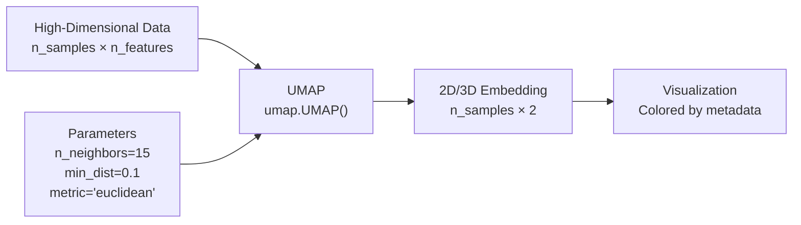

**Scientific Applications**:

1. **Single-Cell RNA-seq Visualization** ([docs/examples.md:448-450]()):
   - Reduce 3,000 genes to 2D for visualization
   - Color cells by cluster, cell type, gene expression
   - Identify cell populations and transitions

2. **Multi-Omics Integration** ([docs/examples.md:2026-2031]()):
   - Visualize integrated genomics + proteomics + metabolomics
   - Color by cancer subtype, survival, treatment response
   - Identify molecular patterns

3. **Chemical Space Visualization**:
   - Reduce molecular fingerprints to 2D
   - Visualize compound libraries and scaffolds
   - Identify SAR patterns and outliers

**Key Parameters**:
- `n_neighbors`: Local vs global structure (default: 15)
- `min_dist`: Tightness of embedding (default: 0.1)
- `metric`: Distance metric ('euclidean', 'cosine', 'correlation')
- `n_components`: Output dimensions (default: 2)

Sources: [README.md:378](), [docs/examples.md:448-450](), [docs/examples.md:2026-2031](), [.claude-plugin/marketplace.json:90]()

---

## Integration with Scientific Workflows

### Multi-Skill ML Workflows

ML and AI skills are typically combined with domain-specific skills to create end-to-end scientific pipelines:

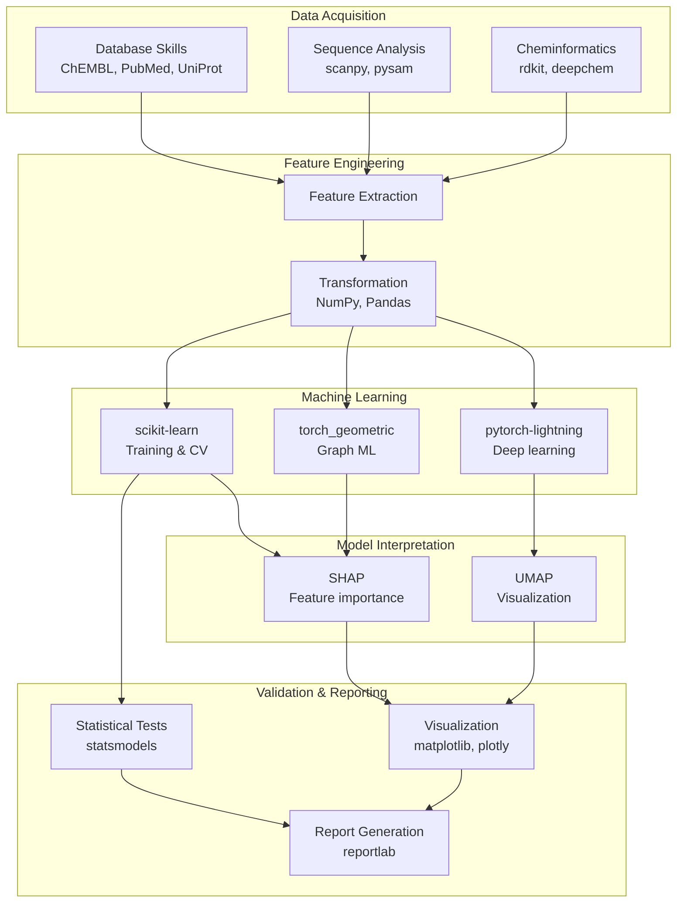

**Example Integration: Drug Discovery Pipeline**

From [docs/examples.md:33-121]():

1. **Data Acquisition**: Query ChEMBL for EGFR inhibitors (IC50 < 50nM)
2. **Feature Engineering**: Calculate molecular descriptors with RDKit
3. **Model Training**: Train DeepChem GCN to predict activity
4. **Virtual Screening**: Score novel compounds with trained model
5. **Optimization**: Use PyMOO to optimize potency vs ADMET properties
6. **Interpretation**: SHAP analysis identifies key molecular features
7. **Validation**: Statistical testing with statsmodels
8. **Reporting**: Generate PDF with matplotlib figures and reportlab

Sources: [docs/examples.md:33-121]()

---

### Common ML Workflow Patterns

#### Pattern 1: Classification with scikit-learn

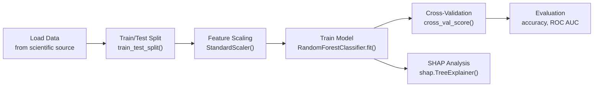

**Code Reference**: Classification pattern used in cancer subtype prediction [docs/examples.md:320-344]()

---

#### Pattern 2: Deep Learning with pytorch-lightning

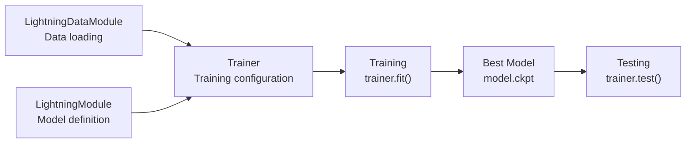

**Code Reference**: Deep learning pattern for pathology [docs/examples.md:1155-1200]()

---

#### Pattern 3: Graph Neural Network with torch_geometric

```mermaid
graph LR
    graph["Graph Construction<br/>Data(x, edge_index)"]
    model["GNN Model<br/>GCNConv layers"]
    loader["DataLoader<br/>Batch graphs"]
    train["Training Loop<br/>for epoch in epochs"]
    pred["Prediction<br/>model(batch)"]
    
    graph --> loader
    model --> train
    loader --> train
    train --> pred
```

**Code Reference**: GNN pattern for brain connectivity [docs/examples.md:1619-1625]()

---

#### Pattern 4: Bayesian Inference with PyMC

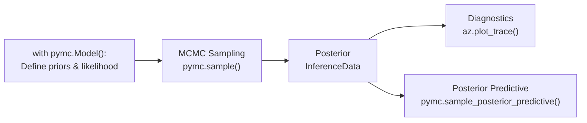

**Code Reference**: Bayesian workflow for parameter estimation [docs/examples.md:2330-2338]()

---

## Common Use Cases Across Scientific Domains

### Supervised Learning Tasks

**Classification Examples**:
- Cancer subtype prediction from gene expression [docs/examples.md:320-344]()
- Tumor vs normal tissue from histology images [docs/examples.md:1185-1190]()
- Antimicrobial resistance from genomic data [docs/examples.md:1886-1897]()
- Patient outcome prediction from clinical variables

**Regression Examples**:
- Molecular property prediction (solubility, toxicity) [docs/examples.md:83-90]()
- Protein-ligand binding affinity
- Material properties (ionic conductivity, band gap) [docs/examples.md:1068-1079]()
- Clinical biomarker quantification

**Time-to-Event Modeling**:
- Patient survival analysis with Cox models [docs/examples.md:2060-2070]()
- Time to disease recurrence
- Time to experimental endpoint
- Device failure prediction

---

### Unsupervised Learning Tasks

**Clustering Applications**:
- Cell type identification from single-cell RNA-seq [docs/examples.md:446-466]()
- Patient stratification into subtypes [docs/examples.md:2026-2048]()
- Chemical scaffold clustering [docs/examples.md:59-64]()
- Functional protein families

**Dimensionality Reduction**:
- Visualization of high-dimensional omics data [docs/examples.md:2026-2031]()
- Feature extraction before ML modeling
- Batch effect correction
- Data exploration and quality control

**Anomaly Detection**:
- Outlier detection in experimental data
- Quality control in automated assays
- Fraud detection in clinical trials
- Equipment malfunction detection

---

### Reinforcement Learning Tasks

**Laboratory Automation**:
- Optimal experimental design [docs/examples.md:2225-2230]()
- Protocol optimization
- Liquid handling robot control
- Adaptive sampling strategies

**Process Optimization**:
- Chemical reactor control [docs/examples.md:2408-2417]()
- Bioprocess optimization
- Supply chain management
- Resource allocation

---

### Deep Learning Tasks

**Computer Vision**:
- Whole slide image analysis [docs/examples.md:1155-1253]()
- Medical image segmentation
- Microscopy image analysis
- Crystal structure recognition

**Natural Language Processing**:
- Literature mining and summarization
- Scientific text generation
- Drug name entity recognition
- Clinical note extraction

**Protein Language Models**:
- Protein function prediction
- Variant effect prediction
- Protein design and optimization
- Structure prediction support

---

## Model Training Best Practices

### Data Splitting Strategy

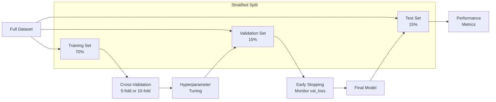

**Key Principles**:
1. **Stratified splitting**: Maintain class balance across splits
2. **No data leakage**: Test set never used during training
3. **Cross-validation**: Used for model selection and hyperparameter tuning
4. **Independent test set**: Reserved for final evaluation only
5. **Time-based splitting**: For temporal data (e.g., patient cohorts)

---

### Cross-Validation Patterns

**K-Fold Cross-Validation**:
```python
from sklearn.model_selection import cross_val_score
scores = cross_val_score(model, X, y, cv=5, scoring='roc_auc')
mean_auc = scores.mean()
std_auc = scores.std()
```

**Stratified K-Fold** (for imbalanced classes):
```python
from sklearn.model_selection import StratifiedKFold
skf = StratifiedKFold(n_splits=5, shuffle=True, random_state=42)
for train_idx, val_idx in skf.split(X, y):
    X_train, X_val = X[train_idx], X[val_idx]
    y_train, y_val = y[train_idx], y[val_idx]
```

**Group K-Fold** (for grouped data):
```python
from sklearn.model_selection import GroupKFold
gkf = GroupKFold(n_splits=5)
# groups: patient IDs, to prevent same patient in train and val
for train_idx, val_idx in gkf.split(X, y, groups=patient_ids):
    ...
```

---

### Hyperparameter Optimization

**Grid Search**:
```python
from sklearn.model_selection import GridSearchCV
param_grid = {
    'n_estimators': [100, 200, 500],
    'max_depth': [10, 20, None],
    'min_samples_split': [2, 5, 10]
}
grid_search = GridSearchCV(RandomForestClassifier(), param_grid, cv=5)
grid_search.fit(X_train, y_train)
best_model = grid_search.best_estimator_
```

**Random Search** (more efficient):
```python
from sklearn.model_selection import RandomizedSearchCV
param_distributions = {
    'n_estimators': [100, 200, 500, 1000],
    'max_depth': [10, 20, 30, None],
    'min_samples_split': [2, 5, 10, 15]
}
random_search = RandomizedSearchCV(
    RandomForestClassifier(), 
    param_distributions, 
    n_iter=20, 
    cv=5
)
random_search.fit(X_train, y_train)
```

**Bayesian Optimization** (for expensive models):
- Use libraries like `optuna` or `scikit-optimize`
- More sample-efficient than grid/random search
- Particularly useful for deep learning hyperparameters

---

### Model Evaluation Metrics

**Classification Metrics**:

| Metric | Use Case | scikit-learn Function |
|--------|----------|----------------------|
| Accuracy | Balanced classes | `accuracy_score()` |
| ROC AUC | Binary classification | `roc_auc_score()` |
| Precision/Recall | Imbalanced classes | `precision_recall_curve()` |
| F1 Score | Harmonic mean of precision/recall | `f1_score()` |
| Matthews Correlation | Imbalanced data, all-around metric | `matthews_corrcoef()` |
| Confusion Matrix | Detailed error analysis | `confusion_matrix()` |

**Regression Metrics**:

| Metric | Use Case | scikit-learn Function |
|--------|----------|----------------------|
| R² | Explained variance | `r2_score()` |
| MAE | Mean absolute error | `mean_absolute_error()` |
| RMSE | Root mean squared error | `mean_squared_error(squared=False)` |
| Pearson Correlation | Linear relationship | `pearsonr()` from scipy |
| Spearman Correlation | Monotonic relationship | `spearmanr()` from scipy |

**Survival Analysis Metrics**:
- **C-index** (Concordance index): Ranking accuracy for survival times
- **Brier Score**: Calibration of survival probabilities
- **Integrated Brier Score**: Time-averaged calibration

---

### Handling Class Imbalance

**Strategies**:

1. **Resampling**:
   - Oversample minority class (SMOTE)
   - Undersample majority class
   - Combination (SMOTE + Tomek links)

2. **Class weights**:
   ```python
   from sklearn.ensemble import RandomForestClassifier
   model = RandomForestClassifier(class_weight='balanced')
   ```

3. **Focal Loss** (for deep learning):
   - Downweight easy examples
   - Focus on hard-to-classify samples

4. **Ensemble methods**:
   - Balanced Random Forest
   - EasyEnsemble, RUSBoost

5. **Evaluation metric selection**:
   - Use ROC AUC, precision-recall AUC instead of accuracy
   - Focus on F1 score or Matthews correlation coefficient

---

## Performance Optimization

### Computational Considerations

**Scalability Strategies**:

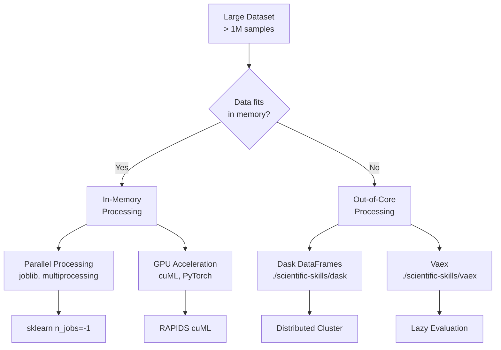

**Performance Tips**:

1. **Use vectorized operations** (NumPy, Pandas) instead of Python loops
2. **Parallelize with `n_jobs=-1`** in scikit-learn estimators
3. **Use GPU acceleration** when available (PyTorch, cuML)
4. **Batch predictions** for large inference tasks
5. **Cache intermediate results** for expensive computations
6. **Profile code** with `cProfile` to identify bottlenecks

---

### Deep Learning Optimization

**Training Speed**:
- **Mixed precision training** (FP16): 2-3× speedup on modern GPUs
- **Multi-GPU training**: Data parallel or model parallel
- **Gradient accumulation**: Simulate large batch sizes
- **Compiled models**: Use `torch.compile()` in PyTorch 2.0+

**Memory Optimization**:
- **Gradient checkpointing**: Trade compute for memory
- **Lower batch sizes**: If GPU memory is limited
- **Clear cache**: `torch.cuda.empty_cache()` between runs
- **Use efficient data loaders**: Prefetch data, pin memory

**Lightning-specific Optimizations**:
```python
trainer = pl.Trainer(
    accelerator='gpu',
    devices=4,  # Multi-GPU
    strategy='ddp',  # Distributed data parallel
    precision=16,  # Mixed precision
    gradient_clip_val=1.0,  # Gradient clipping
    accumulate_grad_batches=4  # Gradient accumulation
)
```

Sources: [docs/examples.md:1190-1200]()

---

## Typical Workflow: End-to-End Example

**Use Case**: Predict drug toxicity from molecular structure

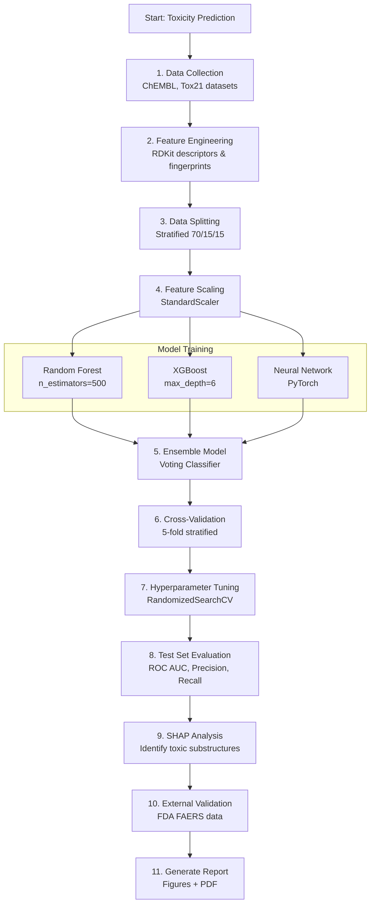

**Detailed Steps**:

1. **Data Collection**: Query ChEMBL for toxicity assays, download Tox21 dataset
2. **Feature Engineering**: 
   - RDKit molecular descriptors (MW, LogP, TPSA, etc.)
   - Morgan fingerprints (radius=2, 2048 bits)
   - MACCS keys for structural alerts
3. **Data Splitting**: Stratified by toxicity class, ensure balanced splits
4. **Feature Scaling**: StandardScaler for descriptors, fingerprints already binary
5. **Model Training**: Train ensemble of RF, XGBoost, Neural Network
6. **Cross-Validation**: 5-fold stratified CV to estimate generalization
7. **Hyperparameter Tuning**: RandomizedSearchCV with 50 iterations
8. **Test Set Evaluation**: Calculate ROC AUC, precision, recall, F1
9. **SHAP Analysis**: Identify toxic substructures (PAINS, reactive groups)
10. **External Validation**: Test on independent FDA FAERS adverse event data
11. **Report Generation**: matplotlib figures, SHAP plots, ReportLab PDF

Sources: [docs/examples.md:633-758]()

---

## References and Resources

### Skill Documentation Locations

All ML and AI skills are located under `./scientific-skills/` with the following structure:

```
./scientific-skills/
├── scikit-learn/
│   ├── SKILL.md
│   ├── scripts/
│   └── references/
├── pytorch-lightning/
│   ├── SKILL.md
│   ├── scripts/
│   └── references/
├── transformers/
├── torch_geometric/
├── stable-baselines3/
├── pufferlib/
├── shap/
├── pymc/
├── pymoo/
├── umap-learn/
├── statsmodels/
├── scikit-survival/
└── aeon/
```

Each skill directory contains:
- `SKILL.md`: Comprehensive documentation with installation, usage examples
- `scripts/`: Example Python scripts demonstrating key functionality
- `references/`: API documentation, tutorials, research papers

---

### Related Pages

- **[Deep Learning Frameworks](#9.1)**: Detailed PyTorch Lightning training workflows, model architectures, distributed training
- **[Natural Language Processing](#9.2)**: Transformers, BERT, protein language models, fine-tuning strategies
- **[Bioinformatics and Genomics](#6)**: Integration with single-cell analysis (scanpy + ML), variant prediction
- **[Cheminformatics and Drug Discovery](#7)**: Molecular property prediction, deep learning for chemistry (DeepChem)
- **[Data Analysis and Visualization](#10)**: matplotlib, seaborn, plotly for ML results visualization
- **[Multi-Domain Workflows](#14)**: End-to-end examples combining ML with scientific databases and analysis

---

### External Documentation

**Official Documentation**:
- scikit-learn: https://scikit-learn.org/stable/
- PyTorch Lightning: https://lightning.ai/docs/pytorch/
- Hugging Face Transformers: https://huggingface.co/docs/transformers/
- PyTorch Geometric: https://pytorch-geometric.readthedocs.io/
- Stable-Baselines3: https://stable-baselines3.readthedocs.io/
- SHAP: https://shap.readthedocs.io/
- PyMC: https://www.pymc.io/
- PyMOO: https://pymoo.org/

**Tutorials and Learning Resources**:
- scikit-learn tutorials: https://scikit-learn.org/stable/tutorial/
- PyTorch Lightning examples: https://github.com/Lightning-AI/lightning/tree/master/examples
- Deep Learning for the Life Sciences: https://www.deeplearningbook.org/

---

Sources: [README.md:373-401](), [.claude-plugin/marketplace.json:17-157](), [docs/examples.md:1-2668]()

---

