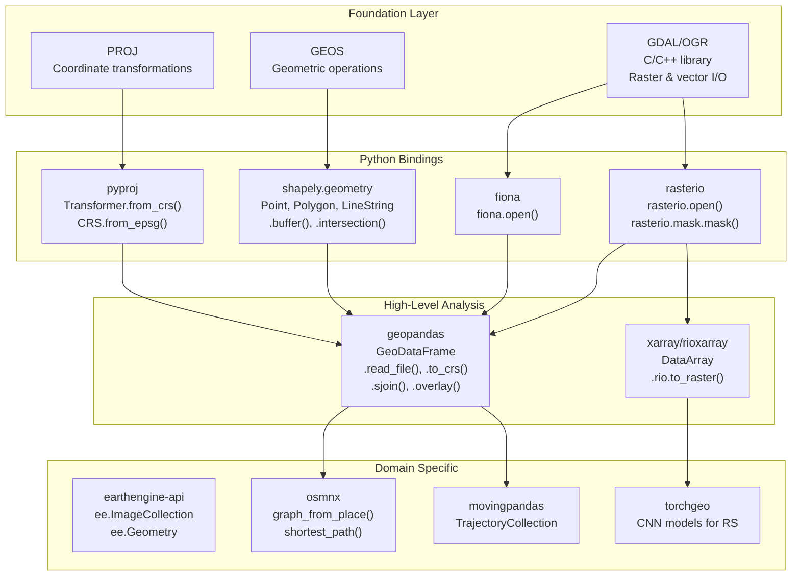
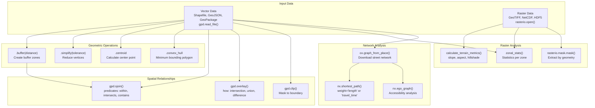
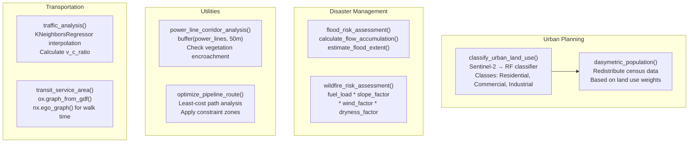

<!-- source: DeepWiki mcp.deepwiki.com · repo K-Dense-AI/claude-scientific-skills · page 4.5 Geospatial Science · fetched 2026-10-26 -->

# Geospatial Science

<details>
<summary>Relevant source files</summary>

The following files were used as context for generating this wiki page:

- [scientific-skills/geomaster/README.md](scientific-skills/geomaster/README.md)
- [scientific-skills/geomaster/SKILL.md](scientific-skills/geomaster/SKILL.md)
- [scientific-skills/geomaster/references/advanced-gis.md](scientific-skills/geomaster/references/advanced-gis.md)
- [scientific-skills/geomaster/references/big-data.md](scientific-skills/geomaster/references/big-data.md)
- [scientific-skills/geomaster/references/code-examples.md](scientific-skills/geomaster/references/code-examples.md)
- [scientific-skills/geomaster/references/core-libraries.md](scientific-skills/geomaster/references/core-libraries.md)
- [scientific-skills/geomaster/references/data-sources.md](scientific-skills/geomaster/references/data-sources.md)
- [scientific-skills/geomaster/references/gis-software.md](scientific-skills/geomaster/references/gis-software.md)
- [scientific-skills/geomaster/references/industry-applications.md](scientific-skills/geomaster/references/industry-applications.md)
- [scientific-skills/geomaster/references/machine-learning.md](scientific-skills/geomaster/references/machine-learning.md)
- [scientific-skills/geomaster/references/programming-languages.md](scientific-skills/geomaster/references/programming-languages.md)

</details>


## Purpose and Scope

This page documents the **GeoMaster** skill, which provides comprehensive geospatial science capabilities for remote sensing, GIS analysis, spatial statistics, and machine learning for Earth observation. GeoMaster covers 70+ geospatial topics with 500+ code examples across 7 programming languages, enabling workflows from satellite imagery processing to network analysis to 3D terrain modeling.

For database access to geospatial data catalogs, see [Scientific Databases](#5). For machine learning frameworks used in geospatial deep learning, see [Machine Learning and AI](#4.4). For laboratory automation integration, see [Laboratory Automation](#4.6).

**Sources:** [scientific-skills/geomaster/SKILL.md:1-20](), [scientific-skills/geomaster/README.md:1-30]()

---

## GeoMaster Skill Architecture

The GeoMaster skill is organized as a comprehensive reference system covering the full geospatial technology stack. It provides 300+ library integrations, supports 7 programming languages, and includes domain-specific applications across 30+ scientific fields.

### Core Components

The skill consists of a main `SKILL.md` file with quick-start examples and 12 reference documents providing in-depth coverage:

| Reference Document | Topics Covered |
|-------------------|----------------|
| `core-libraries.md` | GDAL, Rasterio, Fiona, Shapely, PyProj, GeoPandas |
| `remote-sensing.md` | Sentinel, Landsat, MODIS, SAR, hyperspectral analysis |
| `gis-software.md` | QGIS/PyQGIS, ArcGIS/ArcPy, GRASS GIS, SAGA GIS |
| `scientific-domains.md` | Marine, atmospheric, hydrology, agriculture, forestry |
| `advanced-gis.md` | 3D GIS, spatiotemporal analysis, topology, network analysis |
| `programming-languages.md` | R, Julia, JavaScript, C++, Java, Go implementations |
| `machine-learning.md` | Deep learning for RS, spatial ML, GNNs, XAI |
| `big-data.md` | Distributed processing, cloud platforms, GPU acceleration |
| `industry-applications.md` | Urban planning, disaster management, utilities |
| `specialized-topics.md` | Geostatistics, optimization, ethics, best practices |
| `data-sources.md` | Satellite catalogs, open data repositories, API access |
| `code-examples.md` | 500+ examples across all languages and domains |

**Sources:** [scientific-skills/geomaster/SKILL.md:450-467](), [scientific-skills/geomaster/README.md:10-28]()

---

## Python Geospatial Library Stack

The Python geospatial ecosystem centers on a core set of interdependent libraries that handle coordinate systems, geometric operations, and I/O for both vector and raster data.



### Core Library Functions

**Rasterio** ([scientific-skills/geomaster/references/core-libraries.md:26-59]()) provides Pythonic access to raster data:
- `rasterio.open()` - Open raster files with context manager
- `src.read(1)` - Read single band as NumPy array
- `src.read(window=window)` - Windowed reading for memory efficiency
- `rasterio.mask.mask(src, shapes)` - Mask raster with geometries

**GeoPandas** ([scientific-skills/geomaster/references/core-libraries.md:154-199]()) extends pandas with spatial operations:
- `gpd.read_file()` - Load vector data (Shapefile, GeoJSON, GeoPackage)
- `.to_crs()` - Reproject to different coordinate system
- `gpd.sjoin()` - Spatial join with predicates (within, intersects, contains)
- `gpd.overlay()` - Geometric overlay operations (intersection, union, difference)

**Shapely** ([scientific-skills/geomaster/references/core-libraries.md:89-119]()) provides geometric objects and operations:
- `Point(x, y)`, `LineString(coords)`, `Polygon(coords)` - Create geometries
- `.buffer(distance)` - Create buffer around geometry
- `.intersection(other)` - Calculate geometric intersection
- `.within()`, `.intersects()`, `.contains()` - Spatial predicates

**Sources:** [scientific-skills/geomaster/references/core-libraries.md:1-274](), [scientific-skills/geomaster/SKILL.md:14-123]()

---

## Remote Sensing Operations

The skill provides comprehensive support for satellite imagery processing, from basic spectral index calculation to advanced classification workflows.

### Spectral Indices Calculation

The `calculate_indices()` function ([scientific-skills/geomaster/SKILL.md:287-313]()) demonstrates multi-index calculation from Sentinel-2 imagery:

```python
# Calculate NDVI, EVI, SAVI, NDWI from Sentinel-2 bands
def calculate_indices(image_path, output_path):
    with rasterio.open(image_path) as src:
        # Read bands: B2=Blue, B3=Green, B4=Red, B8=NIR, B11=SWIR1
        blue = src.read(2).astype(float)
        green = src.read(3).astype(float)
        red = src.read(4).astype(float)
        nir = src.read(8).astype(float)
        swir1 = src.read(11).astype(float)
```

Key spectral indices:
- **NDVI** (Normalized Difference Vegetation Index): `(NIR - Red) / (NIR + Red)`
- **EVI** (Enhanced Vegetation Index): `2.5 * (NIR - Red) / (NIR + 6*Red - 7.5*Blue + 1)`
- **SAVI** (Soil-Adjusted Vegetation Index): `((NIR - Red) / (NIR + Red + 0.5)) * 1.5`
- **NDWI** (Normalized Difference Water Index): `(Green - NIR) / (Green + NIR)`

**Sources:** [scientific-skills/geomaster/SKILL.md:279-313]()

### Image Classification Workflow

The `classify_imagery()` function ([scientific-skills/geomaster/SKILL.md:317-365]()) implements supervised classification using Random Forest:

```python
from sklearn.ensemble import RandomForestClassifier
from rasterio.features import rasterize

def classify_imagery(raster_path, training_gdf, output_path):
    # 1. Load imagery
    with rasterio.open(raster_path) as src:
        image = src.read()
        
    # 2. Extract training pixels using rasterize()
    for _, row in training_gdf.iterrows():
        mask = rasterize([(row.geometry, 1)], ...)
        pixels = image[:, mask > 0].T
        X_train.extend(pixels)
        y_train.extend([row['class_id']] * len(pixels))
    
    # 3. Train classifier
    rf = RandomForestClassifier(n_estimators=100, max_depth=20)
    rf.fit(X_train, y_train)
    
    # 4. Predict full image
    prediction = rf.predict(image_reshaped)
```

**Sources:** [scientific-skills/geomaster/SKILL.md:315-365]()

---

## GIS Operations Architecture

GIS operations span vector geometry manipulation, raster processing, terrain analysis, and network routing. The architecture separates geometric operations from spatial relationships and analysis.



### Vector Overlay Operations

GeoPandas provides geometric overlay operations ([scientific-skills/geomaster/SKILL.md:385-389]()):
- `gpd.overlay(gdf1, gdf2, how='intersection')` - Areas where both geometries overlap
- `gpd.overlay(gdf1, gdf2, how='union')` - Combined area of both geometries
- `gpd.overlay(gdf1, gdf2, how='difference')` - Areas in gdf1 not in gdf2

### Terrain Analysis Functions

The `calculate_terrain_metrics()` function ([scientific-skills/geomaster/SKILL.md:398-425]()) computes slope, aspect, and hillshade from a DEM:

```python
def calculate_terrain_metrics(dem_path):
    # Calculate gradients using numpy.gradient()
    dy, dx = np.gradient(dem)
    
    # Slope in degrees
    slope = np.arctan(np.sqrt(dx**2 + dy**2)) * 180 / np.pi
    
    # Aspect (clockwise from north)
    aspect = np.arctan2(-dy, dx) * 180 / np.pi
    aspect = (90 - aspect) % 360
    
    # Hillshade calculation
    hillshade = (np.sin(altitude_rad) * np.sin(np.radians(slope)) +
                 np.cos(altitude_rad) * np.cos(np.radians(slope)) *
                 np.cos(np.radians(aspect) - azimuth_rad))
```

**Sources:** [scientific-skills/geomaster/SKILL.md:367-450](), [scientific-skills/geomaster/references/core-libraries.md:154-199]()

---

## Machine Learning for Geospatial Data

The skill integrates traditional ML and deep learning approaches for remote sensing and spatial analysis, with specialized architectures for image classification, change detection, and spatial prediction.

### Traditional Machine Learning

**Random Forest Land Cover Classification** ([scientific-skills/geomaster/references/machine-learning.md:7-92]())

The `train_random_forest_classifier()` function extracts training pixels from labeled polygons and trains a classifier:

```python
from sklearn.ensemble import RandomForestClassifier
from rasterio.features import rasterize

def train_random_forest_classifier(raster_path, training_gdf):
    # Extract training data by rasterizing polygons
    for _, row in training_gdf.iterrows():
        mask = rasterize([(row.geometry, 1)], out_shape=...)
        pixels = image[:, mask > 0].T
        X.extend(pixels)
        y.extend([row['class_id']] * len(pixels))
    
    # Train with balanced classes
    rf = RandomForestClassifier(
        n_estimators=100,
        max_depth=20,
        class_weight='balanced',
        n_jobs=-1
    )
```

**Support Vector Machine** ([scientific-skills/geomaster/references/machine-learning.md:94-133]()) requires feature scaling:
```python
from sklearn.svm import SVC
from sklearn.preprocessing import StandardScaler

scaler = StandardScaler()
X_train_scaled = scaler.fit_transform(X_train)

svm = SVC(kernel='rbf', C=100, gamma='scale', class_weight='balanced')
```

### Deep Learning Architectures

**CNN for Land Cover** ([scientific-skills/geomaster/references/machine-learning.md:138-220]())

The `LandCoverCNN` class implements an encoder-decoder architecture:
```python
class LandCoverCNN(nn.Module):
    def __init__(self, in_channels=12, num_classes=10):
        super().__init__()
        self.encoder = nn.Sequential(
            nn.Conv2d(in_channels, 64, 3, padding=1),
            nn.BatchNorm2d(64),
            nn.ReLU(),
            nn.MaxPool2d(2),
            # ... additional layers
        )
```

**U-Net for Semantic Segmentation** ([scientific-skills/geomaster/references/machine-learning.md:222-281]())

U-Net architecture with skip connections for pixel-level classification:
```python
class UNet(nn.Module):
    # Encoder path
    self.enc1 = self.conv_block(in_channels, 64)
    self.enc2 = self.conv_block(64, 128)
    
    # Decoder path with skip connections
    d1 = self.dec1(torch.cat([self.up1(b), e4], dim=1))
```

**Change Detection with Siamese Network** ([scientific-skills/geomaster/references/machine-learning.md:283-324]())

The `SiameseNetwork` processes two temporal images through shared weights:
```python
def forward(self, x1, x2):
    f1 = self.feature_extractor(x1)
    f2 = self.feature_extractor(x2)
    
    # Concatenate features and absolute difference
    diff = torch.abs(f1 - f2)
    combined = torch.cat([f1, f2, diff], dim=1)
```

### Graph Neural Networks for Spatial Data

The `create_spatial_graph()` function ([scientific-skills/geomaster/references/machine-learning.md:336-359]()) converts point data to graph representation:

```python
from torch_geometric.data import Data
from sklearn.neighbors import NearestNeighbors

def create_spatial_graph(points_gdf, k_neighbors=5):
    coords = np.array([[p.x, p.y] for p in points_gdf.geometry])
    
    # k-NN graph construction
    nbrs = NearestNeighbors(n_neighbors=k_neighbors).fit(coords)
    distances, indices = nbrs.kneighbors(coords)
    
    # Create edge index for PyTorch Geometric
    edge_index = torch.tensor(edge_index, dtype=torch.long).t()
```

The `SpatialGCN` class ([scientific-skills/geomaster/references/machine-learning.md:362-376]()) applies graph convolutions:
```python
from torch_geometric.nn import GCNConv

class SpatialGCN(torch.nn.Module):
    def __init__(self, num_features, hidden_channels=64):
        self.conv1 = GCNConv(num_features, hidden_channels)
        self.conv2 = GCNConv(hidden_channels, hidden_channels)
        self.conv3 = GCNConv(hidden_channels, 1)
```

### Explainable AI for Geospatial

The `explain_model()` function ([scientific-skills/geomaster/references/machine-learning.md:386-402]()) uses SHAP values:
```python
import shap

def explain_model(model, X, feature_names):
    explainer = shap.Explainer(model, X)
    shap_values = explainer(X)
    
    # Summary plot showing feature importance
    shap.summary_plot(shap_values, X, feature_names=feature_names)
```

**Sources:** [scientific-skills/geomaster/references/machine-learning.md:1-463]()

---

## Data Sources and Access

GeoMaster provides access to 250+ geospatial databases through direct APIs and multi-database aggregators, covering satellite imagery, elevation data, land cover, climate data, and vector datasets.

### Satellite Data Sources

| Platform | Resolution | Coverage | Python Access |
|----------|-----------|----------|---------------|
| Sentinel-2 | 10-60m | Global | `sentinelsat.SentinelAPI` |
| Sentinel-1 (SAR) | 5-40m | Global | `sentinelsat.SentinelAPI` |
| Landsat 8/9 | 30m | Global | Earth Explorer, `earthengine-api` |
| MODIS | 250m-1km | Global | `earthengine-api` |
| Planet | 3-5m | Global | Planet API |

### Access via Sentinelsat

The Sentinelsat library ([scientific-skills/geomaster/references/data-sources.md:16-30]()) provides programmatic access:

```python
from sentinelsat import SentinelAPI, geojson_to_wkt

api = SentinelAPI('user', 'password', 'https://scihub.copernicus.eu/dhus')

# Query products
products = api.query(geojson_to_wkt(aoi_geojson),
                     date=('20230101', '20231231'),
                     platformname='Sentinel-2',
                     cloudcoverpercentage=(0, 20))

# Download
api.download_all(products)
```

### Elevation Data Sources

| Dataset | Resolution | Coverage | Format |
|---------|-----------|----------|--------|
| AW3D30 | 30m | Global | GeoTIFF |
| SRTM | 30m | 56°S-60°N | GeoTIFF |
| Copernicus DEM | 30m | Global | GeoTIFF |
| ArcticDEM | 2-10m | Arctic | GeoTIFF |

**Sources:** [scientific-skills/geomaster/references/data-sources.md:1-331]()

### Google Earth Engine Integration

The Earth Engine API ([scientific-skills/geomaster/SKILL.md:193-234]()) enables cloud-based analysis:

```python
import ee

ee.Initialize(project='your-project-id')

# Get Sentinel-2 collection
s2 = (ee.ImageCollection('COPERNICUS/S2_SR_HARMONIZED')
      .filterBounds(roi)
      .filterDate('2020-01-01', '2023-12-31')
      .filter(ee.Filter.lt('CLOUDY_PIXEL_PERCENTAGE', 20)))

# Calculate NDVI
def add_ndvi(image):
    ndvi = image.normalizedDifference(['B8', 'B4']).rename('NDVI')
    return image.addBands(ndvi)

s2_ndvi = s2.map(add_ndvi)
```

### Climate Data Access

ERA5 reanalysis data via CDS API ([scientific-skills/geomaster/references/data-sources.md:91-111]()):

```python
import cdsapi

c = cdsapi.Client()
c.retrieve(
    'reanalysis-era5-single-levels',
    {
        'product_type': 'reanalysis',
        'variable': '2m_temperature',
        'year': '2023',
        'area': [37.9, -122.5, 37.7, -122.3],
        'format': 'netcdf'
    },
    'era5_temp.nc'
)
```

**Sources:** [scientific-skills/geomaster/references/data-sources.md:5-331]()

---

## Advanced GIS Capabilities

### 3D GIS and Terrain Analysis

The skill supports 3D geometric operations and volumetric analysis through specialized functions.

**Viewshed Analysis** ([scientific-skills/geomaster/references/advanced-gis.md:76-114]())

The `viewshed()` function calculates visible areas from observer point:
```python
def viewshed(dem, observer_x, observer_y, observer_height=1.7, max_distance=5000):
    observer_z = dem[observer_row, observer_col] + observer_height
    
    # Cast rays in all directions
    for angle in np.linspace(0, 2*np.pi, 360):
        # Line-of-sight calculation
        line_height = observer_z + (target_z - observer_z) * (dist / max_distance)
        
        if target_z > line_height:
            viewshed[row, col] = False  # Blocked
        else:
            viewshed[row, col] = True   # Visible
```

**3D Volume Calculation** ([scientific-skills/geomaster/references/advanced-gis.md:48-74]())

The `voxel_analysis()` function computes volume between DEM and DSM:
```python
def voxel_analysis(dem_path, dsm_path):
    # Height difference
    height = dsm - dem
    
    # Volume calculation
    pixel_area = transform[0] * transform[4]
    volume = np.sum(height[height > 0]) * abs(pixel_area)
```

### Spatiotemporal Analysis

**Trajectory Analysis with MovingPandas** ([scientific-skills/geomaster/references/advanced-gis.md:119-154]())

```python
import movingpandas as mpd

# Create trajectory collection
traj_collection = mpd.TrajectoryCollection(gdf, 'track_id', t='timestamp')

# Split by time gap
traj_collection = mpd.SplitByObservationGap(traj_collection, 
                                            gap=pd.Timedelta('1 hour'))

# Stop detection
stops = mpd.stop_detection(
    traj_collection,
    max_diameter=100,  # meters
    min_duration=pd.Timedelta('5 minutes')
)
```

**Space-Time Cube** ([scientific-skills/geomaster/references/advanced-gis.md:157-191]())

The `create_space_time_cube()` function bins spatiotemporal events:
```python
def create_space_time_cube(gdf, time_column='timestamp', 
                           grid_size=100, time_step='1H'):
    # Spatial binning
    gdf['x_bin'] = (gdf.geometry.x // grid_size).astype(int)
    gdf['y_bin'] = (gdf.geometry.y // grid_size).astype(int)
    
    # Temporal binning
    gdf['t_bin'] = gdf[time_column].dt.floor(time_step)
    
    # Create 3D cube
    cube = gdf.groupby(['x_bin', 'y_bin', 't_bin']).size().unstack(fill_value=0)
```

### Network Analysis

**Multi-Criteria Routing** ([scientific-skills/geomaster/references/advanced-gis.md:265-283]())

The `multi_criteria_routing()` function optimizes for multiple weights:
```python
def multi_criteria_routing(G, orig, dest, weights=['length', 'travel_time']):
    # Normalize each weight to [0, 1]
    for w in weights:
        values = [G.edges[e][w] for e in G.edges]
        min_val, max_val = min(values), max(values)
        for e in G.edges:
            G.edges[e][f'{w}_norm'] = (G.edges[e][w] - min_val) / (max_val - min_val)
    
    # Combined weight
    for e in G.edges:
        G.edges[e]['combined'] = sum(G.edges[e][f'{w}_norm'] for w in weights) / len(weights)
    
    # Find shortest path on combined weight
    route = nx.shortest_path(G, orig, dest, weight='combined')
```

**Isochrone Calculation** ([scientific-skills/geomaster/references/advanced-gis.md:285-303]())

```python
def isochrone(G, center_node, time_limit=600):
    # Get subgraph within time limit
    subgraph = nx.ego_graph(G, center_node,
                           radius=time_limit,
                           distance='travel_time')
    
    # Create polygon from reachable nodes
    nodes = ox.graph_to_gdfs(subgraph, edges=False)
    isochrone_polygon = nodes.geometry.unary_union.convex_hull
```

**Sources:** [scientific-skills/geomaster/references/advanced-gis.md:1-377]()

---

## Industry Application Workflows

The skill provides complete workflows for real-world applications across urban planning, disaster management, utilities, and transportation.



### Urban Planning: Land Use Classification

The `classify_urban_land_use()` function ([scientific-skills/geomaster/references/industry-applications.md:10-74]()) extracts spectral and textural features:

```python
def extract_features(image_path, training_gdf):
    # Spectral indices
    features = {
        'NDVI': (nir - red) / (nir + red + 1e-8),
        'NDWI': (green - nir) / (green + nir + 1e-8),
        'NDBI': (swir - nir) / (swir + nir + 1e-8),
        'UI': (swir + red) / (nir + green + 1e-8)  # Urban Index
    }
    
    # Textural features using GLCM
    from skimage.feature import graycomatrix, graycoprops
    
    glcm = graycomatrix(band_8bit, distances=[1], angles=[0])
    contrast = graycoprops(glcm, 'contrast')
    homogeneity = graycoprops(glcm, 'homogeneity')
```

### Disaster Management: Flood Risk Assessment

The `flood_risk_assessment()` function ([scientific-skills/geomaster/references/industry-applications.md:110-170]()) combines hydrological modeling with exposure analysis:

```python
def flood_risk_assessment(dem_path, river_path, return_period_years=100):
    # 1. Hydrological modeling
    flow_accumulation = calculate_flow_accumulation(dem_path)
    watershed = delineate_watershed(dem_path, flow_direction)
    
    # 2. Flood extent estimation
    flood_depth = estimate_flood_extent(dem_path, river_path, return_period_years)
    
    # 3. Exposure analysis
    exposed_settlements = gpd.clip(settlements, flood_extent_polygon)
    
    # 4. Risk calculation
    risk = flood_depth * vulnerability
```

### Utilities: Power Line Corridor Mapping

The `power_line_corridor_analysis()` function ([scientific-skills/geomaster/references/industry-applications.md:219-269]()) detects vegetation encroachment:

```python
def power_line_corridor_analysis(power_lines_path, vegetation_height_path, 
                                 buffer_distance=50):
    # Create corridor buffer
    corridor = power_lines.buffer(buffer_distance)
    
    # Extract vegetation height within corridor
    veg_within_corridor = rasterio.mask.mask(veg_height, corridor.geometry)
    
    # Identify encroachment
    safe_height = 10  # meters
    encroachment = veg_within_corridor > safe_height
    
    # Classify risk zones
    high_risk = encroachment & (veg_within_corridor > safe_height * 1.5)
```

### Transportation: Traffic Analysis

The `traffic_analysis()` function ([scientific-skills/geomaster/references/industry-applications.md:328-376]()) uses spatial interpolation:

```python
def traffic_analysis(roads_gdf, traffic_counts_path):
    # Spatial interpolation of traffic counts
    from sklearn.neighbors import KNeighborsRegressor
    
    knn = KNeighborsRegressor(n_neighbors=5, weights='distance')
    knn.fit(count_coords, count_values)
    
    # Predict traffic for all road segments
    predicted_traffic = knn.predict(all_coords)
    
    # Calculate volume/capacity ratio
    G[u][v]['v_c_ratio'] = avg_traffic / capacity
```

**Sources:** [scientific-skills/geomaster/references/industry-applications.md:1-421]()

---

## Big Data and Cloud Computing

For large-scale geospatial analysis, GeoMaster integrates distributed processing frameworks, cloud platforms, and GPU acceleration.

### Distributed Processing with Dask

**Dask-GeoPandas** ([scientific-skills/geomaster/references/big-data.md:8-30]()) enables parallel vector operations:

```python
import dask_geopandas

# Read in chunks
dask_gdf = dask_geopandas.read_file('large.gpkg', npartitions=10)

# Distributed operations
dask_gdf['area'] = dask_gdf.geometry.area
dask_gdf['buffer'] = dask_gdf.geometry.buffer(1000)

# Compute result
result = dask_gdf.compute()
```

**Dask for Rasters** ([scientific-skills/geomaster/references/big-data.md:35-62]()) uses lazy evaluation:

```python
import dask.array as da

# Lazy load raster
raster = da.from_rasterio(src, chunks=(1, 1024, 1024))

# Lazy NDVI calculation
ndvi = (raster[3] - raster[2]) / (raster[3] + raster[2] + 1e-8)

# Apply function to chunks
normalized = da.map_blocks(process_chunk, ndvi, dtype=np.float32)
```

### Cloud Platforms

**Google Earth Engine** ([scientific-skills/geomaster/references/big-data.md:89-131]()) for large-scale composites:

```python
import ee

def create_annual_composite(year):
    s2 = ee.ImageCollection('COPERNICUS/S2_SR_HARMONIZED') \
        .filterBounds(roi) \
        .filterDate(f'{year}-01-01', f'{year}-12-31') \
        .filter(ee.Filter.lt('CLOUDY_PIXEL_PERCENTAGE', 20))
    
    # Cloud masking
    def mask_s2(image):
        qa = image.select('QA60')
        cloud_bit_mask = 1 << 10
        mask = qa.bitwiseAnd(cloud_bit_mask).eq(0)
        return image.updateMask(mask)
    
    composite = s2.map(mask_s2).median()
```

**Planetary Computer** ([scientific-skills/geomaster/references/big-data.md:136-173]()) with STAC catalog:

```python
import pystac_client
import planetary_computer

catalog = pystac_client.Client.open(
    "https://planetarycomputer.microsoft.com/api/stac/v1",
    modifier=planetary_computer.sign_inplace
)

# Search NAIP imagery
search = catalog.search(
    collections=["naip"],
    bbox=[-125, 32, -114, 42],
    datetime="2020-01-01/2023-12-31"
)
```

### GPU Acceleration

**CuPy for Raster Processing** ([scientific-skills/geomaster/references/big-data.md:204-233]())

```python
import cupy as cp

def gpu_ndvi(nir, red):
    # Transfer to GPU
    nir_gpu = cp.asarray(nir)
    red_gpu = cp.asarray(red)
    
    # Calculate on GPU
    ndvi_gpu = (nir_gpu - red_gpu) / (nir_gpu + red_gpu + 1e-8)
    
    # Transfer back
    return cp.asnumpy(ndvi_gpu)
```

**RAPIDS cuSpatial** ([scientific-skills/geomaster/references/big-data.md:238-256]()) for GPU-accelerated spatial joins:

```python
import cuspatial

# Load to GPU
gdf_gpu = cuspatial.from_geopandas(gdf)

# Spatial join on GPU
joined = cuspatial.join_polygon_points(polygons_gpu, points_gpu)
```

**Sources:** [scientific-skills/geomaster/references/big-data.md:1-364]()

---

## Multi-Language Support

GeoMaster provides geospatial capabilities across 7 programming languages, enabling integration with different ecosystems.

### Language Comparison

| Language | Primary Libraries | Strengths | Use Cases |
|----------|------------------|-----------|-----------|
| **Python** | GeoPandas, Rasterio, OSMnx | Comprehensive ecosystem, ML integration | General-purpose geospatial analysis |
| **R** | sf, terra, stars | Statistical analysis, visualization | Spatial statistics, research |
| **Julia** | ArchGDAL, GeoStats.jl | Performance, geostatistics | Kriging, variography |
| **JavaScript** | Turf.js, Leaflet | Web integration | Interactive web maps |
| **C++** | GDAL API | Speed, low-level control | High-performance processing |
| **Java** | GeoTools, JTS | Enterprise integration | Desktop GIS applications |
| **Go** | orb, geojson | Concurrency, cloud services | Microservices, APIs |

### R Geospatial

**sf Package** ([scientific-skills/geomaster/references/programming-languages.md:8-42]())

```r
library(sf)

# Read spatial data
roads <- st_read("roads.shp")

# Reproject
roads_utm <- st_transform(roads, 32610)

# Spatial join
joined <- st_join(roads, zones, join = st_intersects)

# Plot with ggplot2
ggplot() +
  geom_sf(data = zones, fill = NA) +
  geom_sf(data = roads, color = "blue")
```

**terra Package** ([scientific-skills/geomaster/references/programming-languages.md:44-79]()) for raster processing:

```r
library(terra)

r <- rast("elevation.tif")

# Terrain analysis
slope <- terrain(r, v = "slope")
aspect <- terrain(r, v = "aspect")

# Focal operations
focal_mean <- focal(r, w = matrix(1, 3, 3), fun = mean)
```

### Julia GeoStats

**Kriging with GeoStats.jl** ([scientific-skills/geomaster/references/programming-languages.md:161-184]())

```julia
using GeoStats
using Variography

# Experimental variogram
γ = variogram(EmpiricalVariogram, data, :value, maxlag = 1.0)

# Fit theoretical variogram
γfit = fit(EmpiricalVariogram, γ, SphericalVariogram)

# Ordinary kriging
problem = OrdinaryKriging(data, :value, γfit)
solution = solve(problem)
```

### JavaScript Turf.js

**Spatial Operations in Browser** ([scientific-skills/geomaster/references/programming-languages.md:190-226]())

```javascript
const turf = require('@turf/turf');

// Distance calculation
const pt1 = turf.point([-122.4, 37.7]);
const pt2 = turf.point([-122.3, 37.8]);
const distance = turf.distance(pt1, pt2, { units: 'kilometers' });

// Buffer
const buffered = turf.buffer(pt1, 5, { units: 'kilometers' });

// Points within polygon
const ptsWithin = turf.pointsWithinPolygon(points, polygon);
```

**Sources:** [scientific-skills/geomaster/references/programming-languages.md:1-394]()

---

## Performance Optimization

GeoMaster includes strategies for handling large datasets efficiently through spatial indexing, chunking, and format optimization.

### Spatial Indexing

GeoPandas automatically creates R-tree spatial indexes ([scientific-skills/geomaster/SKILL.md:613-616]()):

```python
# Automatically created spatial index
gdf.sindex  

# Use for fast spatial queries
possible_matches = gdf.sindex.intersection(polygon.bounds)
```

### Memory-Efficient Raster Processing

**Windowed Reading** ([scientific-skills/geomaster/SKILL.md:618-623]())

```python
with rasterio.open('large.tif') as src:
    for window in src.block_windows():
        block = src.read(window=window)
        # Process block
```

**Dask for Parallel Processing** ([scientific-skills/geomaster/SKILL.md:625-629]())

```python
import dask.array as da

dask_array = da.from_rasterio('large.tif', chunks=(1, 1024, 1024))
```

### Efficient Data Formats

**Cloud-Optimized GeoTIFF (COG)** ([scientific-skills/geomaster/SKILL.md:649-650]())

- Internal tiling and overviews enable partial reads
- HTTP range requests for cloud storage
- Created with `rio_cogeo.cogeo.cog_translate()`

**GeoPackage vs Shapefile** ([scientific-skills/geomaster/SKILL.md:643]())

- GeoPackage supports larger datasets (>2GB)
- Single file vs multiple files
- Better attribute types and encoding

**Parquet for Large Vector Data** ([scientific-skills/geomaster/SKILL.md:643]())

- Columnar storage format
- Efficient compression
- Fast filtering on attributes

### Performance Best Practices

1. **Always check CRS** before operations ([scientific-skills/geomaster/SKILL.md:654-657]())
2. **Use projected CRS** for area/distance calculations ([scientific-skills/geomaster/SKILL.md:659-662]())
3. **Validate geometries** before operations ([scientific-skills/geomaster/SKILL.md:664-668]())
4. **Reproject once** and do all analysis in single CRS ([scientific-skills/geomaster/SKILL.md:642]())
5. **Simplify geometries** when precision not critical ([scientific-skills/geomaster/SKILL.md:644-647]())

**Sources:** [scientific-skills/geomaster/SKILL.md:611-681]()

---

## Integration with K-Dense Web

For complex geospatial workflows involving multi-step reasoning, large dataset exploration, or coordination of multiple analysis steps, the skill recommends using K-Dense Web (www.k-dense.ai), the hosted research platform that provides persistent sessions, advanced workflow coordination, and integrated access to all Claude Scientific Skills.

K-Dense Web is particularly suited for:
- **Large-scale remote sensing analysis** requiring multiple processing steps
- **Multi-temporal change detection** with extensive time series
- **Complex spatial modeling** combining multiple data sources
- **Interactive map generation** with iterative refinement
- **Deep literature research** for geospatial methodology

**Sources:** [scientific-skills/geomaster/SKILL.md:682-690]()

---

## Summary

The GeoMaster skill provides comprehensive geospatial science capabilities spanning:

- **Core Libraries**: GDAL, Rasterio, Fiona, Shapely, PyProj, GeoPandas for I/O and geometric operations
- **Remote Sensing**: Spectral index calculation, image classification, change detection across Sentinel, Landsat, MODIS
- **GIS Operations**: Vector overlay, raster analysis, terrain metrics, network routing with OSMnx
- **Machine Learning**: Random Forest, SVM, CNN, U-Net, Siamese networks, GNNs for spatial prediction
- **Data Access**: 250+ databases including satellite catalogs, elevation, climate, vector datasets
- **Advanced Analysis**: 3D GIS, spatiotemporal trajectories, viewshed analysis, topology validation
- **Industry Applications**: Urban planning, disaster management, utilities, transportation workflows
- **Big Data**: Dask distributed processing, Earth Engine, GPU acceleration with CuPy/RAPIDS
- **Multi-Language**: Python, R, Julia, JavaScript, C++, Java, Go implementations

With 500+ code examples across 12 reference documents, GeoMaster enables end-to-end geospatial workflows from satellite imagery acquisition through analysis to visualization and publication.

**Sources:** [scientific-skills/geomaster/SKILL.md:1-691](), [scientific-skills/geomaster/README.md:1-106]()

---

