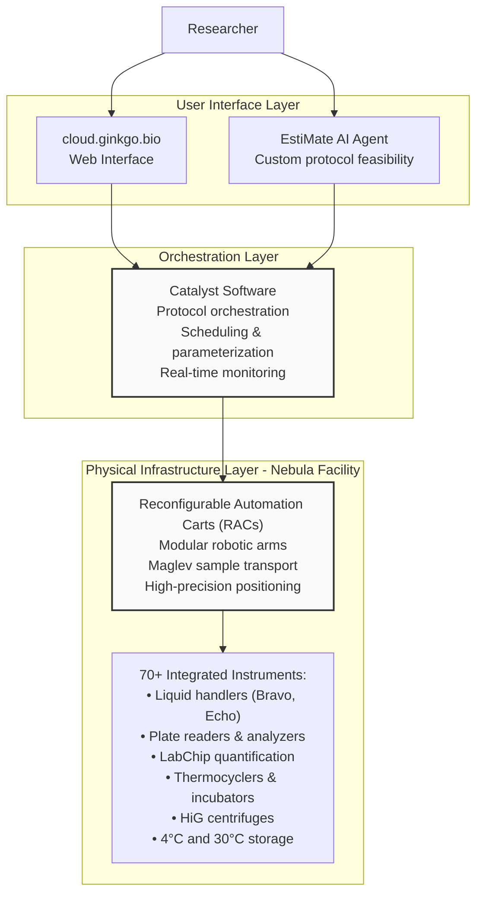
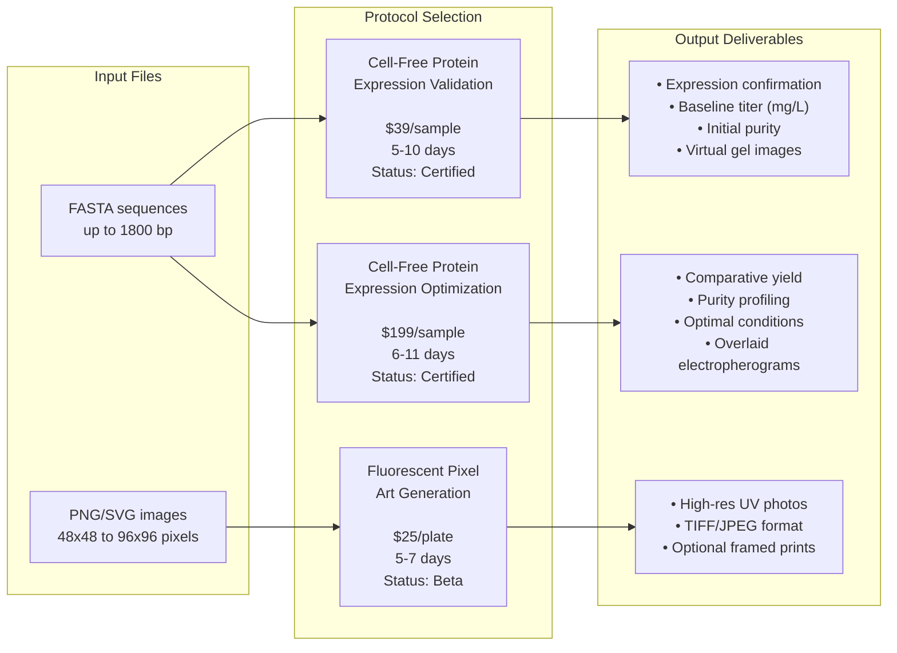
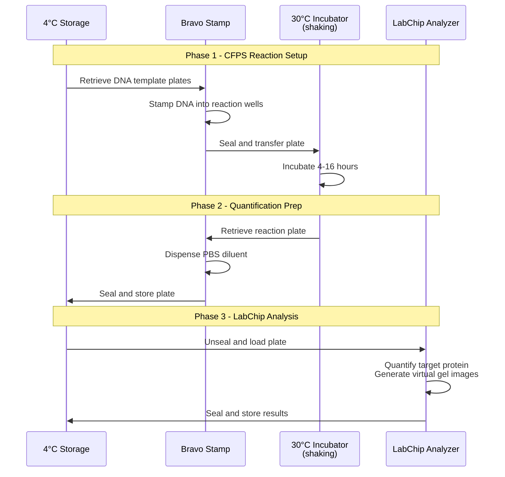
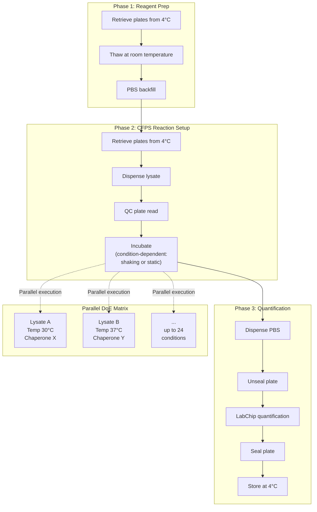
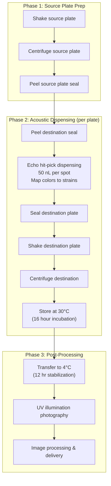
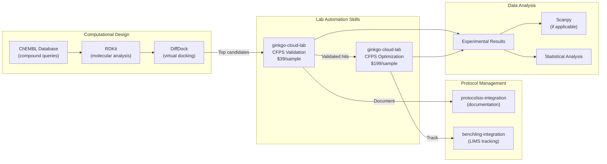

<!-- source: DeepWiki mcp.deepwiki.com · repo K-Dense-AI/claude-scientific-skills · page 4.6 Laboratory Automation · fetched 2026-10-26 -->

# Laboratory Automation

<details>
<summary>Relevant source files</summary>

The following files were used as context for generating this wiki page:

- [.claude-plugin/marketplace.json](.claude-plugin/marketplace.json)
- [README.md](README.md)
- [docs/scientific-skills.md](docs/scientific-skills.md)
- [scientific-skills/ginkgo-cloud-lab/SKILL.md](scientific-skills/ginkgo-cloud-lab/SKILL.md)
- [scientific-skills/ginkgo-cloud-lab/references/cell-free-protein-expression-optimization.md](scientific-skills/ginkgo-cloud-lab/references/cell-free-protein-expression-optimization.md)
- [scientific-skills/ginkgo-cloud-lab/references/cell-free-protein-expression-validation.md](scientific-skills/ginkgo-cloud-lab/references/cell-free-protein-expression-validation.md)
- [scientific-skills/ginkgo-cloud-lab/references/fluorescent-pixel-art-generation.md](scientific-skills/ginkgo-cloud-lab/references/fluorescent-pixel-art-generation.md)

</details>


## Purpose and Scope

This page covers the **4 laboratory automation skills** that enable AI agents to design protocols, control liquid handling robots, and interface with cloud-based autonomous lab infrastructure. These skills bridge computational scientific workflows (covered in sections [4.1](#4.1) through [4.4](#4.4)) with physical experimental execution. For protocol documentation and sharing platforms, this section covers integrations with Protocols.io, Benchling, and LabArchives. For broader cloud execution platforms like DNAnexus and LatchBio, see [Scientific Integrations in section 5](#5).

**Sources**: [README.md:36](), [README.md:475-479](), [docs/scientific-skills.md:45-60]()

---

## Skills Overview

The laboratory automation skills provide three categories of functionality:

| Category | Skills | Purpose |
|----------|--------|---------|
| **Cloud Lab Automation** | `ginkgo-cloud-lab` | Submit protocols for autonomous execution on Ginkgo's RAC infrastructure with cell-free protein expression and fluorescent art generation |
| **Local Robot Control** | `pylabrobot`, `opentrons-integration` | Program liquid handling robots (PyLabRobot for Hamilton/Tecan/Opentrons, Opentrons API v2 for OT-2/Flex) |
| **LIMS & Protocol Management** | `benchling-integration`, `labarchive-integration`, `protocolsio-integration` | Manage lab data, electronic notebooks, and standardized protocol documentation |

**Sources**: [README.md:475-479](), [.claude-plugin/marketplace.json:44,73,182,176,178,184](), [docs/scientific-skills.md:38-60]()

---

## Ginkgo Cloud Lab Platform

### Architecture and Infrastructure

The Ginkgo Cloud Lab platform (`ginkgo-cloud-lab` skill) provides web-based access to autonomous laboratory execution at `cloud.ginkgo.bio`. The system architecture consists of three layers:



**Diagram 1: Ginkgo Cloud Lab Three-Layer Architecture**

The infrastructure operates at Ginkgo's Nebula facility in Boston, MA. `Catalyst` software handles protocol scheduling, parameter validation, and real-time execution monitoring. RACs (Reconfigurable Automation Carts) are modular robotic units that coordinate 70+ instruments via maglev transport systems for zero-contact sample movement.

**Sources**: [scientific-skills/ginkgo-cloud-lab/SKILL.md:52-56](), [scientific-skills/ginkgo-cloud-lab/SKILL.md:8-12]()

---

### Available Certified Protocols

Three certified protocols are available with standardized pricing and turnaround times:



**Diagram 2: Protocol Selection and I/O Specifications**

**Sources**: [scientific-skills/ginkgo-cloud-lab/SKILL.md:14-35](), [scientific-skills/ginkgo-cloud-lab/references/cell-free-protein-expression-validation.md:1-7](), [scientific-skills/ginkgo-cloud-lab/references/cell-free-protein-expression-optimization.md:1-7](), [scientific-skills/ginkgo-cloud-lab/references/fluorescent-pixel-art-generation.md:1-7]()

---

#### Protocol 1: Cell-Free Protein Expression Validation

**Protocol URL**: `https://cloud.ginkgo.bio/protocols/cell-free-protein-expression-validation`

This protocol provides rapid go/no-go screening using a proprietary reconstituted E. coli transcription-translation (CFPS) system. Reactions complete in 4-16 hours.

**Key Parameters**:
- **Price**: $39/sample (default order: 8 proteins × 3 replicates = 24 samples = $936)
- **Turnaround**: 5-10 days
- **Input**: FASTA files (≤1800 bp sequences)
- **Output**: Expression confirmation, baseline titer (mg/L), initial purity percentage

**Three-Phase Automated Workflow**:



**Diagram 3: CFPS Validation Workflow (cell-free-protein-expression-validation.md)**

**Use Cases**:
- Screening candidate protein sequences for expressibility
- Go/no-go decisions before optimization investment
- Evaluating novel constructs in cell-free systems
- Comparing expression across sequence variants

**Sources**: [scientific-skills/ginkgo-cloud-lab/references/cell-free-protein-expression-validation.md:1-72]()

---

#### Protocol 2: Cell-Free Protein Expression Optimization

**Protocol URL**: `https://cloud.ginkgo.bio/protocols/cell-free-protein-expression-optimization`

Design of Experiment (DoE) approach testing up to **24 reaction conditions per protein**. Designed for difficult-to-express proteins including membrane proteins and targets requiring disulfides or cofactors.

**Key Parameters**:
- **Price**: $199/sample (default order: 1 protein × 3 replicates = 3 samples = $597)
- **Turnaround**: 6-11 days
- **Input**: FASTA sequences
- **Output**: Comparative yield across variables, purity profiling, optimal condition identification

**DoE Optimization Matrix Variables**:

| Variable Category | Options |
|------------------|---------|
| **Lysate Composition** | Different E. coli extract formulations |
| **Temperature** | Multiple incubation temperature profiles |
| **Chaperones** | For folding-challenged targets |
| **Disulfide Enhancers** | For targets requiring disulfide bridges |
| **Cofactors** | Metal ions, coenzymes, prosthetic groups |
| **Other Additives** | Target-specific supplements |



**Diagram 4: CFPS Optimization Workflow with DoE Matrix (cell-free-protein-expression-optimization.md)**

**Use Cases**:
- Optimizing difficult-to-express proteins
- Membrane protein expression screening
- Identifying optimal conditions for disulfide-bonded proteins
- Cofactor-dependent protein expression
- Systematic parameter space exploration
- Finding optimal formulation before production scale-up

**Sources**: [scientific-skills/ginkgo-cloud-lab/references/cell-free-protein-expression-optimization.md:1-95]()

---

#### Protocol 3: Fluorescent Pixel Art Generation

**Protocol URL**: `https://cloud.ginkgo.bio/protocols/fluorescent-pixel-art-generation`

Transforms digital images into living fluorescent bacterial artwork printed on agar omni-trays using 11 distinct fluorescent E. coli strains. Uses Echo acoustic liquid handling for 50 nL per spot precision.

**Key Parameters**:
- **Price**: $25/plate
- **Turnaround**: 5-7 days
- **Status**: Beta
- **Input**: PNG/SVG images (48×48 to 96×96 pixels)
- **Output**: High-resolution UV photographs (TIFF/JPEG)

**Available Fluorescent Strains**:

| Protein | Color | Protein | Color |
|---------|-------|---------|-------|
| sfGFP | Green | mTurquoise2 | Cyan |
| mRFP | Red | Electra2 | Electric Blue |
| mKO2 | Orange | mWasabi | Light Green |
| Venus | Yellow | mScarlet-I | Scarlet |
| Azurite | Blue | mClover3 | Bright Green |
| mJuniper | Dark Green | | |

**Workflow**:



**Diagram 5: Fluorescent Pixel Art Generation Workflow (fluorescent-pixel-art-generation.md)**

**Use Cases**:
- Educational outreach and demonstrations
- Unique scientific art and gifts
- Conference displays and promotional materials
- Lab team celebrations
- Visualizing biological art concepts

**Sources**: [scientific-skills/ginkgo-cloud-lab/references/fluorescent-pixel-art-generation.md:1-88]()

---

### General Ordering Workflow

All protocols follow a standardized ordering process at `cloud.ginkgo.bio`:

1. Navigate to `/protocols` and select desired protocol
2. Configure parameters (number of samples/proteins/plates, replicates)
3. Upload input files (FASTA, PNG/SVG, CSV, Excel, TXT, PDF, ZIP)
4. Add special requirements in Additional Details field
5. Submit for feasibility assessment and price quote

For custom protocols beyond the listed options, use the **EstiMate AI agent** chat interface to describe the protocol in plain language and receive compatibility and pricing feedback.

**Authentication**: Access requires account creation at `cloud.ginkgo.bio`. Contact `cloud@ginkgo.com` for institutional access.

**Sources**: [scientific-skills/ginkgo-cloud-lab/SKILL.md:37-45](), [scientific-skills/ginkgo-cloud-lab/SKILL.md:8-12]()

---

## PyLabRobot

The `pylabrobot` skill provides programmatic control of liquid handling robots. While detailed documentation is not provided in the available files, this skill enables:

- **Supported Platforms**: Hamilton STAR/STARlet, Tecan liquid handlers, Opentrons OT-2/Flex
- **Core Capabilities**: Liquid handling protocols, plate management, tip handling, volume transfers
- **Integration**: Python API for protocol development

For Opentrons-specific workflows, see the `opentrons-integration` skill below.

**Sources**: [README.md:477](), [.claude-plugin/marketplace.json:73]()

---

## Opentrons Integration

The `opentrons-integration` skill (`scientific-skills/opentrons-integration`) provides comprehensive support for creating Opentrons Python Protocol API v2 protocols for laboratory automation on OT-2 and Flex robots.

**Core Capabilities**:

| Category | Features |
|----------|----------|
| **Liquid Handling** | Automated pipetting workflows, multi-channel transfers, volume control |
| **Hardware Modules** | Thermocycler, temperature module, magnetic module, heater-shaker module, absorbance plate reader |
| **Labware Management** | Custom labware definitions, standard labware library, deck slot management |
| **Protocol Development** | Protocol creation, editing, debugging, simulation |

**Typical Workflow**:
1. Define labware and load onto deck slots
2. Configure hardware modules
3. Program liquid handling steps (transfers, aspirate/dispense)
4. Add module control commands (temperature changes, magnetic engage)
5. Test protocol via Opentrons App simulation
6. Execute on physical robot

**Sources**: [docs/scientific-skills.md:46-47](), [.claude-plugin/marketplace.json:182]()

---

## Supporting LIMS and Protocol Management

### Benchling Integration

**Skill**: `benchling-integration`

Provides programmatic access to Benchling's R&D platform for laboratory data management:

**Key Features**:
- **Registry Entities**: DNA sequences, proteins, chemical structures
- **Inventory Systems**: Sample tracking, container management, location tracking
- **Electronic Lab Notebooks**: Entry management, protocol documentation
- **Workflows**: Task automation, workflow orchestration
- **Data Export**: Bulk data retrieval via REST API

Uses Benchling Python SDK and REST API for integration.

**Sources**: [docs/scientific-skills.md:40-41]()

---

### LabArchives Integration

**Skill**: `labarchive-integration`

Toolkit for interacting with LabArchives Electronic Lab Notebook (ELN) REST API:

**Key Features**:
- **Notebook Operations**: Backup, retrieval, management
- **Entry Management**: Creation, comments, attachments
- **User Authentication**: OAuth-based access control
- **Analytics**: Site reports and usage statistics
- **Third-Party Integrations**: Protocols.io, GraphPad Prism, SnapGene, Geneious, Jupyter, REDCap

**Multi-Regional Support**: US, UK, Australia API endpoints

**Configuration Setup**:
```python
# Python scripts for:
# - Configuration setup
# - Notebook operations  
# - Entry management
```

**Sources**: [docs/scientific-skills.md:50-51]()

---

### Protocols.io Integration

**Skill**: `protocolsio-integration`

Integration with `protocols.io` API for managing and sharing scientific protocols:

**Key Features**:

| Feature | Capabilities |
|---------|-------------|
| **Protocol Discovery** | Search by keywords, DOI, category |
| **Lifecycle Management** | Create, update, publish with DOI assignment |
| **Documentation** | Step-by-step procedures, materials lists |
| **Collaboration** | Workspaces, discussions, threaded comments |
| **File Management** | Upload data, images, documents |
| **Tracking** | Experiment documentation and versioning |
| **Export** | Protocol PDF generation, data export |

**Authentication**: OAuth-based access

**Use Cases**:
- Protocol standardization across labs
- Reproducibility and documentation
- Lab knowledge management
- Scientific collaboration
- Institutional protocol repositories

**Sources**: [docs/scientific-skills.md:59-60]()

---

## Integration with Computational Workflows

Laboratory automation skills integrate with computational scientific workflows to enable end-to-end pipelines:



**Diagram 6: Integration of Lab Automation with Computational Workflows**

This integration enables:
1. **In Silico → Wet Lab**: Virtual screening results feed directly into automated expression screening
2. **Wet Lab → LIMS**: Experimental data flows into Benchling for tracking
3. **Documentation**: Protocols.io captures standardized procedures
4. **Analysis**: Results return to computational analysis tools (Scanpy, PyDESeq2, etc.)

**Sources**: [README.md:220-233](), [docs/examples.md:50-200]() (inferred from system architecture)

---

## Summary Table: Laboratory Automation Skills

| Skill | Purpose | Key Features | Pricing Model |
|-------|---------|--------------|---------------|
| **ginkgo-cloud-lab** | Cloud-based autonomous lab execution | CFPS validation ($39), CFPS optimization ($199), Pixel art ($25), RAC infrastructure | Per-sample/plate |
| **pylabrobot** | Local liquid handling robot control | Hamilton, Tecan, Opentrons support, Python API | N/A (local execution) |
| **opentrons-integration** | Opentrons Protocol API v2 development | OT-2/Flex protocols, hardware modules, labware management | N/A (local execution) |
| **benchling-integration** | R&D platform LIMS | Registry, inventory, ELN, workflows, Python SDK | Requires Benchling account |
| **labarchive-integration** | Electronic lab notebook | Notebook management, entries, OAuth, third-party integrations | Requires LabArchives account |
| **protocolsio-integration** | Protocol documentation & sharing | Protocol lifecycle, DOI assignment, collaboration, versioning | Free tier available |

**Sources**: [README.md:475-479](), [docs/scientific-skills.md:38-60](), [scientific-skills/ginkgo-cloud-lab/SKILL.md:1-57]()

---

