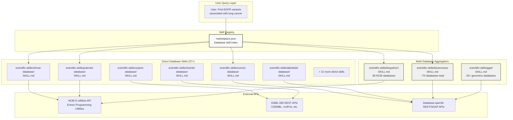
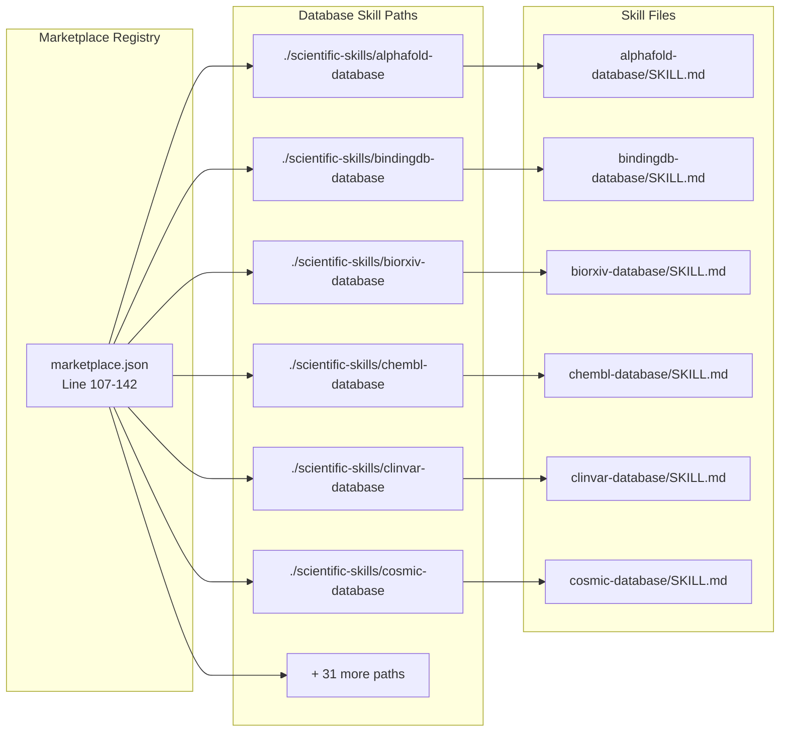
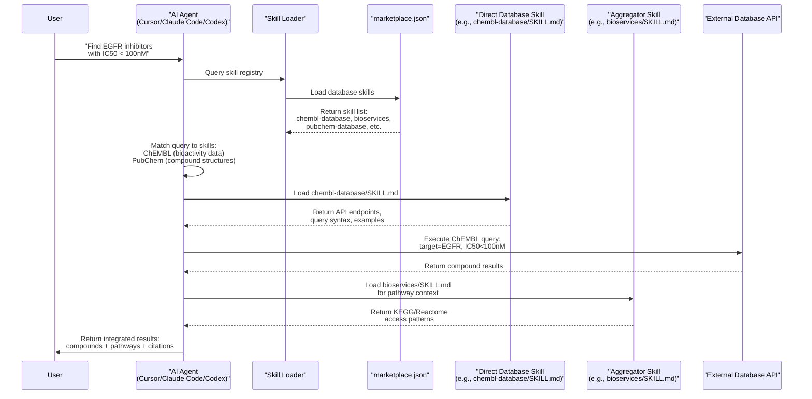
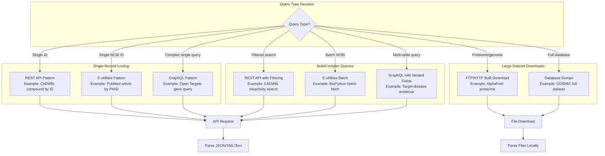
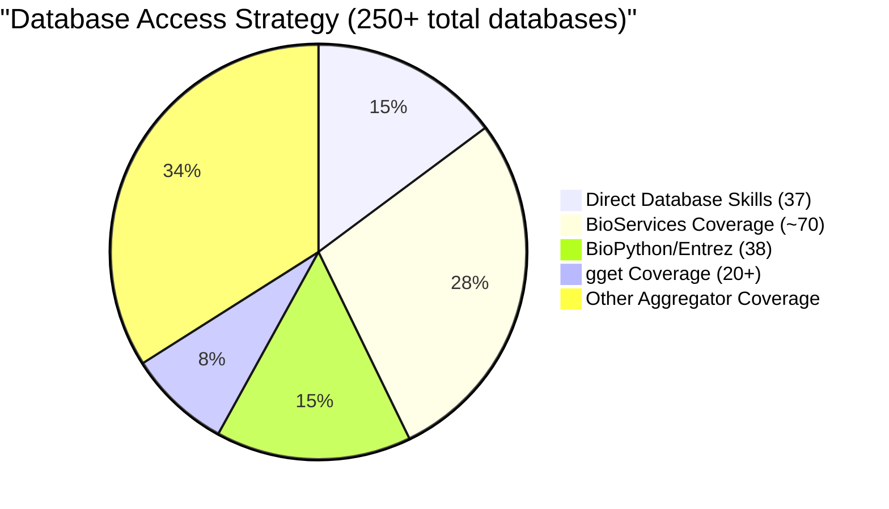

<!-- source: DeepWiki mcp.deepwiki.com · repo K-Dense-AI/claude-scientific-skills · page 5 Scientific Databases · fetched 2026-10-26 -->

# Scientific Databases

<details>
<summary>Relevant source files</summary>

The following files were used as context for generating this wiki page:

- [.claude-plugin/marketplace.json](.claude-plugin/marketplace.json)
- [README.md](README.md)
- [docs/scientific-skills.md](docs/scientific-skills.md)
- [scientific-skills/ginkgo-cloud-lab/SKILL.md](scientific-skills/ginkgo-cloud-lab/SKILL.md)
- [scientific-skills/ginkgo-cloud-lab/references/cell-free-protein-expression-optimization.md](scientific-skills/ginkgo-cloud-lab/references/cell-free-protein-expression-optimization.md)
- [scientific-skills/ginkgo-cloud-lab/references/cell-free-protein-expression-validation.md](scientific-skills/ginkgo-cloud-lab/references/cell-free-protein-expression-validation.md)
- [scientific-skills/ginkgo-cloud-lab/references/fluorescent-pixel-art-generation.md](scientific-skills/ginkgo-cloud-lab/references/fluorescent-pixel-art-generation.md)

</details>


## Purpose and Scope

This page documents the database access architecture that provides access to 250+ scientific databases and data sources through the Claude Scientific Skills system. It covers the dual-strategy approach combining 37+ dedicated database skills with multi-database aggregator packages, the skill structure and naming conventions, and the routing mechanisms that enable unified database access.

For detailed usage of individual database skills, see their respective SKILL.md files in [scientific-skills/](). For information on Python packages that access databases (like BioPython and BioServices), see [Bioinformatics and Genomics](#4.1). For research workflow tools that use these databases, see [Research Workflows and Tools](#6).

---

## Database Access Architecture Overview

The scientific database layer achieves coverage of 250+ databases through a two-tier strategy:

1. **37+ Direct Database Skills**: Dedicated skills for high-priority databases with curated documentation, examples, and best practices
2. **Multi-Database Aggregators**: Python packages that provide unified interfaces to hundreds of additional databases

This architecture balances depth (detailed skills for frequently-used databases) with breadth (comprehensive coverage through aggregators).

### Architecture Diagram



**Sources**: [README.md:54-55](), [README.md:505-518](), [.claude-plugin/marketplace.json:107-142]()

---

## Direct Database Skills

Direct database skills provide optimized, curated access to individual databases with comprehensive documentation. Each skill is located in `scientific-skills/<database-name>-database/` and includes a `SKILL.md` file with metadata, usage instructions, and examples.

### Database Skill Categories

#### Protein and Structure Databases

| Skill Name | Folder | Database Coverage | Key Features |
|------------|--------|-------------------|--------------|
| AlphaFold DB | `alphafold-database/` | 200M+ AI-predicted protein structures | pLDDT confidence, PAE matrices, REST API |
| UniProt | `uniprot-database/` | Universal protein sequences/annotations | Swiss-Prot reviewed entries, ID mapping |
| PDB | `pdb-database/` | 200K+ experimental 3D structures | X-ray, NMR, cryo-EM data |
| InterPro | `interpro-database/` | Protein families, domains (Pfam, PANTHER, SMART + 11 others) | Domain annotations, GO terms |

#### Chemical and Drug Databases

| Skill Name | Folder | Database Coverage | Key Features |
|------------|--------|-------------------|--------------|
| ChEMBL | `chembl-database/` | 2M+ compounds, 19M+ bioactivities, 13K+ targets | IC50/EC50/Ki/Kd values, SAR analysis |
| PubChem | `pubchem-database/` | 110M+ compounds, 270M+ bioactivities | PUG REST API, similarity search |
| DrugBank | `drugbank-database/` | 9,591+ drugs, 200+ data fields per entry | FDA-approved drugs, drug-drug interactions |
| ZINC | `zinc-database/` | 230M+ purchasable compounds | Ready-to-dock 3D formats, vendor pricing |
| HMDB | `hmdb-database/` | 220K+ metabolites | Concentration ranges, disease associations |
| BindingDB | `bindingdb-database/` | Drug-target binding affinities (Ki, Kd, IC50, EC50) | Affinity data for drug screening |

#### Genomic and Variant Databases

| Skill Name | Folder | Database Coverage | Key Features |
|------------|--------|-------------------|--------------|
| Ensembl | `ensembl-database/` | 250+ vertebrate species, Release 115 | VEP variant annotation, REST API |
| NCBI Gene | `gene-database/` | 500+ organisms, gene annotations | E-utilities API, cross-references |
| ClinVar | `clinvar-database/` | Clinical variant interpretations | Pathogenic/benign classifications |
| COSMIC | `cosmic-database/` | Somatic cancer mutations | Cancer Gene Census, mutational signatures |
| gnomAD | `gnomad-database/` | Population allele frequencies | pLI/LOEUF constraint metrics |
| GTEx | `gtex-database/` | Tissue-specific gene expression | eQTL data across 54 tissues |
| GWAS Catalog | `gwas-database/` | Genome-wide association studies | SNP-trait associations, p≤5×10⁻⁸ |
| JASPAR | `jaspar-database/` | Transcription factor binding sites | Position frequency matrices |

#### Clinical and Disease Databases

| Skill Name | Folder | Database Coverage | Key Features |
|------------|--------|-------------------|--------------|
| ClinicalTrials.gov | `clinicaltrials-database/` | Worldwide clinical studies | API v2, eligibility criteria, trial status |
| ClinPGx | `clinpgx-database/` | Pharmacogenomics, gene-drug interactions | CPIC guidelines, allele functions |
| FDA Databases | `fda-database/` | Drug/device adverse events, recalls, approvals | openFDA API, multiple databases |
| cBioPortal | `cbioportal-database/` | Cancer genomics (400+ studies) | Somatic mutations, CNAs, survival data |
| DepMap | `depmap-database/` | Cancer cell line dependencies | Drug sensitivity, gene essentiality |
| Monarch Initiative | `monarch-database/` | Rare disease, cross-species data | OMIM, ORPHANET, HPO integration |
| Imaging Data Commons | `imaging-data-commons/` | Cancer radiology/pathology datasets | DICOM metadata via idc-index |

#### Literature and Reference Databases

| Skill Name | Folder | Database Coverage | Key Features |
|------------|--------|-------------------|--------------|
| PubMed | `pubmed-database/` | 35M+ biomedical citations | E-utilities API, MeSH terms |
| bioRxiv | `biorxiv-database/` | Life sciences preprints | Preprint metadata, PDF downloads |
| OpenAlex | `openalex-database/` | 240M+ scholarly works | No auth, 100K req/day, DOI/ORCID lookup |

#### Pathway and Interaction Databases

| Skill Name | Folder | Database Coverage | Key Features |
|------------|--------|-------------------|--------------|
| KEGG | `kegg-database/` | 500+ pathways, 5,000+ organisms | Metabolic/signaling pathways, REST API |
| Reactome | `reactome-database/` | 2,825+ human pathways, 16K+ reactions | Content/Analysis Service APIs |
| STRING | `string-database/` | 5,000+ genomes, 20B+ interactions | Functional enrichment, network viz |
| Open Targets | `opentargets-database/` | 200M+ evidence strings, target-disease associations | GraphQL API, tractability data |

#### Specialized Databases

| Skill Name | Folder | Database Coverage | Key Features |
|------------|--------|-------------------|--------------|
| GEO | `geo-database/` | 264K+ studies, 8M+ samples | Microarray, RNA-seq, ChIP-seq data |
| ENA | `ena-database/` | Nucleotide sequences, assemblies | REST APIs, FTP/Aspera downloads |
| Metabolomics Workbench | `metabolomics-workbench-database/` | 4,200+ studies, RefMet nomenclature | MS searches, REST API |
| BRENDA | `brenda-database/` | 45,000+ enzymes, millions of kinetic data points | Km, kcat, Vmax, SOAP API |
| USPTO | `uspto-database/` | U.S. patents and trademarks | PatentSearch API, PEDS, assignments |

#### Economic and Financial Databases

| Skill Name | Folder | Database Coverage | Key Features |
|------------|--------|-------------------|--------------|
| FRED Economic Data | `fred-economic-data/` | 800,000+ economic time series | GDP, unemployment, inflation, ALFRED |
| U.S. Fiscal Data (usfiscaldata) | See Python package skills | 54 datasets, 182 tables | National debt, Treasury data |
| Hedge Fund Monitor | See Python package skills | SEC Form PF, CFTC futures | OFR aggregated hedge fund stats |
| Alpha Vantage | See Python package skills | Real-time stocks, forex, crypto | Technical indicators, market data |

**Sources**: [docs/scientific-skills.md:3-35](), [README.md:505-518](), [.claude-plugin/marketplace.json:107-142]()

---

## Multi-Database Aggregator Skills

Three Python package skills provide unified access to hundreds of additional databases through single interfaces:

### BioServices Package

**Location**: [scientific-skills/bioservices/]()

**Coverage**: ~70 databases total
- ~40 bioinformatics web services (KEGG, ChEBI, ChEMBL, Reactome, IntAct, BioModels, etc.)
- ~30 PSICQUIC protein interaction databases

**Key Features**:
- Unified Python API across heterogeneous services
- Automatic result caching
- REST and SOAP protocol support
- Conversion to Python objects and BioPython formats

### BioPython Package

**Location**: [scientific-skills/biopython/]()

**Coverage**: 38 NCBI sub-databases via Entrez E-utilities
- PubMed, GenBank, Gene, Protein, Nucleotide, Structure, Taxonomy, dbSNP, ClinVar, GTR, MedGen, OMIM, and 26 more

**Key Features**:
- `Bio.Entrez` module for E-utilities access
- Sequence parsing (FASTA, GenBank, EMBL, Swiss-Prot, PDB)
- BLAST integration
- File format conversions

### gget Package

**Location**: [scientific-skills/gget/]()

**Coverage**: 20+ genomics databases
- Ensembl, UniProt, NCBI, PDB, COSMIC, and others

**Key Features**:
- Simple command-line and Python API
- Fast queries without complex API setup
- Integration with pandas DataFrames
- Single-command database access

### Aggregator Coverage Diagram

```mermaid
graph TB
    subgraph "BioServices (~70 databases)"
        BS_Core["Core Services (40+)"]
        BS_PSICQUIC["PSICQUIC Databases (30+)"]
        
        BS_Core --> KEGG_BS["KEGG"]
        BS_Core --> ChEBI_BS["ChEBI"]
        BS_Core --> ChEMBL_BS["ChEMBL"]
        BS_Core --> Reactome_BS["Reactome"]
        BS_Core --> IntAct_BS["IntAct"]
        BS_Core --> BioModels_BS["BioModels"]
        BS_Core --> Others_BS["+ 34 more services"]
        
        BS_PSICQUIC --> MINT["MINT"]
        BS_PSICQUIC --> BioGRID["BioGRID"]
        BS_PSICQUIC --> InnateDB["InnateDB"]
        BS_PSICQUIC --> Others_PSIC["+ 27 more"]
    end
    
    subgraph "BioPython/Entrez (38 NCBI databases)"
        BP_Lit["Literature: PubMed, PMC"]
        BP_Seq["Sequences: GenBank, Nucleotide, Protein"]
        BP_Gene["Genes: Gene, HomoloGene"]
        BP_Struct["Structures: Structure, Conserved Domains"]
        BP_Var["Variants: dbSNP, ClinVar, GTR"]
        BP_Tax["Taxonomy: Taxonomy"]
        BP_Other["+ 29 more NCBI databases"]
    end
    
    subgraph "gget (20+ databases)"
        gget_Ens["Ensembl"]
        gget_UP["UniProt"]
        gget_NCBI["NCBI"]
        gget_PDB["PDB"]
        gget_COSMIC["COSMIC"]
        gget_BLAST["BLAST"]
        gget_Enrichr["Enrichr"]
        gget_Others["+ 13 more"]
    end
    
    subgraph "Total Coverage"
        Total["250+ Databases:<br/>37 direct + ~70 BioServices<br/>+ 38 BioPython + 20+ gget<br/>= 250+ total"]
    end
    
    BS_Core --> Total
    BS_PSICQUIC --> Total
    BP_Lit --> Total
    BP_Seq --> Total
    BP_Gene --> Total
    BP_Struct --> Total
    BP_Var --> Total
    BP_Tax --> Total
    BP_Other --> Total
    gget_Ens --> Total
    gget_UP --> Total
    gget_NCBI --> Total
    gget_PDB --> Total
    gget_COSMIC --> Total
    gget_BLAST --> Total
    gget_Enrichr --> Total
    gget_Others --> Total
    
    style Total fill:#f9f9f9,stroke:#333,stroke-width:3px
```



**Sources**: [README.md:54-55](), [README.md:98-99](), [docs/scientific-skills.md:66-69]()

---

## Database Skill Structure

All database skills follow a standardized directory structure and naming convention:

### Naming Convention

Database skills use the pattern: `<database-name>-database/`

Examples:
- `scientific-skills/pubmed-database/`
- `scientific-skills/chembl-database/`
- `scientific-skills/clinvar-database/`

### Directory Structure

```
scientific-skills/<database-name>-database/
├── SKILL.md              # Main skill file with frontmatter metadata
├── references/           # Detailed documentation
│   ├── api-reference.md
│   ├── advanced-queries.md
│   └── troubleshooting.md
├── examples/             # Code examples
│   ├── basic-queries.py
│   ├── bulk-download.py
│   └── integration-workflow.py
└── assets/               # Supporting files
    ├── logo.png
    └── schema-diagram.png
```

### SKILL.md Frontmatter

Each database skill's `SKILL.md` file includes standardized frontmatter:

```markdown
---
name: <database-name>-database
description: <one-line description of database and use cases>
version: <skill version>
author: K-Dense Inc.
license: <license type>
compatibility:
  - cursor
  - claude-code
  - codex
---
```

### File Path Mapping



**Sources**: [.claude-plugin/marketplace.json:107-142](), [README.md:123-161]()

---

## Database Query Routing

When a user submits a query requiring database access, the skill system routes to appropriate database skills based on query content and available skills:

### Query Routing Flow



**Sources**: [README.md:113-162](), [.claude-plugin/marketplace.json:1-194]()

---

## Database Access Patterns

Different database types require different access patterns:

### REST API Pattern (Most Common)

Used by: ChEMBL, UniProt, Ensembl, NCBI Gene, OpenAlex, Open Targets

**Characteristics**:
- HTTP GET/POST requests
- JSON or XML responses
- Rate limiting (varies by database)
- Authentication optional or required

**Example**: [scientific-skills/chembl-database/]()

### E-utilities Pattern (NCBI Databases)

Used by: PubMed, ClinVar, Gene, dbSNP (via BioPython)

**Characteristics**:
- Entrez Programming Utilities
- Three-step process: search → fetch → parse
- Unified interface across 38+ NCBI databases
- Rate limit: 3 req/sec (10 req/sec with API key)

**Example**: [scientific-skills/biopython/]() (Bio.Entrez module)

### GraphQL Pattern

Used by: Open Targets

**Characteristics**:
- Single endpoint for all queries
- Flexible schema-based queries
- Reduced over-fetching
- Nested data retrieval

**Example**: [scientific-skills/opentargets-database/]()

### FTP/Bulk Download Pattern

Used by: AlphaFold DB, PDB, COSMIC, GEO

**Characteristics**:
- Large dataset downloads
- File-based access (FTP, rsync, HTTP)
- Periodic updates
- Local processing required

**Example**: [scientific-skills/alphafold-database/]()

### Access Pattern Comparison



**Sources**: [docs/scientific-skills.md:3-35]()

---

## Database Coverage Summary

### By Scientific Domain

| Domain | Direct Skills | Aggregator Coverage | Total Databases |
|--------|---------------|---------------------|-----------------|
| Proteins & Structures | 4 | BioPython (Structure, Protein, CDD) | ~10 |
| Chemical & Drug | 6 | BioServices (ChEBI, ChEMBL, PubChem) | ~15 |
| Genomics & Variants | 8 | BioPython (38 NCBI), gget (20+) | ~70 |
| Clinical & Disease | 7 | - | 7 |
| Literature | 3 | BioPython (PubMed, PMC) | ~5 |
| Pathways & Interactions | 4 | BioServices (30+ PSICQUIC) | ~35 |
| Metabolomics | 2 | - | 2 |
| Economic & Financial | 4 | - | 4 |
| Specialized | 9 | BioServices (~40 services) | ~100+ |

### Database Skill Distribution



**Sources**: [README.md:52-59](), [README.md:505-518]()

---

## Common Database Operations

### Authentication Patterns

Many databases require authentication. Skills document authentication in their respective `SKILL.md` files:

**No Authentication Required**:
- PubMed, OpenAlex, bioRxiv, GEO, ENA

**Optional API Key (Increases Rate Limits)**:
- NCBI databases (E-utilities), Ensembl

**Required API Key**:
- ChEMBL (for write operations), Alpha Vantage, FDA openFDA (higher limits)

**OAuth/Token Required**:
- ClinicalTrials.gov (for certain endpoints)

### Rate Limiting Strategies

Database skills document rate limits and mitigation strategies:

| Database | Rate Limit | Mitigation Strategy |
|----------|------------|---------------------|
| NCBI E-utilities | 3 req/sec (10 with key) | API key, request batching |
| Ensembl REST | 15 req/sec | Automatic throttling in examples |
| ChEMBL | No documented limit | Pagination for large queries |
| OpenAlex | 100K req/day, 10 req/sec | Include email in user-agent |
| ENA | 50 req/sec | Burst protection in client |

### Error Handling

All database skills follow consistent error handling patterns documented in their `SKILL.md` files:

1. **Network Errors**: Retry logic with exponential backoff
2. **Rate Limit Errors**: Automatic throttling and retry
3. **Invalid Queries**: Clear error messages with correction suggestions
4. **Missing Data**: Graceful handling with null/empty responses
5. **API Changes**: Version checking and migration guides

**Sources**: [docs/scientific-skills.md:3-35]()

---

## Database Skill Registry

The complete list of database skills is registered in [.claude-plugin/marketplace.json:107-142](). The registry structure:

```json
{
  "plugins": [
    {
      "name": "scientific-skills",
      "skills": [
        "./scientific-skills/alphafold-database",
        "./scientific-skills/bindingdb-database",
        "./scientific-skills/biorxiv-database",
        "./scientific-skills/brenda-database",
        "./scientific-skills/cbioportal-database",
        "./scientific-skills/chembl-database",
        "./scientific-skills/clinicaltrials-database",
        "./scientific-skills/clinpgx-database",
        "./scientific-skills/clinvar-database",
        "./scientific-skills/cosmic-database",
        "./scientific-skills/drugbank-database",
        "./scientific-skills/ena-database",
        "./scientific-skills/ensembl-database",
        "./scientific-skills/fda-database",
        "./scientific-skills/fred-economic-data",
        "./scientific-skills/gene-database",
        "./scientific-skills/geo-database",
        "./scientific-skills/gnomad-database",
        "./scientific-skills/gtex-database",
        "./scientific-skills/gwas-database",
        "./scientific-skills/hmdb-database",
        "./scientific-skills/interpro-database",
        "./scientific-skills/jaspar-database",
        "./scientific-skills/kegg-database",
        "./scientific-skills/metabolomics-workbench-database",
        "./scientific-skills/monarch-database",
        "./scientific-skills/openalex-database",
        "./scientific-skills/opentargets-database",
        "./scientific-skills/pdb-database",
        "./scientific-skills/pubchem-database",
        "./scientific-skills/pubmed-database",
        "./scientific-skills/reactome-database",
        "./scientific-skills/string-database",
        "./scientific-skills/uniprot-database",
        "./scientific-skills/uspto-database",
        "./scientific-skills/zinc-database"
      ]
    }
  ]
}
```

### Skill Discovery Process

When an AI agent starts, it:

1. Reads `marketplace.json` to discover available skills
2. Scans each skill path for `SKILL.md` files
3. Parses frontmatter metadata (name, description, version)
4. Registers skill capabilities with the agent
5. Loads full documentation when skill is invoked

**Sources**: [.claude-plugin/marketplace.json:107-142](), [README.md:113-162]()

---

## Integration with Other Skills

Database skills are frequently composed with other skill types in multi-step workflows:

### Common Workflow Patterns

**Literature → Database → Analysis**:
1. PubMed skill: Find relevant papers
2. Database skill (ClinVar, COSMIC): Extract variant/mutation data
3. Analysis skill (BioPython, Scanpy): Process and visualize

**Database → Computation → Visualization**:
1. Database skill (ChEMBL, PubChem): Retrieve compound structures
2. Cheminformatics skill (RDKit, DeepChem): Calculate properties
3. Visualization skill (Matplotlib, Plotly): Generate figures

**Multi-Database Integration**:
1. Gene database (NCBI Gene): Get gene information
2. Protein database (UniProt): Get protein sequences
3. Structure database (AlphaFold DB): Get 3D structures
4. Pathway database (KEGG, Reactome): Get biological context

For detailed workflow examples, see [Multi-Domain Workflows](#8).

**Sources**: [README.md:216-320]()

---

## Summary

The scientific database layer provides:

- **37+ direct database skills** with curated documentation in `scientific-skills/<name>-database/`
- **250+ total databases** through aggregators (BioServices ~70, BioPython 38, gget 20+)
- **Standardized skill structure** following Agent Skills specification
- **Unified access patterns** (REST, E-utilities, GraphQL, FTP)
- **Complete registry** in [.claude-plugin/marketplace.json]()
- **Cross-domain integration** with analysis and visualization skills

All database skills are automatically discovered by Agent Skills-compatible tools (Cursor, Claude Code, Codex) when installed in standard skill directories.

**Sources**: [README.md:50-59](), [README.md:505-518](), [.claude-plugin/marketplace.json:107-142](), [docs/scientific-skills.md:3-35]()

---

