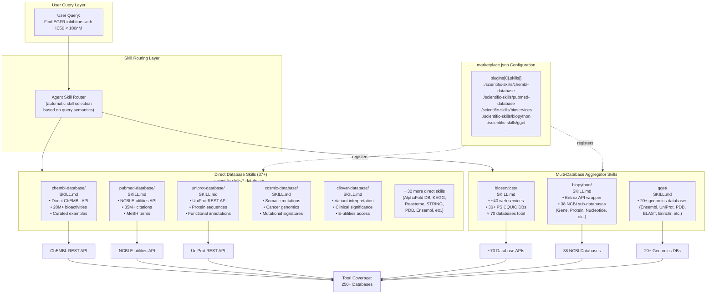
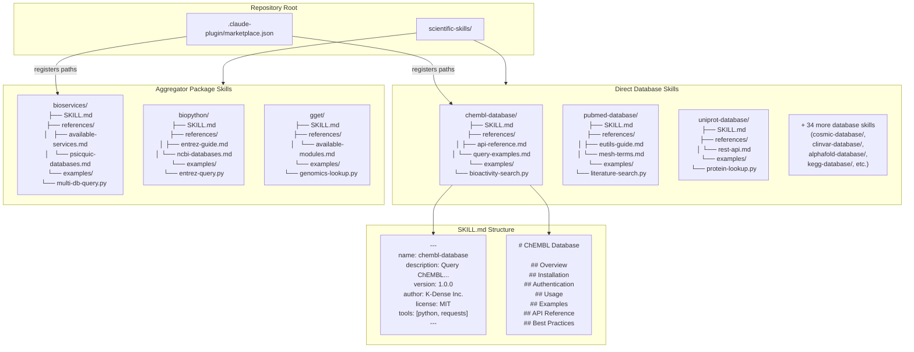
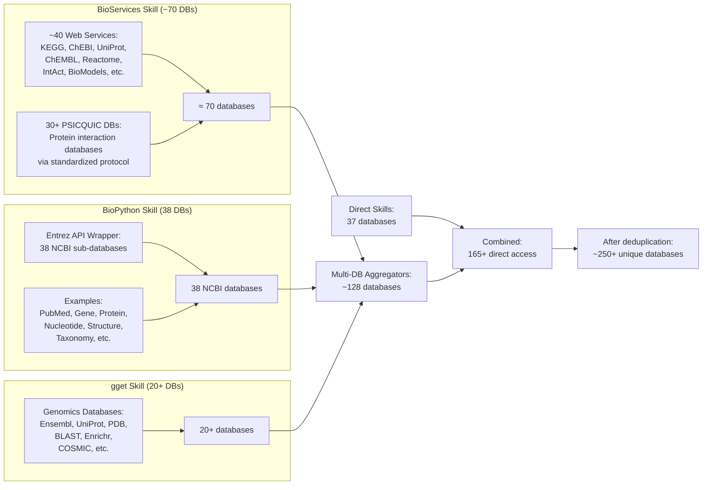
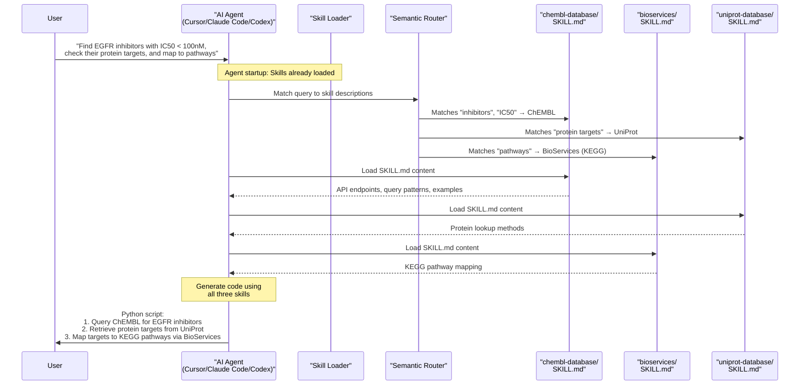
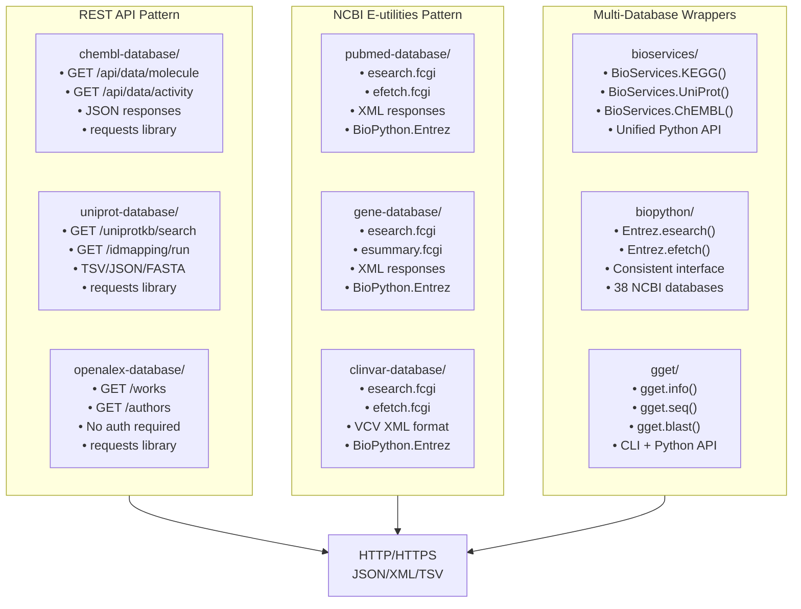
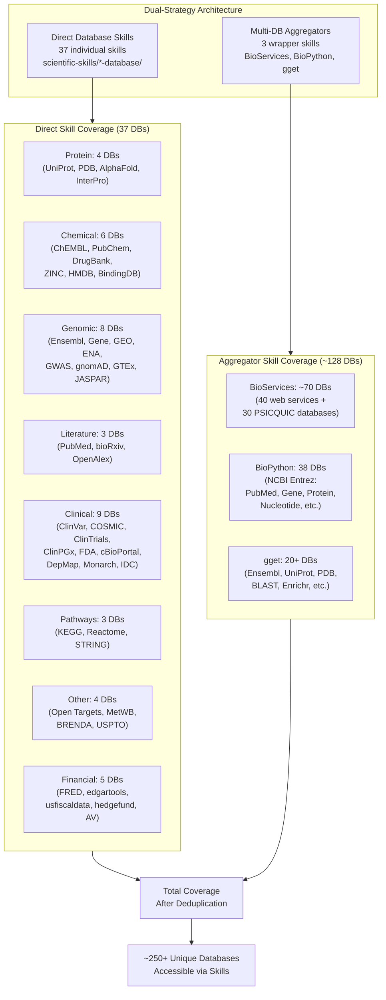

<!-- source: DeepWiki mcp.deepwiki.com · repo K-Dense-AI/claude-scientific-skills · page 5.1 Database Access Architecture · fetched 2026-10-26 -->

# Database Access Architecture

<details>
<summary>Relevant source files</summary>

The following files were used as context for generating this wiki page:

- [.claude-plugin/marketplace.json](.claude-plugin/marketplace.json)
- [README.md](README.md)
- [docs/scientific-skills.md](docs/scientific-skills.md)
- [scientific-skills/ginkgo-cloud-lab/SKILL.md](scientific-skills/ginkgo-cloud-lab/SKILL.md)
- [scientific-skills/ginkgo-cloud-lab/references/cell-free-protein-expression-optimization.md](scientific-skills/ginkgo-cloud-lab/references/cell-free-protein-expression-optimization.md)
- [scientific-skills/ginkgo-cloud-lab/references/cell-free-protein-expression-validation.md](scientific-skills/ginkgo-cloud-lab/references/cell-free-protein-expression-validation.md)
- [scientific-skills/ginkgo-cloud-lab/references/fluorescent-pixel-art-generation.md](scientific-skills/ginkgo-cloud-lab/references/fluorescent-pixel-art-generation.md)

</details>


## Purpose and Scope

This document describes the architecture of the database access layer in Claude Scientific Skills, which provides unified access to 250+ scientific and financial databases through a dual-strategy approach. It covers the structure of database skills, the distinction between direct database skills and multi-database aggregator skills, skill metadata and discovery, and how queries are routed to appropriate data sources.

For detailed information about specific databases by domain, see:
- [Biomedical Literature and Reference Management](#5.2)
- [Protein and Genomics Databases](#5.3)
- [Chemical and Drug Databases](#5.4)
- [Clinical and Healthcare Databases](#5.5)

For information on skill discovery and loading mechanisms, see [Skill Discovery and Loading Mechanism](#3.2).

---

## Architecture Overview

The database access layer achieves 250+ database coverage through a **dual-strategy architecture**:

1. **37+ Direct Database Skills**: Dedicated skills for high-priority databases (ChEMBL, PubMed, UniProt, COSMIC, ClinVar, etc.) with curated documentation, examples, and best practices
2. **Multi-Database Aggregator Skills**: Skills that provide unified interfaces to hundreds of databases through packages like BioServices (~70 databases), BioPython (38 NCBI databases via Entrez), and gget (20+ genomics databases)

This architecture balances **depth** (detailed, optimized skills for critical databases) with **breadth** (comprehensive coverage through aggregators).

**Sources**: [README.md:50-115](), [docs/scientific-skills.md:1-36]()

---

## Dual-Strategy Architecture



**Dual-Strategy Architecture**: The system combines 37+ dedicated database skills (left) with multi-database aggregator skills (right) to achieve 250+ database coverage. Direct skills provide optimized access with curated examples for high-priority databases. Aggregator skills multiply coverage by wrapping multi-database packages.

**Sources**: [README.md:50-115](), [docs/scientific-skills.md:1-36](), [.claude-plugin/marketplace.json:107-142]()

---

## Directory Structure and File Organization



**Directory Structure**: Each database skill (direct or aggregator) resides in its own directory under `scientific-skills/` with a required `SKILL.md` file containing frontmatter metadata and documentation, optional `references/` for detailed guides, and optional `examples/` for working code.

**Sources**: [.claude-plugin/marketplace.json:107-142](), [README.md:115-162]()

---

## Direct Database Skills

Direct database skills provide optimized, well-documented access to individual high-priority databases. Each skill includes:

- **API wrapper or access patterns** for the specific database
- **Curated examples** demonstrating common queries
- **Best practices** for rate limiting, authentication, and error handling
- **Domain-specific documentation** (e.g., ChEMBL bioactivity searches, PubMed MeSH terms)

### Current Direct Database Skills (37+)

| Domain | Skills | Example Path |
|--------|--------|--------------|
| **Protein** | UniProt, PDB, AlphaFold DB, InterPro | `scientific-skills/uniprot-database/` |
| **Chemical** | ChEMBL, PubChem, DrugBank, ZINC, HMDB, BindingDB | `scientific-skills/chembl-database/` |
| **Genomic** | Ensembl, NCBI Gene, GEO, ENA, GWAS Catalog, gnomAD, GTEx, JASPAR | `scientific-skills/ensembl-database/` |
| **Literature** | PubMed, bioRxiv, OpenAlex | `scientific-skills/pubmed-database/` |
| **Clinical** | ClinVar, COSMIC, ClinicalTrials.gov, ClinPGx, FDA Databases, cBioPortal, DepMap, Monarch Initiative, NCI Imaging Data Commons | `scientific-skills/clinvar-database/` |
| **Pathways** | KEGG, Reactome, STRING | `scientific-skills/kegg-database/` |
| **Other** | Open Targets, Metabolomics Workbench, BRENDA, USPTO | `scientific-skills/opentargets-database/` |
| **Financial** | FRED, edgartools, usfiscaldata, hedgefundmonitor, alpha-vantage | `scientific-skills/fred-economic-data/` |

**Sources**: [docs/scientific-skills.md:3-36](), [.claude-plugin/marketplace.json:107-142]()

### Skill File Structure

Each direct database skill follows this structure:

```
scientific-skills/[database-name]-database/
├── SKILL.md                    # Required: Frontmatter + documentation
├── references/                 # Optional: Detailed guides
│   ├── api-reference.md
│   ├── query-examples.md
│   └── authentication.md
├── examples/                   # Optional: Working code
│   ├── basic-query.py
│   ├── advanced-search.py
│   └── batch-download.py
└── assets/                     # Optional: Images, diagrams
    └── workflow-diagram.png
```

**Sources**: [README.md:60-66]()

---

## Multi-Database Aggregator Skills

Multi-database aggregator skills provide unified interfaces to dozens or hundreds of databases through wrapper packages. These skills multiply database coverage without requiring individual skills for every database.

### Coverage Breakdown



**Coverage Breakdown**: Multi-database aggregator skills provide access to ~128 additional databases beyond the 37 direct skills. Some overlap exists (e.g., both BioServices and a direct skill may access UniProt), but the combined coverage exceeds 250 unique databases.

**Sources**: [README.md:54-55](), [docs/scientific-skills.md:67-73]()

### BioServices Skill

- **Path**: `scientific-skills/bioservices/SKILL.md`
- **Coverage**: ~40 bioinformatics web services + 30+ PSICQUIC protein interaction databases ≈ 70 databases
- **Access Pattern**: Unified Python API across heterogeneous web services (REST, SOAP)
- **Key Services**: KEGG, ChEBI, UniProt, ChEMBL, Reactome, IntAct, BioModels, and more

**Sources**: [docs/scientific-skills.md:67-68]()

### BioPython Skill

- **Path**: `scientific-skills/biopython/SKILL.md`
- **Coverage**: 38 NCBI sub-databases via Entrez Programming Utilities (E-utilities)
- **Access Pattern**: Entrez API wrapper with consistent interface across NCBI databases
- **Key Databases**: PubMed, Gene, Protein, Nucleotide, Structure, Taxonomy, dbSNP, ClinVar, etc.

**Sources**: [docs/scientific-skills.md:66-67]()

### gget Skill

- **Path**: `scientific-skills/gget/SKILL.md`
- **Coverage**: 20+ genomics databases
- **Access Pattern**: Command-line tool and Python package with simple, unified query interface
- **Key Databases**: Ensembl, UniProt, PDB, BLAST, Enrichr, COSMIC, and others

**Sources**: [docs/scientific-skills.md:69-70]()

---

## Skill Metadata and SKILL.md Structure

Every database skill includes a `SKILL.md` file with YAML frontmatter and markdown documentation.

### Frontmatter Schema

```yaml
---
name: chembl-database
description: Comprehensive manually curated database of bioactive molecules with drug-like properties maintained by EMBL-EBI. Contains 2M+ unique compounds, 19M+ bioactivity measurements, 13K+ protein targets, and 1.1M+ assays from 90K+ publications.
version: 1.0.0
author: K-Dense Inc.
license: MIT
tools:
  - python
  - requests
dependencies:
  - requests>=2.31.0
  - pandas>=2.0.0
---
```

**Key Fields**:
- `name`: Skill identifier (must match directory name)
- `description`: Brief summary of the database and capabilities
- `version`: Semantic version for tracking updates
- `tools`: Required tools/languages (typically `python`)
- `dependencies`: Python packages required for API access

**Sources**: [README.md:60-66]()

### Documentation Sections

Standard sections in `SKILL.md`:

```markdown
# [Database Name]

## Overview
Brief description, data coverage, key features

## Installation
Python package installation instructions

## Authentication
API key setup, environment variables, rate limits

## Usage
Basic query patterns, common operations

## Examples
Working code snippets demonstrating typical queries

## API Reference
Endpoint documentation, parameters, response formats

## Best Practices
Rate limiting, error handling, caching strategies

## References
Links to official documentation, tutorials
```

**Sources**: [README.md:60-66]()

---

## Query Routing and Skill Selection

The agent automatically selects appropriate database skills based on query semantics and skill descriptions. For complex queries, the agent may compose multiple skills.



**Query Routing**: The agent matches user queries to skill descriptions and loads relevant SKILL.md documentation. Multiple skills can be composed in a single workflow. Skill selection is based on semantic similarity between the query and skill descriptions in frontmatter.

**Sources**: [README.md:115-162]()

### Skill Selection Criteria

The agent selects skills based on:

1. **Semantic matching**: Query keywords match skill `description` field
2. **Domain specificity**: Direct database skills preferred for specific databases
3. **Coverage**: Aggregator skills used when database not covered by direct skill
4. **Composition**: Multiple skills used for complex, multi-step queries

**Example Mappings**:

| Query Keywords | Selected Skills |
|----------------|-----------------|
| "ChEMBL bioactivity", "IC50 values" | `chembl-database/` |
| "protein sequence", "UniProt" | `uniprot-database/` |
| "pathway enrichment", "KEGG" | `bioservices/` or `kegg-database/` |
| "gene information", "NCBI" | `biopython/` (Entrez) or `gene-database/` |
| "variant pathogenicity", "ClinVar" | `clinvar-database/` |

**Sources**: [docs/scientific-skills.md:1-36]()

---

## API Access Patterns

Database skills implement various API access patterns depending on the underlying database.

### Common API Types



**API Access Patterns**: Database skills implement three primary patterns: direct REST APIs for individual databases, NCBI E-utilities for NCBI databases, and multi-database wrappers for unified access to multiple sources.

**Sources**: [docs/scientific-skills.md:1-36]()

### Authentication Methods

| Database | Authentication Method | Configuration |
|----------|----------------------|---------------|
| ChEMBL | None (public API) | No auth required |
| PubMed | Optional (E-utilities API key) | `NCBI_API_KEY` environment variable |
| UniProt | None (public API) | No auth required |
| COSMIC | Account + Token | Account registration, download token |
| FDA Databases | None (openFDA) | No auth required |
| FRED | API key required | `FRED_API_KEY` environment variable |
| edgartools | Optional (user-agent) | `User-Agent` header recommended |

**Sources**: [docs/scientific-skills.md:3-36]()

### Rate Limiting

All database skills document rate limits and implement appropriate throttling:

- **ChEMBL**: No strict limit, recommended 1 req/sec
- **NCBI E-utilities**: 3 req/sec without API key, 10 req/sec with key
- **UniProt**: No strict limit, recommended 1 req/sec
- **OpenAlex**: 100k requests/day, 10 req/sec (with email in requests)
- **Ensembl**: 15 req/sec
- **ENA**: 50 req/sec

**Best Practices** (documented in each skill):
- Implement exponential backoff for 429 (Too Many Requests) responses
- Cache results to minimize repeated queries
- Use batch endpoints when available
- Include appropriate `User-Agent` headers

**Sources**: [docs/scientific-skills.md:3-36]()

---

## Registration in marketplace.json

All database skills are registered in `.claude-plugin/marketplace.json`:

```json
{
  "plugins": [
    {
      "name": "scientific-skills",
      "skills": [
        "./scientific-skills/alphafold-database",
        "./scientific-skills/bindingdb-database",
        "./scientific-skills/biorxiv-database",
        "./scientific-skills/brenda-database",
        "./scientific-skills/cbioportal-database",
        "./scientific-skills/chembl-database",
        "./scientific-skills/clinicaltrials-database",
        "./scientific-skills/clinpgx-database",
        "./scientific-skills/clinvar-database",
        "./scientific-skills/cosmic-database",
        "./scientific-skills/drugbank-database",
        "./scientific-skills/ena-database",
        "./scientific-skills/ensembl-database",
        "./scientific-skills/fda-database",
        "./scientific-skills/fred-economic-data",
        "./scientific-skills/gene-database",
        "./scientific-skills/geo-database",
        "./scientific-skills/gnomad-database",
        "./scientific-skills/gtex-database",
        "./scientific-skills/gwas-database",
        "./scientific-skills/hmdb-database",
        "./scientific-skills/interpro-database",
        "./scientific-skills/jaspar-database",
        "./scientific-skills/kegg-database",
        "./scientific-skills/metabolomics-workbench-database",
        "./scientific-skills/monarch-database",
        "./scientific-skills/openalex-database",
        "./scientific-skills/opentargets-database",
        "./scientific-skills/pdb-database",
        "./scientific-skills/pubchem-database",
        "./scientific-skills/pubmed-database",
        "./scientific-skills/reactome-database",
        "./scientific-skills/string-database",
        "./scientific-skills/uniprot-database",
        "./scientific-skills/uspto-database",
        "./scientific-skills/zinc-database",
        "./scientific-skills/bioservices",
        "./scientific-skills/biopython",
        "./scientific-skills/gget"
      ]
    }
  ]
}
```

The skill loader reads this file at agent startup and scans each listed path for `SKILL.md` files. See [Skill Discovery and Loading Mechanism](#3.2) for details.

**Sources**: [.claude-plugin/marketplace.json:107-142]()

---

## Database Coverage Summary



**Database Coverage Summary**: The system provides access to approximately 250 unique databases through 37 direct skills and 3 multi-database aggregator skills. Some databases are accessible through both direct skills and aggregators (e.g., UniProt, Ensembl), providing redundant access paths and fallback options.

**Sources**: [README.md:50-115](), [docs/scientific-skills.md:3-36]()

### Domain Distribution

| Domain | Direct Skills | Aggregator Coverage | Total |
|--------|---------------|---------------------|-------|
| Protein | 4 | ~20 (BioServices, gget) | ~24 |
| Chemical | 6 | ~15 (BioServices) | ~21 |
| Genomic | 8 | ~40 (BioPython, gget) | ~48 |
| Literature | 3 | 1 (BioPython PubMed) | ~4 |
| Clinical | 9 | ~10 (BioPython, BioServices) | ~19 |
| Pathways | 3 | ~20 (BioServices) | ~23 |
| Financial | 5 | 0 | 5 |
| Other | 4 | ~22 (BioServices) | ~26 |
| **Total** | **37** | **~128** | **~250** |

**Note**: Totals account for overlap (e.g., UniProt accessible via both `uniprot-database/` and `bioservices/`).

**Sources**: [README.md:50-115](), [docs/scientific-skills.md:1-36]()

---

## Summary

The Database Access Architecture achieves comprehensive coverage of 250+ scientific and financial databases through:

1. **37+ Direct Database Skills** ([scientific-skills/*-database/]()) providing optimized, well-documented access to high-priority databases
2. **3 Multi-Database Aggregator Skills** ([bioservices/](), [biopython/](), [gget/]()) multiplying coverage through wrapper packages
3. **Unified Skill Structure** with SKILL.md frontmatter, documentation, examples, and references
4. **Automatic Skill Discovery** via [marketplace.json](.claude-plugin/marketplace.json:107-142)
5. **Semantic Query Routing** by the AI agent based on skill descriptions and query keywords
6. **Consistent API Access Patterns** with authentication, rate limiting, and error handling best practices

This architecture balances depth (detailed direct skills for critical databases) with breadth (comprehensive coverage via aggregators), enabling complex multi-database workflows while maintaining maintainability and user-friendly documentation.

**Sources**: [README.md:50-115](), [docs/scientific-skills.md:1-36](), [.claude-plugin/marketplace.json:107-142]()

---

