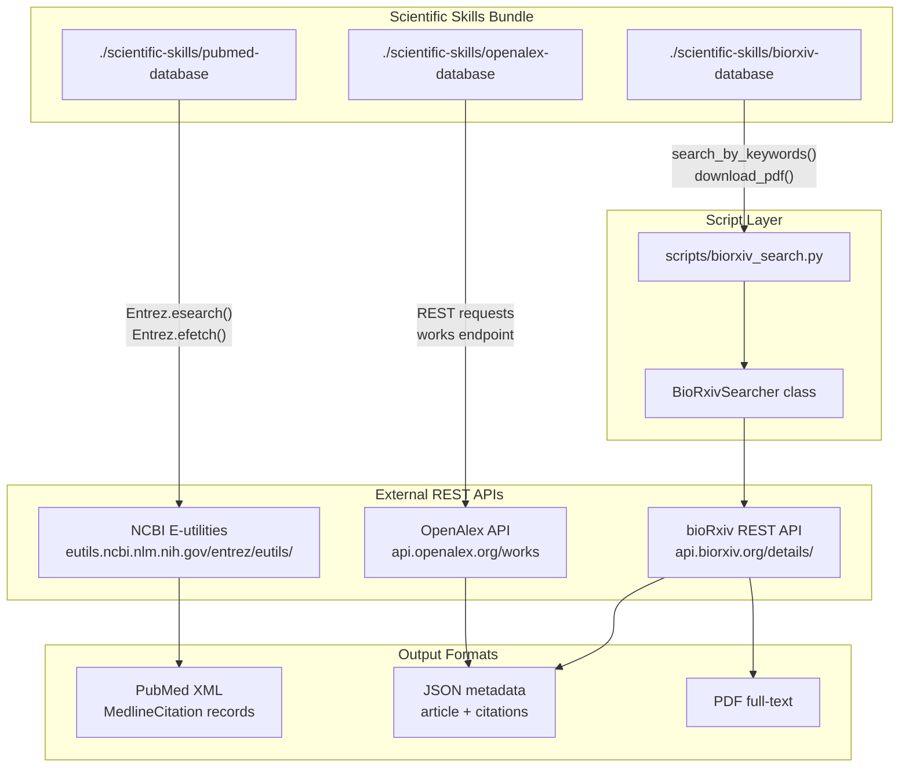
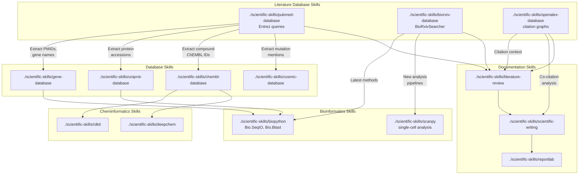

<!-- source: DeepWiki mcp.deepwiki.com · repo K-Dense-AI/claude-scientific-skills · page 5.2 Biomedical Literature and Reference Management · fetched 2026-10-26 -->

# Biomedical Literature Databases

<details>
<summary>Relevant source files</summary>

The following files were used as context for generating this wiki page:

- [.claude-plugin/marketplace.json](.claude-plugin/marketplace.json)
- [README.md](README.md)
- [docs/scientific-skills.md](docs/scientific-skills.md)
- [scientific-skills/ginkgo-cloud-lab/SKILL.md](scientific-skills/ginkgo-cloud-lab/SKILL.md)
- [scientific-skills/ginkgo-cloud-lab/references/cell-free-protein-expression-optimization.md](scientific-skills/ginkgo-cloud-lab/references/cell-free-protein-expression-optimization.md)
- [scientific-skills/ginkgo-cloud-lab/references/cell-free-protein-expression-validation.md](scientific-skills/ginkgo-cloud-lab/references/cell-free-protein-expression-validation.md)
- [scientific-skills/ginkgo-cloud-lab/references/fluorescent-pixel-art-generation.md](scientific-skills/ginkgo-cloud-lab/references/fluorescent-pixel-art-generation.md)
- [scientific-skills/pyzotero/SKILL.md](scientific-skills/pyzotero/SKILL.md)
- [scientific-skills/pyzotero/references/authentication.md](scientific-skills/pyzotero/references/authentication.md)
- [scientific-skills/pyzotero/references/cli.md](scientific-skills/pyzotero/references/cli.md)
- [scientific-skills/pyzotero/references/collections.md](scientific-skills/pyzotero/references/collections.md)
- [scientific-skills/pyzotero/references/error-handling.md](scientific-skills/pyzotero/references/error-handling.md)
- [scientific-skills/pyzotero/references/exports.md](scientific-skills/pyzotero/references/exports.md)
- [scientific-skills/pyzotero/references/files-attachments.md](scientific-skills/pyzotero/references/files-attachments.md)
- [scientific-skills/pyzotero/references/full-text.md](scientific-skills/pyzotero/references/full-text.md)

</details>


This page covers the three scientific literature database skills that provide programmatic access to peer-reviewed publications, preprints, and scholarly metadata. These skills enable literature searches, metadata extraction, citation analysis, and full-text retrieval for scientific research workflows.

**Skills Covered:**
- **pubmed-database**: Access to PubMed/NCBI E-utilities for biomedical literature
- **biorxiv-database**: Preprint server access for cutting-edge research
- **openalex-database**: Comprehensive scholarly metadata and citation graphs

For protein and genomics databases, see page 8.2. For chemical and drug databases, see page 8.5. For clinical databases, see page 8.6.

**Sources:** [.claude-plugin/marketplace.json:115](), [README.md:38](), [README.md:419]()

## Database Coverage

The repository provides three dedicated literature database skills:

| Database | Skill Directory | Coverage | Primary Use Case |
|----------|----------------|----------|------------------|
| **PubMed/NCBI** | `scientific-skills/pubmed-database` | 36M+ peer-reviewed biomedical publications | Searching published literature, extracting metadata, downloading abstracts, citation analysis |
| **bioRxiv** | `scientific-skills/biorxiv-database` | 200K+ preprints in life sciences | Tracking recent preprints, analyzing trends, early research discovery |
| **OpenAlex** | `scientific-skills/openalex-database` | 250M+ scholarly works, authors, institutions | Comprehensive citation graphs, open access metadata, bibliometric analysis |

**Key Capabilities:**
- **E-utilities Access**: PubMed skill provides REST API access to all NCBI literature databases
- **Preprint Tracking**: bioRxiv skill includes search scripts and PDF download capabilities
- **Citation Networks**: OpenAlex skill enables large-scale bibliometric analysis and network studies
- **Integration Ready**: All three skills provide structured JSON/XML output for pipeline integration

**Sources:** [.claude-plugin/marketplace.json:115](), [.claude-plugin/marketplace.json:94](), [.claude-plugin/marketplace.json:111](), [README.md:38](), [README.md:419]()

## Architecture Overview

**Diagram: Literature Database Skills Architecture**



**Key Components:**
- **pubmed-database**: Wraps NCBI E-utilities with `Entrez` module from BioPython for PubMed queries
- **biorxiv-database**: Provides `BioRxivSearcher` class in `scripts/biorxiv_search.py` for preprint searches
- **openalex-database**: Direct REST API access to OpenAlex scholarly graph database
- All skills return structured data (XML/JSON) suitable for downstream analysis pipelines

**Sources:** [.claude-plugin/marketplace.json:115](), [.claude-plugin/marketplace.json:94](), [.claude-plugin/marketplace.json:111]()

## Access Patterns by Skill

### PubMed Database Skill

The `pubmed-database` skill uses BioPython's `Bio.Entrez` module for NCBI E-utilities access:

```python
from Bio import Entrez

Entrez.email = "your.email@example.com"

# Search PubMed
handle = Entrez.esearch(db="pubmed", term="CRISPR gene editing", retmax=100)
results = Entrez.read(handle)
handle.close()

# Fetch article details
ids = results['IdList']
handle = Entrez.efetch(db="pubmed", id=ids, rettype="medline", retmode="text")
records = Entrez.read(handle)
handle.close()
```

**Key E-utilities Functions:**
- `Entrez.esearch(db, term, retmax)`: Search databases and return PMID lists
- `Entrez.efetch(db, id, rettype, retmode)`: Retrieve full records by PMID
- `Entrez.esummary(db, id)`: Get document summaries
- `Entrez.elink(db, dbfrom, id)`: Find related records across NCBI databases
- `Entrez.egquery(term)`: Global query across all Entrez databases
- `Entrez.espell(db, term)`: Spelling suggestions for search terms

**PubMed-Specific Parameters:**
- `db="pubmed"`: Target PubMed database
- `rettype="medline"` or `"xml"`: Return format for articles
- `retmode="text"` or `"xml"`: Output mode
- `retmax`: Maximum number of results (default 20)

**Sources:** [.claude-plugin/marketplace.json:115]()

### bioRxiv Database Skill

The `biorxiv-database` skill provides the `BioRxivSearcher` class for preprint searches:

**Command-Line Interface:**

```bash
# Search by keywords with date range
python scientific-skills/biorxiv-database/scripts/biorxiv_search.py \
  --keywords "CRISPR" "gene editing" \
  --start-date 2024-01-01 \
  --end-date 2024-12-31 \
  --category genomics \
  --output results.json

# Search by author
python scientific-skills/biorxiv-database/scripts/biorxiv_search.py \
  --author "Smith" \
  --days-back 365 \
  --output smith_papers.json

# Download PDF by DOI
python scientific-skills/biorxiv-database/scripts/biorxiv_search.py \
  --doi "10.1101/2024.01.15.123456" \
  --download-pdf paper.pdf
```

**Python API (BioRxivSearcher class):**

```python
from scientific-skills.biorxiv-database.scripts.biorxiv_search import BioRxivSearcher

searcher = BioRxivSearcher(verbose=True)

# Search by keywords
papers = searcher.search_by_keywords(
    keywords=["CRISPR", "gene editing"],
    start_date="2024-01-01",
    end_date="2024-12-31",
    category="genomics"
)

# Search by author
author_papers = searcher.search_by_author(
    author="Smith",
    days_back=365
)

# Download PDF
searcher.download_pdf(
    doi="10.1101/2024.01.15.123456",
    output_path="paper.pdf"
)
```

**Key Methods:**
- `BioRxivSearcher.search_by_keywords()`: Keyword + date range + category filtering
- `BioRxivSearcher.search_by_author()`: Author name searches
- `BioRxivSearcher.search_by_doi()`: Direct DOI lookup
- `BioRxivSearcher.download_pdf()`: Full-text PDF retrieval
- `BioRxivSearcher.search_interval()`: Query by specific date intervals

**Sources:** [.claude-plugin/marketplace.json:94]()

### OpenAlex Database Skill

The `openalex-database` skill provides access to OpenAlex's comprehensive scholarly graph API:

**Key Endpoints:**
- `/works`: Search for papers, articles, and scholarly outputs
- `/authors`: Author profiles and publication histories
- `/institutions`: University and research institution metadata
- `/concepts`: Subject classification and topic hierarchies
- `/sources`: Journals, conferences, and publication venues

**Example Query Pattern:**
```python
# Query OpenAlex works endpoint
import requests

response = requests.get(
    "https://api.openalex.org/works",
    params={
        "filter": "title.search:CRISPR,publication_year:2024",
        "per_page": 100
    }
)
works = response.json()['results']
```

**OpenAlex Features:**
- **Citation Networks**: Full citation graph with cited_by_count and references
- **Open Access Status**: Filter by OA type (gold, green, hybrid, bronze)
- **Concept Tagging**: Automatic subject classification
- **Institution Affiliation**: Link works to author institutions
- **No API Key Required**: Fully open API with polite rate limiting

**Sources:** [.claude-plugin/marketplace.json:111](), [README.md:419]()

## Common Literature Search Workflows

### Workflow 1: Multi-Database Literature Review

**Diagram: Comprehensive Literature Search Workflow**

```mermaid
sequenceDiagram
    participant User
    participant PubMed["pubmed-database<br/>Entrez.esearch/efetch"]
    participant BioRxiv["biorxiv-database<br/>BioRxivSearcher"]
    participant OpenAlex["openalex-database<br/>/works API"]
    participant Analysis["Data Integration"]
    
    User->>PubMed: "Entrez.esearch(db='pubmed', term='CRISPR cancer')"
    PubMed-->>User: "PMIDs: [12345678, 87654321, ...]"
    
    User->>PubMed: "Entrez.efetch(db='pubmed', id=ids, rettype='xml')"
    PubMed-->>User: "PubmedArticle XML records"
    
    User->>BioRxiv: "searcher.search_by_keywords(['CRISPR', 'cancer'])"
    BioRxiv-->>User: "JSON: {results: [{doi, title, abstract}]}"
    
    User->>OpenAlex: "GET /works?filter=title.search:CRISPR+cancer"
    OpenAlex-->>User: "JSON: {results: [{id, title, cited_by_count}]}"
    
    User->>Analysis: "Merge by DOI/PMID crosswalk"
    Analysis-->>User: "Unified citation database"
    
    User->>BioRxiv: "searcher.download_pdf(doi, 'paper.pdf')"
    BioRxiv-->>User: "PDF full-text file"
```

**Workflow Steps:**
1. **PubMed Search**: Use `Entrez.esearch()` to get PMIDs for peer-reviewed publications
2. **Metadata Extraction**: Fetch full records with `Entrez.efetch(rettype='xml')`
3. **Preprint Search**: Query bioRxiv via `BioRxivSearcher.search_by_keywords()`
4. **Citation Analysis**: Query OpenAlex for citation counts and network data
5. **Data Integration**: Merge results using DOI/PMID mappings
6. **Full-Text Retrieval**: Download PDFs from bioRxiv for detailed analysis

**Sources:** [.claude-plugin/marketplace.json:115](), [.claude-plugin/marketplace.json:94](), [.claude-plugin/marketplace.json:111]()

### Workflow 2: Bibliometric Analysis and Trend Tracking

**Code Example - Temporal Publication Trends:**

```python
# Step 1: PubMed historical search
from Bio import Entrez
import pandas as pd

Entrez.email = "researcher@example.com"

years = range(2020, 2025)
pubmed_counts = []

for year in years:
    handle = Entrez.esearch(
        db="pubmed",
        term=f"machine learning[Title] AND ({year}[PDAT])",
        retmax=0  # Count only, no retrieval
    )
    results = Entrez.read(handle)
    handle.close()
    pubmed_counts.append({'year': year, 'count': int(results['Count'])})

df_pubmed = pd.DataFrame(pubmed_counts)

# Step 2: bioRxiv preprint trends
from scientific-skills.biorxiv-database.scripts.biorxiv_search import BioRxivSearcher

searcher = BioRxivSearcher()
preprints = searcher.search_by_keywords(
    keywords=["machine learning"],
    start_date="2020-01-01",
    end_date="2024-12-31",
    category="bioinformatics"
)

# Group by year
df_biorxiv = pd.DataFrame(preprints)
df_biorxiv['year'] = pd.to_datetime(df_biorxiv['date']).dt.year
biorxiv_counts = df_biorxiv.groupby('year').size().reset_index(name='count')

# Step 3: OpenAlex citation network analysis
import requests

response = requests.get(
    "https://api.openalex.org/works",
    params={
        "filter": "title.search:machine learning,publication_year:2020-2024",
        "per_page": 200,
        "select": "id,title,publication_year,cited_by_count,authorships"
    }
)
openalex_data = response.json()['results']

# Analyze citation patterns
df_citations = pd.DataFrame([
    {'year': w['publication_year'], 'citations': w['cited_by_count']}
    for w in openalex_data
])
citation_stats = df_citations.groupby('year').agg({
    'citations': ['mean', 'median', 'sum']
}).reset_index()

# Combine all sources for trend analysis
print("Publication counts by source:")
print(df_pubmed.merge(biorxiv_counts, on='year', how='outer'))
print("\nCitation statistics:")
print(citation_stats)
```

**Workflow Components:**
- **PubMed**: Historical publication counts via `Entrez.esearch()` with year filtering
- **bioRxiv**: Preprint volume trends via `BioRxivSearcher.search_by_keywords()`
- **OpenAlex**: Citation impact analysis via `/works` endpoint with `cited_by_count`

**Sources:** [.claude-plugin/marketplace.json:115](), [.claude-plugin/marketplace.json:94](), [.claude-plugin/marketplace.json:111]()

## Data Formats and Output

### PubMed XML Structure

PubMed returns data in XML format with the following key fields:

```xml
<PubmedArticle>
  <MedlineCitation>
    <PMID>12345678</PMID>
    <Article>
      <ArticleTitle>Title here</ArticleTitle>
      <Abstract>
        <AbstractText>Abstract text...</AbstractText>
      </Abstract>
      <AuthorList>
        <Author>
          <LastName>Smith</LastName>
          <ForeName>John</ForeName>
        </Author>
      </AuthorList>
      <Journal>
        <Title>Journal Name</Title>
      </Journal>
    </Article>
  </MedlineCitation>
</PubmedArticle>
```

BioPython's `Entrez.read()` parses this XML into Python dictionaries.

**Sources:** [scientific-skills/biopython/SKILL.md:110-130]()

### bioRxiv JSON Output

bioRxiv searches return structured JSON:

```json
{
  "query": {
    "keywords": ["CRISPR"],
    "start_date": "2024-01-01",
    "end_date": "2024-12-31"
  },
  "result_count": 42,
  "results": [
    {
      "doi": "10.1101/2024.01.15.123456",
      "title": "Paper Title",
      "authors": "Smith J, Doe J",
      "date": "2024-01-15",
      "category": "genomics",
      "abstract": "Full abstract...",
      "pdf_url": "https://www.biorxiv.org/content/...",
      "version": "1"
    }
  ]
}
```

**Sources:** [scientific-skills/biorxiv-database/SKILL.md:186-218]()

## Integration with Other Skills

**Diagram: Literature Database Integration in Multi-Domain Workflows**



**Common Integration Patterns:**

| Workflow Type | Literature Skills | Connected Skills | Data Flow |
|--------------|------------------|------------------|-----------|
| **Drug Discovery** | `pubmed-database` + `biorxiv-database` | `chembl-database`, `rdkit`, `cosmic-database` | Literature → compound IDs → structure analysis → mutation context |
| **Genomics Analysis** | `pubmed-database` + `openalex-database` | `gene-database`, `uniprot-database`, `biopython` | Literature → gene IDs → sequences → BLAST searches |
| **Single-Cell Studies** | `biorxiv-database` + `pubmed-database` | `scanpy`, `cellxgene-census`, `gene-database` | Preprints → methods → cell type markers → gene annotations |
| **Literature Reviews** | All three literature skills | `literature-review`, `scientific-writing`, `reportlab` | Multi-source search → citation analysis → synthesis → PDF report |

**Sources:** [.claude-plugin/marketplace.json:17-157](), [README.md:203-290](), [docs/examples.md:32-122]()

### Example: Multi-Domain Drug Discovery Workflow

**Complete workflow from [docs/examples.md:32-122]():**

```
Step 1: Query ChEMBL for EGFR inhibitors (IC50 < 50nM)
  ↓ (chembl-database)
Step 2: Analyze structure-activity relationships
  ↓ (rdkit: fingerprints, clustering)
Step 3: Identify resistance mutations from COSMIC
  ↓ (cosmic-database: T790M, C797S mutations)
Step 4: Search PubMed for resistance mechanisms
  ↓ (pubmed-database: Entrez.esearch)
Step 5: Check bioRxiv for latest findings
  ↓ (biorxiv-database: BioRxivSearcher)
Step 6: Generate comprehensive report
  ↓ (reportlab + scientific-writing)
```

**Skills Invoked:**
1. `./scientific-skills/chembl-database` - Bioactivity query
2. `./scientific-skills/rdkit` - SAR analysis
3. `./scientific-skills/cosmic-database` - Mutation frequency
4. `./scientific-skills/pubmed-database` - Resistance literature (`Entrez.esearch()`)
5. `./scientific-skills/biorxiv-database` - Recent preprints (`BioRxivSearcher`)
6. `./scientific-skills/reportlab` - PDF generation

**Literature Role**: Steps 4-5 provide validation and context for computational predictions

**Sources:** [README.md:203-217](), [docs/examples.md:32-122]()

## Search Strategies and Best Practices

### PubMed Search Operators

The `pubmed-database` skill uses `Entrez.esearch()` with advanced PubMed query syntax:

| Operator | Example | Description |
|----------|---------|-------------|
| `[Title]` | `"CRISPR[Title]"` | Search in title field only |
| `[Author]` | `"Smith J[Author]"` | Search by author |
| `[PDAT]` | `"2024[PDAT]"` | Publication date filter |
| `AND` | `"CRISPR AND cancer"` | Boolean AND |
| `OR` | `"genome OR genomic"` | Boolean OR |
| `NOT` | `"cancer NOT review"` | Exclusion |
| `[MeSH]` | `"Diabetes Mellitus[MeSH]"` | Medical Subject Heading |

**Example Complex PubMed Query:**
```python
from Bio import Entrez

Entrez.email = "researcher@example.com"

# Complex query with multiple operators
handle = Entrez.esearch(
    db="pubmed",
    term='("CRISPR"[Title] OR "gene editing"[Title]) AND cancer[MeSH] AND 2024[PDAT] NOT review[PT]',
    retmax=100,
    sort="relevance"
)
results = Entrez.read(handle)
handle.close()

pmids = results['IdList']
print(f"Found {results['Count']} articles, retrieved {len(pmids)} PMIDs")
```

**Advanced Features:**
- **Field-specific searches**: `[Title]`, `[Author]`, `[PDAT]`, `[MeSH]`
- **Boolean operators**: `AND`, `OR`, `NOT` for query logic
- **Publication types**: `[PT]` filter (review, clinical trial, meta-analysis)
- **Date ranges**: `2020:2024[PDAT]` for spans
- **Sorting**: `sort="relevance"` or `sort="pub_date"`

**Sources:** [.claude-plugin/marketplace.json:115]()

### bioRxiv Category Filtering

The `biorxiv-database` skill supports 27 subject categories. Key categories include:

| Category | API Slug | Typical Use | Related Skills |
|----------|---------|-------------|----------------|
| Bioinformatics | `bioinformatics` | Computational methods, algorithms | `scanpy`, `pytorch-lightning` |
| Genomics | `genomics` | Genome analysis, sequencing | `biopython`, `pysam` |
| Neuroscience | `neuroscience` | Brain, neural systems | `neurokit2` |
| Cancer Biology | `cancer-biology` | Cancer research | `cosmic-database`, `clinvar-database` |
| Molecular Biology | `molecular-biology` | Cellular mechanisms | `biopython`, `rdkit` |
| Systems Biology | `systems-biology` | Network analysis, modeling | `reactome-database`, `kegg-database` |

**Command-Line Usage:**
```bash
# Search with category filter
python scientific-skills/biorxiv-database/scripts/biorxiv_search.py \
  --keywords "deep learning" \
  --category bioinformatics \
  --days-back 90 \
  --output dl_preprints.json
```

**Python API Usage:**
```python
from scientific-skills.biorxiv-database.scripts.biorxiv_search import BioRxivSearcher

searcher = BioRxivSearcher(verbose=True)
results = searcher.search_by_keywords(
    keywords=["deep learning"],
    category="bioinformatics",
    days_back=90
)
```

**Sources:** [.claude-plugin/marketplace.json:94]()

### OpenAlex Filtering Strategies

The `openalex-database` skill supports powerful filtering on the `/works` endpoint:

**Filter Syntax:**
```python
import requests

# Filter by multiple criteria
response = requests.get(
    "https://api.openalex.org/works",
    params={
        "filter": "title.search:CRISPR,publication_year:2024,is_oa:true",
        "per_page": 50,
        "sort": "cited_by_count:desc"
    }
)
```

**Common Filters:**
- `publication_year:2020-2024` - Date ranges
- `is_oa:true` - Open access only
- `type:journal-article` - Publication type
- `concepts.id:C123456` - Subject classification
- `institutions.ror:02mhbdp94` - Affiliation filter
- `cited_by_count:>50` - High-impact papers

**Sorting Options:**
- `cited_by_count:desc` - Most cited first
- `publication_date:desc` - Most recent first
- `relevance_score:desc` - Best match to query

**Sources:** [.claude-plugin/marketplace.json:111]()

## Rate Limiting and API Keys

### PubMed/NCBI Rate Limits

The `pubmed-database` skill enforces NCBI E-utilities rate limits:

| Configuration | Rate Limit | Recommended For |
|--------------|------------|-----------------|
| **No API key** | 3 requests/second | Light usage, small queries |
| **With API key** | 10 requests/second | Heavy usage, batch processing |

**Configuration in Code:**
```python
from Bio import Entrez

# Required: Email for tracking
Entrez.email = "your.email@example.com"

# Optional but recommended: API key for higher rate limits
Entrez.api_key = "your_ncbi_api_key"

# Then use normally
handle = Entrez.esearch(db="pubmed", term="CRISPR", retmax=100)
```

**Obtaining NCBI API Key:**
1. Create account at https://www.ncbi.nlm.nih.gov/account/
2. Navigate to Settings → API Key Management
3. Generate new API key
4. Store in environment variable or config file

**Best Practices:**
- Always set `Entrez.email` (NCBI requirement)
- Use API key for >3 requests/second
- Implement retry logic with exponential backoff
- Cache results when possible to minimize API calls

**Sources:** [.claude-plugin/marketplace.json:115]()

### bioRxiv Rate Limits

The `BioRxivSearcher` class in `biorxiv-database` skill includes built-in rate limiting:

**Default Behavior:**
- 0.5-second delay between requests (built into `BioRxivSearcher`)
- No API key required
- No explicit rate limit from bioRxiv, but courtesy delays recommended

**Large-Scale Collection Pattern:**
```python
from scientific-skills.biorxiv-database.scripts.biorxiv_search import BioRxivSearcher
import time

searcher = BioRxivSearcher(verbose=True)

# Process multiple queries with additional delays
for query in large_query_list:
    results = searcher.search_by_keywords(
        keywords=[query],
        days_back=30
    )
    
    # Process results
    for paper in results:
        print(f"{paper['title']} - {paper['date']}")
    
    # Courtesy delay for bulk operations
    time.sleep(1)
```

**Rate Limiting Features:**
- Built-in 0.5s delay in `BioRxivSearcher` class
- No authentication required
- Polite crawling: add delays for large-scale scraping

**Sources:** [.claude-plugin/marketplace.json:94]()

### OpenAlex Rate Limits

The `openalex-database` skill requires polite usage practices:

**Polite Pool Access:**
- No API key required
- "Polite" pool: unlimited requests with proper User-Agent
- Set `mailto` parameter or User-Agent header

**Configuration:**
```python
import requests

# Polite usage with contact email
response = requests.get(
    "https://api.openalex.org/works",
    params={"filter": "title.search:CRISPR", "mailto": "your@email.com"},
    headers={"User-Agent": "YourApp/1.0 (mailto:your@email.com)"}
)
```

**Rate Limit Tiers:**
- **Polite pool**: No rate limit, just add `mailto` or User-Agent
- **Common pool**: Rate-limited to ~5 requests/second without identification
- **Premium**: Contact OpenAlex for higher limits

**Best Practices:**
- Always include `mailto` parameter
- Set descriptive User-Agent header
- No API key needed for standard use

**Sources:** [.claude-plugin/marketplace.json:111]()

## Output Processing Patterns

### Converting PubMed XML to DataFrames

```python
from Bio import Entrez
import pandas as pd

Entrez.email = "researcher@example.com"

# Search and fetch
handle = Entrez.esearch(db="pubmed", term="CRISPR", retmax=20)
results = Entrez.read(handle)
handle.close()

ids = results['IdList']
handle = Entrez.efetch(db="pubmed", id=ids, rettype="medline", retmode="text")
records = Entrez.read(handle)
handle.close()

# Extract to DataFrame
data = []
for record in records['PubmedArticle']:
    article = record['MedlineCitation']['Article']
    data.append({
        'pmid': str(record['MedlineCitation']['PMID']),
        'title': article.get('ArticleTitle', ''),
        'journal': article.get('Journal', {}).get('Title', ''),
        'year': article.get('ArticleDate', [{}])[0].get('Year', '')
    })

df = pd.DataFrame(data)
```

**Sources:** [scientific-skills/biopython/SKILL.md:110-130]()

### bioRxiv JSON to CSV

```python
import json
import pandas as pd

# Load bioRxiv search results
with open('biorxiv_results.json') as f:
    data = json.load(f)

# Convert to DataFrame
df = pd.DataFrame(data['results'])

# Select key columns
df_clean = df[['doi', 'title', 'authors', 'date', 'category', 'abstract']]

# Export
df_clean.to_csv('papers.csv', index=False)
```

**Sources:** [scientific-skills/biorxiv-database/SKILL.md:390-410]()

## Testing Literature Database Skills

### bioRxiv Test Suite

The bioRxiv skill includes comprehensive tests:

```bash
python tests/test_biorxiv_search.py
```

Tests validate:
- `BioRxivSearcher` initialization
- Date range searches
- Category filtering
- Keyword searches
- DOI lookups
- Result formatting
- Interval searches

Expected output shows pass/fail status for each test component.

**Sources:** [scientific-skills/biorxiv-database/SKILL.md:411-466]()

## Reference Documentation

For detailed API specifications and advanced usage:

| Skill | Reference Location | Content |
|-------|-------------------|----------|
| **pubmed-database** | Not provided in files | NCBI E-utilities endpoints, Entrez parameters |
| **biorxiv-database** | `references/api_reference.md` | Complete bioRxiv REST API documentation, response schemas |
| **biopython** | `references/databases.md` | Bio.Entrez comprehensive guide, all NCBI databases |

Load these references when working with complex queries, custom integrations, or troubleshooting API issues.

**Sources:** [scientific-skills/biorxiv-database/SKILL.md:467-478](), [scientific-skills/biopython/SKILL.md:110-130]()

## Summary

Biomedical literature database skills provide three complementary access patterns:

1. **BioPython Bio.Entrez**: Python API for PubMed and all NCBI databases, with XML parsing and rate limiting
2. **bioRxiv scripts**: Command-line and Python API for preprint searches with JSON output and PDF downloads
3. **Direct REST calls**: Low-level access for custom integrations

Choose based on your workflow:
- Use **BioPython** for PubMed searches in Python analysis pipelines
- Use **bioRxiv scripts** for preprint tracking and trend analysis
- Use **direct APIs** for web services or non-Python integrations

All skills integrate seamlessly with sequence analysis (BioPython), database queries (UniProt, ChEMBL), and reporting tools (ReportLab) for comprehensive scientific workflows.

**Sources:** [README.md:37-38](), [README.md:199-290](), [scientific-skills/biopython/SKILL.md:1-50](), [scientific-skills/biorxiv-database/SKILL.md:1-90]()

---

