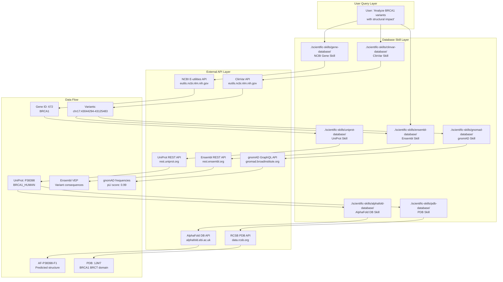
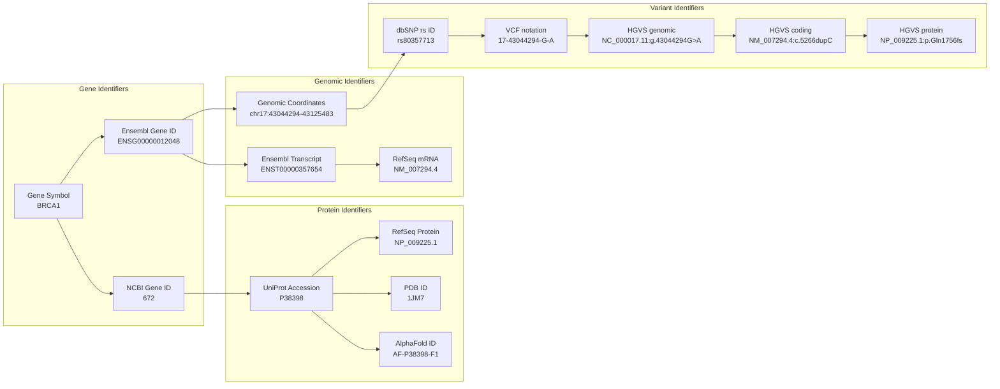
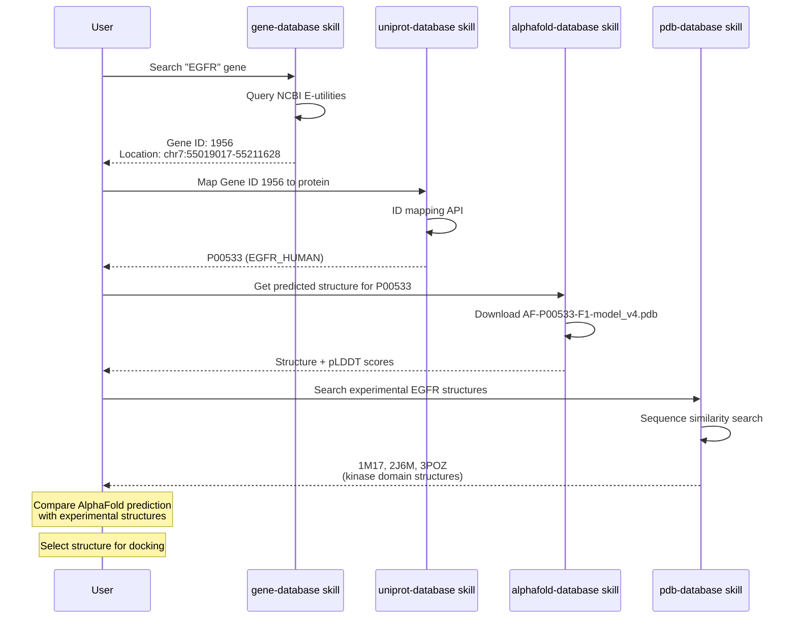
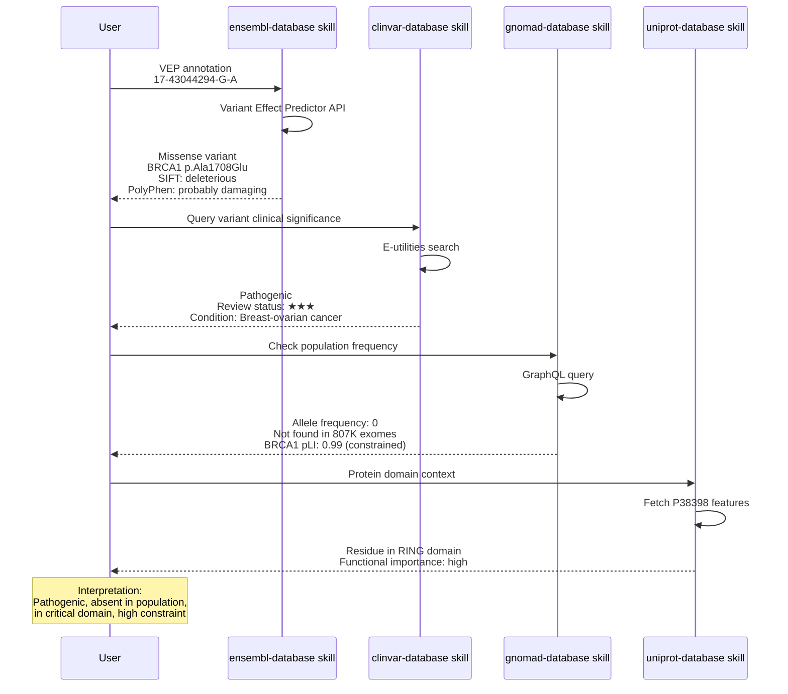
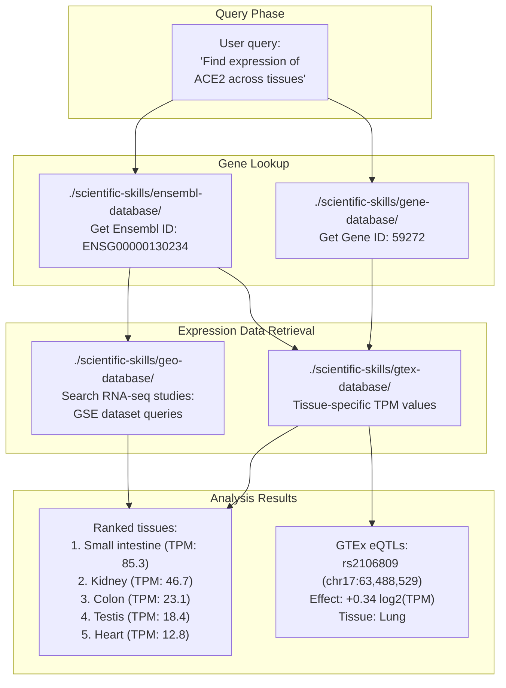

<!-- source: DeepWiki mcp.deepwiki.com · repo K-Dense-AI/claude-scientific-skills · page 5.3 Protein and Genomics Databases · fetched 2026-10-26 -->

# Protein and Genomics Databases

<details>
<summary>Relevant source files</summary>

The following files were used as context for generating this wiki page:

- [.claude-plugin/marketplace.json](.claude-plugin/marketplace.json)
- [README.md](README.md)
- [docs/scientific-skills.md](docs/scientific-skills.md)
- [scientific-skills/ginkgo-cloud-lab/SKILL.md](scientific-skills/ginkgo-cloud-lab/SKILL.md)
- [scientific-skills/ginkgo-cloud-lab/references/cell-free-protein-expression-optimization.md](scientific-skills/ginkgo-cloud-lab/references/cell-free-protein-expression-optimization.md)
- [scientific-skills/ginkgo-cloud-lab/references/cell-free-protein-expression-validation.md](scientific-skills/ginkgo-cloud-lab/references/cell-free-protein-expression-validation.md)
- [scientific-skills/ginkgo-cloud-lab/references/fluorescent-pixel-art-generation.md](scientific-skills/ginkgo-cloud-lab/references/fluorescent-pixel-art-generation.md)

</details>


## Purpose and Scope

This page documents the protein and genomics database skills that provide programmatic access to essential molecular biology data resources. These skills enable retrieval of protein sequences, structures, genomic annotations, gene expression data, and variant information through standardized APIs.

**Scope:** This page covers 12 dedicated database skills for protein and genomics resources. For chemical compound databases (ChEMBL, PubChem, DrugBank), see [Chemical and Drug Databases](#5.4). For clinical variant databases (ClinVar, COSMIC, cBioPortal), see [Clinical and Healthcare Databases](#5.5). For literature databases (PubMed, bioRxiv), see [Biomedical Literature and Reference Management](#5.2). For multi-database access packages (BioServices, BioPython Entrez, gget), see [Database Access Architecture](#5.1).

**Sources:** [README.md:398-546](), [docs/scientific-skills.md:1-36](), [.claude-plugin/marketplace.json:107-142]()

---

## Database Organization and Skill Structure

The protein and genomics databases are organized into two major categories based on the molecular entities they describe:

| Category | Databases | Primary Use Cases |
|----------|-----------|-------------------|
| **Protein Databases** | UniProt, PDB, AlphaFold DB, InterPro | Protein sequence retrieval, structure-based drug design, functional annotation, domain identification |
| **Genomics Databases** | Ensembl, NCBI Gene, GEO, ENA, GWAS Catalog, gnomAD, GTEx, JASPAR | Gene annotation, genomic coordinates, expression profiling, variant frequency, regulatory elements |

Each database skill is located at `./scientific-skills/<database-name>-database/` and contains:
- **SKILL.md**: Skill definition with metadata and usage documentation
- **references/**: Detailed API documentation and query examples
- **examples/**: Working code samples demonstrating common queries

**Sources:** [README.md:505-518](), [docs/scientific-skills.md:4-32](), [.claude-plugin/marketplace.json:107-142]()

---

## Protein Databases

### UniProt Database

**Skill Path:** `./scientific-skills/uniprot-database/`

UniProt (Universal Protein Resource) provides comprehensive protein sequence and functional annotation data through two main components:

- **UniProtKB/Swiss-Prot**: Manually reviewed and curated protein entries with high-quality annotations
- **UniProtKB/TrEMBL**: Automatically annotated unreviewed entries from genome sequencing

**Key Capabilities:**
- Protein sequence retrieval by accession ID, gene name, or organism
- Functional annotations including domains, active sites, binding sites
- Cross-references to 200+ external databases (PDB, Ensembl, KEGG, Reactome, etc.)
- ID mapping across database identifiers
- Batch operations for high-throughput queries
- REST API with multiple output formats (XML, JSON, FASTA, GFF)

**API Access Pattern:**
```
GET https://rest.uniprot.org/uniprotkb/{accession}.{format}
GET https://rest.uniprot.org/uniprotkb/search?query={query}
POST https://rest.uniprot.org/idmapping/run
```

**Common Query Types:**
- Retrieve protein by accession: `P04637` (human p53)
- Search by gene name: `gene:BRCA1 AND organism_id:9606`
- Filter by function: `cc_function:kinase AND reviewed:true`
- Map IDs: Convert Ensembl gene IDs to UniProt accessions

**Sources:** [README.md:507-508](), [docs/scientific-skills.md:32]()

---

### Protein Data Bank (PDB)

**Skill Path:** `./scientific-skills/pdb-database/`

The Protein Data Bank is the worldwide repository for experimentally determined 3D structures of biological macromolecules (proteins, nucleic acids, complex assemblies).

**Data Coverage:**
- 200,000+ structures from X-ray crystallography, NMR, cryo-EM
- Atomic coordinates in PDB and mmCIF formats
- Experimental metadata (resolution, R-factors, data collection parameters)
- Ligand binding sites and protein-protein interfaces
- Structure quality metrics and validation reports

**Key Capabilities:**
- Structure download by PDB ID
- Sequence-based similarity searches (BLAST)
- Structure-based searches (3D similarity, substructure matching)
- Ligand searches (small molecules, cofactors)
- Advanced queries by experimental method, resolution, organism
- Integration with structure visualization tools (PyMOL, Chimera, Mol*)

**API Access Pattern:**
```
GET https://data.rcsb.org/rest/v1/core/entry/{pdb_id}
GET https://files.rcsb.org/download/{pdb_id}.pdb
POST https://search.rcsb.org/rcsbsearch/v2/query
```

**Common Use Cases:**
- Retrieve structure coordinates for molecular docking
- Find homologous structures by sequence similarity
- Analyze binding site geometry for drug design
- Compare conformational states across structure families

**Sources:** [README.md:507-508](), [docs/scientific-skills.md:27]()

---

### AlphaFold Database

**Skill Path:** `./scientific-skills/alphafold-database/`

AlphaFold DB provides AI-predicted protein structure predictions from DeepMind, covering 200+ million proteins without experimental structure determination.

**Data Coverage:**
- Complete reference proteomes from UniProt (human, mouse, zebrafish, etc.)
- Model organism proteomes (E. coli, yeast, C. elegans, Drosophila)
- Confidence metrics per residue and per structure
- Predicted aligned error (PAE) matrices for domain organization

**Confidence Scores:**
- **pLDDT** (per-residue confidence): 0-100 scale indicating local backbone accuracy
  - >90: Very high confidence (comparable to experimental structures)
  - 70-90: Good confidence
  - 50-70: Low confidence
  - <50: Very low confidence (disordered or poorly predicted)
- **PAE** (predicted aligned error): Expected error in Ångstroms between residue pairs

**Key Capabilities:**
- Download predicted structures by UniProt accession
- Retrieve confidence metrics (pLDDT, PAE)
- Bulk downloads via Google Cloud Storage
- REST API access for programmatic retrieval
- Multiple file formats (PDB, mmCIF, AlphaFold format)

**API Access Pattern:**
```
GET https://alphafold.ebi.ac.uk/api/prediction/{uniprot_id}
GET https://alphafold.ebi.ac.uk/files/AF-{uniprot_id}-F1-model_v4.pdb
GET https://alphafold.ebi.ac.uk/files/AF-{uniprot_id}-F1-confidence_v4.json
```

**Integration Workflow:**
```
UniProt accession → AlphaFold DB → Structure prediction
                                  → pLDDT confidence scores
                                  → PAE domain analysis
                                  → Molecular docking (DiffDock)
```

**Sources:** [README.md:407-409](), [docs/scientific-skills.md:5]()

---

### InterPro Database

**Skill Path:** `./scientific-skills/interpro-database/`

InterPro is a unified database of protein families, domains, and functional sites that integrates 14 member databases including Pfam, PANTHER, SMART, ProSite, and others.

**Member Databases Integrated:**
- **Pfam**: Protein families based on multiple sequence alignments and HMMs
- **PANTHER**: Protein family classification with evolutionary relationships
- **SMART**: Simple Modular Architecture Research Tool for domain identification
- **ProSite**: Patterns and profiles for protein families and domains
- **PRINTS**: Fingerprints (multiple motif groups)
- **TIGRFAMs**: Protein families based on HMMs
- Plus 8 additional databases

**Key Capabilities:**
- Identify protein domains and functional sites
- Search by InterPro entry ID, protein accession, or sequence
- Map domains to structures (PDB integration)
- Retrieve GO (Gene Ontology) annotations
- Cross-reference to pathways (Reactome, KEGG)
- Batch protein annotation

**Data Types:**
- Protein family classifications
- Domain architectures
- Conserved sites (active sites, binding sites)
- Sequence signatures (motifs, profiles, HMMs)
- GO term associations
- Pathway memberships

**API Access Pattern:**
```
GET https://www.ebi.ac.uk/interpro/api/entry/interpro/{entry_id}
GET https://www.ebi.ac.uk/interpro/api/protein/uniprot/{accession}
POST https://www.ebi.ac.uk/interpro/api/entry/interpro/search
```

**Sources:** [README.md:427-429](), [docs/scientific-skills.md:6]()

---

## Genomics Databases

### Ensembl Database

**Skill Path:** `./scientific-skills/ensembl-database/`

Ensembl is a genome browser and bioinformatics database providing genomic annotations for 250+ vertebrate species (Release 115, 2025).

**Core Data Types:**
- Gene annotations (exons, introns, UTRs, transcripts, translations)
- Genomic sequences and coordinates
- Variant annotations and predictions (VEP - Variant Effect Predictor)
- Comparative genomics (orthologs, paralogs, synteny)
- Regulatory features (enhancers, promoters, CTCF binding sites)
- Assembly mappings (GRCh37/hg19 ↔ GRCh38/hg38)

**REST API Endpoints:**
The Ensembl REST API provides comprehensive programmatic access through standardized endpoints:

```
GET /lookup/id/{id}                    # Gene/transcript/protein lookup
GET /sequence/id/{id}                  # Retrieve DNA/protein sequences
GET /vep/species/region/{region}       # Variant Effect Prediction
GET /overlap/region/{species}/{region} # Features in genomic region
GET /homology/id/{id}                  # Ortholog/paralog retrieval
GET /xrefs/id/{id}                     # Cross-references to external DBs
```

**Key Capabilities:**
- Gene information retrieval by Ensembl ID, gene symbol, or coordinates
- Sequence extraction from genomic regions
- Variant consequence prediction (synonymous, missense, frameshift, etc.)
- Ortholog identification across species
- Transcript-to-protein mapping
- Assembly coordinate conversion (liftover)

**Variant Effect Predictor (VEP):**
- Predicts functional consequences of variants
- Returns SIFT and PolyPhen scores for missense variants
- Identifies regulatory region variants
- Annotates with conservation scores (GERP, PhyloP)

**Sources:** [README.md:509-510](), [docs/scientific-skills.md:14]()

---

### NCBI Gene Database

**Skill Path:** `./scientific-skills/gene-database/`

NCBI Gene provides comprehensive gene-specific information curated from NCBI resources, integrating data from 500+ organisms.

**Data Content:**
- Official gene nomenclature (HGNC symbols, aliases, full names)
- Genomic locations (chromosomal positions, exon boundaries)
- Gene sequences (genomic DNA, mRNA, protein)
- Gene function and phenotypes
- Pathways and interactions
- Orthologs and paralogs across species
- Variation data (dbSNP, ClinVar links)
- Expression data (GEO links)
- Literature citations (PubMed links)
- Cross-references to 200+ databases

**E-utilities API Access:**
NCBI Gene is accessed through E-utilities (Entrez Programming Utilities), which provides a unified interface to all NCBI databases:

```
# Search for genes
esearch.fcgi?db=gene&term={query}

# Retrieve gene summaries
esummary.fcgi?db=gene&id={gene_id}

# Fetch detailed gene records
efetch.fcgi?db=gene&id={gene_id}&retmode=xml

# Link to related records
elink.fcgi?dbfrom=gene&db=pubmed&id={gene_id}
```

**Query Strategies:**
- By gene symbol: `BRCA1[Gene Name] AND Homo sapiens[Organism]`
- By Gene ID: `672` (BRCA1)
- By genomic location: `chr17:43044294-43125483[Base Position]`
- By function: `protein kinase AND Homo sapiens[Organism]`

**Cross-Database Integration:**
NCBI Gene serves as a hub linking to:
- PubMed (literature)
- dbSNP (sequence variants)
- ClinVar (clinical variants)
- GEO (expression data)
- UniGene (gene clusters)
- HomoloGene (orthologs)
- GTEx (tissue expression)

**Sources:** [README.md:509-510](), [docs/scientific-skills.md:26]()

---

### Gene Expression Omnibus (GEO)

**Skill Path:** `./scientific-skills/geo-database/`

GEO is NCBI's public repository for high-throughput gene expression and functional genomics data, containing 264,000+ studies and 8+ million samples.

**Data Types:**
- **Microarray data**: Gene expression, SNP genotyping, ChIP-chip
- **High-throughput sequencing**: RNA-seq, ChIP-seq, ATAC-seq, Hi-C, single-cell
- **Epigenomics**: DNA methylation, histone modifications
- **Proteomics**: Mass spectrometry
- **Non-coding RNA profiling**: miRNA, lncRNA

**Database Components:**
- **GEO Platforms (GPL)**: Microarray/sequencing platform definitions
- **GEO Samples (GSM)**: Individual sample records with raw and processed data
- **GEO Series (GSE)**: Complete experiments with multiple samples and metadata
- **GEO DataSets (GDS)**: Curated subsets with consistent experimental design

**API Access via E-utilities:**
```
# Search for datasets
esearch.fcgi?db=gds&term=cancer+AND+breast+AND+human

# Retrieve series information
esearch.fcgi?db=gds&term=GSE12345

# Download raw data via FTP
ftp://ftp.ncbi.nlm.nih.gov/geo/series/GSE123nnn/GSE123456/
```

**Data Download Methods:**
1. **GEOquery R package**: Parse SOFT/MINiML format into R objects
2. **FTP downloads**: Bulk access to raw and processed data files
3. **E-utilities**: Programmatic metadata retrieval
4. **GEO2R**: Web-based differential expression analysis

**Common Use Cases:**
- Meta-analysis across multiple studies
- Biomarker discovery from public datasets
- Validation of gene signatures
- Cross-study comparisons
- Mining for disease-associated expression patterns

**Sources:** [README.md:509-510](), [docs/scientific-skills.md:19]()

---

### European Nucleotide Archive (ENA)

**Skill Path:** `./scientific-skills/ena-database/`

ENA is a comprehensive public repository for nucleotide sequence data and metadata, part of the International Nucleotide Sequence Database Collaboration (INSDC) along with GenBank and DDBJ.

**Data Types:**
- **Raw sequencing reads**: FASTQ files from Illumina, PacBio, Nanopore
- **Assembled sequences**: Contigs, scaffolds, chromosomes
- **Annotated sequences**: GenBank/EMBL flat files with features
- **Sample metadata**: BioSample records with experimental conditions
- **Study metadata**: Project descriptions and publications

**REST API Endpoints:**
```
GET /ena/browser/api/xml/{accession}           # Retrieve entry in XML
GET /ena/browser/api/fasta/{accession}         # Retrieve sequences in FASTA
GET /ena/portal/api/search                     # Advanced search
GET /ena/portal/api/filereport?accession={acc} # File download URLs
```

**Search Capabilities:**
- Full-text search across all metadata fields
- Taxonomy-based searches
- Date range filtering
- Sequencing platform filtering
- Advanced query syntax with Boolean operators

**Bulk Download Options:**
1. **REST API**: Individual file downloads via HTTP
2. **FTP**: Bulk access at `ftp://ftp.ebi.ac.uk/pub/databases/ena/`
3. **Aspera**: High-speed transfer for large datasets
4. **ENA Browser**: Interactive web interface with filters

**Rate Limits:**
- 50 requests per second for REST API
- No limits on FTP/Aspera downloads

**Sources:** [README.md:509-510](), [docs/scientific-skills.md:13]()

---

### Population and Variation Databases

#### GWAS Catalog

**Skill Path:** `./scientific-skills/gwas-database/`

The NHGRI-EBI GWAS Catalog is a curated collection of published genome-wide association studies, containing SNP-trait associations with genome-wide significance (p ≤ 5×10⁻⁸).

**Data Content:**
- Thousands of GWAS publications
- Genome-wide significant SNP-trait associations
- Full summary statistics for select studies
- Standardized trait ontology (EFO - Experimental Factor Ontology)
- Genomic coordinates (GRCh38/hg38 and GRCh37/hg19)
- Effect sizes (beta, odds ratio)
- Minor allele frequencies
- Study metadata (sample size, ancestry, platform)

**REST API Access:**
```
GET /gwas/rest/api/studies                     # List all studies
GET /gwas/rest/api/studies/{studyId}           # Study details
GET /gwas/rest/api/singleNucleotidePolymorphisms/{rsId} # SNP associations
GET /gwas/rest/api/efoTraits/{traitId}         # Trait associations
```

**FTP Downloads:**
- `gwas-catalog-associations.tsv`: All associations
- `gwas-catalog-studies.tsv`: Study metadata
- Summary statistics files (when available)

**Query Use Cases:**
- Find genetic variants associated with disease
- Identify genes near significant SNPs
- Perform phenome-wide association studies (PheWAS)
- Prioritize variants for functional follow-up
- Genetic risk score calculation

**Sources:** [README.md:509-510](), [docs/scientific-skills.md:20]()

---

#### gnomAD Database

**Skill Path:** `./scientific-skills/gnomad-database/`

gnomAD (Genome Aggregation Database) provides population allele frequencies and constraint metrics from large-scale sequencing of disease-free individuals.

**Dataset Versions:**
- **gnomAD v4**: 807,162 exomes + 1,143,087 genomes (latest)
- **gnomAD v2**: 125,748 exomes + 15,708 genomes
- Coverage: Exome (targeted) + whole genome data

**Key Metrics:**
- **Allele frequencies**: By population (African, Latino, East Asian, European, South Asian, etc.)
- **pLI** (probability of Loss-of-function Intolerance): Gene constraint score (0-1)
  - pLI ≥ 0.9: Extremely intolerant to loss-of-function
  - pLI < 0.9: More tolerant
- **LOEUF** (Loss-of-function Observed/Expected Upper bound Fraction)
  - Lower LOEUF = more constrained gene
  - Used for haploinsufficiency assessment
- **Missense constraint**: Z-scores for missense variant tolerance
- **Coverage metrics**: Mean depth, % bases at 10x, 20x, 30x

**Browser and API:**
```
# GraphQL API endpoint
POST https://gnomad.broadinstitute.org/api

# Example query structure
query {
  variant(dataset: gnomad_r4, variantId: "1-55516888-G-A") {
    allele_freq
    popmax
    filters
    lof_consequence
  }
}
```

**Use Cases:**
- Filter out common variants (AF > 0.01) in rare disease studies
- Identify haploinsufficient genes (pLI ≥ 0.9)
- Assess variant pathogenicity (absent in gnomAD = potentially pathogenic)
- Calculate population-specific allele frequencies
- Evaluate gene constraint for drug target selection

**Sources:** [README.md:509-510](), [docs/scientific-skills.md:6]()

---

#### GTEx Database

**Skill Path:** `./scientific-skills/gtex-database/`

The Genotype-Tissue Expression (GTEx) project provides comprehensive tissue-specific gene expression data and expression quantitative trait loci (eQTLs) from 54 human tissues.

**Data Types:**
- **Gene expression**: RNA-seq TPM values across 54 tissues
- **Isoform expression**: Transcript-level quantification
- **eQTLs**: Genetic variants affecting gene expression
- **sQTLs**: Splicing quantitative trait loci
- **Sample metadata**: Donor demographics, tissue quality, ischemic time

**Tissue Types Covered (54):**
- Brain regions (13): cortex, cerebellum, hippocampus, etc.
- Cardiovascular: heart, artery, blood vessels
- Digestive: colon, esophagus, stomach, liver, pancreas
- Endocrine: thyroid, adrenal, pituitary
- Muscle: skeletal, heart
- Reproductive: testis, ovary, uterus, prostate
- Other: lung, kidney, skin, adipose, spleen, blood

**API and Download Options:**
1. **GTEx Portal**: Web-based queries and visualization
2. **REST API**: Programmatic access to expression data and eQTLs
3. **BigQuery**: Google Cloud dataset for large-scale queries
4. **Download Portal**: Bulk downloads of matrices and metadata

**Key Use Cases:**
- Determine tissue-specific gene expression patterns
- Identify tissues with highest expression for target genes
- Find genetic variants regulating gene expression (eQTLs)
- Compare expression across tissues for drug target selection
- Interpret non-coding variants via eQTL analysis

**Sources:** [README.md:509-510](), [docs/scientific-skills.md:6]()

---

#### JASPAR Database

**Skill Path:** `./scientific-skills/jaspar-database/`

JASPAR is an open-access database of curated, non-redundant transcription factor (TF) binding site profiles for eukaryotes.

**Data Content:**
- **Position Weight Matrices (PWMs)**: Numeric representations of TF binding preferences
- **Sequence logos**: Visual representations of binding motifs
- **TF metadata**: Protein family, species, structural class
- **Binding site annotations**: Experimentally verified sites
- **TF-gene associations**: Known regulatory relationships

**Matrix Collections:**
- **CORE**: Curated, non-redundant vertebrate profiles (gold standard)
- **PHYLOFACTS**: Profiles from phylogenetic footprinting
- **SPLICE**: Splice site regulatory elements
- **POLII**: RNA polymerase II binding sites
- **FAM**: Familial binding site profiles
- **PBM**: Profiles from protein binding microarrays
- **UNVALIDATED**: Computationally predicted profiles

**API Access:**
```
GET /api/v1/matrix/{matrix_id}                 # Retrieve PWM
GET /api/v1/taxon/{taxon_id}                   # TFs for species
GET /api/v1/collection/{collection}            # Matrix collection
POST /api/v1/matrix/search                     # Search by criteria
```

**File Formats:**
- **JASPAR format**: Tab-delimited PWM (A, C, G, T rows)
- **MEME format**: For use with MEME Suite tools
- **TRANSFAC format**: Legacy format compatibility
- **PFM** (Position Frequency Matrix): Raw counts
- **PWM** (Position Weight Matrix): Log-odds scores

**Use Cases:**
- Predict TF binding sites in promoter regions
- Motif enrichment analysis in ChIP-seq peaks
- Identify regulatory elements in non-coding variants
- Scan sequences for known TF binding motifs
- Compare binding profiles across TF families

**Sources:** [README.md:509-510](), [docs/scientific-skills.md:6]()

---

## Database Integration Architecture

The following diagram illustrates how protein and genomics databases interconnect through shared identifiers and cross-references:



**Integration Workflow:**

1. **Gene Identification**: NCBI Gene provides gene symbol, ID, and genomic coordinates
2. **Protein Retrieval**: UniProt accession obtained via gene-to-protein mapping
3. **Structure Access**: AlphaFold DB prediction or PDB experimental structure retrieved using UniProt ID
4. **Variant Analysis**: ClinVar variants mapped to genomic coordinates
5. **Consequence Prediction**: Ensembl VEP determines variant effects on protein
6. **Population Context**: gnomAD provides allele frequencies and constraint scores

**Sources:** [README.md:85-115](), [docs/scientific-skills.md:1-32](), [.claude-plugin/marketplace.json:107-142]()

---

## Cross-Database Identifier Mapping

Different databases use different identifier systems. Understanding these mappings is essential for multi-database workflows:



**Mapping Services:**

| Service | Mapping Capabilities | Skill Path |
|---------|---------------------|------------|
| **UniProt ID Mapping** | Gene ID ↔ UniProt ↔ Ensembl ↔ RefSeq ↔ PDB | `./scientific-skills/uniprot-database/` |
| **Ensembl Xrefs** | Ensembl ↔ HGNC ↔ UniProt ↔ RefSeq ↔ Gene ID | `./scientific-skills/ensembl-database/` |
| **NCBI Gene Links** | Gene ID ↔ UniGene ↔ HomoloGene ↔ ClinVar ↔ GEO | `./scientific-skills/gene-database/` |
| **BioServices** | Multi-database ID conversion across 40+ services | `./scientific-skills/bioservices/` |

**Sources:** [README.md:407-409](), [docs/scientific-skills.md:5-32]()

---

## Skill Directory Structure and Code Entities

Each database skill follows a standardized directory structure:

```
./scientific-skills/{database-name}-database/
├── SKILL.md                          # Skill definition with frontmatter metadata
├── references/
│   ├── api-reference.md              # API endpoint documentation
│   ├── query-examples.md             # Common query patterns
│   └── data-model.md                 # Database schema and fields
├── examples/
│   ├── basic-queries.py              # Simple query examples
│   ├── batch-operations.py           # High-throughput queries
│   ├── integration-workflow.py       # Multi-database workflow
│   └── output/                       # Example results
└── assets/
    └── diagrams/                     # Visual documentation
```

**SKILL.md Frontmatter Structure:**

Every database skill's `SKILL.md` begins with YAML frontmatter defining metadata:

```yaml
---
name: {database-name}-database
description: Brief description of database and primary use cases
version: 1.0.0
author: K-Dense Inc.
license: MIT
compatibility:
  - cursor
  - claude-code
  - codex
tools:
  - python
  - requests
  - pandas
---
```

**Marketplace Registration:**

Database skills are registered in `.claude-plugin/marketplace.json`:

```json
{
  "plugins": [
    {
      "skills": [
        "./scientific-skills/uniprot-database",
        "./scientific-skills/pdb-database",
        "./scientific-skills/alphafold-database",
        "./scientific-skills/ensembl-database",
        "./scientific-skills/gene-database",
        ...
      ]
    }
  ]
}
```

**Sources:** [.claude-plugin/marketplace.json:107-142](), [README.md:60-66]()

---

## Common Query Workflows

### Workflow 1: Gene-to-Structure Pipeline

**Objective:** From gene symbol to 3D structure for molecular docking



**Code Integration Points:**
- `./scientific-skills/gene-database/examples/basic-queries.py`: Gene lookup by symbol
- `./scientific-skills/uniprot-database/examples/id-mapping.py`: Gene-to-protein conversion
- `./scientific-skills/alphafold-database/examples/download-structure.py`: Structure retrieval
- `./scientific-skills/pdb-database/examples/sequence-search.py`: Homology search

**Sources:** [README.md:220-232](), [docs/scientific-skills.md:5-32]()

---

### Workflow 2: Variant Interpretation Pipeline

**Objective:** Assess clinical significance and population frequency of a variant



**Code Integration Points:**
- `./scientific-skills/ensembl-database/examples/vep-query.py`: Variant consequence prediction
- `./scientific-skills/clinvar-database/examples/variant-search.py`: Clinical significance lookup
- `./scientific-skills/gnomad-database/examples/allele-frequency.py`: Population frequency query
- `./scientific-skills/uniprot-database/examples/feature-retrieval.py`: Domain annotation

**Sources:** [README.md:289-301](), [docs/scientific-skills.md:9-32]()

---

### Workflow 3: Expression Profiling Across Tissues

**Objective:** Identify tissues with highest expression for drug target selection



**Code Integration Points:**
- `./scientific-skills/gene-database/examples/basic-queries.py`: Gene ID retrieval
- `./scientific-skills/gtex-database/examples/tissue-expression.py`: GTEx API queries
- `./scientific-skills/geo-database/examples/dataset-search.py`: GEO study identification
- `./scientific-skills/ensembl-database/examples/gene-lookup.py`: Ensembl ID conversion

**Sources:** [README.md:306-319](), [docs/scientific-skills.md:14-32]()

---

## Multi-Database Integration Patterns

### Pattern 1: Aggregator Skills for Broad Coverage

Some skills provide access to multiple databases through unified interfaces:

**BioServices Skill** (`./scientific-skills/bioservices/`):
- Wraps ~40 bioinformatics web services
- Includes 30+ PSICQUIC protein interaction databases
- Provides consistent API across heterogeneous services
- Handles authentication and rate limiting
- Total coverage: ~70 databases

**BioPython Entrez** (`./scientific-skills/biopython/`):
- Accesses 38 NCBI sub-databases via E-utilities
- Unified query interface for PubMed, Gene, Protein, Nucleotide, etc.
- Handles batch operations and error recovery
- Example databases: Gene, SNP, ClinVar, dbGaP, GEO, SRA, etc.

**gget Skill** (`./scientific-skills/gget/`):
- Simplified access to 20+ genomics databases
- Single-command queries without API setup
- Databases: Ensembl, UniProt, PDB, BLAST, Enrichr, ARCHS4, etc.

**Sources:** [README.md:54-55](), [docs/scientific-skills.md:66-70]()

---

### Pattern 2: Direct Database Skills for Depth

Direct database skills provide comprehensive access to major resources with detailed documentation:

| Database | Skill Path | Key Advantage |
|----------|-----------|---------------|
| UniProt | `./scientific-skills/uniprot-database/` | Complete protein annotations, ID mapping, batch queries |
| Ensembl | `./scientific-skills/ensembl-database/` | VEP integration, assembly liftover, regulatory features |
| NCBI Gene | `./scientific-skills/gene-database/` | Gene-centric data hub, links to all NCBI resources |
| PDB | `./scientific-skills/pdb-database/` | Structure search, quality metrics, ligand information |
| AlphaFold DB | `./scientific-skills/alphafold-database/` | Confidence metrics (pLDDT, PAE), bulk downloads |

**When to use direct skills:**
- Need specialized query capabilities (e.g., Ensembl VEP)
- Require detailed metadata and filtering
- Building production pipelines with error handling
- Need comprehensive documentation and examples

**When to use aggregator skills:**
- Exploratory queries across multiple databases
- Quick lookups without complex parameters
- Prototyping workflows before optimization
- Need access to many databases with minimal setup

**Sources:** [README.md:85-115](), [docs/scientific-skills.md:1-36]()

---

## API Rate Limits and Best Practices

### Rate Limit Summary

| Database | Skill Path | Rate Limit | Authentication |
|----------|-----------|------------|----------------|
| **UniProt** | `./scientific-skills/uniprot-database/` | None specified | Not required |
| **PDB** | `./scientific-skills/pdb-database/` | None specified | Not required |
| **AlphaFold DB** | `./scientific-skills/alphafold-database/` | None specified | Not required |
| **Ensembl** | `./scientific-skills/ensembl-database/` | 15 req/sec per IP | Not required |
| **NCBI E-utilities** | `./scientific-skills/gene-database/` | 3 req/sec (no key)<br/>10 req/sec (with key) | API key recommended |
| **GEO** | `./scientific-skills/geo-database/` | 3 req/sec (via E-utils) | API key recommended |
| **ENA** | `./scientific-skills/ena-database/` | 50 req/sec | Not required |
| **gnomAD** | `./scientific-skills/gnomad-database/` | None specified | Not required |

**Best Practices:**

1. **Batch Operations**: Use batch endpoints when available
   - UniProt: POST to `/idmapping/run` for bulk ID mapping
   - NCBI: Use `id=123,456,789` for multiple IDs
   - Ensembl: POST to `/lookup/id` with JSON array

2. **Caching**: Implement local caching to avoid repeated queries
   - Store frequently accessed data (gene annotations, protein sequences)
   - Use file-based caching or database (SQLite)
   - Respect cache TTL (24-48 hours for static data)

3. **Error Handling**: Implement exponential backoff for rate limit errors
   ```python
   import time
   from requests.exceptions import HTTPError
   
   def query_with_retry(url, max_retries=3):
       for attempt in range(max_retries):
           try:
               response = requests.get(url)
               response.raise_for_status()
               return response.json()
           except HTTPError as e:
               if e.response.status_code == 429:  # Too Many Requests
                   wait_time = 2 ** attempt
                   time.sleep(wait_time)
               else:
                   raise
   ```

4. **API Keys**: Register for NCBI API keys to increase rate limits
   - Visit https://ncbiinsights.ncbi.nlm.nih.gov/2017/11/02/new-api-keys-for-the-e-utilities/
   - Add `api_key=YOUR_KEY` to all E-utilities requests
   - Increases limit from 3 to 10 requests/second

**Sources:** [README.md:621-647](), [docs/scientific-skills.md:13-32]()

---

## Example: Multi-Database Drug Target Analysis

This workflow demonstrates composing multiple protein and genomics database skills to evaluate a potential drug target:

```python
# File: ./scientific-skills/gene-database/examples/integration-workflow.py

# Step 1: Gene identification and annotation
from ncbi_gene import NCBIGeneQuery
gene_query = NCBIGeneQuery()
gene_info = gene_query.search_by_symbol("EGFR", organism="human")
gene_id = gene_info['gene_id']  # 1956

# Step 2: Protein sequence and domains
from uniprot import UniProtQuery
uniprot = UniProtQuery()
protein_info = uniprot.map_gene_to_protein(gene_id)
uniprot_acc = protein_info['accession']  # P00533
domains = uniprot.get_domains(uniprot_acc)  # Kinase domain, EGF-like domains

# Step 3: Structure retrieval
from alphafold import AlphaFoldQuery
alphafold = AlphaFoldQuery()
structure = alphafold.download_structure(uniprot_acc)
confidence = alphafold.get_confidence_metrics(uniprot_acc)
# Returns: pLDDT scores, PAE matrix

# Step 4: Expression profiling
from gtex import GTExQuery
gtex = GTExQuery()
expression = gtex.get_tissue_expression(gene_id)
# Returns: TPM values across 54 tissues
# Highest: Lung (45.2), Skin (23.1), Brain (12.4)

# Step 5: Genetic variation
from gnomad import gnomADQuery
gnomad = gnomADQuery()
gene_constraint = gnomad.get_gene_constraint("EGFR")
# Returns: pLI=0.01, LOEUF=1.12 (not highly constrained)

# Step 6: Disease associations
from ensembl import EnsemblQuery
ensembl = EnsemblQuery()
variants = ensembl.get_gene_variants(gene_id)
pathogenic_variants = [v for v in variants if v['clinvar_sig'] == 'pathogenic']

# Step 7: Literature context
from pubmed import PubMedQuery
pubmed = PubMedQuery()
papers = pubmed.search(f"EGFR[Gene] AND drug target[Title/Abstract]")
print(f"Found {len(papers)} relevant publications")

# Step 8: Generate summary report
target_report = {
    'gene': gene_info,
    'protein': protein_info,
    'structure': structure,
    'expression': expression,
    'constraint': gene_constraint,
    'variants': pathogenic_variants,
    'literature_count': len(papers)
}
```

**Skills Used:**
- `./scientific-skills/gene-database/` (NCBI Gene)
- `./scientific-skills/uniprot-database/` (UniProt)
- `./scientific-skills/alphafold-database/` (AlphaFold DB)
- `./scientific-skills/gtex-database/` (GTEx)
- `./scientific-skills/gnomad-database/` (gnomAD)
- `./scientific-skills/ensembl-database/` (Ensembl)
- `./scientific-skills/pubmed-database/` (PubMed)

**Sources:** [README.md:220-232](), [docs/scientific-skills.md:1-36]()

---

## Troubleshooting Common Issues

### Issue 1: NCBI E-utilities Rate Limiting

**Problem:** `429 Too Many Requests` errors when querying NCBI databases

**Solution:**
1. Reduce query frequency to 3 requests/second (without API key) or 10 requests/second (with API key)
2. Register for free NCBI API key at https://ncbiinsights.ncbi.nlm.nih.gov/2017/11/02/new-api-keys-for-the-e-utilities/
3. Add `api_key` parameter to all E-utilities requests
4. Use batch operations with `id=123,456,789` instead of individual queries
5. Implement exponential backoff retry logic

**Sources:** [README.md:631-642]()

---

### Issue 2: Ensembl Assembly Mismatch

**Problem:** Coordinates from different genome assemblies (GRCh37 vs GRCh38) causing query failures

**Solution:**
1. Check which assembly your coordinates use (GRCh37/hg19 or GRCh38/hg38)
2. Use Ensembl Assembly Converter API for liftover:
   ```
   GET /map/human/GRCh37/17:43044294..43044294/GRCh38
   ```
3. Specify assembly in API requests using `species` parameter
4. Always document which assembly is used in analysis
5. Consider using both assemblies for legacy data compatibility

**Sources:** [docs/scientific-skills.md:14]()

---

### Issue 3: UniProt ID Mapping Timeouts

**Problem:** Large batch ID mapping jobs timing out or failing

**Solution:**
1. Submit job with POST to `/idmapping/run`
2. Poll job status with GET to `/idmapping/status/{job_id}`
3. Wait for `jobStatus: "FINISHED"` before retrieving results
4. Split large batches (>10,000 IDs) into smaller chunks
5. Use stream/download endpoints for very large result sets
6. Implement retry logic for failed jobs

**Sources:** [docs/scientific-skills.md:32]()

---

### Issue 4: AlphaFold DB Structure Quality Interpretation

**Problem:** Uncertainty about which AlphaFold predictions are reliable enough for downstream analysis

**Solution:**
1. Check per-residue pLDDT scores:
   - pLDDT > 90: Very high confidence (use for docking, detailed analysis)
   - pLDDT 70-90: Good confidence (use with caution)
   - pLDDT 50-70: Low confidence (domain boundaries may be correct)
   - pLDDT < 50: Very low confidence (likely disordered, avoid)
2. Review PAE (predicted aligned error) matrix for domain relationships
3. Compare with experimental structures from PDB when available
4. Focus analysis on high-confidence regions
5. Use AlphaFold Colab for higher-quality predictions if needed

**Sources:** [docs/scientific-skills.md:5]()

---

### Issue 5: GEO Dataset Format Inconsistencies

**Problem:** Different GEO datasets have inconsistent metadata and file formats

**Solution:**
1. Use GEOquery R package for standardized parsing (converts SOFT/MINiML to R objects)
2. Check dataset type (expression microarray vs RNA-seq vs other)
3. Read platform information (GPL) to understand data structure
4. Access processed data files when available (avoid raw data parsing)
5. Use GEO2R for quick differential expression without downloading
6. For large datasets, use SRA Run Selector to get raw sequencing files

**Sources:** [docs/scientific-skills.md:19]()

---

## Related Skills and Further Integration

### Complementary Skills for Protein Analysis

- **BioPython** (`./scientific-skills/biopython/`): Sequence manipulation, alignment, structure analysis
- **RDKit** (`./scientific-skills/rdkit/`): Protein-ligand interaction analysis, structure validation
- **DiffDock** (`./scientific-skills/diffdock/`): Molecular docking using PDB/AlphaFold structures
- **OpenMM** (`./scientific-skills/molecular-dynamics/`): Molecular dynamics simulations with PDB structures
- **ESM** (`./scientific-skills/esm/`): Protein language models for sequence analysis

### Complementary Skills for Genomics Analysis

- **Scanpy** (`./scientific-skills/scanpy/`): Single-cell RNA-seq analysis with gene expression
- **PyDESeq2** (`./scientific-skills/pydeseq2/`): Differential expression analysis
- **pysam** (`./scientific-skills/pysam/`): SAM/BAM/VCF file processing
- **TileDB-VCF** (`./scientific-skills/tiledbvcf/`): Scalable VCF database storage and querying
- **Arboreto** (`./scientific-skills/arboreto/`): Gene regulatory network inference

### Related Database Skills

- **ChEMBL** (`./scientific-skills/chembl-database/`): Bioactivity data linking to UniProt targets
- **KEGG** (`./scientific-skills/kegg-database/`): Pathway analysis with gene/protein mapping
- **Reactome** (`./scientific-skills/reactome-database/`): Pathway enrichment with gene sets
- **STRING** (`./scientific-skills/string-database/`): Protein-protein interaction networks
- **ClinVar** (`./scientific-skills/clinvar-database/`): Clinical variant interpretation

**Sources:** [README.md:398-546](), [docs/scientific-skills.md:61-150](), [.claude-plugin/marketplace.json:17-191]()

---

