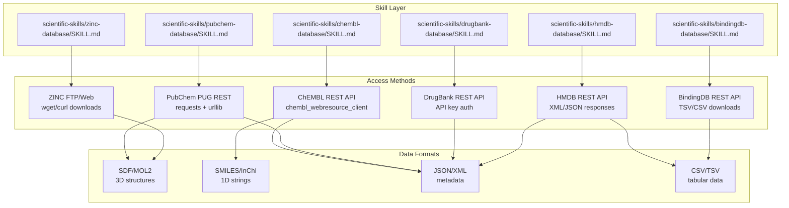
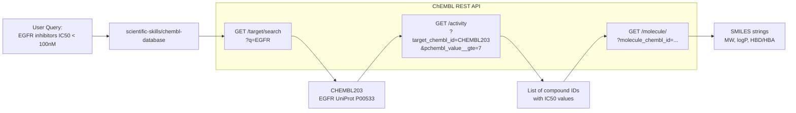
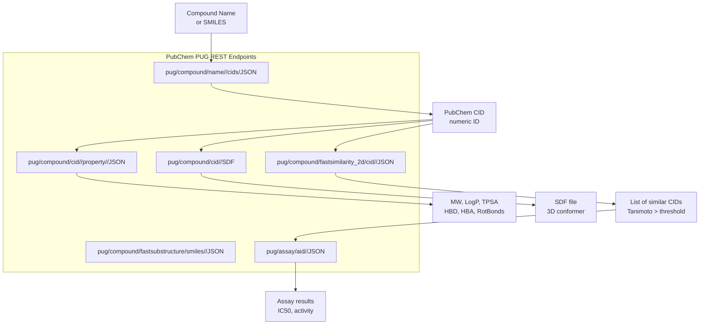
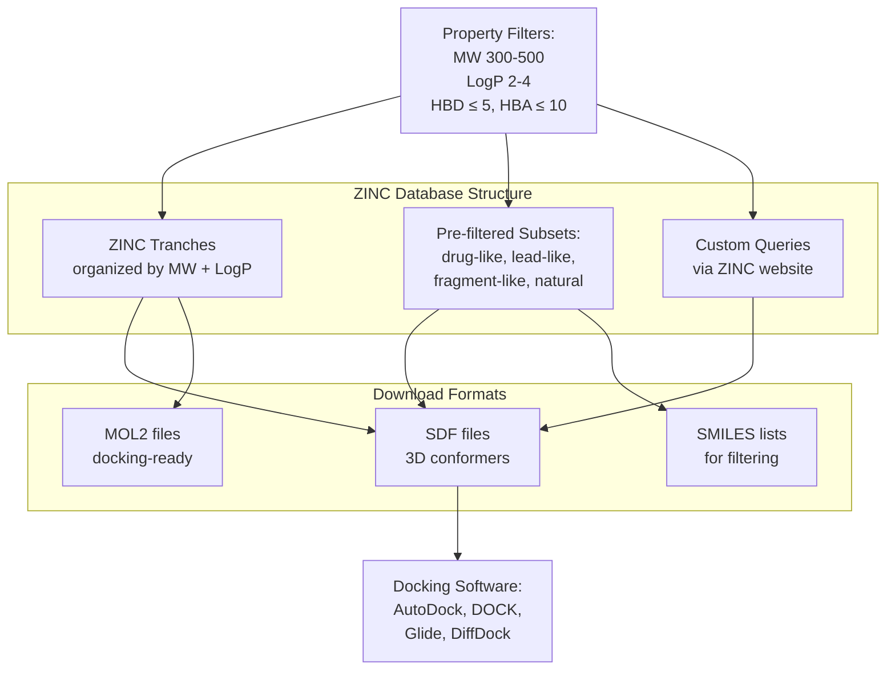
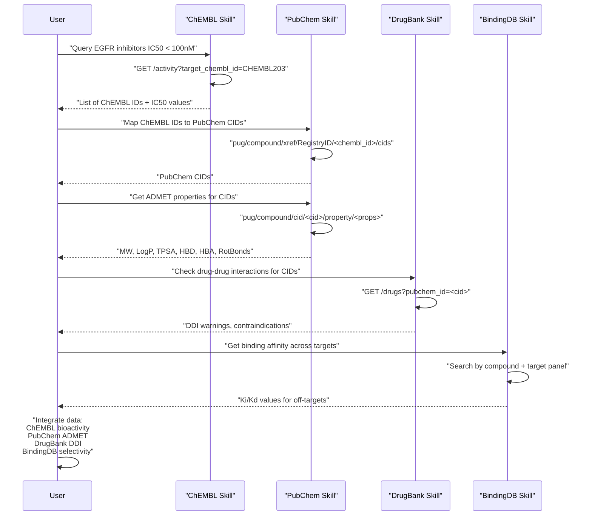

<!-- source: DeepWiki mcp.deepwiki.com · repo K-Dense-AI/claude-scientific-skills · page 5.4 Chemical and Drug Databases · fetched 2026-10-26 -->

# Chemical and Drug Databases

<details>
<summary>Relevant source files</summary>

The following files were used as context for generating this wiki page:

- [.claude-plugin/marketplace.json](.claude-plugin/marketplace.json)
- [README.md](README.md)
- [docs/scientific-skills.md](docs/scientific-skills.md)
- [scientific-skills/ginkgo-cloud-lab/SKILL.md](scientific-skills/ginkgo-cloud-lab/SKILL.md)
- [scientific-skills/ginkgo-cloud-lab/references/cell-free-protein-expression-optimization.md](scientific-skills/ginkgo-cloud-lab/references/cell-free-protein-expression-optimization.md)
- [scientific-skills/ginkgo-cloud-lab/references/cell-free-protein-expression-validation.md](scientific-skills/ginkgo-cloud-lab/references/cell-free-protein-expression-validation.md)
- [scientific-skills/ginkgo-cloud-lab/references/fluorescent-pixel-art-generation.md](scientific-skills/ginkgo-cloud-lab/references/fluorescent-pixel-art-generation.md)

</details>


## Purpose and Scope

This page documents the chemical and drug database skills available in the Claude Scientific Skills ecosystem. These skills provide programmatic access to six major chemical and pharmaceutical databases covering compound structures, bioactivity data, drug information, metabolomics, and binding affinities.

For general database access architecture and multi-database strategies, see [Database Access Architecture](#5.1). For clinical databases like ClinVar and COSMIC, see [Clinical and Healthcare Databases](#5.5). For protein structure databases like PDB and AlphaFold DB, see [Protein and Genomics Databases](#5.3).

**Sources**: [README.md:50-59](), [docs/scientific-skills.md:3-36]()

---

## Database Overview

The following table compares the six chemical and drug databases by content, scale, and primary use cases:

| Database | Content Type | Scale | API Access | Primary Use Cases |
|----------|-------------|-------|------------|-------------------|
| **ChEMBL** | Bioactive molecules | 2M+ compounds, 19M+ bioactivities, 13K+ targets | REST API | Drug discovery, target ID, SAR analysis |
| **PubChem** | Chemical compounds | 110M+ compounds, 270M+ bioactivity results | PUG REST/SOAP | Chemical search, property lookup, similarity |
| **DrugBank** | Drug information | 9,591+ drugs, 200+ fields/entry | REST API | Drug-drug interactions, ADMET, targets |
| **ZINC** | Purchasable compounds | 230M+ compounds, 100+ vendors | Web/FTP | Virtual screening, docking libraries |
| **HMDB** | Human metabolites | 220K+ metabolites | REST API | Metabolomics, biomarker discovery |
| **BindingDB** | Binding affinities | Drug-target pairs with Ki/Kd/IC50/EC50 | REST API | Binding affinity data, target profiling |

**Sources**: [README.md:54](), [docs/scientific-skills.md:6-34]()

---

## Database Architecture



**Database Access Architecture**

This diagram shows the mapping from skill files to API implementations and output formats. Each database skill (`SKILL.md`) encapsulates specific API client libraries or HTTP request patterns.

**Sources**: [.claude-plugin/marketplace.json:112-117](), [.claude-plugin/marketplace.json:136-142]()

---

## ChEMBL Database

ChEMBL is the primary bioactivity database for drug discovery workflows, providing manually curated compound-target-assay data from medicinal chemistry literature.

### Content and Scale

- **2M+ unique compounds** with structures (SMILES, InChI)
- **19M+ bioactivity measurements** (IC50, EC50, Ki, Kd values)
- **13K+ protein targets** mapped to UniProt
- **1.1M+ assays** from 90K+ publications
- **ADMET properties**, clinical trial data, patent information

### Access Pattern



**ChEMBL Query Workflow**

This diagram shows the typical API call sequence for bioactivity queries. Target search returns ChEMBL IDs, which filter activity queries, yielding compound IDs for structure retrieval.

### Key Features

- **chembl_webresource_client** Python package for REST API access
- **Bioactivity filtering** by target, assay type, confidence score
- **Cross-references** to UniProt, PDB, PubChem, DrugBank
- **Similarity and substructure search**
- **Bulk downloads** via FTP

### Use Cases

- Target-based compound retrieval for lead identification
- Structure-activity relationship (SAR) analysis
- Bioactivity prediction model training
- Drug repurposing via target overlap
- Competitive intelligence on published compounds

**Sources**: [README.md:54](), [docs/scientific-skills.md:7]()

---

## PubChem Database

PubChem is the largest free chemical database, maintained by NCBI, serving as a comprehensive resource for chemical structure and bioactivity data.

### Content and Scale

- **110M+ unique compounds** with 2D/3D structures
- **270M+ bioactivity test results** from PubChem BioAssay
- **300M+ chemical structures** including mixtures
- **1M+ patents** linked to structures
- **Vendor information** for commercial availability

### Access Pattern



**PubChem PUG REST API Call Flow**

This diagram maps natural language queries to PUG REST endpoint paths. CID (Compound ID) is the central identifier linking name, property, structure, and similarity queries.

### Key Features

- **PUG (Power User Gateway)** REST and SOAP APIs
- **Property calculation** for ADMET descriptors
- **Chemical similarity search** (Tanimoto coefficient)
- **Substructure matching** via SMARTS patterns
- **Spectral data** (IR, MS, NMR) where available
- **Integration with NCBI resources** (PubMed, Gene, Protein)

### Use Cases

- Physicochemical property lookup for ADMET filtering
- Chemical similarity searching for lead hopping
- Structure-based virtual screening library construction
- Vendor identification for compound procurement
- Bioassay data mining for target profiling

**Sources**: [README.md:54](), [docs/scientific-skills.md:28]()

---

## DrugBank Database

DrugBank provides comprehensive drug and drug-target data curated from FDA labels, literature, and clinical databases.

### Content and Scale

- **9,591+ drug entries** (2,037 FDA-approved, 6,000+ experimental)
- **200+ data fields per entry** including:
  - Chemical structures (SMILES, InChI, MOL files)
  - Pharmacology (mechanism, pharmacodynamics, ADME)
  - Drug-drug interactions (DDI)
  - Protein targets (enzymes, transporters, carriers)
  - Biological pathways
  - External identifiers (PubChem, ChEMBL, UniProt)

### Access Methods

DrugBank offers:
- **Web interface** for manual queries
- **REST API** requiring API key (commercial licenses available)
- **XML/CSV downloads** for bulk data access
- **Python client libraries** for programmatic queries

### Key Features

- **Drug-drug interaction checker** with severity ratings
- **Target annotations** linking drugs to protein targets
- **ADMET properties** from experimental and predicted data
- **Clinical trial information** and regulatory status
- **Pharmacogenomics data** for personalized medicine

### Use Cases

- Drug-drug interaction screening for polypharmacy
- Target-based drug discovery and repurposing
- ADMET property prediction model training
- Pathway analysis linking drugs to biological processes
- Chemical similarity searching for analog identification

**Sources**: [README.md:54](), [docs/scientific-skills.md:12]()

---

## ZINC Database

ZINC specializes in commercially available compounds optimized for virtual screening and molecular docking workflows.

### Content and Scale

- **230M+ purchasable compounds** from 100+ vendors
- **Ready-to-dock 3D formats** (SDF, MOL2) with pre-computed conformers
- **Vendor information** including pricing and delivery time
- **Subsets by property filters** (drug-like, lead-like, fragment-like, natural products)

### Access Pattern



**ZINC Virtual Screening Workflow**

This diagram shows the tranche-based organization and download paths. Tranches partition chemical space by MW and LogP, enabling efficient subset retrieval for docking.

### Key Features

- **Tranche-based organization** by molecular weight and LogP
- **Pre-computed 3D conformers** reducing docking preparation time
- **Drug-likeness filtering** (Lipinski, Veber rules)
- **FTP access** for bulk downloads
- **Integration with docking software** (AutoDock, DOCK, Glide)

### Use Cases

- Virtual screening campaigns requiring purchasable compounds
- Building docking libraries filtered by ADMET properties
- Fragment-based drug design library construction
- Lead identification with commercial availability
- Hit-to-lead optimization via analog procurement

**Sources**: [README.md:54](), [docs/scientific-skills.md:34]()

---

## HMDB (Human Metabolome Database)

HMDB is the comprehensive reference for endogenous human metabolites, supporting metabolomics and biomarker discovery.

### Content and Scale

- **220K+ metabolite entries** with detailed annotations
- **Chemical structures** and spectral data (NMR, MS, IR)
- **Concentration ranges** in blood, urine, CSF, saliva, feces
- **Disease associations** linking metabolites to pathologies
- **Pathway mappings** to KEGG, SMPDB
- **Protein interactions** and enzyme information

### Access Methods

- **REST API** for programmatic queries
- **Text search** by name, formula, mass
- **Spectral search** for MS/NMR peak matching
- **Bulk downloads** in XML/CSV formats

### Key Features

- **Biofluid concentration data** for normal vs. disease states
- **MS/MS spectral library** for metabolite identification
- **NMR chemical shifts** for structure elucidation
- **HMDB IDs** for standardized metabolite referencing
- **Cross-references** to PubChem, ChEBI, KEGG

### Use Cases

- Metabolite identification from MS or NMR data
- Biomarker discovery in disease cohorts
- Metabolic pathway analysis
- Reference concentration ranges for clinical interpretation
- Multi-omics integration linking metabolites to genes/proteins

**Sources**: [README.md:54](), [docs/scientific-skills.md:21]()

---

## BindingDB Database

BindingDB focuses on quantitative binding affinity data for drug-target interactions.

### Content and Scale

- **Drug-target binding affinities** (Ki, Kd, IC50, EC50)
- **2.9M+ binding measurements**
- **1.2M+ compounds** with activity data
- **8,000+ protein targets** from multiple species
- **Patent and literature curation**

### Access Methods

- **REST API** returning TSV/CSV data
- **Web interface** for manual searches
- **Bulk downloads** of complete datasets
- **Search by compound, target, or affinity threshold**

### Key Features

- **Quantitative binding data** with experimental conditions
- **Assay information** (method, temperature, pH)
- **Target sequence alignment** for homology analysis
- **Cross-references** to UniProt, PubChem, ChEMBL, DrugBank
- **Species-specific data** for human, mouse, rat targets

### Use Cases

- Target profiling to assess selectivity
- Binding affinity prediction model training
- Lead optimization via SAR analysis
- Cross-species activity comparison
- Kinetic parameter retrieval for mechanistic studies

**Sources**: [README.md:54](), [docs/scientific-skills.md:7]()

---

## Integration Workflows

### Multi-Database Compound Profiling



**Multi-Database Compound Profiling Workflow**

This sequence diagram demonstrates cross-database integration for comprehensive compound characterization. ChEMBL provides bioactivity, PubChem calculates properties, DrugBank checks interactions, and BindingDB assesses selectivity.

**Sources**: [README.md:220-232](), [docs/scientific-skills.md:7-34]()

---

## Cheminformatics Skill Integration

Chemical and drug databases integrate with cheminformatics analysis skills for end-to-end workflows:

| Database Output | Cheminformatics Skill | Integration Point |
|-----------------|----------------------|-------------------|
| ChEMBL SMILES | `scientific-skills/rdkit` | Structure manipulation, descriptor calculation |
| PubChem SDF | `scientific-skills/datamol` | Analog generation, diversity analysis |
| DrugBank targets | `scientific-skills/diffdock` | Molecular docking predictions |
| ZINC 3D structures | `scientific-skills/deepchem` | ADMET property prediction |
| HMDB metabolites | `scientific-skills/rdkit` | Metabolite fragmentation analysis |
| BindingDB affinities | `scientific-skills/molfeat` | Molecular fingerprinting for QSAR |

**Database-to-Analysis Skill Mappings**

**Sources**: [README.md:406-421](), [.claude-plugin/marketplace.json:30-35](), [.claude-plugin/marketplace.json:86]()

---

## Common Access Patterns

### Pattern 1: Structure-Based Compound Retrieval

```
1. User specifies target protein (e.g., "EGFR")
2. Query ChEMBL for bioactive compounds
3. Retrieve SMILES from ChEMBL API
4. Convert SMILES to 3D structures using RDKit
5. Export to SDF for docking with DiffDock
```

**Relevant Skills**: `scientific-skills/chembl-database`, `scientific-skills/rdkit`, `scientific-skills/diffdock`

### Pattern 2: Property-Based Filtering

```
1. User defines Lipinski filters (MW < 500, LogP < 5, HBD ≤ 5, HBA ≤ 10)
2. Query PubChem for compounds matching filters
3. Retrieve CIDs and download SDF files
4. Calculate additional descriptors with RDKit
5. Rank by drug-likeness score
```

**Relevant Skills**: `scientific-skills/pubchem-database`, `scientific-skills/rdkit`, `scientific-skills/datamol`

### Pattern 3: Target Profiling

```
1. User provides compound SMILES
2. Query ChEMBL for bioactivity across all targets
3. Query BindingDB for binding affinities
4. Map targets to UniProt IDs
5. Identify off-targets with Ki < 1 μM
```

**Relevant Skills**: `scientific-skills/chembl-database`, `scientific-skills/bindingdb-database`, `scientific-skills/uniprot-database`

### Pattern 4: Metabolite Identification

```
1. User provides MS/MS spectrum
2. Query HMDB spectral library for matches
3. Retrieve candidate metabolite structures
4. Query PubChem for additional annotations
5. Confirm with concentration ranges from HMDB
```

**Relevant Skills**: `scientific-skills/hmdb-database`, `scientific-skills/pubchem-database`, `scientific-skills/matchms`

**Sources**: [docs/scientific-skills.md:7-34](), [README.md:220-284]()

---

## Authentication and Rate Limits

| Database | Authentication | Rate Limit | Notes |
|----------|---------------|------------|-------|
| ChEMBL | None | No strict limit | Consider caching for bulk queries |
| PubChem | None | 5 requests/second per IP | Use POST for large queries |
| DrugBank | API key required | Varies by license | Commercial licenses for API access |
| ZINC | None | FTP preferred for bulk | Web queries limited by server capacity |
| HMDB | None | Reasonable use | Bulk downloads via FTP recommended |
| BindingDB | None | No published limit | TSV downloads for large datasets |

**Database Access Requirements**

**Sources**: [docs/scientific-skills.md:7-34]()

---

## Skill File References

Each database is implemented as a standalone skill under `scientific-skills/`:

- [scientific-skills/chembl-database/SKILL.md]()
- [scientific-skills/pubchem-database/SKILL.md]()
- [scientific-skills/drugbank-database/SKILL.md]()
- [scientific-skills/zinc-database/SKILL.md]()
- [scientific-skills/hmdb-database/SKILL.md]()
- [scientific-skills/bindingdb-database/SKILL.md]()

Skill registration in marketplace:

- [.claude-plugin/marketplace.json:112]() - ChEMBL Database
- [.claude-plugin/marketplace.json:136]() - PubChem Database  
- [.claude-plugin/marketplace.json:117]() - DrugBank Database
- [.claude-plugin/marketplace.json:142]() - ZINC Database
- [.claude-plugin/marketplace.json:127]() - HMDB Database
- [.claude-plugin/marketplace.json:108]() - BindingDB Database

**Sources**: [.claude-plugin/marketplace.json:11-194]()

---

