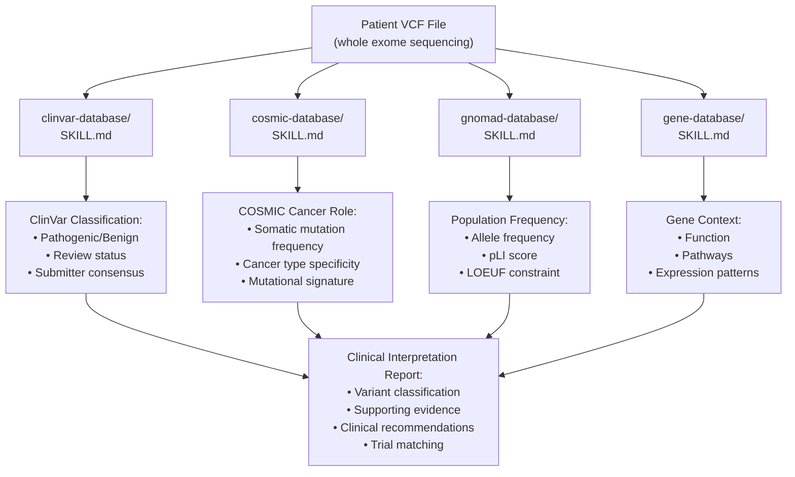
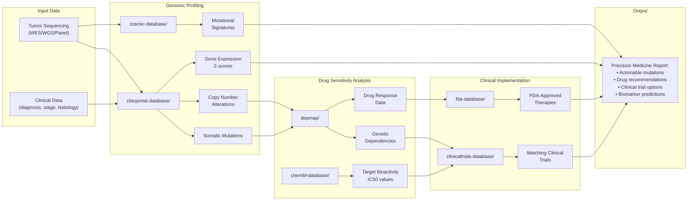
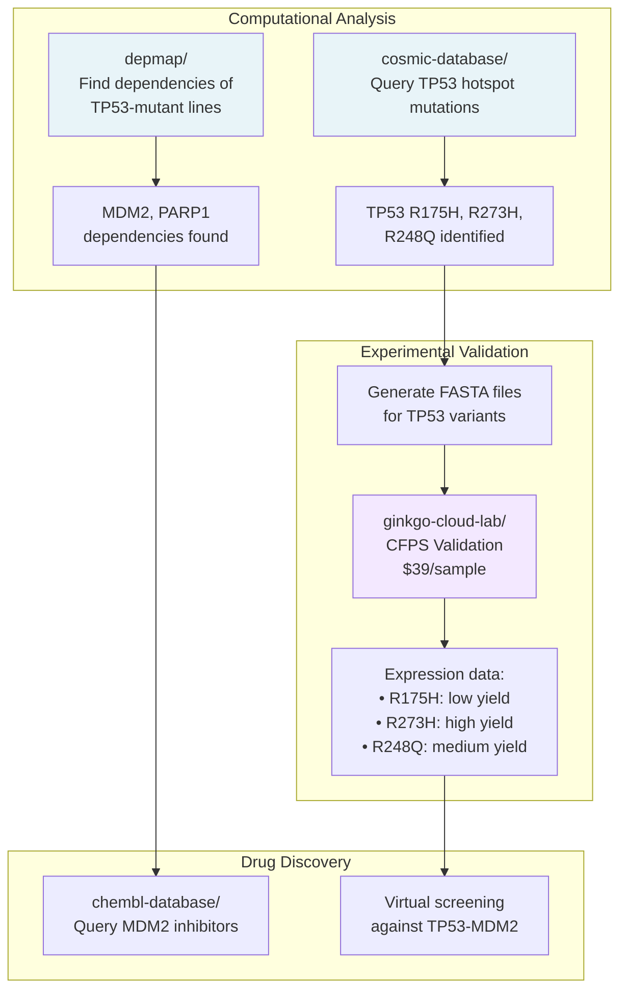

<!-- source: DeepWiki mcp.deepwiki.com · repo K-Dense-AI/claude-scientific-skills · page 5.5 Clinical and Healthcare Databases · fetched 2026-10-26 -->

# Clinical and Healthcare Databases

<details>
<summary>Relevant source files</summary>

The following files were used as context for generating this wiki page:

- [.claude-plugin/marketplace.json](.claude-plugin/marketplace.json)
- [README.md](README.md)
- [docs/scientific-skills.md](docs/scientific-skills.md)
- [scientific-skills/ginkgo-cloud-lab/SKILL.md](scientific-skills/ginkgo-cloud-lab/SKILL.md)
- [scientific-skills/ginkgo-cloud-lab/references/cell-free-protein-expression-optimization.md](scientific-skills/ginkgo-cloud-lab/references/cell-free-protein-expression-optimization.md)
- [scientific-skills/ginkgo-cloud-lab/references/cell-free-protein-expression-validation.md](scientific-skills/ginkgo-cloud-lab/references/cell-free-protein-expression-validation.md)
- [scientific-skills/ginkgo-cloud-lab/references/fluorescent-pixel-art-generation.md](scientific-skills/ginkgo-cloud-lab/references/fluorescent-pixel-art-generation.md)

</details>


## Purpose and Scope

This page documents the clinical and healthcare database skills available in the Claude Scientific Skills ecosystem. These skills provide programmatic access to 9 major clinical databases covering variant interpretation, cancer genomics, clinical trials, pharmacogenomics, drug safety, rare diseases, and medical imaging. Together, these databases enable precision medicine workflows, clinical variant annotation, cancer research, drug safety analysis, and patient stratification.

For general database access architecture and multi-database aggregators, see [Database Access Architecture](#5.1). For biomedical literature databases, see [Biomedical Literature and Reference Management](#5.2). For protein and genomics databases used in research contexts, see [Protein and Genomics Databases](#5.3).

**Sources:** [README.md:1-50](), [docs/scientific-skills.md:1-36](), [.claude-plugin/marketplace.json:111-132]()

---

## Database Categories Overview

Clinical and healthcare databases in this skill collection are organized into five functional categories:

| Category | Databases | Primary Use Cases |
|----------|-----------|-------------------|
| **Variant Interpretation** | ClinVar, COSMIC, gnomAD | Pathogenicity assessment, cancer mutation cataloging, population allele frequencies |
| **Cancer Genomics** | cBioPortal, DepMap, COSMIC | Multi-omics cancer analysis, drug sensitivity screening, survival analysis |
| **Clinical Trials & Regulation** | ClinicalTrials.gov, FDA Databases | Trial matching, adverse event monitoring, drug safety surveillance |
| **Pharmacogenomics** | ClinPGx | Gene-drug interactions, dosing guidelines, clinical implementation |
| **Rare Disease & Imaging** | Monarch Initiative, NCI Imaging Data Commons | Phenotype-gene associations, cancer imaging datasets |

**Sources:** [README.md:425-433](), [docs/scientific-skills.md:7-17]()

---

## Clinical Database Skills Architecture

```mermaid
graph TB
    subgraph "Skill Directory Structure"
        SkillsDir["scientific-skills/"]
        
        ClinVar["clinvar-database/<br/>SKILL.md"]
        COSMIC["cosmic-database/<br/>SKILL.md"]
        ClinTrials["clinicaltrials-database/<br/>SKILL.md"]
        ClinPGx["clinpgx-database/<br/>SKILL.md"]
        FDA["fda-database/<br/>SKILL.md"]
        cBio["cbioportal-database/<br/>SKILL.md"]
        DepMap["depmap/<br/>SKILL.md"]
        Monarch["monarch-database/<br/>SKILL.md"]
        IDC["imaging-data-commons/<br/>SKILL.md"]
    end
    
    subgraph "Variant Interpretation Workflow"
        VCF["VCF File"]
        VCF --> ClinVar
        VCF --> COSMIC
        ClinVar --> PathReport["Pathogenicity<br/>Classification"]
        COSMIC --> CancerReport["Somatic Mutation<br/>Analysis"]
    end
    
    subgraph "Precision Medicine Workflow"
        Patient["Patient Data"]
        Patient --> ClinVar
        Patient --> ClinPGx
        Patient --> ClinTrials
        ClinVar --> GenReport["Genomic Report"]
        ClinPGx --> DrugRec["Drug Dosing<br/>Recommendations"]
        ClinTrials --> TrialMatch["Clinical Trial<br/>Matching"]
    end
    
    subgraph "Cancer Research Workflow"
        CancerSample["Cancer Sample"]
        CancerSample --> cBio
        CancerSample --> DepMap
        CancerSample --> COSMIC
        cBio --> MultiOmics["Multi-Omics<br/>Profiling"]
        DepMap --> DrugSens["Drug Sensitivity<br/>Predictions"]
        COSMIC --> MutSig["Mutational<br/>Signatures"]
    end
    
    SkillsDir --> ClinVar
    SkillsDir --> COSMIC
    SkillsDir --> ClinTrials
    SkillsDir --> ClinPGx
    SkillsDir --> FDA
    SkillsDir --> cBio
    SkillsDir --> DepMap
    SkillsDir --> Monarch
    SkillsDir --> IDC
    
    style SkillsDir fill:#f9f9f9,stroke:#333,stroke-width:2px
    style ClinVar fill:#e8f4f8
    style COSMIC fill:#e8f4f8
    style cBio fill:#e8f4f8
```



**Diagram 1: Clinical Database Skills Organization and Workflow Integration**

This diagram maps the directory structure of clinical database skills to their usage in three major workflows: variant interpretation (VCF annotation), precision medicine (patient-specific recommendations), and cancer research (multi-omics analysis). Each database skill resides in its own directory under `scientific-skills/` with a `SKILL.md` file defining its capabilities.

**Sources:** [.claude-plugin/marketplace.json:111-132](), [docs/scientific-skills.md:7-17]()

---

## Core Variant Interpretation Databases

### ClinVar Database

**Skill Path:** `scientific-skills/clinvar-database/`

ClinVar is NCBI's public archive of genomic variants and their clinical significance, providing standardized classifications for variant interpretation in clinical genetics and precision medicine.

**Key Capabilities:**
- Variant classification retrieval (pathogenic, benign, VUS, likely pathogenic, likely benign)
- E-utilities API access for programmatic queries
- Bulk FTP downloads for offline analysis
- Variant aggregation by gene, condition, or submitter
- Historical submission tracking and review status

**Access Methods:**
| Method | Use Case | Rate Limit |
|--------|----------|------------|
| E-utilities API | Programmatic variant lookup | 3 req/sec without API key, 10 req/sec with key |
| Entrez search | Gene/condition-based queries | Same as E-utilities |
| FTP downloads | Bulk variant dataset retrieval | No limit (file-based) |
| VCF annotation | Pipeline integration | Depends on API usage |

**Typical Workflow:**
1. Parse VCF file with variant coordinates
2. Query ClinVar via E-utilities using variant identifiers (rs IDs, HGVS notation)
3. Extract clinical significance and review status
4. Filter by assertion criteria (expert panel, practice guideline, multiple submitters)
5. Generate clinical interpretation report

**Sources:** [README.md:426](), [docs/scientific-skills.md:9]()

---

### COSMIC Database

**Skill Path:** `scientific-skills/cosmic-database/`

Catalogue of Somatic Mutations in Cancer (COSMIC) is the world's largest database of somatic cancer mutations, maintained by the Wellcome Sanger Institute.

**Key Features:**
- **Mutation Data:** Millions of somatic mutations across thousands of cancer types
- **Cancer Gene Census:** Curated list of genes causally implicated in cancer
- **Mutational Signatures:** SBS, DBS, and ID signatures (COSMIC v3.4)
- **Structural Variants:** Gene fusions, copy number alterations, chromosomal rearrangements
- **Drug Resistance Data:** Mutations conferring resistance to targeted therapies
- **Whole Genome Screens:** CRISPR/RNAi screen results

**Data Categories:**
| Category | Content | Access Method |
|----------|---------|---------------|
| Coding mutations | Non-synonymous, synonymous, frameshift | REST API, web interface |
| Non-coding mutations | Regulatory, intronic, UTR | REST API, bulk download |
| Gene fusions | Fusion transcripts, breakpoints | REST API |
| Copy number variants | Amplifications, deletions | REST API |
| Expression data | Gene expression changes | REST API |
| Drug sensitivity | IC50, EC50 values | REST API |

**Authentication:**
- Free tier: Limited access to core data
- Full access: Requires commercial or academic license
- API access: Token-based authentication

**Sources:** [README.md:426](), [docs/scientific-skills.md:11]()

---

### cBioPortal Database

**Skill Path:** `scientific-skills/cbioportal-database/`

cBioPortal for Cancer Genomics provides access to multi-omics data from 400+ cancer studies, enabling integrated analysis of somatic mutations, copy number alterations, gene expression, and clinical outcomes.

**Data Types Available:**
- **Mutations:** Somatic mutations with mutation type, protein change, functional impact
- **Copy Number Alterations (CNAs):** Gene-level and segment-level amplifications/deletions
- **mRNA Expression:** Z-scores relative to normal or all samples
- **Protein Expression:** RPPA (Reverse Phase Protein Array) data
- **Methylation:** DNA methylation beta values
- **Clinical Data:** Patient demographics, survival, treatment response

**Major Study Collections:**
| Study Collection | Samples | Cancer Types | Data Types |
|-----------------|---------|--------------|------------|
| TCGA Pan-Cancer | 10,000+ | 33 types | Mutations, CNA, expression, methylation |
| MSK-IMPACT | 50,000+ | Multiple | Targeted sequencing (468 genes) |
| METABRIC | 2,509 | Breast cancer | Mutations, CNA, expression, clinical |
| GENIE | 120,000+ | Multiple | Mutations, CNA (consortium data) |

**API Endpoints:**
- `GET /studies` - List available cancer studies
- `GET /studies/{studyId}/mutations` - Retrieve mutations for a study
- `GET /studies/{studyId}/clinical-data` - Get clinical annotations
- `POST /molecular-profiles/mutations` - Query mutations across multiple genes
- `GET /patients/{patientId}/survival-data` - Retrieve survival information

**Query Patterns:**
```
# Example: Query TP53 mutations in lung adenocarcinoma
studyId: "luad_tcga"
geneList: ["TP53", "EGFR", "KRAS"]
molecularProfileId: "luad_tcga_mutations"

# Filter by mutation type
mutationType: "Missense_Mutation"
proteinChange: "p.R273H"

# Include clinical data
includeClinicalData: true
clinicalAttributes: ["OVERALL_SURVIVAL", "DISEASE_FREE_SURVIVAL"]
```

**Sources:** [README.md:427](), [docs/scientific-skills.md:11-12]()

---

### DepMap Database

**Skill Path:** `scientific-skills/depmap/`

Cancer Dependency Map (DepMap) provides systematic mapping of cancer vulnerabilities across 1,000+ cancer cell lines, enabling identification of genetic dependencies and drug sensitivities.

**Core Datasets:**
| Dataset | Description | Dimensions |
|---------|-------------|------------|
| CRISPR screens | Gene knockout dependency scores | ~1,000 cell lines × ~18,000 genes |
| RNAi screens | Gene knockdown dependency scores | ~700 cell lines × ~17,000 genes |
| Drug sensitivity | Compound response (AUC, IC50) | ~900 cell lines × ~500 compounds |
| Omics profiles | Mutations, expression, methylation | Cell line annotations |
| Cell line metadata | Lineage, disease, molecular features | Categorical annotations |

**Dependency Scoring:**
- **Negative scores:** Gene/compound dependency (loss of fitness)
- **Zero scores:** No effect on cell viability
- **Positive scores:** Gene/compound improves fitness
- **Threshold:** Dependency typically < -0.5 (CRISPR) or < -1.0 (RNAi)

**Key Use Cases:**
1. **Target Identification:** Find genes essential in specific cancer types
2. **Biomarker Discovery:** Correlate dependencies with mutations or expression
3. **Drug Repurposing:** Identify cell lines sensitive to existing compounds
4. **Synthetic Lethality:** Discover genetic interactions (gene A dependency + gene B mutation)
5. **Mechanistic Studies:** Understand pathway dependencies

**Access Methods:**
- Web interface: https://depmap.org/portal/
- DepMap API: Programmatic data retrieval
- Bulk downloads: CSV/TSV files for offline analysis
- R package (`depmap`): Direct R integration

**Sources:** [README.md:427](), [docs/scientific-skills.md:11-12]()

---

## Clinical Trial and Regulatory Databases

### ClinicalTrials.gov Database

**Skill Path:** `scientific-skills/clinicaltrials-database/`

Comprehensive registry of clinical studies conducted worldwide, maintained by the U.S. National Library of Medicine. Provides API v2 access with no authentication required.

**Search Capabilities:**
| Search Parameter | Description | Example Values |
|------------------|-------------|----------------|
| `query.cond` | Medical condition | "Breast Cancer", "EGFR Mutation" |
| `query.term` | Intervention/treatment | "Osimertinib", "Immunotherapy" |
| `query.locn` | Geographic location | "Boston, MA", "United States" |
| `filter.overallStatus` | Trial status | "RECRUITING", "COMPLETED", "ACTIVE_NOT_RECRUITING" |
| `filter.phase` | Study phase | "PHASE1", "PHASE2", "PHASE3", "PHASE4" |
| `filter.studyType` | Study design | "INTERVENTIONAL", "OBSERVATIONAL" |

**API v2 Features:**
- **Rate Limit:** ~50 requests/minute (no authentication required)
- **Response Formats:** JSON, CSV
- **Pagination:** Automatic handling of large result sets
- **Field Selection:** Specify which data fields to retrieve
- **Advanced Filtering:** Boolean operators, date ranges, study characteristics

**Retrieved Data Fields:**
- Protocol information (NCT ID, official title, brief summary)
- Eligibility criteria (inclusion/exclusion criteria, age, sex)
- Study design (phase, type, allocation, masking)
- Intervention details (drug name, dosage, administration)
- Outcomes (primary and secondary endpoints)
- Contact information (principal investigator, study locations)
- Study status (recruitment status, completion dates)

**Typical Query:**
```
# Find recruiting trials for EGFR-mutant NSCLC in Boston
query.cond: "Non-Small Cell Lung Cancer"
query.term: "EGFR"
filter.overallStatus: "RECRUITING"
query.locn: "Boston, MA"
filter.phase: "PHASE2|PHASE3"
```

**Sources:** [README.md:426](), [docs/scientific-skills.md:10]()

---

### FDA Databases

**Skill Path:** `scientific-skills/fda-database/`

Comprehensive access to FDA regulatory databases through the openFDA API, covering drugs, medical devices, foods, and veterinary products.

**Database Categories:**

```mermaid
graph LR
    subgraph "FDA Database Ecosystem"
        OpenFDA["openFDA API"]
        
        subgraph "Drug Databases"
            DrugAE["Drug Adverse Events<br/>(FAERS)"]
            DrugLabel["Drug Labeling<br/>(SPL)"]
            DrugNDC["National Drug Code<br/>(NDC Directory)"]
            DrugRecall["Drug Recalls"]
            DrugApproval["Drug Approvals<br/>(Drugs@FDA)"]
            DrugShortage["Drug Shortages"]
        end
        
        subgraph "Device Databases"
            DeviceAE["Device Adverse Events<br/>(MAUDE)"]
            Device510k["510(k) Clearances"]
            DevicePMA["PMA Approvals"]
            DeviceUDI["Unique Device ID"]
            DeviceClass["Device Classifications"]
        end
        
        subgraph "Food/Other Databases"
            FoodRecall["Food Recalls"]
            FoodAE["Food Adverse Events"]
            AnimalAE["Animal Drug<br/>Adverse Events"]
            Substance["UNII Substance<br/>Data"]
        end
    end
    
    OpenFDA --> DrugAE
    OpenFDA --> DrugLabel
    OpenFDA --> DrugNDC
    OpenFDA --> DrugRecall
    OpenFDA --> DrugApproval
    OpenFDA --> DrugShortage
    OpenFDA --> DeviceAE
    OpenFDA --> Device510k
    OpenFDA --> DevicePMA
    OpenFDA --> DeviceUDI
    OpenFDA --> DeviceClass
    OpenFDA --> FoodRecall
    OpenFDA --> FoodAE
    OpenFDA --> AnimalAE
    OpenFDA --> Substance
    
    style OpenFDA fill:#f9f9f9,stroke:#333,stroke-width:2px
```



**Diagram 2: FDA Database Ecosystem via openFDA API**

The openFDA API provides unified access to 15+ FDA databases spanning drug safety, medical devices, food safety, and substance information. Each endpoint supports standardized query syntax with field-specific filtering.

**Key Endpoints and Use Cases:**

| Endpoint | Database | Primary Use Cases |
|----------|----------|-------------------|
| `/drug/event` | FAERS | Adverse event surveillance, signal detection |
| `/drug/label` | SPL | Drug indication lookup, contraindication checking |
| `/drug/ndc` | NDC Directory | Drug identification, package information |
| `/drug/enforcement` | Recalls | Drug recall monitoring, lot tracking |
| `/device/event` | MAUDE | Device adverse event analysis |
| `/device/510k` | 510(k) | Device clearance history |
| `/food/enforcement` | Food Recalls | Food safety monitoring |
| `/other/substance` | UNII | Chemical structure lookup, substance identification |

**Query Parameters:**
- `search`: Field-specific search (e.g., `patient.drug.openfda.brand_name:"Keytruda"`)
- `count`: Aggregation by field (e.g., `count=patient.reaction.reactionmeddrapt.exact`)
- `limit`: Result size (max 1000)
- `skip`: Pagination offset

**Rate Limits:**
- Without API key: 240 requests/minute, 120,000 requests/day
- With API key: 1,000 requests/minute, unlimited daily requests

**Sources:** [README.md:426-427](), [docs/scientific-skills.md:15]()

---

## Pharmacogenomics Databases

### ClinPGx Database

**Skill Path:** `scientific-skills/clinpgx-database/`

Clinical pharmacogenomics database providing gene-drug interactions, CPIC guidelines, allele functions, drug labels, and pharmacogenomic annotations. Successor to PharmGKB, consolidating resources from PharmGKB, CPIC (Clinical Pharmacogenetics Implementation Consortium), and PharmCAT.

**Core Data Types:**

| Data Type | Description | Clinical Utility |
|-----------|-------------|------------------|
| **Gene-Drug Pairs** | Pharmacogene associations with drugs | Identify relevant genes for a drug |
| **CPIC Guidelines** | Evidence-based dosing recommendations | Clinical implementation protocols |
| **Allele Functions** | Functional impact of genetic variants | Interpret genotype results |
| **Drug Labels** | FDA-approved pharmacogenomic label sections | Regulatory guidance |
| **Diplotypes** | Phased allele combinations | Activity score calculation |
| **Phenotypes** | Metabolizer status (PM, IM, NM, RM, UM) | Clinical phenotype assignment |

**Major Pharmacogenes Covered:**
- **CYP450 enzymes:** CYP2D6, CYP2C19, CYP2C9, CYP3A4, CYP3A5
- **Transporters:** SLCO1B1, ABCB1, ABCG2
- **Drug targets:** DPYD, TPMT, NUDT15, UGT1A1
- **HLA genes:** HLA-B, HLA-A (hypersensitivity reactions)
- **Other:** VKORC1 (warfarin), G6PD (drug-induced hemolysis)

**Clinical Decision Support Workflow:**
1. **Genotype Input:** Patient genotype or sequencing data
2. **Diplotype Assignment:** Convert genotypes to diplotypes using PharmCAT
3. **Phenotype Prediction:** Map diplotypes to metabolizer status
4. **Guideline Lookup:** Retrieve CPIC recommendations for drug
5. **Dosing Recommendation:** Evidence-based dose adjustment
6. **Label Check:** Cross-reference FDA label for additional guidance

**CPIC Guideline Levels:**
- **Level A:** High evidence, mandatory testing recommended
- **Level B:** Moderate evidence, testing suggested
- **Level C:** Preliminary evidence
- **Level D:** Insufficient evidence

**Sources:** [README.md:426](), [docs/scientific-skills.md:8]()

---

## Rare Disease and Medical Imaging Databases

### Monarch Initiative Database

**Skill Path:** `scientific-skills/monarch-database/`

Monarch Initiative integrates genotype-phenotype data across species, providing comprehensive disease-gene associations with phenotype ontologies (HPO), model organism data, and clinical variant annotations.

**Integrated Data Sources:**
| Source | Content | Coverage |
|--------|---------|----------|
| **OMIM** | Mendelian disease-gene associations | 6,000+ diseases |
| **ORPHANET** | Rare disease definitions and classifications | 9,000+ rare diseases |
| **HPO** | Human Phenotype Ontology terms | 16,000+ phenotypes |
| **ClinVar** | Variant-disease associations | Cross-referenced variants |
| **MGI** | Mouse model phenotypes | Gene knockout phenotypes |
| **ZFIN** | Zebrafish model data | Developmental phenotypes |
| **FlyBase** | Drosophila genetic data | Ortholog phenotypes |
| **WormBase** | C. elegans genetic data | Functional genomics |

**Cross-Species Phenotype Mapping:**
Monarch uses ontology-based phenotype matching to translate phenotypes across species. For example:
- Human HPO term: "Seizure" (HP:0001250)
- Mouse MP term: "abnormal seizure threshold" (MP:0002064)
- Zebrafish ZP term: "abnormal motor neuron morphology"

This enables identification of disease models and candidate genes using model organism data.

**API Capabilities:**
- **Disease lookup:** Search by disease name, OMIM ID, ORPHANET ID
- **Gene-disease associations:** Retrieve all genes associated with a disease
- **Phenotype-gene associations:** Find genes matching a phenotype profile
- **Cross-species orthologs:** Map human genes to model organisms
- **Variant annotations:** Link variants to diseases and phenotypes

**Rare Disease Workflow:**
1. Input patient phenotype profile (HPO terms)
2. Query Monarch for genes matching phenotype combination
3. Prioritize candidate genes using disease associations
4. Check model organism data for supporting evidence
5. Review ClinVar for known pathogenic variants in candidate genes
6. Generate differential diagnosis list

**Sources:** [README.md:428](), [docs/scientific-skills.md:11-12]()

---

### NCI Imaging Data Commons (IDC)

**Skill Path:** `scientific-skills/imaging-data-commons/`

NCI Imaging Data Commons provides cloud-based access to cancer imaging datasets, including radiology (CT, MRI, PET) and digital pathology (whole slide images), with standardized DICOM metadata and analysis-ready formats.

**Available Imaging Modalities:**

| Modality | Description | Typical Use Cases |
|----------|-------------|-------------------|
| **CT (Computed Tomography)** | 3D anatomical imaging | Tumor volumetrics, treatment response |
| **MRI (Magnetic Resonance)** | Soft tissue contrast | Brain tumors, prostate cancer |
| **PET (Positron Emission)** | Metabolic imaging | FDG-PET for metastasis detection |
| **Digital Pathology** | Whole slide images (WSI) | Histopathology, immune infiltration |
| **Multimodal** | Combined imaging types | Correlative imaging studies |

**Data Access via idc-index:**

The `idc-index` Python package provides programmatic access to IDC datasets:

```
# Example query structure (pseudocode, not actual code)
from idc_index import index

# Query by collection
collections = index.collections()

# Query by patient
patients = index.sql_query("SELECT * FROM dicom_all WHERE collection_id = 'TCGA-LUAD'")

# Filter by modality
ct_studies = index.sql_query("SELECT * FROM dicom_all WHERE Modality = 'CT'")

# Get download URLs
urls = index.download_from_selection(patient_ids=["TCGA-LUAD-0001"])
```

**Major Cancer Collections:**
- **TCGA** (The Cancer Genome Atlas): Imaging for 10,000+ patients across 33 cancer types
- **NLST** (National Lung Screening Trial): CT scans for lung cancer screening
- **CPTAC** (Clinical Proteomic Tumor Analysis): Multi-omics + imaging
- **QIN** (Quantitative Imaging Network): Imaging biomarker validation

**DICOM Metadata Schema:**
- Patient demographics (age, sex)
- Study information (date, description)
- Series details (modality, body part)
- Instance metadata (slice thickness, pixel spacing)
- Clinical annotations (tumor measurements, response assessment)

**Integration with Analysis Tools:**
- **3D Slicer:** Medical image visualization and analysis
- **OHIF Viewer:** Web-based DICOM viewer
- **nnU-Net:** Deep learning segmentation
- **pyradiomics:** Radiomics feature extraction

**Sources:** [README.md:428-429](), [docs/scientific-skills.md:12]()

---

## Multi-Database Clinical Workflows

### Workflow 1: Comprehensive Variant Interpretation



**Diagram 3: Multi-Database Variant Interpretation Workflow**

This workflow demonstrates integration of four database skills (`clinvar-database/`, `cosmic-database/`, `gnomad-database/`, `gene-database/`) to perform comprehensive variant interpretation. Each database provides complementary evidence: ClinVar for clinical significance, COSMIC for somatic cancer context, gnomAD for population frequencies, and NCBI Gene for functional context.

**Workflow Steps:**
1. Parse VCF file to extract variants (chromosome, position, ref, alt)
2. Query ClinVar for germline pathogenicity classifications
3. Query COSMIC for somatic mutation frequency in cancer
4. Query gnomAD for population allele frequencies and constraint metrics
5. Query NCBI Gene for gene function and pathway information
6. Integrate evidence across databases using ACMG/AMP guidelines
7. Generate structured clinical report with variant classifications

**Sources:** [README.md:290-301](), [docs/scientific-skills.md:9-27]()

---

### Workflow 2: Cancer Precision Medicine Pipeline



**Diagram 4: Multi-Database Cancer Precision Medicine Workflow**

This workflow integrates six database skills to generate a comprehensive precision medicine report. The workflow proceeds through three stages: (1) genomic profiling using cBioPortal and COSMIC, (2) drug sensitivity analysis using DepMap and ChEMBL, and (3) clinical implementation matching using ClinicalTrials.gov and FDA databases.

**Integration Points:**
- **cBioPortal → DepMap:** Map tumor mutations to cell line dependencies
- **DepMap → ChEMBL:** Link genetic dependencies to druggable targets
- **ChEMBL → ClinicalTrials:** Identify trials testing relevant compounds
- **COSMIC → FDA:** Match mutational signatures to approved targeted therapies

**Precision Medicine Decision Logic:**
1. Identify actionable mutations (e.g., EGFR L858R, BRAF V600E)
2. Query DepMap for cell lines with matching mutations
3. Retrieve drug sensitivity data for those cell lines
4. Cross-reference with ChEMBL bioactivity for target validation
5. Search ClinicalTrials.gov for trials enrolling relevant mutations
6. Check FDA databases for approved therapies with mutation-specific labels
7. Generate ranked treatment recommendations with evidence levels

**Sources:** [README.md:254-269](), [docs/scientific-skills.md:7-31]()

---

## Clinical Database Skills Comparison

| Database | Skill Directory | Data Type | Update Frequency | Authentication Required | Rate Limits |
|----------|----------------|-----------|------------------|------------------------|-------------|
| ClinVar | `clinvar-database/` | Germline variants | Weekly | Optional (API key) | 3 req/sec (no key), 10 req/sec (with key) |
| COSMIC | `cosmic-database/` | Somatic mutations | Quarterly | Yes (license) | Varies by license tier |
| cBioPortal | `cbioportal-database/` | Multi-omics cancer | Continuous | No | No formal limit |
| DepMap | `depmap/` | Cell line dependencies | Quarterly | No | No formal limit |
| ClinicalTrials.gov | `clinicaltrials-database/` | Clinical trials | Daily | No | ~50 req/min |
| ClinPGx | `clinpgx-database/` | Pharmacogenomics | Continuous | No | No formal limit |
| FDA (openFDA) | `fda-database/` | Drug/device safety | Daily | Optional (API key) | 240 req/min (no key), 1000 req/min (with key) |
| Monarch Initiative | `monarch-database/` | Disease-phenotype-gene | Monthly | No | No formal limit |
| NCI IDC | `imaging-data-commons/` | Cancer imaging | Continuous | No | No formal limit |

**Sources:** [docs/scientific-skills.md:7-36](), [.claude-plugin/marketplace.json:111-132]()

---

## Skill File Structure

Each clinical database skill follows the standardized Agent Skills directory structure:

```
scientific-skills/
├── clinvar-database/
│   ├── SKILL.md                    # Main skill documentation with frontmatter
│   ├── references/                 # Detailed reference documentation
│   │   ├── api-reference.md
│   │   ├── clinical-guidelines.md
│   │   └── variant-interpretation.md
│   └── examples/                   # Working code examples
│       ├── vcf_annotation.py
│       └── batch_variant_lookup.py
├── cosmic-database/
│   ├── SKILL.md
│   ├── references/
│   └── examples/
├── cbioportal-database/
│   ├── SKILL.md
│   ├── references/
│   └── examples/
├── depmap/
│   ├── SKILL.md
│   ├── references/
│   └── examples/
├── clinicaltrials-database/
│   ├── SKILL.md
│   ├── references/
│   └── examples/
├── clinpgx-database/
│   ├── SKILL.md
│   ├── references/
│   └── examples/
├── fda-database/
│   ├── SKILL.md
│   ├── references/
│   └── examples/
├── monarch-database/
│   ├── SKILL.md
│   ├── references/
│   └── examples/
└── imaging-data-commons/
    ├── SKILL.md
    ├── references/
    └── examples/
```

**SKILL.md Frontmatter Schema:**
```yaml
---
name: clinvar-database
description: "Query ClinVar for variant pathogenicity classifications, review status, and clinical significance"
version: 1.0.0
author: "K-Dense Inc."
license: "MIT"
tags: ["clinical", "variants", "pathogenicity", "precision-medicine"]
tools: ["python", "biopython"]
---
```

**Sources:** [.claude-plugin/marketplace.json:111-132](), [README.md:60-66]()

---

## API Access Patterns

### ClinVar E-utilities Access

```
# Pseudocode for ClinVar API access pattern (not actual code)

# Base URL for E-utilities
base_url = "https://eutils.ncbi.nlm.nih.gov/entrez/eutils/"

# Search for variants in TP53
search_url = base_url + "esearch.fcgi"
params = {
    "db": "clinvar",
    "term": "TP53[gene] AND single_gene[prop]",
    "retmax": 100,
    "retmode": "json"
}

# Retrieve variant details
fetch_url = base_url + "efetch.fcgi"
params = {
    "db": "clinvar",
    "id": "12345,67890",  # Variant IDs from search
    "rettype": "vcv",
    "retmode": "xml"
}
```

### cBioPortal REST API Access

```
# Pseudocode for cBioPortal API access pattern (not actual code)

# Base URL
base_url = "https://www.cbioportal.org/api/v2/"

# Get mutations for study
mutations_url = base_url + "molecular-profiles/{molecularProfileId}/mutations"
params = {
    "entrezGeneId": 1956,  # EGFR
    "projection": "DETAILED"
}

# Get clinical data
clinical_url = base_url + "studies/{studyId}/clinical-data"
params = {
    "clinicalDataType": "PATIENT",
    "attributeIds": ["OVERALL_SURVIVAL_MONTHS", "OS_STATUS"]
}
```

### DepMap API Access

```
# Pseudocode for DepMap API access pattern (not actual code)

# Using depmap Python package
import depmap

# Get CRISPR dependency scores
crispr_data = depmap.get_crispr()

# Filter for specific gene
egfr_deps = crispr_data.loc[:, crispr_data.columns.str.contains('EGFR')]

# Get drug sensitivity data
drug_data = depmap.get_drug_response()

# Filter for EGFR inhibitors
egfr_drugs = drug_data[drug_data['target'].str.contains('EGFR')]
```

**Sources:** [docs/scientific-skills.md:9-31]()

---

## Integration with Laboratory Automation

While clinical databases are primarily computational resources, they can integrate with wet-lab workflows for experimental validation:

### Example: CFPS Validation of Cancer Variants



**Diagram 5: Clinical Database to Laboratory Automation Workflow**

This workflow demonstrates integration of clinical databases (COSMIC, DepMap, ChEMBL) with laboratory automation (Ginkgo Cloud Lab CFPS validation). Clinical database queries identify cancer-relevant variants and dependencies, which are then experimentally validated using automated protein expression, feeding into drug discovery workflows.

**Workflow Integration Points:**
1. **COSMIC → Variant Selection:** Identify clinically relevant TP53 mutations
2. **DepMap → Target Prioritization:** Find genetic dependencies in TP53-mutant cell lines
3. **FASTA Generation → Ginkgo CFPS:** Automate protein expression screening
4. **ChEMBL → Compound Screening:** Identify druggable targets based on dependencies

This bridging of computational and experimental workflows demonstrates the end-to-end capabilities of the skill ecosystem, from database queries through robotic wet-lab execution.

**Sources:** [README.md:220-233](), [scientific-skills/ginkgo-cloud-lab/SKILL.md:1-57](), [scientific-skills/ginkgo-cloud-lab/references/cell-free-protein-expression-validation.md:1-72]()

---

## Summary

This page documented 9 clinical and healthcare database skills providing access to variant interpretation (ClinVar, COSMIC, gnomAD), cancer genomics (cBioPortal, DepMap), clinical trials (ClinicalTrials.gov), drug safety (FDA databases), pharmacogenomics (ClinPGx), rare diseases (Monarch Initiative), and medical imaging (NCI IDC). Each skill resides in `scientific-skills/{database-name}/` with standardized `SKILL.md` documentation, reference materials, and working examples.

Key integration patterns include multi-database variant interpretation workflows, precision medicine pipelines combining genomic and drug sensitivity data, and experimental validation workflows bridging computational databases to laboratory automation platforms like Ginkgo Cloud Lab.

**Sources:** [README.md:1-550](), [docs/scientific-skills.md:1-36](), [.claude-plugin/marketplace.json:1-194]()

---

