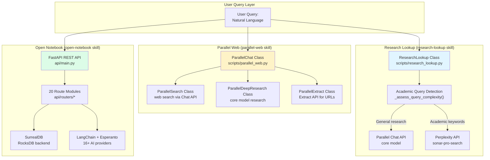
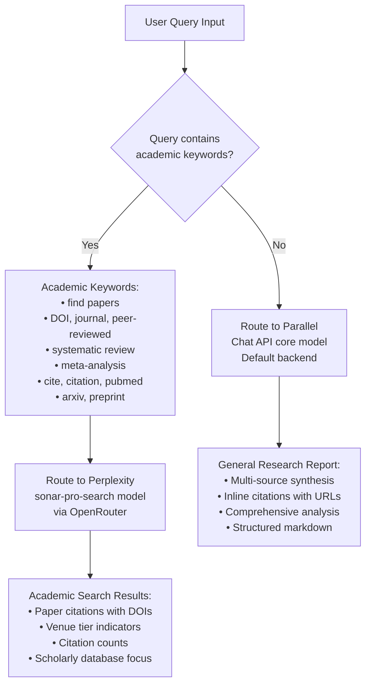
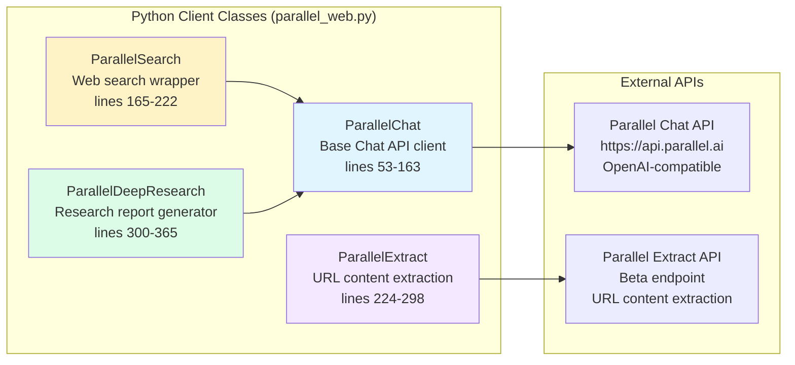
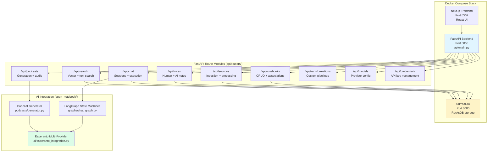
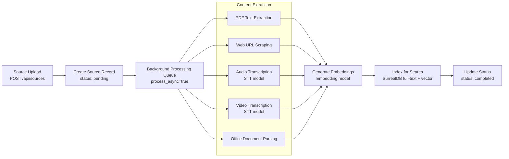
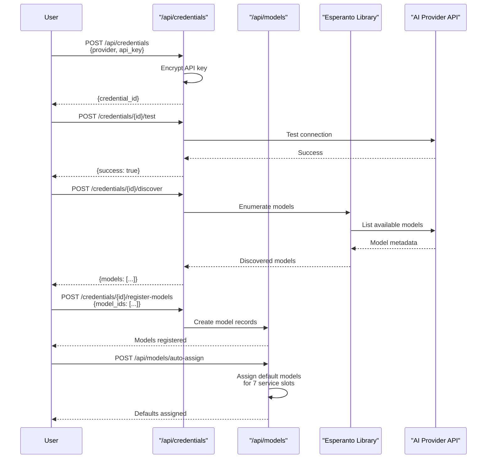
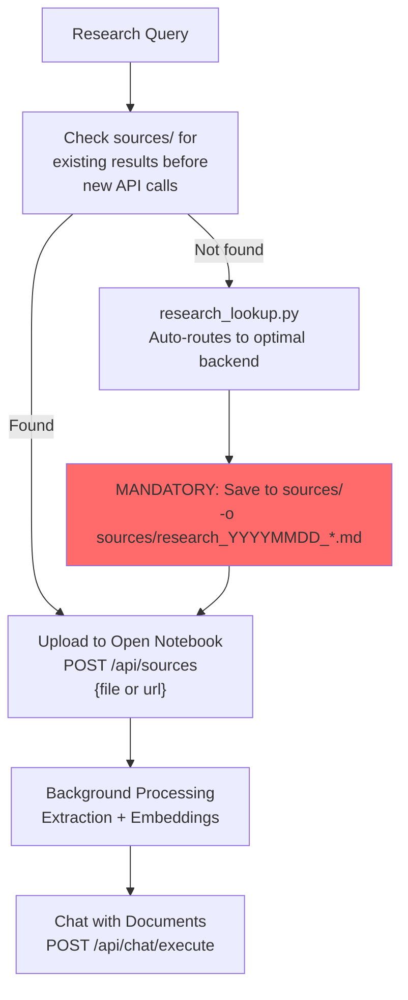
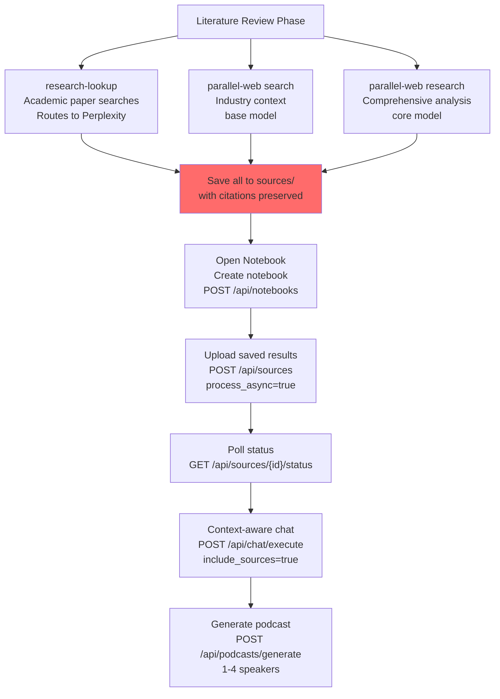
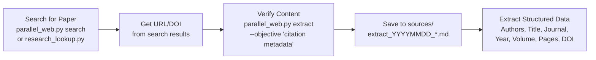

<!-- source: DeepWiki mcp.deepwiki.com · repo K-Dense-AI/claude-scientific-skills · page 6 Research Workflows and Tools · fetched 2026-10-26 -->

# Research Workflows and Tools

<details>
<summary>Relevant source files</summary>

The following files were used as context for generating this wiki page:

- [scientific-skills/open-notebook/SKILL.md](scientific-skills/open-notebook/SKILL.md)
- [scientific-skills/open-notebook/references/api_reference.md](scientific-skills/open-notebook/references/api_reference.md)
- [scientific-skills/open-notebook/references/architecture.md](scientific-skills/open-notebook/references/architecture.md)
- [scientific-skills/open-notebook/references/configuration.md](scientific-skills/open-notebook/references/configuration.md)
- [scientific-skills/open-notebook/references/examples.md](scientific-skills/open-notebook/references/examples.md)
- [scientific-skills/open-notebook/scripts/chat_interaction.py](scientific-skills/open-notebook/scripts/chat_interaction.py)
- [scientific-skills/open-notebook/scripts/notebook_management.py](scientific-skills/open-notebook/scripts/notebook_management.py)
- [scientific-skills/open-notebook/scripts/source_ingestion.py](scientific-skills/open-notebook/scripts/source_ingestion.py)
- [scientific-skills/open-notebook/scripts/test_open_notebook_skill.py](scientific-skills/open-notebook/scripts/test_open_notebook_skill.py)
- [scientific-skills/parallel-web/SKILL.md](scientific-skills/parallel-web/SKILL.md)
- [scientific-skills/parallel-web/references/api_reference.md](scientific-skills/parallel-web/references/api_reference.md)
- [scientific-skills/parallel-web/references/deep_research_guide.md](scientific-skills/parallel-web/references/deep_research_guide.md)
- [scientific-skills/parallel-web/references/extraction_patterns.md](scientific-skills/parallel-web/references/extraction_patterns.md)
- [scientific-skills/parallel-web/references/search_best_practices.md](scientific-skills/parallel-web/references/search_best_practices.md)
- [scientific-skills/parallel-web/references/workflow_recipes.md](scientific-skills/parallel-web/references/workflow_recipes.md)
- [scientific-skills/parallel-web/scripts/parallel_web.py](scientific-skills/parallel-web/scripts/parallel_web.py)
- [scientific-skills/research-lookup/README.md](scientific-skills/research-lookup/README.md)
- [scientific-skills/research-lookup/SKILL.md](scientific-skills/research-lookup/SKILL.md)
- [scientific-skills/research-lookup/examples.py](scientific-skills/research-lookup/examples.py)
- [scientific-skills/research-lookup/lookup.py](scientific-skills/research-lookup/lookup.py)

</details>


## Purpose and Scope

This page provides an overview of the research workflow tools in the Claude Scientific Skills system, covering three primary skills for gathering, organizing, and analyzing research information. These tools enable end-to-end research workflows from initial web searches through document organization to AI-powered analysis.

**Covered in this page:**
- `research-lookup` skill: Intelligent research queries with automatic backend routing
- `parallel-web` skill: Web search, deep research, and URL content extraction
- `open-notebook` skill: Self-hosted research organization and analysis platform

**For detailed usage of specific tools, see:**
- Research lookup and web search patterns: [6.1](#6.1)
- Open Notebook platform features: [6.2](#6.2)
- AI reasoning and analysis tools: [6.3](#6.3)

---

## Tool Ecosystem Overview

The research workflow tools provide three complementary capabilities that work together to support scientific research:

| Tool | Primary Use Case | Backend | Key Capability |
|------|-----------------|---------|----------------|
| `research-lookup` | Academic paper searches | Parallel Chat API + Perplexity sonar-pro-search | Auto-routes to optimal backend based on query type |
| `parallel-web` | General web research | Parallel Chat API + Extract API | Synthesized reports with citations from multiple sources |
| `open-notebook` | Research organization | Self-hosted FastAPI + SurrealDB | Document ingestion, AI chat, podcast generation |

### Diagram: Research Tool Architecture



**Sources:**
- [scientific-skills/research-lookup/SKILL.md:1-414]()
- [scientific-skills/parallel-web/SKILL.md:1-315]()
- [scientific-skills/open-notebook/SKILL.md:1-290]()
- [scientific-skills/research-lookup/lookup.py:1-188]()
- [scientific-skills/parallel-web/scripts/parallel_web.py:1-569]()

---

## Research Lookup: Intelligent Backend Routing

The `research-lookup` skill automatically routes queries to the optimal backend based on query content analysis. This routing is implemented in the `ResearchLookup` class.

### Routing Logic Implementation

The automatic routing system analyzes queries for academic keywords and routes accordingly:



**Sources:**
- [scientific-skills/research-lookup/SKILL.md:49-97]()
- [scientific-skills/research-lookup/scripts/research_lookup.py:1-end]()
- [scientific-skills/research-lookup/lookup.py:14-188]()

### Backend Capabilities Comparison

| Feature | Parallel Chat API (core) | Perplexity sonar-pro-search |
|---------|--------------------------|----------------------------|
| **Latency** | 60s-5min | 5-15s |
| **Use Case** | Comprehensive multi-source research | Academic paper search |
| **Output Format** | Markdown report with inline citations | Summary with 5-8 paper citations |
| **Citation Style** | Web source URLs | DOI, journal, authors, year |
| **Database Priority** | Authoritative web sources | Scholarly databases (PubMed, arXiv) |
| **Cost** | $0.025 per 1000 tokens | Via OpenRouter rates |

**Sources:**
- [scientific-skills/research-lookup/SKILL.md:196-222]()
- [scientific-skills/parallel-web/references/api_reference.md:189-228]()

### Code Entity Mapping

The routing implementation maps to these code constructs:

| Functionality | Code Location | Class/Function |
|---------------|---------------|----------------|
| Main lookup interface | `research-lookup/lookup.py` | `main()` function |
| Backend routing | `research-lookup/scripts/research_lookup.py` | `ResearchLookup.lookup()` |
| Academic keyword detection | `research-lookup/SKILL.md:64-73` | Documented in routing logic |
| Parallel API client | `parallel-web/scripts/parallel_web.py:53-163` | `ParallelChat` class |
| Perplexity integration | Via OpenRouter SDK | OpenRouter API client |

**Sources:**
- [scientific-skills/research-lookup/lookup.py:149-188]()
- [scientific-skills/research-lookup/SKILL.md:49-97]()
- [scientific-skills/parallel-web/scripts/parallel_web.py:53-163]()

---

## Parallel Web Systems: Multi-Purpose Research API

The `parallel-web` skill provides three complementary capabilities through the Parallel Web Systems APIs:

### Core Classes Architecture



**Sources:**
- [scientific-skills/parallel-web/scripts/parallel_web.py:53-365]()
- [scientific-skills/parallel-web/SKILL.md:46-120]()
- [scientific-skills/parallel-web/references/api_reference.md:1-245]()

### Model Selection Matrix

The Chat API supports two research models with different latency/depth tradeoffs:

| Model | Latency | Token Cost | Best For | CLI Usage |
|-------|---------|------------|----------|-----------|
| `base` | 15-100s | $10/1000 | Standard web searches, quick lookups | `--model base` |
| `core` | 60s-5min | $25/1000 | Complex multi-source research, comprehensive reports | `--model core` (default for research) |

**Command-line interface mapping:**

```bash
# ParallelSearch with base model (default)
python scripts/parallel_web.py search "query" --model base -o output.md

# ParallelDeepResearch with core model (default)
python scripts/parallel_web.py research "query" --model core -o output.md

# ParallelExtract for verification
python scripts/parallel_web.py extract "url" --objective "focus" -o output.md
```

**Sources:**
- [scientific-skills/parallel-web/SKILL.md:122-134]()
- [scientific-skills/parallel-web/scripts/parallel_web.py:467-565]()
- [scientific-skills/parallel-web/references/api_reference.md:189-202]()

### Extract API vs Chat API Usage

The Extract API should only be used for specific URL verification, not general research:

| Scenario | Use Tool | Rationale |
|----------|----------|-----------|
| "Find papers on topic X" | `parallel_web.py search` or `research_lookup.py` | Need to discover URLs |
| "Verify citation at URL Y" | `parallel_web.py extract` | Known URL to verify |
| "Research company Z" | `parallel_web.py research` | Need synthesis from multiple sources |
| "Get DOI metadata" | `parallel_web.py extract` | Known DOI URL |
| "Market analysis of industry W" | `parallel_web.py research --model core` | Comprehensive multi-source research |

**Sources:**
- [scientific-skills/parallel-web/SKILL.md:17-44]()
- [scientific-skills/parallel-web/references/extraction_patterns.md:20-33]()

---

## Open Notebook: Self-Hosted Research Platform

Open Notebook provides a complete research organization platform as an alternative to Google NotebookLM, with full REST API access and multi-provider AI support.

### System Architecture



**Sources:**
- [scientific-skills/open-notebook/references/architecture.md:1-164]()
- [scientific-skills/open-notebook/SKILL.md:271-287]()
- [scientific-skills/open-notebook/references/api_reference.md:1-716]()

### Core REST API Endpoints

The Open Notebook REST API exposes 20 route modules. Key endpoints:

| Route Group | Base Path | Primary Operations | Code Location |
|-------------|-----------|-------------------|---------------|
| Notebooks | `/api/notebooks` | List, create, update, delete notebooks | `api/routers/notebooks.py` |
| Sources | `/api/sources` | Upload files, ingest URLs, process content | `api/routers/sources.py` |
| Notes | `/api/notes` | Create human/AI notes, manage associations | `api/routers/notes.py` |
| Chat | `/api/chat/sessions` | Create sessions, execute messages with context | `api/routers/chat.py` |
| Search | `/api/search` | Vector/text search, AI-powered Q&A | `api/routers/search.py` |
| Podcasts | `/api/podcasts` | Generate multi-speaker podcasts, download audio | `api/routers/podcasts.py` |
| Models | `/api/models` | Discover, register, assign default models | `api/routers/models.py` |
| Credentials | `/api/credentials` | Manage encrypted API keys per provider | `api/routers/credentials.py` |

**Sources:**
- [scientific-skills/open-notebook/references/api_reference.md:15-716]()
- [scientific-skills/open-notebook/SKILL.md:256-268]()
- [scientific-skills/open-notebook/references/architecture.md:30-51]()

### Source Processing Pipeline

Open Notebook ingests diverse content types through an asynchronous processing pipeline:



**Sources:**
- [scientific-skills/open-notebook/scripts/source_ingestion.py:1-161]()
- [scientific-skills/open-notebook/references/api_reference.md:103-199]()
- [scientific-skills/open-notebook/references/architecture.md:82-96]()

### Multi-Provider AI Configuration

Open Notebook supports 16+ AI providers through the Esperanto library. Configuration workflow:



**Sources:**
- [scientific-skills/open-notebook/SKILL.md:87-140]()
- [scientific-skills/open-notebook/references/configuration.md:98-140]()
- [scientific-skills/open-notebook/references/api_reference.md:609-716]()

---

## Workflow Integration Patterns

### Pattern 1: Research → Save → Organize

Standard workflow for gathering and organizing research materials:



**Key requirement:** All research results MUST be saved to `sources/` folder with timestamp:

```bash
# research-lookup saves
python research_lookup.py "query" -o sources/research_20250217_143000_topic.md

# parallel-web saves  
python scripts/parallel_web.py search "query" -o sources/search_20250217_143000_topic.md
python scripts/parallel_web.py research "query" -o sources/research_20250217_143000_topic.md
```

**Sources:**
- [scientific-skills/research-lookup/SKILL.md:241-328]()
- [scientific-skills/parallel-web/SKILL.md:190-248]()
- [scientific-skills/open-notebook/scripts/source_ingestion.py:1-161]()

### Pattern 2: Multi-Tool Research Pipeline

Combining tools for comprehensive research workflows:



**Sources:**
- [scientific-skills/parallel-web/references/workflow_recipes.md:1-457]()
- [scientific-skills/open-notebook/references/examples.md:1-291]()
- [scientific-skills/research-lookup/SKILL.md:329-414]()

### Pattern 3: URL Verification and Citation Management

Workflow for verifying and extracting citation metadata:



**Example command sequence:**

```bash
# Step 1: Find papers
python research_lookup.py "Find papers on transformer attention NeurIPS 2024" \
  -o sources/papers_20250217_transformers.md

# Step 2: Extract from specific DOI
python scripts/parallel_web.py extract "https://doi.org/10.48550/arXiv.1706.03762" \
  --objective "Complete citation: authors, title, venue, year, DOI" \
  -o sources/extract_20250217_attention_paper.md
```

**Sources:**
- [scientific-skills/parallel-web/references/workflow_recipes.md:74-113]()
- [scientific-skills/parallel-web/references/extraction_patterns.md:249-291]()

---

## Mandatory File Saving Requirements

All research tools enforce mandatory saving of results to the `sources/` folder for reproducibility and context window recovery:

### Saving Rules by Tool

| Tool | `-o` Flag Requirement | Filename Pattern | Preserved Data |
|------|-----------------------|------------------|----------------|
| `research_lookup.py` | MANDATORY | `research_YYYYMMDD_HHMMSS_<topic>.md` | Response text + Sources list + Additional References with DOIs |
| `parallel_web.py search` | MANDATORY | `search_YYYYMMDD_HHMMSS_<topic>.md` | Synthesized summary + source citations |
| `parallel_web.py research` | MANDATORY | `research_YYYYMMDD_HHMMSS_<topic>.md` | Full markdown report + citation objects |
| `parallel_web.py extract` | MANDATORY | `extract_YYYYMMDD_HHMMSS_<source>.md` | Extracted content + metadata |

### Citation Preservation Formats

Each tool preserves citations in structured formats:

**research-lookup output:**
```markdown
# Research Results

[Response text with inline citations]

## Sources (N):
1. [Title] (Date)
   URL

## Additional References (N):
1. DOI: 10.xxxx/xxxxx → URL
```

**parallel-web output:**
```markdown
# Research Report

[Synthesized content]

========================================== SOURCES ==========================================
  [1] Title
      URL
```

**JSON format (maximum citation metadata):**
```json
{
  "success": true,
  "response": "...",
  "citations": [
    {
      "type": "doi",
      "doi": "10.xxxx/xxxxx",
      "url": "https://...",
      "title": "..."
    }
  ]
}
```

**Sources:**
- [scientific-skills/research-lookup/SKILL.md:241-328]()
- [scientific-skills/parallel-web/SKILL.md:190-248]()

---

## Environment Configuration

Required environment variables for each tool:

| Tool | Variable | Purpose | Source |
|------|----------|---------|--------|
| `research-lookup` | `PARALLEL_API_KEY` | Primary backend (Parallel Chat API) | https://platform.parallel.ai |
| `research-lookup` | `OPENROUTER_API_KEY` | Academic search (Perplexity via OpenRouter) | https://openrouter.ai |
| `parallel-web` | `PARALLEL_API_KEY` | Search + research (Parallel Chat API) | https://platform.parallel.ai |
| `open-notebook` | `OPEN_NOTEBOOK_ENCRYPTION_KEY` | Required for credential encryption | User-generated secure key |
| `open-notebook` | `SURREAL_URL` | SurrealDB connection | `ws://surrealdb:8000/rpc` (Docker default) |

**Sources:**
- [scientific-skills/research-lookup/SKILL.md:196-204]()
- [scientific-skills/parallel-web/SKILL.md:272-283]()
- [scientific-skills/open-notebook/references/configuration.md:60-96]()

---

## Performance and Cost Characteristics

| Operation | Tool | Typical Latency | Approx. Cost | Use Case |
|-----------|------|----------------|--------------|----------|
| Academic paper search | `research_lookup.py` (Perplexity) | 5-15s | $0.01-0.05 | Finding scholarly papers with DOIs |
| General web search | `parallel_web.py search` (base) | 15-100s | $0.01/1K tokens | Quick fact lookups, current events |
| Deep research report | `parallel_web.py research` (core) | 60s-5min | $0.025/1K tokens | Comprehensive multi-source analysis |
| URL content extraction | `parallel_web.py extract` | 1-20s | $0.001/URL | Citation verification |
| Source ingestion | Open Notebook | 5-60s | Depends on AI provider | PDF/video processing + embeddings |
| Chat with documents | Open Notebook | 5-30s | Depends on AI provider | Context-aware Q&A |
| Podcast generation | Open Notebook | 5-30min | Depends on TTS provider | Multi-speaker audio from research |

**Sources:**
- [scientific-skills/research-lookup/README.md:50-56]()
- [scientific-skills/parallel-web/references/workflow_recipes.md:438-449]()
- [scientific-skills/parallel-web/references/api_reference.md:173-185]()

---

