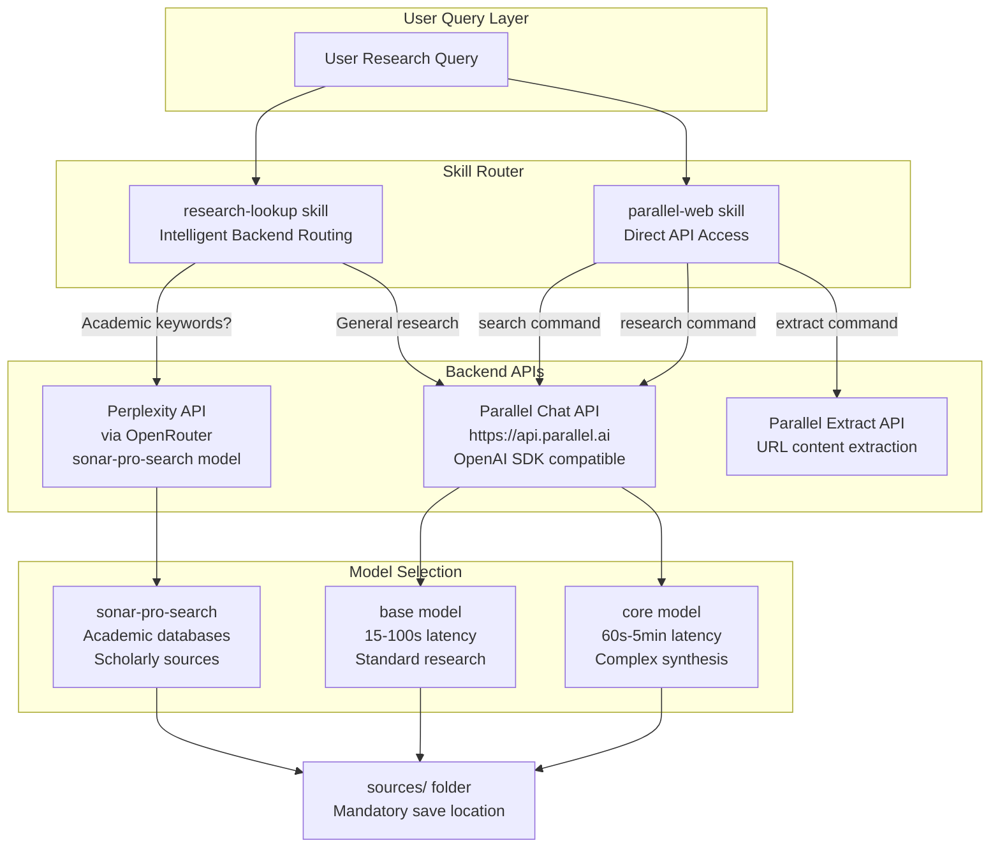
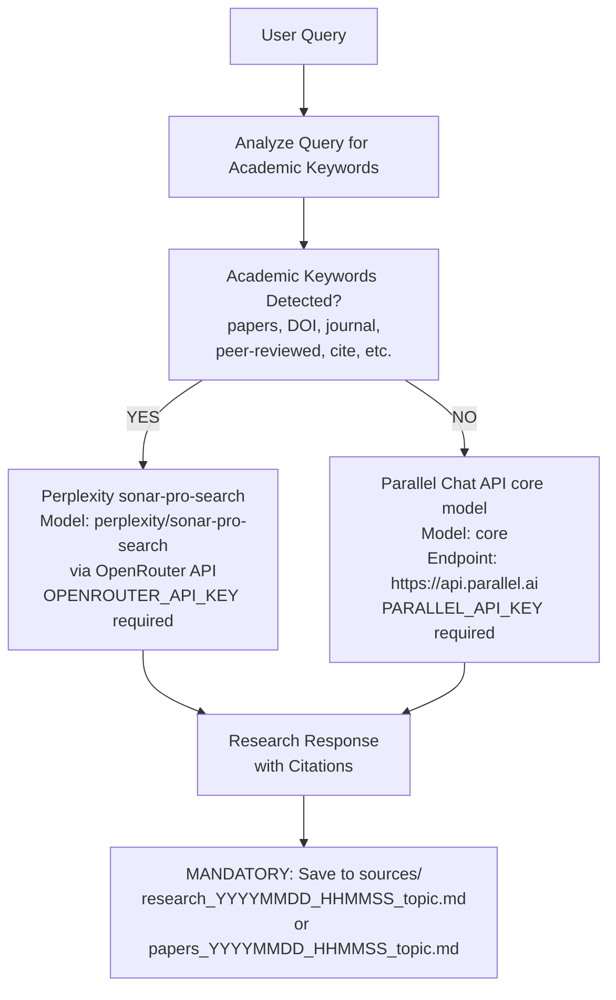
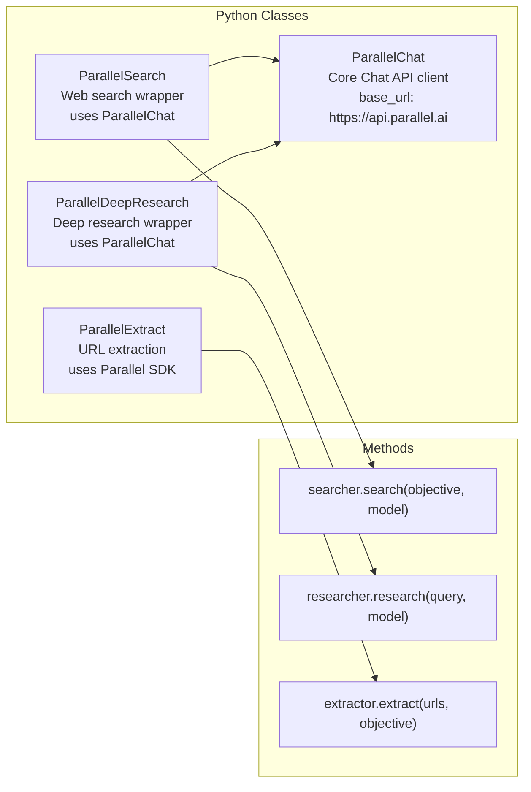
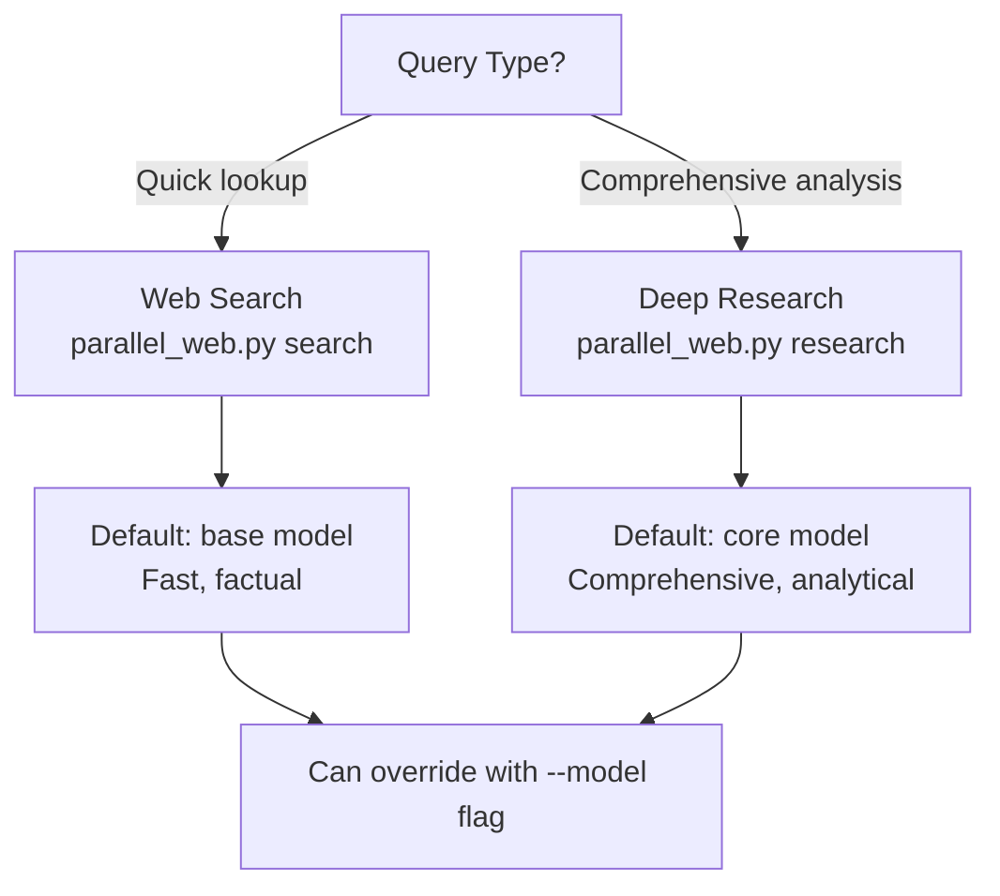
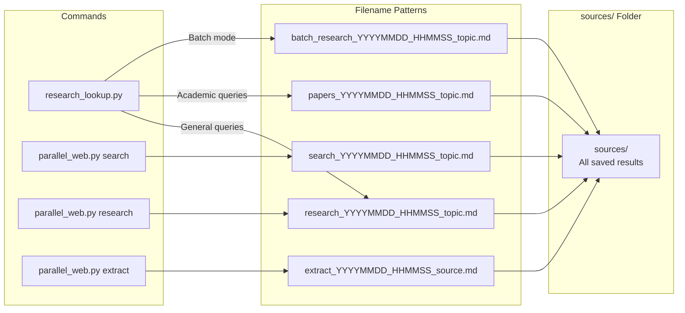
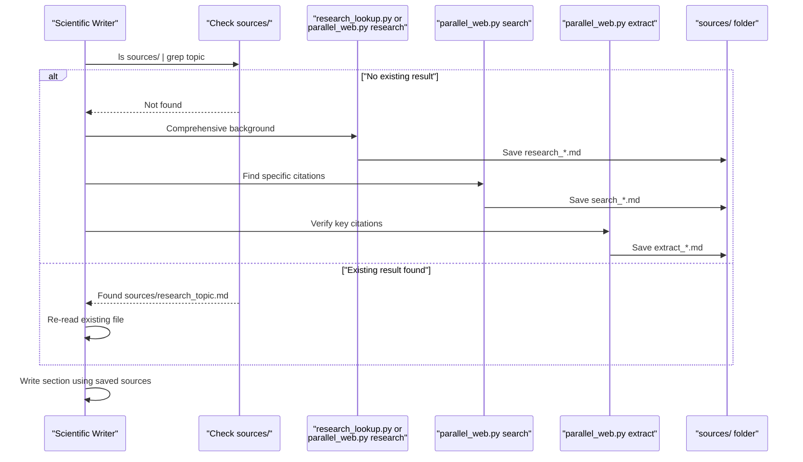
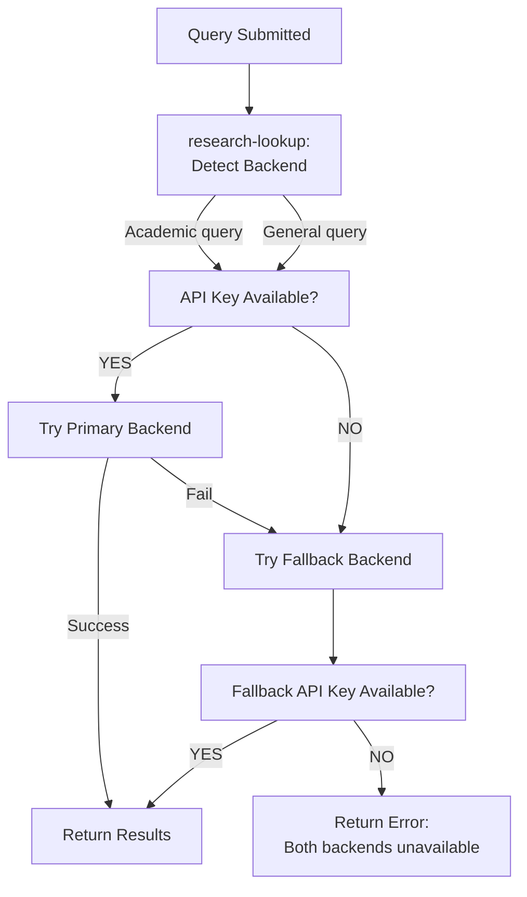

<!-- source: DeepWiki mcp.deepwiki.com · repo K-Dense-AI/claude-scientific-skills · page 6.1 Research Lookup and Web Search · fetched 2026-10-26 -->

# Research Lookup and Web Search

<details>
<summary>Relevant source files</summary>

The following files were used as context for generating this wiki page:

- [scientific-skills/parallel-web/SKILL.md](scientific-skills/parallel-web/SKILL.md)
- [scientific-skills/parallel-web/references/api_reference.md](scientific-skills/parallel-web/references/api_reference.md)
- [scientific-skills/parallel-web/references/deep_research_guide.md](scientific-skills/parallel-web/references/deep_research_guide.md)
- [scientific-skills/parallel-web/references/extraction_patterns.md](scientific-skills/parallel-web/references/extraction_patterns.md)
- [scientific-skills/parallel-web/references/search_best_practices.md](scientific-skills/parallel-web/references/search_best_practices.md)
- [scientific-skills/parallel-web/references/workflow_recipes.md](scientific-skills/parallel-web/references/workflow_recipes.md)
- [scientific-skills/parallel-web/scripts/parallel_web.py](scientific-skills/parallel-web/scripts/parallel_web.py)
- [scientific-skills/research-lookup/README.md](scientific-skills/research-lookup/README.md)
- [scientific-skills/research-lookup/SKILL.md](scientific-skills/research-lookup/SKILL.md)
- [scientific-skills/research-lookup/examples.py](scientific-skills/research-lookup/examples.py)
- [scientific-skills/research-lookup/lookup.py](scientific-skills/research-lookup/lookup.py)

</details>


## Purpose and Scope

This page documents the research lookup and web search capabilities provided by two complementary skills: **`research-lookup`** and **`parallel-web`**. These skills enable real-time web research, academic paper searches, and content extraction for scientific writing workflows. The `research-lookup` skill provides intelligent backend routing between general research and academic-focused search, while `parallel-web` offers comprehensive web search, deep research, and URL extraction capabilities.

For database-specific searches (PubMed, Google Scholar, etc.), see [Biomedical Literature and Reference Management](#5.2). For AI-powered reasoning and multi-perspective analysis, see [AI-Powered Reasoning Tools](#6.3).

**Sources:** [scientific-skills/research-lookup/SKILL.md:1-414](), [scientific-skills/parallel-web/SKILL.md:1-315]()

---

## System Overview: Two-Skill Architecture

The research lookup and web search system consists of two skills that work together:



**Diagram: Two-Skill Research System Architecture**

### Skill Responsibilities

| Skill | Primary Use | Backend Selection | Key Feature |
|-------|-------------|-------------------|-------------|
| `research-lookup` | Auto-routed research queries | Detects academic vs. general queries | Intelligent backend routing |
| `parallel-web` | Direct API control | User specifies command and model | Full control over search/research/extract |

**When to use each skill:**

- **Use `research-lookup`** when you want automatic routing based on query type (academic papers → Perplexity, everything else → Parallel)
- **Use `parallel-web`** when you need specific control over backend (search vs. research), model selection, or URL extraction

**Sources:** [scientific-skills/research-lookup/SKILL.md:11-96](), [scientific-skills/parallel-web/SKILL.md:11-44]()

---

## Backend Routing and Model Selection

### Research-Lookup Intelligent Routing

The `research-lookup` skill automatically routes queries to the optimal backend based on content analysis:



**Diagram: research-lookup Backend Routing Logic**

### Academic Keyword Detection

The routing logic examines queries for these academic indicators:

| Category | Keywords |
|----------|----------|
| Paper finding | `find papers`, `find articles`, `research papers on`, `published studies` |
| Citations | `cite`, `citation`, `doi`, `pubmed`, `pmid` |
| Academic sources | `peer-reviewed`, `journal article`, `scholarly`, `arxiv`, `preprint` |
| Review types | `systematic review`, `meta-analysis`, `literature search` |
| Paper quality | `foundational papers`, `seminal papers`, `landmark papers`, `highly cited` |

**Code implementation:** The routing logic is defined in [scientific-skills/research-lookup/SKILL.md:48-96]() and executed in [scientific-skills/research-lookup/scripts/research_lookup.py]().

**Sources:** [scientific-skills/research-lookup/SKILL.md:48-96]()

---

## Command-Line Interfaces

### research-lookup Command

The `research_lookup.py` script provides automatic backend routing:

```bash
# Auto-routed research (detects query type)
python research_lookup.py "your query" -o sources/research_<topic>.md

# Force Parallel backend (general research)
python research_lookup.py "your query" --force-backend parallel -o sources/research_<topic>.md

# Force Perplexity backend (academic search)
python research_lookup.py "your query" --force-backend perplexity -o sources/papers_<topic>.md

# JSON output with full citation metadata
python research_lookup.py "your query" --json -o sources/research_<topic>.json

# Batch queries
python research_lookup.py --batch "query 1" "query 2" "query 3" -o sources/batch_research_<topic>.md
```

**Script location:** [scientific-skills/research-lookup/scripts/research_lookup.py]()

### parallel-web Commands

The `parallel_web.py` script provides three subcommands:

```bash
# Web search (base model by default, fast)
python scripts/parallel_web.py search "query" -o sources/search_<topic>.md
python scripts/parallel_web.py search "query" --model core -o sources/search_<topic>.md

# Deep research (core model by default, comprehensive)
python scripts/parallel_web.py research "query" -o sources/research_<topic>.md
python scripts/parallel_web.py research "query" --model base -o sources/research_<topic>.md

# URL extraction (verification only)
python scripts/parallel_web.py extract "url" --objective "focus" -o sources/extract_<source>.md
python scripts/parallel_web.py extract "url" --full-content -o sources/extract_<source>.md
```

**Script location:** [scientific-skills/parallel-web/scripts/parallel_web.py:467-568]()

**Sources:** [scientific-skills/research-lookup/SKILL.md:224-237](), [scientific-skills/parallel-web/SKILL.md:54-118]()

---

## Python API Usage

### research-lookup Python Interface

```python
from research_lookup import ResearchLookup

# Initialize with automatic backend selection
research = ResearchLookup()

# Perform lookup (auto-routes to best backend)
result = research.lookup("your research query")

# Access results
if result["success"]:
    print(result["response"])      # Research report
    print(result["citations"])     # Citation list
    print(result["backend"])       # Which backend was used
    print(result["timestamp"])     # When query was executed
```

**Implementation:** [scientific-skills/research-lookup/lookup.py:13-14]() imports `ResearchLookup` from [scientific-skills/research-lookup/scripts/research_lookup.py]()

### parallel-web Python Interface



**Diagram: parallel-web Python Class Architecture**

**Class implementations:**

```python
# Web search
from parallel_web import ParallelSearch

searcher = ParallelSearch()
result = searcher.search(
    objective="search goal",
    model="base",  # or "core"
)

# Deep research
from parallel_web import ParallelDeepResearch

researcher = ParallelDeepResearch()
result = researcher.research(
    query="research question",
    model="core",  # or "base"
)

# URL extraction (verification only)
from parallel_web import ParallelExtract

extractor = ParallelExtract()
result = extractor.extract(
    urls=["https://example.com"],
    objective="what to focus on",
    excerpts=True,
    full_content=False,
)
```

**Class definitions:** 
- `ParallelChat`: [scientific-skills/parallel-web/scripts/parallel_web.py:53-162]()
- `ParallelSearch`: [scientific-skills/parallel-web/scripts/parallel_web.py:165-221]()
- `ParallelDeepResearch`: [scientific-skills/parallel-web/scripts/parallel_web.py:300-364]()
- `ParallelExtract`: [scientific-skills/parallel-web/scripts/parallel_web.py:224-297]()

**Sources:** [scientific-skills/parallel-web/scripts/parallel_web.py:53-364](), [scientific-skills/parallel-web/SKILL.md:139-187]()

---

## Model Selection Guide

### Parallel Chat API Models

Both skills use the Parallel Chat API, which offers two research models:

| Model | Latency | Cost per 1000 | Strengths | Use Cases |
|-------|---------|---------------|-----------|-----------|
| `base` | 15-100s | $10 | Standard research, factual queries | Web searches, quick lookups, current events |
| `core` | 60s-5min | $25 | Complex research, multi-source synthesis | Deep research, comprehensive reports, analytical queries |

**Model selection workflow:**



**Diagram: Model Selection Decision Tree**

### Perplexity Academic Model

When `research-lookup` routes to Perplexity for academic queries:

| Model | Access | Strengths | Use Cases |
|-------|--------|-----------|-----------|
| `perplexity/sonar-pro-search` | Via OpenRouter | Academic databases, scholarly sources, citation-heavy | Academic paper searches, DOI lookups, peer-reviewed literature |

**Sources:** [scientific-skills/parallel-web/SKILL.md:120-134](), [scientific-skills/research-lookup/SKILL.md:206-221](), [scientific-skills/parallel-web/references/api_reference.md:189-202]()

---

## Mandatory Source File Management

**Critical Rule:** Every research lookup and web search result **MUST** be saved to the project's `sources/` folder.

### Saving Patterns



**Diagram: Source File Naming and Storage Patterns**

### Command Examples with Mandatory Saving

```bash
# research-lookup (ALWAYS include -o flag)
python research_lookup.py "Recent advances in CRISPR 2025" \
  -o sources/research_20250217_143000_crispr_advances.md

python research_lookup.py "Find papers on transformer attention" \
  -o sources/papers_20250217_143500_transformer_attention.md

# parallel-web search (ALWAYS include -o flag)
python scripts/parallel_web.py search "quantum computing 2025" \
  -o sources/search_20250217_143000_quantum_computing.md

# parallel-web research (ALWAYS include -o flag)
python scripts/parallel_web.py research "EV battery market analysis" \
  -o sources/research_20250217_144000_ev_battery_market.md

# parallel-web extract (ALWAYS include -o flag)
python scripts/parallel_web.py extract "https://example.com/article" \
  --objective "key findings" \
  -o sources/extract_20250217_143500_example_article.md
```

### Citation Preservation

Both skills preserve citations in saved files:

| Format | Citations Included | When to Use |
|--------|-------------------|-------------|
| Text (default) | `Sources (N):` section with title, date, URL + `Additional References (N):` with DOIs | Standard use—human-readable |
| JSON (`--json`) | Full citation objects: `url`, `title`, `date`, `snippet`, `doi`, `type` | Programmatic processing, BibTeX generation |

**Implementation details:**
- research-lookup: [scientific-skills/research-lookup/SKILL.md:282-299]()
- parallel-web: Citation extraction in [scientific-skills/parallel-web/scripts/parallel_web.py:135-162]()

### Why Mandatory Saving

1. **Reproducibility:** Every citation can be traced back to raw source material
2. **Context Window Recovery:** Saved results can be re-read if context is compacted
3. **Audit Trail:** Complete transparency into information gathering process
4. **Reuse Across Sections:** Multiple sections can reference saved research without duplicate API calls
5. **Cost Efficiency:** Check `sources/` for existing results before making new API calls
6. **Peer Review Support:** Reviewers can verify research backing every claim

**Before making a new query:**

```bash
# Always check if relevant result already exists
ls sources/ | grep -i "quantum_computing"
ls sources/ | grep -i "crispr"

# If found, re-read existing file instead of making new API call
```

**Sources:** [scientific-skills/research-lookup/SKILL.md:241-327](), [scientific-skills/parallel-web/SKILL.md:190-247]()

---

## Integration Patterns

### Routing Decision Table

| Task | Tool | Reason |
|------|------|--------|
| General web search | `parallel_web.py search` | Direct control, fast base model |
| Deep research on any topic | `parallel_web.py research` | Comprehensive synthesis, core model |
| Academic paper search | `research_lookup.py` (auto-routes to Perplexity) | Academic databases, peer-reviewed focus |
| Find papers by keywords | `research_lookup.py` "find papers on..." | Detects academic keywords, routes to Perplexity |
| Citation verification | `parallel_web.py extract` | URL-based verification |
| DOI metadata lookup | `parallel_web.py extract` on DOI URL | Extract handles DOI redirects |
| Market/industry data | `parallel_web.py research --model core` | Multi-source synthesis |
| Current events/news | `parallel_web.py search` | Fast, recent information |

### Multi-Stage Research Workflow



**Diagram: Multi-Stage Research Workflow with Source Checking**

### Scientific Writing Integration Example

```python
# Phase 1: Background research (check sources/ first)
import os
if not os.path.exists("sources/research_quantum_computing.md"):
    from parallel_web import ParallelDeepResearch
    researcher = ParallelDeepResearch()
    background = researcher.research(
        query="Recent advances in quantum computing error correction",
        model="core",
    )
    # Save to sources/ via -o flag in CLI or manually in Python

# Phase 2: Find specific papers (check sources/ first)
if not os.path.exists("sources/papers_quantum_error_correction.md"):
    from research_lookup import ResearchLookup
    research = ResearchLookup()
    papers = research.lookup(
        "Find papers on surface code quantum error correction"
    )
    # Auto-routes to Perplexity, saves to sources/

# Phase 3: Verify key citations (check sources/ first)
if not os.path.exists("sources/extract_nature_quantum_paper.md"):
    from parallel_web import ParallelExtract
    extractor = ParallelExtract()
    citation = extractor.extract(
        urls=["https://doi.org/10.1038/..."],
        objective="Complete citation metadata",
    )
    # Save to sources/ via -o flag in CLI or manually in Python
```

**Sources:** [scientific-skills/parallel-web/references/workflow_recipes.md:1-457](), [scientific-skills/research-lookup/SKILL.md:330-353]()

---

## Environment Configuration

### Required API Keys

```bash
# For research-lookup automatic routing
export PARALLEL_API_KEY="your_parallel_api_key"      # General research (default backend)
export OPENROUTER_API_KEY="your_openrouter_api_key"  # Academic queries (Perplexity)

# For parallel-web
export PARALLEL_API_KEY="your_parallel_api_key"      # Search and research
# Only needed for extract command:
# pip install parallel-web  # Extract API requires SDK
```

**API key sources:**
- Parallel API: https://platform.parallel.ai
- OpenRouter API: https://openrouter.ai

**Fallback behavior:** If one backend's API key is missing, `research-lookup` attempts the other backend automatically.

### Python Package Requirements

```bash
# For both skills
pip install openai        # OpenAI SDK for Parallel Chat API

# For parallel-web extract command only
pip install parallel-web  # Parallel SDK for Extract API
```

**Implementation:** Environment variable checks in:
- research-lookup: [scientific-skills/research-lookup/lookup.py:151-156]()
- parallel-web: [scientific-skills/parallel-web/scripts/parallel_web.py:29-38]()

**Sources:** [scientific-skills/research-lookup/SKILL.md:196-221](), [scientific-skills/parallel-web/SKILL.md:273-284]()

---

## Error Handling and Troubleshooting

### Common Errors

| Error | Cause | Solution |
|-------|-------|----------|
| `PARALLEL_API_KEY not set` | Missing environment variable | `export PARALLEL_API_KEY="..."` |
| `OPENROUTER_API_KEY not set` | Missing environment variable for Perplexity | `export OPENROUTER_API_KEY="..."` |
| `openai not installed` | Missing Python package | `pip install openai` |
| `parallel-web not installed` | Missing SDK for extract | `pip install parallel-web` |
| `Rate limit exceeded` | Too many requests | Wait and retry (300 req/min for Chat API) |
| Complex queries may take up to 5 minutes | Normal for core model | Use base model or wait |
| Information cutoff | Perplexity knowledge limitation | Rephrase query, try Parallel backend |
| Cannot access paywalls | API limitation | Use Extract on non-paywalled URLs |

### Fallback Strategies



**Diagram: research-lookup Fallback Logic**

**Implementation:** Fallback behavior documented in [scientific-skills/research-lookup/SKILL.md:357-367]()

**Sources:** [scientific-skills/research-lookup/SKILL.md:357-367](), [scientific-skills/parallel-web/SKILL.md:288-304]()

---

## Paper Quality Prioritization

When using `research-lookup` for academic queries, results are automatically prioritized by citation count, venue quality, and author reputation:

### Citation-Based Ranking

| Paper Age | Citation Threshold | Classification |
|-----------|-------------------|----------------|
| 0-3 years | 20+ citations | Noteworthy |
| 0-3 years | 100+ citations | Highly Influential |
| 3-7 years | 100+ citations | Significant |
| 3-7 years | 500+ citations | Landmark Paper |
| 7+ years | 500+ citations | Seminal Work |
| 7+ years | 1000+ citations | Foundational |

### Venue Quality Tiers

**Tier 1 (Premier Venues):**
- General Science: Nature, Science, Cell, PNAS
- Medicine: NEJM, Lancet, JAMA, BMJ
- Field-Specific: Nature Medicine, Nature Biotechnology, Nature Methods
- Top CS/AI: NeurIPS, ICML, ICLR, ACL, CVPR

**Tier 2 (High-Impact Specialized):**
- Journals with Impact Factor > 10
- Top conferences in subfields (EMNLP, NAACL, ECCV, MICCAI)

**Tier 3 (Respected Specialized):**
- Journals with Impact Factor 5-10

**Venue detection implementation:** [scientific-skills/research-lookup/lookup.py:90-146]() detects venue tier from URL to indicate source quality.

**Sources:** [scientific-skills/research-lookup/SKILL.md:162-191](), [scientific-skills/research-lookup/lookup.py:90-146]()

---

## Complementary Skills

| Task | Skill | Reason |
|------|-------|--------|
| Academic paper searches | `research-lookup` | Auto-routes to Perplexity for scholarly focus |
| Google Scholar / PubMed | `citation-management` (see [#5.2](#5.2)) | Database-specific searches |
| Systematic literature reviews | `literature-review` (see [#7.2](#7.2)) | Structured review methodology |
| DOI to BibTeX conversion | `citation-management` | Citation format conversion |
| Generate diagrams from research | `scientific-schematics` (see [#7.1](#7.1)) | AI-powered publication-quality diagrams |

**Sources:** [scientific-skills/research-lookup/SKILL.md:340-352](), [scientific-skills/parallel-web/SKILL.md:308-315]()

---

