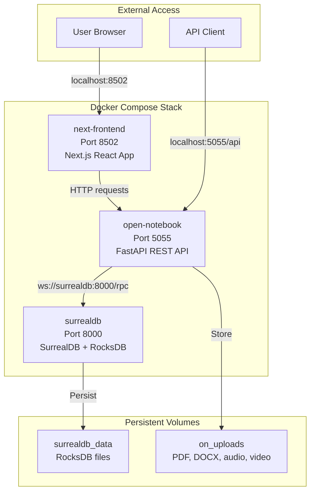
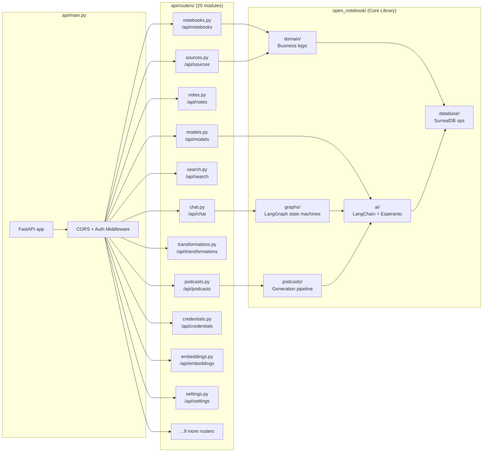
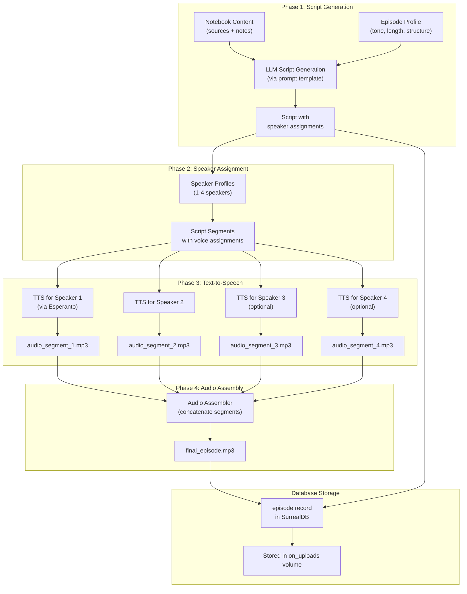

<!-- source: DeepWiki mcp.deepwiki.com · repo K-Dense-AI/claude-scientific-skills · page 6.2 Open Notebook Research Platform · fetched 2026-10-26 -->

# Open Notebook Research Platform

<details>
<summary>Relevant source files</summary>

The following files were used as context for generating this wiki page:

- [scientific-skills/open-notebook/SKILL.md](scientific-skills/open-notebook/SKILL.md)
- [scientific-skills/open-notebook/references/api_reference.md](scientific-skills/open-notebook/references/api_reference.md)
- [scientific-skills/open-notebook/references/architecture.md](scientific-skills/open-notebook/references/architecture.md)
- [scientific-skills/open-notebook/references/configuration.md](scientific-skills/open-notebook/references/configuration.md)
- [scientific-skills/open-notebook/references/examples.md](scientific-skills/open-notebook/references/examples.md)
- [scientific-skills/open-notebook/scripts/chat_interaction.py](scientific-skills/open-notebook/scripts/chat_interaction.py)
- [scientific-skills/open-notebook/scripts/notebook_management.py](scientific-skills/open-notebook/scripts/notebook_management.py)
- [scientific-skills/open-notebook/scripts/source_ingestion.py](scientific-skills/open-notebook/scripts/source_ingestion.py)
- [scientific-skills/open-notebook/scripts/test_open_notebook_skill.py](scientific-skills/open-notebook/scripts/test_open_notebook_skill.py)

</details>


## Purpose and Scope

This document provides technical documentation for the **Open Notebook** skill, a self-hosted, open-source alternative to Google NotebookLM. Open Notebook enables researchers to organize materials into notebooks, ingest diverse content sources (PDFs, videos, audio, web pages, Office documents), generate AI-powered notes and summaries, create multi-speaker podcasts from research, and conduct context-aware conversations with documents using 16+ AI providers.

This page covers the system architecture, core components, API endpoints, data flows, and deployment configuration. For information about other research workflow tools, see [Research Lookup and Web Search](#6.1) and [AI-Powered Reasoning Tools](#6.3).

**Sources:** [scientific-skills/open-notebook/SKILL.md:1-10]()

---

## System Overview

Open Notebook provides a REST API-first research platform with complete data sovereignty through self-hosting. Unlike Google NotebookLM, which has no public API outside the Enterprise version, Open Notebook exposes all functionality through a comprehensive REST API at `http://localhost:5055/api` with interactive documentation at `/docs`.

### Key Advantages Over NotebookLM

| Feature | Open Notebook | Google NotebookLM |
|---------|--------------|-------------------|
| **API Access** | Full REST API for all features | No public API (Enterprise only) |
| **AI Providers** | 16+ providers (OpenAI, Anthropic, Google, Ollama, Groq, Mistral, etc.) | Locked to Google models |
| **Podcast Speakers** | 1-4 customizable speakers | 2-speaker limit |
| **Data Hosting** | Self-hosted with complete data sovereignty | Cloud-hosted by Google |
| **License** | Open source (MIT) | Proprietary |

**Sources:** [scientific-skills/open-notebook/SKILL.md:17-23]()

---

## Docker Compose Architecture

Open Notebook deploys as a containerized stack with three primary services coordinated through Docker Compose:



**Diagram: Docker Compose Service Architecture with Persistent Volumes**

The stack consists of:
- **next-frontend**: Next.js UI on port 8502
- **open-notebook**: FastAPI backend API on port 5055  
- **surrealdb**: SurrealDB database on port 8000 with RocksDB backend
- **surrealdb_data**: Volume for database persistence
- **on_uploads**: Volume for uploaded file storage

**Sources:** [scientific-skills/open-notebook/references/architecture.md:7-28](), [scientific-skills/open-notebook/references/configuration.md:7-39]()

---

## FastAPI Backend Architecture

The backend is organized into 20 route modules under `api/routers/`, each handling a distinct domain:



**Diagram: FastAPI Backend Structure Mapping Routes to Code Modules**

The architecture follows a clear separation:
- **api/main.py**: Application setup, middleware registration, router mounting
- **api/routers/**: 20 route handler modules (notebooks, sources, notes, chat, search, podcasts, transformations, models, credentials, embeddings, settings, and 9 others)
- **api/models.py**: Pydantic request/response validation models
- **api/auth.py**: Optional password authentication middleware
- **open_notebook/domain/**: Domain models and business logic
- **open_notebook/database/**: SurrealDB operations and queries
- **open_notebook/ai/**: LangChain and Esperanto AI integration
- **open_notebook/graphs/**: LangGraph conversational state machines
- **open_notebook/podcasts/**: Multi-speaker podcast generation pipeline

**Sources:** [scientific-skills/open-notebook/references/architecture.md:32-42](), [scientific-skills/open-notebook/references/architecture.md:143-163]()

---

## SurrealDB Data Model

SurrealDB serves as the primary data store, providing both document storage and relational capabilities with full-text and vector search:

| Record Type | SurrealDB Table | Description | Key Fields |
|-------------|----------------|-------------|------------|
| Notebook | `notebook` | Research project container | `id`, `name`, `description`, `archived`, `created_at`, `updated_at` |
| Source | `source` | Ingested content (PDF, URL, audio, video) | `id`, `title`, `content`, `source_type`, `status`, `embedding` |
| Note | `note` | Human or AI-generated notes | `id`, `title`, `content`, `note_type` (human/ai), `notebook_id` |
| ChatSession | `chat_session` | Conversational thread | `id`, `title`, `notebook_id`, `messages[]` |
| Episode | `episode` | Generated podcast episode | `id`, `notebook_id`, `script`, `audio_path`, `status` |
| Transformation | `transformation` | Custom content transformation | `id`, `name`, `prompt`, `apply_default` |
| Model | `model` | Registered AI model | `id`, `provider`, `model_name`, `model_type` (llm/embedding/stt/tts) |
| Credential | `credential` | Encrypted API key | `id`, `provider`, `name`, `encrypted_key` |

SurrealDB uses RocksDB as the persistent backend storage engine, configured via `start --user root --pass root rocksdb://data/database.db`.

**Sources:** [scientific-skills/open-notebook/references/architecture.md:43-51]()

---

## Core API Endpoints

The REST API provides comprehensive programmatic access to all Open Notebook functionality:

### Notebooks API

| Method | Endpoint | Description |
|--------|----------|-------------|
| `GET` | `/api/notebooks` | List all notebooks with source and note counts |
| `POST` | `/api/notebooks` | Create a new notebook |
| `GET` | `/api/notebooks/{notebook_id}` | Retrieve a single notebook |
| `PUT` | `/api/notebooks/{notebook_id}` | Update notebook fields (name, description, archived) |
| `DELETE` | `/api/notebooks/{notebook_id}` | Delete notebook (optionally delete exclusive sources) |
| `GET` | `/api/notebooks/{notebook_id}/delete-preview` | Preview deletion impact (affected notes and sources) |
| `POST` | `/api/notebooks/{notebook_id}/sources/{source_id}` | Link source to notebook (idempotent) |
| `DELETE` | `/api/notebooks/{notebook_id}/sources/{source_id}` | Unlink source from notebook |

**Sources:** [scientific-skills/open-notebook/references/api_reference.md:17-100]()

### Sources API

| Method | Endpoint | Description |
|--------|----------|-------------|
| `GET` | `/api/sources` | List sources with filtering and pagination |
| `POST` | `/api/sources` | Upload file or ingest URL/text (multipart form data) |
| `POST` | `/api/sources/json` | Create source via JSON (legacy endpoint) |
| `GET` | `/api/sources/{source_id}` | Retrieve source metadata |
| `GET` | `/api/sources/{source_id}/status` | Poll processing status for async ingestion |
| `PUT` | `/api/sources/{source_id}` | Update source title or topic |
| `DELETE` | `/api/sources/{source_id}` | Delete source and associated embeddings |
| `GET` | `/api/sources/{source_id}/download` | Download original uploaded file |
| `POST` | `/api/sources/{source_id}/retry` | Requeue failed source for processing |
| `GET` | `/api/sources/{source_id}/insights` | Retrieve AI-generated insights |

**Sources:** [scientific-skills/open-notebook/references/api_reference.md:103-208]()

### Chat API

| Method | Endpoint | Description |
|--------|----------|-------------|
| `GET` | `/api/chat/sessions` | List chat sessions (filter by notebook) |
| `POST` | `/api/chat/sessions` | Create new chat session |
| `GET` | `/api/chat/sessions/{session_id}` | Get session with full message history |
| `PUT` | `/api/chat/sessions/{session_id}` | Update session metadata |
| `DELETE` | `/api/chat/sessions/{session_id}` | Delete chat session |
| `POST` | `/api/chat/execute` | Send message with context from sources/notes |
| `POST` | `/api/chat/context` | Build context data for inspection |

**Sources:** [scientific-skills/open-notebook/references/api_reference.md:270-345]()

### Search API

| Method | Endpoint | Description |
|--------|----------|-------------|
| `POST` | `/api/search` | Search knowledge base (vector or text) |
| `POST` | `/api/search/ask` | Ask question with streaming AI answer (SSE) |
| `POST` | `/api/search/ask/simple` | Ask question with complete response (non-streaming) |

Search types:
- **`vector`**: Semantic search using embeddings (requires configured embedding model)
- **`text`**: Full-text keyword matching (no embedding model needed)

**Sources:** [scientific-skills/open-notebook/references/api_reference.md:347-384]()

### Podcasts API

| Method | Endpoint | Description |
|--------|----------|-------------|
| `POST` | `/api/podcasts/generate` | Generate podcast episode (returns `job_id`) |
| `GET` | `/api/podcasts/jobs/{job_id}` | Poll generation status |
| `GET` | `/api/podcasts/episodes` | List all episodes |
| `GET` | `/api/podcasts/episodes/{episode_id}` | Get episode metadata |
| `GET` | `/api/podcasts/episodes/{episode_id}/audio` | Stream podcast audio file |
| `POST` | `/api/podcasts/episodes/{episode_id}/retry` | Retry failed episode |
| `DELETE` | `/api/podcasts/episodes/{episode_id}` | Delete episode and audio file |

**Sources:** [scientific-skills/open-notebook/references/api_reference.md:386-443]()

### Models API

| Method | Endpoint | Description |
|--------|----------|-------------|
| `GET` | `/api/models` | List registered models (filter by type: llm/embedding/stt/tts) |
| `POST` | `/api/models` | Register new model |
| `DELETE` | `/api/models/{model_id}` | Delete model registration |
| `POST` | `/api/models/{model_id}/test` | Test model connectivity |
| `GET` | `/api/models/defaults` | Get default model assignments (7 slots: chat, transformation, embedding, stt, tts, podcast, summary) |
| `PUT` | `/api/models/defaults` | Update default model assignments |
| `GET` | `/api/models/providers` | List available AI providers |
| `GET` | `/api/models/discover/{provider}` | Discover models from provider |
| `POST` | `/api/models/sync/{provider}` | Sync models for single provider |
| `POST` | `/api/models/sync` | Sync models for all providers |
| `POST` | `/api/models/auto-assign` | Auto-populate default slots using priority rankings |

**Sources:** [scientific-skills/open-notebook/references/api_reference.md:517-605]()

---

## Source Ingestion Pipeline

The source ingestion pipeline processes diverse content types through text extraction, embedding generation, and metadata extraction:

```mermaid
sequenceDiagram
    participant Client
    participant SourcesRouter["api/routers/sources.py"]
    participant SourceDomain["open_notebook/domain/source.py"]
    participant ProcessingQueue["Async Processing Queue"]
    participant TextExtractor["Text Extraction<br/>(PDF, DOCX, audio, video)"]
    participant EmbeddingGen["Embedding Generation<br/>(via Esperanto)"]
    participant SurrealDB["database/surrealdb"]
    
    Client->>SourcesRouter: "POST /api/sources<br/>(file upload or URL)"
    SourcesRouter->>SurrealDB: "Create source record<br/>status='pending'"
    SurrealDB-->>SourcesRouter: "source_id"
    SourcesRouter-->>Client: "{'id': 'source:xyz', 'status': 'pending'}"
    
    alt process_async=true
        SourcesRouter->>ProcessingQueue: "Queue processing job"
        ProcessingQueue-->>Client: "Return immediately"
        
        ProcessingQueue->>SourceDomain: "Start async processing"
        SourceDomain->>TextExtractor: "Extract text from file/URL"
        TextExtractor-->>SourceDomain: "content text"
        SourceDomain->>SurrealDB: "Update source.content<br/>status='processing'"
        
        SourceDomain->>EmbeddingGen: "Generate embedding vector"
        EmbeddingGen-->>SourceDomain: "embedding[]"
        SourceDomain->>SurrealDB: "Update source.embedding<br/>status='completed'"
    else process_async=false
        SourcesRouter->>SourceDomain: "Process synchronously"
        SourceDomain->>TextExtractor: "Extract text"
        TextExtractor-->>SourceDomain: "content text"
        SourceDomain->>EmbeddingGen: "Generate embedding"
        EmbeddingGen-->>SourceDomain: "embedding[]"
        SourceDomain->>SurrealDB: "Update source<br/>status='completed'"
        SourcesRouter-->>Client: "{'id': 'source:xyz', 'status': 'completed'}"
    end
    
    Client->>SourcesRouter: "GET /api/sources/{source_id}/status"
    SourcesRouter->>SurrealDB: "SELECT status FROM source"
    SurrealDB-->>Client: "{'status': 'completed'}"
```

**Diagram: Source Ingestion Data Flow with Asynchronous Processing**

The pipeline supports:
- **File uploads**: PDF, DOCX, audio (MP3, WAV, M4A), video (MP4, MOV, AVI)
- **Web URLs**: HTML page scraping and content extraction
- **Raw text**: Direct text input for manual content

Processing modes:
- **Asynchronous** (default): Returns immediately, poll `/api/sources/{source_id}/status` for completion
- **Synchronous**: Blocks until processing completes (for small text sources)

**Sources:** [scientific-skills/open-notebook/references/architecture.md:82-96](), [scientific-skills/open-notebook/scripts/source_ingestion.py:20-83]()

---

## Chat Execution with Context

The chat system uses LangGraph state machines to manage conversational context, retrieving relevant sources and notes before generating responses:

```mermaid
sequenceDiagram
    participant Client
    participant ChatRouter["api/routers/chat.py"]
    participant ChatGraph["open_notebook/graphs/chat_graph.py<br/>LangGraph State Machine"]
    participant ContextBuilder["Context Builder"]
    participant SurrealDB["database/surrealdb"]
    participant LangChain["LangChain + Esperanto"]
    participant LLM["AI Provider<br/>(OpenAI, Anthropic, etc.)"]
    
    Client->>ChatRouter: "POST /api/chat/execute<br/>{'session_id', 'message', 'context'}"
    ChatRouter->>SurrealDB: "SELECT * FROM chat_session<br/>WHERE id = session_id"
    SurrealDB-->>ChatRouter: "session + messages[]"
    
    ChatRouter->>ChatGraph: "Initialize state machine<br/>with session history"
    
    ChatGraph->>ContextBuilder: "Build context<br/>(include_sources, include_notes)"
    ContextBuilder->>SurrealDB: "SELECT sources FROM notebook"
    ContextBuilder->>SurrealDB: "SELECT notes FROM notebook"
    SurrealDB-->>ContextBuilder: "sources[] + notes[]"
    ContextBuilder-->>ChatGraph: "context_text + citations"
    
    ChatGraph->>LangChain: "Format prompt with:<br/>• Session history<br/>• User message<br/>• Context from sources/notes"
    LangChain->>LLM: "Stream completion request"
    LLM-->>LangChain: "Streaming response chunks"
    LangChain-->>ChatGraph: "Response with source citations"
    
    ChatGraph->>SurrealDB: "Append messages to session:<br/>• User message<br/>• Assistant response"
    
    ChatGraph-->>ChatRouter: "Final response + citations"
    ChatRouter-->>Client: "{'response': '...', 'citations': [...]}"
```

**Diagram: Chat Execution Flow Through LangGraph State Machine**

Context building options:
- **`include_sources`**: Retrieve full text from sources linked to the notebook
- **`include_notes`**: Include human and AI-generated notes
- **`model_override`**: Use a specific model instead of the default chat model

The LangGraph state machine tracks conversation history across turns, enabling multi-turn conversations with memory.

**Sources:** [scientific-skills/open-notebook/references/architecture.md:98-113](), [scientific-skills/open-notebook/scripts/chat_interaction.py:51-69]()

---

## Podcast Generation Pipeline

Podcast generation transforms notebook contents into multi-speaker audio discussions using a four-phase pipeline:



**Diagram: Podcast Generation Four-Phase Pipeline**

The pipeline executes asynchronously:
1. **Script Generation**: LLM generates conversational script based on notebook content and episode profile
2. **Speaker Assignment**: Assigns script segments to 1-4 configured speaker profiles
3. **Text-to-Speech**: Generates audio for each segment using provider-specific TTS (OpenAI, Google, ElevenLabs)
4. **Audio Assembly**: Concatenates segments into final episode MP3

Poll `/api/podcasts/jobs/{job_id}` for status (`"processing"`, `"completed"`, `"failed"`). Once completed, retrieve audio via `/api/podcasts/episodes/{episode_id}/audio`.

**Sources:** [scientific-skills/open-notebook/references/architecture.md:115-133](), [scientific-skills/open-notebook/scripts/podcast_generation.py:130-165]() (Note: This file was referenced in examples.md but not provided)

---

## Esperanto Multi-Provider Integration

Open Notebook supports 16+ AI providers through the Esperanto library, which abstracts provider-specific differences behind a unified interface:

| Provider | LLM | Embedding | Speech-to-Text | Text-to-Speech | Base URL Customizable |
|----------|-----|-----------|----------------|----------------|---------------------|
| **OpenAI** | ✓ | ✓ | ✓ | ✓ | ✓ |
| **Anthropic** | ✓ | — | — | — | ✓ |
| **Google GenAI** | ✓ | ✓ | — | ✓ | — |
| **Vertex AI** | ✓ | ✓ | — | ✓ | — |
| **Ollama** | ✓ | ✓ | — | — | ✓ |
| **Groq** | ✓ | — | ✓ | — | — |
| **Mistral** | ✓ | ✓ | — | — | ✓ |
| **Azure OpenAI** | ✓ | ✓ | — | — | ✓ |
| **DeepSeek** | ✓ | — | — | — | ✓ |
| **xAI** | ✓ | — | — | — | — |
| **OpenRouter** | ✓ | — | — | — | — |
| **ElevenLabs** | — | — | ✓ | ✓ | — |
| **Perplexity** | ✓ | — | — | — | — |
| **Voyage** | — | ✓ | — | — | — |

### Model Type Slots

Open Notebook uses seven default model slots that can be assigned to any registered model:
1. **chat**: Default LLM for chat sessions
2. **transformation**: LLM for content transformations
3. **embedding**: Model for vector search indexing
4. **speech-to-text**: STT for audio transcription
5. **text-to-speech**: TTS for podcast generation
6. **podcast**: LLM for podcast script generation
7. **summary**: LLM for source summarization

Auto-assignment uses provider priority rankings: `openai > anthropic > google > groq > mistral > ollama > azure > deepseek > xai > openrouter > perplexity`.

**Sources:** [scientific-skills/open-notebook/SKILL.md:219-238](), [scientific-skills/open-notebook/references/architecture.md:62-69](), [scientific-skills/open-notebook/references/api_reference.md:549-594]()

---

## Configuration and Deployment

### Required Environment Variables

| Variable | Description | Default |
|----------|-------------|---------|
| **`OPEN_NOTEBOOK_ENCRYPTION_KEY`** | **Required.** Secret key for encrypting stored API credentials. Must be set before first launch and kept consistent across restarts. | None |

### Database Configuration

| Variable | Description | Default |
|----------|-------------|---------|
| `SURREAL_URL` | SurrealDB WebSocket connection URL | `ws://surrealdb:8000/rpc` |
| `SURREAL_NAMESPACE` | SurrealDB namespace | `open_notebook` |
| `SURREAL_DATABASE` | SurrealDB database name | `open_notebook` |
| `SURREAL_USER` | SurrealDB username | `root` |
| `SURREAL_PASS` | SurrealDB password | `root` |

### Application Configuration

| Variable | Description | Default |
|----------|-------------|---------|
| `OPEN_NOTEBOOK_PASSWORD` | Optional password protection for the web UI and API | None |
| `UPLOAD_DIR` | Directory for uploaded file storage | `/app/uploads` |

**Sources:** [scientific-skills/open-notebook/SKILL.md:240-250](), [scientific-skills/open-notebook/references/configuration.md:60-85]()

### Docker Compose Deployment

```bash
# Download compose file
curl -o docker-compose.yml https://raw.githubusercontent.com/lfnovo/open-notebook/main/docker-compose.yml

# Set required encryption key
export OPEN_NOTEBOOK_ENCRYPTION_KEY="your-secret-key-here"

# Optional: Add password protection
export OPEN_NOTEBOOK_PASSWORD="your-ui-password"

# Start services
docker-compose up -d

# View logs
docker-compose logs -f open-notebook

# Stop services
docker-compose down
```

Access points:
- **Frontend UI**: http://localhost:8502
- **REST API**: http://localhost:5055
- **API Documentation**: http://localhost:5055/docs (Swagger UI)
- **Alternative API Docs**: http://localhost:5055/redoc (ReDoc)

**Sources:** [scientific-skills/open-notebook/SKILL.md:36-52](), [scientific-skills/open-notebook/references/configuration.md:40-58]()

---

## Authentication

If `OPEN_NOTEBOOK_PASSWORD` is configured, API requests must include authentication. The following routes are excluded from authentication requirements:
- `/` (root)
- `/health`
- `/docs` (Swagger UI)
- `/openapi.json`
- `/redoc`
- `/api/auth/status`
- `/api/config`

**Sources:** [scientific-skills/open-notebook/references/api_reference.md:11-14]()

---

## Example Workflows

### Notebook and Source Management

```python
import requests

BASE_URL = "http://localhost:5055/api"

# Create notebook
notebook = requests.post(f"{BASE_URL}/notebooks", json={
    "name": "Cancer Genomics Research",
    "description": "Literature review on tumor mutational burden"
}).json()

# Add URL source
source = requests.post(f"{BASE_URL}/sources", data={
    "url": "https://arxiv.org/abs/2301.00001",
    "notebook_id": notebook["id"],
    "process_async": "true"
}).json()

# Poll processing status
status = requests.get(f"{BASE_URL}/sources/{source['id']}/status").json()
print(status)  # {"status": "completed"}
```

**Sources:** [scientific-skills/open-notebook/scripts/notebook_management.py:21-31](), [scientific-skills/open-notebook/scripts/source_ingestion.py:22-33]()

### Chat with Context

```python
# Create chat session
session = requests.post(f"{BASE_URL}/chat/sessions", json={
    "notebook_id": notebook["id"],
    "title": "TMB Discussion"
}).json()

# Send message with source context
response = requests.post(f"{BASE_URL}/chat/execute", json={
    "session_id": session["id"],
    "message": "What are the key biomarkers for immunotherapy response?",
    "context": {"include_sources": True, "include_notes": True}
}).json()

print(response["response"])
```

**Sources:** [scientific-skills/open-notebook/scripts/chat_interaction.py:21-69]()

### Vector Search

```python
# Search across all materials
results = requests.post(f"{BASE_URL}/search", json={
    "query": "tumor mutational burden immunotherapy",
    "search_type": "vector",
    "limit": 10,
    "min_similarity": 0.7
}).json()

# Get AI-powered answer
answer = requests.post(f"{BASE_URL}/search/ask/simple", json={
    "query": "How does TMB predict checkpoint inhibitor response?"
}).json()
```

**Sources:** [scientific-skills/open-notebook/SKILL.md:163-176](), [scientific-skills/open-notebook/references/examples.md:216-254]()

---

## Error Handling

The API returns standard HTTP status codes with JSON error bodies:

| Status | Meaning | Description |
|--------|---------|-------------|
| `400` | Bad Request | Invalid input or malformed request |
| `401` | Unauthorized | Authentication required but missing/invalid |
| `404` | Not Found | Resource does not exist |
| `422` | Unprocessable Entity | Configuration error (e.g., no models configured) |
| `429` | Too Many Requests | Rate limited by AI provider |
| `500` | Internal Server Error | Unexpected server error |
| `502` | Bad Gateway | External service (AI provider) error |

Error response format:
```json
{
  "detail": "Description of the error"
}
```

**Sources:** [scientific-skills/open-notebook/references/api_reference.md:696-716]()

---

## Key Design Decisions

1. **Multi-provider by default**: Not locked to any single AI provider, enabling cost optimization and capability matching per task
2. **Async processing**: Long-running operations (source ingestion, podcast generation) run asynchronously with status polling to prevent request timeouts
3. **Self-hosted data**: All data stays on the user's infrastructure with encrypted credential storage via `OPEN_NOTEBOOK_ENCRYPTION_KEY`
4. **REST-first API**: Every UI action is backed by an API endpoint for automation and programmatic access
5. **Docker-native**: Designed for containerized deployment with persistent volumes for data durability

**Sources:** [scientific-skills/open-notebook/references/architecture.md:135-142]()

---

## Repository and License

- **Repository**: https://github.com/lfnovo/open-notebook
- **License**: MIT (open source)
- **Skill Author**: K-Dense Inc.

**Sources:** [scientific-skills/open-notebook/SKILL.md:2-7](), [scientific-skills/open-notebook/SKILL.md:24]()

---

