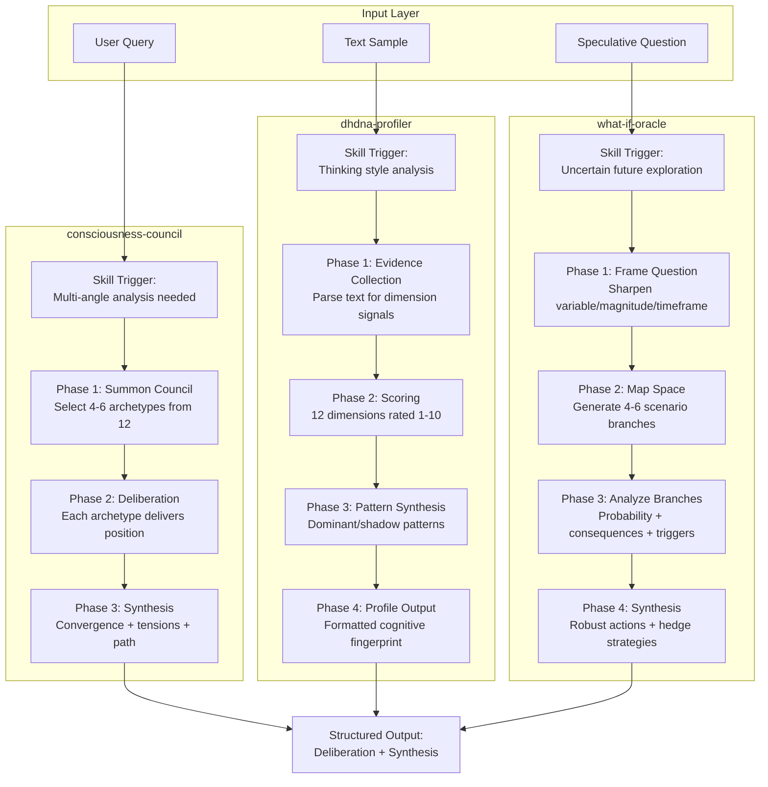
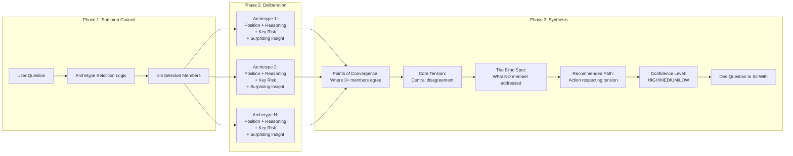
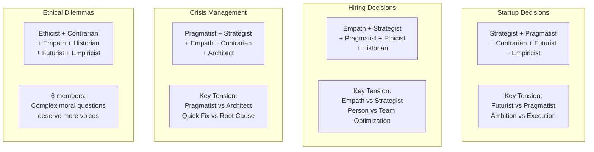
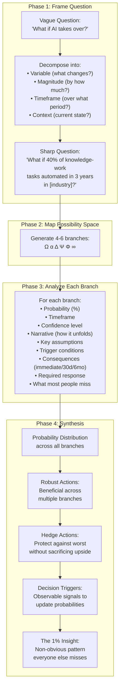
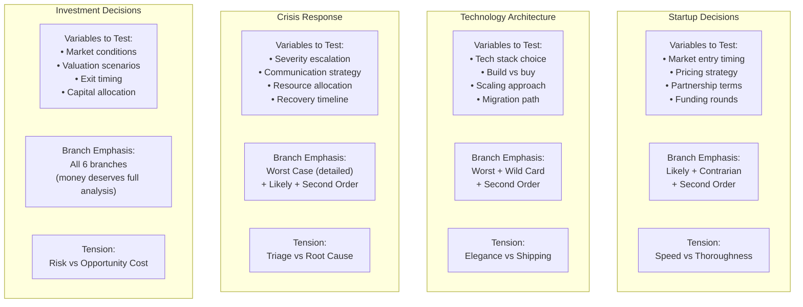
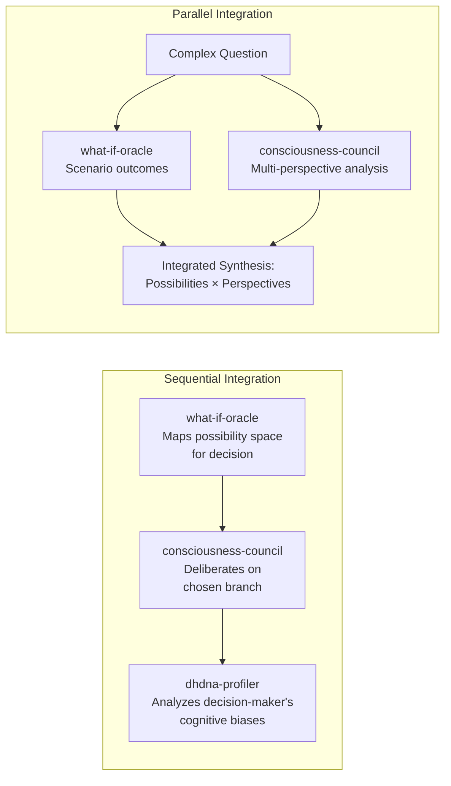

<!-- source: DeepWiki mcp.deepwiki.com · repo K-Dense-AI/claude-scientific-skills · page 6.3 AI-Powered Reasoning Tools · fetched 2026-10-26 -->

# AI-Powered Reasoning Tools

<details>
<summary>Relevant source files</summary>

The following files were used as context for generating this wiki page:

- [scientific-skills/consciousness-council/SKILL.md](scientific-skills/consciousness-council/SKILL.md)
- [scientific-skills/consciousness-council/references/advanced-configurations.md](scientific-skills/consciousness-council/references/advanced-configurations.md)
- [scientific-skills/dhdna-profiler/SKILL.md](scientific-skills/dhdna-profiler/SKILL.md)
- [scientific-skills/dhdna-profiler/references/advanced-profiling.md](scientific-skills/dhdna-profiler/references/advanced-profiling.md)
- [scientific-skills/what-if-oracle/SKILL.md](scientific-skills/what-if-oracle/SKILL.md)
- [scientific-skills/what-if-oracle/references/scenario-templates.md](scientific-skills/what-if-oracle/references/scenario-templates.md)

</details>


## Purpose and Scope

This page documents three advanced reasoning skills that enhance AI-powered decision-making through structured cognitive frameworks: **consciousness-council** for multi-perspective deliberation, **dhdna-profiler** for cognitive pattern extraction, and **what-if-oracle** for scenario analysis. These tools implement formal reasoning architectures that generate cognitive diversity, extract thinking patterns, and map possibility spaces.

For web-based research and information retrieval, see [Research Lookup and Web Search](#6.1). For research organization and knowledge management, see [Open Notebook Research Platform](#6.2). For general AI-powered content generation, see [Scientific Communication](#7).

**Sources:** [scientific-skills/consciousness-council/SKILL.md:1-151](), [scientific-skills/dhdna-profiler/SKILL.md:1-163](), [scientific-skills/what-if-oracle/SKILL.md:1-169]()

---

## System Overview

All three skills originate from AHK Strategies and implement structured reasoning frameworks based on published research. They share common characteristics: MIT licensed, require Read/Write tools only, and operate through phase-based execution models.

### Skill Capabilities Matrix

| Skill | Primary Function | Input Type | Output Format | Use Case Trigger |
|-------|-----------------|------------|---------------|------------------|
| **consciousness-council** | Multi-perspective deliberation | Questions, decisions, dilemmas | Structured council deliberation + synthesis | "council mode", "different perspectives", "help me decide" |
| **dhdna-profiler** | Cognitive pattern extraction | Text samples (any length) | 12-dimensional cognitive profile | "analyze thinking style", "cognitive profile", "DHDNA" |
| **what-if-oracle** | Scenario analysis | Speculative questions | Multi-branch possibility tree | "what if...", "scenario analysis", "best/worst case" |

**Sources:** [scientific-skills/consciousness-council/SKILL.md:1-8](), [scientific-skills/dhdna-profiler/SKILL.md:1-8](), [scientific-skills/what-if-oracle/SKILL.md:1-8]()

### Reasoning Tool Architecture



**Sources:** [scientific-skills/consciousness-council/SKILL.md:20-98](), [scientific-skills/dhdna-profiler/SKILL.md:54-132](), [scientific-skills/what-if-oracle/SKILL.md:28-124]()

---

## Consciousness Council: Multi-Perspective Deliberation

The consciousness-council skill implements a structured epistemic diversity system that generates multiple reasoning perspectives on any question. Instead of single-frame analysis, it simulates a cognitive boardroom where distinct thinking archetypes deliberate and synthesize insights.

### The 12 Cognitive Archetypes

The Council defines 12 distinct reasoning archetypes, each with characteristic thinking styles and blind spots:

| # | Archetype | Thinking Style | Signature Question | Blind Spot |
|---|-----------|----------------|-------------------|------------|
| 1 | **The Architect** | Systems thinking, structure-first | "What's the underlying structure?" | Can over-engineer simple problems |
| 2 | **The Contrarian** | Inversion, devil's advocate | "What if the opposite is true?" | Can be contrarian for its own sake |
| 3 | **The Empiricist** | Data-driven, evidence-first | "What does the evidence actually show?" | Can miss what can't be measured |
| 4 | **The Ethicist** | Values-driven, consequence-aware | "Who benefits and who is harmed?" | Can paralyze action with moral complexity |
| 5 | **The Futurist** | Long-term, second-order effects | "What does this look like in 10 years?" | Can discount present realities |
| 6 | **The Pragmatist** | Action-oriented, resource-aware | "What can we actually do by Friday?" | Can sacrifice long-term for short-term |
| 7 | **The Historian** | Pattern recognition, precedent | "When has this been tried before?" | Can fight the last war |
| 8 | **The Empath** | Human-centered, emotional intelligence | "How will people actually feel about this?" | Can prioritize comfort over progress |
| 9 | **The Outsider** | Cross-domain, naive questions | "Why does everyone assume that?" | Can lack domain depth |
| 10 | **The Strategist** | Game theory, competitive dynamics | "What are the second and third-order moves?" | Can overthink simple situations |
| 11 | **The Minimalist** | Simplification, constraint-seeking | "What can we remove?" | Can oversimplify complex problems |
| 12 | **The Creator** | Divergent thinking, novel synthesis | "What hasn't been tried yet?" | Can chase novelty over reliability |

**Sources:** [scientific-skills/consciousness-council/SKILL.md:28-43]()

### Three-Phase Execution Model



**Sources:** [scientific-skills/consciousness-council/SKILL.md:20-98]()

### Archetype Selection Heuristics

The skill uses domain-specific selection patterns to maximize productive tension:

| Question Type | Recommended Council | Key Tension |
|--------------|---------------------|-------------|
| Business decisions | Strategist + Pragmatist + Ethicist + Futurist + Contrarian | Vision vs. execution |
| Technical architecture | Architect + Minimalist + Empiricist + Outsider | Elegance vs. simplicity |
| Personal dilemmas | Empath + Contrarian + Futurist + Pragmatist | Security vs. growth |
| Creative challenges | Creator + Outsider + Historian + Minimalist | Novelty vs. reliability |
| Ethical questions | Ethicist + Contrarian + Empiricist + Empath + Historian | Principles vs. pragmatism |
| Strategy/competition | Strategist + Historian + Futurist + Contrarian + Pragmatist | Long-term vs. immediate |

**Sources:** [scientific-skills/consciousness-council/SKILL.md:45-54]()

### Configuration Options

The Council supports customization through natural language commands:

- **"Quick council"** / **"fast deliberation"** → 3 members, shorter responses
- **"Deep council"** / **"full deliberation"** → 6 members, extended reasoning
- **"Add [archetype]"** → Include specific archetype
- **"Without [archetype]"** → Exclude specific archetype
- **"Anonymous council"** → Hide archetype labels until synthesis (reduces anchoring bias)
- **"Devil's advocate mode"** → All members argue AGAINST intuitive answer
- **"Rounds mode"** → Members respond to each other in second round

**Sources:** [scientific-skills/consciousness-council/SKILL.md:99-111]()

### Advanced Council Configurations

Domain-specific council presets optimize for specialized decision contexts:



**Sources:** [scientific-skills/consciousness-council/references/advanced-configurations.md:6-36]()

---

## DHDNA Profiler: Cognitive Pattern Extraction

The dhdna-profiler skill extracts cognitive fingerprints from text by analyzing thinking patterns across 12 dimensions. Based on the Digital Human DNA framework, it treats cognitive style as a unique signature encoded in reasoning patterns.

### The 12 Cognitive Dimensions

Each dimension measures a specific aspect of thinking style on a 1-10 scale:

| # | Dimension | Low Score (1-3) | High Score (8-10) |
|---|-----------|----------------|-------------------|
| 1 | **Analytical Depth** | Intuitive, holistic, pattern-based | Systematic, proof-oriented, precise |
| 2 | **Creative Range** | Conventional, incremental | Paradigm-breaking, cross-domain synthesis |
| 3 | **Emotional Processing** | Detached, clinical | Emotionally rich, feeling-integrated |
| 4 | **Linguistic Precision** | Simple, direct | Architecturally complex, nuanced |
| 5 | **Ethical Reasoning** | Pragmatic, outcome-focused | Principle-driven, justice-oriented |
| 6 | **Strategic Thinking** | Tactical, reactive | Multi-move, game-theoretic |
| 7 | **Memory Integration** | Present-focused | Deep historical awareness, precedent-driven |
| 8 | **Social Intelligence** | Self-referential | Deeply other-aware, coalition-building |
| 9 | **Domain Expertise** | Generalist | Deep specialist |
| 10 | **Intuitive Reasoning** | Methodical, step-by-step | Leap-of-faith, insight-driven |
| 11 | **Temporal Orientation** | Present-anchored | Time-spanning, historical-to-futurist |
| 12 | **Metacognition** | Unreflective | Deeply self-aware, thinks about thinking |

**Sources:** [scientific-skills/dhdna-profiler/SKILL.md:22-39]()

### The Six Tension Pairs

Dimensions exist in tension—high scores on one often correlate with lower scores on its counterpart:

| Pair | Tension | What It Reveals |
|------|---------|-----------------|
| DIM 1 ↔ DIM 10 | Analytical ↔ Intuitive | Logic vs. Gut — how the mind reaches conclusions |
| DIM 3 ↔ DIM 6 | Emotional ↔ Strategic | Heart vs. Head — what drives decisions |
| DIM 2 ↔ DIM 5 | Creative ↔ Ethical | Freedom vs. Framework — innovation within or beyond rules |
| DIM 4 ↔ DIM 12 | Linguistic ↔ Metacognitive | Expression vs. Self-Awareness — external craft vs. internal reflection |
| DIM 7 ↔ DIM 11 | Memory ↔ Temporal | Past vs. Time Itself — experience vs. time-horizon |
| DIM 8 ↔ DIM 9 | Social ↔ Domain | Breadth vs. Depth — people skills vs. technical mastery |

**Sources:** [scientific-skills/dhdna-profiler/SKILL.md:41-52]()

### Four-Phase Profiling Process

```mermaid
graph TB
    subgraph "Phase 1: Evidence Collection"
        Text["Input Text"]
        Parse["Parse for dimension signals:<br/>• Direct quotes<br/>• Structural patterns<br/>• What's present<br/>• What's absent"]
        Evidence["Textual Evidence per Dimension"]
        
        Text --> Parse
        Parse --> Evidence
    end
    
    subgraph "Phase 2: Scoring"
        Score1to10["Score each dimension 1-10"]
        CiteEvidence["Cite strongest textual evidence"]
        Confidence["Flag confidence:<br/>HIGH/MEDIUM/LOW"]
        
        Evidence --> Score1to10
        Score1to10 --> CiteEvidence
        CiteEvidence --> Confidence
    end
    
    subgraph "Phase 3: Pattern Synthesis"
        Dominant["Dominant Pattern:<br/>2-3 highest dimensions<br/>'home base'"]
        Shadow["Shadow Pattern:<br/>2-3 lowest dimensions<br/>where mind doesn't go"]
        Tensions["Signature Tensions:<br/>Widest tension pair gaps"]
        Topology["Reasoning Topology:<br/>Linear/Spiral/Web/<br/>Dialectic/Fractal"]
        Fingerprint["Decision Fingerprint:<br/>Analyze-first/<br/>Feel-first/<br/>Envision-first/<br/>Question-first"]
        
        Confidence --> Dominant
        Dominant --> Shadow
        Shadow --> Tensions
        Tensions --> Topology
        Topology --> Fingerprint
    end
    
    subgraph "Phase 4: Profile Output"
        ScoreTable["Dimension Scores Table"]
        TensionMap["Tension Map Visualization"]
        Narrative["Narrative Synthesis:<br/>2-3 paragraphs on<br/>how mind works"]
        Quotes["Key Quotes with<br/>dimension attribution"]
        
        Fingerprint --> ScoreTable
        ScoreTable --> TensionMap
        TensionMap --> Narrative
        Narrative --> Quotes
    end
```



**Sources:** [scientific-skills/dhdna-profiler/SKILL.md:54-132]()

### Reasoning Topology Classification

The profiler categorizes how minds move through ideas:

- **Linear:** A → B → C → conclusion (step-by-step progression)
- **Spiral:** Approaches same idea from multiple angles, each deeper
- **Web:** Connects disparate domains into synthesis
- **Dialectic:** Thesis → antithesis → synthesis
- **Fractal:** Same pattern at micro and macro levels

**Sources:** [scientific-skills/dhdna-profiler/SKILL.md:83-90]()

### Comparison Mode

When analyzing multiple text samples from different authors, the profiler generates:

- **Convergence points:** Shared high dimensions
- **Divergence points:** Opposing scores on same dimension
- **Productive tension pairs:** Which pairs would create valuable disagreement
- **Conversation simulation:** How these minds would interact in discussion

**Sources:** [scientific-skills/dhdna-profiler/SKILL.md:134-143]()

### Domain-Specific Profiling Presets

| Domain | Focus Dimensions | Typical Topology |
|--------|-----------------|------------------|
| Academic Writing | Analytical (1), Linguistic (4), Domain (9), Metacognition (12) | Linear or Dialectic |
| Creative Writing | Creative (2), Emotional (3), Linguistic (4), Intuitive (10) | Spiral or Web |
| Business/Executive | Strategic (6), Social (8), Temporal (11), Analytical (1) | Linear or Fractal |
| Technical Documentation | Analytical (1), Domain (9), Linguistic (4), Metacognition (12) | Linear |
| Personal Journaling | Emotional (3), Metacognition (12), Memory (7), Temporal (11) | Spiral |

**Sources:** [scientific-skills/dhdna-profiler/references/advanced-profiling.md:3-33]()

### Cognitive Entropy Score

A meta-metric derived from dimension variance:

**Cognitive Entropy = Standard Deviation of all 12 scores**

- **Low entropy (SD < 1.5):** Balanced thinker—no extreme spikes or valleys
- **Medium entropy (SD 1.5-3.0):** Characteristic thinker—clear strengths and shadows
- **High entropy (SD > 3.0):** Extreme specialist—profound strengths paired with significant blind spots

**Sources:** [scientific-skills/dhdna-profiler/references/advanced-profiling.md:37-44]()

---

## What-If Oracle: Possibility Space Exploration

The what-if-oracle skill maps uncertainty through structured multi-branch scenario analysis. Instead of single predictions, it explores the full possibility space with probability distributions, trigger conditions, and decision strategies.

### The 0·IF·1 Framework

Every scenario analysis contains three elements:

- **0:** The unexpressed state (potential, what hasn't happened yet)
- **1:** The expressed state (current reality, what IS)
- **IF:** The conditional bond (decision, event, or change transforming 0 into 1)

Analysis quality depends on IF precision. Vague questions ("what if things go wrong?") produce vague results. Precise questions ("what if primary supplier raises prices 30% in Q3?") produce actionable intelligence.

**Sources:** [scientific-skills/what-if-oracle/SKILL.md:18-27]()

### Six Scenario Branches

The Oracle generates 4-6 branches covering the full possibility spectrum:

| Branch Symbol | Definition | Purpose |
|---------------|-----------|---------|
| **Ω Best Case** | Everything goes right, key assumptions validate, lucky breaks | Define ceiling—maximum upside |
| **α Likely Case** | Most probable path given current evidence, no major surprises | Anchor expectations in reality |
| **Δ Worst Case** | Key assumptions fail, two things go wrong simultaneously | Define floor—maximum downside |
| **Ψ Wild Card** | Unexpected variable enters, black swan territory | Stress-test for unimaginable |
| **Φ Contrarian** | Opposite of consensus view turns out true | Challenge groupthink, reveal hidden assumptions |
| **∞ Second Order** | First-order effects trigger cascading consequences | Map ripple effects |

**Sources:** [scientific-skills/what-if-oracle/SKILL.md:49-60]()

### Four-Phase Oracle Execution



**Sources:** [scientific-skills/what-if-oracle/SKILL.md:28-124]()

### Branch Analysis Structure

Each branch receives comprehensive analysis with this structure:

```
╔══════════════════════════════════════════════╗
║  BRANCH: [Ω/α/Δ/Ψ/Φ/∞] — [Branch Name]    ║
╠══════════════════════════════════════════════╣
║  Probability: [X%]                           ║
║  Timeframe: [When this could materialize]    ║
║  Confidence: [HIGH/MEDIUM/LOW]               ║
╠══════════════════════════════════════════════╣
║  NARRATIVE: [2-3 sentences step-by-step]     ║
║  KEY ASSUMPTIONS: [What must be true]        ║
║  TRIGGER CONDITIONS: [Early signals]         ║
║  CONSEQUENCES:                               ║
║    → Immediate: [What happens first]         ║
║    → 30 days: [What follows]                 ║
║    → 6 months: [Where it leads]              ║
║  REQUIRED RESPONSE: [Specific action]        ║
║  WHAT MOST PEOPLE MISS: [Non-obvious insight]║
╚══════════════════════════════════════════════╝
```

**Sources:** [scientific-skills/what-if-oracle/SKILL.md:63-100]()

### Golden Ratio Weighting

When evidence exists, the Oracle applies golden ratio resource allocation:

- **Primary future (most likely):** 61.8% of attention/resources
- **Alternative future:** 38.2% of attention/resources

This prevents both overcommitment to single path and dilution across too many contingencies. Nature uses this ratio for branching in trees, rivers, and blood vessels.

**Sources:** [scientific-skills/what-if-oracle/SKILL.md:125-133]()

### Oracle Modes

| Mode | Branches | Use Case | Execution Time |
|------|----------|----------|----------------|
| **Quick Oracle** | 3 (Best/Likely/Worst) | Fast decisions | 2-3 minutes |
| **Deep Oracle** | All 6 | High-stakes decisions | 5-10 minutes |
| **Scenario Chain** | Recursive depth | Complex strategic planning | Variable |
| **Reverse Oracle** | Work backward from outcome | Goal-setting and strategy design | 3-5 minutes |
| **Competitive Oracle** | Multi-stakeholder perspectives | Game-theoretic analysis | 5-10 minutes |

**Sources:** [scientific-skills/what-if-oracle/SKILL.md:135-155]()

### Domain-Specific Templates



**Sources:** [scientific-skills/what-if-oracle/references/scenario-templates.md:5-88]()

### Probability Calibration Guidelines

| Confidence Level | Probability Range | Evidence Required |
|-----------------|-------------------|-------------------|
| **Very High** | >80% | Strong historical precedent + current data alignment |
| **High** | 60-80% | Multiple converging signals, some historical support |
| **Medium** | 30-60% | Mixed signals, could go either way |
| **Low** | 10-30% | Plausible but requires several things to align |
| **Very Low** | <10% | Black swan territory—possible but unlikely |

**Rule:** All branch probabilities should sum to approximately 100%. If they don't, there's a missing branch.

**Sources:** [scientific-skills/what-if-oracle/references/scenario-templates.md:127-137]()

---

## Integration Patterns

### Cross-Skill Workflows

The three reasoning tools compose naturally for complex decision analysis:



**Example workflow:**
1. Run **what-if-oracle** on "What if we pivot to B2B?" → Get 6 scenario branches
2. Feed most likely branch (α) to **consciousness-council** → Get multi-perspective deliberation
3. Analyze executive team's writing with **dhdna-profiler** → Identify cognitive blind spots
4. Synthesize: "Scenario α has 45% probability, but our team profile shows low Contrarian thinking—run Devil's Advocate Council mode"

**Sources:** [scientific-skills/consciousness-council/SKILL.md:1-151](), [scientific-skills/dhdna-profiler/SKILL.md:1-163](), [scientific-skills/what-if-oracle/SKILL.md:1-169]()

### Skill Composition with Scientific Workflows

These reasoning tools enhance scientific decision-making:

| Scientific Domain | Integration Pattern | Example |
|------------------|---------------------|---------|
| **Clinical Research** | Oracle → Council | "What if this mutation is pathogenic?" (Oracle branches) → "Should we recommend genetic counseling?" (Council deliberation) |
| **Drug Discovery** | Profile → Council | Profile research team's cognitive styles → Assemble Council with complementary archetypes for compound selection |
| **Grant Writing** | Council → Oracle | Use Council to generate research directions → Oracle to explore funding scenarios |
| **Experimental Design** | Oracle → Profile | Map experimental outcome scenarios → Profile PI's thinking to anticipate blind spots |

**Sources:** Inferred from skill descriptions and scientific workflow context

---

## Configuration and Customization

### Skill Invocation

All three skills use natural language triggers defined in their frontmatter:

```yaml
# consciousness-council trigger patterns
- "council mode"
- "mind council" 
- "what would different experts think"
- "help me think through this from all sides"
- "deliberate on this"

# dhdna-profiler trigger patterns  
- "analyze thinking style"
- "cognitive profile"
- "DHDNA"
- "what's my thinking style"
- "analyze how this person reasons"

# what-if-oracle trigger patterns
- "what if..."
- "what would happen if..."
- "scenario analysis"
- "best case / worst case"
- "explore scenarios"
```

**Sources:** [scientific-skills/consciousness-council/SKILL.md:3](), [scientific-skills/dhdna-profiler/SKILL.md:3](), [scientific-skills/what-if-oracle/SKILL.md:3]()

### Custom Archetype Creation

Users can define custom archetypes for domain-specific councils:

```
Name: The Regulator
Lens: Compliance and risk management
Signature question: "What could go wrong legally?"
Blind spot: Can kill innovation with caution
Disagrees with: Creator, Futurist
```

**Sources:** [scientific-skills/consciousness-council/references/advanced-configurations.md:42-60]()

### Quality Metrics

#### Council Quality Score (CQS)

| Metric | Scale | What It Measures |
|--------|-------|-----------------|
| Diversity Score | 1-5 | How different were perspectives? |
| Tension Quality | 1-5 | How productive was central disagreement? |
| Blind Spot Discovery | 1-5 | Did synthesis reveal something new? |
| Actionability | 1-5 | How concrete is recommended path? |

**CQS Formula:** (Diversity × 0.25) + (Tension × 0.30) + (Blind Spot × 0.25) + (Actionability × 0.20)

Good deliberation scores 3.5+ overall. Below 3.0, consider re-running with different members.

**Sources:** [scientific-skills/consciousness-council/references/advanced-configurations.md:62-76]()

---

## Research Foundation

All three skills are based on published academic research:

| Skill | Research Paper | DOI |
|-------|---------------|-----|
| **consciousness-council** | Mind Council Architecture | Via TheMindBook platform |
| **dhdna-profiler** | Digital Human DNA Framework | [10.5281/zenodo.18736629](https://doi.org/10.5281/zenodo.18736629) |
| **dhdna-profiler** | IDNA Consolidation v2 | [10.5281/zenodo.18807387](https://doi.org/10.5281/zenodo.18807387) |
| **what-if-oracle** | The What-If Statement | [10.5281/zenodo.18736841](https://doi.org/10.5281/zenodo.18736841) |
| **what-if-oracle** | IDNA Consolidation v2 | [10.5281/zenodo.18807387](https://doi.org/10.5281/zenodo.18807387) |

All skills developed by [AHK Strategies](https://ahkstrategies.net) and available through [themindbook.app](https://themindbook.app) platform.

**Sources:** [scientific-skills/consciousness-council/SKILL.md:147-150](), [scientific-skills/dhdna-profiler/SKILL.md:14](), [scientific-skills/dhdna-profiler/SKILL.md:159-162](), [scientific-skills/what-if-oracle/SKILL.md:16](), [scientific-skills/what-if-oracle/SKILL.md:162-166]()

---

