<!-- source: DeepWiki mcp.deepwiki.com · repo K-Dense-AI/claude-scientific-skills · page 7 Scientific Communication · fetched 2026-10-26 -->

# Scientific Communication

<details>
<summary>Relevant source files</summary>

The following files were used as context for generating this wiki page:

- [.claude-plugin/marketplace.json](.claude-plugin/marketplace.json)
- [README.md](README.md)
- [docs/examples.md](docs/examples.md)
- [docs/scientific-skills.md](docs/scientific-skills.md)
- [scientific-skills/benchling-integration/SKILL.md](scientific-skills/benchling-integration/SKILL.md)
- [scientific-skills/dnanexus-integration/SKILL.md](scientific-skills/dnanexus-integration/SKILL.md)
- [scientific-skills/generate-image/SKILL.md](scientific-skills/generate-image/SKILL.md)
- [scientific-skills/generate-image/scripts/generate_image.py](scientific-skills/generate-image/scripts/generate_image.py)
- [scientific-skills/ginkgo-cloud-lab/SKILL.md](scientific-skills/ginkgo-cloud-lab/SKILL.md)
- [scientific-skills/ginkgo-cloud-lab/references/cell-free-protein-expression-optimization.md](scientific-skills/ginkgo-cloud-lab/references/cell-free-protein-expression-optimization.md)
- [scientific-skills/ginkgo-cloud-lab/references/cell-free-protein-expression-validation.md](scientific-skills/ginkgo-cloud-lab/references/cell-free-protein-expression-validation.md)
- [scientific-skills/ginkgo-cloud-lab/references/fluorescent-pixel-art-generation.md](scientific-skills/ginkgo-cloud-lab/references/fluorescent-pixel-art-generation.md)
- [scientific-skills/markdown-mermaid-writing/SKILL.md](scientific-skills/markdown-mermaid-writing/SKILL.md)
- [scientific-skills/markdown-mermaid-writing/assets/examples/example-research-report.md](scientific-skills/markdown-mermaid-writing/assets/examples/example-research-report.md)
- [scientific-skills/perplexity-search/SKILL.md](scientific-skills/perplexity-search/SKILL.md)
- [scientific-skills/transformers/SKILL.md](scientific-skills/transformers/SKILL.md)

</details>


## Purpose and Scope

This page documents the **24+ Scientific Communication skills** that enable researchers to create, organize, and disseminate scientific content. These skills span literature access, web search, research organization, scientific writing, document processing, visual communication, and publishing workflows. The category provides tools for the entire research communication lifecycle—from finding and synthesizing literature through final publication and presentation.

For database access and data retrieval, see [Scientific Databases](#5). For domain-specific analysis workflows, see [Scientific Domains](#4). For document templates and standards enforcement, the `markdown-mermaid-writing` skill ([scientific-skills/markdown-mermaid-writing/SKILL.md:1-335]()) establishes the mandatory documentation format for all outputs in the ecosystem.

**Sources:** [README.md:491-504](), [docs/scientific-skills.md:1-50]()

---

## Architecture Overview

The Scientific Communication skills are organized into six functional layers: documentation standards, content creation, literature access, research organization, publishing, and visual communication. All skills integrate through a common documentation standard enforced by `markdown-mermaid-writing`.

```mermaid
graph TB
    subgraph "Documentation Standards Layer"
        MMW["markdown-mermaid-writing<br/>(MANDATORY for all outputs)"]
        Templates["9 Document Templates:<br/>research_paper.md<br/>how_to_guide.md<br/>decision_record.md"]
        StyleGuides["2 Style Guides:<br/>markdown_style_guide.md<br/>mermaid_style_guide.md"]
    end
    
    subgraph "Content Creation Layer"
        ScientificWriting["scientific-writing<br/>Manuscript preparation"]
        PeerReview["peer-review<br/>Review workflows"]
        Citations["citation-management<br/>Reference handling"]
    end
    
    subgraph "Literature Access Layer"
        PubMed["pubmed-database<br/>35M+ citations"]
        BioRxiv["biorxiv-database<br/>Preprint search"]
        OpenAlex["openalex-database<br/>240M+ works"]
        BGPTPaperSearch["bgpt-paper-search<br/>25+ structured fields"]
    end
    
    subgraph "Web Search Layer"
        PerplexitySearch["perplexity-search<br/>Real-time AI search"]
        ParallelWeb["parallel-web<br/>Synthesized summaries"]
        ResearchLookup["research-lookup<br/>Intelligent routing"]
    end
    
    subgraph "Research Organization Layer"
        OpenNotebook["open-notebook<br/>Self-hosted NotebookLM<br/>PDF/video/audio ingestion<br/>16+ AI providers<br/>Podcast generation"]
    end
    
    subgraph "Publishing Layer"
        Paper2Web["paper-2-web<br/>Web publication"]
        VenueTemplates["venue-templates<br/>Journal formats"]
        ScientificSlides["scientific-slides<br/>Presentations"]
        LatexPosters["latex-posters<br/>Conference posters"]
        PPTXPosters["pptx-posters<br/>PowerPoint posters"]
    end
    
    subgraph "Visual Communication Layer"
        GenerateImage["generate-image<br/>AI image generation<br/>FLUX.2 Pro, Gemini 3.1<br/>OpenRouter API"]
        ScientificSchematics["scientific-schematics<br/>Technical diagrams"]
        Infographics["infographics<br/>10 types, 8 styles"]
        DocumentSkills["document-skills<br/>PDF/DOCX/PPTX/XLSX"]
    end
    
    subgraph "External APIs"
        OpenRouterAPI["OpenRouter API<br/>Image generation models"]
        HuggingFaceHub["Hugging Face Hub<br/>Transformer models"]
    end
    
    MMW --> ScientificWriting
    MMW --> PeerReview
    MMW --> ScientificSlides
    MMW --> LatexPosters
    
    Templates --> ScientificWriting
    StyleGuides --> MMW
    
    PubMed --> OpenNotebook
    BioRxiv --> OpenNotebook
    OpenAlex --> OpenNotebook
    BGPTPaperSearch --> ScientificWriting
    
    PerplexitySearch --> ScientificWriting
    ParallelWeb --> ScientificWriting
    ResearchLookup --> ScientificWriting
    
    OpenNotebook --> ScientificWriting
    
    ScientificWriting --> Paper2Web
    ScientificWriting --> VenueTemplates
    
    Citations --> ScientificWriting
    
    GenerateImage --> ScientificSlides
    GenerateImage --> LatexPosters
    GenerateImage --> PPTXPosters
    
    ScientificSchematics --> ScientificSlides
    Infographics --> ScientificSlides
    
    DocumentSkills --> ScientificWriting
    
    GenerateImage --> OpenRouterAPI
    ScientificWriting --> HuggingFaceHub
```

**Sources:** [README.md:491-504](), [.claude-plugin/marketplace.json:143-170](), [scientific-skills/markdown-mermaid-writing/SKILL.md:26-60]()

---

## Documentation Standards: markdown-mermaid-writing

The `markdown-mermaid-writing` skill ([scientific-skills/markdown-mermaid-writing/SKILL.md:1-335]()) is **MANDATORY** for all documentation in the Claude Scientific Skills ecosystem. It establishes text-based diagrams as the default documentation standard, ensuring outputs are version-controlled, token-efficient, and diffable in git.

### Core Philosophy: Source Format First

The skill enforces a three-phase documentation workflow where **Phase 1 (Mermaid in Markdown) is always required** and serves as the source of truth. Phases 2 (Python-generated charts) and 3 (AI-generated visuals) are optional downstream conversions.

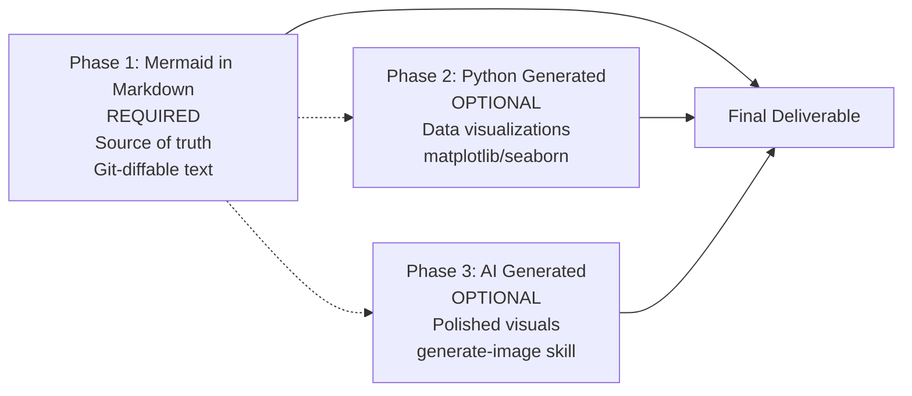

**Key Requirements:**

| Component | Requirement | File Reference |
|-----------|-------------|----------------|
| **Accessibility** | `accTitle` and `accDescr` on every diagram (where supported) | [scientific-skills/markdown-mermaid-writing/SKILL.md:182-191]() |
| **Diagram Types** | 24 types supported with reference guides | [scientific-skills/markdown-mermaid-writing/SKILL.md:106-135]() |
| **Heading Structure** | One H1 per document, emoji on H2 only | [scientific-skills/markdown-mermaid-writing/SKILL.md:162-173]() |
| **Citations** | Footnote `[^N]` with full URL for all external claims | [scientific-skills/markdown-mermaid-writing/SKILL.md:162-173]() |
| **Templates** | 9 document templates available | [scientific-skills/markdown-mermaid-writing/SKILL.md:146-159]() |

### Supported Diagram Types

The skill provides reference guides for 24 Mermaid diagram types stored in `references/diagrams/`:

- **Flowchart** - Experimental workflows, decision logic
- **Sequence** - Service interactions, API calls, messaging
- **ER Diagram** - Data models, schema
- **State** - State machines, lifecycles
- **Gantt** - Project timelines, roadmaps
- **C4** - System architecture with zoom levels
- **Mindmap** - Concept hierarchies, brainstorming
- **Timeline** - Chronological events, history
- **Quadrant** - Two-axis comparison, prioritization
- **Sankey** - Flow magnitude, resource distribution
- **XY Chart** - Numeric trends, bar + line charts
- **Architecture** - Cloud infrastructure, service topology
- **Radar** - Multi-dimensional comparison, skills radar

Full list: [scientific-skills/markdown-mermaid-writing/SKILL.md:106-135]()

### Document Templates

Nine templates in `templates/` enforce consistent structure:

- `research_paper.md` - Scientific manuscripts
- `how_to_guide.md` - Tutorials and procedures
- `decision_record.md` - Architecture decision records (ADR)
- `presentation.md` - Presentation content
- `project_documentation.md` - Project docs
- `status_report.md` - Progress reports
- `pull_request.md` - PR descriptions
- `issue.md` - Issue tracking
- `kanban.md` - Sprint/project boards

**Sources:** [scientific-skills/markdown-mermaid-writing/SKILL.md:1-335](), [scientific-skills/markdown-mermaid-writing/assets/examples/example-research-report.md:1-222]()

---

## Image Generation: generate-image

The `generate-image` skill ([scientific-skills/generate-image/SKILL.md:1-184]()) provides AI-powered image generation and editing through OpenRouter API, supporting FLUX.2 Pro and Gemini 3.1 Flash Image Preview models. Use for **general-purpose images** (photos, illustrations, artwork, concept art) but **NOT for technical diagrams**—use `scientific-schematics` for flowcharts, circuits, and pathways.

### Model Selection

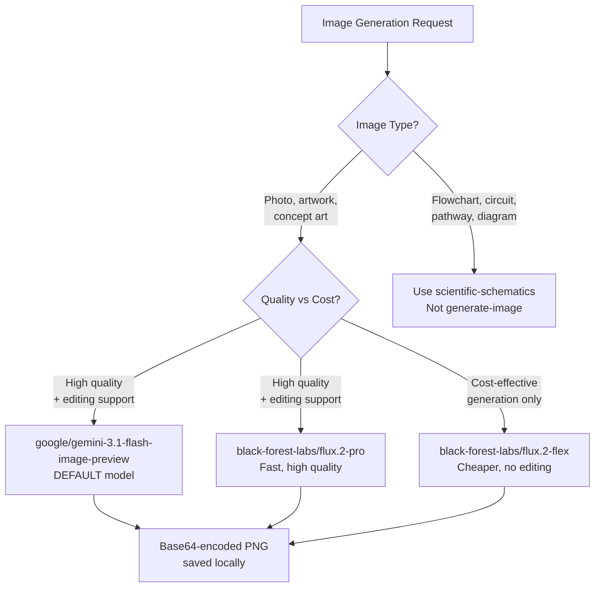

### API Configuration

The script `scripts/generate_image.py` ([scientific-skills/generate-image/scripts/generate_image.py:1-282]()) requires an OpenRouter API key configured via `.env` file or environment variable:

```python
# Check for .env file in current or parent directories
def check_env_file() -> Optional[str]:
    current_dir = Path.cwd()
    for parent in [current_dir] + list(current_dir.parents):
        env_file = parent / ".env"
        if env_file.exists():
            with open(env_file, 'r') as f:
                for line in f:
                    if line.startswith('OPENROUTER_API_KEY='):
                        return line.split('=', 1)[1].strip()
    return None
```

Reference: [scientific-skills/generate-image/scripts/generate_image.py:22-36]()

### Usage Patterns

**Basic generation:**
```bash
python scripts/generate_image.py "A beautiful sunset over mountains"
```

**Image editing:**
```bash
python scripts/generate_image.py "Make the sky purple" --input photo.jpg --output edited.png
```

**Custom model:**
```bash
python scripts/generate_image.py "Abstract art" --model "black-forest-labs/flux.2-pro" --output artwork.png
```

### Image Editing Support

Both Gemini 3.1 Flash Image Preview and FLUX.2 Pro support image editing through multimodal message content:

```python
# Load input image as base64 data URL
image_data_url = load_image_as_base64(input_image)

# Build multimodal message for editing
message_content = [
    {"type": "text", "text": prompt},
    {"type": "image_url", "image_url": {"url": image_data_url}}
]
```

Reference: [scientific-skills/generate-image/scripts/generate_image.py:118-137]()

**Sources:** [scientific-skills/generate-image/SKILL.md:1-184](), [scientific-skills/generate-image/scripts/generate_image.py:1-282]()

---

## Literature Access

Scientific Communication provides four complementary skills for literature discovery and retrieval, each optimized for different use cases.

### Skill Comparison Matrix

| Skill | Database | Coverage | Key Feature | Use Case |
|-------|----------|----------|-------------|----------|
| **pubmed-database** | PubMed/MEDLINE | 35M+ citations | MeSH terms, E-utilities | Biomedical literature, systematic reviews |
| **biorxiv-database** | bioRxiv | Preprints | Pre-peer-review access | Latest research pre-publication |
| **openalex-database** | OpenAlex | 240M+ works | No authentication | Cross-domain literature, bibliometrics |
| **bgpt-paper-search** | BioGPT indexes | Structured fields | 25+ metadata fields | Deep research with quality scores |

### pubmed-database

NCBI's PubMed provides 35M+ citations with advanced search via E-utilities API. Supports Boolean operators, field tags (author, journal, MeSH terms, publication date), filters, and citation export formats (RIS, BibTeX, MEDLINE).

**MeSH Term Search:** Use Medical Subject Headings for precise topic matching:
```python
# Search using MeSH terms
query = '"CRISPR-Cas Systems"[MeSH Terms] AND "Gene Editing"[MeSH Terms]'
results = search_pubmed(query, max_results=100)
```

**Advanced Filtering:**
```python
# Complex query with field tags
query = """
    (diabetes[Title] OR "diabetes mellitus"[Title]) 
    AND (CRISPR[Title/Abstract] OR "gene therapy"[Title/Abstract])
    AND ("2023/01/01"[Date - Publication] : "2024/12/31"[Date - Publication])
    AND hasabstract[text] 
    AND english[Language]
"""
```

### openalex-database

OpenAlex provides 240M+ scholarly works with **no authentication required**, making it ideal for large-scale bibliometric analysis and cross-domain searches. Features REST API with 100k requests/day (10 req/sec with email), advanced filtering, aggregation, random sampling, and batch ID lookups (DOI, ORCID, ROR, ISSN).

**Comprehensive Metadata:**
- Titles, abstracts, citations
- Authorships with affiliations
- Topics and concepts
- Funding information
- Open access status

**API Query Pattern:**
```python
# Search with filters
url = "https://api.openalex.org/works"
params = {
    "filter": "publication_year:2024,topics.id:T12345",
    "sort": "cited_by_count:desc",
    "per-page": 50
}
response = requests.get(url, params=params, headers={"User-Agent": "mailto:your@email.com"})
```

Reference: [docs/scientific-skills.md:24]()

### bgpt-paper-search

BGPT Paper Search extracts **25+ structured fields per paper from full text**, not just abstracts. Provides methods, results, sample sizes, statistical tests, quality scores, and confidence intervals for deep research analysis.

**Structured Fields Available:**
- Methods and protocols
- Sample sizes and demographics
- Statistical tests and p-values
- Effect sizes and confidence intervals
- Quality assessment scores
- Dataset availability
- Code availability

### biorxiv-database

Preprint server for life sciences, providing access to research before formal peer review. Supports search by keywords, authors, date ranges, and subject categories (neuroscience, bioinformatics, genomics). Returns structured JSON metadata and enables PDF downloads for full-text analysis.

**Sources:** [docs/scientific-skills.md:24-36](), [README.md:54](), [README.md:492-494]()

---

## Web Search and Real-Time Information

### perplexity-search

The `perplexity-search` skill ([scientific-skills/perplexity-search/SKILL.md:1-447]()) provides AI-powered web search with real-time information through LiteLLM and OpenRouter. Access current information beyond model training cutoffs with source citations.

### Model Selection Decision Tree

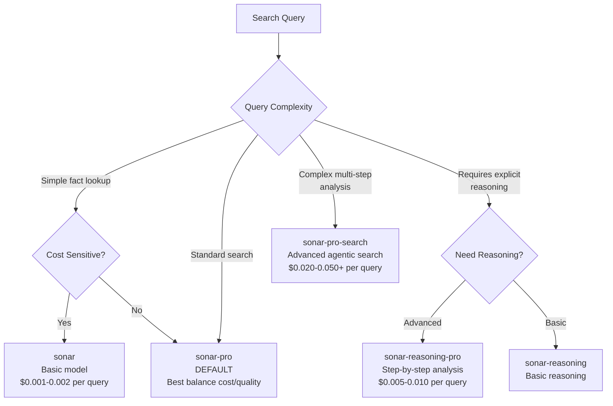

### Script Integration

The script `scripts/perplexity_search.py` integrates with OpenRouter API:

```python
# API request with LiteLLM
response = requests.post(
    url="https://openrouter.ai/api/v1/chat/completions",
    headers={
        "Authorization": f"Bearer {api_key}",
        "Content-Type": "application/json",
    },
    json={
        "model": model,  # e.g., "openrouter/perplexity/sonar-pro"
        "messages": [{"role": "user", "content": query}],
        "modalities": ["text"]
    }
)
```

Reference: [scientific-skills/perplexity-search/SKILL.md:143-160]()

### Query Design Best Practices

**Effective Query Structure:**
1. **Topic**: Main subject
2. **Scope**: Specific aspect
3. **Context**: Time frame, domain, constraints
4. **Output**: Desired format

**Example:**
```bash
python scripts/perplexity_search.py \
  "What improvements does AlphaFold3 offer over AlphaFold2 for protein structure prediction, according to research published between 2023 and 2024? Include specific accuracy metrics and benchmarks." \
  --model sonar-pro
```

### parallel-web

Provides synthesized summaries with citations from multiple sources. Useful for comparative analysis where a single source is insufficient.

### research-lookup

Intelligent backend routing for research queries, automatically selecting the appropriate database or search service based on query characteristics.

**Sources:** [scientific-skills/perplexity-search/SKILL.md:1-447](), [README.md:494]()

---

## Research Organization: open-notebook

The `open-notebook` skill provides a **self-hosted NotebookLM alternative** for research organization, source ingestion, AI chat, and podcast generation. Supports PDFs, videos, audio, web pages, and integrates with 16+ AI providers.

### Architecture

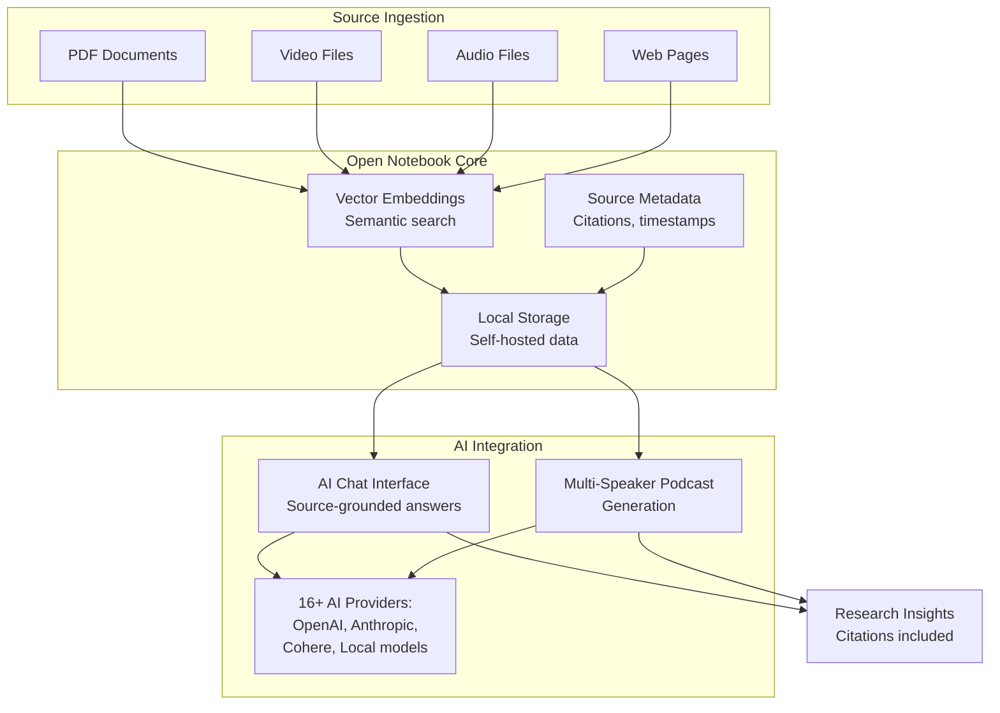

### Key Features

| Feature | Description | Benefit |
|---------|-------------|---------|
| **Multi-Source Ingestion** | PDFs, videos, audio, web pages | Unified research repository |
| **Self-Hosted** | Local data storage | Privacy and control |
| **16+ AI Providers** | OpenAI, Anthropic, Cohere, local | Provider flexibility |
| **AI Chat** | Source-grounded Q&A | Fast research synthesis |
| **Podcast Generation** | Multi-speaker audio output | Alternative content format |
| **Vector Search** | Semantic search across sources | Find relevant passages |

### Workflow Pattern

1. **Ingest sources** - Upload PDFs, videos, audio, or provide web URLs
2. **Process and embed** - System creates vector embeddings for semantic search
3. **Chat interface** - Ask questions, get answers with source citations
4. **Generate podcast** - Create multi-speaker audio summaries
5. **Export insights** - Save research notes with full citations

**Sources:** [README.md:495](), [docs/scientific-skills.md:1-50]()

---

## Writing and Review Skills

### scientific-writing

Provides manuscript preparation workflows for scientific papers, including structure templates, citation integration, and figure references. Integrates with `markdown-mermaid-writing` for diagrams and `citation-management` for bibliography handling.

**Manuscript Structure:**
- Abstract (structured or unstructured)
- Introduction with literature context
- Methods with reproducibility details
- Results with statistical analysis
- Discussion with interpretation
- References with proper formatting

### peer-review

Structures peer review workflows with templates for reviewer comments, author responses, and revision tracking. Supports multi-round review cycles and editorial decision documentation.

**Review Components:**
- Summary assessment
- Major comments (by section)
- Minor comments (line-by-line)
- Reproducibility checklist
- Recommendations (accept/revise/reject)

### citation-management

Handles reference formatting, bibliography generation, and citation style enforcement (APA, MLA, Chicago, Nature, Science, Cell). Integrates with `pyzotero` for Zotero library access.

**Supported Workflows:**
- Import citations from literature databases
- Format inline citations
- Generate bibliography
- Handle duplicate detection
- Support multiple citation styles

**Sources:** [README.md:496-503](), [docs/scientific-skills.md:1-50]()

---

## Document Processing

### document-skills

Four specialized skills handle common document formats:

| Skill | Format | Operations | Common Use Cases |
|-------|--------|------------|------------------|
| **docx** | Microsoft Word | Read, write, edit | Manuscripts, reports, protocols |
| **pdf** | PDF | Read, extract text/tables | Published papers, documentation |
| **pptx** | PowerPoint | Create, edit slides | Presentations, figures |
| **xlsx** | Excel | Read, write, analyze | Data tables, supplementary materials |

**Architecture:**

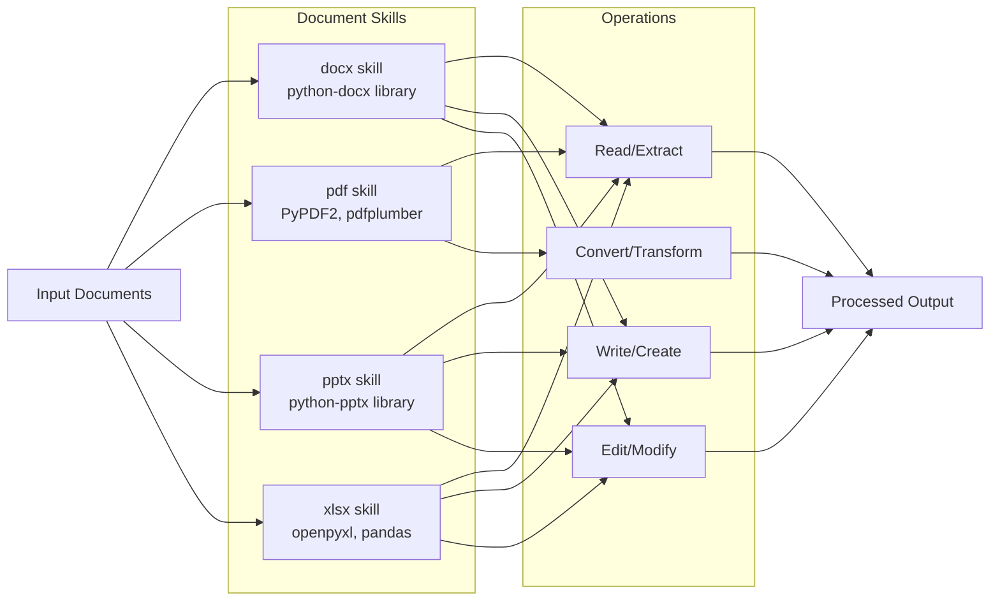

### markitdown

Converts various document formats (DOCX, PPTX, XLSX, PDF, images, audio, video) to Markdown for unified text processing. Useful for extracting content from diverse sources into a consistent format for downstream analysis or documentation.

**Sources:** [README.md:497](), [.claude-plugin/marketplace.json:172-175]()

---

## Publishing and Presentation

### Publishing Workflows

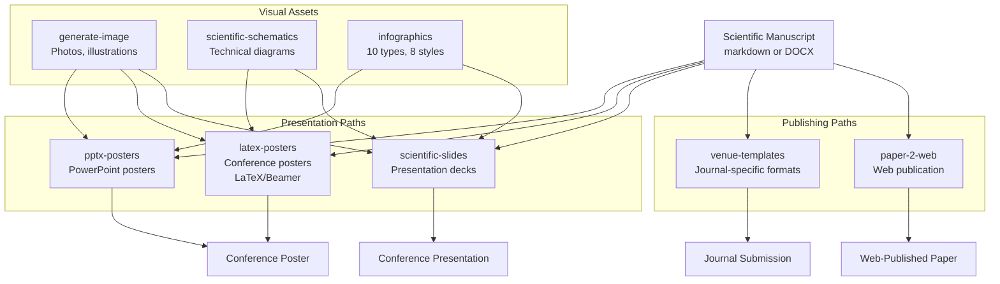

### paper-2-web

Converts scientific manuscripts to web-friendly HTML format with interactive figures, collapsible sections, and citation links. Maintains scientific rigor while improving accessibility for online readers.

### venue-templates

Provides journal-specific templates (Nature, Science, Cell, PLOS, BMC, etc.) with proper formatting, citation styles, and figure/table requirements. Ensures submission compliance before manuscript submission.

### scientific-slides

Creates presentation decks with scientific content, including data visualizations, equations, and references. Integrates with `generate-image` for visual assets and `scientific-schematics` for technical diagrams.

### latex-posters and pptx-posters

Conference poster generation in two formats:
- **latex-posters**: LaTeX/Beamer-based posters with precise typographic control
- **pptx-posters**: PowerPoint-based posters for easier editing and collaboration

Both support multi-column layouts, figure panels, QR codes, and institutional branding.

**Sources:** [README.md:498-500](), [.claude-plugin/marketplace.json:162-171]()

---

## Visual Communication

### infographics

Generates professional infographics with 10 diagram types and 8 visual styles, all using colorblind-safe palettes.

**Diagram Types:**
1. Process Flow
2. Timeline
3. Comparison
4. Hierarchy
5. Data Visualization
6. Geographic
7. Statistical
8. Conceptual
9. Instructional
10. Mixed-type

**Visual Styles:**
- Modern
- Classic
- Minimalist
- Technical
- Creative
- Corporate
- Academic
- Infographic

**Colorblind-Safe Palettes:** All infographics use palettes tested for deuteranopia, protanopia, and tritanopia color blindness.

### scientific-schematics

For technical diagrams including flowcharts, circuit diagrams, biological pathways, system architectures, and CONSORT diagrams. Generates publication-quality schematics as PNG files via AI models.

**Use Cases:**
- Flowcharts and process diagrams
- Circuit diagrams and electrical schematics
- Biological signaling pathways
- System architecture diagrams
- CONSORT flowcharts for clinical trials
- Methodology diagrams

**Distinction from generate-image:**
- **scientific-schematics**: Technical diagrams requiring precise structure
- **generate-image**: General-purpose images (photos, artwork, illustrations)

**Sources:** [README.md:500-503](), [scientific-skills/generate-image/SKILL.md:23-30]()

---

## Integration Patterns

### Pattern 1: Literature Review to Manuscript

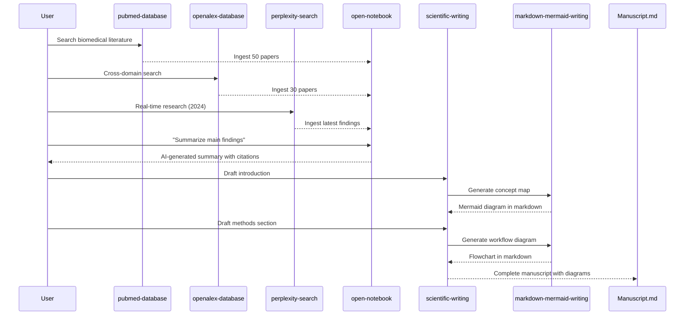

### Pattern 2: Data Analysis to Poster

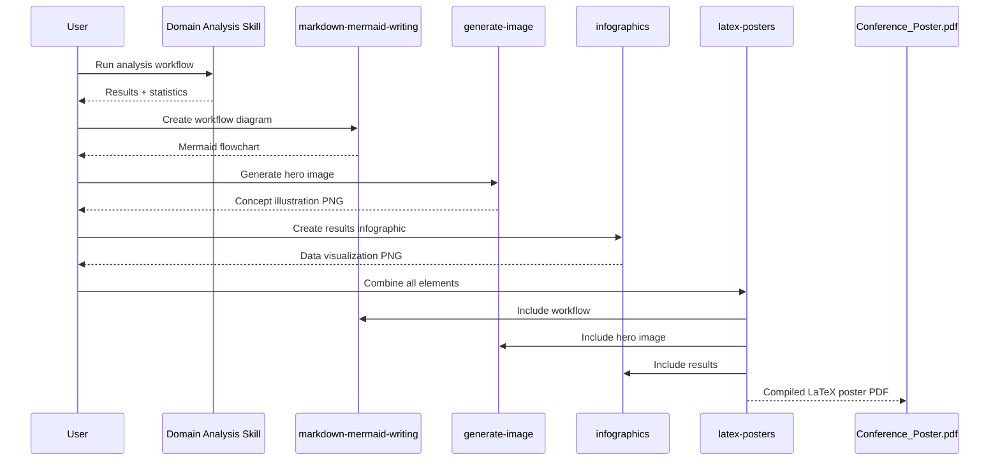

### Pattern 3: Presentation with Live Search

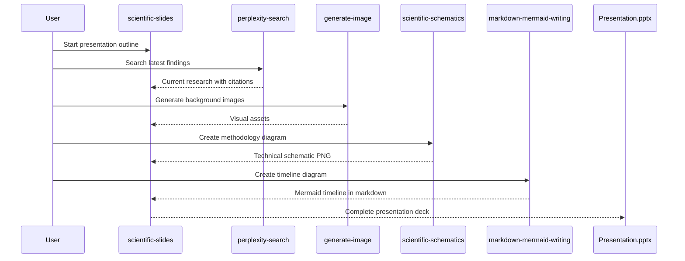

**Sources:** [README.md:216-320](), [docs/examples.md:1-50]()

---

## Integration with Other Domains

Scientific Communication skills integrate across all domain categories:

### With Bioinformatics (#4.1)

- `literature-review` + `pubmed-database` → Find relevant genomics papers
- `scientific-writing` + analysis results → Draft bioinformatics manuscripts
- `scientific-schematics` → Visualize sequencing pipelines

### With Cheminformatics (#4.2)

- `bgpt-paper-search` → Find drug discovery papers with structured fields
- `infographics` → Create SAR (structure-activity relationship) visualizations
- `latex-posters` → Present drug discovery results at conferences

### With Clinical Research (#4.3)

- `clinicaltrials-database` + `literature-review` → Comprehensive clinical evidence
- `clinical-reports` + `scientific-writing` → Patient genomics reports
- `perplexity-search` → Latest clinical trial results

### With Machine Learning (#4.4)

- `paper-2-web` → Publish ML research online
- `scientific-slides` + model results → Present ML findings
- `transformers` + `scientific-writing` → NLP-assisted manuscript drafting

### With Laboratory Automation (#4.6)

- `ginkgo-cloud-lab` + `scientific-writing` → Document automated protocols
- `dnanexus-integration` + `paper-2-web` → Publish bioinformatics pipelines
- `benchling-integration` + `open-notebook` → Research organization

**Sources:** [README.md:24-41](), [docs/examples.md:1-500]()

---

## Workflow Decision Tree

When starting a scientific communication task, follow this decision tree:

```mermaid
graph TD
    Start["Scientific Communication Task"]
    
    TaskType{Task Type?}
    
    Start --> TaskType
    
    TaskType -->|"Find literature"| LitType{Literature Type?}
    TaskType -->|"Write content"| WriteType{Content Type?}
    TaskType -->|"Create visuals"| VisualType{Visual Type?}
    TaskType -->|"Organize research"| OpenNotebook["Use open-notebook<br/>Multi-source ingestion<br/>AI chat + podcast"]
    TaskType -->|"Publish/Present"| PubType{Output Format?}
    
    LitType -->|"Biomedical"| PubMed["pubmed-database"]
    LitType -->|"Preprints"| BioRxiv["biorxiv-database"]
    LitType -->|"Cross-domain"| OpenAlex["openalex-database"]
    LitType -->|"Structured fields"| BGPT["bgpt-paper-search"]
    LitType -->|"Real-time web"| Perplexity["perplexity-search"]
    
    WriteType -->|"Manuscript"| ScientificWriting["scientific-writing<br/>+ markdown-mermaid-writing"]
    WriteType -->|"Review"| PeerReview["peer-review"]
    WriteType -->|"Documentation"| MMWDocs["markdown-mermaid-writing<br/>+ templates"]
    
    VisualType -->|"Technical diagram"| Schematics["scientific-schematics"]
    VisualType -->|"Photo/artwork"| GenImage["generate-image"]
    VisualType -->|"Infographic"| Infographics["infographics"]
    VisualType -->|"Text diagram"| MMWDiagram["markdown-mermaid-writing<br/>24 diagram types"]
    
    PubType -->|"Web publication"| Paper2Web["paper-2-web"]
    PubType -->|"Journal submission"| VenueTemplates["venue-templates"]
    PubType -->|"Presentation"| SciSlides["scientific-slides"]
    PubType -->|"Poster"| Posters["latex-posters or pptx-posters"]
    
    PubMed --> Output["Results"]
    BioRxiv --> Output
    OpenAlex --> Output
    BGPT --> Output
    Perplexity --> Output
    ScientificWriting --> Output
    PeerReview --> Output
    MMWDocs --> Output
    Schematics --> Output
    GenImage --> Output
    Infographics --> Output
    MMWDiagram --> Output
    OpenNotebook --> Output
    Paper2Web --> Output
    VenueTemplates --> Output
    SciSlides --> Output
    Posters --> Output
```

**Sources:** [README.md:491-504](), [scientific-skills/markdown-mermaid-writing/SKILL.md:46-59]()

---

## Cost and API Management

Several Scientific Communication skills require external API access:

### OpenRouter API (generate-image, perplexity-search)

- **Setup**: Create `.env` file with `OPENROUTER_API_KEY=your-key`
- **Key location**: https://openrouter.ai/keys
- **Pricing**: Pay-as-you-go, model-dependent
- **Cost optimization**: Choose appropriate models (e.g., `sonar` vs `sonar-pro-search`)
- **Monitoring**: https://openrouter.ai/activity

### Cost Comparison

| Skill | Model | Approximate Cost | Use Case |
|-------|-------|------------------|----------|
| **perplexity-search** | `sonar` | $0.001-0.002/query | Simple fact lookups |
| **perplexity-search** | `sonar-pro` (default) | $0.002-0.005/query | General research |
| **perplexity-search** | `sonar-pro-search` | $0.020-0.050+/query | Complex analysis |
| **generate-image** | `flux.2-flex` | Lower cost | Generation only |
| **generate-image** | `gemini-3.1-flash` (default) | Medium cost | Generation + editing |
| **generate-image** | `flux.2-pro` | Medium cost | High quality + editing |

### Best Practices

1. **API Key Security**: Never commit keys to version control
2. **Environment Variables**: Use `.env` files or system environment
3. **Spending Limits**: Configure in OpenRouter dashboard
4. **Usage Monitoring**: Check activity logs regularly
5. **Model Selection**: Match model capability to task complexity

**Sources:** [scientific-skills/perplexity-search/SKILL.md:246-269](), [scientific-skills/generate-image/SKILL.md:46-56]()

---

## Summary

The Scientific Communication category provides 24+ skills for the full research communication lifecycle:

1. **Documentation Standards** - `markdown-mermaid-writing` (MANDATORY) establishes text-based diagrams as default
2. **Literature Access** - Four complementary databases (PubMed, bioRxiv, OpenAlex, BGPT Paper Search)
3. **Web Search** - Real-time information via Perplexity Search
4. **Research Organization** - Self-hosted Open Notebook with multi-source ingestion and AI chat
5. **Writing** - Scientific writing, peer review, and citation management
6. **Document Processing** - Handle DOCX, PDF, PPTX, XLSX formats
7. **Publishing** - Paper-2-Web, venue templates, and presentation tools
8. **Visual Communication** - Generate images, schematics, and infographics

All skills integrate through common documentation standards and complement domain-specific analysis workflows across bioinformatics, cheminformatics, clinical research, and machine learning.

**Sources:** [README.md:491-504](), [.claude-plugin/marketplace.json:143-170](), [docs/scientific-skills.md:1-50]()

---

