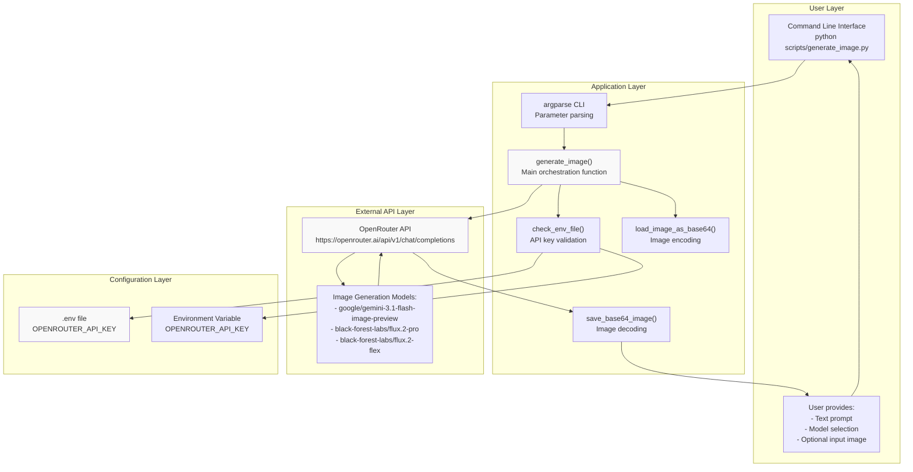
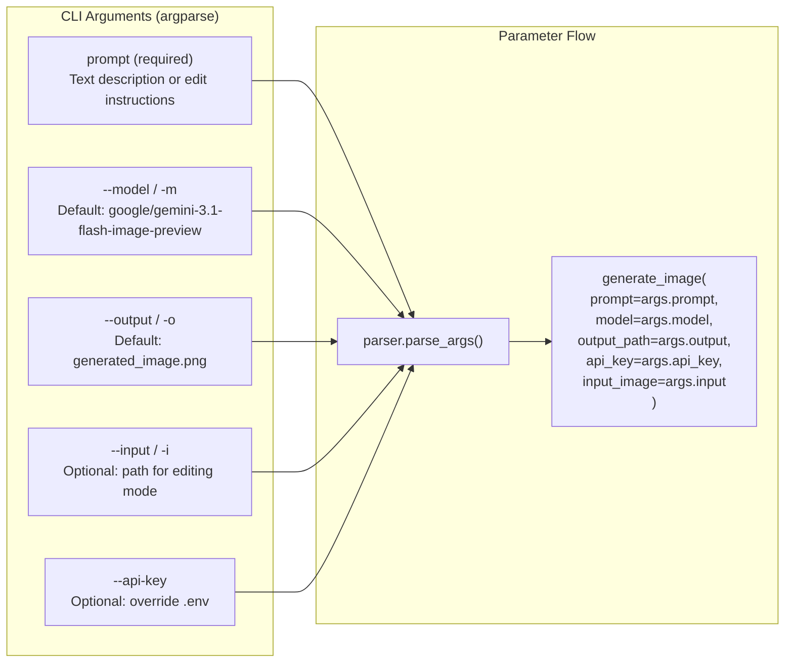
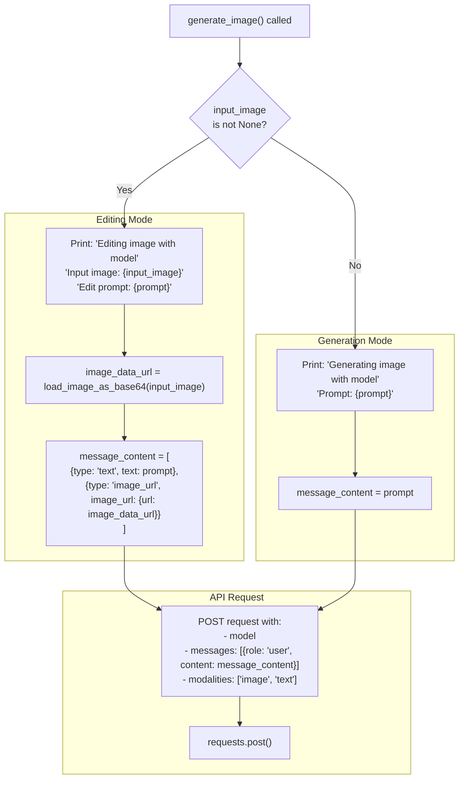
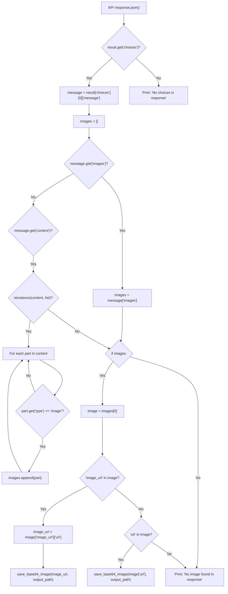
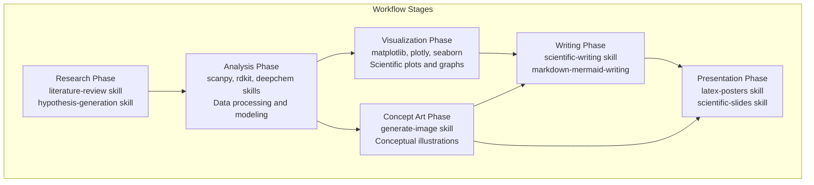

<!-- source: DeepWiki mcp.deepwiki.com · repo K-Dense-AI/claude-scientific-skills · page 7.1 Image Generation and Visual Content · fetched 2026-10-26 -->

# Image Generation and Visual Content

<details>
<summary>Relevant source files</summary>

The following files were used as context for generating this wiki page:

- [docs/examples.md](docs/examples.md)
- [scientific-skills/benchling-integration/SKILL.md](scientific-skills/benchling-integration/SKILL.md)
- [scientific-skills/dnanexus-integration/SKILL.md](scientific-skills/dnanexus-integration/SKILL.md)
- [scientific-skills/generate-image/SKILL.md](scientific-skills/generate-image/SKILL.md)
- [scientific-skills/generate-image/scripts/generate_image.py](scientific-skills/generate-image/scripts/generate_image.py)
- [scientific-skills/perplexity-search/SKILL.md](scientific-skills/perplexity-search/SKILL.md)
- [scientific-skills/transformers/SKILL.md](scientific-skills/transformers/SKILL.md)

</details>


## Purpose and Scope

This page documents the **generate-image** skill, which provides AI-powered image generation and editing capabilities for scientific communication. The skill uses OpenRouter's API to access state-of-the-art image generation models including FLUX.2 Pro and Gemini 3.1 Flash Image Preview.

**Scope**: This skill handles general-purpose image creation including photographs, illustrations, artwork, concept art, and visual assets for presentations and publications. It is specifically designed for **non-technical visual content**.

**Important distinction**: For technical diagrams, flowcharts, circuit schematics, biological pathways, or system architecture diagrams, refer to the **scientific-schematics** skill instead (not covered in this document). The generate-image skill explicitly excludes technical/schematic content in favor of photorealistic and artistic imagery.

**Related sections**: For using generated images in scientific publications, see Scientific Writing and Documentation [7.2](#7.2).

---

## System Architecture

The generate-image skill operates through a three-layer architecture connecting the user to cloud-based image generation models.

### High-Level Architecture



**Sources**: [scientific-skills/generate-image/SKILL.md:1-184](), [scientific-skills/generate-image/scripts/generate_image.py:1-282]()

---

## Core Components

### API Integration and Request Flow

The system makes HTTP requests to OpenRouter's chat completions endpoint with image generation models. The request structure differs based on whether the operation is generation or editing.

```mermaid
sequenceDiagram
    participant User
    participant generate_image
    participant check_env_file
    participant requests
    participant OpenRouter
    participant load_image_as_base64
    participant save_base64_image
    
    User->>generate_image: "prompt, model, output_path, input_image"
    generate_image->>check_env_file: "Validate API key"
    
    alt API key not found
        check_env_file-->>User: "Error: OPENROUTER_API_KEY not found"
    end
    
    check_env_file-->>generate_image: "api_key"
    
    alt Editing mode (input_image provided)
        generate_image->>load_image_as_base64: "input_image path"
        load_image_as_base64-->>generate_image: "data:image/png;base64,..."
        generate_image->>generate_image: "Build multimodal content:<br/>[text, image_url]"
    else Generation mode
        generate_image->>generate_image: "message_content = prompt string"
    end
    
    generate_image->>requests: "POST to OpenRouter<br/>Authorization: Bearer {api_key}"
    requests->>OpenRouter: "JSON payload with messages"
    OpenRouter-->>requests: "Response with base64 image"
    
    alt Success (200 status)
        requests-->>generate_image: "result JSON"
        generate_image->>save_base64_image: "base64_data, output_path"
        save_base64_image-->>User: "Image saved to: {output_path}"
    else Error
        requests-->>generate_image: "Error status code"
        generate_image-->>User: "API Error ({status_code})"
    end
```

**Sources**: [scientific-skills/generate-image/scripts/generate_image.py:75-207]()

---

### Environment Configuration System

The `check_env_file()` function implements a recursive directory search pattern to locate API credentials.

```mermaid
graph TB
    Start["check_env_file() called"]
    GetCwd["current_dir = Path.cwd()"]
    BuildDirs["dirs = [current_dir] + list(current_dir.parents)"]
    
    LoopStart{"For each parent<br/>directory"}
    CheckFile["env_file = parent / '.env'"]
    Exists{"env_file.exists()?"}
    
    ReadFile["Read file line by line"]
    CheckLine{"Line starts with<br/>'OPENROUTER_API_KEY='?"}
    ExtractKey["api_key = line.split('=', 1)[1]<br/>.strip().strip('\"').strip(\"'\")"]
    ValidKey{"api_key not empty?"}
    
    ReturnKey["Return api_key"]
    Continue["Continue to next directory"]
    ReturnNone["Return None"]
    
    Start --> GetCwd
    GetCwd --> BuildDirs
    BuildDirs --> LoopStart
    LoopStart -->|Yes| CheckFile
    CheckFile --> Exists
    Exists -->|Yes| ReadFile
    ReadFile --> CheckLine
    CheckLine -->|Yes| ExtractKey
    ExtractKey --> ValidKey
    ValidKey -->|Yes| ReturnKey
    ValidKey -->|No| Continue
    CheckLine -->|No| Continue
    Exists -->|No| Continue
    Continue --> LoopStart
    LoopStart -->|No more dirs| ReturnNone
```

**Sources**: [scientific-skills/generate-image/scripts/generate_image.py:22-35]()

---

### Image Processing Functions

Two core functions handle image encoding and decoding for API transmission.

#### load_image_as_base64()

| Purpose | Input | Output | Key Operations |
|---------|-------|--------|----------------|
| Encode local image file for API transmission | File path string | Base64 data URL string | 1. Path validation<br/>2. MIME type detection from extension<br/>3. Binary file read<br/>4. Base64 encoding<br/>5. Data URL formatting |

**Implementation details**:
- Supported extensions: `.png`, `.jpg`, `.jpeg`, `.gif`, `.webp` [scientific-skills/generate-image/scripts/generate_image.py:46-54]()
- Default MIME type: `image/png` if extension not recognized
- Output format: `data:{mime_type};base64,{encoded_data}` [scientific-skills/generate-image/scripts/generate_image.py:60]()

#### save_base64_image()

| Purpose | Input | Output | Key Operations |
|---------|-------|--------|----------------|
| Decode API response and save to file | Base64 string, output path | None (side effect: file written) | 1. Strip data URL prefix if present<br/>2. Base64 decode<br/>3. Write binary to file |

**Implementation details**:
- Handles data URL format: splits on first comma if present [scientific-skills/generate-image/scripts/generate_image.py:66-67]()
- Writes binary mode (`'wb'`) for image data [scientific-skills/generate-image/scripts/generate_image.py:71-72]()

**Sources**: [scientific-skills/generate-image/scripts/generate_image.py:38-73]()

---

### Command-Line Interface

The CLI uses `argparse` to provide a user-friendly interface with comprehensive help text and examples.



**Argument specifications**:
- `prompt`: Required positional argument, type `str` [scientific-skills/generate-image/scripts/generate_image.py:237-241]()
- `--model`: Optional, default `"google/gemini-3.1-flash-image-preview"` [scientific-skills/generate-image/scripts/generate_image.py:243-248]()
- `--output`: Optional, default `"generated_image.png"` [scientific-skills/generate-image/scripts/generate_image.py:250-255]()
- `--input`: Optional, enables editing mode when provided [scientific-skills/generate-image/scripts/generate_image.py:257-261]()
- `--api-key`: Optional, overrides environment-based detection [scientific-skills/generate-image/scripts/generate_image.py:263-267]()

**Sources**: [scientific-skills/generate-image/scripts/generate_image.py:209-278]()

---

## Workflow Patterns

### Generation vs Editing Mode

The `generate_image()` function implements different message structures based on whether an input image is provided.



**Key differences**:
- **Generation mode**: `message_content` is a simple string [scientific-skills/generate-image/scripts/generate_image.py:141]()
- **Editing mode**: `message_content` is a list with text and image_url objects [scientific-skills/generate-image/scripts/generate_image.py:126-137]()
- Editing mode requires base64-encoding the input image [scientific-skills/generate-image/scripts/generate_image.py:123]()
- Both modes use the same API endpoint and include `"modalities": ["image", "text"]` [scientific-skills/generate-image/scripts/generate_image.py:158]()

**Sources**: [scientific-skills/generate-image/scripts/generate_image.py:114-142]()

---

### Response Parsing Logic

The API returns images in different formats depending on the model. The parsing logic handles both variations.



**Response format handling**:
1. **Direct `images` field**: Some models return `message["images"]` directly [scientific-skills/generate-image/scripts/generate_image.py:176-177]()
2. **Content array format**: Other models return `message["content"]` as a list with image parts [scientific-skills/generate-image/scripts/generate_image.py:179-184]()
3. **URL extraction**: Handles both `image_url.url` and direct `url` fields [scientific-skills/generate-image/scripts/generate_image.py:189-195]()

**Sources**: [scientific-skills/generate-image/scripts/generate_image.py:169-204]()

---

## Model Selection and Configuration

The skill supports multiple OpenRouter image generation models with different capabilities and pricing.

### Available Models

| Model ID | Capabilities | Best For | Cost Tier |
|----------|-------------|----------|-----------|
| `google/gemini-3.1-flash-image-preview` | Generation + Editing | Default choice, high quality, versatile | Medium |
| `black-forest-labs/flux.2-pro` | Generation + Editing | Fast, high quality, supports both modes | Medium-High |
| `black-forest-labs/flux.2-flex` | Generation only | Cost-effective, lower quality | Low |

**Model selection guidelines** [scientific-skills/generate-image/SKILL.md:70-73]():
- **Quality**: Use `gemini-3.1-flash-image-preview` or `flux.2-pro`
- **Editing**: Use `gemini-3.1-flash-image-preview` or `flux.2-pro` (both support image editing)
- **Cost**: Use `flux.2-flex` for generation-only tasks

**Default model**: `google/gemini-3.1-flash-image-preview` [scientific-skills/generate-image/scripts/generate_image.py:246]()

**Sources**: [scientific-skills/generate-image/SKILL.md:59-73](), [scientific-skills/generate-image/scripts/generate_image.py:77]()

---

## Integration with Scientific Workflows

The generate-image skill integrates with other scientific communication skills to produce complete publication materials.



### Common Use Cases

**1. Scientific Paper Illustrations** [scientific-skills/generate-image/SKILL.md:125-131]()
```bash
# Generate conceptual figure
python scripts/generate_image.py \
  "Microscopic view of cancer cells being attacked by immunotherapy agents, scientific illustration style" \
  --output figures/immunotherapy_concept.png

# Generate molecular visualization
python scripts/generate_image.py \
  "DNA double helix structure with highlighted mutation site, modern scientific visualization" \
  --output slides/dna_mutation.png
```

**2. Presentation Assets** [scientific-skills/generate-image/SKILL.md:133-140]()
```bash
# Title slide background
python scripts/generate_image.py \
  "Abstract blue and white background with subtle molecular patterns, professional presentation style" \
  --output slides/background.png

# Poster hero image
python scripts/generate_image.py \
  "Laboratory setting with modern equipment, photorealistic, well-lit" \
  --output poster/hero.png
```

**3. General Visual Content** [scientific-skills/generate-image/SKILL.md:142-149]()
```bash
# Documentation images
python scripts/generate_image.py \
  "Professional team collaboration around a digital whiteboard, modern office" \
  --output docs/team_collaboration.png

# Marketing materials
python scripts/generate_image.py \
  "Futuristic AI brain concept with glowing neural networks" \
  --output marketing/ai_concept.png
```

**Skill composition patterns**:
- **scientific-schematics**: Use for technical diagrams, flowcharts, circuits, pathways [scientific-skills/generate-image/SKILL.md:179]()
- **generate-image**: Use for photos, illustrations, artwork, visual concepts [scientific-skills/generate-image/SKILL.md:180]()
- **scientific-slides**: Combine with generate-image for visually rich presentations [scientific-skills/generate-image/SKILL.md:181]()
- **latex-posters**: Use generate-image for poster visuals and hero images [scientific-skills/generate-image/SKILL.md:182]()

**Sources**: [scientific-skills/generate-image/SKILL.md:122-183](), [docs/examples.md:20-28]()

---

## Configuration and Setup

### Environment Configuration

The skill requires an OpenRouter API key for authentication. The system checks multiple sources in order.

**Configuration precedence** (highest to lowest):
1. `--api-key` command-line argument [scientific-skills/generate-image/scripts/generate_image.py:120]()
2. `.env` file in current directory or parent directories [scientific-skills/generate-image/scripts/generate_image.py:22-35]()
3. `OPENROUTER_API_KEY` environment variable (checked implicitly by `.env` file search)

**Setup instructions** [scientific-skills/generate-image/SKILL.md:46-56]():
1. Obtain API key from https://openrouter.ai/keys
2. Create `.env` file with `OPENROUTER_API_KEY=your-api-key-here`
3. Or set environment variable: `export OPENROUTER_API_KEY=your-api-key-here`

### Error Handling

The system provides clear error messages for common setup and runtime issues.

| Error Condition | Detection Point | Error Message | Resolution |
|----------------|-----------------|---------------|------------|
| API key not found | `generate_image()` function check | "OPENROUTER_API_KEY not found!" + setup instructions | Configure `.env` or environment variable |
| `requests` library missing | Import attempt | "requests library not found. Install with: pip install requests" | `uv pip install requests` |
| API error | HTTP response status | "API Error ({status_code}): {response.text}" | Check API key validity, credits, rate limits |
| Input image not found | `load_image_as_base64()` | "Error: Image file not found: {image_path}" | Verify input file path |

**API key validation flow** [scientific-skills/generate-image/scripts/generate_image.py:101-112]():
```python
if not api_key:
    api_key = check_env_file()

if not api_key:
    print("❌ Error: OPENROUTER_API_KEY not found!")
    print("\nPlease create a .env file in your project directory with:")
    print("OPENROUTER_API_KEY=your-api-key-here")
    # ... additional instructions
    sys.exit(1)
```

**API error handling** [scientific-skills/generate-image/scripts/generate_image.py:162-165]():
```python
if response.status_code != 200:
    print(f"❌ API Error ({response.status_code}): {response.text}")
    sys.exit(1)
```

**Sources**: [scientific-skills/generate-image/SKILL.md:46-59](), [scientific-skills/generate-image/SKILL.md:151-160](), [scientific-skills/generate-image/scripts/generate_image.py:96-112](), [scientific-skills/generate-image/scripts/generate_image.py:162-165]()

---

## Image Editing Capabilities

The skill supports editing existing images through the same API interface using multimodal prompts.

### Editing Workflow

**Input requirements**:
- Existing image file (PNG, JPEG, GIF, WebP)
- Text prompt describing desired changes
- Model that supports editing (`gemini-3.1-flash-image-preview` or `flux.2-pro`)

**Supported operations** [scientific-skills/generate-image/SKILL.md:170-176]():
- Color adjustments ("Make the sky purple")
- Object addition ("Add sunglasses to the person")
- Object removal ("Remove the text from the image")
- Style changes ("Make it look like a watercolor painting")
- Background modifications ("Change the background to a sunset")

**Example usage** [scientific-skills/generate-image/SKILL.md:92-105]():
```bash
# Edit with default model
python scripts/generate_image.py "Make the background blue" --input photo.jpg

# Edit with specific model
python scripts/generate_image.py \
  "Add sunglasses to the person" \
  --input portrait.png \
  --model "black-forest-labs/flux.2-pro"

# Edit with custom output
python scripts/generate_image.py \
  "Remove the text from the image" \
  --input screenshot.png \
  --output cleaned.png
```

**Best practices for editing prompts** [scientific-skills/generate-image/SKILL.md:170-176]():
- Be specific about desired changes
- Reference specific elements in the image when possible
- Use clear and detailed editing instructions
- Prefer explicit descriptions over vague commands

**Sources**: [scientific-skills/generate-image/SKILL.md:92-105](), [scientific-skills/generate-image/SKILL.md:170-176]()

---

## Technical Specifications

### API Request Structure

The system sends POST requests to OpenRouter's chat completions endpoint with specific formatting.

**Request payload structure** [scientific-skills/generate-image/scripts/generate_image.py:144-160]():
```json
{
  "model": "google/gemini-3.1-flash-image-preview",
  "messages": [
    {
      "role": "user",
      "content": "<string or array>"
    }
  ],
  "modalities": ["image", "text"]
}
```

**Headers** [scientific-skills/generate-image/scripts/generate_image.py:147-149]():
- `Authorization`: `Bearer {api_key}`
- `Content-Type`: `application/json`

**Content format variations**:
- **Generation**: `content` is a string prompt
- **Editing**: `content` is an array of objects:
  ```json
  [
    {"type": "text", "text": "prompt text"},
    {"type": "image_url", "image_url": {"url": "data:image/png;base64,..."}}
  ]
  ```

### Image Format Handling

**Input formats** [scientific-skills/generate-image/scripts/generate_image.py:46-54]():
- `.png` → `image/png`
- `.jpg`, `.jpeg` → `image/jpeg`
- `.gif` → `image/gif`
- `.webp` → `image/webp`

**Output format**:
- Always saved as PNG [scientific-skills/generate-image/SKILL.md:163]()
- File extension can be customized via `--output` parameter
- Base64-decoded binary data [scientific-skills/generate-image/scripts/generate_image.py:70-72]()

**Data URL encoding** [scientific-skills/generate-image/scripts/generate_image.py:60]():
```
data:{mime_type};base64,{base64_encoded_data}
```

**Sources**: [scientific-skills/generate-image/scripts/generate_image.py:38-73](), [scientific-skills/generate-image/scripts/generate_image.py:144-160](), [scientific-skills/generate-image/SKILL.md:163-168]()

---

