<!-- source: DeepWiki mcp.deepwiki.com · repo K-Dense-AI/claude-scientific-skills · page 8 Multi-Domain Workflows · fetched 2026-10-26 -->

# Multi-Domain Workflows

<details>
<summary>Relevant source files</summary>

The following files were used as context for generating this wiki page:

- [.claude-plugin/marketplace.json](.claude-plugin/marketplace.json)
- [README.md](README.md)
- [docs/scientific-skills.md](docs/scientific-skills.md)
- [scientific-skills/ginkgo-cloud-lab/SKILL.md](scientific-skills/ginkgo-cloud-lab/SKILL.md)
- [scientific-skills/ginkgo-cloud-lab/references/cell-free-protein-expression-optimization.md](scientific-skills/ginkgo-cloud-lab/references/cell-free-protein-expression-optimization.md)
- [scientific-skills/ginkgo-cloud-lab/references/cell-free-protein-expression-validation.md](scientific-skills/ginkgo-cloud-lab/references/cell-free-protein-expression-validation.md)
- [scientific-skills/ginkgo-cloud-lab/references/fluorescent-pixel-art-generation.md](scientific-skills/ginkgo-cloud-lab/references/fluorescent-pixel-art-generation.md)

</details>


## Purpose and Scope

This section demonstrates how Claude Scientific Skills enables complete end-to-end scientific workflows by composing skills across multiple domains. Multi-domain workflows orchestrate skills from bioinformatics, cheminformatics, clinical research, machine learning, databases, and laboratory automation to execute complex research pipelines from a single natural language prompt.

Individual skills are documented in their respective domain sections ([#4]()). For installation and configuration, see [#2.1](). For the underlying skill discovery mechanism, see [#3.2]().

**Subsections:**
- [#8.1]() - Drug Discovery Pipeline (literature → docking → lab automation)
- [#8.2]() - Cancer Genomics and Precision Medicine (variant analysis → clinical databases)
- [#8.3]() - Genomic Variant Analysis (TileDB-VCF population genomics)

---

## Workflow Architecture

Multi-domain workflows leverage the Agent Skills standard to compose independent skills without explicit orchestration code. The agent matches user prompts to registered skills, chains execution across domains, and manages data flow automatically.

### Skill Discovery and Composition Flow

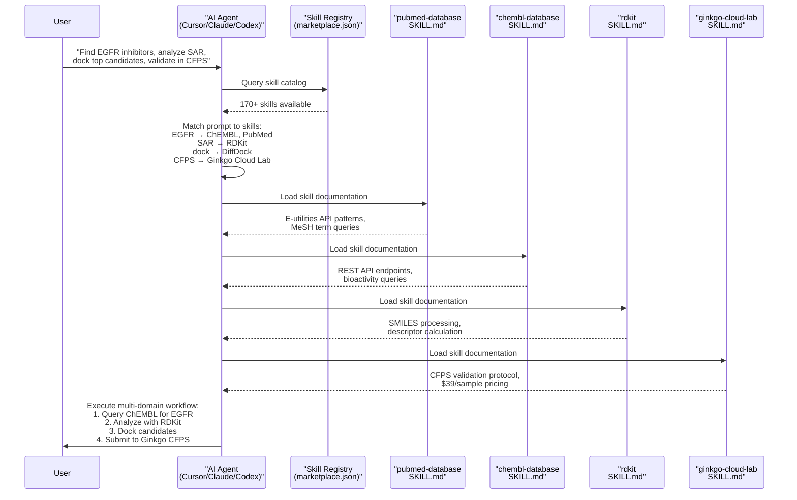

**Sources:** [README.md:113-162](), [.claude-plugin/marketplace.json:1-194]()

---

## Workflow Composition Patterns

Multi-domain workflows follow three primary composition patterns:

### Pattern 1: Linear Pipeline

Sequential execution where each skill's output feeds the next stage.

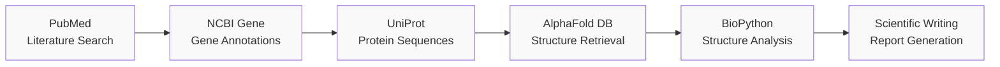

### Pattern 2: Parallel Convergence

Multiple skills execute in parallel, converging for integration or comparison.

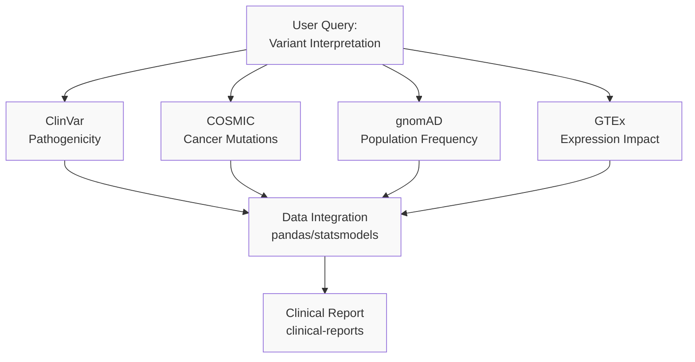

### Pattern 3: Iterative Refinement

Skills execute in cycles with feedback loops for optimization.

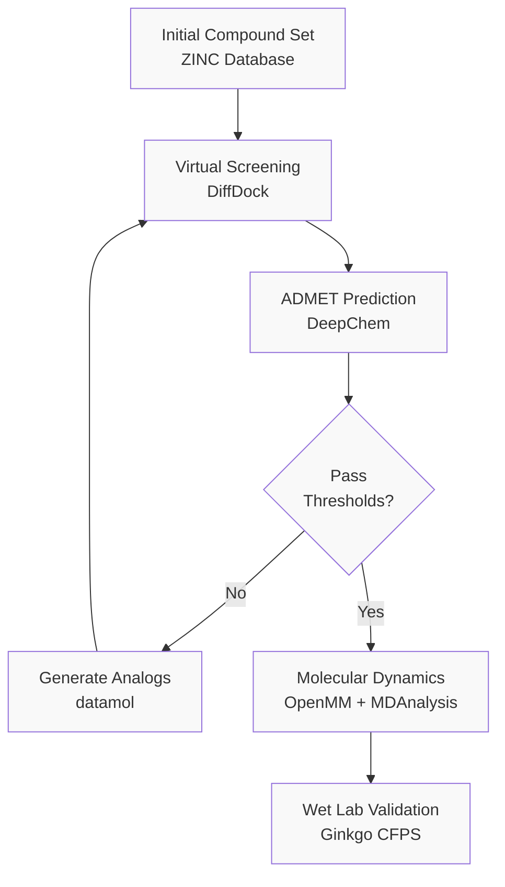

**Sources:** [README.md:216-321](), [docs/scientific-skills.md:1-100]()

---

## Example Workflow: Drug Discovery Pipeline

This workflow demonstrates skill composition from literature mining through computational chemistry to physical lab automation.

### Workflow Diagram

```mermaid
graph TB
    subgraph Phase1["Phase 1: Target Identification"]
        P1A["pubmed-database<br/>Search 'EGFR lung cancer'<br/>E-utilities API"]
        P1B["ncbi-gene-database<br/>EGFR gene info<br/>Entrez API"]
        P1C["uniprot-database<br/>Protein sequences<br/>REST API"]
        P1D["alphafold-database<br/>Structure prediction<br/>AlphaFold DB"]
        
        P1A --> P1B
        P1B --> P1C
        P1C --> P1D
    end
    
    subgraph Phase2["Phase 2: Compound Discovery"]
        P2A["chembl-database<br/>Query bioactivity<br/>target_chembl_id = CHEMBL203"]
        P2B["rdkit<br/>SMILES → descriptors<br/>Mol objects"]
        P2C["datamol<br/>Generate analogs<br/>scaffold decoration"]
        
        P1D --> P2A
        P2A --> P2B
        P2B --> P2C
    end
    
    subgraph Phase3["Phase 3: In Silico Screening"]
        P3A["diffdock<br/>Molecular docking<br/>confidence scores"]
        P3B["deepchem<br/>ADMET prediction<br/>GraphConvModel"]
        P3C["molecular-dynamics<br/>OpenMM + MDAnalysis<br/>trajectory analysis"]
        
        P2C --> P3A
        P3A --> P3B
        P3B --> P3C
    end
    
    subgraph Phase4["Phase 4: Lab Automation"]
        P4A["ginkgo-cloud-lab<br/>CFPS validation<br/>$39/sample"]
        P4B["ginkgo-cloud-lab<br/>CFPS optimization<br/>$199/sample, 24 conditions"]
        
        P3C --> P4A
        P4A --> P4B
    end
    
    subgraph Phase5["Phase 5: Documentation"]
        P5A["generate-image<br/>Chemical structures<br/>FLUX.2 Pro via OpenRouter"]
        P5B["scientific-writing<br/>Manuscript generation"]
        P5C["latex-posters<br/>Conference materials"]
        
        P4B --> P5A
        P5A --> P5B
        P5B --> P5C
    end
    
    style Phase1 fill:#f9f9f9
    style Phase2 fill:#f9f9f9
    style Phase3 fill:#f9f9f9
    style Phase4 fill:#f9f9f9
    style Phase5 fill:#f9f9f9
```

**Sources:** [README.md:220-234](), [scientific-skills/ginkgo-cloud-lab/SKILL.md:1-57]()

### Skill-to-Code Mapping

| Workflow Phase | Skills Used | Key Code Entities |
|---|---|---|
| Target Identification | `pubmed-database`, `ncbi-gene-database`, `uniprot-database`, `alphafold-database` | E-utilities API, Entrez, REST endpoints |
| Compound Discovery | `chembl-database`, `rdkit`, `datamol` | `target_chembl_id`, `Chem.MolFromSmiles()`, scaffold decoration |
| In Silico Screening | `diffdock`, `deepchem`, `molecular-dynamics` | confidence scores, `GraphConvModel`, `MDAnalysis.Universe()` |
| Lab Automation | `ginkgo-cloud-lab` | CFPS validation ($39/sample), optimization ($199/sample) |
| Documentation | `generate-image`, `scientific-writing`, `latex-posters` | OpenRouter API, manuscript templates |

**Sources:** [docs/scientific-skills.md:3-35](), [scientific-skills/ginkgo-cloud-lab/SKILL.md:16-28]()

### Data Flow Example

The following shows how data transforms across skill boundaries in the drug discovery pipeline:

```mermaid
graph LR
    Input1["User Prompt:<br/>'Find EGFR inhibitors'"]
    
    Input1 --> D1["PubMed Papers<br/>PMIDs: [31234567, ...]"]
    D1 --> D2["Gene ID: 1956<br/>Symbol: EGFR"]
    D2 --> D3["UniProt: P00533<br/>FASTA sequence"]
    D3 --> D4["AlphaFold ID:<br/>AF-P00533-F1<br/>PDB coordinates"]
    
    D4 --> D5["ChEMBL Compounds<br/>SMILES: [CC1=C..., ...]<br/>IC50: [12.4, 8.1, ...] nM"]
    D5 --> D6["RDKit Mol Objects<br/>MW: [456.5, 412.3, ...]<br/>LogP: [3.2, 2.8, ...]"]
    D6 --> D7["Analog Library<br/>500 compounds<br/>SMILES variations"]
    
    D7 --> D8["DiffDock Poses<br/>Confidence: [0.89, 0.76, ...]<br/>PDB files"]
    D8 --> D9["ADMET Predictions<br/>Caco2: [high, medium, ...]<br/>hERG: [safe, safe, ...]"]
    D9 --> D10["MD Trajectories<br/>RMSD: 2.3 Å<br/>Binding free energy"]
    
    D10 --> D11["FASTA sequences<br/>Top 3 candidates"]
    D11 --> D12["CFPS Results<br/>Expression: [15, 22, 8] mg/L<br/>Purity: [78%, 85%, 62%]"]
    
    style Input1 fill:#f9f9f9
    style D1 fill:#f9f9f9
    style D2 fill:#f9f9f9
    style D3 fill:#f9f9f9
    style D4 fill:#f9f9f9
    style D5 fill:#f9f9f9
    style D6 fill:#f9f9f9
    style D7 fill:#f9f9f9
    style D8 fill:#f9f9f9
    style D9 fill:#f9f9f9
    style D10 fill:#f9f9f9
    style D11 fill:#f9f9f9
    style D12 fill:#f9f9f9
```

**Sources:** [README.md:220-234](), [scientific-skills/ginkgo-cloud-lab/references/cell-free-protein-expression-validation.md:1-72]()

---

## Example Workflow: Single-Cell RNA-seq Analysis

This workflow integrates genomics, single-cell analysis, database queries, and pathway enrichment.

### Workflow Architecture

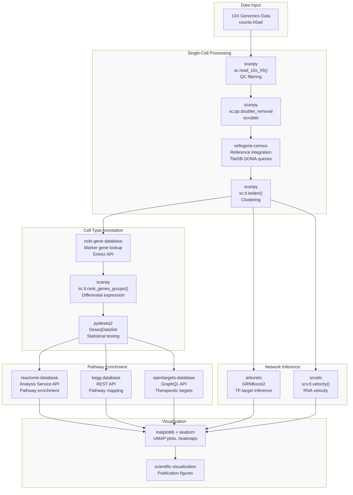

**Sources:** [README.md:237-250](), [docs/scientific-skills.md:64-75]()

### Skill Invocation Pattern

The agent invokes skills based on natural language prompts. The following shows the mapping from user intent to skill execution:

| User Intent | Matched Skills | Key Functions/APIs |
|---|---|---|
| "Load 10X data" | `scanpy` | `sc.read_10x_h5()`, `sc.read_10x_mtx()` |
| "Remove doublets" | `scanpy` | `sc.external.pp.scrublet()` |
| "Integrate with reference" | `cellxgene-census` | `cellxgene_census.open_soma()`, TileDB-SOMA queries |
| "Find cell type markers" | `ncbi-gene-database` | E-utilities Entrez API |
| "Differential expression" | `pydeseq2`, `scanpy` | `DeseqDataSet()`, `sc.tl.rank_genes_groups()` |
| "Infer gene networks" | `arboreto` | `GRNBoost2()`, ensemble tree methods |
| "RNA velocity" | `scvelo` | `scv.tl.velocity()`, dynamical modeling |
| "Enrich pathways" | `reactome-database`, `kegg-database` | REST API, Analysis Service |
| "Find drug targets" | `opentargets-database` | GraphQL `target` queries |

**Sources:** [docs/scientific-skills.md:64-75](), [.claude-plugin/marketplace.json:17-100]()

---

## Example Workflow: Clinical Variant Interpretation

This workflow demonstrates parallel database queries converging for clinical decision support.

### Workflow Diagram

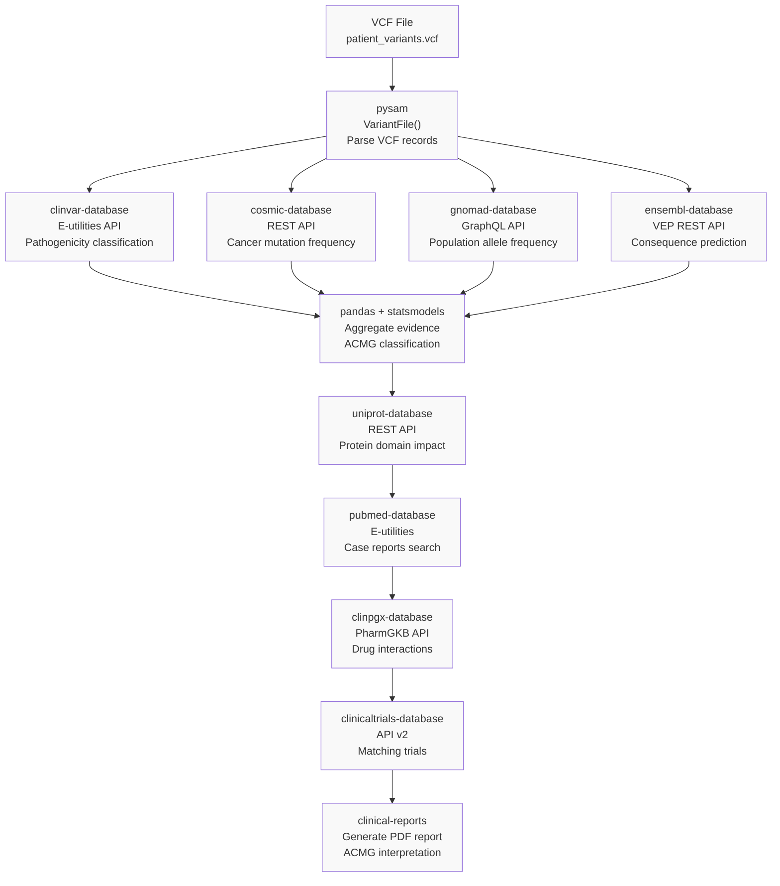

**Sources:** [README.md:288-300](), [docs/scientific-skills.md:9-33]()

### Parallel Query Execution

The workflow executes multiple database queries in parallel, aggregating results for comprehensive variant interpretation:

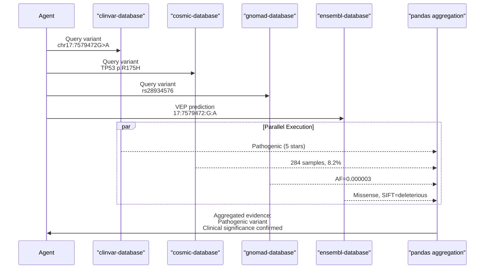

**Sources:** [README.md:288-300](), [docs/scientific-skills.md:9-14]()

---

## Example Workflow: Multi-Omics Biomarker Discovery

This workflow integrates RNA-seq, proteomics, metabolomics, and clinical trial data for predictive modeling.

### Workflow Architecture

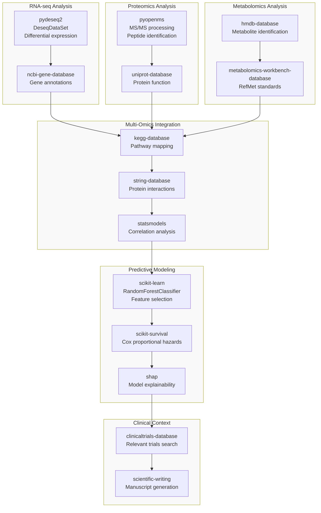

**Sources:** [README.md:254-268](), [docs/scientific-skills.md:19-33]()

### Data Integration Strategy

Multi-omics workflows require integrating heterogeneous data types. The following shows the data transformation pipeline:

| Data Type | Input Format | Skills Used | Output Format |
|---|---|---|---|
| RNA-seq | counts.csv | `pydeseq2` | DESeq2Results (gene, log2FC, padj) |
| Proteomics | .mzML files | `pyopenms` | Protein IDs, abundances |
| Metabolomics | .mzXML files | `hmdb-database` | Metabolite IDs, concentrations |
| Pathways | Gene/protein lists | `kegg-database`, `string-database` | Pathway IDs, enrichment p-values |
| Integration | Multi-modal matrices | `statsmodels` | Correlation matrices, p-values |
| Prediction | Feature matrix | `scikit-learn`, `scikit-survival` | Model predictions, survival curves |

**Sources:** [README.md:254-268](), [docs/scientific-skills.md:19-33]()

---

## Skill Routing Mechanism

The agent routes user queries to appropriate skills using metadata from `SKILL.md` frontmatter and skill descriptions.

### Routing Decision Process

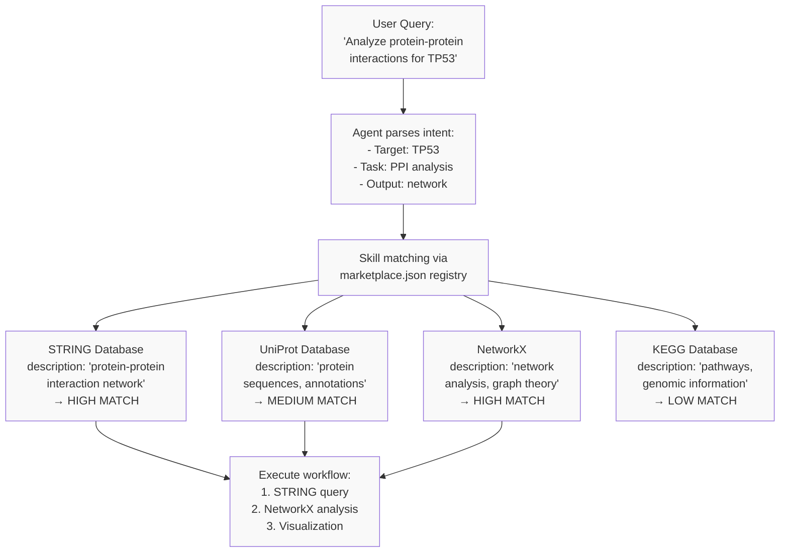

**Sources:** [.claude-plugin/marketplace.json:1-194](), [README.md:113-162]()

---

## Workflow Execution Patterns

### Sequential Execution

Skills execute in order, with each skill's output feeding the next:

```python
# Example: Drug discovery linear pipeline
# Skills: chembl-database → rdkit → diffdock

# Step 1: Query ChEMBL
compounds = query_chembl(target="EGFR", activity_type="IC50", max_value=50)

# Step 2: Calculate descriptors with RDKit
from rdkit import Chem
from rdkit.Chem import Descriptors

for compound in compounds:
    mol = Chem.MolFromSmiles(compound['smiles'])
    compound['mw'] = Descriptors.MolWt(mol)
    compound['logp'] = Descriptors.MolLogP(mol)

# Step 3: Molecular docking
docked_poses = run_diffdock(
    compounds=compounds,
    receptor_pdb="alphafold_structure.pdb"
)
```

**Sources:** [README.md:220-234]()

### Parallel Aggregation

Multiple skills execute independently, then results aggregate:

```python
# Example: Variant interpretation
# Skills: clinvar-database, cosmic-database, gnomad-database → integration

import asyncio
import pandas as pd

async def query_all_databases(variant):
    # Parallel queries
    clinvar_task = query_clinvar(variant)
    cosmic_task = query_cosmic(variant)
    gnomad_task = query_gnomad(variant)
    
    # Await all results
    clinvar, cosmic, gnomad = await asyncio.gather(
        clinvar_task, cosmic_task, gnomad_task
    )
    
    # Aggregate evidence
    evidence = pd.DataFrame({
        'clinvar_pathogenicity': clinvar['classification'],
        'cosmic_frequency': cosmic['sample_count'],
        'gnomad_af': gnomad['allele_frequency']
    })
    
    return evidence
```

**Sources:** [README.md:288-300]()

### Iterative Refinement

Skills execute in loops with conditional branching:

```python
# Example: Lead optimization
# Skills: datamol, diffdock, deepchem (iterative)

max_iterations = 10
threshold_affinity = -8.0  # kcal/mol

for iteration in range(max_iterations):
    # Generate analogs
    analogs = datamol.generate_analogs(lead_compound)
    
    # Dock candidates
    docked = diffdock.dock(analogs, receptor)
    
    # Predict ADMET
    admet = deepchem.predict_admet(analogs)
    
    # Filter by criteria
    candidates = filter_compounds(
        docked, admet,
        affinity_threshold=threshold_affinity
    )
    
    if candidates:
        break  # Found suitable candidates
    
    # Update lead for next iteration
    lead_compound = select_best(docked)
```

**Sources:** [README.md:271-284]()

---

## Laboratory Automation Integration

Multi-domain workflows can bridge from computational design to physical lab execution via the `ginkgo-cloud-lab` skill.

### Computational-to-Physical Workflow

```mermaid
graph LR
    subgraph Computational["Computational Design"]
        C1["diffdock<br/>Molecular docking"]
        C2["deepchem<br/>ADMET prediction"]
        C3["molecular-dynamics<br/>MD simulation"]
    end
    
    subgraph DataPrep["Data Preparation"]
        D1["biopython<br/>Generate FASTA<br/>from sequences"]
        D2["Format sequences<br/>for Ginkgo input"]
    end
    
    subgraph Physical["Physical Automation"]
        P1["ginkgo-cloud-lab<br/>CFPS validation<br/>$39/sample"]
        P2["ginkgo-cloud-lab<br/>CFPS optimization<br/>$199/sample<br/>24 conditions DoE"]
    end
    
    subgraph Analysis["Result Analysis"]
        A1["Parse LabChip results<br/>Expression titers"]
        A2["Correlate computational<br/>vs. experimental"]
    end
    
    C1 --> C2
    C2 --> C3
    C3 --> D1
    D1 --> D2
    D2 --> P1
    P1 --> P2
    P2 --> A1
    A1 --> A2
    
    style Computational fill:#f9f9f9
    style DataPrep fill:#f9f9f9
    style Physical fill:#f9f9f9
    style Analysis fill:#f9f9f9
```

**Sources:** [scientific-skills/ginkgo-cloud-lab/SKILL.md:1-57](), [scientific-skills/ginkgo-cloud-lab/references/cell-free-protein-expression-validation.md:1-72]()

### Ginkgo Cloud Lab Protocol Execution

The `ginkgo-cloud-lab` skill enables automated protocol submission:

```python
# Computational design produces candidate sequences
candidates = [
    {"name": "EGFR_variant_1", "sequence": "ATGCGC..."},
    {"name": "EGFR_variant_2", "sequence": "ATGTTC..."},
    {"name": "EGFR_variant_3", "sequence": "ATGAAC..."}
]

# Convert to FASTA format
import io
fasta_buffer = io.StringIO()
for candidate in candidates:
    fasta_buffer.write(f">{candidate['name']}\n")
    fasta_buffer.write(f"{candidate['sequence']}\n")

# Submit to Ginkgo Cloud Lab CFPS validation
# Protocol: cell-free-protein-expression-validation
# Price: $39/sample × 3 samples × 3 replicates = $351
# Turnaround: 5-10 days
# Output: Expression confirmation, titer (mg/L), purity %
```

**Sources:** [scientific-skills/ginkgo-cloud-lab/references/cell-free-protein-expression-validation.md:1-72]()

### Protocol Optimization Workflow

For difficult-to-express proteins, the optimization protocol evaluates 24 conditions:

| Parameter | Values Tested |
|---|---|
| Lysate composition | 3 formulations |
| Temperature | 2 conditions (25°C, 37°C) |
| Chaperones | 2 conditions (with/without) |
| Disulfide enhancers | 2 conditions (with/without) |
| **Total conditions** | **3 × 2 × 2 × 2 = 24** |

**Sources:** [scientific-skills/ginkgo-cloud-lab/references/cell-free-protein-expression-optimization.md:54-64]()

---

## Best Practices for Multi-Domain Workflows

### 1. Explicit Skill Invocation

Always mention "use available skills" in prompts to trigger skill discovery:

```
✅ GOOD: "Use available skills to query ChEMBL for EGFR inhibitors"
❌ BAD: "Find EGFR inhibitors" (may not trigger skill loading)
```

### 2. Data Format Compatibility

Ensure data formats are compatible across skill boundaries:

| Source Skill | Output Format | Target Skill | Input Format | Conversion Required |
|---|---|---|---|---|
| `chembl-database` | JSON (SMILES strings) | `rdkit` | Mol objects | `Chem.MolFromSmiles()` |
| `scanpy` | AnnData (h5ad) | `pydeseq2` | counts matrix | `.X` attribute extraction |
| `alphafold-database` | PDB file | `biopython` | Structure object | `PDBParser()` |
| `ensembl-database` | JSON (genomic coords) | `pysam` | BED format | Manual conversion |

### 3. Error Handling

Implement graceful degradation when skills fail:

```python
# Example: Database query with fallback
try:
    results = query_chembl(target="EGFR")
except APIError:
    # Fallback to PubChem
    results = query_pubchem(target="EGFR receptor")
```

### 4. Workflow Documentation

Document skill dependencies and data flow:

```markdown
## Workflow: EGFR Inhibitor Discovery

**Skills Required:**
- `chembl-database` (compound queries)
- `rdkit` (cheminformatics)
- `diffdock` (molecular docking)
- `ginkgo-cloud-lab` (CFPS validation)

**Data Flow:**
ChEMBL query → SMILES list → RDKit descriptors → DiffDock poses → FASTA sequences → Ginkgo CFPS
```

**Sources:** [README.md:216-321]()

---

## Performance Considerations

### Parallel Execution

Skills with independent data sources can execute in parallel:

```python
# Parallel database queries reduce total execution time
import concurrent.futures

def fetch_all_data(gene_id):
    with concurrent.futures.ThreadPoolExecutor(max_workers=5) as executor:
        future_clinvar = executor.submit(query_clinvar, gene_id)
        future_cosmic = executor.submit(query_cosmic, gene_id)
        future_gnomad = executor.submit(query_gnomad, gene_id)
        future_ensembl = executor.submit(query_ensembl, gene_id)
        future_uniprot = executor.submit(query_uniprot, gene_id)
        
        results = {
            'clinvar': future_clinvar.result(),
            'cosmic': future_cosmic.result(),
            'gnomad': future_gnomad.result(),
            'ensembl': future_ensembl.result(),
            'uniprot': future_uniprot.result()
        }
    
    return results
```

### Caching Strategy

Cache intermediate results to avoid redundant computations:

```python
# Cache expensive computations
import functools

@functools.lru_cache(maxsize=1000)
def compute_descriptors(smiles: str):
    mol = Chem.MolFromSmiles(smiles)
    return {
        'mw': Descriptors.MolWt(mol),
        'logp': Descriptors.MolLogP(mol),
        'tpsa': Descriptors.TPSA(mol)
    }
```

**Sources:** [README.md:216-321]()

---

## Debugging Multi-Domain Workflows

### Skill Discovery Issues

Verify skills are registered:

```python
# Check if skills are loaded
import os
from pathlib import Path

skills_dir = Path.home() / ".cursor" / "skills"
print(f"Skills directory: {skills_dir}")
print(f"Exists: {skills_dir.exists()}")

if skills_dir.exists():
    skill_folders = [d for d in skills_dir.iterdir() if d.is_dir()]
    print(f"Found {len(skill_folders)} skills:")
    for skill in skill_folders:
        skill_md = skill / "SKILL.md"
        print(f"  - {skill.name}: {skill_md.exists()}")
```

### Data Flow Validation

Validate data at skill boundaries:

```python
# Validate data transformations
def validate_pipeline_stage(data, stage_name, expected_schema):
    assert set(data.keys()) == set(expected_schema), \
        f"{stage_name}: Schema mismatch. Expected {expected_schema}, got {data.keys()}"
    
    for key, expected_type in expected_schema.items():
        assert isinstance(data[key], expected_type), \
            f"{stage_name}: {key} has wrong type. Expected {expected_type}, got {type(data[key])}"
    
    print(f"✓ {stage_name} validation passed")

# Example usage
chembl_results = query_chembl(target="EGFR")
validate_pipeline_stage(
    chembl_results[0],
    "ChEMBL Query",
    {'molecule_chembl_id': str, 'smiles': str, 'standard_value': float}
)
```

**Sources:** [README.md:621-647]()

---

This page demonstrated how Claude Scientific Skills enables end-to-end scientific workflows by composing skills from multiple domains. Key capabilities include linear pipelines, parallel aggregation, iterative refinement, and integration with physical lab automation. For domain-specific details, see [#4](). For skill creation guidelines, see [#9.3]().

---

