<!-- source: DeepWiki mcp.deepwiki.com · repo K-Dense-AI/claude-scientific-skills · page 8.1 Drug Discovery Pipeline · fetched 2026-10-26 -->

# Drug Discovery Pipeline

<details>
<summary>Relevant source files</summary>

The following files were used as context for generating this wiki page:

- [.claude-plugin/marketplace.json](.claude-plugin/marketplace.json)
- [README.md](README.md)
- [docs/scientific-skills.md](docs/scientific-skills.md)
- [scientific-skills/ginkgo-cloud-lab/SKILL.md](scientific-skills/ginkgo-cloud-lab/SKILL.md)
- [scientific-skills/ginkgo-cloud-lab/references/cell-free-protein-expression-optimization.md](scientific-skills/ginkgo-cloud-lab/references/cell-free-protein-expression-optimization.md)
- [scientific-skills/ginkgo-cloud-lab/references/cell-free-protein-expression-validation.md](scientific-skills/ginkgo-cloud-lab/references/cell-free-protein-expression-validation.md)
- [scientific-skills/ginkgo-cloud-lab/references/fluorescent-pixel-art-generation.md](scientific-skills/ginkgo-cloud-lab/references/fluorescent-pixel-art-generation.md)

</details>


## Purpose and Scope

This document describes the end-to-end drug discovery pipeline workflow that composes multiple scientific skills across bioinformatics, cheminformatics, clinical research, and laboratory automation domains. The pipeline demonstrates how to orchestrate target identification, compound discovery, virtual screening, molecular dynamics simulation, and experimental validation using the Claude Scientific Skills ecosystem.

For individual domain overviews, see [Bioinformatics and Genomics](#4.1), [Cheminformatics and Drug Discovery](#4.2), [Clinical Research and Precision Medicine](#4.3), and [Laboratory Automation](#4.6). For database-specific details, see [Scientific Databases](#5).

---

## Pipeline Architecture

The drug discovery pipeline spans five major phases, each utilizing domain-specific skills that integrate through standardized data formats and APIs.

```mermaid
graph TB
    subgraph "Phase 1: Target Identification & Validation"
        PubMed["pubmed-database<br/>Literature mining<br/>E-utilities API"]
        NCBI["gene-database<br/>Gene information<br/>Entrez queries"]
        UniProt["uniprot-database<br/>Protein sequences<br/>REST API"]
        AlphaFold["alphafold-database<br/>Structure predictions<br/>200M+ structures"]
    end
    
    subgraph "Phase 2: Compound Discovery & Filtering"
        ChEMBL["chembl-database<br/>28M+ bioactivities<br/>REST API"]
        ZINC["zinc-database<br/>230M+ purchasable<br/>Vendor catalogs"]
        RDKit["rdkit<br/>Chem module<br/>Descriptors, SMILES"]
        DataMol["datamol<br/>dm.scaffold<br/>Analog generation"]
    end
    
    subgraph "Phase 3: In Silico Screening"
        DiffDock["diffdock<br/>Molecular docking<br/>Inference API"]
        DeepChem["deepchem<br/>dc.models<br/>ADMET prediction"]
        OpenMM["molecular-dynamics<br/>openmm.app<br/>MD simulation"]
        MDAnalysis["molecular-dynamics<br/>MDAnalysis.Universe<br/>Trajectory analysis"]
    end
    
    subgraph "Phase 4: Experimental Validation"
        Ginkgo["ginkgo-cloud-lab<br/>CFPS protocols<br/>RAC automation"]
        DNAnexus["dnanexus-integration<br/>dxpy SDK<br/>Workflow execution"]
    end
    
    subgraph "Phase 5: Documentation & Communication"
        GenImage["generate-image<br/>OpenRouter API<br/>FLUX.2 Pro"]
        SciWrite["scientific-writing<br/>LaTeX templates<br/>Document generation"]
        Visualization["scientific-visualization<br/>matplotlib.pyplot<br/>seaborn.heatmap"]
    end
    
    PubMed --> NCBI
    NCBI --> UniProt
    UniProt --> AlphaFold
    
    AlphaFold --> ChEMBL
    ChEMBL --> RDKit
    RDKit --> DataMol
    DataMol --> ZINC
    
    ZINC --> DiffDock
    DiffDock --> DeepChem
    DeepChem --> OpenMM
    OpenMM --> MDAnalysis
    
    MDAnalysis --> Ginkgo
    Ginkgo --> DNAnexus
    
    DNAnexus --> GenImage
    GenImage --> SciWrite
    SciWrite --> Visualization
```

**Sources:**
- [README.md:220-234]()
- [docs/scientific-skills.md:7-8]()
- [docs/scientific-skills.md:412-421]()
- [.claude-plugin/marketplace.json:107-142]()

---

## Phase 1: Target Identification & Validation

### Workflow Steps

1. **Literature Mining** - Query PubMed for recent publications on therapeutic targets
2. **Gene Information Retrieval** - Fetch gene annotations from NCBI Gene database
3. **Protein Sequence Analysis** - Retrieve protein sequences and functional annotations from UniProt
4. **Structure Prediction Access** - Download predicted structures from AlphaFold DB

### Skill Integration

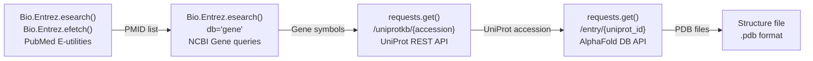

### Key Code Entities

| Skill | Package/Module | Primary Functions | Data Format |
|-------|---------------|-------------------|-------------|
| `pubmed-database` | `Bio.Entrez` | `esearch()`, `efetch()`, `esummary()` | XML, MEDLINE |
| `gene-database` | `Bio.Entrez` | `esearch(db='gene')`, `efetch()` | JSON, XML |
| `uniprot-database` | `requests` | `GET /uniprotkb/{accession}` | JSON, FASTA |
| `alphafold-database` | `requests` | `GET /entry/{uniprot_id}` | PDB, mmCIF |

### Example Query Pattern

```
Query: EGFR inhibitors lung cancer resistance mechanisms
├─ PubMed search → PMIDs (e.g., 35123456, 34987654)
├─ NCBI Gene → Gene ID (EGFR: 1956), aliases (ERBB1)
├─ UniProt → Accession (P00533), sequence, domains
└─ AlphaFold DB → Structure file (AF-P00533-F1.pdb), pLDDT scores
```

**Sources:**
- [scientific-skills/pubmed-database/SKILL.md]()
- [scientific-skills/gene-database/SKILL.md]()
- [scientific-skills/uniprot-database/SKILL.md]()
- [scientific-skills/alphafold-database/SKILL.md]()
- [docs/scientific-skills.md:27-28]()

---

## Phase 2: Compound Discovery & Filtering

### Workflow Steps

1. **Bioactivity Query** - Search ChEMBL for compounds with known activity against target
2. **Compound Filtering** - Filter by IC50/EC50 values, molecular properties (Lipinski's Rule of Five)
3. **Structure Analysis** - Calculate molecular descriptors using RDKit
4. **Analog Generation** - Generate structural analogs using DataMol scaffold-based methods
5. **Purchasable Compound Search** - Find commercially available compounds from ZINC

### ChEMBL Database Integration

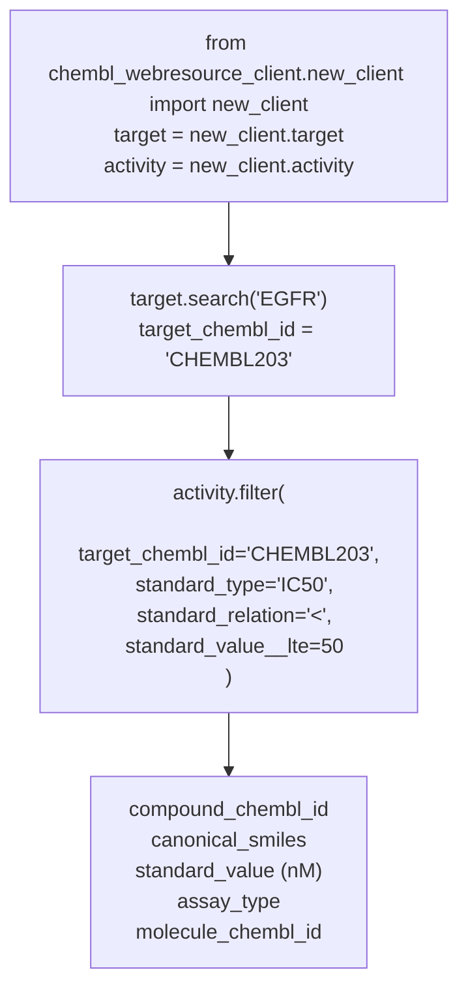

### RDKit Molecular Property Calculations

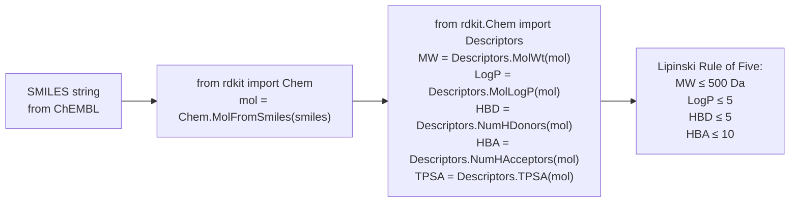

### DataMol Analog Generation

| Function | Purpose | Input | Output |
|----------|---------|-------|--------|
| `dm.from_smiles()` | Convert SMILES to RDKit Mol | SMILES string | `rdkit.Chem.Mol` |
| `dm.scaffold.get_murcko_scaffold()` | Extract core scaffold | `Mol` object | Scaffold `Mol` |
| `dm.scaffold.scaffold_to_smiles()` | Convert scaffold to SMILES | Scaffold `Mol` | Scaffold SMILES |
| `dm.from_df()` | Batch process DataFrame | `pd.DataFrame` with SMILES column | List of `Mol` objects |

### ZINC Database Query

```
Query: Purchasable compounds similar to ChEMBL hits
├─ Input: Reference SMILES from ChEMBL top hits
├─ Filters: MW 300-500 Da, LogP 2-4, HBD ≤ 3, HBA ≤ 6
├─ Output: ZINC IDs, vendor catalogs, pricing
└─ Format: SDF files for docking
```

**Sources:**
- [scientific-skills/chembl-database/SKILL.md]()
- [scientific-skills/rdkit/SKILL.md]()
- [scientific-skills/datamol/SKILL.md]()
- [scientific-skills/zinc-database/SKILL.md]()
- [README.md:224-228]()
- [docs/scientific-skills.md:7]()

---

## Phase 3: In Silico Screening

### Molecular Docking with DiffDock

DiffDock performs protein-ligand docking using diffusion generative models to predict binding poses and affinities.

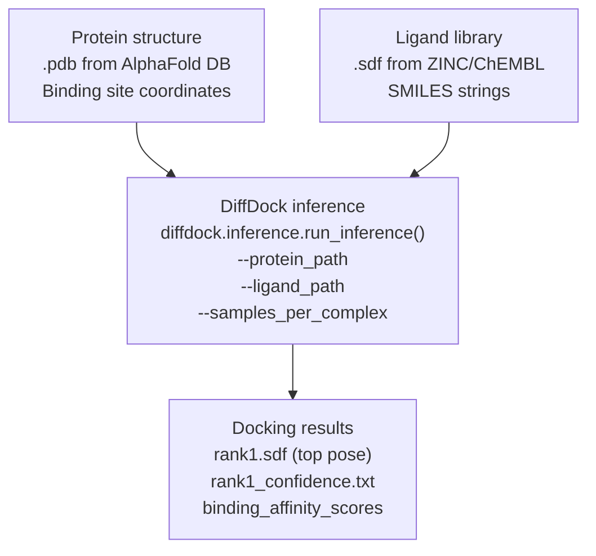

### ADMET Prediction with DeepChem

DeepChem provides pre-trained models for predicting absorption, distribution, metabolism, excretion, and toxicity properties.

| Model | Task | Input | Output |
|-------|------|-------|--------|
| `dc.models.GraphConvModel` | General property prediction | SMILES → Graph | Property values |
| `dc.models.MPNNModel` | Message passing NN | Molecular graph | Continuous predictions |
| `dc.models.AttentiveFPModel` | Fingerprint-based | SMILES | Multi-task predictions |
| `dc.molnet.load_tox21()` | Toxicity prediction | SMILES | 12 toxicity endpoints |

### Molecular Dynamics with OpenMM

OpenMM simulates protein-ligand complex dynamics to assess binding stability.

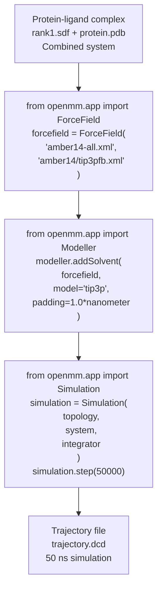

### Trajectory Analysis with MDAnalysis

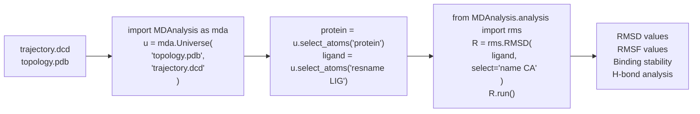

**Sources:**
- [scientific-skills/diffdock/SKILL.md]()
- [scientific-skills/deepchem/SKILL.md]()
- [scientific-skills/molecular-dynamics/SKILL.md]()
- [README.md:224-228]()
- [docs/scientific-skills.md:414-417]()

---

## Phase 4: Experimental Validation

### Ginkgo Cloud Lab Integration

Top candidates from in silico screening proceed to experimental validation using Ginkgo Cloud Lab's autonomous protocols.

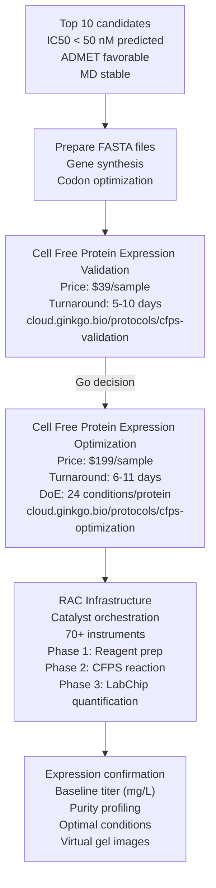

### CFPS Protocol Parameters

| Protocol | Price | Turnaround | Workflow Phases | Output |
|----------|-------|------------|-----------------|--------|
| Validation | $39/sample | 5-10 days | 1. CFPS setup<br/>2. Quench & store<br/>3. LabChip quantification | Expression confirmation<br/>Baseline titer<br/>Initial purity |
| Optimization | $199/sample | 6-11 days | 1. Reagent prep<br/>2. CFPS reaction (24 conditions)<br/>3. LabChip analysis | Comparative yield<br/>Purity profiling<br/>Optimal conditions |

### DNAnexus Workflow Orchestration

Post-validation sequencing and analysis workflows execute on DNAnexus platform.

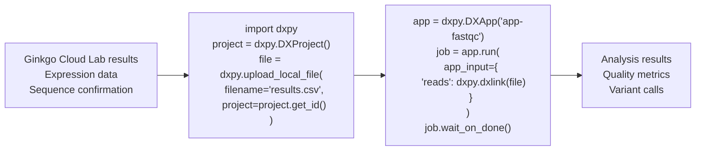

**Sources:**
- [scientific-skills/ginkgo-cloud-lab/SKILL.md:1-57]()
- [scientific-skills/ginkgo-cloud-lab/references/cell-free-protein-expression-validation.md:1-72]()
- [scientific-skills/ginkgo-cloud-lab/references/cell-free-protein-expression-optimization.md:1-86]()
- [scientific-skills/dnanexus-integration/SKILL.md]()

---

## Phase 5: Documentation & Communication

### Image Generation

Generate publication-quality chemical structure images and molecular visualizations.

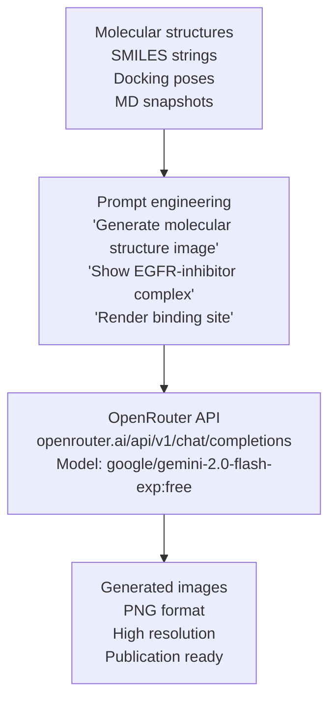

### Scientific Writing

Compile results into structured research documents.

| Template | Purpose | Output Format |
|----------|---------|---------------|
| `research_paper.md` | Full manuscript | LaTeX, DOCX |
| `how_to_guide.md` | Method documentation | Markdown, PDF |
| `decision_record.md` | Candidate selection rationale | Markdown |

### Visualization Workflows

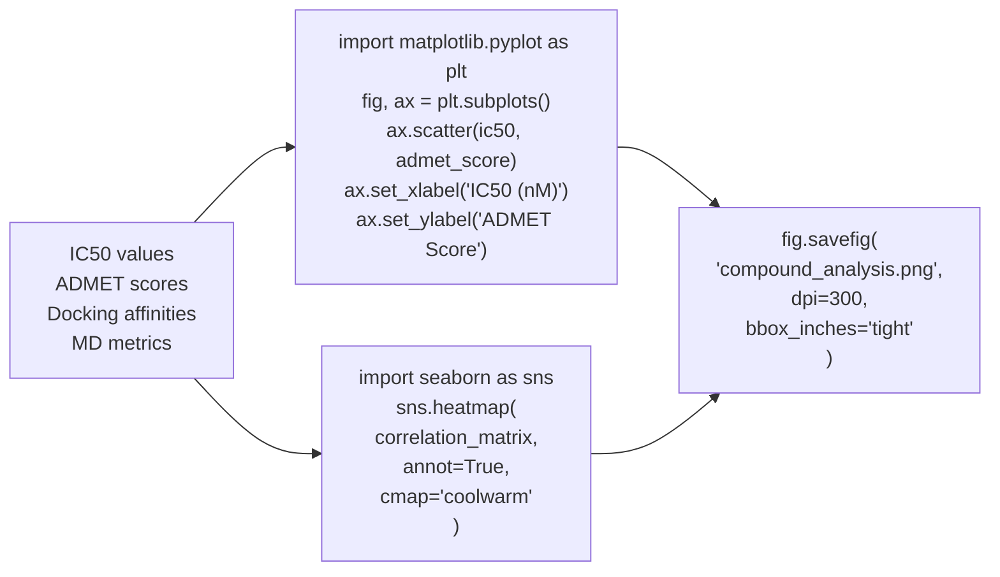

**Sources:**
- [scientific-skills/generate-image/SKILL.md]()
- [scientific-skills/scientific-writing/SKILL.md]()
- [scientific-skills/scientific-visualization/SKILL.md]()
- [scientific-skills/markdown-mermaid-writing/SKILL.md]()

---

## Complete Workflow Example

### Prompt Template

```
Use available skills you have access to whenever possible. Query ChEMBL for EGFR inhibitors 
(IC50 < 50nM), analyze structure-activity relationships with RDKit, generate improved analogs 
with datamol, perform virtual screening with DiffDock against AlphaFold EGFR structure, predict 
ADMET properties with DeepChem, run molecular dynamics with OpenMM, search PubMed for resistance 
mechanisms, check COSMIC for mutations, submit top candidates to Ginkgo Cloud Lab for CFPS 
validation, and create visualizations and a comprehensive report.
```

### Expected Skill Invocation Sequence

```mermaid
graph TB
    Start["User prompt:<br/>Find EGFR inhibitors"]
    
    S1["pubmed-database<br/>Search: 'EGFR inhibitor resistance'<br/>Retrieve recent PMIDs"]
    
    S2["gene-database<br/>Query: EGFR gene ID<br/>Fetch gene information"]
    
    S3["alphafold-database<br/>Download: AF-P00533-F1.pdb<br/>EGFR structure"]
    
    S4["chembl-database<br/>Filter: IC50 < 50 nM, target=EGFR<br/>Retrieve compound list"]
    
    S5["rdkit<br/>Calculate: MW, LogP, HBD, HBA<br/>Apply Lipinski filter"]
    
    S6["datamol<br/>Generate analogs<br/>Scaffold-based enumeration"]
    
    S7["zinc-database<br/>Find purchasable analogs<br/>Vendor information"]
    
    S8["diffdock<br/>Dock compounds to EGFR<br/>Rank by affinity"]
    
    S9["deepchem<br/>Predict ADMET<br/>Toxicity screening"]
    
    S10["molecular-dynamics<br/>OpenMM simulation<br/>MDAnalysis trajectory"]
    
    S11["cosmic-database<br/>Query EGFR mutations<br/>Resistance mechanisms"]
    
    S12["ginkgo-cloud-lab<br/>Submit top 10 candidates<br/>CFPS validation"]
    
    S13["scientific-visualization<br/>Generate figures<br/>Structure-activity plots"]
    
    S14["scientific-writing<br/>Compile report<br/>Methods + results"]
    
    Start --> S1
    S1 --> S2
    S2 --> S3
    S3 --> S4
    S4 --> S5
    S5 --> S6
    S6 --> S7
    S7 --> S8
    S8 --> S9
    S9 --> S10
    S10 --> S11
    S11 --> S12
    S12 --> S13
    S13 --> S14
```

### Data Flow and File Formats

| Stage | Input Format | Skill | Output Format |
|-------|-------------|-------|---------------|
| Literature review | Keywords | `pubmed-database` | PMID list (JSON) |
| Gene lookup | Gene symbol | `gene-database` | Gene ID, annotations (JSON) |
| Structure retrieval | UniProt ID | `alphafold-database` | PDB file |
| Bioactivity query | Target ChEMBL ID | `chembl-database` | SMILES, IC50 (JSON) |
| Property calculation | SMILES | `rdkit` | Descriptors (pandas DataFrame) |
| Analog generation | SMILES | `datamol` | Analog SMILES list |
| Purchasable search | SMILES | `zinc-database` | SDF files, vendor info |
| Molecular docking | PDB, SDF | `diffdock` | Docked poses (SDF), scores |
| ADMET prediction | SMILES | `deepchem` | Property predictions (CSV) |
| MD simulation | PDB complex | `molecular-dynamics` | Trajectory (DCD), metrics |
| Mutation analysis | Gene symbol | `cosmic-database` | Mutation list (JSON) |
| CFPS validation | FASTA | `ginkgo-cloud-lab` | Expression data (PDF, images) |
| Visualization | CSV data | `scientific-visualization` | PNG figures (300 dpi) |
| Report generation | Markdown | `scientific-writing` | PDF, DOCX |

**Sources:**
- [README.md:220-234]()
- [.claude-plugin/marketplace.json:17-191]()

---

## Skill Dependencies and Integration Points

### Package Dependencies

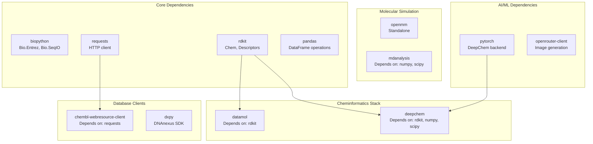

### API Authentication Requirements

| Skill | API Key Required | Environment Variable | Rate Limit |
|-------|------------------|---------------------|------------|
| `pubmed-database` | Optional (recommended) | `NCBI_API_KEY` | 3 req/sec (no key)<br/>10 req/sec (with key) |
| `chembl-database` | No | N/A | None specified |
| `uniprot-database` | No | N/A | None specified |
| `alphafold-database` | No | N/A | None specified |
| `cosmic-database` | Yes | `COSMIC_EMAIL`, `COSMIC_PASSWORD` | None specified |
| `zinc-database` | No | N/A | None specified |
| `ginkgo-cloud-lab` | Yes (account) | N/A | N/A (web-based) |
| `dnanexus-integration` | Yes | `DX_AUTH_TOKEN` | None specified |
| `generate-image` | Yes | `OPENROUTER_API_KEY` | Varies by model |

### Installation Commands

```bash
# Phase 1: Target identification
uv pip install biopython requests

# Phase 2: Compound discovery
uv pip install chembl-webresource-client rdkit datamol

# Phase 3: In silico screening
uv pip install deepchem openmm mdanalysis

# Phase 4: Experimental validation
uv pip install dxpy

# Phase 5: Documentation
uv pip install matplotlib seaborn
```

**Sources:**
- [scientific-skills/biopython/SKILL.md]()
- [scientific-skills/rdkit/SKILL.md]()
- [scientific-skills/datamol/SKILL.md]()
- [scientific-skills/deepchem/SKILL.md]()
- [scientific-skills/molecular-dynamics/SKILL.md]()
- [scientific-skills/chembl-database/SKILL.md]()

---

## Cost and Timeline Analysis

### Computational Costs

| Phase | Compute Type | Estimated Time | Cloud Cost (estimate) |
|-------|-------------|----------------|----------------------|
| Phase 1 | API queries | 5-10 minutes | Free (rate-limited) |
| Phase 2 | Local CPU | 30-60 minutes | $0 (local) |
| Phase 3 (Docking) | GPU (A100) | 2-4 hours per 1000 compounds | $2-4/hour |
| Phase 3 (ADMET) | CPU | 10-30 minutes | $0.10-0.30 |
| Phase 3 (MD) | GPU (A100) | 8-24 hours per complex | $16-48 |
| Phase 4 (Ginkgo) | Cloud lab | 5-11 days | See experimental costs |
| Phase 5 | Local CPU | 1-2 hours | $0 (local) |

### Experimental Costs (Ginkgo Cloud Lab)

| Protocol | Unit Price | Typical Order | Total Cost | Turnaround |
|----------|-----------|---------------|------------|------------|
| CFPS Validation | $39/sample | 10 proteins × 3 replicates = 30 samples | $1,170 | 5-10 days |
| CFPS Optimization | $199/sample | 3 top candidates × 3 replicates = 9 samples | $1,791 | 6-11 days |
| **Total Experimental** | | | **$2,961** | **11-21 days** |

### Total Pipeline Timeline

```
Day 0-1:    Phase 1 (Target identification)
Day 1-2:    Phase 2 (Compound discovery, 1000 compounds)
Day 2-5:    Phase 3 (In silico screening, 100 top candidates)
Day 5-16:   Phase 4 (CFPS validation, 10 candidates)
Day 16-27:  Phase 4 (CFPS optimization, 3 top candidates)
Day 27-28:  Phase 5 (Documentation)

Total: ~28 days from target to optimized expression conditions
```

**Sources:**
- [scientific-skills/ginkgo-cloud-lab/references/cell-free-protein-expression-validation.md:1-6]()
- [scientific-skills/ginkgo-cloud-lab/references/cell-free-protein-expression-optimization.md:1-6]()
- [README.md:333-353]()

---

## Common Integration Patterns

### Pattern 1: Database Chaining

Query multiple databases sequentially using identifiers as keys.

```
PubMed PMID → Extract gene symbols → NCBI Gene ID → UniProt accession → AlphaFold structure
```

### Pattern 2: Property Filtering Pipeline

Apply sequential filters to reduce compound library size.

```
ChEMBL query (1000 compounds)
→ Lipinski filter (600 compounds)
→ ADMET filter (200 compounds)
→ Docking score filter (50 compounds)
→ MD stability filter (10 candidates)
```

### Pattern 3: Parallel Processing

Process multiple candidates simultaneously.

```python
# Pseudo-code for parallel docking
from concurrent.futures import ProcessPoolExecutor

def dock_compound(protein_path, ligand_smiles):
    # DiffDock inference call
    return docking_score

with ProcessPoolExecutor(max_workers=8) as executor:
    results = executor.map(dock_compound, [protein_path]*len(ligands), ligands)
```

### Pattern 4: Conditional Workflow Branching

Use validation results to determine next steps.

```
CFPS Validation results
├─ Expression detected → Proceed to Optimization
└─ No expression → Redesign construct, return to Phase 2
```

**Sources:**
- [README.md:220-320]()
- [docs/scientific-skills.md:1-546]()

---

