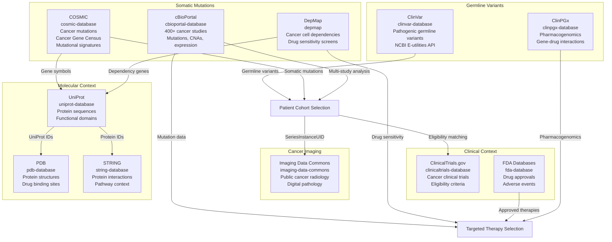
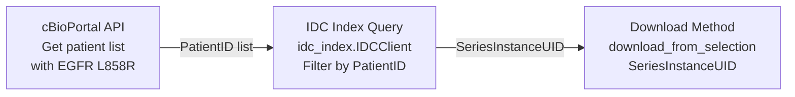
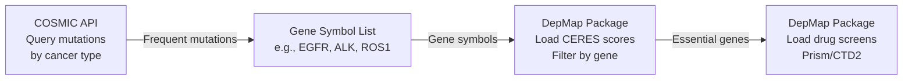
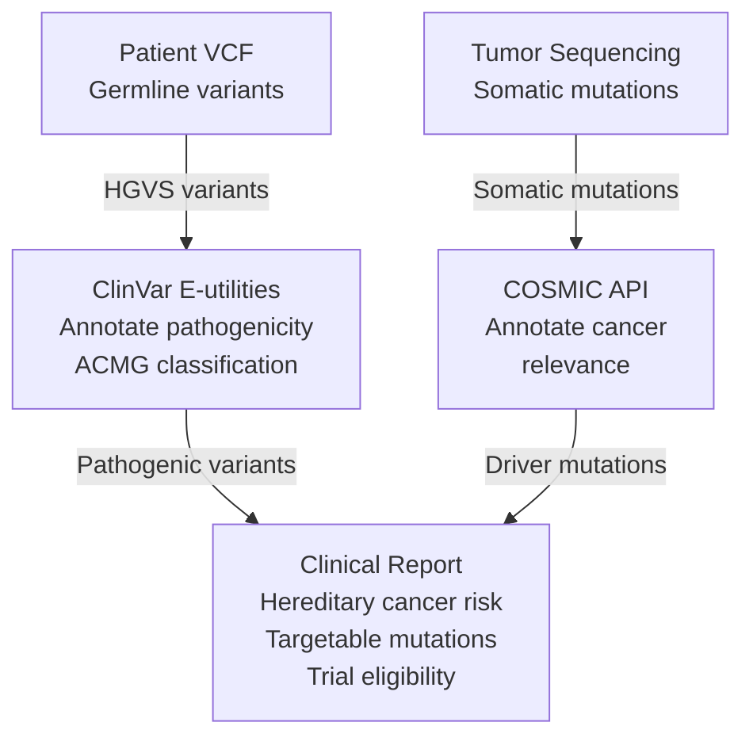
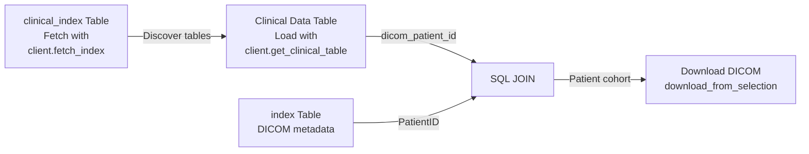
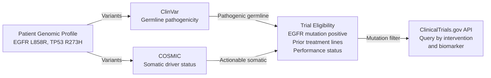
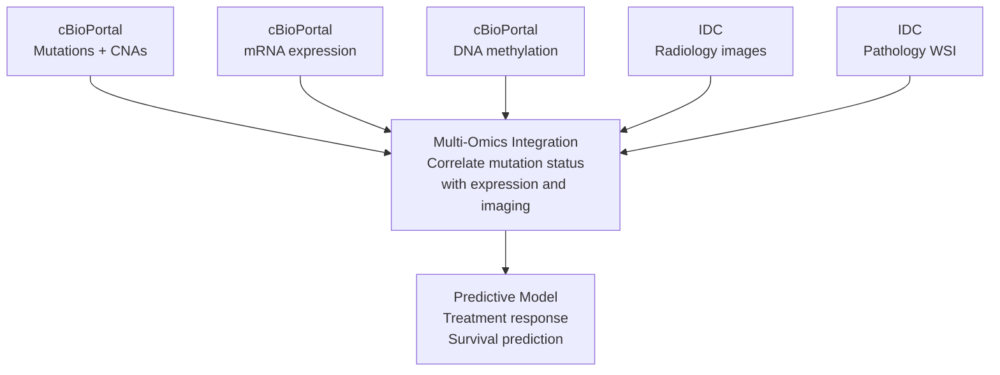

<!-- source: DeepWiki mcp.deepwiki.com · repo K-Dense-AI/claude-scientific-skills · page 8.2 Cancer Genomics and Precision Medicine · fetched 2026-10-26 -->

# Cancer Genomics and Precision Medicine

<details>
<summary>Relevant source files</summary>

The following files were used as context for generating this wiki page:

- [.claude-plugin/marketplace.json](.claude-plugin/marketplace.json)
- [README.md](README.md)
- [docs/scientific-skills.md](docs/scientific-skills.md)
- [scientific-skills/ginkgo-cloud-lab/SKILL.md](scientific-skills/ginkgo-cloud-lab/SKILL.md)
- [scientific-skills/ginkgo-cloud-lab/references/cell-free-protein-expression-optimization.md](scientific-skills/ginkgo-cloud-lab/references/cell-free-protein-expression-optimization.md)
- [scientific-skills/ginkgo-cloud-lab/references/cell-free-protein-expression-validation.md](scientific-skills/ginkgo-cloud-lab/references/cell-free-protein-expression-validation.md)
- [scientific-skills/ginkgo-cloud-lab/references/fluorescent-pixel-art-generation.md](scientific-skills/ginkgo-cloud-lab/references/fluorescent-pixel-art-generation.md)
- [scientific-skills/imaging-data-commons/SKILL.md](scientific-skills/imaging-data-commons/SKILL.md)
- [scientific-skills/imaging-data-commons/references/bigquery_guide.md](scientific-skills/imaging-data-commons/references/bigquery_guide.md)
- [scientific-skills/imaging-data-commons/references/cli_guide.md](scientific-skills/imaging-data-commons/references/cli_guide.md)
- [scientific-skills/imaging-data-commons/references/clinical_data_guide.md](scientific-skills/imaging-data-commons/references/clinical_data_guide.md)
- [scientific-skills/imaging-data-commons/references/cloud_storage_guide.md](scientific-skills/imaging-data-commons/references/cloud_storage_guide.md)
- [scientific-skills/imaging-data-commons/references/dicomweb_guide.md](scientific-skills/imaging-data-commons/references/dicomweb_guide.md)
- [scientific-skills/imaging-data-commons/references/digital_pathology_guide.md](scientific-skills/imaging-data-commons/references/digital_pathology_guide.md)
- [scientific-skills/imaging-data-commons/references/index_tables_guide.md](scientific-skills/imaging-data-commons/references/index_tables_guide.md)
- [scientific-skills/imaging-data-commons/references/sql_patterns.md](scientific-skills/imaging-data-commons/references/sql_patterns.md)
- [scientific-skills/imaging-data-commons/references/use_cases.md](scientific-skills/imaging-data-commons/references/use_cases.md)

</details>


## Purpose and Scope

This page demonstrates end-to-end cancer genomics and precision medicine workflows using the Claude Scientific Skills ecosystem. It covers the integration of somatic mutation databases (COSMIC), germline variant interpretation (ClinVar), multi-study cancer genomics (cBioPortal), cancer cell line dependencies (DepMap), and cancer imaging data (NCI Imaging Data Commons) to enable comprehensive cancer research from molecular to clinical levels.

For general drug discovery workflows, see [Drug Discovery Pipeline](#8.1). For population-scale genomic variant analysis, see [Genomic Variant Analysis](#8.3). For individual database skill documentation, see [Scientific Databases](#5).

---

## Cancer Research Data Architecture

The following diagram illustrates the cancer-focused databases and their relationships in the skills ecosystem:

**Cancer Data Integration Architecture**



**Sources**: 
- [README.md:425-432]()
- [docs/scientific-skills.md:6-34]()

---

## Core Workflow Components

### Variant Databases

| Database Skill | Coverage | Access Method | Key Use Cases |
|---------------|----------|---------------|---------------|
| `clinvar-database` | Germline variants, clinical significance | E-utilities API, bulk FTP | Hereditary cancer risk, pathogenicity interpretation |
| `cosmic-database` | Somatic mutations, Cancer Gene Census | REST API (requires license) | Driver mutation identification, mutational signatures |
| `cbioportal-database` | 400+ cancer studies, multi-omics | REST API, Python client | Cross-study analysis, survival correlation |
| `depmap` | Cancer cell line dependencies, drug screens | Python package | Therapeutic target validation, drug sensitivity |

### Imaging and Clinical Data

| Skill | Data Type | Access Pattern | Integration Point |
|-------|-----------|----------------|-------------------|
| `imaging-data-commons` | CT, MR, PET, WSI pathology | `idc-index` Python package | `SeriesInstanceUID` from patient cohorts |
| `clinicaltrials-database` | Clinical trials, eligibility | API v2 JSON/CSV | Trial matching by mutation/biomarker |
| `clinpgx-database` | Gene-drug interactions | REST API | Treatment selection by genotype |

**Sources**: 
- [docs/scientific-skills.md:6-34]()
- [scientific-skills/imaging-data-commons/SKILL.md:1-85]()

---

## Cancer Genomics Workflow Pipeline

**Workflow: From Somatic Mutation Discovery to Imaging-Guided Therapy**

```mermaid
graph LR
    subgraph "Phase 1: Variant Discovery"
        COSMIC_Query["COSMIC<br/>cosmic-database<br/>Query driver mutations<br/>by cancer type"]
        ClinVar_Annotate["ClinVar<br/>clinvar-database<br/>Annotate germline<br/>pathogenicity"]
    end
    
    subgraph "Phase 2: Multi-Study Analysis"
        cBio_Studies["cBioPortal<br/>cbioportal-database<br/>Aggregate mutations<br/>across 400+ studies"]
        cBio_Expression["cBioPortal<br/>Expression analysis<br/>CNAs, mRNA levels"]
        cBio_Survival["cBioPortal<br/>Survival analysis<br/>Kaplan-Meier curves"]
    end
    
    subgraph "Phase 3: Therapeutic Targets"
        DepMap_Dep["DepMap<br/>depmap<br/>Cancer cell<br/>dependency scores"]
        DepMap_Drug["DepMap<br/>Drug sensitivity<br/>IC50 screens"]
        ClinPGx_Match["ClinPGx<br/>clinpgx-database<br/>Pharmacogenomics<br/>dosing guidelines"]
    end
    
    subgraph "Phase 4: Imaging Integration"
        IDC_Query["IDC<br/>imaging-data-commons<br/>Query by PatientID<br/>or clinical criteria"]
        IDC_Download["IDC<br/>Download DICOM<br/>CT/MR/PET/WSI"]
        IDC_Visualize["IDC<br/>OHIF/SLIM viewer<br/>Browser-based"]
    end
    
    subgraph "Phase 5: Clinical Translation"
        Trials_Match["ClinicalTrials.gov<br/>clinicaltrials-database<br/>Match by mutation<br/>biomarker status"]
        FDA_Check["FDA Databases<br/>fda-database<br/>Approved therapies<br/>adverse events"]
    end
    
    COSMIC_Query -->|"Gene list"| cBio_Studies
    ClinVar_Annotate -->|"Pathogenic variants"| cBio_Studies
    
    cBio_Studies -->|"Mutation frequency"| cBio_Expression
    cBio_Expression -->|"Multi-omics"| cBio_Survival
    
    cBio_Survival -->|"Prognostic genes"| DepMap_Dep
    DepMap_Dep -->|"Essential genes"| DepMap_Drug
    DepMap_Drug -->|"Drug candidates"| ClinPGx_Match
    
    cBio_Studies -->|"Patient cohort"| IDC_Query
    IDC_Query -->|"SeriesInstanceUID list"| IDC_Download
    IDC_Download -->|"DICOM files"| IDC_Visualize
    
    DepMap_Drug -->|"Drug list"| Trials_Match
    ClinPGx_Match -->|"Genotype"| Trials_Match
    Trials_Match -->|"Trial IDs"| FDA_Check
```



**Sources**: 
- [README.md:220-232]() (drug discovery example)
- [README.md:288-302]() (variant interpretation example)
- [docs/examples.md:50-200]() (referenced in README)

---

## Example: Lung Cancer EGFR Mutation Analysis

### Step 1: Discover EGFR Mutations in Lung Cancer

Using COSMIC to find common EGFR mutations in lung adenocarcinoma:

**Skill**: `cosmic-database` ([docs/scientific-skills.md:11]())

```python
# Query COSMIC for EGFR mutations in lung cancer
# Note: COSMIC requires license for programmatic access
# Documentation: scientific-skills/cosmic-database/SKILL.md

# Typical query pattern:
# - Filter by gene symbol (EGFR)
# - Filter by cancer type (lung adenocarcinoma)
# - Retrieve mutation frequencies, Cancer Gene Census status
```

Expected output: L858R, exon 19 deletions, T790M resistance mutations with frequencies.

### Step 2: Validate Germline vs Somatic Status

Using ClinVar to check if variants are known germline pathogenic variants:

**Skill**: `clinvar-database` ([docs/scientific-skills.md:9]())

```python
# Use ClinVar E-utilities to check variant pathogenicity
# scientific-skills/clinvar-database/SKILL.md
# Query by HGVS notation: NM_005228.5:c.2573T>G (L858R)
# Retrieve clinical significance classifications
```

### Step 3: Aggregate EGFR Data Across Cancer Studies

Using cBioPortal to analyze EGFR across 400+ studies:

**Skill**: `cbioportal-database` ([docs/scientific-skills.md:11]())

```python
# cBioPortal Python client workflow:
# 1. Get all lung adenocarcinoma studies
# 2. Query EGFR mutations, CNAs, expression across studies
# 3. Correlate mutation status with survival outcomes
# 4. Identify co-occurring mutations (e.g., TP53, KRAS)
```

Expected analysis: EGFR mutation frequency ~15% in LUAD, enrichment in never-smokers, survival correlation with EGFR-TKI treatment.

### Step 4: Identify Therapeutic Vulnerabilities

Using DepMap to find EGFR-dependent cell lines and drug sensitivities:

**Skill**: `depmap` ([docs/scientific-skills.md:11]())

```python
# DepMap Python package workflow:
# 1. Load cancer dependency scores (CERES)
# 2. Filter for EGFR-amplified or mutant cell lines
# 3. Retrieve drug sensitivity (IC50) for EGFR inhibitors
# 4. Identify synthetic lethal interactions
```

Expected output: EGFR-mutant lines dependent on EGFR, sensitive to osimertinib/afatinib, co-dependencies on downstream signaling.

### Step 5: Retrieve Patient Imaging Data

Using Imaging Data Commons to download lung CT and PET scans:

**Skill**: `imaging-data-commons` ([scientific-skills/imaging-data-commons/SKILL.md:1-85]())

```python
from idc_index import IDCClient

client = IDCClient()

# Query for lung cancer CT scans with EGFR mutation annotation
# (assumes cohort selection based on previous genomic analysis)
query = """
SELECT
    PatientID,
    SeriesInstanceUID,
    Modality,
    SeriesDescription
FROM index
WHERE collection_id IN ('tcga_luad', 'nlst')
    AND Modality IN ('CT', 'PT')
    AND BodyPartExamined = 'CHEST'
    AND license_short_name = 'CC BY 4.0'
LIMIT 100
"""

results = client.sql_query(query)

# Download imaging data
client.download_from_selection(
    seriesInstanceUID=list(results['SeriesInstanceUID'].values),
    downloadDir="./lung_egfr_imaging"
)

# Generate viewer URLs for browser-based visualization
viewer_url = client.get_viewer_URL(
    studyInstanceUID=results.iloc[0]['StudyInstanceUID']
)
```

**Sources**: 
- [scientific-skills/imaging-data-commons/SKILL.md:240-330]()
- [scientific-skills/imaging-data-commons/SKILL.md:359-422]()

### Step 6: Match Patients to Clinical Trials

Using ClinicalTrials.gov to find EGFR-targeted trials:

**Skill**: `clinicaltrials-database` ([docs/scientific-skills.md:10]())

```python
# Query ClinicalTrials.gov API v2:
# - Condition: lung adenocarcinoma
# - Intervention: EGFR inhibitor (osimertinib, erlotinib, etc.)
# - Biomarker: EGFR mutation positive
# - Status: recruiting
# Retrieve: NCT IDs, eligibility criteria, contact information
```

### Step 7: Pharmacogenomics Dosing

Using ClinPGx for EGFR inhibitor dosing by genotype:

**Skill**: `clinpgx-database` ([docs/scientific-skills.md:8]())

```python
# Query ClinPGx for:
# - EGFR inhibitor pharmacokinetics
# - CYP3A4/CYP3A5 metabolizer status impact
# - CPIC guidelines for dose adjustments
```

**Sources**: 
- [README.md:288-302]() (variant interpretation workflow)
- [docs/scientific-skills.md:8-11]()

---

## Integration Patterns

### Pattern 1: Genomic Variant to Imaging

**Use case**: Link somatic mutations from cBioPortal to patient imaging from IDC.



**Key code entities**:
- cBioPortal skill: query by mutation, return `PatientID`
- IDC: `client.sql_query()` filters `index` table by `PatientID`
- IDC: `client.download_from_selection(seriesInstanceUID=...)` downloads DICOM

**Sources**: 
- [scientific-skills/imaging-data-commons/SKILL.md:240-330]()

### Pattern 2: Mutation Discovery to Target Validation

**Use case**: COSMIC driver mutation → DepMap dependency scores → drug sensitivity.



**Key code entities**:
- COSMIC skill: REST API queries return mutation frequencies
- DepMap skill: Python package loads dependency matrices, drug sensitivity DataFrames

**Sources**: 
- [docs/scientific-skills.md:11]()

### Pattern 3: Clinical Annotation Workflow

**Use case**: Integrate germline (ClinVar) and somatic (COSMIC) variants for clinical reporting.



**Key integration points**:
- VCF parsing: use `pysam` skill ([docs/scientific-skills.md:72]())
- ClinVar: E-utilities API, FTP downloads ([docs/scientific-skills.md:9]())
- COSMIC: REST API with license ([docs/scientific-skills.md:11]())

**Sources**: 
- [README.md:288-302]()
- [docs/scientific-skills.md:9-11]()

---

## Imaging Data Integration

### Querying Cancer Imaging by Clinical Criteria

The Imaging Data Commons provides cancer imaging with clinical annotations. Use `idc-index` for efficient queries.

**Cancer imaging collections overview**:

```python
from idc_index import IDCClient

client = IDCClient()

# Fetch collection metadata
client.fetch_index("collections_index")

# Find collections by cancer type
cancer_collections = client.sql_query("""
    SELECT 
        collection_id,
        CancerTypes,
        TumorLocations,
        Subjects,
        Modalities
    FROM collections_index
    WHERE CancerTypes LIKE '%Lung%'
    ORDER BY Subjects DESC
""")
```

**Available metadata fields**:
- `CancerTypes`: Cancer type annotations (e.g., "Lung", "Breast")
- `TumorLocations`: Anatomical sites
- `Modalities`: Imaging modalities (CT, MR, PT, SM for pathology)
- `license_short_name`: Data license (check for commercial use)

**Sources**: 
- [scientific-skills/imaging-data-commons/SKILL.md:240-280]()

### Clinical Data Linkage

IDC provides clinical data tables for selected collections. Join imaging with clinical annotations:

**Clinical data workflow**:



**Code example structure**:

```python
# Step 1: Fetch clinical index
client.fetch_index("clinical_index")

# Step 2: Find clinical tables for collection
tables = client.sql_query("""
    SELECT DISTINCT table_name, column_label
    FROM clinical_index
    WHERE collection_id = 'nlst'
""")

# Step 3: Load clinical table
clinical_df = client.get_clinical_table("nlst_canc")

# Step 4: Join with imaging data
query = """
SELECT
    index.PatientID,
    index.SeriesInstanceUID,
    nlst_canc.clinical_stag
FROM index
JOIN nlst_canc ON index.PatientID = nlst_canc.dicom_patient_id
WHERE index.collection_id = 'nlst'
    AND index.Modality = 'CT'
    AND nlst_canc.clinical_stag = '400'  -- Stage IV
"""
```

**Sources**: 
- [scientific-skills/imaging-data-commons/SKILL.md:169-180]()
- [scientific-skills/imaging-data-commons/references/clinical_data_guide.md:70-140]()

### Annotations and Segmentations

IDC includes AI-generated and expert annotations on cancer imaging:

| Index Table | Content | Key Columns |
|-------------|---------|-------------|
| `seg_index` | DICOM Segmentations (organs, tumors) | `AlgorithmName`, `total_segments`, `segmented_SeriesInstanceUID` |
| `ann_index` | Microscopy annotations (pathology) | `referenced_SeriesInstanceUID` |
| `ann_group_index` | Annotation group details | `AnnotationGroupLabel`, `GraphicType`, `NumberOfAnnotations` |

**Finding segmentations**:

```python
client.fetch_index("seg_index")

# Find TotalSegmentator organ segmentations
segmentations = client.sql_query("""
    SELECT
        seg.SeriesInstanceUID AS seg_series,
        seg.AlgorithmName,
        seg.total_segments,
        src.collection_id
    FROM seg_index seg
    JOIN index src ON seg.segmented_SeriesInstanceUID = src.SeriesInstanceUID
    WHERE seg.AlgorithmName LIKE '%TotalSegmentator%'
    LIMIT 20
""")
```

**Sources**: 
- [scientific-skills/imaging-data-commons/SKILL.md:129-145]()
- [scientific-skills/imaging-data-commons/references/sql_patterns.md:50-138]()

---

## Multi-Study Cancer Analysis Patterns

### Cross-Study Mutation Frequency

Using cBioPortal to aggregate mutations across studies:

**Workflow components**:
1. Query all lung cancer studies
2. For each study, query EGFR mutations
3. Aggregate frequencies and clinical correlations
4. Perform survival analysis

**Key skill**: `cbioportal-database` ([docs/scientific-skills.md:11]())

### Therapeutic Target Validation

Using DepMap to validate COSMIC driver mutations as therapeutic targets:

**Workflow**:
1. COSMIC: identify high-frequency driver mutations
2. DepMap: check dependency scores (CERES) for those genes
3. DepMap: query drug sensitivity screens
4. Filter for druggable, essential genes

**Key skills**: `cosmic-database`, `depmap` ([docs/scientific-skills.md:11]())

### Biomarker-Driven Clinical Trial Matching

**Integration pattern**:



**Sources**: 
- [README.md:373-377]() (clinical trials use case)

---

## Experimental Validation Integration

### Ginkgo Cloud Lab for Functional Studies

After identifying therapeutic targets computationally, validate with cell-free protein expression:

**Skill**: `ginkgo-cloud-lab` ([scientific-skills/ginkgo-cloud-lab/SKILL.md:1-57]())

**Validation workflow**:
1. Submit wildtype and mutant protein sequences (e.g., EGFR L858R vs wildtype)
2. **Protocol**: Cell Free Protein Expression Validation ($39/sample, 5-10 days)
3. Compare expression levels and purity
4. **Optimization**: Use DoE protocol ($199/sample) for difficult constructs

**Code reference**: [scientific-skills/ginkgo-cloud-lab/references/cell-free-protein-expression-validation.md:1-72]()

**Sources**: 
- [scientific-skills/ginkgo-cloud-lab/SKILL.md:16-22]()
- [scientific-skills/ginkgo-cloud-lab/references/cell-free-protein-expression-validation.md:1-72]()

---

## Best Practices

### Data Access and Licensing

**Cancer database access patterns**:

| Database | Authentication | Rate Limits | License Notes |
|----------|----------------|-------------|---------------|
| ClinVar | None (E-utilities free) | 3 req/sec without key | Public domain |
| COSMIC | License required | API limits per license | Academic/commercial licenses differ |
| cBioPortal | None (public instance) | Rate limiting unspecified | Data-specific licenses |
| IDC | None | Daily quota (per-IP) | Per-series licenses (mostly CC-BY) |

**Licensing check workflow**:

```python
# Always verify license before commercial use
idc_client = IDCClient()

licenses = idc_client.sql_query("""
    SELECT
        collection_id,
        license_short_name,
        COUNT(*) AS series_count
    FROM index
    GROUP BY collection_id, license_short_name
""")

# Filter for CC-BY only (commercial use allowed with attribution)
cc_by_only = licenses[licenses['license_short_name'].str.contains('CC BY') & 
                      ~licenses['license_short_name'].str.contains('NC')]
```

**Sources**: 
- [scientific-skills/imaging-data-commons/SKILL.md:520-551]()

### Reproducibility

**Save cohort identifiers**:

```python
# For imaging data, save crdc_series_uuid for exact reproducibility
manifest = {
    "idc_version": client.get_idc_version(),
    "analysis_date": "2024-01-15",
    "crdc_series_uuids": list(results['crdc_series_uuid']),
    "cosmic_version": "v99",
    "cbioportal_timestamp": "2024-01-01"
}

import json
with open("cancer_cohort_manifest.json", "w") as f:
    json.dump(manifest, f, indent=2)
```

**Sources**: 
- [scientific-skills/imaging-data-commons/references/cloud_storage_guide.md:229-268]()

### Error Handling

**Common issues**:

1. **ClinVar**: Variant not found → check HGVS notation and transcript version
2. **COSMIC**: License expired → contact COSMIC helpdesk for renewal
3. **cBioPortal**: Study not found → verify study ID with `getStudies()` call
4. **IDC**: No imaging for PatientID → not all genomic studies have imaging

**Sources**: 
- [scientific-skills/imaging-data-commons/SKILL.md:621-650]()

---

## Advanced Workflows

### Multi-Omics Integration

**Combining genomics, transcriptomics, and imaging**:



### Radiomics and Pathomics

**Extracting quantitative features from imaging**:

1. Download imaging from IDC
2. Use `pyradiomics` (not in skills, but compatible) for feature extraction
3. Correlate with genomic features from cBioPortal
4. Build predictive models with `scikit-learn` skill

**Sources**: 
- [README.md:250-268]() (multi-omics biomarker discovery example)

### Digital Pathology Integration

IDC includes whole slide imaging (WSI) for pathology. Use specialized indices:

**Pathology workflow**:

```python
# Fetch slide microscopy index
client.fetch_index("sm_index")
client.fetch_index("ann_index")
client.fetch_index("ann_group_index")

# Find high-resolution pathology slides
pathology = client.sql_query("""
    SELECT
        i.collection_id,
        s.ObjectiveLensPower,
        s.min_PixelSpacing_2sf
    FROM sm_index s
    JOIN index i ON s.SeriesInstanceUID = i.SeriesInstanceUID
    WHERE s.ObjectiveLensPower >= 40
    ORDER BY s.min_PixelSpacing_2sf
    LIMIT 20
""")
```

**Sources**: 
- [scientific-skills/imaging-data-commons/references/digital_pathology_guide.md:1-255]()

---

## Related Documentation

- [Drug Discovery Pipeline](#8.1) - End-to-end drug discovery with molecular docking
- [Genomic Variant Analysis](#8.3) - Population genomics with TileDB-VCF
- [Scientific Databases](#5) - Complete database skill catalog
- [Clinical Research and Precision Medicine](#4.3) - Individual clinical database skills

**Page sources**:
- [README.md:1-929]()
- [docs/scientific-skills.md:1-150]()
- [scientific-skills/imaging-data-commons/SKILL.md:1-800]()
- [scientific-skills/ginkgo-cloud-lab/SKILL.md:1-57]()

---

