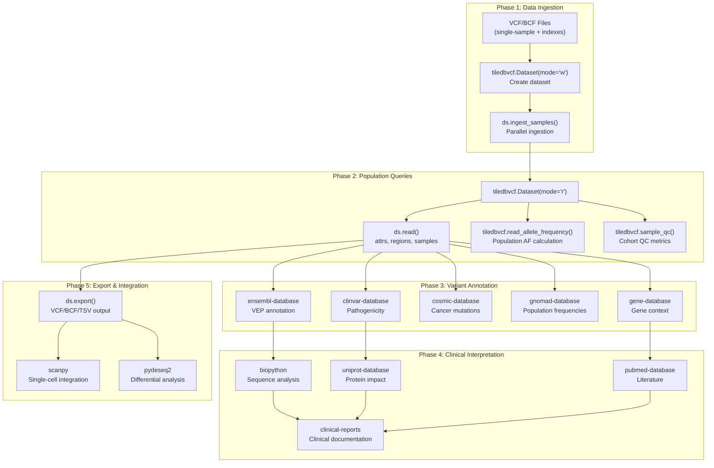
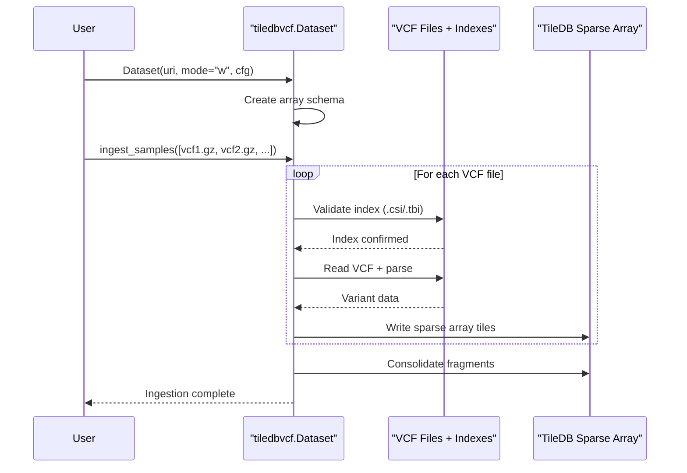
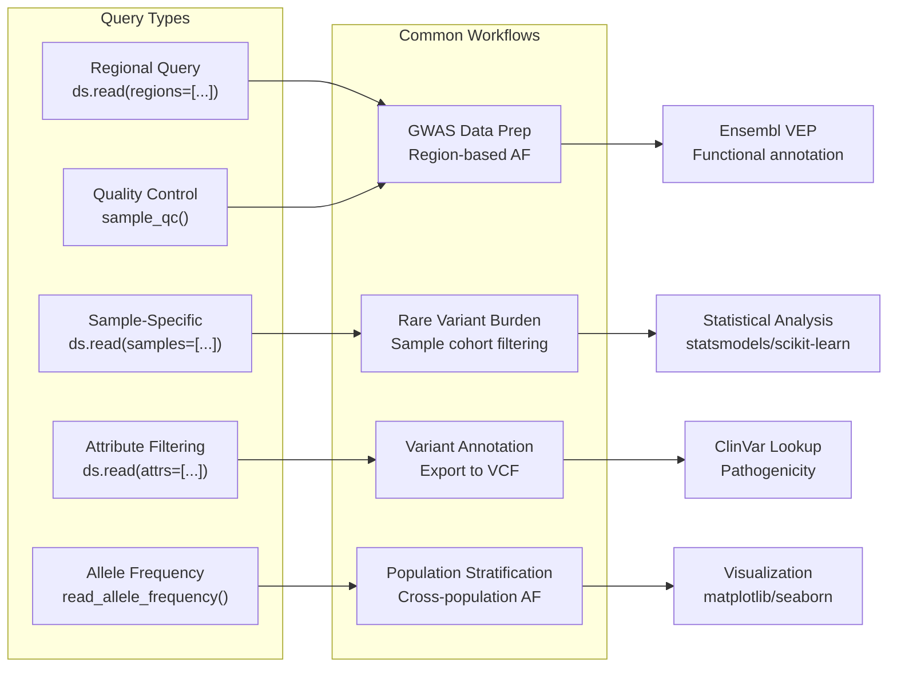
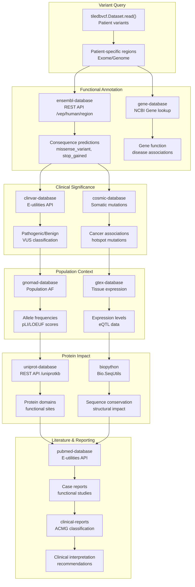

<!-- source: DeepWiki mcp.deepwiki.com · repo K-Dense-AI/claude-scientific-skills · page 8.3 Genomic Variant Analysis · fetched 2026-10-26 -->

# Genomic Variant Analysis

<details>
<summary>Relevant source files</summary>

The following files were used as context for generating this wiki page:

- [.claude-plugin/marketplace.json](.claude-plugin/marketplace.json)
- [README.md](README.md)
- [docs/scientific-skills.md](docs/scientific-skills.md)
- [scientific-skills/ginkgo-cloud-lab/SKILL.md](scientific-skills/ginkgo-cloud-lab/SKILL.md)
- [scientific-skills/ginkgo-cloud-lab/references/cell-free-protein-expression-optimization.md](scientific-skills/ginkgo-cloud-lab/references/cell-free-protein-expression-optimization.md)
- [scientific-skills/ginkgo-cloud-lab/references/cell-free-protein-expression-validation.md](scientific-skills/ginkgo-cloud-lab/references/cell-free-protein-expression-validation.md)
- [scientific-skills/ginkgo-cloud-lab/references/fluorescent-pixel-art-generation.md](scientific-skills/ginkgo-cloud-lab/references/fluorescent-pixel-art-generation.md)
- [scientific-skills/tiledbvcf/SKILL.md](scientific-skills/tiledbvcf/SKILL.md)

</details>


## Purpose and Scope

This page demonstrates end-to-end workflows for genomic variant analysis using TileDB-VCF as the core storage and query engine, integrated with multiple database and analysis skills for population genomics and clinical variant interpretation. The workflows span from VCF ingestion through large-scale population queries to clinical variant annotation and reporting.

For laboratory automation of protein expression validation, see [Ginkgo Cloud Lab Protocols](#4.6.1). For cancer-specific genomic analysis workflows, see [Cancer Genomics and Precision Medicine](#8.2). For database-specific variant query patterns, see [Clinical and Healthcare Databases](#5.5) and [Protein and Genomics Databases](#5.3).

**Sources:** [README.md:369-370](), [scientific-skills/tiledbvcf/SKILL.md:1-457]()

---

## Workflow Architecture

The genomic variant analysis workflow integrates TileDB-VCF for scalable variant storage with multiple genomics databases and analysis tools. The architecture supports both population-scale queries and clinical variant interpretation.



**Workflow Overview:** The pipeline begins with single-sample VCF ingestion into TileDB-VCF's sparse array format, enabling efficient population-scale queries by genomic region and sample cohort. Query results feed into multiple annotation databases (Ensembl VEP, ClinVar, COSMIC, gnomAD) for functional and clinical interpretation. Downstream integration includes sequence analysis (BioPython), protein impact assessment (UniProt), literature search (PubMed), and clinical reporting. Export capabilities enable integration with single-cell analysis (Scanpy) and differential expression tools (PyDESeq2).

**Sources:** [scientific-skills/tiledbvcf/SKILL.md:100-160](), [README.md:365-371](), [docs/scientific-skills.md:9-26]()

---

## Phase 1: Dataset Creation and VCF Ingestion

### Requirements and Constraints

TileDB-VCF has specific requirements for input data:

| Requirement | Specification | Rationale |
|-------------|---------------|-----------|
| **VCF Format** | Single-sample VCFs only | Multi-sample VCFs not supported |
| **Index Files** | `.csi` (bcftools) or `.tbi` (tabix) required | Efficient region-based queries |
| **Coordinates** | 1-based genomic positions | VCF standard compatibility |
| **File Format** | VCF or BCF (compressed recommended) | Storage efficiency |

**Sources:** [scientific-skills/tiledbvcf/SKILL.md:106-109]()

### Dataset Creation

```python
import tiledbvcf

# Create dataset with memory configuration
config = tiledbvcf.ReadConfig(
    memory_budget=2048,  # MB
    region_partition=(0, 3095677412),  # Full genome
    sample_partition=(0, 10000)  # Up to 10k samples
)

ds = tiledbvcf.Dataset(
    uri="my_population_dataset",
    mode="w",
    cfg=config
)
```

**Configuration Parameters:**
- `memory_budget`: Allocated RAM in MB for ingestion operations [scientific-skills/tiledbvcf/SKILL.md:173-179]()
- `region_partition`: Genomic coordinate range (0 to ~3.1B for human genome)
- `sample_partition`: Maximum expected sample count for schema optimization

**Sources:** [scientific-skills/tiledbvcf/SKILL.md:58-71](), [scientific-skills/tiledbvcf/SKILL.md:173-179]()

### Parallel Ingestion Workflow



**Ingestion Process:**
1. **Index Validation**: Checks for `.csi` or `.tbi` index files [scientific-skills/tiledbvcf/SKILL.md:108]()
2. **Parallel Processing**: Multiple VCF files ingested concurrently [scientific-skills/tiledbvcf/SKILL.md:112]()
3. **Sparse Array Storage**: Variants stored with genomic coordinates as dimensions [scientific-skills/tiledbvcf/SKILL.md:165-170]()
4. **Incremental Addition**: New samples added without reprocessing existing data [scientific-skills/tiledbvcf/SKILL.md:113]()

**Sources:** [scientific-skills/tiledbvcf/SKILL.md:100-118]()

### CLI Alternative for Ingestion

```bash
# Create empty dataset
tiledbvcf create --uri my_population_dataset

# Ingest samples (requires single-sample VCFs with indexes)
tiledbvcf store --uri my_population_dataset \
  --samples cohort1_sample1.vcf.gz,cohort1_sample2.vcf.gz

# Verify ingestion
tiledbvcf stat --uri my_population_dataset
tiledbvcf list --uri my_population_dataset
```

**CLI Commands:**
- `create`: Initializes empty TileDB-VCF dataset [scientific-skills/tiledbvcf/SKILL.md:252]()
- `store`: Ingests VCF/BCF files [scientific-skills/tiledbvcf/SKILL.md:256]()
- `list`: Lists all ingested sample names [scientific-skills/tiledbvcf/SKILL.md:264]()
- `stat`: Displays dataset statistics [scientific-skills/tiledbvcf/SKILL.md:267]()

**Sources:** [scientific-skills/tiledbvcf/SKILL.md:239-268]()

---

## Phase 2: Population-Scale Variant Queries

### Coordinate Systems and Region Specification

**Critical:** TileDB-VCF uses **1-based coordinates** following VCF standard [scientific-skills/tiledbvcf/SKILL.md:184-187]()

| Format | Example | Interpretation |
|--------|---------|----------------|
| Single region | `chr1:1000000-2000000` | Positions 1,000,000 to 2,000,000 (1,001 bases) |
| Multiple regions | `["chr1:1000000-2000000", "chr2:500000-1500000"]` | Two separate regions |
| Whole chromosome | `chr1` | Entire chromosome 1 |
| BED-style conversion | `chr1:999999-2000000` | Equivalent to 1-based chr1:1000000-2000000 |

**Sources:** [scientific-skills/tiledbvcf/SKILL.md:183-202]()

### Basic Query Pattern

```python
# Open existing dataset for reading
ds = tiledbvcf.Dataset(uri="my_population_dataset", mode="r")

# Query specific regions and samples
df = ds.read(
    attrs=["sample_name", "pos_start", "pos_end", "alleles", "fmt_GT"],
    regions=["chr1:1000000-2000000", "chr2:500000-1500000"],
    samples=["sample1", "sample2", "sample3"]
)
```

**Query Parameters:**
- `attrs`: List of fields to retrieve (position, alleles, genotypes, quality) [scientific-skills/tiledbvcf/SKILL.md:80]()
- `regions`: Genomic regions in 1-based coordinates [scientific-skills/tiledbvcf/SKILL.md:81]()
- `samples`: Sample names to filter (must match VCF headers) [scientific-skills/tiledbvcf/SKILL.md:82]()

**Sources:** [scientific-skills/tiledbvcf/SKILL.md:74-85]()

### Population Genomics Query Patterns



**Workflow Patterns:**
1. **GWAS Preparation**: Regional queries with allele frequency calculation [scientific-skills/tiledbvcf/SKILL.md:153]()
2. **Rare Variant Burden**: Sample cohort filtering with attribute-based criteria [scientific-skills/tiledbvcf/SKILL.md:154]()
3. **Population Stratification**: Cross-population allele frequency analysis [scientific-skills/tiledbvcf/SKILL.md:155]()
4. **Variant Annotation**: Export subsets for downstream annotation pipelines [scientific-skills/tiledbvcf/SKILL.md:157]()

**Sources:** [scientific-skills/tiledbvcf/SKILL.md:148-160]()

### Allele Frequency Analysis

```python
# Calculate allele frequencies across samples
af_df = tiledbvcf.read_allele_frequency(
    uri="my_population_dataset",
    regions=["chr1:1000000-2000000"],
    samples=["EUR_sample1", "EUR_sample2", "AFR_sample1", "AFR_sample2"]
)

# Results include per-variant AF across specified cohort
print(af_df.head())
```

**Sources:** [scientific-skills/tiledbvcf/SKILL.md:272-279]()

### Sample Quality Control

```python
# Perform cohort-wide sample QC
qc_results = tiledbvcf.sample_qc(
    uri="my_population_dataset",
    samples=["sample1", "sample2"]
)

# QC metrics for filtering low-quality samples
```

**Sources:** [scientific-skills/tiledbvcf/SKILL.md:282-289]()

---

## Phase 3: Clinical Variant Interpretation

### Multi-Database Annotation Pipeline

Clinical variant interpretation requires integrating multiple annotation sources. The workflow queries TileDB-VCF for variants, then enriches with clinical databases.



**Annotation Cascade:**
1. **Functional Layer**: Ensembl VEP for consequence prediction, NCBI Gene for context
2. **Clinical Layer**: ClinVar for known pathogenicity, COSMIC for cancer mutations
3. **Population Layer**: gnomAD for allele frequencies, GTEx for expression
4. **Protein Layer**: UniProt for domain information, BioPython for sequence analysis
5. **Evidence Layer**: PubMed for literature, clinical-reports for ACMG classification

**Sources:** [README.md:289-299](), [docs/scientific-skills.md:9-10](), [docs/scientific-skills.md:14]()

### Example: Hereditary Cancer Risk Assessment

```python
import tiledbvcf
import requests
import json

# 1. Query patient variants from TileDB-VCF
ds = tiledbvcf.Dataset(uri="patient_variants", mode="r")
patient_df = ds.read(
    attrs=["sample_name", "pos_start", "pos_end", "alleles", "fmt_GT"],
    regions=["chr17:43000000-43100000"],  # BRCA1 region
    samples=["PATIENT_001"]
)

# 2. Annotate with Ensembl VEP
for idx, variant in patient_df.iterrows():
    chrom = variant['contig']
    pos = variant['pos_start']
    alleles = variant['alleles']
    
    # VEP REST API query
    vep_url = f"https://rest.ensembl.org/vep/human/region/{chrom}:{pos}-{pos}/{alleles}"
    vep_response = requests.get(vep_url, headers={"Content-Type": "application/json"})
    vep_data = vep_response.json()
    
    # Extract consequences
    for consequence in vep_data:
        consequence_terms = consequence.get('most_severe_consequence', 'unknown')
        gene_symbol = consequence.get('gene_symbol', 'unknown')
        print(f"Variant: {chrom}:{pos} {alleles}")
        print(f"Gene: {gene_symbol}, Consequence: {consequence_terms}")

# 3. ClinVar pathogenicity lookup
# (Use clinvar-database skill for E-utilities API access)
# Query: esearch.fcgi?db=clinvar&term=BRCA1[gene]+pathogenic[clinical_significance]

# 4. COSMIC cancer mutations
# (Use cosmic-database skill for somatic mutation queries)

# 5. Generate clinical report
# (Use clinical-reports skill for ACMG-compliant documentation)
```

**Workflow Steps:**
1. Extract patient variants from TileDB-VCF filtered by gene region [scientific-skills/tiledbvcf/SKILL.md:74-85]()
2. Annotate with Ensembl VEP for consequence predictions [docs/scientific-skills.md:14]()
3. Query ClinVar for known pathogenicity [docs/scientific-skills.md:9]()
4. Check COSMIC for cancer associations [docs/scientific-skills.md:11]()
5. Generate clinical interpretation report [README.md:296]()

**Sources:** [README.md:288-299](), [docs/scientific-skills.md:9-11]()

---

## Phase 4: Data Export and Integration

### Export Formats

TileDB-VCF supports multiple export formats for downstream analysis:

```python
import os

# Export to VCF format
ds.export(
    regions=["chr21:8220186-8405573"],
    samples=["HG00101", "HG00097"],
    output_format="v",  # "v" = VCF, "b" = BCF, "t" = TSV
    output_dir=os.path.expanduser("~")
)
```

**Export Options:**
- `output_format="v"`: Standard VCF format [scientific-skills/tiledbvcf/SKILL.md:95]()
- `output_format="b"`: Compressed BCF format
- `output_format="t"`: TSV (tab-separated values) for tabular analysis

**Sources:** [scientific-skills/tiledbvcf/SKILL.md:87-98](), [scientific-skills/tiledbvcf/SKILL.md:136-146]()

### Integration with Single-Cell Analysis

```python
import tiledbvcf
import scanpy as sc
import pandas as pd

# 1. Export variants for specific cell types
ds = tiledbvcf.Dataset(uri="single_cell_variants", mode="r")
variant_df = ds.read(
    attrs=["sample_name", "pos_start", "alleles", "fmt_GT"],
    regions=["chr1:1000000-2000000"],
    samples=cell_barcodes  # List of cell barcodes
)

# 2. Load single-cell RNA-seq data
adata = sc.read_h5ad("scrna_data.h5ad")

# 3. Merge variant and expression data
# Create variant genotype matrix matching cell barcodes
variant_matrix = variant_df.pivot_table(
    index='sample_name',
    columns=['pos_start', 'alleles'],
    values='fmt_GT'
)

# Add to AnnData obsm layer
adata.obsm['variants'] = variant_matrix

# 4. Analyze variant-expression associations
# (Use pydeseq2 or statsmodels for differential analysis)
```

**Integration Pattern:**
1. Export cell-specific variants from TileDB-VCF
2. Load single-cell expression data with Scanpy [docs/scientific-skills.md:64-65]()
3. Merge variant genotypes with expression matrix
4. Perform integrated analysis (variant-expression associations)

**Sources:** [scientific-skills/tiledbvcf/SKILL.md:136-146](), [README.md:237-249]()

---

## Performance Considerations and Optimization

### Memory Management

```python
# Configure memory budget for large queries
config = tiledbvcf.ReadConfig(
    memory_budget=4096,  # 4GB
    tiledb_config={
        "sm.tile_cache_size": "1000000000",  # 1GB tile cache
        "vfs.s3.region": "us-east-1"  # S3 region for cloud data
    }
)

ds = tiledbvcf.Dataset(uri="large_dataset", mode="r", cfg=config)
```

**Performance Guidelines:**

| Scenario | Recommendation | Configuration |
|----------|---------------|---------------|
| Large result sets | Use streaming/pagination | Set memory budget appropriately |
| Repeated region access | Enable tile cache | `sm.tile_cache_size` |
| Many small regions | Combine nearby regions | Reduce query count |
| Cloud storage | Configure VFS settings | `vfs.s3.*` parameters |
| Parallel ingestion | Batch processing | Multiple `ingest_samples()` calls |

**Sources:** [scientific-skills/tiledbvcf/SKILL.md:205-213](), [scientific-skills/tiledbvcf/SKILL.md:292-301]()

### Common Pitfalls

1. **Memory Exhaustion**: Use appropriate memory budget for large VCF files [scientific-skills/tiledbvcf/SKILL.md:230]()
2. **Inefficient Queries**: Combine nearby regions instead of many separate queries [scientific-skills/tiledbvcf/SKILL.md:231]()
3. **Sample Name Mismatches**: Ensure VCF header names match query specifications [scientific-skills/tiledbvcf/SKILL.md:232]()
4. **Coordinate Confusion**: Remember 1-based coordinates (VCF standard) [scientific-skills/tiledbvcf/SKILL.md:233]()
5. **Concurrent Writes**: Multiple writers can cause corruption—use locking [scientific-skills/tiledbvcf/SKILL.md:236]()

**Sources:** [scientific-skills/tiledbvcf/SKILL.md:228-237]()

### Cloud Storage Integration

TileDB-VCF supports seamless cloud storage access:

```python
# S3 dataset
ds = tiledbvcf.Dataset(uri="s3://bucket/population_dataset", mode="r")

# Azure Blob Storage
ds = tiledbvcf.Dataset(uri="azure://container/population_dataset", mode="r")

# Google Cloud Storage
ds = tiledbvcf.Dataset(uri="gcs://bucket/population_dataset", mode="r")
```

**Cloud Considerations:**
- Ensure proper authentication and permissions [scientific-skills/tiledbvcf/SKILL.md:235]()
- Configure VFS parameters for optimal cloud access [scientific-skills/tiledbvcf/SKILL.md:216-226]()
- Use TileDB-Cloud for enterprise-scale deployments [scientific-skills/tiledbvcf/SKILL.md:325-456]()

**Sources:** [scientific-skills/tiledbvcf/SKILL.md:215-226]()

---

## Scaling to TileDB-Cloud

For datasets exceeding 1,000 samples or requiring distributed processing, TileDB-Cloud provides enterprise capabilities:

### Migration Checklist

✅ **Migrate to TileDB-Cloud when:**
- [ ] Datasets > 1000 samples [scientific-skills/tiledbvcf/SKILL.md:437]()
- [ ] Processing > 100GB of VCF data [scientific-skills/tiledbvcf/SKILL.md:438]()
- [ ] Require distributed computing [scientific-skills/tiledbvcf/SKILL.md:439]()
- [ ] Multiple team members need access [scientific-skills/tiledbvcf/SKILL.md:440]()
- [ ] Need enterprise security/compliance [scientific-skills/tiledbvcf/SKILL.md:441]()

**Sources:** [scientific-skills/tiledbvcf/SKILL.md:434-444]()

### TileDB-Cloud Setup

```python
import tiledb.cloud
import tiledbvcf

# Authentication via environment variable
# export TILEDB_REST_TOKEN="your_api_token"

# Access cloud dataset
dataset_uri = "tiledb://TileDB-Inc/gvcf-1kg-dragen-v376"
ds = tiledbvcf.Dataset(dataset_uri, tiledb_config=cfg)

# Distributed query execution
df = tiledb.cloud.vcf.read(
    dataset_uri=dataset_uri,
    regions=["chr13:32396898-32397044", "chr13:32398162-32400268"],
    samples=ds.samples(),
    attrs=["sample_name", "fmt_GT", "fmt_AD", "fmt_DP"],
    namespace="my-namespace"  # Billing account
)
```

**Enterprise Features:**
- **Serverless Compute**: Pay-per-use compute resources [scientific-skills/tiledbvcf/SKILL.md:423]()
- **Data Sharing**: Namespace-based permissions [scientific-skills/tiledbvcf/SKILL.md:411-420]()
- **Security**: HIPAA/SOC2 compliance, encryption, audit logs [scientific-skills/tiledbvcf/SKILL.md:428-432]()

**Sources:** [scientific-skills/tiledbvcf/SKILL.md:325-456]()

---

## Advanced Multi-Skill Workflows

### Complete Population Genomics Pipeline

```python
import tiledbvcf
import requests
import pandas as pd

# 1. TileDB-VCF: Query population variants
ds = tiledbvcf.Dataset(uri="1000genomes_dataset", mode="r")
variants = ds.read(
    attrs=["sample_name", "pos_start", "alleles", "fmt_GT"],
    regions=["chr7:117000000-117500000"],  # CFTR gene region
    samples=EUR_samples + AFR_samples + EAS_samples
)

# 2. Calculate population-specific allele frequencies
af_df = tiledbvcf.read_allele_frequency(
    uri="1000genomes_dataset",
    regions=["chr7:117000000-117500000"],
    samples=EUR_samples
)

# 3. Ensembl: Annotate functional consequences
for variant in variants.itertuples():
    vep_response = requests.get(
        f"https://rest.ensembl.org/vep/human/region/{variant.contig}:{variant.pos_start}",
        headers={"Content-Type": "application/json"}
    )
    # Process VEP annotations

# 4. ClinVar: Clinical significance
# (Use clinvar-database skill for pathogenicity queries)

# 5. gnomAD: Compare with reference populations
# (Use gnomad-database skill for population AF and constraint scores)

# 6. KEGG/Reactome: Pathway enrichment
# (Use kegg-database and reactome-database skills for pathway analysis)

# 7. Statistical Analysis: Association testing
# (Use statsmodels or scikit-learn for burden tests)

# 8. Visualization: Generate plots
# (Use matplotlib/seaborn for population stratification plots)
```

**Workflow Integration Points:**
1. **TileDB-VCF**: Efficient variant storage and retrieval [scientific-skills/tiledbvcf/SKILL.md:1-457]()
2. **Ensembl**: Functional annotation via VEP [docs/scientific-skills.md:14]()
3. **ClinVar**: Clinical significance [docs/scientific-skills.md:9]()
4. **gnomAD**: Population context [docs/scientific-skills.md:124]()
5. **Pathway Databases**: Biological interpretation [docs/scientific-skills.md:22](), [docs/scientific-skills.md:30]()
6. **Statistical Tools**: Association testing [docs/scientific-skills.md:449]()

**Sources:** [README.md:304-317](), [scientific-skills/tiledbvcf/SKILL.md:148-160]()

### Rare Disease Variant Discovery

```python
import tiledbvcf
import pandas as pd

# 1. Query family trio (proband + parents)
ds = tiledbvcf.Dataset(uri="rare_disease_cohort", mode="r")
trio_variants = ds.read(
    attrs=["sample_name", "pos_start", "alleles", "fmt_GT", "fmt_AD"],
    regions=["chr1", "chr2", "chrX"],  # Exome regions
    samples=["proband", "father", "mother"]
)

# 2. Filter for de novo variants
# Compare proband genotype to parents

# 3. gnomAD: Filter common variants (AF < 0.01)
# (Use gnomad-database for population filtering)

# 4. Ensembl VEP: Prioritize by consequence
# (Filter for loss-of-function, missense in conserved domains)

# 5. Monarch Initiative: Disease-gene associations
# (Use monarch-database for rare disease phenotype matching)

# 6. PubMed: Literature validation
# (Use pubmed-database for gene-phenotype evidence)

# 7. Clinical Report: ACMG classification
# (Use clinical-reports for variant interpretation report)
```

**Rare Disease Workflow:**
1. Family-based variant calling from TileDB-VCF
2. De novo mutation detection and inheritance patterns
3. Population frequency filtering (gnomAD) [docs/scientific-skills.md:124]()
4. Functional consequence prioritization (Ensembl VEP)
5. Phenotype-gene matching (Monarch Initiative) [docs/scientific-skills.md:11]()
6. Literature evidence gathering (PubMed)
7. Clinical interpretation and reporting

**Sources:** [README.md:288-299](), [docs/scientific-skills.md:11](), [docs/scientific-skills.md:124]()

---

## Resources and Further Information

### TileDB-VCF Documentation
- **TileDB Academy**: https://cloud.tiledb.com/academy/ [scientific-skills/tiledbvcf/SKILL.md:311]()
- **Population Genomics Guide**: https://cloud.tiledb.com/academy/structure/life-sciences/population-genomics/ [scientific-skills/tiledbvcf/SKILL.md:312]()
- **GitHub Repository**: https://github.com/TileDB-Inc/TileDB-VCF [scientific-skills/tiledbvcf/SKILL.md:313]()

### Related Skills
- **ClinVar Database**: Variant pathogenicity [docs/scientific-skills.md:9]()
- **COSMIC Database**: Somatic mutations [docs/scientific-skills.md:11]()
- **Ensembl Database**: Functional annotation [docs/scientific-skills.md:14]()
- **gnomAD Database**: Population frequencies [docs/scientific-skills.md:124]()
- **BioPython**: Sequence analysis [docs/scientific-skills.md:66-67]()
- **Scanpy**: Single-cell integration [docs/scientific-skills.md:64-65]()

### Workflow Templates
For complete workflow examples across all scientific domains, see [docs/examples.md](). For K-Dense Web's hosted platform with cloud GPUs and publication-ready outputs, visit https://k-dense.ai.

**Sources:** [scientific-skills/tiledbvcf/SKILL.md:304-456](), [README.md:320-352]()

---

