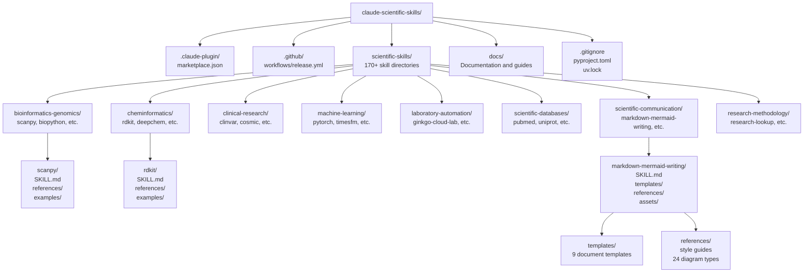
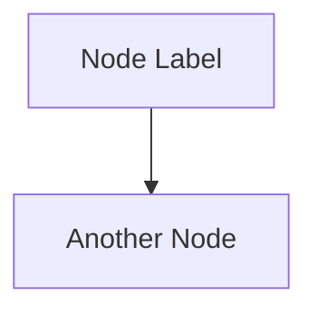
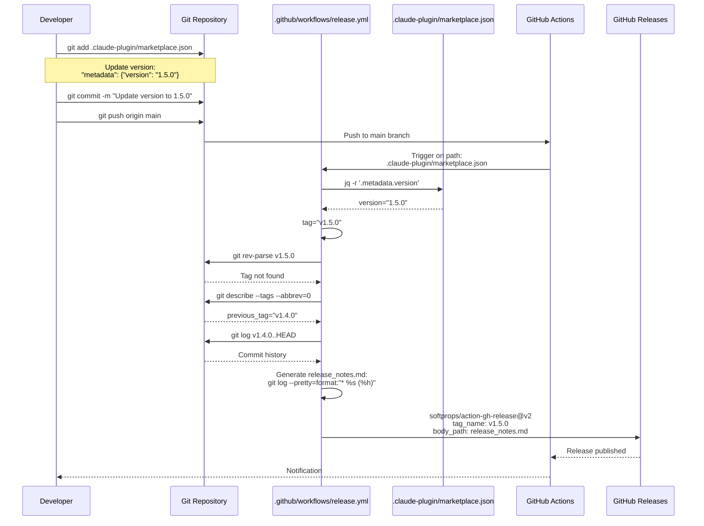
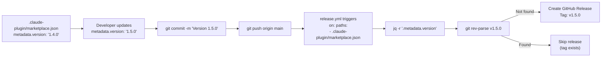
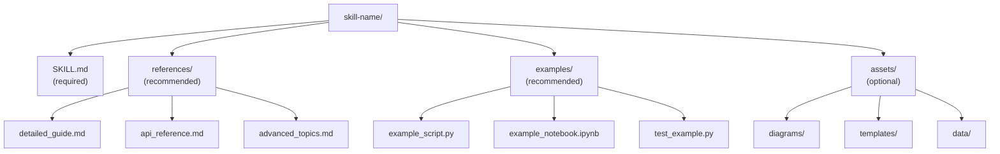

<!-- source: DeepWiki mcp.deepwiki.com · repo K-Dense-AI/claude-scientific-skills · page 9 Development and Contribution · fetched 2026-10-26 -->

# Development and Contribution

<details>
<summary>Relevant source files</summary>

The following files were used as context for generating this wiki page:

- [.github/workflows/release.yml](.github/workflows/release.yml)
- [.gitignore](.gitignore)
- [docs/k-dense-web.gif](docs/k-dense-web.gif)
- [scientific-skills/markdown-mermaid-writing/SKILL.md](scientific-skills/markdown-mermaid-writing/SKILL.md)
- [scientific-skills/markdown-mermaid-writing/assets/examples/example-research-report.md](scientific-skills/markdown-mermaid-writing/assets/examples/example-research-report.md)

</details>


This document provides technical guidance for developers contributing to the Claude Scientific Skills ecosystem. It covers repository structure, development workflow, documentation standards, version control practices, and the automated release pipeline.

For specific topics:
- Repository file organization and dependency management: see [Project Structure and Configuration](#9.1)
- GitHub Actions workflow and version tagging: see [Release Automation and Versioning](#9.2)
- SKILL.md authoring and skill creation process: see [Creating New Skills](#9.3)

---

## Repository Structure

The repository follows a standardized layout with skills organized by scientific domain and supporting infrastructure for documentation, automation, and distribution.

### Directory Layout



**Sources**: [.gitignore:1-17](), [scientific-skills/markdown-mermaid-writing/SKILL.md:1-335]()

---

## Development Workflow

### Local Environment Setup

1. **Clone repository**:
   ```bash
   git clone https://github.com/K-Dense-AI/claude-scientific-skills.git
   cd claude-scientific-skills
   ```

2. **Environment files**: The repository excludes development artifacts via [.gitignore:1-17]():
   - `.venv/` - Python virtual environments
   - `pyproject.toml`, `uv.lock` - Dependency management files
   - `.python-version` - Python version specification
   - `__pycache__/` - Compiled Python bytecode
   - `.env` - Local environment variables

3. **Install for testing**: Skills are installed by copying to agent-specific directories:
   ```bash
   cp -r scientific-skills/* ~/.cursor/skills/
   # or ~/.claude/skills/, .codex/skills/, .cursor/skills/
   ```

### Git Workflow

```mermaid
graph LR
    fork["Fork Repository"]
    clone["Clone Fork<br/>git clone"]
    branch["Create Branch<br/>git checkout -b feature/skill-name"]
    develop["Develop Skill<br/>Create SKILL.md<br/>Add references/<br/>Add examples/"]
    test["Test Locally<br/>Copy to ~/.cursor/skills/<br/>Verify in agent"]
    commit["Commit Changes<br/>git add .<br/>git commit -m 'Add XYZ skill'"]
    push["Push Branch<br/>git push origin feature/skill-name"]
    pr["Create Pull Request<br/>To K-Dense-AI/main"]
    review["Code Review<br/>Check documentation standards"]
    merge["Merge to main"]
    release["Automated Release<br/>release.yml triggers"]
    
    fork --> clone
    clone --> branch
    branch --> develop
    develop --> test
    test --> commit
    commit --> push
    push --> pr
    pr --> review
    review -->|"Changes requested"| develop
    review -->|"Approved"| merge
    merge --> release
```



**Sources**: [.gitignore:1-17](), [.github/workflows/release.yml:1-101]()

---

## Documentation Standards System

All skills **must** conform to the standards defined by the `markdown-mermaid-writing` skill. This is not optional—it is the mandatory documentation layer for the entire ecosystem.

### Documentation Architecture

```mermaid
graph TB
    subgraph "Required Files"
        skillmd["SKILL.md<br/>Main documentation file"]
        frontmatter["Frontmatter Metadata<br/>name: skill-name<br/>description: text<br/>allowed-tools: [...]<br/>license: Apache-2.0<br/>metadata: {...}"]
        content["Markdown Content<br/>## Overview<br/>## When to Use<br/>## Installation<br/>## Usage<br/>## Examples"]
    end
    
    subgraph "Optional Supporting Files"
        refs["references/<br/>Detailed guides<br/>API documentation"]
        examples["examples/<br/>Working code samples<br/>Jupyter notebooks"]
        assets["assets/<br/>Images, templates"]
    end
    
    subgraph "Mandatory Standards"
        mmw["markdown-mermaid-writing skill<br/>MUST be followed"]
        templates["9 Document Templates<br/>research_paper.md<br/>how_to_guide.md<br/>decision_record.md<br/>presentation.md<br/>etc."]
        markdown_guide["markdown_style_guide.md<br/>One H1 per document<br/>Emoji on H2 only<br/>Cite with [^N]<br/>Tables over prose"]
        mermaid_guide["mermaid_style_guide.md<br/>accTitle + accDescr<br/>No %%{init}<br/>classDef only<br/>snake_case node IDs"]
    end
    
    subgraph "Quality Checklist"
        check1["✓ Template used?"]
        check2["✓ Mermaid diagrams?"]
        check3["✓ All citations?"]
        check4["✓ Examples tested?"]
    end
    
    skillmd --> frontmatter
    skillmd --> content
    content --> refs
    content --> examples
    content --> assets
    
    skillmd -.->|"MUST follow"| mmw
    mmw --> templates
    mmw --> markdown_guide
    mmw --> mermaid_guide
    
    skillmd --> check1
    skillmd --> check2
    skillmd --> check3
    examples --> check4
```

**Sources**: [scientific-skills/markdown-mermaid-writing/SKILL.md:1-335]()

### SKILL.md Frontmatter Schema

Every `SKILL.md` file begins with YAML frontmatter defining skill metadata:

```yaml
---
name: skill-name
description: >
  Multi-line description of the skill's purpose and capabilities.
  This field is used by agents to determine skill relevance.
allowed-tools: Read Write Edit Bash
license: Apache-2.0
metadata:
  skill-author: Author Name / Organization (@handle)
  skill-source: https://github.com/org/repo
  skill-version: "1.0.0"
  skill-contributors:
    - name: Contributor Name
      org: Organization
      role: Role description
---
```

**Required frontmatter fields** [scientific-skills/markdown-mermaid-writing/SKILL.md:1-24]():
- `name`: Lowercase kebab-case identifier
- `description`: Plain text description (supports multi-line with `>`)
- `allowed-tools`: Space-separated list of agent capabilities
- `license`: SPDX license identifier
- `metadata.skill-author`: Primary author with attribution
- `metadata.skill-source`: Source repository URL
- `metadata.skill-version`: Semantic version string

### Mermaid Diagram Requirements

All Mermaid diagrams **must** include accessibility annotations [scientific-skills/markdown-mermaid-writing/SKILL.md:180-190]():



**Prohibited syntax** [scientific-skills/markdown-mermaid-writing/SKILL.md:187-190]():
- `%%{init}` directives (breaks GitHub dark mode)
- Inline `style` commands (use `classDef` only)
- Multiple emojis per node (max 1, at start of label)
- Node IDs with spaces or special characters (use `snake_case`)

**Sources**: [scientific-skills/markdown-mermaid-writing/SKILL.md:180-245]()

---

## Automated Release Pipeline

The repository uses a GitHub Actions workflow to automatically create releases when the marketplace version is updated.

### Release Workflow Architecture



**Sources**: [.github/workflows/release.yml:1-101]()

### Release Workflow Steps

The [.github/workflows/release.yml:1-101]() workflow executes these operations:

1. **Trigger conditions** [.github/workflows/release.yml:3-9]():
   - Push to `main` branch
   - Changes to `.claude-plugin/marketplace.json`
   - Manual `workflow_dispatch`

2. **Version extraction** [.github/workflows/release.yml:24-30]():
   ```bash
   VERSION=$(jq -r '.metadata.version' .claude-plugin/marketplace.json)
   echo "version=$VERSION" >> $GITHUB_OUTPUT
   echo "tag=v$VERSION" >> $GITHUB_OUTPUT
   ```

3. **Tag existence check** [.github/workflows/release.yml:32-41]():
   ```bash
   if git rev-parse "v$VERSION" >/dev/null 2>&1; then
     echo "exists=true" >> $GITHUB_OUTPUT
   else
     echo "exists=false" >> $GITHUB_OUTPUT
   fi
   ```

4. **Previous tag retrieval** [.github/workflows/release.yml:43-54]():
   ```bash
   PREVIOUS_TAG=$(git describe --tags --abbrev=0 2>/dev/null || echo "")
   ```

5. **Release notes generation** [.github/workflows/release.yml:56-82]():
   ```bash
   git log ${PREVIOUS_TAG}..HEAD --pretty=format:"* %s (%h)" --no-merges
   ```

6. **Release creation** [.github/workflows/release.yml:84-95]():
   - Uses `softprops/action-gh-release@v2`
   - Tag name: `v$VERSION`
   - Body from `release_notes.md`
   - Not draft, not prerelease

**Sources**: [.github/workflows/release.yml:1-101]()

### Version Control Workflow



**Sources**: [.github/workflows/release.yml:3-9](), [.github/workflows/release.yml:24-41]()

---

## Contribution Guidelines

### Pre-Contribution Checklist

Before submitting a pull request, verify all requirements are met:

| Requirement | Check | Reference |
|-------------|-------|-----------|
| **SKILL.md exists** | ✓ | Required file in skill directory |
| **Valid frontmatter** | ✓ | `name`, `description`, `allowed-tools`, `license`, `metadata` fields |
| **Markdown style guide followed** | ✓ | [scientific-skills/markdown-mermaid-writing/references/markdown_style_guide.md]() |
| **Mermaid diagrams included** | ✓ | At least one diagram demonstrating workflow or architecture |
| **Mermaid style guide followed** | ✓ | `accTitle`/`accDescr` on all diagrams (except `radar-beta`) |
| **No prohibited syntax** | ✓ | No `%%{init}`, no inline `style`, only `classDef` |
| **Examples provided** | ✓ | Working code in `examples/` directory |
| **Examples tested** | ✓ | All code examples execute successfully |
| **Citations included** | ✓ | External claims cited with `[^N]` footnotes |
| **References documented** | ✓ | `references/` directory with detailed guides |
| **Template used** | ✓ | One of 9 templates from `markdown-mermaid-writing/templates/` |

**Sources**: [scientific-skills/markdown-mermaid-writing/SKILL.md:285-291]()

### Skill Directory Structure

Each skill must follow this organization:



**Sources**: [scientific-skills/markdown-mermaid-writing/SKILL.md:1-335]()

### Code Quality Requirements

1. **Python code** (if applicable):
   - No committed `pyproject.toml` or `uv.lock` in skill directories [.gitignore:6-7]()
   - No `.venv/` directories [.gitignore:9]()
   - No `__pycache__/` or `.pyc` files [.gitignore:13]()
   - No `.env` files with secrets [.gitignore:15]()

2. **Documentation**:
   - All examples must have inline comments
   - API usage must be documented in `references/`
   - Installation instructions must be clear and tested

3. **Testing**:
   - Example code must execute without errors
   - Include `test_*.py` files where applicable
   - Document expected outputs

**Sources**: [.gitignore:1-17]()

---

## Documentation Quality Checklist

Apply this checklist before finalizing any contribution [scientific-skills/markdown-mermaid-writing/SKILL.md:285-291]():

### Document Structure
- [ ] Does the document use an appropriate template from `templates/`?
- [ ] Is there exactly one H1 heading (the title)?
- [ ] Do H2 headings have one emoji at the start?
- [ ] Are H3 and H4 headings emoji-free?
- [ ] Is there a horizontal rule (`---`) after every `</details>` block?

### Content Quality
- [ ] Are all external claims cited with `[^N]` footnote references?
- [ ] Do all footnotes have complete URLs?
- [ ] Are comparisons presented as markdown tables?
- [ ] Is bold text used sparingly (max 2-3 terms per paragraph)?
- [ ] Are technical terms defined on first use?

### Diagrams and Visuals
- [ ] Does every workflow, architecture, or relationship have a Mermaid diagram?
- [ ] Does every diagram have `accTitle` and `accDescr` (except `radar-beta`)?
- [ ] Are all node IDs in `snake_case`?
- [ ] Are all labels wrapped in double quotes (`"Label"`)?
- [ ] Do diagrams use `classDef` instead of inline `style`?
- [ ] Are diagrams free of `%%{init}` directives?
- [ ] Is each diagram preceded by a descriptive title?

### Code Examples
- [ ] Are all code examples tested and working?
- [ ] Do examples include inline comments?
- [ ] Are file paths cited using `[path/to/file:startLine-endLine]()` syntax?
- [ ] Are installation commands provided and tested?

**Sources**: [scientific-skills/markdown-mermaid-writing/SKILL.md:285-291](), [scientific-skills/markdown-mermaid-writing/SKILL.md:162-198]()

---

## Integration Testing

Test new skills before submitting:

1. **Copy to skill directory**:
   ```bash
   cp -r scientific-skills/new-skill-name ~/.cursor/skills/
   ```

2. **Restart agent** (Cursor, Claude Code, or Codex)

3. **Test skill discovery**: Ask agent to list available skills and confirm the new skill appears

4. **Test functionality**: Use the skill in a realistic workflow

5. **Test documentation**: Verify that:
   - Agent can parse the `SKILL.md` frontmatter
   - Examples load and execute
   - References are accessible
   - Mermaid diagrams render correctly

**Sources**: [scientific-skills/markdown-mermaid-writing/SKILL.md:1-335]()

---

## Version Control Best Practices

### Commit Message Format

Use conventional commit messages:

```
type(scope): description

- type: feat, fix, docs, style, refactor, test, chore
- scope: skill name or component
- description: concise summary (50 chars max)
```

Examples:
```
feat(scanpy): Add single-cell RNA-seq analysis skill
fix(rdkit): Correct molecular descriptor calculation
docs(markdown-mermaid-writing): Update style guide examples
```

### Branch Naming

Use descriptive branch names:
- `feature/skill-name` - New skills
- `fix/skill-name-issue` - Bug fixes
- `docs/section-update` - Documentation updates
- `refactor/component` - Code refactoring

**Sources**: [.github/workflows/release.yml:1-9]()

---

## Marketplace Configuration

The `.claude-plugin/marketplace.json` file serves as the single source of truth for versioning. When this file is updated and pushed to `main`, the release workflow automatically creates a new GitHub release.

### Updating the Marketplace Version

1. Edit `.claude-plugin/marketplace.json`
2. Update `metadata.version` field
3. Commit and push to `main`
4. GitHub Actions automatically creates release with tag `v<version>`

The workflow checks if the tag already exists [.github/workflows/release.yml:32-41]() and skips release creation if found, preventing duplicate releases.

**Sources**: [.github/workflows/release.yml:24-30](), [.github/workflows/release.yml:84-95]()

---

## Additional Resources

For detailed information on specific contribution topics:
- Repository organization and dependency management: see [Project Structure and Configuration](#9.1)
- GitHub Actions workflow internals and tag management: see [Release Automation and Versioning](#9.2)
- Step-by-step skill creation with examples: see [Creating New Skills](#9.3)
- Complete skill catalog and metadata reference: see [Complete Skill Catalog](#10.1)
- Marketplace schema specification: see [Marketplace Configuration Reference](#10.2)

**Sources**: [scientific-skills/markdown-mermaid-writing/SKILL.md:1-335](), [.github/workflows/release.yml:1-101](), [.gitignore:1-17]()

---

