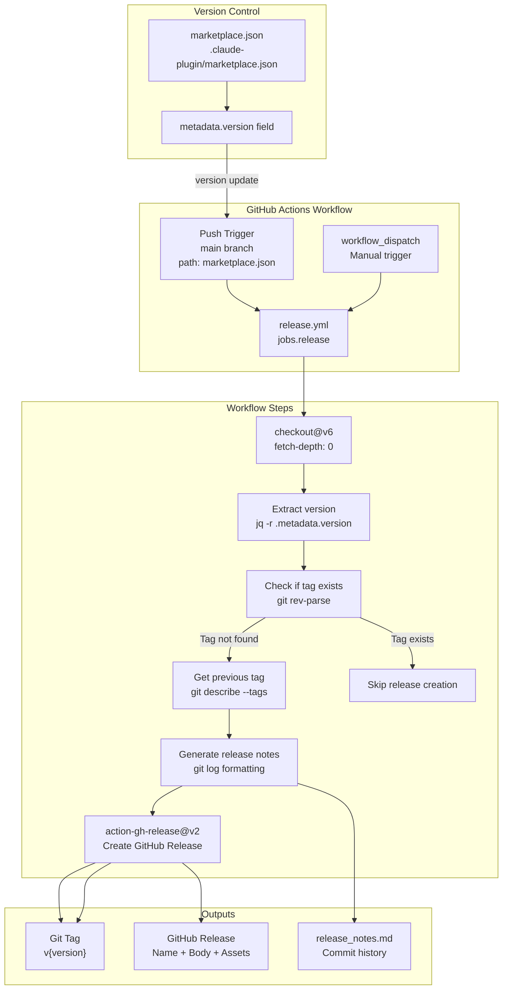
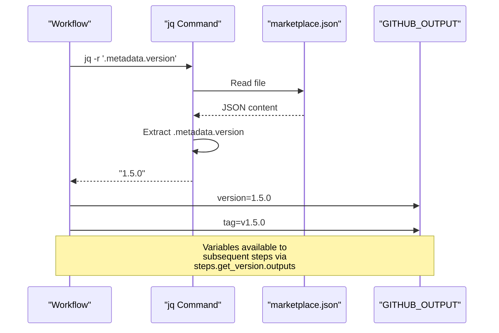
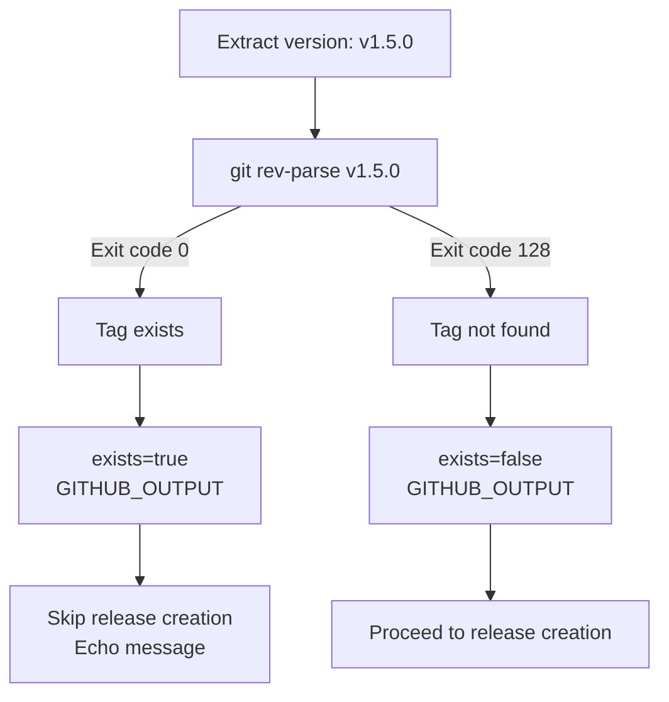
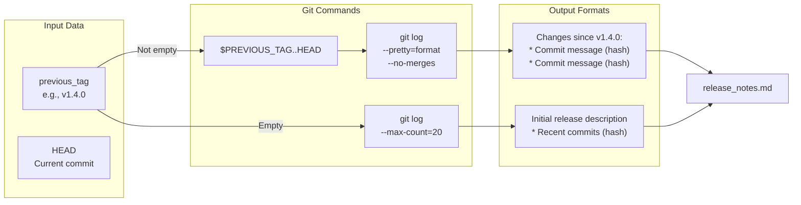
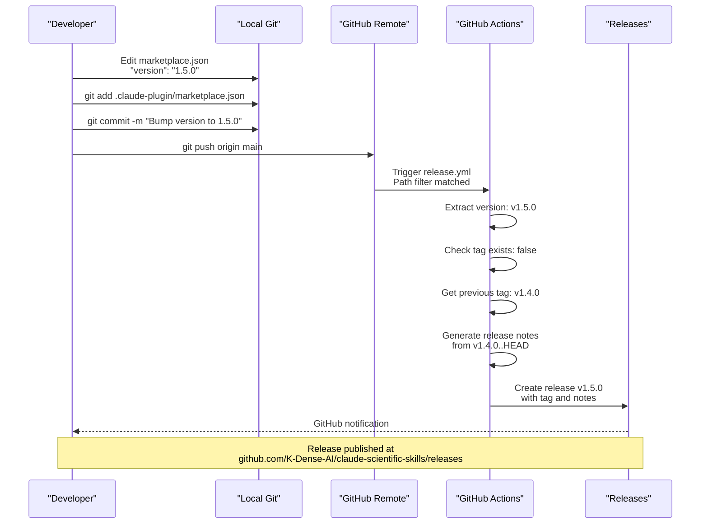
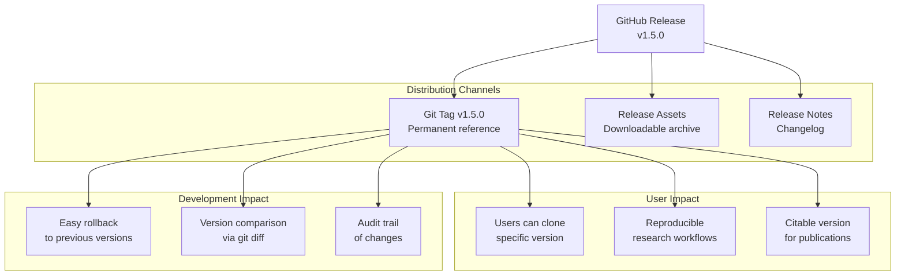

<!-- source: DeepWiki mcp.deepwiki.com · repo K-Dense-AI/claude-scientific-skills · page 9.2 Release Automation and Versioning · fetched 2026-10-26 -->

# Release Automation and Versioning

<details>
<summary>Relevant source files</summary>

The following files were used as context for generating this wiki page:

- [.github/workflows/release.yml](.github/workflows/release.yml)
- [docs/k-dense-web.gif](docs/k-dense-web.gif)

</details>


## Purpose and Scope

This document describes the automated release pipeline for Claude Scientific Skills, which maintains version control across 170+ skills. The system uses GitHub Actions to automatically create tagged releases when the version in `marketplace.json` is updated, ensuring reproducibility and auditability of all skill versions.

For information about project structure and repository organization, see [Project Structure and Configuration](#9.1). For guidance on creating new skills, see [Creating New Skills](#9.3).

**Sources:** [.github/workflows/release.yml:1-101]()

---

## Release Automation Architecture

The release automation system consists of a single GitHub Actions workflow that monitors `marketplace.json` for version changes and automatically creates GitHub releases with generated changelogs. The workflow serves as the single source of truth for versioning across the entire skill ecosystem.

### System Components



**Diagram: Release Automation Pipeline Architecture**

The workflow is triggered when changes to `.claude-plugin/marketplace.json` are pushed to the `main` branch. It extracts the version, checks for existing tags to prevent duplicates, generates release notes from commit history, and creates a GitHub release with the new tag.

**Sources:** [.github/workflows/release.yml:1-101]()

---

## Workflow Trigger Configuration

The `release.yml` workflow uses two trigger mechanisms:

| Trigger Type | Configuration | Purpose |
|-------------|---------------|---------|
| `push` | Branch: `main`<br/>Path: `.claude-plugin/marketplace.json` | Automatic release on version update |
| `workflow_dispatch` | Manual trigger | Allow manual release creation |

### Trigger Definition

```yaml
on:
  push:
    branches:
      - main
    paths:
      - '.claude-plugin/marketplace.json'
  workflow_dispatch:
```

The `paths` filter ensures the workflow only runs when `marketplace.json` is modified, preventing unnecessary executions on unrelated changes. The `workflow_dispatch` trigger enables manual execution from the GitHub Actions UI.

**Sources:** [.github/workflows/release.yml:3-9]()

---

## Version Extraction Process

The workflow extracts version information from `marketplace.json` using `jq`, a command-line JSON processor. This establishes `marketplace.json` as the single source of truth for versioning.



**Diagram: Version Extraction Sequence**

### Implementation Details

The `get_version` step performs the extraction:

```yaml
- name: Extract version from marketplace.json
  id: get_version
  run: |
    VERSION=$(jq -r '.metadata.version' .claude-plugin/marketplace.json)
    echo "version=$VERSION" >> $GITHUB_OUTPUT
    echo "tag=v$VERSION" >> $GITHUB_OUTPUT
    echo "Extracted version: $VERSION"
```

**Output Variables:**
- `steps.get_version.outputs.version` - Raw version string (e.g., `1.5.0`)
- `steps.get_version.outputs.tag` - Git tag format (e.g., `v1.5.0`)

The version string is prefixed with `v` to create the git tag, following semantic versioning conventions.

**Sources:** [.github/workflows/release.yml:24-30]()

---

## Tag Existence Verification

Before creating a release, the workflow checks if a tag for the current version already exists. This prevents duplicate releases and ensures idempotency.

### Tag Check Logic



**Diagram: Tag Existence Check Flow**

### Implementation

```yaml
- name: Check if tag already exists
  id: check_tag
  run: |
    if git rev-parse "v${{ steps.get_version.outputs.version }}" >/dev/null 2>&1; then
      echo "exists=true" >> $GITHUB_OUTPUT
      echo "Tag v${{ steps.get_version.outputs.version }} already exists"
    else
      echo "exists=false" >> $GITHUB_OUTPUT
      echo "Tag v${{ steps.get_version.outputs.version }} does not exist"
    fi
```

The `git rev-parse` command attempts to resolve the tag reference. If successful, the tag exists and `exists=true` is set. All subsequent steps that create releases are conditioned on `steps.check_tag.outputs.exists == 'false'`.

**Sources:** [.github/workflows/release.yml:32-41]()

---

## Previous Tag Retrieval

To generate meaningful release notes, the workflow retrieves the previous tag to determine the commit range for the changelog.

### Tag Retrieval Process

| Command | Purpose | Success Case | Fallback |
|---------|---------|--------------|----------|
| `git describe --tags --abbrev=0` | Get most recent tag | Returns tag name | Empty string |

```yaml
- name: Get previous tag
  id: previous_tag
  if: steps.check_tag.outputs.exists == 'false'
  run: |
    PREVIOUS_TAG=$(git describe --tags --abbrev=0 2>/dev/null || echo "")
    if [ -z "$PREVIOUS_TAG" ]; then
      echo "previous_tag=" >> $GITHUB_OUTPUT
      echo "No previous tag found"
    else
      echo "previous_tag=$PREVIOUS_TAG" >> $GITHUB_OUTPUT
      echo "Previous tag: $PREVIOUS_TAG"
    fi
```

**Behavior:**
- If previous tags exist: Sets `previous_tag` to the most recent tag (e.g., `v1.4.0`)
- If no previous tags exist: Sets `previous_tag` to empty string (initial release scenario)

The `--abbrev=0` flag ensures the full tag name is returned without commit hash abbreviation.

**Sources:** [.github/workflows/release.yml:43-54]()

---

## Release Notes Generation

The workflow automatically generates release notes from commit history between the previous tag and the current HEAD. The format varies based on whether this is an initial release or an incremental update.

### Release Notes Structure



**Diagram: Release Notes Generation Logic**

### Implementation

The `generate_release_notes` step creates a markdown file with formatted commit history:

```yaml
- name: Generate release notes
  id: release_notes
  if: steps.check_tag.outputs.exists == 'false'
  run: |
    PREVIOUS_TAG="${{ steps.previous_tag.outputs.previous_tag }}"
    
    # Start release notes
    cat > release_notes.md << 'EOF'
    ## What's Changed
    
    EOF
    
    # Generate changelog from commits
    if [ -n "$PREVIOUS_TAG" ]; then
      echo "Changes since $PREVIOUS_TAG:" >> release_notes.md
      echo "" >> release_notes.md
      
      # Get commits with nice formatting
      git log ${PREVIOUS_TAG}..HEAD --pretty=format:"* %s (%h)" --no-merges >> release_notes.md
    else
      echo "Initial release of Claude Scientific Skills" >> release_notes.md
      echo "" >> release_notes.md
      echo "This release includes:" >> release_notes.md
      git log --pretty=format:"* %s (%h)" --no-merges --max-count=20 >> release_notes.md
    fi
    
    cat release_notes.md
```

**Git Log Format String:**
- `%s` - Commit subject (first line of message)
- `%h` - Abbreviated commit hash
- `--no-merges` - Exclude merge commits
- `--max-count=20` - Limit to 20 commits for initial release

**Sources:** [.github/workflows/release.yml:56-82]()

---

## GitHub Release Creation

The workflow uses the `softprops/action-gh-release@v2` action to create the GitHub release with the generated tag, version name, and release notes.

### Release Configuration

```yaml
- name: Create Release
  if: steps.check_tag.outputs.exists == 'false'
  uses: softprops/action-gh-release@v2
  with:
    tag_name: ${{ steps.get_version.outputs.tag }}
    name: v${{ steps.get_version.outputs.version }}
    body_path: release_notes.md
    draft: false
    prerelease: false
    generate_release_notes: false
  env:
    GITHUB_TOKEN: ${{ secrets.GITHUB_TOKEN }}
```

### Action Parameters

| Parameter | Value | Purpose |
|-----------|-------|---------|
| `tag_name` | `v{version}` from `marketplace.json` | Creates git tag |
| `name` | `v{version}` | Human-readable release title |
| `body_path` | `release_notes.md` | Loads generated changelog |
| `draft` | `false` | Publishes release immediately |
| `prerelease` | `false` | Marks as stable release |
| `generate_release_notes` | `false` | Uses custom notes instead of GitHub's auto-generation |

The `GITHUB_TOKEN` secret is automatically provided by GitHub Actions with `contents: write` permission (specified at workflow level).

**Sources:** [.github/workflows/release.yml:84-95]()

---

## Duplicate Release Handling

When a tag already exists, the workflow skips release creation and logs a message:

```yaml
- name: Skip release creation
  if: steps.check_tag.outputs.exists == 'true'
  run: |
    echo "Release v${{ steps.get_version.outputs.version }} already exists. Skipping release creation."
```

This prevents errors when:
- A release has already been created for the current version
- The workflow is re-run without version changes
- Manual tags have been created outside the workflow

**Sources:** [.github/workflows/release.yml:97-100]()

---

## Permissions and Security

The workflow requires minimal permissions to operate securely:

```yaml
permissions:
  contents: write
```

**Permission Justification:**
- `contents: write` - Required to create tags and releases
- No other permissions granted - Follows principle of least privilege

The workflow uses the default `GITHUB_TOKEN`, which is scoped to the repository and automatically expires after the workflow run. No long-lived credentials are stored.

**Sources:** [.github/workflows/release.yml:11-12]()

---

## Version Update Workflow

### Developer Process



**Diagram: End-to-End Release Creation Process**

### Required Steps for Releasing

1. **Update Version in marketplace.json:**
   ```json
   {
     "metadata": {
       "version": "1.5.0"
     }
   }
   ```

2. **Commit and Push:**
   ```bash
   git add .claude-plugin/marketplace.json
   git commit -m "Bump version to 1.5.0"
   git push origin main
   ```

3. **Workflow Executes Automatically:**
   - Version extraction
   - Tag verification
   - Release notes generation
   - Release creation

4. **Verify Release:**
   - Check GitHub releases page
   - Confirm tag created
   - Review generated release notes

**Sources:** [.github/workflows/release.yml:1-101]()

---

## Manual Release Triggering

The `workflow_dispatch` trigger allows manual execution without modifying `marketplace.json`:

### Manual Trigger Process

1. Navigate to **Actions** tab in GitHub repository
2. Select **Create Release** workflow
3. Click **Run workflow** button
4. Select branch (typically `main`)
5. Click **Run workflow** to execute

**Use Cases for Manual Triggering:**
- Re-generating release notes after force-push corrections
- Creating releases for historical versions
- Testing workflow changes
- Emergency release creation

The workflow reads the current version from `marketplace.json` at the time of execution, so manual triggers still respect the version in the file.

**Sources:** [.github/workflows/release.yml:9]()

---

## Integration with Skill Ecosystem

### Marketplace.json as Version Authority

The `marketplace.json` file serves as the authoritative source for:

| Field | Purpose | Example |
|-------|---------|---------|
| `metadata.version` | System-wide version | `"1.5.0"` |
| `metadata.lastUpdated` | Update timestamp | `"2024-01-15"` |
| Individual skill versions | Per-skill versioning | Each skill has version field |

When the system version changes, a new release captures:
- All skill additions or updates since the last release
- Bug fixes and improvements
- Documentation changes
- Infrastructure updates

### Downstream Effects of Release



**Diagram: Release Impact Across Ecosystem**

**Sources:** [.github/workflows/release.yml:1-101]()

---

## Best Practices

### Version Numbering

Follow semantic versioning (SemVer) for `marketplace.json`:

- **Major version** (X.0.0) - Breaking changes to skill interfaces
- **Minor version** (1.X.0) - New skills or backward-compatible features
- **Patch version** (1.5.X) - Bug fixes and documentation updates

### Commit Message Guidelines

Release notes are generated from commit messages. Use clear, descriptive messages:

**Good:**
```
Add TileDB-VCF genomic variant storage skill
Fix ChEMBL API authentication error
Update Scanpy skill documentation with batch processing examples
```

**Avoid:**
```
Update files
Fix bug
WIP
```

### Pre-Release Checklist

Before updating `marketplace.json` version:

- [ ] All skill documentation follows markdown-mermaid-writing standards
- [ ] Example code has been tested
- [ ] Breaking changes are documented
- [ ] Major new features have reference documentation
- [ ] Previous release notes reviewed for completeness

### Rollback Procedure

If a release contains errors:

1. **Identify the good version:**
   ```bash
   git tag -l
   # Find previous stable version, e.g., v1.4.0
   ```

2. **Revert marketplace.json:**
   ```bash
   git checkout v1.4.0 -- .claude-plugin/marketplace.json
   git commit -m "Revert to version 1.4.0 due to [issue]"
   git push origin main
   ```

3. **New release created automatically** with reverted version

**Sources:** [.github/workflows/release.yml:1-101]()

---

## Troubleshooting

### Common Issues

| Issue | Symptom | Resolution |
|-------|---------|------------|
| Workflow not triggered | No action after push | Verify path filter: `.claude-plugin/marketplace.json` modified |
| Tag already exists | Workflow skips release | Increment version in `marketplace.json` |
| Permission denied | Workflow fails at release creation | Confirm `permissions: contents: write` in workflow |
| Empty release notes | No commits listed | Ensure `fetch-depth: 0` in checkout step |

### Debugging Steps

1. **Check workflow runs:**
   - Navigate to **Actions** tab
   - Review workflow execution logs
   - Examine each step's output

2. **Verify marketplace.json:**
   ```bash
   jq '.metadata.version' .claude-plugin/marketplace.json
   ```

3. **List existing tags:**
   ```bash
   git tag -l
   ```

4. **Test tag check locally:**
   ```bash
   git rev-parse v1.5.0 >/dev/null 2>&1 && echo "exists" || echo "not found"
   ```

**Sources:** [.github/workflows/release.yml:1-101]()

---

## Future Enhancements

Potential improvements to the release automation system:

- **Automated version bumping** based on commit message conventions
- **Release note categorization** (features, fixes, documentation)
- **Contributor attribution** extracted from commit authors
- **Asset attachment** of packaged skills or documentation
- **Notification system** for new releases (Slack, Discord)
- **Semantic version validation** to prevent invalid version strings

These enhancements would build upon the existing `release.yml` workflow while maintaining its core simplicity and reliability.

**Sources:** [.github/workflows/release.yml:1-101]()

---

