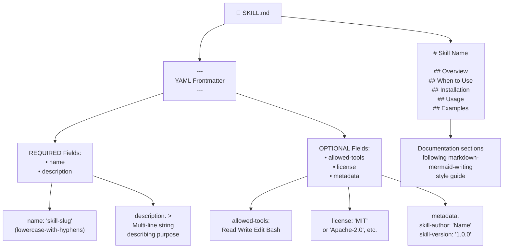
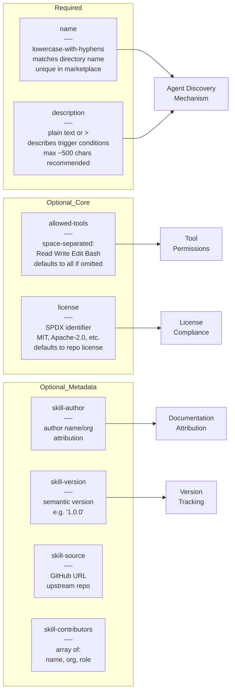
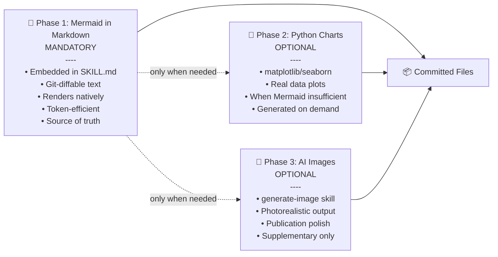
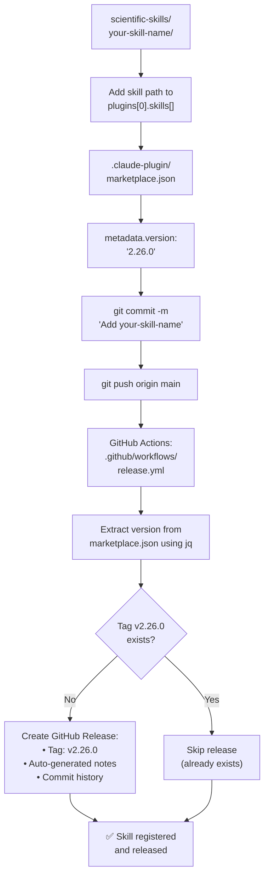
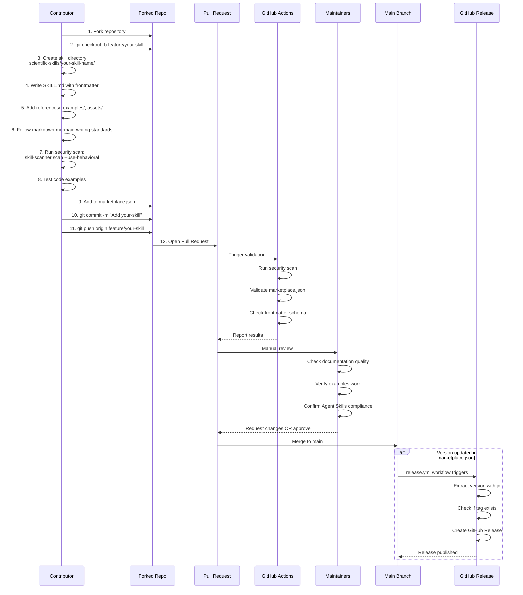
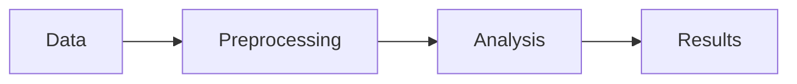

<!-- source: DeepWiki mcp.deepwiki.com · repo K-Dense-AI/claude-scientific-skills · page 9.3 Creating New Skills · fetched 2026-10-26 -->

# Creating New Skills

<details>
<summary>Relevant source files</summary>

The following files were used as context for generating this wiki page:

- [.claude-plugin/marketplace.json](.claude-plugin/marketplace.json)
- [README.md](README.md)
- [docs/scientific-skills.md](docs/scientific-skills.md)
- [scientific-skills/ginkgo-cloud-lab/SKILL.md](scientific-skills/ginkgo-cloud-lab/SKILL.md)
- [scientific-skills/ginkgo-cloud-lab/references/cell-free-protein-expression-optimization.md](scientific-skills/ginkgo-cloud-lab/references/cell-free-protein-expression-optimization.md)
- [scientific-skills/ginkgo-cloud-lab/references/cell-free-protein-expression-validation.md](scientific-skills/ginkgo-cloud-lab/references/cell-free-protein-expression-validation.md)
- [scientific-skills/ginkgo-cloud-lab/references/fluorescent-pixel-art-generation.md](scientific-skills/ginkgo-cloud-lab/references/fluorescent-pixel-art-generation.md)
- [scientific-skills/markdown-mermaid-writing/SKILL.md](scientific-skills/markdown-mermaid-writing/SKILL.md)
- [scientific-skills/markdown-mermaid-writing/assets/examples/example-research-report.md](scientific-skills/markdown-mermaid-writing/assets/examples/example-research-report.md)

</details>


## Purpose and Scope

This page provides a complete guide for skill authors on creating, documenting, testing, and contributing new skills to the claude-scientific-skills repository. It covers the required file structure, frontmatter schema, documentation standards, security scanning, and the contribution workflow from initial development to marketplace registration.

For information about the overall system architecture and how skills are discovered by agents, see [Core Architecture](#3). For documentation standards and style guides that apply to all skills, see [Documentation Standards](#3.5). For the automated release process triggered by marketplace updates, see [Release Automation and Versioning](#9.2).

---

## Skill Anatomy and Required Structure

Every skill must follow a standardized directory structure to ensure Agent Skills compatibility and automatic discovery by Cursor, Claude Code, and Codex.

### Directory Structure

```
scientific-skills/
└── your-skill-name/
    ├── SKILL.md                  # REQUIRED: Skill definition with frontmatter
    ├── references/               # OPTIONAL: Detailed guides and API docs
    │   ├── guide-1.md
    │   └── guide-2.md
    ├── examples/                 # OPTIONAL: Working code examples
    │   ├── example-1.py
    │   └── example-notebook.ipynb
    └── assets/                   # OPTIONAL: Images, diagrams, templates
        ├── workflow-diagram.png
        └── template.json
```

**Directory Naming Rules**:
- Use lowercase with hyphens (`kebab-case`)
- Match the `name` field in SKILL.md frontmatter
- No spaces, underscores, or special characters
- Example: `pytorch-lightning`, not `PyTorch_Lightning` or `PyTorchLightning`

**Sources**: [README.md:60-66](), [scientific-skills/markdown-mermaid-writing/SKILL.md:1-335](), [scientific-skills/ginkgo-cloud-lab/SKILL.md:1-57]()

---

### SKILL.md Frontmatter Schema

The `SKILL.md` file begins with YAML frontmatter that defines metadata for agent discovery and marketplace registration. This is the **only required file** for a valid skill.



**Required Frontmatter Fields**:

```yaml
---
name: your-skill-name
description: >
  Single-line or multi-line description of the skill's purpose, use cases,
  and capabilities. Use when the user needs to [specific trigger]. Covers
  [key features] and [major integrations].
---
```

**Optional Frontmatter Fields**:

```yaml
allowed-tools: Read Write Edit Bash  # Tools the agent may use
license: MIT                         # SPDX license identifier
metadata:
  skill-author: Your Name / Organization
  skill-source: https://github.com/your/repo
  skill-version: "1.0.0"
  skill-contributors:
    - name: Contributor Name
      org: Organization
      role: Maintainer
```

**Sources**: [scientific-skills/markdown-mermaid-writing/SKILL.md:1-24](), [scientific-skills/ginkgo-cloud-lab/SKILL.md:1-5]()

---

### Frontmatter Field Details



| Field | Type | Required | Validation | Purpose |
|-------|------|----------|------------|---------|
| `name` | string | **Yes** | lowercase, hyphens only, must match directory name | Unique identifier for agent discovery |
| `description` | string | **Yes** | plain text or `>` multi-line | Describes when and how to use the skill |
| `allowed-tools` | string | No | Space-separated: `Read Write Edit Bash` | Tool permissions (defaults to all) |
| `license` | string | No | SPDX identifier (e.g., `MIT`, `Apache-2.0`) | Individual skill license (can differ from repo) |
| `metadata.skill-author` | string | No | Free text | Author name and/or organization |
| `metadata.skill-version` | string | No | Semantic version (e.g., `"1.0.0"`) | Skill version independent of repo version |
| `metadata.skill-source` | string | No | URL | Upstream repository or original source |
| `metadata.skill-contributors` | array | No | List of `{name, org, role}` objects | Additional contributors |

**Sources**: [scientific-skills/markdown-mermaid-writing/SKILL.md:1-24](), [README.md:654-664]()

---

## Documentation Standards: Mandatory Requirements

**All skills MUST follow the markdown-mermaid-writing skill standards.** This is non-negotiable for contribution acceptance.

### The Three-Phase Documentation Workflow



**Phase 1 is mandatory**: Every structural diagram (workflows, architectures, relationships) must start as Mermaid in markdown. Python/AI-generated images are **supplements**, not replacements.

**Sources**: [scientific-skills/markdown-mermaid-writing/SKILL.md:61-140]()

---

### Required Files for Documentation Compliance

| File | Requirement | Purpose | Template |
|------|-------------|---------|----------|
| `SKILL.md` | **REQUIRED** | Main skill documentation with frontmatter | [markdown-mermaid-writing/templates/how_to_guide.md]() |
| `references/*.md` | Recommended | Detailed guides, API references, advanced topics | [markdown-mermaid-writing/templates/]() |
| `examples/*.py` | Recommended | Working code examples with comments | N/A |
| `examples/*.ipynb` | Optional | Jupyter notebooks demonstrating workflows | N/A |
| `assets/` | Optional | Diagrams, images, templates | N/A |

**Diagram Requirements** (from mermaid_style_guide.md):
- **Always include** `accTitle` and `accDescr` on supported diagram types
- No `%%{init}` theme directives (breaks GitHub dark mode)
- No inline `style` — use `classDef` only
- One emoji max per node, at start of label
- Use `snake_case` for node IDs
- Pick the appropriate diagram type from 24 available

**Markdown Requirements** (from markdown_style_guide.md):
- One H1 (`#`) per document — the title only
- Emoji on H2 (`##`) headings only, one per section
- Cite external claims with footnotes `[^N]` and full URLs
- Bold sparingly (2-3 terms per paragraph max)
- Horizontal rule `---` after every `</details>` block
- Tables over prose for comparisons/configs

**Sources**: [scientific-skills/markdown-mermaid-writing/SKILL.md:141-199](), [scientific-skills/markdown-mermaid-writing/SKILL.md:296-318]()

---

### Quality Checklist Before Submission

Every skill must pass this checklist before pull request submission:

```mermaid
flowchart TD
    accTitle: Skill Quality Verification Checklist
    accDescr: Step-by-step validation process ensuring documentation standards, testing, security scanning, and Agent Skills compliance

    Start["📝 New Skill Created"]
    
    Template{Used a<br/>template?}
    Diagrams{All workflows<br/>as Mermaid?}
    Style{Follows markdown<br/>+ Mermaid guides?}
    Examples{Code examples<br/>tested?}
    Security{Security<br/>scan clean?}
    Frontmatter{Valid frontmatter<br/>schema?}
    Marketplace{Added to<br/>marketplace.json?}
    
    TemplateNo["Review templates/<br/>and references/"]
    DiagramsNo["Convert prose to<br/>Mermaid diagrams"]
    StyleNo["Apply markdown_style_guide<br/>+ mermaid_style_guide"]
    ExamplesNo["Add and test<br/>working examples"]
    SecurityNo["Run skill-scanner<br/>fix issues"]
    FrontmatterNo["Fix YAML<br/>validate fields"]
    MarketplaceNo["Add skill path<br/>to plugins.skills[]"]
    
    Ready["✅ Ready for PR"]
    
    Start --> Template
    Template -->|No| TemplateNo
    Template -->|Yes| Diagrams
    TemplateNo --> Diagrams
    
    Diagrams -->|No| DiagramsNo
    Diagrams -->|Yes| Style
    DiagramsNo --> Style
    
    Style -->|No| StyleNo
    Style -->|Yes| Examples
    StyleNo --> Examples
    
    Examples -->|No| ExamplesNo
    Examples -->|Yes| Security
    ExamplesNo --> Security
    
    Security -->|No| SecurityNo
    Security -->|Yes| Frontmatter
    SecurityNo --> Frontmatter
    
    Frontmatter -->|No| FrontmatterNo
    Frontmatter -->|Yes| Marketplace
    FrontmatterNo --> Marketplace
    
    Marketplace -->|No| MarketplaceNo
    Marketplace -->|Yes| Ready
    MarketplaceNo --> Ready
```



**Pre-Submission Checklist**:

- [ ] SKILL.md exists with valid frontmatter (`name`, `description`)
- [ ] Directory name matches frontmatter `name` field exactly
- [ ] Used a template from `markdown-mermaid-writing/templates/` as starting point
- [ ] All structural diagrams are Mermaid with `accTitle`/`accDescr`
- [ ] Followed `markdown_style_guide.md` (one H1, emoji on H2 only, citations)
- [ ] Followed `mermaid_style_guide.md` (no `%%{init}`, `classDef` only, no colors)
- [ ] Code examples tested and functional
- [ ] Security scan passed (`skill-scanner scan --use-behavioral`)
- [ ] Added skill path to `.claude-plugin/marketplace.json`
- [ ] License field in frontmatter (if different from repo MIT license)

**Sources**: [scientific-skills/markdown-mermaid-writing/SKILL.md:282-294](), [README.md:583-604]()

---

## Testing and Validation

### Security Scanning with Cisco AI Skill Scanner

All skills are scanned using the open-source [cisco-ai-skill-scanner](https://github.com/cisco-ai-defense/skill-scanner) to detect prompt injection, data exfiltration, and malicious code patterns.

**Installation**:
```bash
uv pip install cisco-ai-skill-scanner
```

**Running the Scanner**:
```bash
skill-scanner scan /path/to/your-skill-name --use-behavioral
```

The `--use-behavioral` flag enables advanced detection of malicious patterns beyond static analysis.

**Expected Output** (clean scan):
```
✅ No security issues detected
```

**If issues are found**:
1. Review the flagged patterns in the scanner output
2. Modify SKILL.md or example code to remove problematic constructs
3. Re-run scanner until clean
4. Clean scan is **required** before PR acceptance

> **Note**: A clean scan does not guarantee complete security, but significantly reduces common attack vectors. All contributed skills are also manually reviewed.

**Sources**: [README.md:593-604]()

---

### Testing Code Examples

If your skill includes `examples/*.py` or `examples/*.ipynb`, ensure they execute without errors:

**For Python Scripts**:
```bash
cd scientific-skills/your-skill-name/examples/
python example-1.py
```

**For Jupyter Notebooks**:
```bash
jupyter nbconvert --to notebook --execute example-notebook.ipynb
```

All examples should:
- Include clear docstrings and inline comments
- Handle common error cases gracefully
- Use relative paths for local assets
- Document required dependencies in SKILL.md
- Run successfully on a clean Python 3.9+ environment with `uv pip install <package>`

**Sources**: [README.md:562-591]()

---

## Marketplace Registration

### Adding Your Skill to marketplace.json

Once your skill is documented and tested, register it in the marketplace by adding its path to `.claude-plugin/marketplace.json`.



**Step-by-Step Process**:

1. **Open marketplace.json**: [.claude-plugin/marketplace.json:1-194]()

2. **Add your skill path** to the `plugins[0].skills` array (alphabetically sorted):

```json
{
  "plugins": [
    {
      "name": "scientific-skills",
      "skills": [
        "./scientific-skills/existing-skill-1",
        "./scientific-skills/existing-skill-2",
        "./scientific-skills/your-skill-name",
        "./scientific-skills/existing-skill-3"
      ]
    }
  ]
}
```

3. **Update version** (if releasing): Increment `metadata.version` in marketplace.json:

```json
{
  "metadata": {
    "version": "2.27.0"
  }
}
```

**Version Increment Rules**:
- **Patch** (2.26.0 → 2.26.1): Bug fixes, documentation updates, no new skills
- **Minor** (2.26.0 → 2.27.0): New skills added, backward-compatible changes
- **Major** (2.26.0 → 3.0.0): Breaking changes to skill APIs or structure

**Sources**: [.claude-plugin/marketplace.json:1-194](), [README.md:552-618]()

---

### Automated Release Workflow

When you push changes to `marketplace.json` with a new version, the automated release workflow triggers:

**Workflow File**: [.github/workflows/release.yml:1-98]()

**Automation Steps**:
1. GitHub Actions detects changes to `.claude-plugin/marketplace.json`
2. Extracts `metadata.version` using `jq`
3. Checks if tag `v{version}` already exists
4. If new version:
   - Retrieves previous tag
   - Generates changelog from commit history
   - Creates GitHub Release with tag and release notes
5. If version already tagged: skips release creation

**No manual intervention required** — pushing to main with an updated version automatically publishes the release.

**Sources**: [README.md:552-618]()

---

## Complete Contribution Workflow



**Detailed Steps**:

1. **Fork the repository** at https://github.com/K-Dense-AI/claude-scientific-skills

2. **Create a feature branch**:
   ```bash
   git checkout -b feature/your-skill-name
   ```

3. **Create skill directory**:
   ```bash
   mkdir -p scientific-skills/your-skill-name/{references,examples,assets}
   ```

4. **Write SKILL.md** with required frontmatter (see [Skill Anatomy](#skill-anatomy-and-required-structure))

5. **Add supporting documentation**:
   - `references/` — detailed guides, API documentation
   - `examples/` — working Python scripts, notebooks
   - `assets/` — diagrams, images, templates

6. **Apply documentation standards** (mandatory):
   - Use a template from `markdown-mermaid-writing/templates/`
   - Follow `markdown_style_guide.md` rules
   - Follow `mermaid_style_guide.md` rules
   - Embed Mermaid diagrams for all workflows/architectures

7. **Run security scan**:
   ```bash
   skill-scanner scan scientific-skills/your-skill-name --use-behavioral
   ```
   Fix any flagged issues before proceeding.

8. **Test code examples**:
   ```bash
   python scientific-skills/your-skill-name/examples/example.py
   ```

9. **Register in marketplace**:
   - Add skill path to `.claude-plugin/marketplace.json` in alphabetical order
   - Optionally increment `metadata.version` if ready to release

10. **Commit and push**:
    ```bash
    git add .
    git commit -m "Add your-skill-name skill"
    git push origin feature/your-skill-name
    ```

11. **Open Pull Request** with clear description:
    - What the skill does
    - Which scientific domain it covers
    - Dependencies required
    - Link to official documentation

12. **PR Review Process**:
    - Automated security scan runs
    - Maintainers verify documentation quality
    - Code examples tested
    - Frontmatter validated
    - Agent Skills specification compliance checked

13. **Merge and Release**:
    - Once approved, PR is merged to main
    - If version was incremented, GitHub Release is automatically created
    - Skill is now available to all users

**Sources**: [README.md:552-618]()

---

## Common Patterns for Different Skill Types

### Python Package Skills

**Examples**: [scientific-skills/scanpy/SKILL.md](), [scientific-skills/pytorch-lightning/SKILL.md]()

**Key Sections**:
- Installation instructions with `uv pip install package-name`
- Import patterns and basic usage
- Integration with common workflows (pandas, numpy, jupyter)
- Links to official documentation
- Common gotchas and troubleshooting

**Example Structure**:
```markdown
## Installation
uv pip install package-name

## Quick Start
```python
import package
# minimal working example
```

## Common Workflows
### Workflow 1: [Use Case]
### Workflow 2: [Use Case]

## Integration with Other Skills
- Works with: scikit-learn, pandas, matplotlib
```

---

### Database Skills

**Examples**: [scientific-skills/pubmed-database/SKILL.md](), [scientific-skills/chembl-database/SKILL.md]()

**Key Sections**:
- API endpoint and authentication
- Query syntax and examples
- Rate limits and best practices
- Response format and parsing
- Bulk download options

**Example Structure**:
```markdown
## API Access
- Base URL: https://api.database.org/v1/
- Authentication: API key or no auth required
- Rate limit: 10 requests/second

## Query Examples
### Search by [Field]
### Filter by [Criteria]
### Retrieve [Data Type]

## Response Parsing
```python
import requests
response = requests.get(...)
data = response.json()
```
```

---

### Integration Skills

**Examples**: [scientific-skills/ginkgo-cloud-lab/SKILL.md](), [scientific-skills/benchling-integration/SKILL.md]()

**Key Sections**:
- Platform overview and capabilities
- Authentication setup
- Available operations (CRUD)
- Workflow examples
- Error handling and troubleshooting

**Example Structure**:
```markdown
## Overview
Brief description of the platform

## Authentication
- API key setup
- Configuration file location

## Available Operations
### Create [Resource]
### Read [Resource]
### Update [Resource]
### Delete [Resource]

## Common Workflows
```

---

### Analysis Skills

**Examples**: [scientific-skills/exploratory-data-analysis/SKILL.md](), [scientific-skills/statistical-analysis/SKILL.md]()

**Key Sections**:
- When to use this analysis
- Input data requirements
- Step-by-step workflow
- Interpretation of results
- Visualization recommendations

**Example Structure**:
```markdown
## When to Use
Describe appropriate use cases

## Input Requirements
- Data format
- Required columns
- Sample size considerations

## Analysis Steps


## Interpreting Results
Guidelines for p-values, effect sizes, etc.
```

**Sources**: [scientific-skills/ginkgo-cloud-lab/SKILL.md:1-57](), [docs/scientific-skills.md:1-547]()

---

## File Path Reference Table

Quick reference for key files when creating skills:

| Component | File Path | Purpose |
|-----------|-----------|---------|
| Skill definition | `scientific-skills/your-skill/SKILL.md` | Required frontmatter and documentation |
| Marketplace registry | `.claude-plugin/marketplace.json` | Skill path registration |
| Markdown style guide | `scientific-skills/markdown-mermaid-writing/references/markdown_style_guide.md` | Required formatting rules |
| Mermaid style guide | `scientific-skills/markdown-mermaid-writing/references/mermaid_style_guide.md` | Diagram standards |
| Document templates | `scientific-skills/markdown-mermaid-writing/templates/*.md` | Starting templates (9 types) |
| Diagram references | `scientific-skills/markdown-mermaid-writing/references/diagrams/*.md` | 24 diagram type guides |
| Example skill | `scientific-skills/markdown-mermaid-writing/assets/examples/example-research-report.md` | Complete example |
| Release workflow | `.github/workflows/release.yml` | Automated release automation |
| Contribution guide | `README.md:552-618` | Full contribution guidelines |
| Security scanning | N/A (external tool) | `cisco-ai-skill-scanner` PyPI package |

**Sources**: [README.md:1-933](), [scientific-skills/markdown-mermaid-writing/SKILL.md:1-335]()

---

## Getting Help

If you encounter issues during skill creation:

- **Documentation Standards**: Review [markdown-mermaid-writing/SKILL.md]() and its references/
- **Security Scan Failures**: Check [Cisco AI Skill Scanner documentation](https://github.com/cisco-ai-defense/skill-scanner)
- **Marketplace Questions**: See [Marketplace Configuration Reference](#10.2)
- **General Questions**: [Open a GitHub Discussion](https://github.com/K-Dense-AI/claude-scientific-skills/discussions)
- **Bug Reports**: [File an issue](https://github.com/K-Dense-AI/claude-scientific-skills/issues)
- **Community Support**: [Join K-Dense Slack](https://join.slack.com/t/k-densecommunity/shared_invite/zt-3iajtyls1-EwmkwIZk0g_o74311Tkf5g)

**Sources**: [README.md:692-714]()

---

