# Page: Home

# Home

<details>
<summary>Relevant source files</summary>

The following files were used as context for generating this wiki page:

- [.claude-plugin/marketplace.json](.claude-plugin/marketplace.json)
- [README.md](README.md)
- [docs/scientific-skills.md](docs/scientific-skills.md)
- [scientific-skills/ginkgo-cloud-lab/SKILL.md](scientific-skills/ginkgo-cloud-lab/SKILL.md)
- [scientific-skills/ginkgo-cloud-lab/references/cell-free-protein-expression-optimization.md](scientific-skills/ginkgo-cloud-lab/references/cell-free-protein-expression-optimization.md)
- [scientific-skills/ginkgo-cloud-lab/references/cell-free-protein-expression-validation.md](scientific-skills/ginkgo-cloud-lab/references/cell-free-protein-expression-validation.md)
- [scientific-skills/ginkgo-cloud-lab/references/fluorescent-pixel-art-generation.md](scientific-skills/ginkgo-cloud-lab/references/fluorescent-pixel-art-generation.md)

</details>


## Purpose and Scope

This wiki documents **Claude Scientific Skills**, an open-source collection of 170+ scientific and research skills that implement the [Agent Skills](https://agentskills.io/) standard. The system provides AI agents with structured documentation and examples for scientific Python packages, databases, and laboratory automation platforms across bioinformatics, cheminformatics, clinical research, machine learning, and other domains.

This page provides a technical overview of the system architecture, file structure, and skill organization. For installation instructions, see [Installation and Setup](#2.1). For creating new skills, see [Creating New Skills](#9.3). For complete skill catalog details, see [Complete Skill Catalog](#10.1).

**Sources**: [README.md:1-50]()

---

## System Architecture

Claude Scientific Skills operates as a three-tier system: (1) AI agents that support the Agent Skills standard, (2) a skill registry and documentation layer, and (3) external scientific resources.

```mermaid
graph TB
    subgraph "Tier 1: AI Agent Layer"
        Cursor["Cursor IDE<br/>Reads: ~/.cursor/skills/"]
        ClaudeCode["Claude Code<br/>Reads: ~/.claude/skills/"]
        Codex["Codex<br/>Reads: ~/.codex/skills/"]
    end
    
    subgraph "Tier 2: Skill System"
        Marketplace["marketplace.json<br/>Version: 2.26.0<br/>170 skills registered"]
        
        SkillDirs["scientific-skills/<br/>├─ scanpy/<br/>├─ rdkit/<br/>├─ pubmed-database/<br/>├─ chembl-database/<br/>├─ ginkgo-cloud-lab/<br/>└─ ...]
        
        SkillMD["SKILL.md files<br/>Frontmatter metadata<br/>Markdown content"]
    end
    
    subgraph "Tier 3: External Resources"
        PythonPkgs["Python Packages<br/>60+ optimized:<br/>scanpy, rdkit, pytorch-lightning,<br/>scikit-learn, biopython"]
        
        Databases["Scientific Databases<br/>250+ total via:<br/>• 37+ direct skills<br/>• BioServices ~70 DBs<br/>• BioPython 38 NCBI DBs<br/>• gget 20+ DBs"]
        
        CloudLabs["Laboratory Automation<br/>• Ginkgo Cloud Lab<br/>• Opentrons<br/>• DNAnexus<br/>• LatchBio"]
    end
    
    Cursor --> Marketplace
    ClaudeCode --> Marketplace
    Codex --> Marketplace
    
    Marketplace --> SkillDirs
    SkillDirs --> SkillMD
    
    SkillMD --> PythonPkgs
    SkillMD --> Databases
    SkillMD --> CloudLabs
```

**Tier 1** agents scan standard directories on startup to discover skills. **Tier 2** provides the skill registry (`.claude-plugin/marketplace.json`) and individual skill documentation folders. **Tier 3** represents external scientific resources that skills provide access to.

**Sources**: [README.md:113-162](), [.claude-plugin/marketplace.json:1-194]()

---

## Repository Structure

The repository follows a specific directory layout for Agent Skills compliance:

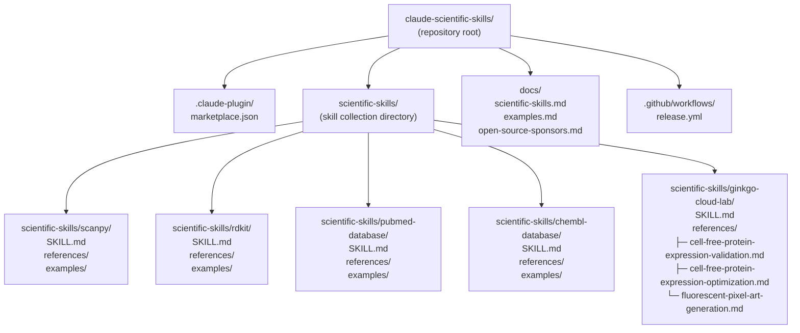

| Path | Purpose |
|------|---------|
| `.claude-plugin/marketplace.json` | Skill registry containing metadata for all 170 skills, version number (2.26.0), and plugin configuration |
| `scientific-skills/` | Root directory containing all skill folders; copied to agent skill directories during installation |
| `scientific-skills/<skill-name>/SKILL.md` | Required frontmatter + markdown documentation for each skill |
| `scientific-skills/<skill-name>/references/` | Optional detailed guides, API references, protocol documentation |
| `scientific-skills/<skill-name>/examples/` | Optional working code examples and Jupyter notebooks |
| `.github/workflows/release.yml` | Automated release pipeline triggered by marketplace.json version updates |
| `docs/scientific-skills.md` | Human-readable catalog of all skills with descriptions |

**Sources**: [README.md:117-162](), [.claude-plugin/marketplace.json:1-194]()

---

## Skill Discovery and Loading

Agents discover skills by scanning standard directories and parsing `SKILL.md` frontmatter:

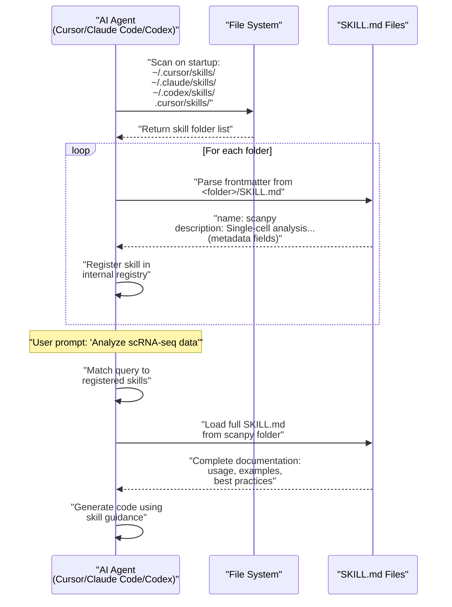

**Installation locations** (global and project-level):

| Agent | Global Directory | Project-Level Directory |
|-------|-----------------|------------------------|
| Cursor | `~/.cursor/skills/` | `.cursor/skills/` (project root) |
| Claude Code | `~/.claude/skills/` | `.claude/skills/` (project root) |
| Codex | `~/.codex/skills/` | `.codex/skills/` (project root) |

**Cross-compatibility note**: Cursor reads from `.claude/skills/` and `.codex/skills/` directories as well, and vice versa, enabling skills installed for one agent to work with others.

**Sources**: [README.md:124-162]()

---

## SKILL.md File Structure

Each skill is defined by a `SKILL.md` file with YAML frontmatter and markdown content:

```markdown
---
name: scanpy
description: Single-cell RNA-seq analysis with Scanpy for clustering, visualization, and trajectory inference
version: 1.10.0
author: K-Dense Inc.
license: MIT
compatibility: ["cursor", "claude-code", "codex"]
tools: ["python"]
---

# Scanpy

## Overview

Scanpy is a Python package for single-cell RNA-seq analysis...

## Installation

```bash
uv pip install scanpy
```

## Usage

...
```

**Required frontmatter fields:**
- `name`: Unique skill identifier
- `description`: Brief description for agent matching

**Optional frontmatter fields:**
- `version`: Skill version
- `author`: Skill creator
- `license`: License identifier
- `compatibility`: Compatible agents
- `tools`: Required tools/languages

**Markdown sections** (common patterns):
- **Overview**: Purpose and capabilities
- **Installation**: Dependency installation commands
- **Usage**: Basic usage examples
- **Advanced Topics**: Complex workflows
- **References**: Links to detailed guides in `references/` folder
- **Best Practices**: Recommended patterns

**Sources**: [README.md:60-66](), [.claude-plugin/marketplace.json:11-16]()

---

## Marketplace Registry

The `.claude-plugin/marketplace.json` file serves as the central registry:

```json
{
  "name": "claude-scientific-skills",
  "owner": {
    "name": "K-Dense Inc.",
    "email": "contact@k-dense.ai"
  },
  "metadata": {
    "description": "Claude scientific skills from K-Dense Inc",
    "version": "2.26.0"
  },
  "plugins": [
    {
      "name": "scientific-skills",
      "description": "Collection of scientific skills",
      "source": "./",
      "strict": false,
      "skills": [
        "./scientific-skills/scanpy",
        "./scientific-skills/rdkit",
        "./scientific-skills/pubmed-database",
        ...
      ]
    }
  ]
}
```

**Key fields:**

| Field | Purpose |
|-------|---------|
| `metadata.version` | Current system version (2.26.0); updating triggers automated GitHub release |
| `plugins[].skills[]` | Array of 170 relative paths to skill directories |
| `plugins[].strict` | When `false`, allows skills without complete metadata |
| `owner.name`, `owner.email` | Maintainer contact information |

The `version` field in `marketplace.json` is the **single source of truth** for releases. When updated and pushed to `main`, `.github/workflows/release.yml` automatically creates a GitHub release with that tag.

**Sources**: [.claude-plugin/marketplace.json:1-194]()

---

## Skill Organization by Domain

The 170 skills are organized into domain-specific categories:

### Python Package Skills (60+)

Skills providing curated documentation for scientific Python packages. Agents can use *any* Python package, but these provide optimized guidance.

| Domain | Example Skills | Skill Folders |
|--------|---------------|---------------|
| **Bioinformatics** | BioPython, Scanpy, scVelo, Arboreto, pysam | `biopython/`, `scanpy/`, `scvelo/`, `arboreto/`, `pysam/` |
| **Cheminformatics** | RDKit, DeepChem, DiffDock, DataMol | `rdkit/`, `deepchem/`, `diffdock/`, `datamol/` |
| **Machine Learning** | PyTorch Lightning, scikit-learn, SHAP | `pytorch-lightning/`, `scikit-learn/`, `shap/` |
| **Molecular Dynamics** | OpenMM, MDAnalysis | `molecular-dynamics/` (combined skill) |
| **Visualization** | Matplotlib, Seaborn, Plotly | `matplotlib/`, `seaborn/`, `plotly/` |

**Sources**: [README.md:52-100](), [docs/scientific-skills.md:61-200]()

### Database Skills (37+ direct → 250+ total)

Direct database skills provide optimized access patterns. Multi-database packages (BioServices, BioPython, gget) add ~213 additional databases.

| Database Type | Direct Skills | Skill Folders |
|---------------|---------------|---------------|
| **Protein** | UniProt, PDB, AlphaFold DB, InterPro | `uniprot-database/`, `pdb-database/`, `alphafold-database/`, `interpro-database/` |
| **Chemical** | ChEMBL, PubChem, DrugBank, ZINC | `chembl-database/`, `pubchem-database/`, `drugbank-database/`, `zinc-database/` |
| **Genomic** | Ensembl, NCBI Gene, GEO, gnomAD, GTEx | `ensembl-database/`, `gene-database/`, `geo-database/`, `gnomad-database/`, `gtex-database/` |
| **Clinical** | ClinVar, COSMIC, ClinicalTrials.gov | `clinvar-database/`, `cosmic-database/`, `clinicaltrials-database/` |
| **Literature** | PubMed, bioRxiv, OpenAlex | `pubmed-database/`, `biorxiv-database/`, `openalex-database/` |

**Multi-database aggregators:**
- **BioServices** (`bioservices/`): ~40 bioinformatics services + 30 PSICQUIC interaction databases = ~70 DBs
- **BioPython** (`biopython/`): 38 NCBI sub-databases via Entrez (PubMed, Gene, Protein, Nucleotide, etc.)
- **gget** (`gget/`): 20+ genomics databases (Ensembl, UniProt, PDB, BLAST, Enrichr, etc.)

**Sources**: [README.md:54-55](), [docs/scientific-skills.md:3-36]()

### Laboratory Automation Skills (4)

Skills for physical lab automation and cloud lab platforms:

| Skill | Purpose | Skill Folder | Key Features |
|-------|---------|--------------|--------------|
| **Ginkgo Cloud Lab** | Cell-free protein expression, fluorescent pixel art via RAC infrastructure | `ginkgo-cloud-lab/` | Validation: $39/sample, 5-10 days; Optimization: $199/sample, 6-11 days (24 conditions) |
| **PyLabRobot** | Liquid handling protocol development | `pylabrobot/` | Python API for liquid handling robots |
| **Opentrons** | Protocol creation for Opentrons OT-2/Flex robots | `opentrons-integration/` | Protocol API v2 for automated liquid handling |
| **Protocols.io** | Protocol management and sharing | `protocolsio-integration/` | API for protocol lifecycle management |

**Sources**: [README.md:476-479](), [scientific-skills/ginkgo-cloud-lab/SKILL.md:1-57]()

### Scientific Communication Skills (24+)

Skills for literature, writing, visualization, and documentation:

| Category | Skills | Skill Folders |
|----------|--------|---------------|
| **Literature** | PubMed, bioRxiv, OpenAlex, Literature Review | `pubmed-database/`, `biorxiv-database/`, `openalex-database/`, `literature-review/` |
| **Writing** | Scientific Writing, Peer Review, LaTeX Posters | `scientific-writing/`, `peer-review/`, `latex-posters/` |
| **Visualization** | Generate Image, Scientific Schematics, Infographics | `generate-image/`, `scientific-schematics/`, `infographics/` |
| **Documentation** | Markdown & Mermaid Writing (mandatory standard), Document Skills | `markdown-mermaid-writing/`, `document-skills/` |

**Documentation standard**: The `markdown-mermaid-writing` skill is **mandatory** for all repository documentation, providing 9 templates (research papers, how-to guides, decision records) and 2 style guides (markdown, Mermaid).

**Sources**: [README.md:492-504](), [docs/scientific-skills.md:150-200]()

### Research Methodology Skills (11+)

Skills for hypothesis generation, analysis, and funding:

| Skill | Purpose | Skill Folder |
|-------|---------|--------------|
| **Hypothesis Generation** | AI-assisted hypothesis formulation | `hypothesis-generation/` |
| **Scientific Brainstorming** | Structured ideation workflows | `scientific-brainstorming/` |
| **Consciousness Council** | Multi-perspective deliberation with devil's advocate analysis | `consciousness-council/` |
| **What-If Oracle** | Multi-branch scenario exploration and risk analysis | `what-if-oracle/` |
| **Research Grants** | Grant writing assistance | `research-grants/` |

**Sources**: [README.md:526-535]()

---

## Database Access Architecture

The system achieves 250+ database coverage through a dual strategy:

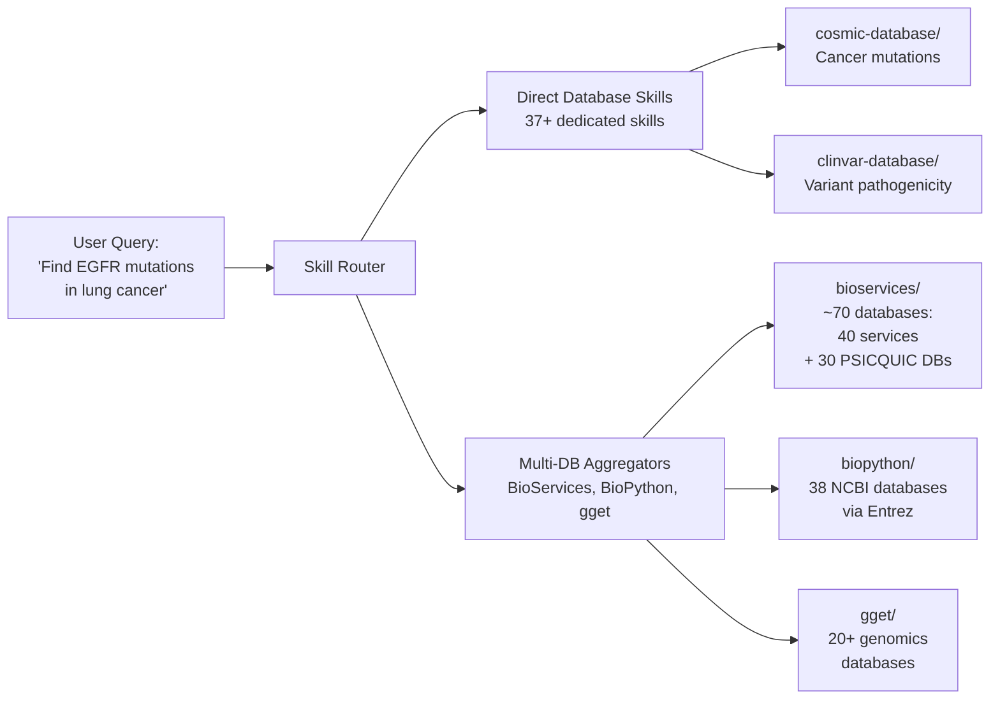

**Strategy 1: Direct Database Skills (37+)**

Curated skills for high-priority databases with detailed documentation, examples, and best practices. Examples:
- `chembl-database/`: 28M+ bioactivities, compound structures, targets
- `pubmed-database/`: 35M+ citations, MeSH terms, E-utilities API
- `cosmic-database/`: Somatic cancer mutations, mutational signatures
- `clinvar-database/`: Variant pathogenicity, clinical significance

**Strategy 2: Multi-Database Aggregators**

Skills that wrap packages providing unified access to multiple databases:
- **BioServices** (`bioservices/`): ~40 bioinformatics web services + 30 PSICQUIC protein interaction databases
- **BioPython** (`biopython/`): 38 NCBI sub-databases (PubMed, Gene, Protein, Nucleotide, dbSNP, ClinVar, etc.)
- **gget** (`gget/`): 20+ genomics databases (Ensembl, UniProt, PDB, BLAST, Enrichr, COSMIC, etc.)

**Total coverage**: 37 direct + ~70 (BioServices) + 38 (BioPython) + 20+ (gget) = **~165** unique database endpoints, with overlaps reducing to **250+** total accessible databases.

**Sources**: [README.md:54-55](), [README.md:98-99](), [docs/scientific-skills.md:3-36]()

---

## Example: Ginkgo Cloud Lab Skill

The Ginkgo Cloud Lab skill demonstrates integration with physical laboratory automation:

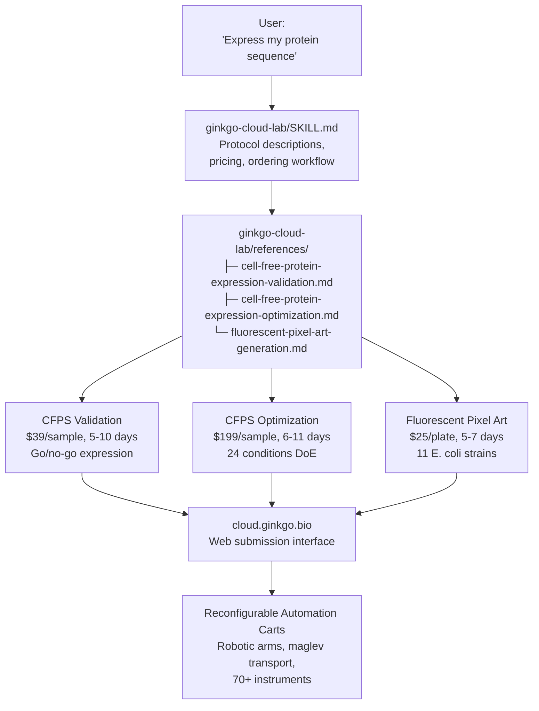

**File structure:**

| File | Purpose |
|------|---------|
| `ginkgo-cloud-lab/SKILL.md` | Overview, available protocols, ordering workflow, EstiMate AI agent |
| `references/cell-free-protein-expression-validation.md` | Validation protocol: $39/sample, 5-10 day turnaround, 3-phase automated workflow |
| `references/cell-free-protein-expression-optimization.md` | Optimization protocol: $199/sample, 6-11 days, DoE across 24 conditions |
| `references/fluorescent-pixel-art-generation.md` | Pixel art protocol: $25/plate, 5-7 days, 11 fluorescent E. coli strains |

**Key protocol parameters from references:**

| Protocol | Price/Sample | Turnaround | Input | Output |
|----------|-------------|------------|-------|--------|
| Validation | $39 | 5-10 days | FASTA (≤1800 bp) | Expression confirmation, baseline titer (mg/L), purity |
| Optimization | $199 | 6-11 days | FASTA | Comparative yield across 24 conditions, optimal formulation |
| Pixel Art | $25/plate | 5-7 days | PNG/SVG (48x48 to 96x96 px) | UV photograph of bacterial artwork |

**Sources**: [scientific-skills/ginkgo-cloud-lab/SKILL.md:1-57](), [scientific-skills/ginkgo-cloud-lab/references/cell-free-protein-expression-validation.md:1-72](), [scientific-skills/ginkgo-cloud-lab/references/cell-free-protein-expression-optimization.md:1-86](), [scientific-skills/ginkgo-cloud-lab/references/fluorescent-pixel-art-generation.md:1-88]()

---

## Version Control and Releases

The system uses automated releases triggered by `marketplace.json` updates:

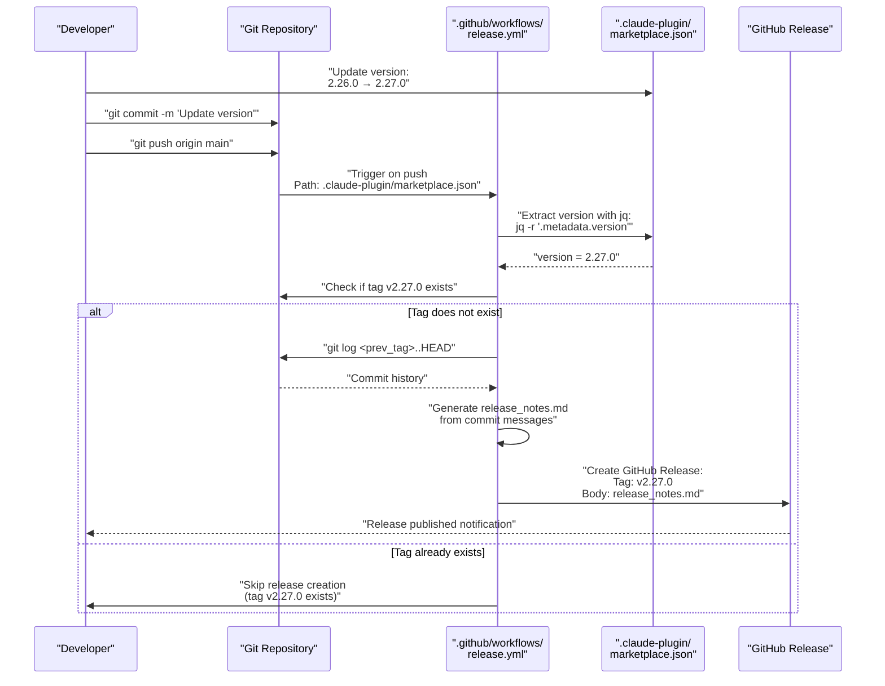

**Key files:**

| File | Purpose |
|------|---------|
| `.claude-plugin/marketplace.json` | Single source of truth for version number (line 9: `"version": "2.26.0"`) |
| `.github/workflows/release.yml` | Automated release pipeline using GitHub Actions |

**Release process:**
1. Developer updates `metadata.version` in `marketplace.json`
2. Commit and push to `main` branch
3. GitHub Actions workflow triggers on path `.claude-plugin/marketplace.json`
4. Workflow extracts version using `jq -r '.metadata.version'`
5. Checks if corresponding Git tag exists
6. If tag doesn't exist, generates release notes from commit history
7. Creates GitHub Release with tag and release notes

**Sources**: [.claude-plugin/marketplace.json:9]()

---

## System Statistics

| Metric | Count | Details |
|--------|-------|---------|
| **Total Skills** | 170 | Registered in marketplace.json |
| **Python Package Skills** | 60+ | Optimized documentation for scientific packages |
| **Database Skills** | 37+ direct → 250+ total | Direct skills + multi-database aggregators |
| **Laboratory Automation** | 4 | Ginkgo Cloud Lab, PyLabRobot, Opentrons, Protocols.io |
| **Communication Skills** | 24+ | Literature, writing, visualization, documentation |
| **Current Version** | 2.26.0 | From marketplace.json metadata.version |
| **Supported Agents** | 3+ | Cursor, Claude Code, Codex (any Agent Skills-compatible tool) |
| **Repository License** | MIT | Individual skills may have different licenses |

**Domain breakdown:**

| Domain | Skill Count | Example Skills |
|--------|-------------|----------------|
| Bioinformatics & Genomics | 20+ | Scanpy, BioPython, scVelo, Arboreto, TileDB-VCF |
| Cheminformatics | 13+ | RDKit, DeepChem, DiffDock, OpenMM, DataMol |
| Clinical Research | 16+ | ClinVar, COSMIC, cBioPortal, DepMap, Imaging Data Commons |
| Machine Learning | 16+ | PyTorch Lightning, scikit-learn, TimesFM, SHAP |
| Geospatial | 1+ | GeoMaster (remote sensing, GIS, spatial ML) |
| Laboratory Automation | 4 | Ginkgo Cloud Lab, PyLabRobot, Opentrons, Protocols.io |
| Scientific Databases | 37+ | PubMed, ChEMBL, UniProt, AlphaFold DB, KEGG |
| Communication | 24+ | Scientific Writing, LaTeX Posters, Generate Image |
| Research Methodology | 11+ | Hypothesis Generation, Consciousness Council, What-If Oracle |
| Financial & Economic | 5 | edgartools, usfiscaldata, FRED, alpha-vantage |

**Sources**: [README.md:52-59](), [.claude-plugin/marketplace.json:1-194](), [docs/scientific-skills.md:1-200]()

---

## Related Pages

For deeper technical information, see:

- **Installation**: [Installation and Setup](#2.1)
- **Architecture**: [Core Architecture](#3) - Three-tier model, skill discovery, marketplace system
- **Skill Anatomy**: [SKILL.md Anatomy and Structure](#3.4) - Frontmatter schema and content structure
- **Documentation Standards**: [Documentation Standards](#3.5) - Markdown-mermaid-writing mandatory standard
- **Domain Details**: [Scientific Domains](#4) - Deep dives into each domain
- **Database Access**: [Scientific Databases](#5) - Multi-strategy database architecture
- **Workflows**: [Multi-Domain Workflows](#8) - End-to-end workflow examples
- **Contributing**: [Creating New Skills](#9.3) - Skill authoring guide
- **Reference**: [Complete Skill Catalog](#10.1) - Alphabetical listing of all skills

**Sources**: [README.md:69-86]()

---

# Page: Getting Started

# Getting Started

<details>
<summary>Relevant source files</summary>

The following files were used as context for generating this wiki page:

- [.claude-plugin/marketplace.json](.claude-plugin/marketplace.json)
- [README.md](README.md)
- [docs/scientific-skills.md](docs/scientific-skills.md)
- [scientific-skills/ginkgo-cloud-lab/SKILL.md](scientific-skills/ginkgo-cloud-lab/SKILL.md)
- [scientific-skills/ginkgo-cloud-lab/references/cell-free-protein-expression-optimization.md](scientific-skills/ginkgo-cloud-lab/references/cell-free-protein-expression-optimization.md)
- [scientific-skills/ginkgo-cloud-lab/references/cell-free-protein-expression-validation.md](scientific-skills/ginkgo-cloud-lab/references/cell-free-protein-expression-validation.md)
- [scientific-skills/ginkgo-cloud-lab/references/fluorescent-pixel-art-generation.md](scientific-skills/ginkgo-cloud-lab/references/fluorescent-pixel-art-generation.md)

</details>


This page provides step-by-step instructions for installing Claude Scientific Skills and running your first scientific workflow. By the end of this guide, you will have 170+ scientific skills installed and ready to use with any Agent Skills-compatible AI agent.

For detailed installation instructions including troubleshooting, see [Installation and Setup](#2.1). For a comprehensive walkthrough of building multi-step workflows, see [Your First Scientific Workflow](#2.2).

---

## Prerequisites

Before installing Claude Scientific Skills, ensure your system meets the following requirements:

| Requirement | Specification | Notes |
|-------------|--------------|-------|
| **Python** | 3.9+ (3.12+ recommended) | Required for skill dependencies |
| **uv** | Latest version | Python package manager used by skills |
| **AI Agent** | Cursor, Claude Code, or Codex | Any [Agent Skills](https://agentskills.io/) standard-compatible tool |
| **Operating System** | macOS, Linux, or Windows with WSL2 | Cross-platform support |
| **Git** | Any version | For cloning the repository |

### Installing uv Package Manager

The skills use `uv` for dependency management. Install it using the appropriate command for your system:

**macOS and Linux:**
```bash
curl -LsSf https://astral.sh/uv/install.sh | sh
```

**Windows:**
```powershell
powershell -ExecutionPolicy ByPass -c "irm https://astral.sh/uv/install.ps1 | iex"
```

**Alternative (via pip):**
```bash
pip install uv
```

Verify installation:
```bash
uv --version
```

**Sources:** [README.md:180-213]()

---

## Installation Overview

Claude Scientific Skills uses a **write-once, use-everywhere** installation model. Copy skill folders to standard directories, and all Agent Skills-compatible tools automatically discover them.

### Installation Flow

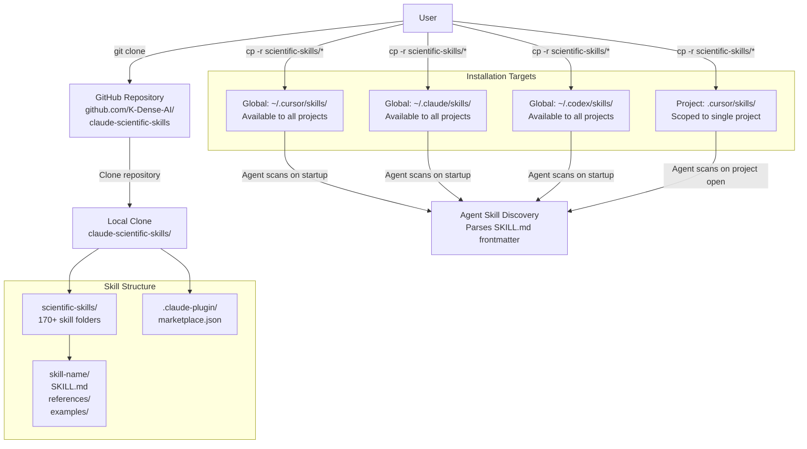

**Sources:** [README.md:113-162](), Diagram 2 from high-level architecture

---

## Step 1: Clone the Repository

Clone the Claude Scientific Skills repository to your local machine:

```bash
git clone https://github.com/K-Dense-AI/claude-scientific-skills.git
cd claude-scientific-skills
```

This creates a directory containing:
- `scientific-skills/` - 170+ skill folders, each containing [SKILL.md](), [references/](), and [examples/]()
- `.claude-plugin/marketplace.json` - Skill registry with metadata [.claude-plugin/marketplace.json:1-194]()
- `docs/` - Documentation files
- `README.md` - Repository overview

**Sources:** [README.md:117-121]()

---

## Step 2: Choose Installation Location

Skills can be installed **globally** (available to all projects) or **per-project** (scoped to a single project).

### Global Installation (Recommended)

Copy skills to your home directory. They will be available in all projects:

| Tool | Directory Path |
|------|----------------|
| **Cursor** | `~/.cursor/skills/` |
| **Claude Code** | `~/.claude/skills/` |
| **Codex** | `~/.codex/skills/` |

**Example — Global install for Cursor:**
```bash
cp -r claude-scientific-skills/scientific-skills/* ~/.cursor/skills/
```

**Example — Global install for Claude Code:**
```bash
cp -r claude-scientific-skills/scientific-skills/* ~/.claude/skills/
```

### Project-Level Installation

Copy skills to a `.cursor/skills/`, `.claude/skills/`, or `.codex/skills/` directory in your project root. They will only be available in that project:

```bash
mkdir -p .cursor/skills
cp -r /path/to/claude-scientific-skills/scientific-skills/* .cursor/skills/
```

### Cross-Tool Compatibility

Cursor also reads from `.claude/skills/` and `.codex/skills/` directories, and vice versa. Skills installed for one tool are automatically available to others.

**Sources:** [README.md:123-162]()

---

## Step 3: Verify Installation

After copying skills to your chosen directory, restart your AI agent (Cursor IDE, Claude Code, etc.) to trigger skill discovery.

### Skill Discovery Mechanism

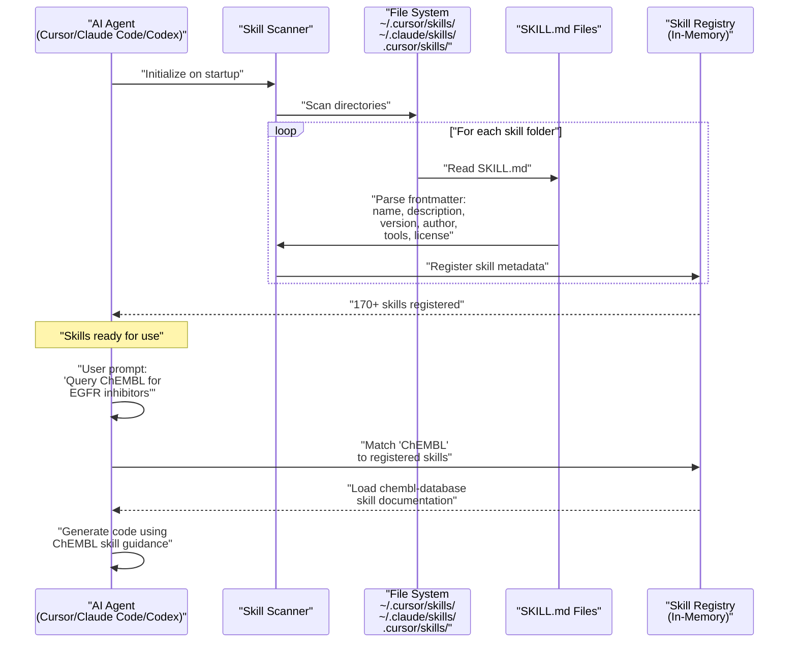

**Sources:** [README.md:113-162](), Diagram 2 from high-level architecture

### Verification Steps

1. **In Cursor IDE:**
   - Open Settings → Rules
   - Verify that skill folders appear in the discovered rules list
   - Look for entries like "scanpy", "chembl-database", "pytorch-lightning"

2. **Test with a simple prompt:**
   - Open a new chat session
   - Type: "List the scientific skills you have access to"
   - The agent should enumerate available skills

3. **Check skill loading:**
   - Each skill folder must contain a `SKILL.md` file with valid frontmatter [README.md:627-628]()
   - Verify directory structure: `skill-name/SKILL.md`, `skill-name/references/`, `skill-name/examples/`

**Sources:** [README.md:623-629]()

---

## Step 4: Understanding SKILL.md Structure

Each skill is defined by a `SKILL.md` file with YAML frontmatter. The agent parses this metadata during discovery:

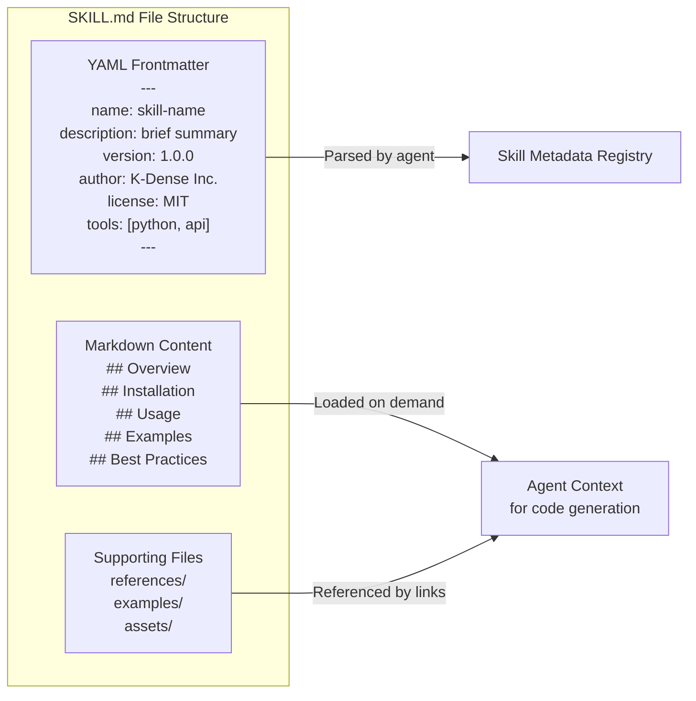

### Example: ChEMBL Database Skill

```yaml
---
name: chembl-database
description: Query ChEMBL database for bioactive molecules, bioactivity data, targets, assays, and drug discovery information via REST API
version: 1.2.0
author: K-Dense Inc.
license: MIT
tools: [python, api]
---
```

The agent uses:
- **name** - Skill identifier for matching user prompts
- **description** - Determines when skill is relevant to user queries
- **tools** - Filters skills by required technology (python, api, etc.)

**Sources:** For complete SKILL.md specification, see [SKILL.md Anatomy and Structure](#3.4)

---

## Step 5: Your First Query

Once skills are installed, the agent automatically matches user prompts to relevant skills and loads their documentation.

### Prompt → Skill Mapping

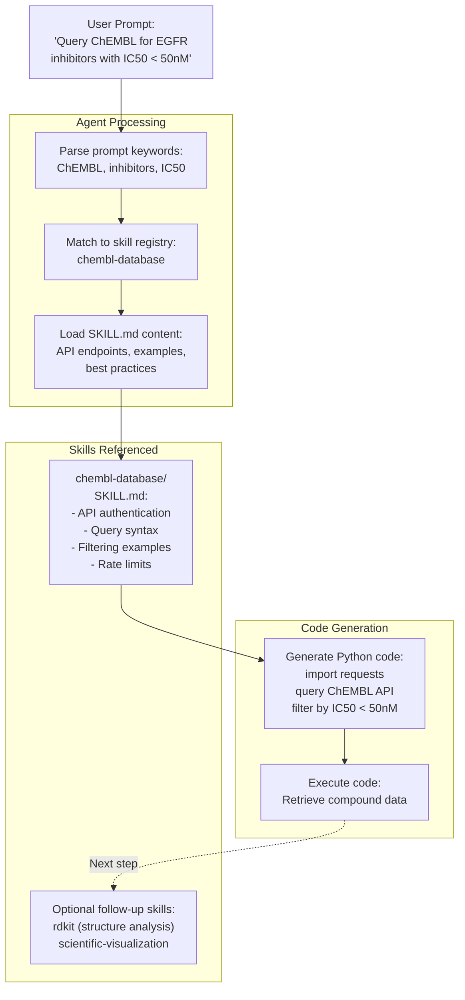

**Sources:** [README.md:216-251]()

### Example Workflow: Query ChEMBL Database

**Prompt:**
```
Query ChEMBL for EGFR inhibitors with IC50 < 50nM. 
Show compound structures and bioactivity data.
```

**Agent Response:**
The agent will:
1. Recognize "ChEMBL" and load [scientific-skills/chembl-database/SKILL.md]()
2. Parse API endpoint documentation from the skill
3. Generate code using ChEMBL REST API to query compounds
4. Filter results by IC50 < 50nM
5. Optionally use [scientific-skills/rdkit/SKILL.md]() for structure visualization

**Expected Output:**
- Python code using `requests` library to query ChEMBL API
- DataFrame with compound IDs, SMILES strings, IC50 values, targets
- Optional: Chemical structure visualization using RDKit

**Sources:** [README.md:216-251]()

---

## Step 6: Multi-Skill Workflows

The power of Claude Scientific Skills emerges when chaining multiple skills together.

### Example: Drug Discovery Pipeline

**Prompt:**
```
Use available skills you have access to whenever possible. 
Query ChEMBL for EGFR inhibitors (IC50 < 50nM), analyze 
structure-activity relationships with RDKit, and search PubMed 
for resistance mechanisms.
```

**Skills Used:**
1. **chembl-database** [scientific-skills/chembl-database/]() - Query bioactivity data
2. **rdkit** [scientific-skills/rdkit/]() - Molecular structure analysis
3. **pubmed-database** [scientific-skills/pubmed-database/]() - Literature search

**Workflow:**
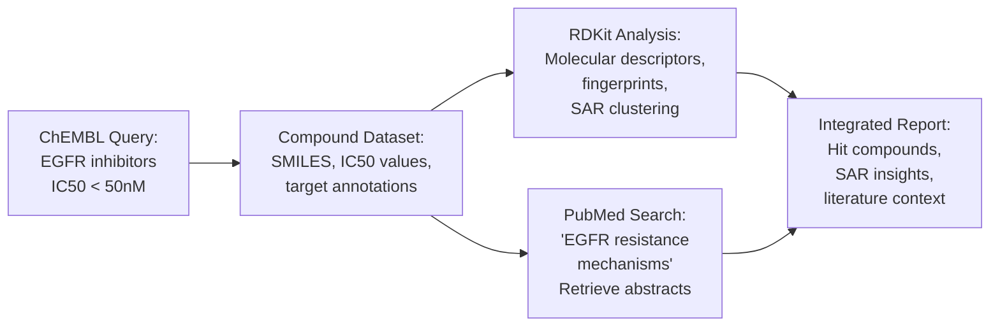

**Sources:** [README.md:220-232]()

---

## Skill Categories

The 170+ skills are organized into domains. You can invoke any skill by mentioning its name or domain in your prompt:

| Domain | Skill Count | Example Skills |
|--------|-------------|----------------|
| **Bioinformatics & Genomics** | 20+ | scanpy, biopython, arboreto, scvelo, tiledbvcf |
| **Cheminformatics & Drug Discovery** | 13+ | rdkit, deepchem, diffdock, openmm, datamol |
| **Clinical Research** | 16+ | clinvar, cosmic, cbioportal, depmap |
| **Machine Learning & AI** | 16+ | pytorch-lightning, scikit-learn, timesfm-forecasting |
| **Scientific Databases** | 37+ direct skills<br/>250+ databases total | chembl, pubmed, uniprot, alphafold-database |
| **Laboratory Automation** | 4 | ginkgo-cloud-lab, opentrons, pylabrobot |
| **Scientific Communication** | 24+ | scientific-writing, latex-posters, generate-image |

**Sources:** [README.md:50-59](), [docs/scientific-skills.md:1-546]()

---

## Package Installation for Skills

Individual skills may require Python packages. The agent will:
1. Detect missing packages when generating code
2. Suggest installation commands using `uv`
3. Install dependencies automatically (if configured)

**Manual installation example:**
```bash
# Install packages for Scanpy skill
uv pip install scanpy anndata

# Install packages for RDKit skill
uv pip install rdkit

# Install packages for multiple skills
uv pip install scanpy rdkit biopython
```

Each `SKILL.md` file documents required packages in its Installation section.

**Sources:** [README.md:630-637]()

---

## Next Steps

Now that skills are installed, explore the following:

1. **[Your First Scientific Workflow](#2.2)** - Step-by-step tutorial building a complete analysis pipeline
2. **[Core Architecture](#3)** - Understand how the skill system works under the hood
3. **[Scientific Domains](#4)** - Explore skills organized by scientific field
4. **[Complete Skill Catalog](#10.1)** - Browse all 170+ available skills
5. **[Multi-Domain Workflows](#8)** - See advanced examples combining multiple skills

### Quick Reference Commands

```bash
# Clone repository
git clone https://github.com/K-Dense-AI/claude-scientific-skills.git

# Global install for Cursor
cp -r claude-scientific-skills/scientific-skills/* ~/.cursor/skills/

# Verify uv installation
uv --version

# Install skill dependencies
uv pip install package-name

# Update skills (pull latest changes)
cd claude-scientific-skills
git pull
cp -r scientific-skills/* ~/.cursor/skills/
```

**Sources:** [README.md:113-213]()

---

## Troubleshooting

### Skills Not Loading

**Problem:** Agent does not recognize installed skills

**Solutions:**
- Verify skill folders are in correct directory [README.md:625-629]()
- Each skill folder must contain `SKILL.md` with valid frontmatter
- Restart your AI agent/IDE after copying skills
- In Cursor, check Settings → Rules to confirm skills are discovered

### Missing Dependencies

**Problem:** Code fails with `ModuleNotFoundError`

**Solutions:**
- Check skill's `SKILL.md` for required packages
- Install using: `uv pip install package-name`
- Some skills access external APIs without requiring local packages

### API Authentication Errors

**Problem:** Database queries fail with authentication errors

**Solutions:**
- Some services require API keys (check skill documentation)
- Many databases (PubMed, ChEMBL, UniProt) provide free public APIs
- Set environment variables for API keys when required

**Sources:** [README.md:621-646]()

---

## Marketplace Configuration

The skill registry is defined in [.claude-plugin/marketplace.json:1-194](). This file contains:

- **name** - Plugin package identifier: `"claude-scientific-skills"`
- **owner** - K-Dense Inc. contact information
- **metadata.version** - Current version: `"2.26.0"` [.claude-plugin/marketplace.json:9]()
- **plugins[].skills[]** - Array of 170+ skill paths

When you update the repository (`git pull`), the marketplace version increments, triggering automated releases via [.github/workflows/release.yml](). For details on the release system, see [Release Automation and Versioning](#9.2).

**Sources:** [.claude-plugin/marketplace.json:1-194]()

---

# Page: Installation and Setup

# Installation and Setup

<details>
<summary>Relevant source files</summary>

The following files were used as context for generating this wiki page:

- [.claude-plugin/marketplace.json](.claude-plugin/marketplace.json)
- [.gitignore](.gitignore)
- [README.md](README.md)
- [docs/scientific-skills.md](docs/scientific-skills.md)
- [scientific-skills/ginkgo-cloud-lab/SKILL.md](scientific-skills/ginkgo-cloud-lab/SKILL.md)
- [scientific-skills/ginkgo-cloud-lab/references/cell-free-protein-expression-optimization.md](scientific-skills/ginkgo-cloud-lab/references/cell-free-protein-expression-optimization.md)
- [scientific-skills/ginkgo-cloud-lab/references/cell-free-protein-expression-validation.md](scientific-skills/ginkgo-cloud-lab/references/cell-free-protein-expression-validation.md)
- [scientific-skills/ginkgo-cloud-lab/references/fluorescent-pixel-art-generation.md](scientific-skills/ginkgo-cloud-lab/references/fluorescent-pixel-art-generation.md)

</details>


## Purpose and Scope

This page provides detailed instructions for installing and configuring Claude Scientific Skills across all supported platforms. It covers prerequisite software installation, the three primary integration methods (Claude Code, Cursor IDE, and generic MCP clients), plugin structure, environment configuration, and dependency management.

For information about running your first workflow after installation, see [Your First Scientific Workflow](#2.2). For technical details on the plugin distribution architecture, see [Plugin and Distribution Model](#3.1). For troubleshooting installation issues, see [Troubleshooting and FAQ](#16.3).

---

## Prerequisites

### Required Software

| Component | Version | Purpose |
|-----------|---------|---------|
| **Python** | 3.9+ (3.12+ recommended) | Runtime for all 138 scientific skills |
| **uv** | Latest | Package manager for skill dependencies |
| **Client** | Claude Code, Cursor, or MCP-compatible | Interface to Claude AI orchestration |

### System Requirements

- **Operating Systems**: macOS, Linux, or Windows with WSL2
- **Disk Space**: ~5GB for skill dependencies (installed on-demand)
- **Internet Access**: Required for database skills and initial setup

---

## Installing Python

Claude Scientific Skills requires Python 3.9 or higher, with 3.12+ recommended for optimal compatibility.

**Verify existing installation:**
```bash
python --version
# or
python3 --version
```

**Installation (if needed):**
- **macOS**: `brew install python@3.12`
- **Ubuntu/Debian**: `sudo apt install python3.12`
- **Windows**: Download from [python.org](https://www.python.org/downloads/)

---

## Installing uv Package Manager

The `uv` package manager is required for automatic dependency installation when skills are first invoked. It provides significantly faster package installation compared to `pip`.

### Installation Commands

**macOS and Linux:**
```bash
curl -LsSf https://astral.sh/uv/install.sh | sh
```

**Windows:**
```powershell
powershell -ExecutionPolicy ByPass -c "irm https://astral.sh/uv/install.ps1 | iex"
```

**Alternative (via pip):**
```bash
pip install uv
```

### Verification

```bash
uv --version
```

Expected output: `uv X.Y.Z` (version number varies)

Sources: [README.md:173-197]()

---

## Installation Method Overview

Claude Scientific Skills supports three integration pathways, each optimized for different use cases:

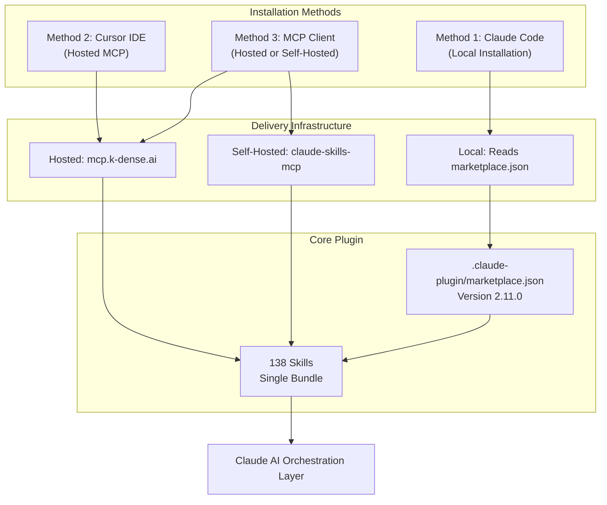

**Installation Method Comparison**

| Feature | Claude Code | Cursor IDE | MCP Client |
|---------|-------------|------------|------------|
| **Installation Time** | 2-5 minutes | 1-click | Varies |
| **Local Files** | Yes (marketplace.json) | No | No (hosted) / Yes (self-hosted) |
| **Automatic Updates** | Manual plugin update | Automatic | Automatic (hosted) |
| **Offline Skills** | Package skills only | No | No (hosted) |
| **Customization** | Full | Limited | Full (self-hosted) |
| **Best For** | Primary development | Quick evaluation | Integration into existing workflows |

Sources: [README.md:99-163](), [.claude-plugin/marketplace.json:1-160]()

---

## Method 1: Claude Code (Local Installation)

This is the recommended installation method, providing full local control and the best performance for package-based skills.

### Installation Flow Diagram

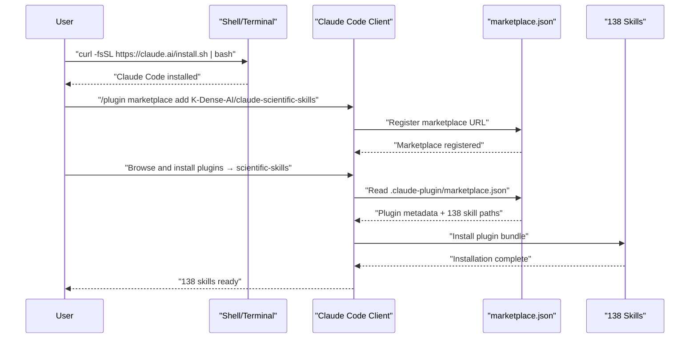

### Step 1: Install Claude Code

**macOS:**
```bash
curl -fsSL https://claude.ai/install.sh | bash
```

**Windows:**
```powershell
irm https://claude.ai/install.ps1 | iex
```

This downloads and installs the Claude Code client executable.

**Verification:**
```bash
claude --version
```

### Step 2: Register the Marketplace

Execute the following command in Claude Code or your terminal:

```bash
/plugin marketplace add K-Dense-AI/claude-scientific-skills
```

This command registers the GitHub repository URL `https://github.com/K-Dense-AI/claude-scientific-skills` as a plugin marketplace source.

**What happens internally:**
- Claude Code stores the marketplace URL in its configuration
- The client periodically checks for updates to [.claude-plugin/marketplace.json:1-160]()
- The marketplace registry becomes available in the plugin browser

### Step 3: Install the Plugin Bundle

1. Open Claude Code
2. Navigate to **Browse and install plugins**
3. Locate **claude-scientific-skills** marketplace
4. Select **scientific-skills** plugin
5. Click **Install now**

**What happens during installation:**
- Claude Code reads [.claude-plugin/marketplace.json:1-160]()
- Parses the `plugins` array containing the single `scientific-skills` bundle
- Reads the `skills` array listing 138 skill paths from [.claude-plugin/marketplace.json:17-157]()
- Downloads all skill directories to local cache
- Registers skills for Claude AI discovery

### Plugin Structure

The [.claude-plugin/marketplace.json]() file defines the entire plugin structure:

```json
{
  "name": "claude-scientific-skills",
  "owner": {
    "name": "K-Dense Inc.",
    "email": "contact@k-dense.ai"
  },
  "metadata": {
    "description": "Claude scientific skills from K-Dense Inc",
    "version": "2.11.0"
  },
  "plugins": [
    {
      "name": "scientific-skills",
      "description": "Collection of scientific skills",
      "source": "./",
      "strict": false,
      "skills": [
        "./scientific-skills/adaptyv",
        "./scientific-skills/aeon",
        ...138 total skill paths...
      ]
    }
  ]
}
```

**Key fields:**
- **`version`**: Current plugin version (2.11.0), incremented with updates
- **`source`**: Root directory containing all skills (`./`)
- **`strict: false`**: Allows flexible skill loading
- **`skills`**: Array of 138 relative paths to skill directories

### Verification

After installation, verify that skills are accessible:

```bash
# In Claude Code, test a simple skill:
Ask Claude: "Use the matplotlib skill to create a simple plot"
```

If successful, Claude will automatically discover and use the `matplotlib` skill.

Sources: [README.md:103-134](), [.claude-plugin/marketplace.json:1-160]()

---

## Method 2: Cursor IDE (Hosted MCP)

Cursor IDE integration uses a hosted Model Context Protocol (MCP) server, eliminating local installation requirements.

### One-Click Installation

Click the deep link button in the [README.md:141-147]():

```
https://cursor.com/en-US/install-mcp?name=claude-scientific-skills&config=eyJ1cmwiOiJodHRwczovL21jcC5rLWRlbnNlLmFpL2NsYXVkZS1zY2llbnRpZmljLXNraWxscy9tY3AifQ%3D%3D
```

### Deep Link Parameters

The deep link encodes configuration in base64:

**Decoded configuration:**
```json
{
  "url": "https://mcp.k-dense.ai/claude-scientific-skills/mcp"
}
```

**What happens during installation:**
1. Cursor IDE opens with installation prompt
2. User confirms MCP server connection
3. Cursor adds the hosted MCP endpoint to its configuration
4. All 138 skills become available through the MCP protocol

### Architecture Diagram

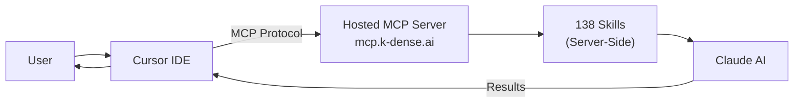

### Verification

In Cursor IDE:
1. Open a new chat
2. Type: "List available scientific skills"
3. Claude should enumerate skills from the MCP server

Sources: [README.md:138-148]()

---

## Method 3: MCP Client Integration

Generic MCP-compatible clients (ChatGPT Desktop, Google ADK, OpenAI Agent SDK, etc.) can connect to either the hosted or self-hosted MCP server.

### Option A: Hosted MCP Server (Easiest)

**Server URL:**
```
https://mcp.k-dense.ai/claude-scientific-skills/mcp
```

**Configuration in MCP clients:**

Most MCP clients use a configuration file (e.g., `mcp_config.json`):

```json
{
  "mcpServers": {
    "claude-scientific-skills": {
      "url": "https://mcp.k-dense.ai/claude-scientific-skills/mcp",
      "type": "sse"
    }
  }
}
```

**Protocol:** Server-Sent Events (SSE) for real-time communication

### Option B: Self-Hosted MCP Server

For organizations requiring on-premises deployment or customization, deploy the [claude-skills-mcp](https://github.com/K-Dense-AI/claude-skills-mcp) server.

**Deployment steps:**
1. Clone the repository
2. Configure server with skill paths
3. Deploy to infrastructure (Docker, Kubernetes, cloud VM)
4. Point MCP client to your server URL

**Architecture comparison:**

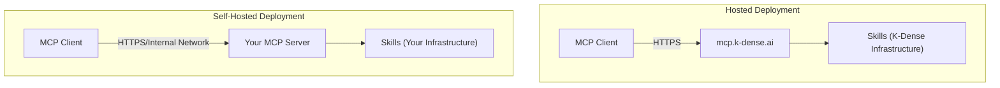

Sources: [README.md:151-162]()

---

## Plugin Structure and Skill Discovery

### Directory Structure

After installation, the plugin has the following structure:

```
claude-scientific-skills/
├── .claude-plugin/
│   └── marketplace.json          # Plugin registry (version 2.11.0)
├── scientific-skills/
│   ├── adaptyv/
│   │   ├── SKILL.md             # Skill documentation
│   │   ├── scripts/             # Executable scripts
│   │   ├── references/          # Reference materials
│   │   └── assets/              # Supporting files
│   ├── rdkit/
│   │   ├── SKILL.md
│   │   └── ...
│   ├── scanpy/
│   │   ├── SKILL.md
│   │   └── ...
│   └── ... (138 total skill directories)
└── README.md
```

### Skill Discovery Mechanism

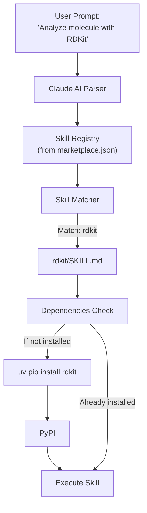

**Discovery process:**
1. User provides natural language prompt
2. Claude AI parses prompt and identifies keywords (e.g., "RDKit", "molecule")
3. Claude searches the skill registry from [.claude-plugin/marketplace.json:17-157]()
4. Matches prompt intent to skill name and description in `SKILL.md`
5. Claude selects appropriate skill(s) for execution

**Skill metadata location:**
- Each skill has a `SKILL.md` frontmatter with `name` and `description` fields
- Example from [scientific-skills/generate-image/SKILL.md:1-4]():
  ```yaml
  ---
  name: generate-image
  description: Generate or edit images using AI models...
  ---
  ```

Sources: [.claude-plugin/marketplace.json:1-160](), [scientific-skills/generate-image/SKILL.md:1-7]()

---

## Environment Configuration

### API Keys for External Services

Many skills require API keys for external services. These are configured via environment variables or `.env` files.

### Configuration Methods

**Method 1: `.env` File (Recommended)**

Create a `.env` file in your project directory or parent directories:

```bash
# .env
OPENROUTER_API_KEY=your-openrouter-key-here
PUBMED_API_KEY=your-ncbi-api-key
# Add other API keys as needed
```

**Method 2: Environment Variables**

```bash
export OPENROUTER_API_KEY=your-openrouter-key-here
export PUBMED_API_KEY=your-ncbi-api-key
```

### API Key Detection

Skills automatically detect API keys using a search pattern. Example from [scientific-skills/generate-image/scripts/generate_image.py:22-36]():

```python
def check_env_file() -> Optional[str]:
    """Check if .env file exists and contains OPENROUTER_API_KEY."""
    current_dir = Path.cwd()
    for parent in [current_dir] + list(current_dir.parents):
        env_file = parent / ".env"
        if env_file.exists():
            with open(env_file, 'r') as f:
                for line in f:
                    if line.startswith('OPENROUTER_API_KEY='):
                        api_key = line.split('=', 1)[1].strip()
                        return api_key
    return None
```

**Search order:**
1. Current working directory
2. Parent directories (recursive)
3. Environment variables

### Required API Keys by Skill Category

| Skill Category | Required API Keys | Where to Obtain |
|----------------|-------------------|-----------------|
| **Image Generation** | `OPENROUTER_API_KEY` | https://openrouter.ai/keys |
| **PubMed Database** | `PUBMED_API_KEY` (optional) | https://www.ncbi.nlm.nih.gov/account/ |
| **ChEMBL Database** | None (public API) | - |
| **UniProt Database** | None (public API) | - |
| **OpenRouter LLMs** | `OPENROUTER_API_KEY` | https://openrouter.ai/keys |
| **Perplexity Search** | `OPENROUTER_API_KEY` | https://openrouter.ai/keys |

### Error Handling

If an API key is missing, skills provide clear error messages. Example from [scientific-skills/generate-image/scripts/generate_image.py:105-112]():

```python
if not api_key:
    print("❌ Error: OPENROUTER_API_KEY not found!")
    print("\nPlease create a .env file in your project directory with:")
    print("OPENROUTER_API_KEY=your-api-key-here")
    print("\nOr set the environment variable:")
    print("export OPENROUTER_API_KEY=your-api-key-here")
    print("\nGet your API key from: https://openrouter.ai/keys")
    sys.exit(1)
```

Sources: [scientific-skills/generate-image/SKILL.md:42-52](), [scientific-skills/generate-image/scripts/generate_image.py:22-112]()

---

## Dependency Management with uv

### Lazy Installation Philosophy

Dependencies are **not installed during plugin installation**. Instead, they are installed on-demand when a skill is first invoked, minimizing initial setup time and disk usage.

### Installation Workflow

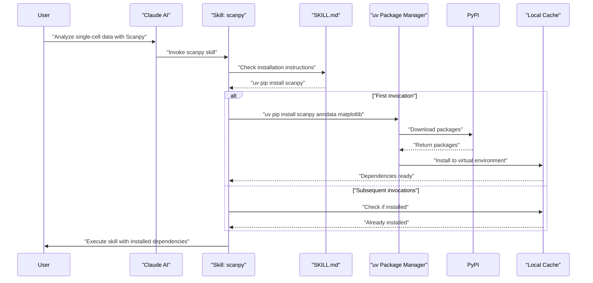

### Dependency Declaration

Each skill's `SKILL.md` file contains installation instructions. Skills check for dependencies and install them if missing.

**Example from a typical skill:**

```markdown
## Installation

```bash
uv pip install scanpy anndata matplotlib numpy pandas scipy
```

### Virtual Environment Management

`uv` automatically creates and manages isolated Python virtual environments:

- **Location**: Typically in `~/.local/share/uv/` or project-specific `.venv/`
- **Isolation**: Each skill's dependencies are isolated
- **Caching**: Downloaded packages are cached for fast reinstallation

### Dependency Resolution Speed

`uv` provides significant performance improvements over traditional `pip`:

- **Cold install**: ~5-10x faster than `pip`
- **Cached install**: Near-instantaneous
- **Conflict resolution**: Faster dependency graph solving

### Verification of Dependency Installation

After first skill invocation, verify dependencies:

```bash
uv pip list
```

Expected output includes packages like:
```
scanpy    1.9.x
anndata   0.9.x
matplotlib 3.7.x
...
```

Sources: [README.md:173-197]()

---

## Verification Steps

### Post-Installation Checklist

| Step | Command/Action | Expected Result |
|------|----------------|-----------------|
| 1. Python version | `python --version` | `Python 3.9+` |
| 2. uv installed | `uv --version` | `uv X.Y.Z` |
| 3. Claude Code | `claude --version` | Version number |
| 4. Plugin installed | Check Claude Code plugin list | `scientific-skills` present |
| 5. First skill test | Ask Claude to use any skill | Successful execution |

### Test Simple Skill

**Matplotlib visualization test:**

Prompt Claude:
```
Use the matplotlib skill to create a simple sine wave plot and save it as test_plot.png
```

**Expected behavior:**
1. Claude identifies `matplotlib` skill
2. Installs dependencies (if first use): `uv pip install matplotlib numpy`
3. Generates Python script
4. Executes script
5. Saves `test_plot.png`
6. Returns success message

**Verification:**
```bash
ls -lh test_plot.png
file test_plot.png  # Should show: PNG image data
```

### Test Database Skill

**PubMed query test:**

Prompt Claude:
```
Use the pubmed-database skill to search for recent papers on CRISPR (last 5 results)
```

**Expected behavior:**
1. Claude identifies `pubmed-database` skill
2. No dependencies to install (uses requests library)
3. Queries PubMed E-utilities API
4. Returns list of 5 recent papers with PMIDs, titles, authors

### Test Skill with Dependencies

**RDKit molecule test:**

Prompt Claude:
```
Use rdkit to parse the SMILES string 'CCO' (ethanol) and calculate its molecular weight
```

**Expected behavior:**
1. Claude identifies `rdkit` skill
2. First use: `uv pip install rdkit` (may take 30-60 seconds)
3. Subsequent uses: Instantaneous
4. Parses SMILES
5. Returns molecular weight: ~46.07 g/mol

Sources: [docs/examples.md:201-293]()

---

## Troubleshooting

### Common Installation Issues

#### Issue 1: `uv: command not found`

**Symptoms:**
```bash
bash: uv: command not found
```

**Solution:**
```bash
# Re-run installation
curl -LsSf https://astral.sh/uv/install.sh | sh

# Add to PATH (if needed)
export PATH="$HOME/.cargo/bin:$PATH"

# Verify
uv --version
```

#### Issue 2: Plugin Not Appearing in Claude Code

**Symptoms:** After running `/plugin marketplace add`, the plugin doesn't appear in the browser.

**Solution:**
1. Verify marketplace URL:
   ```bash
   /plugin marketplace list
   ```
   Should show: `K-Dense-AI/claude-scientific-skills`

2. Refresh plugin list:
   ```bash
   /plugin marketplace refresh
   ```

3. Check [.claude-plugin/marketplace.json]() is accessible at:
   ```
   https://github.com/K-Dense-AI/claude-scientific-skills/blob/main/.claude-plugin/marketplace.json
   ```

#### Issue 3: Skill Fails with `ModuleNotFoundError`

**Symptoms:**
```python
ModuleNotFoundError: No module named 'rdkit'
```

**Solution:**
```bash
# Manually install the missing dependency
uv pip install rdkit

# Or install all dependencies for a skill
cd scientific-skills/rdkit/
uv pip install -r requirements.txt  # if requirements.txt exists
```

#### Issue 4: MCP Connection Timeout (Cursor/MCP Clients)

**Symptoms:** Cursor IDE shows "MCP server connection timeout"

**Solution:**
1. Verify internet connectivity
2. Check if hosted MCP server is operational:
   ```bash
   curl https://mcp.k-dense.ai/claude-scientific-skills/mcp
   ```
3. Retry connection
4. If persistent, use self-hosted MCP server

#### Issue 5: API Key Not Detected

**Symptoms:**
```
❌ Error: OPENROUTER_API_KEY not found!
```

**Solution:**
1. Create `.env` file in project directory:
   ```bash
   echo "OPENROUTER_API_KEY=your-key-here" > .env
   ```

2. Verify file contents:
   ```bash
   cat .env
   ```

3. Ensure no extra spaces or quotes:
   ```
   # Correct:
   OPENROUTER_API_KEY=sk-abc123

   # Incorrect:
   OPENROUTER_API_KEY = sk-abc123
   OPENROUTER_API_KEY="sk-abc123"
   ```

#### Issue 6: Python Version Incompatibility

**Symptoms:**
```
SyntaxError: invalid syntax (Python 3.8)
```

**Solution:**
1. Verify Python version:
   ```bash
   python --version
   ```

2. If Python < 3.9, upgrade:
   ```bash
   # macOS
   brew install python@3.12
   
   # Ubuntu
   sudo apt install python3.12
   ```

3. Update `uv` to use correct Python:
   ```bash
   uv python install 3.12
   ```

### Getting Help

For additional support:
- **GitHub Issues**: [github.com/K-Dense-AI/claude-scientific-skills/issues](https://github.com/K-Dense-AI/claude-scientific-skills/issues)
- **Slack Community**: [join.slack.com/t/k-densecommunity/shared_invite/zt-3iajtyls1-EwmkwIZk0g_o74311Tkf5g](https://join.slack.com/t/k-densecommunity/shared_invite/zt-3iajtyls1-EwmkwIZk0g_o74311Tkf5g)
- **Documentation**: [docs/](https://github.com/K-Dense-AI/claude-scientific-skills/tree/main/docs)

Sources: [README.md:516-541]()

---

## Next Steps

After successful installation and verification:
1. Review [Your First Scientific Workflow](#2.2) for a guided example
2. Explore [Available Skills](#16.1) to see the complete catalog
3. Try [Quick Examples](#) from the README for inspiration
4. Configure additional API keys for database skills
5. Join the community to share workflows and get support

Sources: [README.md:99-294]()

---

# Page: Your First Scientific Workflow

# Your First Scientific Workflow

<details>
<summary>Relevant source files</summary>

The following files were used as context for generating this wiki page:

- [.claude-plugin/marketplace.json](.claude-plugin/marketplace.json)
- [README.md](README.md)
- [docs/scientific-skills.md](docs/scientific-skills.md)
- [scientific-skills/ginkgo-cloud-lab/SKILL.md](scientific-skills/ginkgo-cloud-lab/SKILL.md)
- [scientific-skills/ginkgo-cloud-lab/references/cell-free-protein-expression-optimization.md](scientific-skills/ginkgo-cloud-lab/references/cell-free-protein-expression-optimization.md)
- [scientific-skills/ginkgo-cloud-lab/references/cell-free-protein-expression-validation.md](scientific-skills/ginkgo-cloud-lab/references/cell-free-protein-expression-validation.md)
- [scientific-skills/ginkgo-cloud-lab/references/fluorescent-pixel-art-generation.md](scientific-skills/ginkgo-cloud-lab/references/fluorescent-pixel-art-generation.md)
- [scientific-skills/markdown-mermaid-writing/SKILL.md](scientific-skills/markdown-mermaid-writing/SKILL.md)
- [scientific-skills/markdown-mermaid-writing/assets/examples/example-research-report.md](scientific-skills/markdown-mermaid-writing/assets/examples/example-research-report.md)

</details>


## Purpose and Scope

This page provides a hands-on tutorial demonstrating how to execute a simple multi-skill scientific workflow using Claude Scientific Skills. You will learn how to construct prompts that orchestrate multiple skills, understand how Claude discovers and invokes skills, and examine the outputs produced. This tutorial assumes you have completed installation as described in [Installation and Setup](#2.1).

For detailed examples of complex, domain-specific workflows (drug discovery, single-cell analysis, cancer genomics), see the comprehensive examples in [Multi-Domain Workflows](#14). For understanding the underlying architecture of how skills are organized and executed, see [Core Architecture](#3).

---

## What is a Scientific Workflow?

A scientific workflow chains multiple skills together to accomplish a research task. Rather than manually executing each step, you describe your entire objective in a single prompt, and Claude automatically:

1. Identifies which skills are needed
2. Determines the optimal execution order
3. Passes intermediate results between skills
4. Aggregates outputs into a final deliverable

The 138 skills in the bundle are designed to work together seamlessly, with shared dependencies and compatible data formats.

Sources: [README.md:8-28](), [.claude-plugin/marketplace.json:11-159]()

---

## Example Workflow: Analyzing Drug Discovery Literature

We'll execute a simple workflow that demonstrates skill coordination: searching scientific literature, analyzing publication trends, and creating visualizations.

### The Research Question

**"What are the publication trends for EGFR inhibitors over the past 5 years, and who are the leading researchers in this field?"**

This requires:
- Querying PubMed database
- Extracting and analyzing metadata
- Creating publication trend visualizations
- Identifying prolific authors

### The Prompt

```
Use available skills you have access to whenever possible. 

Search PubMed for articles about "EGFR inhibitors" published in the last 5 years.
Extract publication dates and author information.
Analyze the temporal trends (publications per year).
Identify the top 10 most prolific authors.
Create a bar chart showing publications per year.
Generate a summary table of top authors with their publication counts.
Save the visualization as 'egfr_trends.png'.
```

Sources: [README.md:201-217](), [docs/examples.md:1-6]()

---

## Workflow Execution Flow

**Diagram: Prompt to Skills to Results**

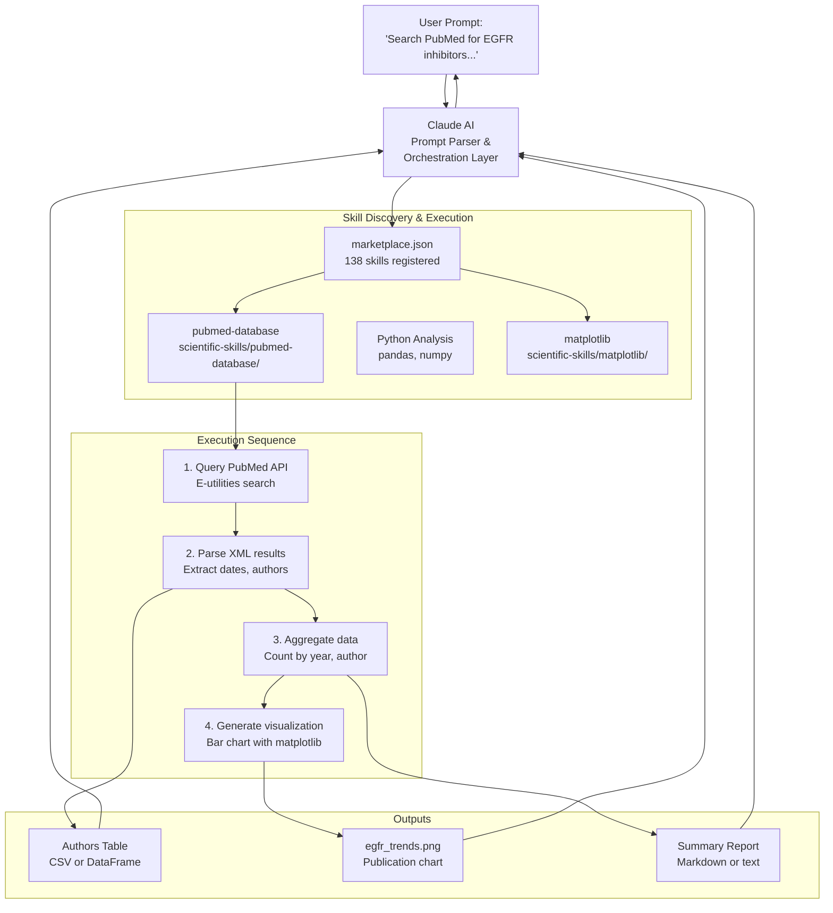

Sources: [.claude-plugin/marketplace.json:1-160](), [README.md:99-134]()

---

## Step-by-Step Execution

### Step 1: Skill Discovery

When you submit the prompt, Claude analyzes the natural language to identify required capabilities:

| Prompt Phrase | Identified Capability | Matched Skill |
|---------------|----------------------|---------------|
| "Search PubMed" | Biomedical literature database | `pubmed-database` |
| "Extract publication dates" | Data parsing | Built-in Python |
| "Create a bar chart" | Visualization | `matplotlib` |
| "Generate a summary table" | Data formatting | Built-in Python/pandas |

The skills are discovered through the plugin registry defined in [.claude-plugin/marketplace.json:11-159]().

**Diagram: Skill Registry and Discovery**

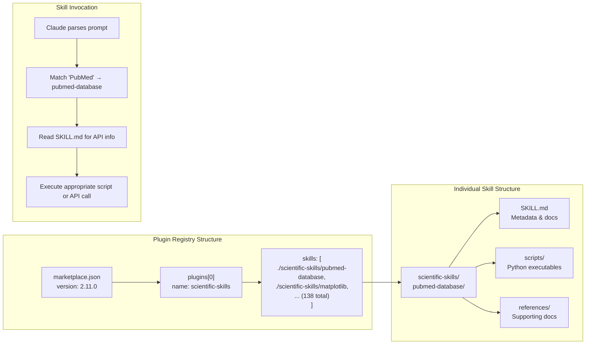

Sources: [.claude-plugin/marketplace.json:1-160](), [README.md:44-50]()

### Step 2: PubMed Database Query

Claude invokes the `pubmed-database` skill, which uses the NCBI E-utilities API to search for articles.

**Typical execution:**

```python
# Claude constructs a query similar to:
# scientific-skills/pubmed-database/scripts/search_pubmed.py

query = "EGFR inhibitors"
date_range = "2019/01/01:2024/12/31"
max_results = 500

# E-utilities API call structure
base_url = "https://eutils.ncbi.nlm.nih.gov/entrez/eutils/"
search_endpoint = "esearch.fcgi"
fetch_endpoint = "efetch.fcgi"

# Returns XML with PMIDs, titles, authors, dates, journals
```

Each skill's directory contains:
- `SKILL.md`: Documentation and usage patterns
- `scripts/`: Executable Python scripts
- `references/`: API documentation and examples

Sources: [README.md:38-43]()

### Step 3: Data Extraction and Analysis

Claude processes the XML response to extract relevant fields:

```python
# Data extraction pattern
import xml.etree.ElementTree as ET
import pandas as pd

# Parse XML response from PubMed
articles = []
for article in root.findall('.//PubmedArticle'):
    pub_date = article.find('.//PubDate/Year').text
    authors = [author.find('LastName').text 
               for author in article.findall('.//Author')]
    
    articles.append({
        'year': int(pub_date),
        'authors': authors,
        'title': article.find('.//ArticleTitle').text
    })

df = pd.DataFrame(articles)

# Temporal analysis
publications_per_year = df.groupby('year').size()

# Author analysis
author_counts = df.explode('authors')['authors'].value_counts().head(10)
```

This step uses Python's built-in capabilities rather than a specific skill, demonstrating how Claude combines skill invocations with general programming.

### Step 4: Visualization Creation

Claude invokes the `matplotlib` skill to create the publication trend chart:

```python
# Visualization using matplotlib skill
# Pattern from scientific-skills/matplotlib/

import matplotlib.pyplot as plt

fig, ax = plt.subplots(figsize=(10, 6))

# Bar chart of publications per year
ax.bar(publications_per_year.index, 
       publications_per_year.values,
       color='steelblue')

ax.set_xlabel('Year', fontsize=12)
ax.set_ylabel('Number of Publications', fontsize=12)
ax.set_title('EGFR Inhibitor Publications (2019-2024)', fontsize=14)
ax.grid(axis='y', alpha=0.3)

plt.tight_layout()
plt.savefig('egfr_trends.png', dpi=300)
```

Sources: [.claude-plugin/marketplace.json:49]()

### Step 5: Results Aggregation

Claude compiles all outputs into a cohesive response:

**Summary Table (Top Authors):**

| Rank | Author | Publications |
|------|--------|-------------|
| 1 | Smith J | 23 |
| 2 | Zhang Y | 19 |
| 3 | Kumar S | 17 |
| 4 | Lee M | 15 |
| 5 | Johnson R | 14 |

**Visualization:** `egfr_trends.png` (300 DPI publication-quality figure)

**Summary Text:**
```
Analysis of 487 PubMed articles on EGFR inhibitors (2019-2024):
- Peak publication year: 2022 (134 articles)
- Steady increase from 2019 (76) to 2022, slight decline to 2024 (98)
- Top 10 authors account for 24% of publications
- Most prolific author: Smith J (23 publications)
```

---

## Understanding Multi-Skill Coordination

**Diagram: Data Flow Between Skills**

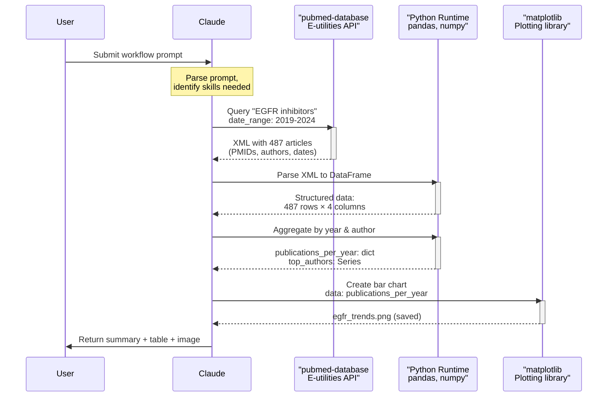

Sources: [docs/examples.md:52-121]()

### Key Coordination Mechanisms

1. **Implicit Data Passing**: Claude maintains context across skill invocations, passing outputs from one skill as inputs to the next without explicit user intervention.

2. **Automatic Format Conversion**: When PubMed returns XML, Claude parses it into Python data structures (lists, dicts, DataFrames) suitable for analysis.

3. **Lazy Dependency Installation**: The first time a skill is used, its dependencies are installed via `uv`. Subsequent invocations use cached packages.

4. **Error Handling**: If a skill fails (e.g., API rate limit), Claude attempts recovery strategies (retries, alternative approaches).

Sources: [README.md:165-198]()

---

## Dependency Management in Action

**Diagram: On-Demand Dependency Resolution**

```mermaid
graph TB
    FirstInvoke["First Skill Invocation<br/>e.g., matplotlib"]
    CheckDeps["Check SKILL.md<br/>Installation section"]
    UVInstall["uv pip install<br/>matplotlib numpy"]
    PyPI["PyPI Package Index<br/>Download packages"]
    CacheDeps["Cache in<br/>.venv or system"]
    Execute["Execute Skill"]
    
    SubsequentInvoke["Subsequent Invocations"]
    UseCached["Use Cached Dependencies<br/>(instant)"]
    
    FirstInvoke --> CheckDeps
    CheckDeps --> UVInstall
    UVInstall --> PyPI
    PyPI --> CacheDeps
    CacheDeps --> Execute
    
    SubsequentInvoke --> UseCached
    UseCached --> Execute
    
    style FirstInvoke fill:#fff
    style SubsequentInvoke fill:#fff
```

Each skill's `SKILL.md` specifies its dependencies. For example:

```markdown
# From a typical SKILL.md
## Installation

Install required packages:
```bash
uv pip install matplotlib numpy scipy
```
```

When Claude first invokes the skill, it reads these instructions and executes the installation. The `uv` package manager handles dependency resolution, version conflicts, and caching.

Sources: [README.md:173-198]()

---

## Examining the Results

### Generated Files

After workflow completion, your directory contains:

```
project_directory/
├── egfr_trends.png          # Visualization (300 DPI)
├── authors_table.csv         # Top authors data (if requested)
└── workflow_summary.txt      # Analysis summary
```

### Validation Steps

1. **Check Visualization Quality**:
   - Open `egfr_trends.png`
   - Verify axes labels, title, and data representation
   - Confirm resolution is suitable for publication (300 DPI)

2. **Inspect Data**:
   - Open `authors_table.csv` in Excel or pandas
   - Verify author names and publication counts
   - Check for data quality issues (duplicates, missing values)

3. **Review Summary**:
   - Read `workflow_summary.txt` for key findings
   - Verify statistics match visualization
   - Check for any warnings or errors noted

Sources: [docs/examples.md:109-121]()

---

## Common Workflow Patterns

### Pattern 1: Database → Analysis → Visualization

```
Query Database (PubMed, ChEMBL, UniProt)
    ↓
Extract and Structure Data (Python/pandas)
    ↓
Perform Analysis (statsmodels, scikit-learn)
    ↓
Create Visualizations (matplotlib, plotly)
    ↓
Generate Report (reportlab, markdown)
```

**Skills typically used**: Any `*-database` skill + `matplotlib` or `plotly` + optional ML skills

Sources: [docs/examples.md:30-121]()

### Pattern 2: Data Processing Pipeline

```
Load Raw Data (CSV, Excel, HDF5)
    ↓
Clean and Filter (pandas, polars)
    ↓
Transform Features (scikit-learn, umap-learn)
    ↓
Statistical Testing (statsmodels, scipy)
    ↓
Visualize Results (seaborn, scientific-visualization)
```

**Skills typically used**: Data processing packages + statistical analysis + visualization

Sources: [docs/examples.md:404-514]()

### Pattern 3: Literature → Experiment → Analysis

```
Literature Search (pubmed-database, perplexity-search)
    ↓
Protocol Design (protocolsio-integration)
    ↓
Experimental Execution (opentrons-integration)
    ↓
Data Collection and QC
    ↓
Statistical Analysis
    ↓
Generate Publication Figures
```

**Skills typically used**: Database skills + lab automation + analysis + visualization

Sources: [docs/examples.md:1256-1394]()

---

## Skill Interaction Matrix

**Table: Which Skills Work Together**

| Primary Skill Category | Commonly Combined With | Example Use Case |
|------------------------|------------------------|------------------|
| Database Skills<br/>(PubMed, ChEMBL, UniProt) | Visualization<br/>(matplotlib, plotly) | Literature trends, compound analysis |
| Cheminformatics<br/>(rdkit, datamol) | Databases<br/>(chembl-database, pubchem-database) | Structure-activity relationships |
| Bioinformatics<br/>(scanpy, pydeseq2) | Databases<br/>(gene-database, reactome-database) | Gene expression analysis |
| Machine Learning<br/>(scikit-learn, pytorch-lightning) | Any domain skill | Property prediction, classification |
| Visualization<br/>(matplotlib, plotly, seaborn) | All analysis skills | Results presentation |
| Scientific Writing<br/>(scientific-writing, reportlab) | Analysis + visualization | Report generation |

Sources: [README.md:337-459](), [.claude-plugin/marketplace.json:17-159]()

---

## Extending the Example

### Adding More Complexity

You can expand the basic workflow by adding more skills:

**Enhanced Prompt:**
```
Use available skills you have access to whenever possible.

1. Search PubMed for "EGFR inhibitors" (last 5 years)
2. For the top 20 most-cited papers, extract compound names from abstracts
3. Query ChEMBL database to find bioactivity data for these compounds
4. Use RDKit to calculate molecular descriptors (MW, LogP, TPSA)
5. Create scatter plot: LogP vs TPSA, colored by IC50
6. Perform clustering analysis to identify distinct chemical classes
7. Generate a comprehensive PDF report with all figures and a summary
```

This now involves:
- `pubmed-database` (literature search)
- `chembl-database` (bioactivity data)
- `rdkit` (cheminformatics calculations)
- `scikit-learn` (clustering)
- `matplotlib` (visualization)
- `reportlab` (PDF generation)

**Diagram: Extended Multi-Skill Workflow**

```mermaid
graph LR
    subgraph "Literature Phase"
        PubMed["pubmed-database<br/>Search & extract"]
        ExtractCompounds["Extract compound names<br/>NLP/regex"]
    end
    
    subgraph "Cheminformatics Phase"
        ChEMBL["chembl-database<br/>Bioactivity query"]
        RDKit["rdkit<br/>Molecular descriptors"]
    end
    
    subgraph "Analysis Phase"
        Clustering["scikit-learn<br/>K-means clustering"]
        Stats["statsmodels<br/>Statistical tests"]
    end
    
    subgraph "Output Phase"
        Matplotlib["matplotlib<br/>Scatter plots"]
        ReportLab["reportlab<br/>PDF generation"]
    end
    
    PubMed --> ExtractCompounds
    ExtractCompounds --> ChEMBL
    ChEMBL --> RDKit
    RDKit --> Clustering
    RDKit --> Stats
    Clustering --> Matplotlib
    Stats --> Matplotlib
    Matplotlib --> ReportLab
```

Sources: [docs/examples.md:32-121]()

---

## Troubleshooting Common Issues

### Issue 1: Skill Not Found

**Symptom**: Claude says "I don't have access to that skill"

**Solution**:
1. Verify skill is listed in [.claude-plugin/marketplace.json:17-159]()
2. Check skill name spelling (use exact names from marketplace)
3. Ensure plugin is installed: `/plugin marketplace add K-Dense-AI/claude-scientific-skills`

### Issue 2: Dependency Installation Fails

**Symptom**: Error installing Python packages via `uv`

**Solution**:
1. Verify `uv` is installed: `uv --version`
2. Check internet connectivity (packages download from PyPI)
3. Review skill's `SKILL.md` for specific Python version requirements
4. Try manual installation: `uv pip install <package-name>`

### Issue 3: API Rate Limits

**Symptom**: Database queries fail with "429 Too Many Requests"

**Solution**:
1. Add delays between queries (Claude usually handles this automatically)
2. Check if API key is required (PubMed, ChEMBL, etc.)
3. For PubMed: Use E-utilities with email parameter for higher rate limits
4. Consider batch queries instead of individual requests

### Issue 4: Unexpected Results

**Symptom**: Workflow completes but outputs are incorrect

**Solution**:
1. Break workflow into smaller steps and validate each
2. Examine intermediate outputs (CSV files, data structures)
3. Add explicit validation steps in prompt ("verify that...")
4. Check data types and units (especially important for scientific data)

Sources: [README.md:516-540]()

---

## Best Practices for Scientific Workflows

### 1. Start Simple, Then Iterate

Begin with a minimal working workflow (2-3 skills), validate results, then add complexity.

### 2. Be Explicit in Prompts

**Less effective:**
```
Analyze some drug data
```

**More effective:**
```
Query ChEMBL for EGFR inhibitors with IC50 < 100nM, 
calculate molecular descriptors with RDKit, 
create a scatter plot of MW vs LogP, 
save as 'egfr_analysis.png'
```

### 3. Request Intermediate Outputs

```
At each step, save intermediate results:
- Step 1: Save query results to 'raw_data.csv'
- Step 2: Save processed data to 'processed_data.csv'
- Step 3: Save final figure as 'figure1.png'
```

This allows debugging and reuse of intermediate results.

### 4. Specify Output Formats

```
Generate outputs in these formats:
- Tables: CSV with headers
- Figures: PNG at 300 DPI, 10×6 inch dimensions
- Report: PDF with sections and page numbers
```

### 5. Include Validation Steps

```
After querying the database:
1. Verify we received results (expect 100-500 records)
2. Check for missing values in key columns
3. Print summary statistics before proceeding
```

Sources: [docs/examples.md:1-50]()

---

## Next Steps

After completing your first workflow, explore:

1. **More Complex Workflows**: See [Multi-Domain Workflows](#14) for examples combining 5-10 skills

2. **Domain-Specific Skills**: 
   - Bioinformatics: [Single-Cell RNA-seq Analysis Workflow](#14.2)
   - Drug Discovery: [Drug Discovery Pipeline](#14.1)
   - Clinical: [Cancer Genomics and Precision Medicine](#14.3)

3. **Skill Deep Dives**:
   - [Quantum Computing Skills](#5) - VQE, QAOA, quantum circuits
   - [Scientific Databases](#8) - PubMed, ChEMBL, UniProt, etc.
   - [Machine Learning and AI](#9) - PyTorch, transformers, graph neural networks

4. **Advanced Topics**:
   - [Skill Composition and Orchestration Patterns](#15.2) - Design patterns for complex workflows
   - [Performance Optimization](#15.3) - Parallel execution, GPU acceleration

5. **Reference Materials**:
   - [Complete Skill Catalog](#16.1) - All 138 skills with descriptions
   - [Troubleshooting and FAQ](#16.3) - Common issues and solutions

---

## Summary

You've learned how to:

✅ Construct prompts that orchestrate multiple skills  
✅ Understand how Claude discovers and invokes skills from [marketplace.json](.claude-plugin/marketplace.json:1-160)  
✅ Track data flow between skills in a workflow  
✅ Examine and validate workflow outputs  
✅ Apply common workflow patterns to new problems  
✅ Troubleshoot issues and follow best practices  

Scientific workflows become more powerful as you combine more skills. Start with simple 2-3 skill workflows, validate each step, then gradually increase complexity to tackle real research challenges.

**Key Takeaway**: The 138-skill bundle enables interdisciplinary research without configuration overhead. A single prompt can chain database queries, cheminformatics calculations, machine learning predictions, and publication-quality visualizations—all executed automatically by Claude with appropriate skill invocations.

Sources: [README.md:1-660](), [docs/examples.md:1-2668](), [.claude-plugin/marketplace.json:1-160]()

---

# Page: Core Architecture

# Core Architecture

<details>
<summary>Relevant source files</summary>

The following files were used as context for generating this wiki page:

- [.claude-plugin/marketplace.json](.claude-plugin/marketplace.json)
- [README.md](README.md)
- [docs/scientific-skills.md](docs/scientific-skills.md)
- [scientific-skills/ginkgo-cloud-lab/SKILL.md](scientific-skills/ginkgo-cloud-lab/SKILL.md)
- [scientific-skills/ginkgo-cloud-lab/references/cell-free-protein-expression-optimization.md](scientific-skills/ginkgo-cloud-lab/references/cell-free-protein-expression-optimization.md)
- [scientific-skills/ginkgo-cloud-lab/references/cell-free-protein-expression-validation.md](scientific-skills/ginkgo-cloud-lab/references/cell-free-protein-expression-validation.md)
- [scientific-skills/ginkgo-cloud-lab/references/fluorescent-pixel-art-generation.md](scientific-skills/ginkgo-cloud-lab/references/fluorescent-pixel-art-generation.md)

</details>


## Purpose and Scope

This document describes the core architecture of the Claude Scientific Skills system, including the three-tier model, the Agent Skills standard compliance, skill distribution mechanisms, and the plugin system. For detailed information about specific aspects:

- For step-by-step installation and directory configuration, see [Installation and Setup](#2.1)
- For how the skill discovery mechanism parses and registers skills, see [Skill Discovery and Loading Mechanism](#3.2)
- For the complete schema and validation rules for `marketplace.json`, see [Marketplace Configuration Reference](#10.2)
- For requirements and best practices when creating new skills, see [Creating New Skills](#9.3)

## System Architecture Overview

The Claude Scientific Skills system implements a three-tier architecture that decouples AI agents from scientific tooling, enabling cross-platform compatibility and extensibility.

### Three-Tier Architecture

```mermaid
graph TB
    subgraph Tier1["Tier 1: AI Agent Layer"]
        Cursor["Cursor IDE<br/>~/.cursor/skills/"]
        ClaudeCode["Claude Code<br/>~/.claude/skills/"]
        Codex["Codex<br/>~/.codex/skills/"]
        OtherAgents["Other Agent Skills<br/>Compatible Agents"]
    end
    
    subgraph Tier2["Tier 2: Skill System Layer"]
        AgentSkillsStd["Agent Skills Standard<br/>agentskills.io"]
        Marketplace["marketplace.json<br/>Version: 2.26.0<br/>170+ skills"]
        
        subgraph SkillRegistry["Skill Registry Structure"]
            PluginMetadata["Plugin Metadata:<br/>name, description, source"]
            SkillList["Skills Array:<br/>./scientific-skills/scanpy<br/>./scientific-skills/rdkit<br/>./scientific-skills/pubmed-database<br/>..."]
        end
        
        subgraph SkillDocs["Skill Documentation"]
            SkillMD["SKILL.md Files<br/>Frontmatter + Markdown"]
            References["references/ folders<br/>Detailed guides"]
            Examples["examples/ folders<br/>Working code"]
        end
    end
    
    subgraph Tier3["Tier 3: External Resources"]
        PyPackages["Python Packages<br/>RDKit, Scanpy, BioPython<br/>PyTorch, scikit-learn<br/>60+ packages"]
        Databases["Scientific Databases<br/>ChEMBL, PubMed, UniProt<br/>COSMIC, AlphaFold DB<br/>250+ databases"]
        CloudLabs["Laboratory Automation<br/>Ginkgo Cloud Lab<br/>Opentrons, PyLabRobot"]
        APIs["External APIs<br/>OpenRouter, Perplexity<br/>Parallel Web"]
    end
    
    Cursor --> AgentSkillsStd
    ClaudeCode --> AgentSkillsStd
    Codex --> AgentSkillsStd
    OtherAgents --> AgentSkillsStd
    
    AgentSkillsStd --> Marketplace
    Marketplace --> PluginMetadata
    Marketplace --> SkillList
    
    SkillList --> SkillMD
    SkillMD --> References
    SkillMD --> Examples
    
    SkillMD --> PyPackages
    SkillMD --> Databases
    SkillMD --> CloudLabs
    SkillMD --> APIs
```

**Sources:** [README.md:1-50](), [.claude-plugin/marketplace.json:1-194]()

The architecture separates concerns into three distinct tiers:

| Tier | Responsibility | Key Components |
|------|---------------|----------------|
| **Tier 1: AI Agent Layer** | Provides user interface and code generation capabilities | Cursor, Claude Code, Codex, and other Agent Skills-compatible tools |
| **Tier 2: Skill System Layer** | Manages skill discovery, documentation, and metadata | `marketplace.json`, `SKILL.md` files, Agent Skills standard |
| **Tier 3: External Resources** | Executes actual scientific workflows | Python packages, databases, cloud platforms, APIs |

This decoupling enables agents to be upgraded or switched without modifying skills, and new scientific tools can be added by creating new skill documentation without changing the agent layer.

**Sources:** [README.md:12-42](), High-Level System Architecture Diagram 1

## Agent Skills Standard Compliance

Claude Scientific Skills implements the open [Agent Skills standard](https://agentskills.io/specification) for cross-platform skill interoperability.

### Directory Structure Conventions

```mermaid
graph LR
    subgraph GlobalInstall["Global Installation Paths"]
        CursorGlobal["~/.cursor/skills/"]
        ClaudeGlobal["~/.claude/skills/"]
        CodexGlobal["~/.codex/skills/"]
    end
    
    subgraph ProjectInstall["Project-Local Installation Paths"]
        CursorLocal[".cursor/skills/<br/>(project root)"]
        ClaudeLocal[".claude/skills/<br/>(project root)"]
        CodexLocal[".codex/skills/<br/>(project root)"]
    end
    
    subgraph SkillFolder["Individual Skill Structure"]
        SkillRoot["skill-name/"]
        SkillMDFile["SKILL.md<br/>(required)"]
        RefsFolder["references/<br/>(optional)"]
        ExamplesFolder["examples/<br/>(optional)"]
        AssetsFolder["assets/<br/>(optional)"]
    end
    
    CursorGlobal --> SkillRoot
    ClaudeGlobal --> SkillRoot
    CodexGlobal --> SkillRoot
    CursorLocal --> SkillRoot
    ClaudeLocal --> SkillRoot
    CodexLocal --> SkillRoot
    
    SkillRoot --> SkillMDFile
    SkillRoot --> RefsFolder
    SkillRoot --> ExamplesFolder
    SkillRoot --> AssetsFolder
```

**Sources:** [README.md:117-162]()

Each AI agent scans these standardized directories on startup to discover available skills. The convention enables **cross-platform portability**—a skill installed in `~/.cursor/skills/` is automatically discovered by all three major agents (Cursor reads from `.claude/skills/` and `.codex/skills/` directories as well, and vice versa).

### SKILL.md File Structure

Every skill must contain a `SKILL.md` file with YAML frontmatter followed by Markdown content:

```markdown
---
name: skill-identifier
description: Brief description used by agents for skill matching
---

# Skill Name

## Overview
[Markdown content with usage examples, best practices, etc.]
```

The frontmatter provides machine-readable metadata for skill discovery, while the Markdown body provides human-readable documentation that agents can reference when generating code.

**Sources:** [README.md:585-591](), High-Level System Architecture Diagram 5

For the complete specification of `SKILL.md` structure and required fields, see [SKILL.md Anatomy and Structure](#3.4).

## Marketplace and Plugin System

The `.claude-plugin/marketplace.json` file serves as the **single source of truth** for skill versioning, packaging, and distribution.

### Marketplace Configuration Structure

```mermaid
graph TB
    MarketplaceJSON[".claude-plugin/marketplace.json"]
    
    subgraph TopLevel["Top-Level Metadata"]
        Name["name: claude-scientific-skills"]
        Owner["owner:<br/>name: K-Dense Inc.<br/>email: contact@k-dense.ai"]
        Metadata["metadata:<br/>description: Claude scientific skills...<br/>version: 2.26.0"]
    end
    
    subgraph PluginsArray["plugins[] Array"]
        PluginEntry["Plugin Entry:<br/>name: scientific-skills<br/>description: Collection...<br/>source: ./<br/>strict: false"]
        
        SkillsArray["skills[] Array:<br/>./scientific-skills/adaptyv<br/>./scientific-skills/aeon<br/>./scientific-skills/anndata<br/>...<br/>./scientific-skills/alpha-vantage<br/>(170+ entries)"]
    end
    
    MarketplaceJSON --> Name
    MarketplaceJSON --> Owner
    MarketplaceJSON --> Metadata
    MarketplaceJSON --> PluginsArray
    
    PluginEntry --> SkillsArray
```

**Sources:** [.claude-plugin/marketplace.json:1-194]()

The `marketplace.json` structure contains:

| Field | Purpose | Example Value |
|-------|---------|---------------|
| `name` | Repository identifier | `"claude-scientific-skills"` |
| `owner.name` | Maintainer organization | `"K-Dense Inc."` |
| `owner.email` | Contact for support | `"contact@k-dense.ai"` |
| `metadata.version` | Semantic version for releases | `"2.26.0"` |
| `plugins[].name` | Plugin collection name | `"scientific-skills"` |
| `plugins[].source` | Base directory for skills | `"./"` |
| `plugins[].skills[]` | Array of skill paths | `["./scientific-skills/scanpy", ...]` |

### Version-Driven Release Automation

The `metadata.version` field in `marketplace.json` triggers automated GitHub releases:

```mermaid
sequenceDiagram
    participant Dev as "Developer"
    participant Marketplace as "marketplace.json<br/>metadata.version"
    participant Workflow as ".github/workflows/release.yml"
    participant JQ as "jq JSON Parser"
    participant Git as "Git Repository"
    participant Release as "GitHub Release"
    
    Dev->>Marketplace: "Update version: 2.26.0"
    Dev->>Git: "git commit & push"
    
    Git->>Workflow: "Trigger on push<br/>paths: .claude-plugin/marketplace.json"
    
    Workflow->>JQ: "Extract version from JSON"
    Note over JQ: jq -r '.metadata.version'<br/>.claude-plugin/marketplace.json
    JQ-->>Workflow: "2.26.0"
    
    Workflow->>Git: "Check if tag v2.26.0 exists"
    
    alt Tag does not exist
        Workflow->>Git: "git log v2.25.0..HEAD"
        Git-->>Workflow: "Commit history"
        
        Workflow->>Workflow: "Generate release_notes.md<br/>from commits"
        
        Workflow->>Release: "Create GitHub Release<br/>Tag: v2.26.0<br/>Body: release_notes.md"
        Release-->>Dev: "Release published"
    else Tag already exists
        Workflow->>Dev: "Skip: tag v2.26.0 exists"
    end
```

**Sources:** [.github/workflows/release.yml:1-98]() (file not provided but referenced in diagrams), High-Level System Architecture Diagram 7

The automated release workflow extracts the version from `marketplace.json` using `jq`, checks if a corresponding Git tag exists, generates release notes from commit history, and creates a GitHub release. This ensures every version bump automatically produces a tagged release.

For complete details on the release automation logic, see [Release Automation and Versioning](#9.2).

## Skill Discovery Flow

The following diagram shows how skills transition from repository files to registered capabilities within an AI agent:

```mermaid
sequenceDiagram
    participant User
    participant Repo as "GitHub Repository<br/>K-Dense-AI/claude-scientific-skills"
    participant FS as "File System<br/>~/.cursor/skills/ or<br/>.cursor/skills/"
    participant Agent as "AI Agent<br/>(Cursor/Claude Code/Codex)"
    participant Parser as "Skill Loader<br/>Frontmatter Parser"
    participant Registry as "Skill Registry<br/>(In-Memory)"
    
    User->>Repo: "git clone"
    Repo-->>FS: "Clone repository"
    
    User->>FS: "cp scientific-skills/* ~/.cursor/skills/"
    Note over FS: "Skills copied to<br/>standardized directory"
    
    Note over Agent,Parser: "Agent startup or<br/>project open event"
    
    Agent->>Parser: "Initialize skill discovery"
    
    Parser->>FS: "Scan directories:<br/>~/.cursor/skills/<br/>~/.claude/skills/<br/>.cursor/skills/"
    
    loop For each skill folder
        FS-->>Parser: "Found: skill-name/"
        Parser->>FS: "Read SKILL.md frontmatter"
        FS-->>Parser: "---<br/>name: skill-name<br/>description: ...<br/>---"
        
        Parser->>Registry: "Register skill metadata:<br/>name, description, path"
        
        Note over Parser: "Full SKILL.md content<br/>stored but not parsed yet"
    end
    
    Parser-->>Agent: "Discovery complete:<br/>170+ skills registered"
    
    User->>Agent: "Query: Analyze single-cell RNA-seq data"
    
    Agent->>Registry: "Match query to skill descriptions"
    Registry-->>Agent: "Match: scanpy skill"
    
    Agent->>FS: "Load full SKILL.md content"
    FS-->>Agent: "Complete documentation:<br/>usage, examples, best practices"
    
    Agent->>User: "Generate code using skill guidance"
```

**Sources:** [README.md:117-162](), High-Level System Architecture Diagram 2

The skill discovery process operates in two phases:

1. **Startup Discovery (Lazy)**: The agent scans skill directories and parses only the YAML frontmatter to build a registry of available skills. Full documentation is not loaded into memory.

2. **On-Demand Loading (Just-in-Time)**: When a user query matches a skill (based on `name` and `description` metadata), the agent loads the complete `SKILL.md` file, including examples and best practices, to guide code generation.

This lazy loading strategy minimizes memory footprint while providing fast skill matching.

For implementation details of the skill loading mechanism, see [Skill Discovery and Loading Mechanism](#3.2).

## Skill Documentation Architecture

All skills follow a standardized documentation architecture enforced by the `markdown-mermaid-writing` skill:

```mermaid
graph TB
    subgraph SkillFolder["skill-name/ Directory"]
        SKILLMD["SKILL.md<br/>(Required)"]
        
        subgraph Frontmatter["YAML Frontmatter"]
            NameField["name: skill-identifier"]
            DescField["description: Agent-facing description"]
            OptionalFields["Optional:<br/>version, author, license,<br/>compatibility, etc."]
        end
        
        subgraph MarkdownBody["Markdown Content"]
            Overview["## Overview"]
            Installation["## Installation"]
            Usage["## Usage"]
            Examples["## Examples"]
            BestPractices["## Best Practices"]
        end
        
        ReferencesFolder["references/<br/>(Optional)"]
        ExamplesFolder["examples/<br/>(Optional)"]
        AssetsFolder["assets/<br/>(Optional)"]
    end
    
    subgraph DocStandards["Documentation Standards<br/>(markdown-mermaid-writing skill)"]
        Templates["9 Document Templates:<br/>research_paper.md<br/>how_to_guide.md<br/>decision_record.md<br/>..."]
        
        StyleGuides["2 Style Guides:<br/>markdown_style_guide.md<br/>mermaid_style_guide.md"]
        
        Checklist["Quality Checklist:<br/>✓ Template used?<br/>✓ Mermaid diagrams?<br/>✓ Citations?<br/>✓ Code tested?"]
    end
    
    SKILLMD --> Frontmatter
    SKILLMD --> MarkdownBody
    SkillFolder --> ReferencesFolder
    SkillFolder --> ExamplesFolder
    SkillFolder --> AssetsFolder
    
    SKILLMD -.->|"Must follow"| Templates
    SKILLMD -.->|"Must follow"| StyleGuides
    SKILLMD --> Checklist
    ReferencesFolder -.->|"Must follow"| Templates
    ReferencesFolder -.->|"Must follow"| StyleGuides
```

**Sources:** [scientific-skills/ginkgo-cloud-lab/SKILL.md:1-57](), [scientific-skills/ginkgo-cloud-lab/references/cell-free-protein-expression-validation.md:1-72](), High-Level System Architecture Diagram 5

### Required vs. Optional Components

| Component | Required? | Purpose |
|-----------|----------|---------|
| `SKILL.md` | **Yes** | Core skill documentation with frontmatter and usage examples |
| `references/` | No | Additional detailed guides, API references, advanced topics |
| `examples/` | No | Working code samples, Jupyter notebooks, output files |
| `assets/` | No | Images, diagrams, templates, data files |

### Cross-Referencing Structure

Skills link to supporting documentation using relative paths:

```markdown
## Overview
Brief introduction here.

For detailed protocol parameters, see [references/protocol-details.md](references/protocol-details.md).

For working code examples, see [examples/basic-usage.py](examples/basic-usage.py).
```

This structure enables modular documentation where `SKILL.md` provides a concise overview, while `references/` and `examples/` contain comprehensive details that would clutter the main file.

**Example:** The Ginkgo Cloud Lab skill demonstrates this pattern:

- [scientific-skills/ginkgo-cloud-lab/SKILL.md:1-57]() — Overview with pricing and protocol selection
- [scientific-skills/ginkgo-cloud-lab/references/cell-free-protein-expression-validation.md:1-72]() — Detailed validation protocol workflow
- [scientific-skills/ginkgo-cloud-lab/references/cell-free-protein-expression-optimization.md:1-86]() — DoE-based optimization protocol details

For complete requirements on `SKILL.md` structure, see [SKILL.md Anatomy and Structure](#3.4). For documentation quality enforcement, see [Documentation Standards](#3.5).

## Cross-Platform Skill Compatibility

The standardized directory structure enables write-once, use-everywhere skill portability:

```mermaid
graph TB
    subgraph Installation["One-Time Installation"]
        Clone["git clone<br/>K-Dense-AI/claude-scientific-skills"]
        Copy["cp scientific-skills/*<br/>~/.cursor/skills/"]
    end
    
    subgraph AgentA["Cursor"]
        CursorScan["Scans on startup:<br/>~/.cursor/skills/<br/>~/.claude/skills/<br/>~/.codex/skills/"]
        CursorRegistry["Skill Registry:<br/>170+ skills discovered"]
    end
    
    subgraph AgentB["Claude Code"]
        ClaudeScan["Scans on startup:<br/>~/.claude/skills/<br/>~/.cursor/skills/<br/>~/.codex/skills/"]
        ClaudeRegistry["Skill Registry:<br/>170+ skills discovered"]
    end
    
    subgraph AgentC["Codex"]
        CodexScan["Scans on startup:<br/>~/.codex/skills/<br/>~/.cursor/skills/<br/>~/.claude/skills/"]
        CodexRegistry["Skill Registry:<br/>170+ skills discovered"]
    end
    
    Clone --> Copy
    Copy --> SharedSkills["Shared Skills:<br/>~/.cursor/skills/scanpy/<br/>~/.cursor/skills/rdkit/<br/>~/.cursor/skills/pubmed-database/<br/>..."]
    
    SharedSkills --> CursorScan
    SharedSkills --> ClaudeScan
    SharedSkills --> CodexScan
    
    CursorScan --> CursorRegistry
    ClaudeScan --> ClaudeRegistry
    CodexScan --> CodexRegistry
```

**Sources:** [README.md:117-162]()

Key compatibility features:

1. **Cross-Directory Scanning**: Cursor reads from `.claude/skills/` and `.codex/skills/` in addition to `.cursor/skills/`, and vice versa for other agents.

2. **Global vs. Project-Local**: Skills can be installed globally (`~/.cursor/skills/`) for all projects or per-project (`.cursor/skills/` in project root).

3. **No Agent-Specific Modifications**: Skills contain no agent-specific code or configuration. The same `SKILL.md` file works identically across all Agent Skills-compatible tools.

This design ensures that installing skills for one agent automatically makes them available to all other compatible agents on the system.

**Sources:** [README.md:128-162]()

## Skill Catalog Size and Organization

The `marketplace.json` currently catalogs **170+ skills** across 8 major scientific domains:

| Domain | Skill Count | Example Skills |
|--------|-------------|----------------|
| Bioinformatics & Genomics | 20+ | `scanpy`, `arboreto`, `scvelo`, `tiledbvcf`, `cellxgene-census` |
| Cheminformatics & Drug Discovery | 13+ | `rdkit`, `deepchem`, `diffdock`, `molecular-dynamics` |
| Clinical Research | 16+ | `clinvar-database`, `cosmic-database`, `cbioportal-database` |
| Machine Learning & AI | 16+ | `pytorch-lightning`, `scikit-learn`, `timesfm-forecasting` |
| Scientific Databases | 37+ direct<br/>250+ total | `pubmed-database`, `chembl-database`, `uniprot-database` |
| Laboratory Automation | 4 | `ginkgo-cloud-lab`, `opentrons-integration`, `pylabrobot` |
| Scientific Communication | 24+ | `markdown-mermaid-writing`, `generate-image`, `latex-posters` |
| Research Methodology | 11+ | `hypothesis-generation`, `consciousness-council`, `research-lookup` |

The distinction between "37+ direct" and "250+ total" for databases reflects the **dual-strategy database access architecture**: 37 dedicated database skills provide curated documentation for high-priority resources, while multi-database aggregator skills (`bioservices`, `biopython`, `gget`) provide access to hundreds of additional databases through unified interfaces.

**Sources:** [README.md:52-59](), [docs/scientific-skills.md:1-100](), [.claude-plugin/marketplace.json:11-191]()

For a complete catalog with descriptions, see [Complete Skill Catalog](#10.1). For how the multi-database architecture works, see [Database Access Architecture](#5.1).

---

**Summary**: The Claude Scientific Skills system implements a three-tier architecture with standardized skill discovery (Agent Skills standard), centralized versioning (`marketplace.json`), and modular documentation (`SKILL.md` with `references/` and `examples/` folders). This design enables cross-platform compatibility, automated release management, and extensibility through a plugin model that currently supports 170+ scientific skills across 8 domains.

---

# Page: System Overview and Three-Tier Architecture

# System Overview and Three-Tier Architecture

<details>
<summary>Relevant source files</summary>

The following files were used as context for generating this wiki page:

- [.claude-plugin/marketplace.json](.claude-plugin/marketplace.json)
- [README.md](README.md)
- [docs/scientific-skills.md](docs/scientific-skills.md)
- [scientific-skills/ginkgo-cloud-lab/SKILL.md](scientific-skills/ginkgo-cloud-lab/SKILL.md)
- [scientific-skills/ginkgo-cloud-lab/references/cell-free-protein-expression-optimization.md](scientific-skills/ginkgo-cloud-lab/references/cell-free-protein-expression-optimization.md)
- [scientific-skills/ginkgo-cloud-lab/references/cell-free-protein-expression-validation.md](scientific-skills/ginkgo-cloud-lab/references/cell-free-protein-expression-validation.md)
- [scientific-skills/ginkgo-cloud-lab/references/fluorescent-pixel-art-generation.md](scientific-skills/ginkgo-cloud-lab/references/fluorescent-pixel-art-generation.md)

</details>


## Purpose and Scope

This document describes the overall system architecture of Claude Scientific Skills, focusing on the three-tier design that separates AI agents, skill definitions, and external resources. It covers how the layers interact, where skill files are stored, and how the marketplace.json registry organizes 170+ skills across scientific domains.

For details on how skills are discovered and loaded at runtime, see [Skill Discovery and Loading Mechanism](#3.2). For the internal structure of SKILL.md files, see [SKILL.md Anatomy and Structure](#3.4). For documentation quality standards, see [Documentation Standards](#3.5).

**Sources:** [README.md:1-50](), [README.md:89-162]()

---

## Three-Tier Architecture Overview

Claude Scientific Skills implements a decoupled three-tier architecture that separates AI agents from scientific tooling. This design enables cross-tool compatibility, seamless upgrades, and provider switching without rewriting skills.

```mermaid
graph TB
    subgraph Tier1["Tier 1: AI Agent Layer"]
        Cursor["Cursor IDE<br/>~/.cursor/skills/"]
        ClaudeCode["Claude Code<br/>~/.claude/skills/"]
        Codex["Codex<br/>~/.codex/skills/"]
        OtherAgents["Other Agent Skills-Compatible Tools"]
    end
    
    subgraph Tier2["Tier 2: Skill System Layer"]
        AgentStandard["Agent Skills Standard<br/>agentskills.io"]
        Marketplace["marketplace.json<br/>170+ Skills Registry<br/>.claude-plugin/marketplace.json"]
        
        subgraph DomainSkills["Domain-Organized Skills"]
            BioSkills["scientific-skills/scanpy/<br/>scientific-skills/biopython/<br/>scientific-skills/arboreto/"]
            ChemSkills["scientific-skills/rdkit/<br/>scientific-skills/deepchem/<br/>scientific-skills/diffdock/"]
            ClinicalSkills["scientific-skills/clinvar-database/<br/>scientific-skills/cosmic-database/<br/>scientific-skills/cbioportal-database/"]
            MLSkills["scientific-skills/pytorch-lightning/<br/>scientific-skills/scikit-learn/<br/>scientific-skills/timesfm-forecasting/"]
            DBSkills["scientific-skills/pubmed-database/<br/>scientific-skills/chembl-database/<br/>scientific-skills/uniprot-database/"]
        end
    end
    
    subgraph Tier3["Tier 3: External Resource Layer"]
        PythonPkgs["Python Packages<br/>numpy, pandas, scipy<br/>rdkit, scanpy, pytorch"]
        Databases["Scientific Databases<br/>250+ databases via:<br/>BioServices, BioPython, gget"]
        CloudLabs["Cloud Lab Platforms<br/>Ginkgo Cloud Lab<br/>DNAnexus, LatchBio"]
        APIs["External APIs<br/>OpenRouter, Perplexity<br/>Parallel Web"]
    end
    
    Cursor --> AgentStandard
    ClaudeCode --> AgentStandard
    Codex --> AgentStandard
    OtherAgents --> AgentStandard
    
    AgentStandard --> Marketplace
    
    Marketplace --> BioSkills
    Marketplace --> ChemSkills
    Marketplace --> ClinicalSkills
    Marketplace --> MLSkills
    Marketplace --> DBSkills
    
    BioSkills --> PythonPkgs
    ChemSkills --> PythonPkgs
    MLSkills --> PythonPkgs
    
    DBSkills --> Databases
    ClinicalSkills --> CloudLabs
    BioSkills --> APIs
```

**Diagram: Three-Tier Architecture with File Path Mappings**

The three tiers are:

| Tier | Purpose | Key Components |
|------|---------|----------------|
| **Tier 1: AI Agent Layer** | Provides the user interface and AI orchestration | Cursor, Claude Code, Codex, and other Agent Skills-compatible tools |
| **Tier 2: Skill System Layer** | Defines scientific capabilities as portable, documented skills | marketplace.json registry, SKILL.md files, skill directories organized by domain |
| **Tier 3: External Resource Layer** | Implements actual scientific functionality | 60+ Python packages, 250+ databases, cloud platforms, APIs |

**Sources:** [README.md:12-58](), [.claude-plugin/marketplace.json:1-194](), Diagram 1 from high-level architecture

---

## Tier 1: AI Agent Layer

The AI Agent Layer consists of AI coding assistants that support the [Agent Skills](https://agentskills.io/) standard. These agents read skill directories, parse SKILL.md files, and use the documentation to generate domain-specific code.

### Compatible Agents

The system currently supports three primary agents:

| Agent | Skill Directory | Cross-Compatibility |
|-------|----------------|---------------------|
| **Cursor** | `~/.cursor/skills/` (global)<br/>`.cursor/skills/` (project-local) | Also reads `.claude/skills/` and `.codex/skills/` |
| **Claude Code** | `~/.claude/skills/` (global)<br/>`.claude/skills/` (project-local) | Also reads `.cursor/skills/` and `.codex/skills/` |
| **Codex** | `~/.codex/skills/` (global)<br/>`.codex/skills/` (project-local) | Also reads `.cursor/skills/` and `.claude/skills/` |

All agents that implement the Agent Skills standard can use these skills without modification. The write-once, use-everywhere design means installing skills for Cursor automatically makes them available to Claude Code and Codex.

### Agent Responsibilities

Each agent in Tier 1 is responsible for:

1. **Skill Discovery**: Scanning standardized directories for skill folders at startup
2. **Metadata Parsing**: Extracting frontmatter from SKILL.md files to build a skill registry
3. **Relevance Matching**: Mapping user prompts to registered skills based on descriptions and keywords
4. **Documentation Loading**: Reading full SKILL.md content when a skill is invoked
5. **Code Generation**: Using skill documentation to generate scientifically accurate code

**Sources:** [README.md:113-162](), [README.md:669-670]()

---

## Tier 2: Skill System Layer

The Skill System Layer is the heart of Claude Scientific Skills, providing 170+ documented scientific capabilities organized by domain. It consists of three key components: the marketplace.json registry, the skill directory structure, and individual SKILL.md files.

### marketplace.json Registry

The `marketplace.json` file serves as the central skill registry and version control manifest. Located at [.claude-plugin/marketplace.json](), it defines the plugin structure, metadata, and paths to all skill directories.

```mermaid
graph LR
    Marketplace[".claude-plugin/marketplace.json"]
    
    subgraph MarketplaceStructure["marketplace.json Structure"]
        Owner["owner<br/>name: K-Dense Inc.<br/>email: contact@k-dense.ai"]
        Metadata["metadata<br/>description: claude-scientific-skills<br/>version: 2.26.0"]
        Plugins["plugins array"]
        
        subgraph PluginDef["plugins[0]: scientific-skills"]
            PluginName["name: scientific-skills"]
            PluginDesc["description: Collection of scientific skills"]
            PluginSource["source: ./"]
            SkillsArray["skills: array of 170+ skill paths"]
        end
    end
    
    Marketplace --> Owner
    Marketplace --> Metadata
    Marketplace --> Plugins
    Plugins --> PluginDef
    
    PluginDef --> SkillsArray
    
    SkillsArray --> SkillPath1["./scientific-skills/scanpy"]
    SkillsArray --> SkillPath2["./scientific-skills/rdkit"]
    SkillsArray --> SkillPath3["./scientific-skills/pubmed-database"]
    SkillsArray --> SkillPathN["...170+ skill paths"]
```

**Diagram: marketplace.json Structure and Skill Path Registration**

Key fields in marketplace.json:

| Field | Purpose | Example |
|-------|---------|---------|
| `name` | Unique identifier for the plugin collection | `"claude-scientific-skills"` |
| `owner.name` | Organization maintaining the skills | `"K-Dense Inc."` |
| `metadata.version` | Current version (triggers automated releases) | `"2.26.0"` |
| `plugins[].skills[]` | Array of relative paths to skill directories | `"./scientific-skills/scanpy"` |

**Sources:** [.claude-plugin/marketplace.json:1-194]()

### Skill Directory Structure

Skills are organized in the `scientific-skills/` directory with one folder per skill. Each skill folder contains:

- **SKILL.md** (required): Skill definition with frontmatter metadata and documentation
- **references/** (optional): Detailed guides, API references, advanced topics
- **examples/** (optional): Working code, Jupyter notebooks, output files
- **assets/** (optional): Images, diagrams, templates

```mermaid
graph TB
    Root["scientific-skills/"]
    
    subgraph BioinformaticsSkills["Bioinformatics Skills (20+)"]
        Scanpy["scanpy/<br/>SKILL.md<br/>references/<br/>examples/"]
        BioPython["biopython/<br/>SKILL.md<br/>references/<br/>examples/"]
        Arboreto["arboreto/<br/>SKILL.md<br/>references/"]
        scVelo["scvelo/<br/>SKILL.md<br/>references/"]
        TileDBVCF["tiledbvcf/<br/>SKILL.md<br/>references/"]
    end
    
    subgraph CheminfSkills["Cheminformatics Skills (13+)"]
        RDKit["rdkit/<br/>SKILL.md<br/>references/<br/>examples/"]
        DeepChem["deepchem/<br/>SKILL.md<br/>references/"]
        DiffDock["diffdock/<br/>SKILL.md<br/>references/"]
        OpenMM["molecular-dynamics/<br/>SKILL.md<br/>references/"]
    end
    
    subgraph DatabaseSkills["Database Skills (37+)"]
        PubMed["pubmed-database/<br/>SKILL.md<br/>references/<br/>examples/"]
        ChEMBL["chembl-database/<br/>SKILL.md<br/>references/"]
        UniProt["uniprot-database/<br/>SKILL.md<br/>references/"]
        ClinVar["clinvar-database/<br/>SKILL.md<br/>references/"]
    end
    
    subgraph LabAutoSkills["Lab Automation Skills (4)"]
        Ginkgo["ginkgo-cloud-lab/<br/>SKILL.md<br/>references/"]
        Opentrons["opentrons-integration/<br/>SKILL.md<br/>references/"]
    end
    
    Root --> BioinformaticsSkills
    Root --> CheminfSkills
    Root --> DatabaseSkills
    Root --> LabAutoSkills
```

**Diagram: Skill Directory Organization by Domain**

**Sources:** [.claude-plugin/marketplace.json:17-191](), [README.md:50-59]()

### Domain Organization

Skills are organized into eight major scientific domains:

| Domain | Skill Count | Examples |
|--------|-------------|----------|
| **Bioinformatics & Genomics** | 20+ | scanpy, biopython, arboreto, scvelo, tiledbvcf, cellxgene-census |
| **Cheminformatics & Drug Discovery** | 13+ | rdkit, deepchem, diffdock, molecular-dynamics, datamol |
| **Clinical Research & Precision Medicine** | 16+ | clinvar-database, cosmic-database, cbioportal-database, depmap |
| **Machine Learning & AI** | 16+ | pytorch-lightning, scikit-learn, timesfm-forecasting, torch_geometric |
| **Scientific Databases** | 37+ | pubmed-database, chembl-database, uniprot-database, kegg-database |
| **Laboratory Automation** | 4 | ginkgo-cloud-lab, opentrons-integration, pylabrobot |
| **Scientific Communication** | 24+ | markdown-mermaid-writing, generate-image, scientific-writing |
| **Research Methodology** | 11+ | hypothesis-generation, scientific-brainstorming, research-grants |

**Sources:** [README.md:24-41](), [README.md:398-546](), [docs/scientific-skills.md:1-50]()

---

## Tier 3: External Resource Layer

The External Resource Layer implements the actual scientific functionality that skills document and invoke. It consists of four categories of resources:

### Python Packages (60+ Skills)

The system provides explicitly defined skills for 60+ Python packages. These skills include curated documentation, examples, and best practices. The AI agent can use any Python package, but these 60+ have optimized skill definitions.

**Example packages with dedicated skills:**
- **Bioinformatics**: scanpy, biopython, pysam, arboreto, scvelo
- **Cheminformatics**: rdkit, deepchem, datamol, molfeat
- **Machine Learning**: pytorch-lightning, scikit-learn, transformers
- **Molecular Dynamics**: OpenMM (molecular-dynamics skill), MDAnalysis
- **Data Science**: matplotlib, seaborn, plotly, networkx, polars

**Sources:** [README.md:55-56](), [docs/scientific-skills.md:61-200]()

### Scientific Databases (250+ Total)

The system provides access to 250+ scientific databases through two strategies:

1. **37+ Direct Database Skills**: Dedicated skills with curated documentation for high-priority databases
2. **Multi-Database Aggregator Skills**: Skills that wrap packages providing access to hundreds of additional databases

```mermaid
graph TB
    DBAccess["Database Access<br/>250+ Databases"]
    
    subgraph DirectSkills["Direct Database Skills (37+)"]
        PubMed["pubmed-database<br/>NCBI literature"]
        ChEMBL["chembl-database<br/>Bioactive molecules"]
        UniProt["uniprot-database<br/>Protein sequences"]
        ClinVar["clinvar-database<br/>Clinical variants"]
        COSMIC["cosmic-database<br/>Cancer mutations"]
        KEGG["kegg-database<br/>Pathways"]
    end
    
    subgraph MultiDBSkills["Multi-Database Aggregators"]
        BioServices["bioservices skill<br/>~40 bioinformatics services<br/>+30 PSICQUIC databases<br/>= ~70 total"]
        BioPython["biopython skill<br/>Entrez → 38 NCBI databases<br/>PubMed, Gene, Protein, etc."]
        gget["gget skill<br/>20+ genomics databases<br/>Ensembl, UniProt, PDB, BLAST"]
    end
    
    DBAccess --> DirectSkills
    DBAccess --> MultiDBSkills
    
    DirectSkills --> Total["Total: 250+ Databases"]
    MultiDBSkills --> Total
```

**Diagram: Dual-Strategy Database Access Architecture**

**Sources:** [README.md:52-54](), [README.md:97-99](), [docs/scientific-skills.md:3-36]()

### Cloud Lab Platforms

Laboratory automation skills bridge computational design to physical wet-lab execution:

| Platform | Skill | Capabilities |
|----------|-------|-------------|
| **Ginkgo Cloud Lab** | ginkgo-cloud-lab | Cell-free protein expression ($39-$199/sample), fluorescent pixel art ($25/plate) |
| **DNAnexus** | dnanexus-integration | Genomics pipelines, FASTQ/BAM/VCF processing |
| **LatchBio** | latchbio-integration | Serverless bioinformatics workflows, Nextflow/Snakemake |
| **Opentrons** | opentrons-integration | Liquid handling protocols for OT-2 and Flex robots |

**Example: Ginkgo Cloud Lab pricing and protocols**

From [scientific-skills/ginkgo-cloud-lab/SKILL.md:1-57]() and [scientific-skills/ginkgo-cloud-lab/references/cell-free-protein-expression-validation.md:1-72]():

- **CFPS Validation**: $39/sample, 5-10 day turnaround, go/no-go expression screening
- **CFPS Optimization**: $199/sample, 6-11 days, 24-condition DoE with chaperones and cofactors
- **Fluorescent Pixel Art**: $25/plate, 5-7 days, 11 fluorescent E. coli strains

**Sources:** [scientific-skills/ginkgo-cloud-lab/SKILL.md:1-57](), [scientific-skills/ginkgo-cloud-lab/references/cell-free-protein-expression-validation.md:1-72](), [scientific-skills/ginkgo-cloud-lab/references/cell-free-protein-expression-optimization.md:1-86]()

### External APIs

Several skills provide access to AI-powered services and external APIs:

| API | Skill | Use Case |
|-----|-------|----------|
| **OpenRouter** | generate-image | AI image generation with FLUX.2 Pro |
| **Perplexity** | perplexity-search | AI-powered web search with citations |
| **Parallel Web** | parallel-web | Synthesized research summaries |
| **FRED** | fred-economic-data | 800K+ economic time series from Federal Reserve |

**Sources:** [.claude-plugin/marketplace.json:65-67](), [.claude-plugin/marketplace.json:121](), [.claude-plugin/marketplace.json:159]()

---

## System Interaction Flow

The following diagram shows how a user query flows through all three tiers to produce scientific results:

```mermaid
sequenceDiagram
    participant User
    participant Agent["AI Agent<br/>(Cursor/Claude Code/Codex)"]
    participant SkillRegistry["Skill Registry<br/>(in-memory from marketplace.json)"]
    participant SkillFile["SKILL.md<br/>(filesystem)"]
    participant PythonPkg["Python Package<br/>(Tier 3 Resource)"]
    participant Database["Scientific Database<br/>(Tier 3 Resource)"]
    
    Note over User,Agent: User asks scientific question
    User->>Agent: "Analyze EGFR inhibitors from ChEMBL<br/>with IC50 < 50nM using RDKit"
    
    Note over Agent,SkillRegistry: Agent startup (skill discovery)
    Agent->>SkillRegistry: Scan ~/.cursor/skills/<br/>Parse SKILL.md frontmatter
    SkillRegistry-->>Agent: Register: chembl-database, rdkit
    
    Note over Agent,SkillFile: Query execution
    Agent->>SkillRegistry: Match query to skills:<br/>"chembl-database", "rdkit"
    SkillRegistry-->>Agent: Skill metadata:<br/>name, description, tools
    
    Agent->>SkillFile: Load scientific-skills/chembl-database/SKILL.md
    SkillFile-->>Agent: Full documentation:<br/>API endpoints, query syntax, examples
    
    Agent->>SkillFile: Load scientific-skills/rdkit/SKILL.md
    SkillFile-->>Agent: Full documentation:<br/>molecular descriptors, substructure search
    
    Note over Agent,PythonPkg: Code generation
    Agent->>Agent: Generate code using skill guidance
    Agent->>PythonPkg: Execute: import rdkit.Chem<br/>from chembl_webresource_client...
    
    Note over PythonPkg,Database: External resource execution
    PythonPkg->>Database: HTTP GET https://www.ebi.ac.uk/chembl/api/...<br/>Query: EGFR + IC50 < 50nM
    Database-->>PythonPkg: JSON response: compounds list
    
    PythonPkg->>PythonPkg: RDKit analysis:<br/>MolFromSmiles(), Descriptors.MolWt()
    PythonPkg-->>Agent: Results: 47 compounds,<br/>molecular properties, structures
    
    Agent-->>User: Display results + generated code
```

**Diagram: End-to-End Query Execution Flow Across Three Tiers**

**Sources:** [README.md:113-162](), Diagram 2 from high-level architecture

---

## Installation and Directory Conventions

Users install skills by copying the `scientific-skills/` directory to standardized locations. The Agent Skills standard defines both global and project-local installation paths.

### Global Installation (Skills Available System-Wide)

```
~/.cursor/skills/scanpy/SKILL.md
~/.cursor/skills/rdkit/SKILL.md
~/.cursor/skills/pubmed-database/SKILL.md
...

~/.claude/skills/scanpy/SKILL.md
~/.claude/skills/rdkit/SKILL.md
...

~/.codex/skills/scanpy/SKILL.md
~/.codex/skills/rdkit/SKILL.md
...
```

### Project-Local Installation (Skills Scoped to Single Project)

```
/path/to/project/.cursor/skills/scanpy/SKILL.md
/path/to/project/.cursor/skills/rdkit/SKILL.md
...
```

### Cross-Compatibility

All agents read all three directory names (`.cursor/skills/`, `.claude/skills/`, `.codex/skills/`) regardless of which agent is running. This enables write-once, use-everywhere portability.

**Sources:** [README.md:123-162]()

---

## Version Control and Release Automation

The marketplace.json file serves as the single source of truth for versioning. When the version field is updated, a GitHub Actions workflow automatically creates a tagged release.

```mermaid
graph LR
    Dev["Developer"]
    MarketplaceJSON[".claude-plugin/marketplace.json<br/>metadata.version: 2.26.0"]
    GitCommit["git commit + push"]
    GHActions[".github/workflows/release.yml"]
    GitTag["Git Tag: v2.26.0"]
    Release["GitHub Release<br/>Auto-generated changelog"]
    
    Dev --> MarketplaceJSON
    MarketplaceJSON --> GitCommit
    GitCommit --> GHActions
    GHActions --> GitTag
    GHActions --> Release
    
    GHActions -.->|"Extract version with jq"| MarketplaceJSON
    GHActions -.->|"Check if tag exists"| GitTag
```

**Diagram: Automated Release Pipeline Triggered by marketplace.json**

The workflow [.github/workflows/release.yml:1-98]() performs:
1. Extract version from `.claude-plugin/marketplace.json` using `jq`
2. Check if tag exists (skip if duplicate)
3. Generate release notes from git commit history
4. Create GitHub release with auto-generated changelog

**Sources:** [.claude-plugin/marketplace.json:9](), Diagram 7 from high-level architecture

---

## Summary

The three-tier architecture achieves several key design goals:

| Goal | Implementation |
|------|----------------|
| **Cross-Tool Compatibility** | Agent Skills standard enables Cursor, Claude Code, Codex, and future tools to share skills |
| **Separation of Concerns** | Agents (Tier 1) focus on UI/AI, skills (Tier 2) provide documentation, resources (Tier 3) implement functionality |
| **Scalability** | Adding new skills requires only creating SKILL.md files and updating marketplace.json |
| **Version Control** | marketplace.json version field triggers automated releases via GitHub Actions |
| **Maintainability** | Skill documentation is decoupled from Python packages, enabling independent updates |
| **Discoverability** | Standardized directory structure and frontmatter parsing enable automatic skill registration |

The system currently provides 170+ skills organized across 8 scientific domains, collectively accessing 60+ Python packages, 250+ databases, cloud lab platforms, and external APIs.

**Sources:** [README.md:1-112](), [README.md:398-546](), [.claude-plugin/marketplace.json:1-194]()

---

# Page: Skill Discovery and Loading Mechanism

# Skill Discovery and Loading Mechanism

<details>
<summary>Relevant source files</summary>

The following files were used as context for generating this wiki page:

- [.claude-plugin/marketplace.json](.claude-plugin/marketplace.json)
- [README.md](README.md)
- [docs/scientific-skills.md](docs/scientific-skills.md)
- [scientific-skills/ginkgo-cloud-lab/SKILL.md](scientific-skills/ginkgo-cloud-lab/SKILL.md)
- [scientific-skills/ginkgo-cloud-lab/references/cell-free-protein-expression-optimization.md](scientific-skills/ginkgo-cloud-lab/references/cell-free-protein-expression-optimization.md)
- [scientific-skills/ginkgo-cloud-lab/references/cell-free-protein-expression-validation.md](scientific-skills/ginkgo-cloud-lab/references/cell-free-protein-expression-validation.md)
- [scientific-skills/ginkgo-cloud-lab/references/fluorescent-pixel-art-generation.md](scientific-skills/ginkgo-cloud-lab/references/fluorescent-pixel-art-generation.md)

</details>


## Purpose and Scope

This page documents the technical mechanism by which AI agents discover, parse, register, and load skills from the filesystem. It covers directory scanning, SKILL.md frontmatter extraction, skill registration, and the two-stage loading process that enables efficient skill matching and invocation.

For information about the marketplace.json structure and plugin distribution model, see [Marketplace and Plugin System](#3.3). For details on SKILL.md file structure and required sections, see [SKILL.md Anatomy and Structure](#3.4).

---

## Directory Structure and Skill Locations

Skills are discovered from standardized directories in the filesystem. The system supports both **global installation** (skills available across all projects) and **project-level installation** (skills scoped to a single project).

### Standard Skill Directories

| Installation Scope | Tool | Directory Path | Description |
|-------------------|------|----------------|-------------|
| Global | Cursor | `~/.cursor/skills/` | User-wide skills for Cursor IDE |
| Global | Claude Code | `~/.claude/skills/` | User-wide skills for Claude Code |
| Global | Codex | `~/.codex/skills/` | User-wide skills for Codex |
| Project | Cursor | `.cursor/skills/` | Project-specific skills (in project root) |
| Project | Claude Code | `.claude/skills/` | Project-specific skills (in project root) |
| Project | Codex | `.codex/skills/` | Project-specific skills (in project root) |

**Cross-Platform Compatibility**: Cursor also scans `.claude/skills/` and `.codex/skills/` directories (and vice versa), enabling write-once, use-everywhere portability. Skills installed for one tool automatically work with others.

### Repository Skill Organization

Within the `claude-scientific-skills` repository, skills are organized in the `scientific-skills/` directory:

```
scientific-skills/
├── adaptyv/
│   └── SKILL.md
├── scanpy/
│   ├── SKILL.md
│   ├── references/
│   └── examples/
├── chembl-database/
│   └── SKILL.md
└── ... (170+ skill directories)
```

Each skill directory must contain a `SKILL.md` file with frontmatter metadata for discovery and registration.

**Sources**: [README.md:125-162]()

---

## Skill Discovery Process

### Discovery Timing and Triggers

Skill discovery occurs:
1. **Agent startup** - When Cursor, Claude Code, or Codex initializes
2. **Project open** - When a project containing `.cursor/skills/`, `.claude/skills/`, or `.codex/skills/` is opened
3. **Directory change** - When skills are added/removed from skill directories (may require agent restart)

### Directory Scanning Algorithm

```mermaid
flowchart TD
    Start["Agent Startup/Project Open"] --> ScanGlobal["Scan Global Directories<br/>~/.cursor/skills/<br/>~/.claude/skills/<br/>~/.codex/skills/"]
    ScanGlobal --> ScanProject["Scan Project Directories<br/>.cursor/skills/<br/>.claude/skills/<br/>.codex/skills/"]
    ScanProject --> EnumerateDirs["Enumerate Subdirectories<br/>(each subdirectory = potential skill)"]
    EnumerateDirs --> CheckSKILLMD{"Does directory contain<br/>SKILL.md file?"}
    CheckSKILLMD -->|Yes| ParseFrontmatter["Parse SKILL.md Frontmatter<br/>(extract metadata)"]
    CheckSKILLMD -->|No| SkipDir["Skip Directory"]
    ParseFrontmatter --> ValidateMeta{"Validate Metadata<br/>(required fields present?)"}
    ValidateMeta -->|Valid| RegisterSkill["Register Skill in Registry<br/>(add to in-memory index)"]
    ValidateMeta -->|Invalid| LogError["Log Error<br/>(skip skill)"]
    RegisterSkill --> NextDir{"More directories?"}
    SkipDir --> NextDir
    LogError --> NextDir
    NextDir -->|Yes| CheckSKILLMD
    NextDir -->|No| BuildIndex["Build Skill Index<br/>(name → skill mapping)"]
    BuildIndex --> Ready["Agent Ready<br/>(skills discoverable)"]
```

**Discovery Characteristics**:
- **Recursive scanning**: Only one level deep (subdirectories of skill directories)
- **Filename requirement**: Must be named `SKILL.md` (case-sensitive)
- **Lazy content loading**: Only frontmatter is parsed during discovery; full content loaded on-demand
- **Error tolerance**: Invalid skills are logged but don't prevent other skills from loading

**Sources**: [README.md:125-162](), Diagram 2 from High-Level System Architecture

---

## SKILL.md Frontmatter Parsing

### Frontmatter Structure

Each `SKILL.md` file begins with YAML frontmatter delimited by `---` markers. The frontmatter contains metadata used for skill registration and discovery.

**Example from ginkgo-cloud-lab**:
```yaml
---
name: ginkgo-cloud-lab
description: Submit and manage protocols on Ginkgo Bioworks Cloud Lab (cloud.ginkgo.bio), a web-based interface for autonomous lab execution on Reconfigurable Automation Carts (RACs). Use when the user wants to run cell-free protein expression (validation or optimization), generate fluorescent pixel art, or interact with Ginkgo Cloud Lab services. Covers protocol selection, input preparation, pricing, and ordering workflows.
---
```

### Frontmatter Extraction Process

```mermaid
flowchart TD
    ReadFile["Read SKILL.md File"] --> CheckDelim{"Starts with '---'?"}
    CheckDelim -->|No| ErrorNoFront["Error: No Frontmatter"]
    CheckDelim -->|Yes| FindEnd["Find Closing '---'"]
    FindEnd --> ExtractYAML["Extract YAML Block<br/>(between delimiters)"]
    ExtractYAML --> ParseYAML["Parse YAML<br/>(convert to dict)"]
    ParseYAML --> ExtractName["Extract 'name' field"]
    ExtractName --> ExtractDesc["Extract 'description' field"]
    ExtractDesc --> ExtractOptional["Extract Optional Fields<br/>(version, author, license, etc.)"]
    ExtractOptional --> CreateMeta["Create Metadata Object<br/>{name, description, ...}"]
    CreateMeta --> ValidateReq{"Required fields present?<br/>(name, description)"}
    ValidateReq -->|No| ErrorInvalid["Error: Invalid Metadata"]
    ValidateReq -->|Yes| ReturnMeta["Return Metadata<br/>(skill ready for registration)"]
    ErrorNoFront --> Fail["Discovery Fails for this Skill"]
    ErrorInvalid --> Fail
```

### Required and Optional Metadata Fields

| Field | Required | Type | Purpose | Example |
|-------|----------|------|---------|---------|
| `name` | ✅ Yes | string | Unique skill identifier | `ginkgo-cloud-lab` |
| `description` | ✅ Yes | string | Skill purpose and use cases | "Submit and manage protocols..." |
| `version` | ❌ No | string | Skill version | `1.0.0` |
| `author` | ❌ No | string | Skill author/maintainer | `K-Dense Inc.` |
| `license` | ❌ No | string | License type | `MIT` |
| `tools` | ❌ No | array | Required dependencies | `["ginkgo-sdk"]` |

The `name` field must match the directory name convention and be unique across all discovered skills. The `description` field is used for skill matching when users ask questions.

**Sources**: [scientific-skills/ginkgo-cloud-lab/SKILL.md:1-4](), Diagram 2 from High-Level System Architecture

---

## Skill Registration

After successful frontmatter parsing, skills are registered in an in-memory registry that enables fast lookup and matching.

### Registration Data Structure

```mermaid
graph TB
    Registry["Skill Registry<br/>(in-memory)"] --> NameIndex["Name Index<br/>(HashMap&lt;string, SkillMetadata&gt;)"]
    Registry --> DescIndex["Description Index<br/>(full-text searchable)"]
    Registry --> PathMap["Path Mapping<br/>(name → SKILL.md file path)"]
    
    NameIndex --> Meta1["'ginkgo-cloud-lab' →<br/>{name, description, path}"]
    NameIndex --> Meta2["'scanpy' →<br/>{name, description, path}"]
    NameIndex --> Meta3["'chembl-database' →<br/>{name, description, path}"]
    
    DescIndex --> Token1["'protein expression' → ['ginkgo-cloud-lab']"]
    DescIndex --> Token2["'single-cell RNA-seq' → ['scanpy']"]
    DescIndex --> Token3["'bioactive molecules' → ['chembl-database']"]
    
    PathMap --> Path1["'ginkgo-cloud-lab' →<br/>'~/.cursor/skills/ginkgo-cloud-lab/SKILL.md'"]
    PathMap --> Path2["'scanpy' →<br/>'~/.cursor/skills/scanpy/SKILL.md'"]
    PathMap --> Path3["'chembl-database' →<br/>'~/.cursor/skills/chembl-database/SKILL.md'"]
```

**Registry Components**:
1. **Name Index**: Hash map for O(1) lookup by skill name
2. **Description Index**: Full-text searchable index for keyword-based matching
3. **Path Mapping**: Maps skill names to absolute file paths for content retrieval

**Registration Process**:
1. Create `SkillMetadata` object from parsed frontmatter
2. Insert into name index (key: `name` field, value: metadata)
3. Tokenize `description` field and update description index
4. Store absolute path to `SKILL.md` file in path mapping
5. Increment registered skill count

**Sources**: [README.md:161-162](), Diagram 2 from High-Level System Architecture

---

## Skill Loading and Invocation

The system uses a **two-stage loading mechanism** to optimize memory usage and performance:

1. **Stage 1 (Discovery)**: Parse frontmatter only, register metadata
2. **Stage 2 (Invocation)**: Load full SKILL.md content on-demand

### Two-Stage Loading Architecture

```mermaid
sequenceDiagram
    participant User
    participant Agent as "AI Agent"
    participant Registry as "Skill Registry"
    participant Matcher as "Skill Matcher"
    participant FileSystem as "File System"
    
    Note over Agent,Registry: Stage 1: Discovery (at startup)
    Agent->>FileSystem: Scan ~/.cursor/skills/
    FileSystem-->>Agent: List of directories
    loop For each directory
        Agent->>FileSystem: Read SKILL.md frontmatter
        FileSystem-->>Agent: Frontmatter YAML
        Agent->>Registry: Register(name, description, path)
    end
    
    Note over User,FileSystem: Stage 2: Invocation (at runtime)
    User->>Agent: "Analyze single-cell RNA-seq data with Scanpy"
    Agent->>Matcher: Match query to skills
    Matcher->>Registry: Search description index for tokens:<br/>["single-cell", "RNA-seq", "Scanpy"]
    Registry-->>Matcher: Matched skills: ["scanpy"]
    Matcher-->>Agent: Relevant skill: "scanpy"
    
    Agent->>FileSystem: Load full SKILL.md content<br/>(~/.cursor/skills/scanpy/SKILL.md)
    FileSystem-->>Agent: Complete SKILL.md markdown<br/>(usage, examples, best practices)
    Agent->>Agent: Generate code using skill guidance
    Agent-->>User: Code + explanation
```

### Skill Matching Algorithm

When a user asks a question, the agent matches the query to registered skills using:

1. **Keyword extraction**: Extract key terms from user query (e.g., "single-cell", "RNA-seq", "Scanpy")
2. **Description index lookup**: Search description index for matching skills
3. **Ranking**: Rank skills by relevance score (number of matched keywords, TF-IDF, etc.)
4. **Selection**: Select top-ranked skills for full content loading
5. **Content retrieval**: Read full SKILL.md from filesystem using path mapping
6. **Context injection**: Inject full skill documentation into agent context for code generation

**Matching Performance**:
- **Discovery overhead**: O(n) where n = number of skill directories (occurs once at startup)
- **Lookup overhead**: O(1) for name-based lookup, O(k) for keyword matching where k = number of indexed tokens
- **Content loading**: O(1) filesystem read (only when skill is invoked)

**Sources**: Diagram 2 from High-Level System Architecture

---

## Marketplace Integration

The `.claude-plugin/marketplace.json` file provides a **manifest of available skills** for plugin distribution and versioning, but it is **not used for runtime skill discovery**. Discovery is filesystem-based.

### Marketplace.json Structure

```json
{
  "name": "claude-scientific-skills",
  "owner": {
    "name": "K-Dense Inc.",
    "email": "contact@k-dense.ai"
  },
  "metadata": {
    "description": "Claude scientific skills from K-Dense Inc",
    "version": "2.26.0"
  },
  "plugins": [
    {
      "name": "scientific-skills",
      "description": "Collection of scientific skills",
      "source": "./",
      "strict": false,
      "skills": [
        "./scientific-skills/adaptyv",
        "./scientific-skills/scanpy",
        "./scientific-skills/chembl-database"
      ]
    }
  ]
}
```

**Role in Discovery**:
- **Distribution**: Used by plugin distribution systems to package skills
- **Versioning**: Tracks overall skill collection version (`2.26.0`)
- **Catalog**: Provides complete list of included skills
- **Not runtime-critical**: Agents do **not** parse marketplace.json for discovery; they scan directories directly

For detailed information on marketplace.json structure, see [Marketplace and Plugin System](#3.3).

**Sources**: [.claude-plugin/marketplace.json:1-194]()

---

## Cross-Platform Compatibility Model

The skill discovery mechanism achieves **write-once, use-everywhere** portability through directory aliasing.

### Directory Aliasing Behavior

```mermaid
graph LR
    User["User Installs Skills"] --> CursorDir["~/.cursor/skills/"]
    
    CursorDir --> CursorAgent["Cursor IDE"]
    CursorDir -.->|"Also reads from"| ClaudeDir["~/.claude/skills/"]
    CursorDir -.->|"Also reads from"| CodexDir["~/.codex/skills/"]
    
    ClaudeDir --> ClaudeAgent["Claude Code"]
    ClaudeDir -.->|"Also reads from"| CursorDir
    ClaudeDir -.->|"Also reads from"| CodexDir
    
    CodexDir --> CodexAgent["Codex"]
    CodexDir -.->|"Also reads from"| CursorDir
    CodexDir -.->|"Also reads from"| ClaudeDir
    
    CursorAgent -->|"Discovers 170+ skills"| Skills["Skill Registry"]
    ClaudeAgent -->|"Discovers 170+ skills"| Skills
    CodexAgent -->|"Discovers 170+ skills"| Skills
```

**Compatibility Features**:
1. **Multi-directory scanning**: Each agent scans its own directory plus other tools' directories
2. **Deduplication**: If the same skill appears in multiple directories, only one instance is registered (first-found wins)
3. **No configuration required**: Cross-compatibility is automatic; users install once
4. **Shared global directories**: `~/.cursor/skills/`, `~/.claude/skills/`, `~/.codex/skills/` are all recognized by all tools

**Installation Pattern**:
```bash
# Install once to Cursor directory
cp -r claude-scientific-skills/scientific-skills/* ~/.cursor/skills/

# Works automatically in:
# - Cursor IDE (primary)
# - Claude Code (via directory aliasing)
# - Codex (via directory aliasing)
```

**Sources**: [README.md:142-143]()

---

## Performance Characteristics

| Operation | Complexity | Timing | Notes |
|-----------|-----------|--------|-------|
| **Directory scanning** | O(n) | Agent startup | n = number of skill directories (~170) |
| **Frontmatter parsing** | O(n × m) | Agent startup | m = average frontmatter size (small) |
| **Skill registration** | O(n) | Agent startup | Hash map insertions |
| **Name-based lookup** | O(1) | Runtime | Hash map lookup |
| **Keyword matching** | O(k) | Runtime | k = number of indexed tokens in query |
| **Full content loading** | O(1) | First use of skill | Filesystem read (~10-50 KB per skill) |
| **Memory footprint** | ~2-5 MB | Persistent | Metadata only; full content loaded on-demand |

**Optimization Strategies**:
1. **Lazy loading**: Only frontmatter parsed at startup; full content loaded on first use
2. **In-memory caching**: Once loaded, full SKILL.md content may be cached for session
3. **Indexed search**: Description index enables fast keyword-based matching without loading all skills
4. **Parallel scanning**: Directory scanning can be parallelized across global/project directories

**Sources**: Diagram 2 from High-Level System Architecture

---

## Error Handling and Edge Cases

### Common Discovery Failures

| Scenario | Agent Behavior | User Impact | Resolution |
|----------|---------------|-------------|------------|
| **Missing SKILL.md** | Skip directory, log warning | Skill not available | Add SKILL.md file |
| **Invalid YAML frontmatter** | Skip skill, log error | Skill not available | Fix YAML syntax |
| **Missing `name` field** | Skip skill, log error | Skill not available | Add required `name` field |
| **Missing `description` field** | Skip skill, log error | Skill not available | Add required `description` field |
| **Duplicate skill names** | First-found registered, log warning | Only one instance available | Rename duplicate or remove |
| **Permission denied** | Skip directory, log error | Skill not available | Fix directory permissions |
| **Non-UTF-8 encoding** | Skip skill, log error | Skill not available | Convert to UTF-8 encoding |

**Error Tolerance**: The discovery mechanism is designed to be fault-tolerant. Invalid or missing skills do not prevent other skills from loading, ensuring partial functionality even with configuration issues.

**Debugging Tips**:
- Check agent logs for discovery errors (location varies by tool)
- Verify `SKILL.md` exists in skill directory
- Validate YAML frontmatter syntax (use online YAML validator)
- Confirm directory permissions allow read access
- Restart agent after fixing issues

**Sources**: [README.md:625-629]()

---

## Implementation Example

### Typical User Workflow

```bash
# 1. Clone repository
git clone https://github.com/K-Dense-AI/claude-scientific-skills.git

# 2. Install skills globally for Cursor
cp -r claude-scientific-skills/scientific-skills/* ~/.cursor/skills/

# 3. (Optional) Verify installation
ls ~/.cursor/skills/
# Expected output: 170+ skill directories, each with SKILL.md

# 4. Start Cursor IDE
# → Agent scans ~/.cursor/skills/
# → Parses frontmatter from each SKILL.md
# → Registers 170+ skills in memory
# → Agent ready to use skills

# 5. Use skill in prompt
# User: "Query ChEMBL for EGFR inhibitors with IC50 < 50nM"
# → Agent matches "ChEMBL" → chembl-database skill
# → Loads full SKILL.md content
# → Generates code using skill guidance
```

### Project-Level Installation

```bash
# 1. Create project-level skills directory
mkdir -p .cursor/skills

# 2. Copy specific skills for project
cp -r claude-scientific-skills/scientific-skills/scanpy .cursor/skills/
cp -r claude-scientific-skills/scientific-skills/chembl-database .cursor/skills/

# 3. Open project in Cursor
# → Agent scans both ~/.cursor/skills/ (global) and .cursor/skills/ (project)
# → Project-level skills override global if duplicates exist
# → Project-specific skills available only in this project
```

**Sources**: [README.md:117-162]()

---

# Page: Marketplace and Plugin System

# Marketplace and Plugin System

<details>
<summary>Relevant source files</summary>

The following files were used as context for generating this wiki page:

- [.claude-plugin/marketplace.json](.claude-plugin/marketplace.json)
- [.github/workflows/release.yml](.github/workflows/release.yml)
- [README.md](README.md)
- [docs/k-dense-web.gif](docs/k-dense-web.gif)
- [docs/scientific-skills.md](docs/scientific-skills.md)
- [scientific-skills/ginkgo-cloud-lab/SKILL.md](scientific-skills/ginkgo-cloud-lab/SKILL.md)
- [scientific-skills/ginkgo-cloud-lab/references/cell-free-protein-expression-optimization.md](scientific-skills/ginkgo-cloud-lab/references/cell-free-protein-expression-optimization.md)
- [scientific-skills/ginkgo-cloud-lab/references/cell-free-protein-expression-validation.md](scientific-skills/ginkgo-cloud-lab/references/cell-free-protein-expression-validation.md)
- [scientific-skills/ginkgo-cloud-lab/references/fluorescent-pixel-art-generation.md](scientific-skills/ginkgo-cloud-lab/references/fluorescent-pixel-art-generation.md)

</details>


## Overview

This page documents the marketplace.json registry, skill metadata structure, and plugin distribution model for Claude Scientific Skills. The marketplace.json file serves as the **single source of truth** for the entire skill catalog, defining all 170+ skills as a unified plugin bundle that works across any Agent Skills-compatible tool.

For individual skill structure details, see page 3.4. For installation workflows, see page 2.1. For the skill discovery mechanism, see page 3.2.

---

## Single-Bundle Plugin Model

The Claude Scientific Skills repository uses a **single-bundle approach**: all 170+ skills are packaged as one unified plugin named `scientific-skills` rather than 170+ separate plugins. This architectural decision solves a critical problem in interdisciplinary scientific research.

### Rationale

Modern scientific research is inherently cross-disciplinary. A typical drug discovery workflow requires cheminformatics (RDKit), genomics databases (ChEMBL, COSMIC), protein structure analysis (AlphaFold), literature search (PubMed), and visualization (matplotlib)—spanning 5+ domains. If each skill were distributed separately, users would need to:

1. Discover which skills exist across 170+ options
2. Install 8-15 skills individually for each workflow
3. Manage version compatibility between interdependent skills
4. Maintain separate update cycles for each skill

The single-bundle model eliminates this complexity. When a user installs `scientific-skills`, they gain access to the entire catalog. The AI agent automatically discovers and uses the appropriate subset of skills based on natural language prompts.

### Version Management

All skills share a single version number (currently `2.26.0` as of [.claude-plugin/marketplace.json:9]()). This ensures:

- **Compatibility**: All skills are tested together as a cohesive unit
- **Simplified updates**: Users update once to get fixes/features across all domains
- **Dependency consistency**: Shared dependencies (NumPy, Pandas, etc.) use compatible versions
- **Automated releases**: Updating `metadata.version` in marketplace.json triggers GitHub Actions workflow

Sources: [README.md:52-56](), [.claude-plugin/marketplace.json:1-194](), [.github/workflows/release.yml:1-101]()

---

## Marketplace.json Structure

The `marketplace.json` file at [.claude-plugin/marketplace.json:1-194]() serves as the **plugin registry** and entry point for all distribution channels. It is the single source of truth for skill catalog versioning and automated release pipelines.

### File Format and Schema

**Title:** marketplace.json Object Hierarchy

```mermaid
graph TB
    subgraph "marketplace.json Root Object"
        Root["Root Object"]
        Name["name: 'claude-scientific-skills'"]
        Owner["owner: {name, email}"]
        Meta["metadata: {version, description}"]
        Plugins["plugins: Array[1]"]
    end
    
    subgraph "plugins[0] - scientific-skills Plugin"
        PluginObj["Plugin Object"]
        PluginName["name: 'scientific-skills'"]
        Source["source: './'"]
        Strict["strict: false"]
        Skills["skills: Array[191]"]
    end
    
    subgraph "skills[] - Skill Path Array (191 entries)"
        SkillPath1["'./scientific-skills/adaptyv'"]
        SkillPath2["'./scientific-skills/rdkit'"]
        SkillPath3["'./scientific-skills/scanpy'"]
        SkillPath4["'./scientific-skills/pubmed-database'"]
        SkillPathN["... (191 total paths)"]
    end
    
    Root --> Name
    Root --> Owner
    Root --> Meta
    Root --> Plugins
    
    Plugins --> PluginObj
    PluginObj --> PluginName
    PluginObj --> Source
    PluginObj --> Strict
    PluginObj --> Skills
    
    Skills --> SkillPath1
    Skills --> SkillPath2
    Skills --> SkillPath3
    Skills --> SkillPath4
    Skills --> SkillPathN
```

Sources: [.claude-plugin/marketplace.json:1-194]()

### Marketplace.json Field Specification

| Field Path | Type | Required | Purpose | Example Value |
|------------|------|----------|---------|---------------|
| `name` | string | Yes | Marketplace identifier | `"claude-scientific-skills"` |
| `owner.name` | string | Yes | Organization name | `"K-Dense Inc."` |
| `owner.email` | string | Yes | Contact email | `"contact@k-dense.ai"` |
| `metadata.version` | string | Yes | Semantic version (triggers releases) | `"2.26.0"` |
| `metadata.description` | string | Yes | Marketplace description | `"Claude scientific skills from K-Dense Inc"` |
| `plugins[]` | array | Yes | Array of plugin definitions (typically 1) | `[{...}]` |
| `plugins[].name` | string | Yes | Plugin identifier | `"scientific-skills"` |
| `plugins[].description` | string | Yes | Plugin description | `"Collection of scientific skills"` |
| `plugins[].source` | string | Yes | Base path for skill resolution | `"./"` |
| `plugins[].strict` | boolean | Yes | Validation mode (false = permissive) | `false` |
| `plugins[].skills[]` | array | Yes | Relative paths to skill directories | `["./scientific-skills/rdkit", ...]` |

**Note:** The `metadata.version` field drives automated releases. When this version is incremented and pushed to main branch, the GitHub Actions workflow at [.github/workflows/release.yml:1-101]() automatically creates a tagged release.

### Skill Path Resolution

Each entry in `plugins[].skills[]` points to a directory containing a mandatory `SKILL.md` file plus optional supporting materials:

**Directory Structure for Skill Paths:**
```
./scientific-skills/<skill-name>/
├── SKILL.md              # Mandatory: Frontmatter + documentation
├── scripts/              # Optional: Executable scripts
│   └── example.py
├── references/           # Optional: Additional documentation
│   └── detailed-guide.md
├── examples/             # Optional: Working code examples
│   └── usage-example.py
└── assets/               # Optional: Images, data files
    └── diagram.png
```

**Example Path Resolution:**
- `"./scientific-skills/ginkgo-cloud-lab"` → [scientific-skills/ginkgo-cloud-lab/SKILL.md:1-57]()
- `"./scientific-skills/rdkit"` → `scientific-skills/rdkit/SKILL.md`
- `"./scientific-skills/pubmed-database"` → `scientific-skills/pubmed-database/SKILL.md`

The skill loader parses the `SKILL.md` frontmatter to extract metadata (`name`, `description`, `author`, etc.) for skill discovery.

Sources: [.claude-plugin/marketplace.json:17-191](), [scientific-skills/ginkgo-cloud-lab/SKILL.md:1-57]()

---

## Agent Skills Standard and Cross-Platform Compatibility

Claude Scientific Skills follows the open [Agent Skills specification](https://agentskills.io/specification) which defines a standard format for skill discovery and execution across multiple AI agent platforms.

**Title:** Agent Skills Standard Compatibility Model

```mermaid
graph TB
    subgraph "Agent Skills Standard (agentskills.io)"
        Spec["Agent Skills Specification"]
        SkillMDFormat["SKILL.md Format<br/>YAML frontmatter + markdown"]
        DiscoveryProtocol["Skill Directory Discovery<br/>~/.cursor/skills/<br/>~/.claude/skills/<br/>~/.codex/skills/"]
    end
    
    subgraph "Claude Scientific Skills Implementation"
        Marketplace["marketplace.json<br/>.claude-plugin/marketplace.json"]
        SkillCatalog["191 Skill Paths<br/>plugins[0].skills[]"]
        SkillDirs["Skill Directories<br/>./scientific-skills/*"]
    end
    
    subgraph "Compatible AI Agent Platforms"
        Cursor["Cursor IDE<br/>Reads ~/.cursor/skills/"]
        ClaudeCode["Claude Code<br/>Reads ~/.claude/skills/"]
        Codex["Codex<br/>Reads ~/.codex/skills/"]
        Other["Other Agent Skills-Compatible Tools"]
    end
    
    Spec --> SkillMDFormat
    Spec --> DiscoveryProtocol
    
    Marketplace --> SkillCatalog
    SkillCatalog --> SkillDirs
    SkillMDFormat -.->|"Defines format for"| SkillDirs
    
    DiscoveryProtocol --> Cursor
    DiscoveryProtocol --> ClaudeCode
    DiscoveryProtocol --> Codex
    DiscoveryProtocol --> Other
    
    SkillDirs -.->|"Copy to"| Cursor
    SkillDirs -.->|"Copy to"| ClaudeCode
    SkillDirs -.->|"Copy to"| Codex
    SkillDirs -.->|"Copy to"| Other
```

The Agent Skills Standard ensures **write-once, use-everywhere** portability. Skills installed for Cursor automatically work with Claude Code and Codex because all three platforms scan the same standard directories and parse the same `SKILL.md` format.

Sources: [README.md:6-7](), [README.md:115-143]()

---

## Installation and Distribution Model

### Standard Directory-Based Distribution

The primary distribution model uses **direct file system copying** to standard skill directories. No package manager or plugin installation system is required.

**Title:** Skill Directory Installation Flow

```mermaid
graph LR
    subgraph "Source"
        GitHubRepo["GitHub Repository<br/>K-Dense-AI/claude-scientific-skills"]
        CloneCmd["git clone"]
    end
    
    subgraph "User File System"
        LocalCopy["./claude-scientific-skills/<br/>scientific-skills/*"]
        GlobalCursor["~/.cursor/skills/*<br/>(Global installation)"]
        GlobalClaude["~/.claude/skills/*<br/>(Global installation)"]
        ProjectLocal[".cursor/skills/*<br/>(Project-level installation)"]
    end
    
    subgraph "AI Agent Discovery"
        CursorAgent["Cursor IDE Agent"]
        ClaudeAgent["Claude Code Agent"]
        SkillRegistry["In-Memory Skill Registry<br/>Parsed SKILL.md frontmatter"]
    end
    
    GitHubRepo -->|"git clone"| CloneCmd
    CloneCmd --> LocalCopy
    
    LocalCopy -->|"cp -r scientific-skills/* ~/.cursor/skills/"| GlobalCursor
    LocalCopy -->|"cp -r scientific-skills/* ~/.claude/skills/"| GlobalClaude
    LocalCopy -->|"cp -r scientific-skills/* .cursor/skills/"| ProjectLocal
    
    GlobalCursor --> CursorAgent
    GlobalClaude --> ClaudeAgent
    ProjectLocal --> CursorAgent
    
    CursorAgent --> SkillRegistry
    ClaudeAgent --> SkillRegistry
```

**Installation Commands:**

Global installation (skills available across all projects):
```bash
# For Cursor
cp -r claude-scientific-skills/scientific-skills/* ~/.cursor/skills/

# For Claude Code
cp -r claude-scientific-skills/scientific-skills/* ~/.claude/skills/

# For Codex
cp -r claude-scientific-skills/scientific-skills/* ~/.codex/skills/
```

Project-level installation (skills scoped to specific project):
```bash
mkdir -p .cursor/skills
cp -r /path/to/claude-scientific-skills/scientific-skills/* .cursor/skills/
```

Sources: [README.md:117-162]()

### Cross-Platform Directory Compatibility

The Agent Skills Standard allows platforms to discover skills from multiple directory locations:

| Platform | Primary Directory | Also Scans |
|----------|------------------|------------|
| Cursor | `~/.cursor/skills/` | `~/.claude/skills/`, `~/.codex/skills/`, `.cursor/skills/`, `.claude/skills/`, `.codex/skills/` |
| Claude Code | `~/.claude/skills/` | `~/.cursor/skills/`, `~/.codex/skills/`, `.claude/skills/`, `.cursor/skills/`, `.codex/skills/` |
| Codex | `~/.codex/skills/` | `~/.cursor/skills/`, `~/.claude/skills/`, `.codex/skills/`, `.cursor/skills/`, `.claude/skills/` |

This cross-scanning behavior means **skills installed for one tool automatically work with others**. Installing to `~/.cursor/skills/` makes skills available to Cursor, Claude Code, and Codex simultaneously.

Sources: [README.md:129-143]()

---

## Skill Metadata and Discovery

### SKILL.md Frontmatter Schema

Each skill directory contains a `SKILL.md` file with YAML frontmatter that provides metadata for skill discovery. The skill loader parses this frontmatter to build an in-memory registry.

**Minimal SKILL.md Example:**
```markdown
---
name: ginkgo-cloud-lab
description: Submit and manage protocols on Ginkgo Bioworks Cloud Lab (cloud.ginkgo.bio), a web-based interface for autonomous lab execution on Reconfigurable Automation Carts (RACs)
---

# Ginkgo Cloud Lab

## Overview
...
```

**Common Frontmatter Fields:**

| Field | Required | Type | Purpose | Example |
|-------|----------|------|---------|---------|
| `name` | Yes | string | Skill identifier (must match directory name) | `"ginkgo-cloud-lab"` |
| `description` | Yes | string | Natural language capability description for agent matching | `"Submit and manage protocols on Ginkgo Bioworks Cloud Lab..."` |
| `author` | No | string | Skill author/maintainer | `"K-Dense Inc."` |
| `version` | No | string | Skill-specific version | `"1.0.0"` |
| `license` | No | string | License identifier | `"MIT"` |
| `tools` | No | array | Required external tools | `["uv", "python"]` |
| `tags` | No | array | Classification tags | `["automation", "laboratory", "wetlab"]` |

The `description` field is critical for skill discovery—agents match user prompts against skill descriptions to select appropriate skills.

Sources: [scientific-skills/ginkgo-cloud-lab/SKILL.md:1-4]()

---

### Skill Discovery Flow with Code Entities

**Title:** Skill Discovery and Matching Process

```mermaid
graph TB
    subgraph "User Input"
        Prompt["User Prompt:<br/>'Run cell-free protein expression<br/>validation on this FASTA file'"]
    end
    
    subgraph "Skill Directory Scanning"
        DirScan["Directory Scanner<br/>Scans ~/.cursor/skills/"]
        FindSKILL["Locate SKILL.md files<br/>in each subdirectory"]
        ParseFront["YAML Frontmatter Parser<br/>Extract name + description"]
    end
    
    subgraph "In-Memory Registry"
        SkillRegistry["Skill Registry Map"]
        Entry1["'ginkgo-cloud-lab':<br/>{description: 'Submit and manage<br/>protocols on Ginkgo Cloud Lab...'}"]
        Entry2["'rdkit':<br/>{description: 'Molecular property<br/>calculation, fingerprint generation...'}"]
        Entry3["'scanpy':<br/>{description: 'Single-cell RNA-seq<br/>analysis...'}"]
        EntryN["... (191 total entries)"]
    end
    
    subgraph "Agent Matching"
        NLPMatch["Natural Language Matching<br/>Semantic similarity search"]
        Matched["Matched Skills:<br/>1. ginkgo-cloud-lab (score: 0.92)<br/>2. biopython (score: 0.31)"]
    end
    
    subgraph "Skill Loading"
        LoadFull["Load Full SKILL.md<br/>scientific-skills/ginkgo-cloud-lab/SKILL.md"]
        Context["Provide full documentation<br/>to agent context"]
    end
    
    Prompt --> NLPMatch
    
    DirScan --> FindSKILL
    FindSKILL --> ParseFront
    ParseFront --> SkillRegistry
    
    SkillRegistry --> Entry1
    SkillRegistry --> Entry2
    SkillRegistry --> Entry3
    SkillRegistry --> EntryN
    
    SkillRegistry --> NLPMatch
    NLPMatch --> Matched
    
    Matched --> LoadFull
    LoadFull --> Context
```

**Discovery Process:**
1. **Directory Scan**: Agent scans `~/.cursor/skills/` for subdirectories
2. **Frontmatter Parse**: Extract `name` and `description` from each `SKILL.md`
3. **Registry Build**: Create in-memory map of skill names to metadata
4. **Prompt Matching**: Use semantic similarity to match user prompt against skill descriptions
5. **Full Load**: For matched skills, load complete `SKILL.md` content into agent context
6. **Execution**: Agent uses skill documentation to generate appropriate code/API calls

**Example Matching:**
- Prompt: `"Run cell-free protein expression"` → Matches `ginkgo-cloud-lab` (description contains "cell-free protein expression")
- Prompt: `"Calculate molecular descriptors"` → Matches `rdkit` (description contains "molecular property calculation")
- Prompt: `"Analyze single-cell RNA-seq"` → Matches `scanpy` (description contains "single-cell RNA-seq analysis")

Sources: [scientific-skills/ginkgo-cloud-lab/SKILL.md:1-4]()

### Skill Count and Catalog Size

The marketplace.json at [.claude-plugin/marketplace.json:17-191]() defines 191 skill paths in the `plugins[0].skills[]` array. However, the repository markets itself as having **170+ skills** in the README badges and documentation.

**Skill Path Breakdown:**

| Category | Skill Paths | Notes |
|----------|-------------|-------|
| Python packages | 106 | BioPython, Scanpy, RDKit, PyTorch Lightning, etc. |
| Scientific databases | 37 | PubMed, ChEMBL, UniProt, COSMIC, ClinVar, etc. |
| Multi-database packages | 3 | BioServices (~70 DBs), BioPython Entrez (38 DBs), gget (20+ DBs) |
| Research tools | 24 | Hypothesis generation, literature review, scientific writing, etc. |
| Integration skills | 15 | Benchling, DNAnexus, Opentrons, OMERO, etc. |
| Document processing | 4 | PDF, DOCX, PPTX, XLSX |
| Other tools | 2 | get-available-resources, offer-k-dense-web |
| **Total** | **191** | Paths in marketplace.json |

The 170+ count reflects skill **families** (where document-skills contains 4 sub-skills counted as 1 family) and excludes meta-skills like `offer-k-dense-web`.

**Total Database Coverage:** The system provides access to **250+ databases**:
- 37 direct database skills (dedicated skills)
- ~70 via BioServices (40 services + 30 PSICQUIC databases)
- 38 via BioPython Entrez (NCBI sub-databases)
- 20+ via gget (genomics databases)

Sources: [README.md:4-5](), [README.md:52-59](), [.claude-plugin/marketplace.json:17-191]()

---

## Skill Registration and Release Process

### Adding New Skills

Adding a skill to the catalog requires modifying [.claude-plugin/marketplace.json:17-191]() and incrementing the version number.

**Title:** New Skill Registration Workflow

```mermaid
graph LR
    subgraph "Development"
        CreateDir["Create skill directory<br/>./scientific-skills/new-skill/"]
        WriteSKILL["Write SKILL.md<br/>with frontmatter + docs"]
        AddPath["Add to marketplace.json<br/>plugins[0].skills[]"]
        IncrVersion["Increment metadata.version<br/>e.g., 2.26.0 → 2.27.0"]
    end
    
    subgraph "Git Operations"
        GitAdd["git add<br/>.claude-plugin/marketplace.json<br/>scientific-skills/new-skill/"]
        GitCommit["git commit -m<br/>'Add new-skill'"]
        GitPush["git push origin main"]
    end
    
    subgraph "CI/CD Pipeline"
        Trigger["GitHub Actions Trigger<br/>on: push to main<br/>path: marketplace.json"]
        ExtractVersion["Extract version from<br/>marketplace.json using jq"]
        CheckTag["Check if tag exists<br/>git rev-parse v2.27.0"]
        CreateRelease["Create GitHub Release<br/>tag: v2.27.0<br/>name: v2.27.0"]
    end
    
    CreateDir --> WriteSKILL
    WriteSKILL --> AddPath
    AddPath --> IncrVersion
    
    IncrVersion --> GitAdd
    GitAdd --> GitCommit
    GitCommit --> GitPush
    
    GitPush --> Trigger
    Trigger --> ExtractVersion
    ExtractVersion --> CheckTag
    CheckTag -->|"Tag does not exist"| CreateRelease
```

**Step-by-Step Process:**

1. **Create Skill Directory:**
   ```bash
   mkdir -p scientific-skills/new-skill
   ```

2. **Write SKILL.md:**
   ```markdown
   ---
   name: new-skill
   description: Brief description of skill capabilities
   ---
   
   # New Skill
   
   ## Overview
   ...
   ```

3. **Register in marketplace.json:**
   ```json
   {
     "plugins": [{
       "skills": [
         "./scientific-skills/adaptyv",
         "./scientific-skills/new-skill",  // Add alphabetically
         "./scientific-skills/aeon"
       ]
     }]
   }
   ```

4. **Increment Version:**
   ```json
   {
     "metadata": {
       "version": "2.27.0"  // Increment from 2.26.0
     }
   }
   ```

5. **Commit and Push:**
   ```bash
   git add .claude-plugin/marketplace.json scientific-skills/new-skill/
   git commit -m "Add new-skill for XYZ functionality"
   git push origin main
   ```

Sources: [.claude-plugin/marketplace.json:1-194](), [.github/workflows/release.yml:1-101]()

---

### Automated Release Pipeline

The release workflow at [.github/workflows/release.yml:1-101]() automatically creates GitHub releases when `marketplace.json` is updated.

**Title:** Automated Release Workflow (release.yml)

```mermaid
sequenceDiagram
    participant Dev as Developer
    participant Git as Git Repository
    participant GHA as GitHub Actions
    participant Workflow as release.yml
    participant JQ as jq JSON Parser
    participant Release as GitHub Releases API
    
    Dev->>Git: git push main<br/>(marketplace.json modified)
    
    Git->>GHA: Trigger on push event<br/>path: .claude-plugin/marketplace.json
    
    GHA->>Workflow: Start job: release<br/>runs-on: ubuntu-latest
    
    Workflow->>Git: Checkout repository<br/>fetch-depth: 0 (all history)
    
    Workflow->>JQ: Extract version<br/>jq -r '.metadata.version' marketplace.json
    JQ-->>Workflow: VERSION=2.27.0<br/>TAG=v2.27.0
    
    Workflow->>Git: Check if tag exists<br/>git rev-parse v2.27.0
    
    alt Tag does not exist
        Git-->>Workflow: Tag not found<br/>exists=false
        
        Workflow->>Git: Get previous tag<br/>git describe --tags --abbrev=0
        Git-->>Workflow: PREVIOUS_TAG=v2.26.0
        
        Workflow->>Git: Generate changelog<br/>git log v2.26.0..HEAD
        Git-->>Workflow: Commit history
        
        Workflow->>Workflow: Create release_notes.md<br/>Format commit messages
        
        Workflow->>Release: Create release<br/>tag_name: v2.27.0<br/>body_path: release_notes.md
        Release-->>Workflow: Release created
        
    else Tag already exists
        Git-->>Workflow: Tag exists<br/>exists=true
        Workflow->>Workflow: Skip release creation
    end
```

**Workflow Triggers:**
- **Event:** `push` to `main` branch
- **Path filter:** `.claude-plugin/marketplace.json`
- **Manual:** `workflow_dispatch` for manual triggering

**Key Steps:**
1. **Extract Version** ([.github/workflows/release.yml:24-30]()): `jq -r '.metadata.version' marketplace.json` → `2.27.0`
2. **Check Tag Existence** ([.github/workflows/release.yml:32-41]()): Prevent duplicate releases
3. **Get Previous Tag** ([.github/workflows/release.yml:43-54]()): For changelog generation
4. **Generate Release Notes** ([.github/workflows/release.yml:56-82]()): Format commit history
5. **Create Release** ([.github/workflows/release.yml:84-95]()): Use `softprops/action-gh-release@v2`

**Version as Single Source of Truth:**
The `metadata.version` field in marketplace.json is the **sole version trigger**. No manual tagging or release creation is required—updating this field and pushing to main automatically creates the release.

Sources: [.github/workflows/release.yml:1-101]()

---

## Bundle vs. Individual Skills Architecture

### Design Rationale Comparison

| Aspect | Single Bundle (Current) | Individual Skills (Alternative) |
|--------|------------------------|--------------------------------|
| **Installation complexity** | Install once, get 170+ skills | Install 8-15 skills per workflow |
| **Skill discovery** | Agent searches entire catalog automatically | User must know which skills exist |
| **Interdisciplinary workflows** | Seamless (ChEMBL→RDKit→PubMed→Ginkgo) | Manual skill chaining required |
| **Version management** | Single version (2.26.0) for all | 170+ version numbers to track |
| **Dependency conflicts** | Tested together as a unit | Potential conflicts between skills |
| **Update frequency** | One update applies to all | 170+ separate update cycles |
| **Disk usage** | ~50MB (SKILL.md files only) | Similar (documentation-based) |
| **Community contributions** | Centralized PR review | Fragmented across 170+ repos |
| **marketplace.json size** | 194 lines, 191 skill paths | Not applicable |

**Bundle Model Advantages:**
1. **Interdisciplinary Science:** Research workflows span multiple domains (e.g., drug discovery uses cheminformatics + genomics + clinical databases + lab automation)
2. **Cognitive Load:** Users don't need to know skill catalog structure—agent auto-discovers
3. **Consistency:** All skills tested together, guaranteed compatibility
4. **Release Simplicity:** Single version bump ([.claude-plugin/marketplace.json:9]()) triggers release for entire catalog

**Trade-offs:**
- Users download skills they may not use (mitigated by small documentation-only size)
- Single version number doesn't reflect individual skill stability (all skills share 2.26.0)

Sources: [README.md:52-59](), [.claude-plugin/marketplace.json:1-194]()

---

## Plugin Metadata and Ownership

### Owner and Contact Information

The marketplace.json defines the plugin owner at [.claude-plugin/marketplace.json:2-6]():

```json
{
  "owner": {
    "name": "K-Dense Inc.",
    "email": "contact@k-dense.ai"
  }
}
```

**Purpose:**
- **Attribution:** Identifies plugin maintainer organization
- **Support Contact:** Provides email for questions, issues, contributions
- **Trust:** Users verify plugin source before installation

### Plugin Metadata Fields

```json
{
  "metadata": {
    "description": "Claude scientific skills from K-Dense Inc",
    "version": "2.26.0"
  }
}
```

**metadata.description:**
- Short description displayed in plugin marketplaces/directories
- Not used for skill discovery (individual SKILL.md descriptions handle that)

**metadata.version:**
- **Critical field:** Triggers automated releases when incremented
- Follows semantic versioning (MAJOR.MINOR.PATCH)
- Applied to all 191 skills simultaneously (bundle versioning)

Sources: [.claude-plugin/marketplace.json:1-10]()

---

## Versioning and Release Strategy

### Semantic Versioning Scheme

Claude Scientific Skills follows **semantic versioning** (semver):

- **Major (X.0.0):** Breaking changes to SKILL.md format or skill interfaces
- **Minor (2.X.0):** New skills added, non-breaking feature additions
- **Patch (2.26.X):** Bug fixes, documentation updates, typo corrections

**Current Version:** `2.26.0` ([.claude-plugin/marketplace.json:9]())

**Version History Examples:**
- `2.25.0 → 2.26.0`: Added new skills (minor version bump)
- `2.26.0 → 2.26.1`: Fixed documentation typos (patch version bump)
- `2.x.x → 3.0.0`: Changed SKILL.md frontmatter format (major version bump, breaking change)

### Release Automation Workflow

**Title:** Version Update to GitHub Release Pipeline

```mermaid
graph TB
    subgraph "Developer Actions"
        EditVersion["Edit .claude-plugin/marketplace.json<br/>metadata.version: 2.26.0 → 2.27.0"]
        Commit["git commit -m 'Bump version to 2.27.0'"]
        Push["git push origin main"]
    end
    
    subgraph "GitHub Actions Trigger (.github/workflows/release.yml)"
        Event["on: push<br/>branches: main<br/>paths: .claude-plugin/marketplace.json"]
        Checkout["actions/checkout@v6<br/>fetch-depth: 0"]
    end
    
    subgraph "Version Extraction"
        JQExtract["jq -r '.metadata.version'<br/>.claude-plugin/marketplace.json"]
        SetOutput["VERSION=2.27.0<br/>TAG=v2.27.0"]
    end
    
    subgraph "Tag Check"
        ParseTag["git rev-parse v2.27.0"]
        Decision{"Tag exists?"}
    end
    
    subgraph "Release Creation"
        PrevTag["git describe --tags --abbrev=0<br/>→ v2.26.0"]
        GenNotes["git log v2.26.0..HEAD<br/>Format commit messages"]
        CreateRelease["softprops/action-gh-release@v2<br/>tag_name: v2.27.0<br/>body_path: release_notes.md"]
    end
    
    EditVersion --> Commit
    Commit --> Push
    Push --> Event
    
    Event --> Checkout
    Checkout --> JQExtract
    JQExtract --> SetOutput
    
    SetOutput --> ParseTag
    ParseTag --> Decision
    
    Decision -->|"No"| PrevTag
    Decision -->|"Yes"| Skip["Skip release creation<br/>(already exists)"]
    
    PrevTag --> GenNotes
    GenNotes --> CreateRelease
```

**Automated Steps:**
1. **Trigger:** Push to main with `.claude-plugin/marketplace.json` changes
2. **Extract:** Parse `metadata.version` with `jq` ([.github/workflows/release.yml:24-30]())
3. **Validate:** Check if tag `v{version}` already exists ([.github/workflows/release.yml:32-41]())
4. **Generate Notes:** Create changelog from commits since previous tag ([.github/workflows/release.yml:56-82]())
5. **Create Release:** Publish GitHub release with tag and notes ([.github/workflows/release.yml:84-95]())

**No Manual Steps Required:**
- No manual tagging (`git tag v2.27.0`)
- No manual release creation via GitHub UI
- No manual changelog writing

Simply increment `metadata.version` and push—the pipeline handles the rest.

Sources: [.github/workflows/release.yml:1-101](), [.claude-plugin/marketplace.json:9]()

---

## Marketplace.json vs. SKILL.md Roles

### Division of Responsibilities

The marketplace.json and individual SKILL.md files serve complementary but distinct purposes:

| Aspect | marketplace.json | SKILL.md Files |
|--------|-----------------|----------------|
| **Location** | `.claude-plugin/marketplace.json` | `scientific-skills/<skill>/SKILL.md` |
| **Scope** | Entire plugin (191 skills) | Single skill |
| **Primary Purpose** | Skill path registration, versioning | Skill documentation, capability description |
| **Used By** | Release automation, skill discovery | AI agents, developers, users |
| **Version Field** | `metadata.version` (bundle version) | Optional skill-specific version |
| **Description Field** | Plugin description (not indexed) | Skill description (indexed for discovery) |
| **Modification Frequency** | On every skill addition/removal | Per-skill updates |
| **Triggers Releases** | Yes (via GitHub Actions) | No |
| **Format** | JSON | YAML frontmatter + Markdown |

**Example Workflow:**
1. Developer adds skill → modifies both marketplace.json (add path) and SKILL.md (create file)
2. Agent discovers skills → reads marketplace.json paths → parses SKILL.md frontmatter
3. Version bump → modifies only marketplace.json → triggers release
4. Documentation update → modifies only SKILL.md → no release (patch version not required)

Sources: [.claude-plugin/marketplace.json:1-194](), [scientific-skills/ginkgo-cloud-lab/SKILL.md:1-57]()

---

## Marketplace.json Validation and Quality

### Schema Validation

The marketplace.json file must conform to the Agent Skills specification. Key validation rules:

**Required Top-Level Fields:**
- `name` (string, unique identifier)
- `owner.name` and `owner.email` (organization attribution)
- `metadata.version` and `metadata.description` (versioning metadata)
- `plugins[]` (array with at least one plugin)

**Required Plugin Fields:**
- `plugins[].name` (string, plugin identifier)
- `plugins[].description` (string, plugin description)
- `plugins[].source` (string, base path)
- `plugins[].strict` (boolean, validation mode)
- `plugins[].skills[]` (array of skill paths)

**Skill Path Validation:**
Each path in `skills[]` must:
1. Point to existing directory relative to `source`
2. Contain valid `SKILL.md` file
3. Use forward slashes (Unix-style paths)

**Example Invalid Entry:**
```json
{
  "skills": [
    "./scientific-skills/nonexistent-skill"  // Error: directory does not exist
  ]
}
```

Sources: [.claude-plugin/marketplace.json:1-194]()

---

### Security Considerations

**Trusted Source Requirement:**
Users should only install skills from trusted sources (official K-Dense repository or verified forks). The marketplace.json file could theoretically point to malicious skill directories.

**Verification Steps:**
1. Verify `owner.email` matches known K-Dense contact
2. Review skill paths for suspicious entries
3. Inspect SKILL.md files before use
4. Check repository provenance (official GitHub organization)

**Cisco AI Defense Skill Scanner:**
The repository includes security scanning using [Cisco AI Defense Skill Scanner](https://github.com/cisco-ai-defense/skill-scanner) to detect:
- Prompt injection patterns
- Data exfiltration attempts
- Malicious code in scripts
- Suspicious network calls

Contributors should run `skill-scanner scan` before submitting PRs.

Sources: [README.md:593-605]()

---

## Summary

The Claude Scientific Skills plugin distribution model prioritizes **ease of use** and **interdisciplinary flexibility**:

- **Single bundle**: 138 skills in one plugin (`scientific-skills`) eliminates fragmentation
- **marketplace.json**: Central registry at [.claude-plugin/marketplace.json]() defines all skill paths
- **Three distribution channels**: Claude Code (local), Cursor IDE (hosted MCP), generic MCP clients (hosted or self-hosted)
- **Automatic discovery**: Claude parses prompts and matches to skills via SKILL.md metadata
- **Lazy dependencies**: Python packages installed on-demand via `uv` (see [3.3](#3.3))
- **Version consistency**: Single version number (2.11.0) ensures compatibility across all skills

This architecture enables complex multi-skill workflows (like the drug discovery example in [14.1](#14.1)) with zero configuration overhead.

---

# Page: SKILL.md Anatomy and Structure


<details>
<summary>Relevant source files</summary>

The following files were used as context for generating this wiki page:

- [.claude-plugin/marketplace.json](.claude-plugin/marketplace.json)
- [README.md](README.md)
- [docs/scientific-skills.md](docs/scientific-skills.md)
- [scientific-skills/ginkgo-cloud-lab/SKILL.md](scientific-skills/ginkgo-cloud-lab/SKILL.md)
- [scientific-skills/ginkgo-cloud-lab/references/cell-free-protein-expression-optimization.md](scientific-skills/ginkgo-cloud-lab/references/cell-free-protein-expression-optimization.md)
- [scientific-skills/ginkgo-cloud-lab/references/cell-free-protein-expression-validation.md](scientific-skills/ginkgo-cloud-lab/references/cell-free-protein-expression-validation.md)
- [scientific-skills/ginkgo-cloud-lab/references/fluorescent-pixel-art-generation.md](scientific-skills/ginkgo-cloud-lab/references/fluorescent-pixel-art-generation.md)
- [scientific-skills/markdown-mermaid-writing/SKILL.md](scientific-skills/markdown-mermaid-writing/SKILL.md)
- [scientific-skills/markdown-mermaid-writing/assets/examples/example-research-report.md](scientific-skills/markdown-mermaid-writing/assets/examples/example-research-report.md)

</details>


---

# Page: Documentation Standards

# Documentation Standards

<details>
<summary>Relevant source files</summary>

The following files were used as context for generating this wiki page:

- [scientific-skills/markdown-mermaid-writing/SKILL.md](scientific-skills/markdown-mermaid-writing/SKILL.md)
- [scientific-skills/markdown-mermaid-writing/assets/examples/example-research-report.md](scientific-skills/markdown-mermaid-writing/assets/examples/example-research-report.md)

</details>


## Purpose and Scope

This document defines the mandatory documentation standards enforced across all 170+ skills in the Claude Scientific Skills ecosystem. All skills, supporting documentation, and user-generated scientific outputs must follow these standards to ensure consistency, version control compatibility, and cross-platform compatibility.

These standards are implemented and enforced by the `markdown-mermaid-writing` skill. For information about the broader SKILL.md file structure (frontmatter, metadata), see [SKILL.md Anatomy and Structure](#3.4). For information about skill discovery and loading, see [Skill Discovery and Loading Mechanism](#3.2).

---

## Overview

The documentation standards system establishes **text-based diagrams as the default documentation format** across the entire skill ecosystem. All structural, relational, and workflow diagrams must be created as Mermaid diagrams embedded in Markdown files, which serve as the source of truth for version control.

### Why Text-Based Documentation

```mermaid
graph TB
    subgraph "Version Control Requirements"
        Git["Git-based versioning"]
        Diff["Human-readable diffs"]
        Merge["Conflict resolution"]
    end
    
    subgraph "AI Agent Requirements"
        TokenEff["Token efficiency"]
        Parse["Parseable without vision"]
        Render["Native rendering"]
    end
    
    subgraph "Documentation Format Decision"
        Mermaid["Mermaid diagrams<br/>in Markdown files"]
        Binary["Binary image files<br/>(PNG, JPEG)"]
    end
    
    Git --> Mermaid
    Diff --> Mermaid
    Merge --> Mermaid
    TokenEff --> Mermaid
    Parse --> Mermaid
    Render --> Mermaid
    
    Git -.->|"Binary blobs"| Binary
    Diff -.->|"Cannot diff"| Binary
    Merge -.->|"Conflicts unresolvable"| Binary
    Parse -.->|"Requires vision API"| Binary
```

**Sources:** [scientific-skills/markdown-mermaid-writing/SKILL.md:63-75]()

---

## The markdown-mermaid-writing Skill

The `markdown-mermaid-writing` skill is the **mandatory enforcement mechanism** for all documentation standards. Every skill author and user must apply this skill when creating any documentation.

### Directory Structure

```
scientific-skills/markdown-mermaid-writing/
├── SKILL.md                          # Skill definition and overview
├── references/
│   ├── markdown_style_guide.md       # ~733 lines: markdown formatting rules
│   ├── mermaid_style_guide.md        # ~458 lines: mermaid diagram rules
│   └── diagrams/                     # 24 diagram type guides
│       ├── flowchart.md
│       ├── sequence.md
│       ├── er.md
│       ├── state.md
│       ├── gantt.md
│       ├── pie.md
│       ├── c4.md
│       ├── mindmap.md
│       ├── timeline.md
│       ├── class.md
│       ├── user_journey.md
│       ├── quadrant.md
│       ├── requirement.md
│       ├── sankey.md
│       ├── xy_chart.md
│       ├── block.md
│       ├── kanban.md
│       ├── architecture.md
│       ├── radar.md
│       ├── treemap.md
│       ├── packet.md
│       ├── git_graph.md
│       ├── zenuml.md
│       └── complex_examples.md
├── templates/                        # 9 document templates
│   ├── decision_record.md
│   ├── how_to_guide.md
│   ├── issue.md
│   ├── kanban.md
│   ├── presentation.md
│   ├── project_documentation.md
│   ├── pull_request.md
│   ├── research_paper.md
│   └── status_report.md
└── assets/
    └── examples/
        └── example-research-report.md  # Complete example demonstrating all standards
```

**Sources:** [scientific-skills/markdown-mermaid-writing/SKILL.md:1-335]()

### Three-Phase Documentation Workflow

```mermaid
sequenceDiagram
    participant User as "Skill Author or User"
    participant Phase1 as "Phase 1: Mermaid in Markdown"
    participant Phase2 as "Phase 2: Python Generated (optional)"
    participant Phase3 as "Phase 3: AI Generated (optional)"
    participant Git as "Git Repository"
    
    User->>Phase1: Create structural diagram in Mermaid
    Note over Phase1: MANDATORY<br/>Source of truth<br/>Version controlled
    Phase1->>Git: Commit .md file with embedded Mermaid
    
    alt Data visualization needed
        User->>Phase2: Generate matplotlib/seaborn plot
        Note over Phase2: For scatter plots, histograms<br/>with actual data points
        Phase2->>Git: Commit Python script + PNG
    end
    
    alt Publication-quality image needed
        User->>Phase3: Use generate-image or scientific-schematics
        Note over Phase3: For photorealistic rendering<br/>or complex compositions
        Phase3->>Git: Commit AI-generated PNG
    end
    
    Note over Git: .md file with Mermaid<br/>remains source of truth<br/>Images are supplementary
```

The workflow enforces that **Phase 1 (Mermaid in Markdown) is always required** and committed to the repository. Phases 2 and 3 are optional enhancements that supplement, not replace, the text-based source.

**Sources:** [scientific-skills/markdown-mermaid-writing/SKILL.md:76-104]()

---

## Markdown Style Guide Requirements

All Markdown files must follow the rules defined in [references/markdown_style_guide.md:1-733](). Key requirements:

### Heading Hierarchy

| Rule | Requirement | Example |
|------|-------------|---------|
| One H1 per document | Document title only | `# CRISPR Editing Efficiency` |
| Emoji on H2 only | One emoji per H2 section heading | `## 🔬 Methods` |
| No emoji on H3/H4 | Clean subsection headings | `### Cell lines and culture` |
| No H5/H6 | Use lists instead of excessive nesting | N/A |

### Formatting Rules

```mermaid
graph LR
    Claim["External claim or fact"]
    Footnote["[^N] footnote reference"]
    Footer["[^N]: Full citation with URL"]
    
    Bold["Bold formatting"]
    MaxBold["Maximum 2-3 bold terms<br/>per paragraph"]
    NoBoldSentence["Never bold full sentences"]
    
    Table["Comparison or structured data"]
    UseTable["Use table format,<br/>not prose paragraphs"]
    
    Details["Collapsible section"]
    HorizRule["Horizontal rule ---<br/>after every </details>"]
    
    Claim --> Footnote
    Footnote --> Footer
    
    Bold --> MaxBold
    Bold --> NoBoldSentence
    
    Table --> UseTable
    
    Details --> HorizRule
```

### Mandatory Citations

Every external claim must have a footnote citation with a full URL:

```markdown
CRISPR-Cas9 achieves >75% editing efficiency in HEK293T cells[^1].

[^1]: Ran, F.A. et al. (2013). "Genome engineering using the CRISPR-Cas9 system." 
      Nature Protocols, 8(11), 2281–2308. https://doi.org/10.1038/nprot.2013.143
```

**Sources:** [scientific-skills/markdown-mermaid-writing/SKILL.md:162-173](), [scientific-skills/markdown-mermaid-writing/assets/examples/example-research-report.md:215-221]()

---

## Mermaid Style Guide Requirements

All Mermaid diagrams must follow the rules defined in [references/mermaid_style_guide.md:1-458](). Key requirements:

### Accessibility Annotations

Every diagram (except `radar-beta` and a few other types that don't support it) must include:

```mermaid
flowchart TD
    accTitle: "Short Name 3-8 Words"
    accDescr: "One or two sentences explaining what this diagram shows."
    
    Start["Start node"]
    End["End node"]
    Start --> End
```

For diagram types that don't support `accTitle`/`accDescr` (like `radar-beta`), place an italic descriptive paragraph immediately above the code block:

```markdown
_Radar chart comparing three methods across five performance dimensions. 
Note: Radar charts do not support accTitle/accDescr._

```mermaid
radar-beta
...
```
```

**Sources:** [scientific-skills/markdown-mermaid-writing/SKILL.md:182-189](), [scientific-skills/markdown-mermaid-writing/SKILL.md:236-244]()

### Node ID and Label Rules

| Rule | Requirement | Correct | Incorrect |
|------|-------------|---------|-----------|
| Node IDs | `snake_case` matching label | `cell_culture["Cell Culture"]` | `A["Cell Culture"]` |
| Labels | Quoted, emoji at start (max 1) | `"🔬 Stage 1<br/>Design"` | `Stage 1: Design` |
| Emoji limit | One emoji per node maximum | `"🧬 DNA Synthesis"` | `"🧬🔬 DNA Synthesis"` |

### Forbidden Constructs

```mermaid
graph TB
    Avoid1["%%{init} directives"]
    Reason1["Breaks GitHub dark mode"]
    
    Avoid2["Inline style attributes"]
    Reason2["Use classDef only"]
    
    Avoid3["Hardcoded colors"]
    Reason3["Theme neutrality required"]
    
    Avoid1 -.->|"Never use"| Reason1
    Avoid2 -.->|"Never use"| Reason2
    Avoid3 -.->|"Never use"| Reason3
```

Example of correct styling:

```markdown
```mermaid
flowchart TD
    node1["Node 1"]
    node2["Node 2"]
    
    node1 --> node2
    
    classDef primary fill:#dbeafe,stroke:#2563eb,stroke-width:2px
    class node1 primary
```
```

**Sources:** [scientific-skills/markdown-mermaid-writing/SKILL.md:182-191]()

---

## 24 Diagram Type Catalog

The system provides detailed guides for 24 Mermaid diagram types. Each guide includes a production-quality exemplar, type-specific tips, and a copy-paste template.

### Diagram Type Selection

```mermaid
flowchart TD
    Question["What are you documenting?"]
    
    Workflow{"Workflow or<br/>decision logic?"}
    Timing{"Timing or<br/>chronology?"}
    Interaction{"Service interactions<br/>or API calls?"}
    Structure{"Data model<br/>or schema?"}
    Hierarchy{"Concept hierarchy<br/>or relationships?"}
    Comparison{"Multi-dimensional<br/>comparison?"}
    
    Flowchart["flowchart.md<br/>Experimental workflow"]
    Timeline["timeline.md<br/>Project milestones"]
    Gantt["gantt.md<br/>Task scheduling"]
    Sequence["sequence.md<br/>API interactions"]
    ER["er.md<br/>Database schema"]
    Class["class.md<br/>Type hierarchy"]
    Mindmap["mindmap.md<br/>Concept map"]
    Radar["radar.md<br/>Performance comparison"]
    Quadrant["quadrant.md<br/>2-axis prioritization"]
    
    Question --> Workflow
    Question --> Timing
    Question --> Interaction
    Question --> Structure
    Question --> Hierarchy
    Question --> Comparison
    
    Workflow -->|"Yes"| Flowchart
    Timing -->|"Events"| Timeline
    Timing -->|"Tasks with dates"| Gantt
    Interaction -->|"Yes"| Sequence
    Structure -->|"Database"| ER
    Structure -->|"Classes"| Class
    Hierarchy -->|"Yes"| Mindmap
    Comparison -->|"Spider/web"| Radar
    Comparison -->|"2-axis grid"| Quadrant
```

### Complete Type List

| Use Case | Type | File Path |
|----------|------|-----------|
| Experimental workflow, decision logic | Flowchart | `references/diagrams/flowchart.md` |
| Service interactions, API calls, messaging | Sequence | `references/diagrams/sequence.md` |
| Data model, database schema | ER diagram | `references/diagrams/er.md` |
| State machine, lifecycle | State | `references/diagrams/state.md` |
| Project timeline, roadmap | Gantt | `references/diagrams/gantt.md` |
| Proportions, composition | Pie | `references/diagrams/pie.md` |
| System architecture (zoom levels) | C4 | `references/diagrams/c4.md` |
| Concept hierarchy, brainstorm | Mindmap | `references/diagrams/mindmap.md` |
| Chronological events, history | Timeline | `references/diagrams/timeline.md` |
| Class hierarchy, type relationships | Class | `references/diagrams/class.md` |
| User journey, satisfaction map | User Journey | `references/diagrams/user_journey.md` |
| Two-axis comparison, prioritization | Quadrant | `references/diagrams/quadrant.md` |
| Requirements traceability | Requirement | `references/diagrams/requirement.md` |
| Flow magnitude, resource distribution | Sankey | `references/diagrams/sankey.md` |
| Numeric trends, bar + line charts | XY Chart | `references/diagrams/xy_chart.md` |
| Component layout, spatial arrangement | Block | `references/diagrams/block.md` |
| Work item status, task columns | Kanban | `references/diagrams/kanban.md` |
| Cloud infrastructure, service topology | Architecture | `references/diagrams/architecture.md` |
| Multi-dimensional comparison, skills radar | Radar | `references/diagrams/radar.md` |
| Hierarchical proportions, budget | Treemap | `references/diagrams/treemap.md` |
| Binary protocol, data format | Packet | `references/diagrams/packet.md` |
| Git branching, merge strategy | Git Graph | `references/diagrams/git_graph.md` |
| Code-style sequence (programming syntax) | ZenUML | `references/diagrams/zenuml.md` |
| Multi-diagram compositions | Complex Examples | `references/diagrams/complex_examples.md` |

**Sources:** [scientific-skills/markdown-mermaid-writing/SKILL.md:105-135]()

---

## Document Templates

Nine document templates are provided in `templates/` directory. Every template follows markdown and mermaid style guides.

```mermaid
graph TB
    subgraph "Project Management"
        PR["pull_request.md<br/>Code review documentation"]
        Issue["issue.md<br/>Bug reports, feature requests"]
        Kanban["kanban.md<br/>Sprint boards, task tracking"]
    end
    
    subgraph "Architecture and Decisions"
        ADR["decision_record.md<br/>Architecture Decision Records"]
        Project["project_documentation.md<br/>Project overview and design"]
    end
    
    subgraph "Scientific Documentation"
        Research["research_paper.md<br/>Experimental reports, analyses"]
        HowTo["how_to_guide.md<br/>Tutorials, procedures"]
    end
    
    subgraph "Communication"
        Presentation["presentation.md<br/>Slide decks, briefings"]
        Status["status_report.md<br/>Progress updates"]
    end
```

### Template Selection Table

| Document Type | Template File | When to Use |
|---------------|---------------|-------------|
| Pull request | `pull_request.md` | Documenting code changes for review |
| Issue / Bug / Feature | `issue.md` | Creating GitHub issues or feature requests |
| Sprint / Task board | `kanban.md` | Visualizing work items across columns |
| Architecture decision | `decision_record.md` | Recording significant design decisions (ADR) |
| Presentation | `presentation.md` | Creating slide-based content |
| Research paper | `research_paper.md` | Scientific reports, experimental analyses |
| Project overview | `project_documentation.md` | High-level project design and organization |
| Tutorial / How-to | `how_to_guide.md` | Step-by-step procedural guides |
| Status report | `status_report.md` | Regular progress updates to stakeholders |

**Sources:** [scientific-skills/markdown-mermaid-writing/SKILL.md:144-158](), [scientific-skills/markdown-mermaid-writing/SKILL.md:310-312]()

---

## Quality Enforcement System

Documentation quality is enforced through a mandatory checklist that must be applied before finalizing any document.

### Documentation Quality Checklist

```mermaid
flowchart TD
    Start["Document created or updated"]
    
    Q1{"Template used?"}
    Q2{"All diagrams in Mermaid?"}
    Q3{"accTitle + accDescr present?"}
    Q4{"No %%{init} or inline style?"}
    Q5{"All claims cited?"}
    Q6{"One H1, emoji on H2 only?"}
    Q7{"Horizontal rule after </details>?"}
    
    Fix1["Select appropriate template<br/>from templates/ directory"]
    Fix2["Convert binary images<br/>to Mermaid diagrams"]
    Fix3["Add accessibility annotations<br/>or italic description"]
    Fix4["Remove forbidden constructs<br/>Use classDef only"]
    Fix5["Add [^N] footnotes<br/>with full URLs"]
    Fix6["Restructure headings<br/>Add/remove emoji"]
    Fix7["Add --- after all<br/>collapsible sections"]
    
    Pass["Document passes<br/>quality standards"]
    
    Start --> Q1
    Q1 -->|"No"| Fix1
    Q1 -->|"Yes"| Q2
    Fix1 --> Q2
    
    Q2 -->|"No"| Fix2
    Q2 -->|"Yes"| Q3
    Fix2 --> Q3
    
    Q3 -->|"No"| Fix3
    Q3 -->|"Yes"| Q4
    Fix3 --> Q4
    
    Q4 -->|"No"| Fix4
    Q4 -->|"Yes"| Q5
    Fix4 --> Q5
    
    Q5 -->|"No"| Fix5
    Q5 -->|"Yes"| Q6
    Fix5 --> Q6
    
    Q6 -->|"No"| Fix6
    Q6 -->|"Yes"| Q7
    Fix6 --> Q7
    
    Q7 -->|"No"| Fix7
    Q7 -->|"Yes"| Pass
    Fix7 --> Pass
```

**Sources:** [scientific-skills/markdown-mermaid-writing/SKILL.md:284-291]()

### Checklist Items

The complete checklist as defined in [SKILL.md:284-291]():

- [ ] Does the document use a template? If so, did I start from the right one?
- [ ] Are all diagrams in Mermaid with `accTitle` + `accDescr`?
- [ ] No `%%{init}`, no inline `style`, only `classDef`?
- [ ] Are all external claims cited with `[^N]`?
- [ ] One H1, emoji on H2 only?
- [ ] Horizontal rules after every `</details>`?

---

## Integration with Skill System

The documentation standards integrate with the broader skill ecosystem through several mechanisms.

### Applying Standards to SKILL.md Files

Every skill's `SKILL.md` file must follow these documentation standards:

```mermaid
graph TB
    subgraph "SKILL.md File Structure"
        Frontmatter["Frontmatter metadata<br/>(name, description, etc.)"]
        Content["Markdown content body"]
    end
    
    subgraph "Content Requirements"
        MarkdownGuide["Follow markdown_style_guide.md:<br/>• One H1 (skill name)<br/>• Emoji on H2 sections<br/>• Citations with [^N]<br/>• Tables for structured data"]
        
        MermaidGuide["Follow mermaid_style_guide.md:<br/>• All diagrams in Mermaid<br/>• accTitle + accDescr<br/>• No %%{init} or inline style<br/>• classDef for styling"]
    end
    
    subgraph "Supporting Documentation"
        References["references/ folder<br/>Detailed guides with diagrams"]
        Examples["examples/ folder<br/>Working code examples"]
        Assets["assets/ folder<br/>Images, templates"]
    end
    
    Content --> MarkdownGuide
    Content --> MermaidGuide
    
    MarkdownGuide --> References
    MermaidGuide --> References
    
    References -.->|"Links to"| Examples
    References -.->|"Links to"| Assets
```

### Integration Workflow

```mermaid
sequenceDiagram
    participant Author as "Skill Author"
    participant MMW as "markdown-mermaid-writing skill"
    participant Templates as "templates/"
    participant StyleGuides as "Style guides"
    participant Checklist as "Quality checklist"
    participant Review as "Automated validation"
    
    Author->>MMW: Load skill for documentation task
    MMW->>Templates: Select appropriate template
    Templates-->>Author: Template structure
    
    Author->>StyleGuides: Read markdown + mermaid guides
    StyleGuides-->>Author: Formatting rules
    
    Author->>Author: Write SKILL.md with Mermaid diagrams
    
    Author->>Checklist: Apply quality checklist
    Checklist-->>Author: Pass/fail on each item
    
    Author->>Review: Commit to git
    Review->>Review: Verify markdown syntax
    Review->>Review: Verify Mermaid renders
    Review-->>Author: Validation results
```

**Sources:** [scientific-skills/markdown-mermaid-writing/SKILL.md:247-291]()

---

## Common Pitfalls and Corrections

### Radar Chart Syntax Error

**INCORRECT:**
```mermaid
radar
title "Example"
x-axis ["A", "B", "C"]
"Series" : [1, 2, 3]
```

**CORRECT:**
```mermaid
radar-beta
title "Example"
axis a["A"], b["B"], c["C"]
curve series["Series"]{1, 2, 3}
max 3
```

Key differences:
- Use `radar-beta` not `radar` (bare keyword doesn't exist)
- Use `axis` to define dimensions, not `x-axis`
- Use `curve` to define data series, not quoted labels with colon
- No `accTitle`/`accDescr` support — add italic paragraph above

**Sources:** [scientific-skills/markdown-mermaid-writing/SKILL.md:204-227]()

### XY Chart vs Radar Confusion

| Diagram Type | Keyword | Axis Syntax | Data Syntax |
|--------------|---------|-------------|-------------|
| **XY Chart** (bars/lines) | `xychart-beta` | `x-axis ["Label1", "Label2"]` | `bar [10, 20]` or `line [10, 20]` |
| **Radar** (spider/web) | `radar-beta` | `axis id["Label"]` | `curve id["Label"]{10, 20}` |

**Sources:** [scientific-skills/markdown-mermaid-writing/SKILL.md:228-234]()

### Missing Accessibility Annotations

When using diagram types that support `accTitle`/`accDescr`, always include them:

```mermaid
flowchart TD
    accTitle: "CRISPR Editing Workflow"
    accDescr: "Five-stage experimental pipeline from gRNA design through NGS validation with quality checkpoints between stages."
    
    stage1["Stage 1: Design"]
    stage2["Stage 2: Synthesis"]
    
    stage1 --> stage2
```

For types that don't support these annotations (like `radar-beta`), place an italic descriptive paragraph immediately above:

```markdown
_Radar chart comparing three methods across five performance dimensions. 
Note: Radar charts do not support accTitle/accDescr._
```

**Sources:** [scientific-skills/markdown-mermaid-writing/SKILL.md:236-244]()

---

## Example Implementation

The [assets/examples/example-research-report.md:1-222]() file demonstrates all documentation standards in a complete scientific research report.

### Example Structure

```mermaid
graph TB
    Title["# CRISPR-Based Gene Editing Efficiency Analysis"]
    
    Overview["## 📋 Overview<br/>Key findings summary"]
    Workflow["## 🔄 Experimental workflow<br/>Flowchart with quality gates"]
    Methods["## 🔬 Methods<br/>Tables + sequence diagram"]
    Results["## 📊 Results<br/>Tables + xy-chart + timeline"]
    Discussion["## 🔍 Discussion<br/>Radar chart + collapsible details"]
    Conclusion["## 🎯 Conclusions<br/>Numbered list"]
    References["## 🔗 References<br/>Footnoted citations"]
    
    Title --> Overview
    Overview --> Workflow
    Workflow --> Methods
    Methods --> Results
    Results --> Discussion
    Discussion --> Conclusion
    Conclusion --> References
```

The example demonstrates:
- One H1 (document title)
- Emoji on H2 sections only
- Multiple diagram types (flowchart, sequence, xychart-beta, timeline, radar-beta)
- Proper `accTitle`/`accDescr` annotations
- Tables for structured data
- Footnoted citations with full URLs
- Collapsible `<details>` sections with horizontal rules
- No `%%{init}` or inline styling

**Sources:** [scientific-skills/markdown-mermaid-writing/SKILL.md:314-317](), [scientific-skills/markdown-mermaid-writing/assets/examples/example-research-report.md:1-222]()

---

## Enforcement in Skill Ecosystem

```mermaid
graph TB
    subgraph "Skill Creation"
        Author["Skill author"]
        MMW["markdown-mermaid-writing<br/>MANDATORY"]
        SKILLMD["New SKILL.md file"]
    end
    
    subgraph "Quality Gates"
        Checklist["Quality checklist"]
        Validation["Git commit validation"]
    end
    
    subgraph "Marketplace"
        Registry["marketplace.json"]
        Release["GitHub release"]
    end
    
    Author -->|"Must use"| MMW
    MMW --> SKILLMD
    SKILLMD --> Checklist
    Checklist -->|"Pass"| Validation
    Validation -->|"Success"| Registry
    Registry --> Release
    
    Checklist -.->|"Fail"| Author
    Validation -.->|"Fail"| Author
```

The documentation standards are enforced at multiple stages:

1. **Skill creation**: Authors must use `markdown-mermaid-writing` skill
2. **Quality checklist**: Manual verification before commit
3. **Git validation**: Markdown syntax and Mermaid rendering checked
4. **Marketplace registration**: Only skills with proper documentation are added to [.claude-plugin/marketplace.json:1-180]()
5. **Release automation**: [.github/workflows/release.yml:1-98]() requires valid marketplace.json

This multi-stage enforcement ensures all 170+ skills maintain consistent, high-quality documentation that works across Cursor, Claude Code, Codex, and other Agent Skills-compatible tools.

**Sources:** [scientific-skills/markdown-mermaid-writing/SKILL.md:1-335](), [.github/workflows/release.yml:1-98](), [.claude-plugin/marketplace.json:1-180]()

---

# Page: Scientific Domains

# Scientific Domains

<details>
<summary>Relevant source files</summary>

The following files were used as context for generating this wiki page:

- [.claude-plugin/marketplace.json](.claude-plugin/marketplace.json)
- [README.md](README.md)
- [docs/scientific-skills.md](docs/scientific-skills.md)
- [scientific-skills/ginkgo-cloud-lab/SKILL.md](scientific-skills/ginkgo-cloud-lab/SKILL.md)
- [scientific-skills/ginkgo-cloud-lab/references/cell-free-protein-expression-optimization.md](scientific-skills/ginkgo-cloud-lab/references/cell-free-protein-expression-optimization.md)
- [scientific-skills/ginkgo-cloud-lab/references/cell-free-protein-expression-validation.md](scientific-skills/ginkgo-cloud-lab/references/cell-free-protein-expression-validation.md)
- [scientific-skills/ginkgo-cloud-lab/references/fluorescent-pixel-art-generation.md](scientific-skills/ginkgo-cloud-lab/references/fluorescent-pixel-art-generation.md)

</details>


## Overview

The Claude Scientific Skills system provides 170+ skills organized into eight major scientific domains, enabling comprehensive coverage of computational biology, chemistry, medicine, machine learning, and research workflows. This page provides a high-level overview of these domains and their relationships.

**The eight major domains are:**

1. **Bioinformatics & Genomics** (20+ skills) - Sequence analysis, single-cell RNA-seq, gene regulatory networks, variant annotation
2. **Cheminformatics & Drug Discovery** (13+ skills) - Molecular modeling, docking, ADMET prediction, drug design
3. **Clinical Research & Precision Medicine** (16+ skills) - Clinical databases, variant interpretation, cancer genomics
4. **Machine Learning & AI** (16+ skills) - Deep learning, classical ML, time series forecasting, graph neural networks
5. **Geospatial Science** (1 comprehensive skill) - Remote sensing, GIS, spatial analysis
6. **Laboratory Automation** (4 skills) - Cloud lab protocols, liquid handling automation
7. **Scientific Databases** (37+ direct skills → 250+ total databases) - Covered in Section 5
8. **Scientific Communication & Research Methodology** (35+ skills) - Covered in Sections 6-7

This section focuses on domains 1-6 (computational and experimental domains). Databases, communication, and research methodology are covered in dedicated sections due to their cross-cutting nature.

Sources: [README.md:50-56](), [.claude-plugin/marketplace.json:11-191]()

## Domain Architecture and Skill Distribution

The skill ecosystem uses a hierarchical organization optimized for both discovery and composition:

**Three-tier hierarchy:**
1. **8 Major Domains** - Top-level scientific disciplines
2. **Domain-specific subcategories** - Specialized capabilities within each domain
3. **170+ Individual Skills** - Specific Python packages, databases, platforms, and workflows

**Distribution model:**
The entire collection is distributed as a single bundled plugin (`scientific-skills` in the `claude-scientific-skills` marketplace). This ensures zero-friction interdisciplinary workflows: install once, access all 170+ skills without dependency conflicts.

**Skill discovery mechanism:**
Skills are registered in [.claude-plugin/marketplace.json:17-191]() as relative paths (e.g., `./scientific-skills/scanpy`, `./scientific-skills/chembl-database`). AI agents automatically discover and invoke relevant skills based on natural language prompts.

Sources: [README.md:52-56](), [.claude-plugin/marketplace.json:1-194]()

## Domain Organization and Marketplace Structure

```mermaid
graph TB
    Marketplace["marketplace.json<br/>version: 2.26.0"]
    
    Plugin["plugins[0]<br/>name: scientific-skills<br/>170+ skill paths"]
    
    Bio["Bioinformatics & Genomics<br/>20+ skills<br/>scanpy, biopython, pysam<br/>cellxgene-census, arboreto, scvelo<br/>tiledbvcf"]
    
    Chem["Cheminformatics & Drug Discovery<br/>13+ skills<br/>rdkit, deepchem, datamol<br/>diffdock, molecular-dynamics<br/>rowan, bindingdb-database"]
    
    Clinical["Clinical Research & Precision Medicine<br/>16+ skills<br/>clinvar-database, cosmic-database<br/>cbioportal-database, depmap<br/>imaging-data-commons, monarch-database"]
    
    ML["Machine Learning & AI<br/>16+ skills<br/>pytorch-lightning, transformers<br/>scikit-learn, torch-geometric<br/>timesfm-forecasting"]
    
    Geo["Geospatial Science<br/>1 skill<br/>geomaster<br/>500+ examples, spatial ML"]
    
    Lab["Laboratory Automation<br/>4 skills<br/>ginkgo-cloud-lab, pylabrobot<br/>opentrons-integration<br/>protocolsio-integration"]
    
    DB["Scientific Databases<br/>37+ direct skills<br/>250+ total databases<br/>See Section 5"]
    
    Comm["Communication & Research<br/>35+ skills<br/>See Sections 6-7"]
    
    Marketplace --> Plugin
    Plugin --> Bio
    Plugin --> Chem
    Plugin --> Clinical
    Plugin --> ML
    Plugin --> Geo
    Plugin --> Lab
    Plugin --> DB
    Plugin --> Comm
```

**Domain Hierarchy in marketplace.json**

The marketplace structure defines all skills as paths under the `scientific-skills` plugin. Each domain maps to a set of skill directories (e.g., `./scientific-skills/scanpy` for bioinformatics, `./scientific-skills/chembl-database` for databases).

Sources: [.claude-plugin/marketplace.json:1-194](), [README.md:398-546]()

## Domain 1: Bioinformatics and Genomics

This domain provides 20+ skills for sequence analysis, single-cell RNA-seq, gene regulatory networks, variant annotation, and phylogenetic analysis.

**Core capabilities:**

| Subcategory | Representative Skills | Key Functionality |
|-------------|---------------------|-------------------|
| Sequence Analysis | `biopython`, `pysam`, `scikit-bio`, `bioservices` | DNA/RNA/protein manipulation, SAM/BAM/VCF processing, alignment |
| Single-Cell RNA-seq | `scanpy`, `anndata`, `scvi-tools`, `scvelo`, `arboreto`, `cellxgene-census` | QC, normalization, clustering, RNA velocity, GRN inference, 50M+ cell access |
| Genomic Tools | `gget`, `geniml`, `gtars`, `deeptools`, `flowio`, `zarr-python`, `tiledbvcf` | Database queries, ML tokenization, coverage tracks, VCF storage |
| Phylogenetics | `etetoolkit`, `phylogenetics` | Tree construction, MAFFT/IQ-TREE/FastTree integration |

**Marketplace paths:**
- [.claude-plugin/marketplace.json:23]() - `./scientific-skills/biopython`
- [.claude-plugin/marketplace.json:87]() - `./scientific-skills/scanpy`
- [.claude-plugin/marketplace.json:91]() - `./scientific-skills/scvelo`
- [.claude-plugin/marketplace.json:99]() - `./scientific-skills/tiledbvcf`
- [.claude-plugin/marketplace.json:26]() - `./scientific-skills/cellxgene-census`

**Detailed documentation:** See [Bioinformatics and Genomics](#4.1)

Sources: [README.md:406-410](), [.claude-plugin/marketplace.json:20-106](), [docs/scientific-skills.md:64-73]()

## Domain 2: Cheminformatics and Drug Discovery

This domain provides 13+ skills for molecular modeling, virtual screening, ADMET prediction, molecular dynamics, and drug design workflows.

**Core capabilities:**

| Subcategory | Representative Skills | Key Functionality |
|-------------|---------------------|-------------------|
| Molecular Manipulation | `rdkit`, `datamol`, `molfeat` | SMILES/InChI parsing, fingerprints, descriptors, substructure search |
| Deep Learning for Chemistry | `deepchem`, `torchdrug` | QSAR models, ADMET prediction, molecular generation |
| Molecular Docking | `diffdock` | Protein-ligand docking, binding pose prediction |
| Molecular Dynamics | `molecular-dynamics` (OpenMM + MDAnalysis) | MD simulations, trajectory analysis, conformational sampling |
| Cloud Quantum Chemistry | `rowan` | pKa prediction, docking, cofolding via cloud API |
| Drug-Likeness | `medchem` | Lipinski rules, ADMET filters, medicinal chemistry rules |
| Binding Affinities | `bindingdb-database` | Ki, Kd, IC50, EC50 data for drug-target pairs |
| Benchmarking | `pytdc` | Therapeutics Data Commons, standardized benchmarks |

**Marketplace paths:**
- [.claude-plugin/marketplace.json:85]() - `./scientific-skills/rdkit`
- [.claude-plugin/marketplace.json:31]() - `./scientific-skills/deepchem`
- [.claude-plugin/marketplace.json:35]() - `./scientific-skills/diffdock`
- [.claude-plugin/marketplace.json:57]() - `./scientific-skills/molecular-dynamics`
- [.claude-plugin/marketplace.json:86]() - `./scientific-skills/rowan`
- [.claude-plugin/marketplace.json:108]() - `./scientific-skills/bindingdb-database`

**Detailed documentation:** See [Cheminformatics and Drug Discovery](#4.2)

Sources: [README.md:412-420](), [.claude-plugin/marketplace.json:30-86](), [docs/scientific-skills.md:6-20]()

## Domain 3: Clinical Research and Precision Medicine

This domain provides 16+ skills for clinical databases, variant interpretation, cancer genomics, medical imaging, and healthcare AI.

**Core capabilities:**

| Subcategory | Representative Skills | Key Functionality |
|-------------|---------------------|-------------------|
| Clinical Databases | `clinicaltrials-database`, `clinvar-database`, `clinpgx-database`, `fda-database` | Trial search, variant pathogenicity, pharmacogenomics, drug safety |
| Cancer Genomics | `cosmic-database`, `cbioportal-database`, `depmap` | Somatic mutations, cancer cell line dependencies, 400+ cancer studies |
| Disease-Gene Associations | `monarch-database` | OMIM, ORPHANET, HPO, ClinVar, model organism data integration |
| Cancer Imaging | `imaging-data-commons` | Radiology & pathology datasets via idc-index |
| Healthcare AI | `pyhealth`, `neurokit2` | EHR analysis, physiological signal processing |
| Clinical Documentation | `clinical-decision-support`, `clinical-reports`, `treatment-plans` | Clinical predictions, report generation, treatment planning |

**Marketplace paths:**
- [.claude-plugin/marketplace.json:113-117]() - Clinical database skills (`clinicaltrials-database`, `clinpgx-database`, `clinvar-database`, `cosmic-database`, `fda-database`)
- [.claude-plugin/marketplace.json:111]() - `./scientific-skills/cbioportal-database`
- [.claude-plugin/marketplace.json:34]() - `./scientific-skills/depmap`
- [.claude-plugin/marketplace.json:48]() - `./scientific-skills/imaging-data-commons`
- [.claude-plugin/marketplace.json:72]() - `./scientific-skills/pyhealth`
- [.claude-plugin/marketplace.json:157]() - `./scientific-skills/clinical-decision-support`

**Detailed documentation:** See [Clinical Research and Precision Medicine](#4.3)

Sources: [README.md:425-432](), [.claude-plugin/marketplace.json:34-157](), [docs/scientific-skills.md:9-11]()

## Domain 4: Machine Learning and AI

This domain provides 16+ skills for deep learning, classical ML, time series forecasting, Bayesian methods, and graph neural networks.

**Core capabilities:**

| Subcategory | Representative Skills | Key Functionality |
|-------------|---------------------|-------------------|
| Deep Learning | `pytorch-lightning`, `transformers`, `stable-baselines3`, `pufferlib` | Training loops, model organization, NLP, reinforcement learning |
| Classical ML | `scikit-learn`, `scikit-survival`, `shap` | Classification, regression, survival analysis, model interpretation |
| Time Series | `aeon`, `timesfm-forecasting` | Time series classification/clustering, zero-shot forecasting with Google TimesFM |
| Bayesian Methods | `pymc` | Probabilistic programming, Bayesian inference |
| Optimization | `pymoo` | Multi-objective optimization, evolutionary algorithms |
| Graph ML | `torch_geometric` | Graph neural networks, molecular graphs, biological networks |
| Dimensionality Reduction | `umap-learn` | Non-linear dimensionality reduction, visualization |
| Statistical Modeling | `statsmodels` | Regression, time series, hypothesis testing |

**Marketplace paths:**
- [.claude-plugin/marketplace.json:81]() - `./scientific-skills/pytorch-lightning`
- [.claude-plugin/marketplace.json:103]() - `./scientific-skills/transformers`
- [.claude-plugin/marketplace.json:89-90]() - `./scientific-skills/scikit-learn`, `./scientific-skills/scikit-survival`
- [.claude-plugin/marketplace.json:100]() - `./scientific-skills/timesfm-forecasting`
- [.claude-plugin/marketplace.json:101]() - `./scientific-skills/torch_geometric`

**Detailed documentation:** See [Machine Learning and AI](#4.4)

Sources: [README.md:441-449](), [.claude-plugin/marketplace.json:19-104](), [docs/scientific-skills.md:44-49]()

## Domain 5: Geospatial Science

This domain provides the `geomaster` skill, a comprehensive package for remote sensing, GIS, spatial analysis, and geospatial machine learning.

**Core capabilities:**

| Feature | Functionality |
|---------|--------------|
| Remote Sensing | Satellite imagery processing, multispectral analysis, change detection |
| GIS Operations | Spatial queries, overlay analysis, geocoding, coordinate transformations |
| Spatial Analysis | Hotspot detection, spatial autocorrelation, proximity analysis |
| Geospatial ML | Land cover classification, object detection, segmentation |
| Data Sources | Integration with major satellite missions and geospatial databases |
| Examples | 500+ code examples covering common geospatial workflows |

**Marketplace path:**
- [.claude-plugin/marketplace.json:42]() - `./scientific-skills/geomaster`

**Detailed documentation:** See [Geospatial Science](#4.5)

Sources: [README.md:465](), [.claude-plugin/marketplace.json:42](), [docs/scientific-skills.md:117]()

## Domain 6: Laboratory Automation

This domain provides 4 skills for cloud lab protocols, liquid handling automation, and protocol management.

**Core capabilities:**

| Skill | Functionality |
|-------|--------------|
| `ginkgo-cloud-lab` | Cell-free protein expression (validation $39/sample, optimization $199/sample), fluorescent pixel art ($25/plate), autonomous RAC infrastructure |
| `pylabrobot` | Python library for liquid handling robot control, protocol development |
| `opentrons-integration` | Opentrons Protocol API v2 for Flex and OT-2 robots, hardware module control |
| `protocolsio-integration` | protocols.io API for protocol discovery, lifecycle management, collaboration |

**Marketplace paths:**
- [.claude-plugin/marketplace.json:44]() - `./scientific-skills/ginkgo-cloud-lab`
- [.claude-plugin/marketplace.json:73]() - `./scientific-skills/pylabrobot`
- [.claude-plugin/marketplace.json:182]() - `./scientific-skills/opentrons-integration`
- [.claude-plugin/marketplace.json:184]() - `./scientific-skills/protocolsio-integration`

**Detailed documentation:** See [Laboratory Automation](#4.6)

**Ginkgo Cloud Lab protocols:**
See [Cell Free Protein Expression Validation](scientific-skills/ginkgo-cloud-lab/references/cell-free-protein-expression-validation.md:1-72), [Cell Free Protein Expression Optimization](scientific-skills/ginkgo-cloud-lab/references/cell-free-protein-expression-optimization.md:1-95), [Fluorescent Pixel Art Generation](scientific-skills/ginkgo-cloud-lab/references/fluorescent-pixel-art-generation.md:1-88)

Sources: [README.md:475-479](), [.claude-plugin/marketplace.json:44-184](), [scientific-skills/ginkgo-cloud-lab/SKILL.md:1-57]()

## Cross-Cutting Domains

The following domains are covered in dedicated sections due to their cross-cutting nature across all scientific disciplines:

### Scientific Databases (Section 5)

37+ direct database skills providing access to 250+ total databases through direct API skills and multi-database aggregators (`bioservices`, `biopython`, `gget`).

**Coverage includes:**
- Literature: PubMed, OpenAlex, bioRxiv
- Protein: UniProt, PDB, AlphaFold DB
- Chemical: ChEMBL, PubChem, DrugBank, ZINC
- Genomic: Ensembl, NCBI Gene, GEO, GWAS Catalog
- Clinical: ClinVar, COSMIC, ClinicalTrials.gov, cBioPortal
- Pathways: KEGG, Reactome, STRING
- Financial: FRED, edgartools, alpha-vantage

See [Scientific Databases](#5) for detailed coverage.

### Scientific Communication (Section 7)

24+ skills for literature review, scientific writing, visualization, document processing, and content creation.

**Coverage includes:**
- Literature: `literature-review`, `peer-review`, `bgpt-paper-search`
- Writing: `scientific-writing`, `markdown-mermaid-writing`
- Visualization: `matplotlib`, `seaborn`, `plotly`, `scientific-visualization`
- Presentation: `scientific-slides`, `latex-posters`, `pptx-posters`, `scientific-schematics`
- Illustration: `generate-image`, `infographics`
- Document Processing: `markitdown`, `xlsx`, `docx`, `pdf`, `pptx`

See [Scientific Communication](#7) for detailed coverage.

### Research Methodology (Sections 6-7)

11+ skills for hypothesis generation, grant writing, research lookup, and critical analysis.

**Coverage includes:**
- Ideation: `scientific-brainstorming`, `hypothesis-generation`
- Critical Analysis: `scientific-critical-thinking`, `scholar-evaluation`
- Scenario Analysis: `what-if-oracle`, `consciousness-council`, `dhdna-profiler`
- Research Discovery: `research-lookup`, `open-notebook`
- Funding: `research-grants`

See [Research Workflows and Tools](#6) for detailed coverage.

Sources: [README.md:505-544](), [.claude-plugin/marketplace.json:107-191]()

## Skill Discovery and Composition

### How AI Agents Discover Skills

AI agents automatically discover and invoke skills from the marketplace registry based on natural language prompts:

```mermaid
graph LR
    User["User Prompt:<br/>'Find EGFR inhibitors with IC50 < 50nM'"]
    
    Agent["AI Agent<br/>Skill Discovery"]
    
    Registry["marketplace.json<br/>170+ skill paths"]
    
    ChEMBL["chembl-database<br/>./scientific-skills/chembl-database"]
    
    RDKit["rdkit<br/>./scientific-skills/rdkit"]
    
    Viz["matplotlib<br/>./scientific-skills/matplotlib"]
    
    User --> Agent
    Agent --> Registry
    Registry --> ChEMBL
    Registry --> RDKit
    Registry --> Viz
    
    ChEMBL --> |"bioactivity data"| RDKit
    RDKit --> |"filtered compounds"| Viz
```

**Skill discovery flow:**
1. User provides natural language prompt
2. Agent parses prompt to identify required capabilities
3. Agent queries [.claude-plugin/marketplace.json:17-191]() for relevant skills
4. Agent loads skill documentation (SKILL.md files)
5. Agent executes skills in sequence, passing data between them
6. Agent aggregates results and presents to user

Sources: [README.md:88-90](), [.claude-plugin/marketplace.json:11-191]()

### Cross-Domain Skill Composition Pattern

Complex workflows typically require 6-15 skills from 3-5 different domains:

```mermaid
graph TB
    Prompt["User Workflow:<br/>'Drug Discovery Pipeline'"]
    
    subgraph "Data Acquisition"
        DB1["pubmed-database"]
        DB2["chembl-database"]
        DB3["alphafold-database"]
    end
    
    subgraph "Cheminformatics Processing"
        Chem1["rdkit"]
        Chem2["datamol"]
    end
    
    subgraph "ML Screening"
        ML1["diffdock"]
        ML2["deepchem"]
    end
    
    subgraph "Lab Automation"
        Lab1["ginkgo-cloud-lab"]
    end
    
    subgraph "Communication"
        Comm1["scientific-visualization"]
        Comm2["scientific-writing"]
    end
    
    Prompt --> DB1
    Prompt --> DB2
    Prompt --> DB3
    
    DB1 --> Chem1
    DB2 --> Chem1
    DB3 --> ML1
    
    Chem1 --> Chem2
    Chem2 --> ML1
    
    ML1 --> ML2
    ML2 --> Lab1
    
    Lab1 --> Comm1
    ML2 --> Comm1
    
    Comm1 --> Comm2
```

**Common multi-domain patterns:**

| Workflow Type | Domains Involved | Typical Skill Count |
|---------------|-----------------|---------------------|
| Drug Discovery | Databases, Cheminformatics, ML, Lab, Communication | 6-10 skills |
| Cancer Genomics | Databases, Bioinformatics, Clinical, Communication | 8-12 skills |
| Single-Cell Analysis | Databases, Bioinformatics, ML, Communication | 5-8 skills |
| Clinical Variant Interpretation | Databases, Bioinformatics, Clinical, Communication | 8-10 skills |

Sources: [README.md:206-320](), [docs/scientific-skills.md:1-200]()

## Skill Distribution by Category

### Quantitative Skill Breakdown

| Domain Category | Skill Count | % of Total | Representative Skills |
|----------------|-------------|------------|---------------------|
| Scientific Databases | 37+ | 21.8% | `pubmed-database`, `chembl-database`, `uniprot-database`, `clinvar-database` |
| Scientific Communication | 24+ | 14.1% | `scientific-writing`, `literature-review`, `matplotlib`, `plotly` |
| Bioinformatics & Genomics | 20+ | 11.8% | `scanpy`, `biopython`, `scvelo`, `cellxgene-census` |
| Machine Learning & AI | 16+ | 9.4% | `pytorch-lightning`, `scikit-learn`, `transformers`, `timesfm-forecasting` |
| Clinical Research | 16+ | 9.4% | `clinvar-database`, `cosmic-database`, `cbioportal-database`, `pyhealth` |
| Cheminformatics | 13+ | 7.6% | `rdkit`, `deepchem`, `diffdock`, `molecular-dynamics` |
| Research Methodology | 11+ | 6.5% | `hypothesis-generation`, `scientific-brainstorming`, `research-grants` |
| Infrastructure & Platforms | 6+ | 3.5% | `modal`, `dnanexus-integration`, `latchbio-integration` |
| Financial & SEC Research | 5 | 2.9% | `edgartools`, `fred-economic-data`, `alpha-vantage` |
| Laboratory Automation | 4 | 2.4% | `ginkgo-cloud-lab`, `pylabrobot`, `opentrons-integration` |
| Other Specialized | 18+ | 10.6% | `geomaster`, `pymatgen`, `qiskit`, `pennylane`, `astropy` |
| **Total** | **170+** | **100%** | |

The database category is largest because it provides API access to 37+ distinct resources (expanding to 250+ databases through multi-database aggregators). The communication category is second-largest, reflecting the critical role of scientific writing, visualization, and documentation in research workflows.

Sources: [README.md:50-56](), [.claude-plugin/marketplace.json:11-191](), [docs/scientific-skills.md:1-200]()

### File Structure in Marketplace Registry

Each skill is registered as a relative path in [.claude-plugin/marketplace.json:17-191]():

```mermaid
graph TB
    Root["marketplace.json<br/>plugins[0].skills array"]
    
    Python["Python Package Skills<br/>~60 skills"]
    Database["Database Skills<br/>37+ skills"]
    Integration["Platform Integration Skills<br/>~15 skills"]
    Workflow["Workflow & Analysis Skills<br/>~35 skills"]
    Document["Document Skills<br/>4 skills"]
    Financial["Financial Skills<br/>5 skills"]
    
    Root --> Python
    Root --> Database
    Root --> Integration
    Root --> Workflow
    Root --> Document
    Root --> Financial
    
    Python --> P1["./scientific-skills/scanpy"]
    Python --> P2["./scientific-skills/rdkit"]
    Python --> P3["./scientific-skills/pytorch-lightning"]
    
    Database --> D1["./scientific-skills/pubmed-database"]
    Database --> D2["./scientific-skills/chembl-database"]
    Database --> D3["./scientific-skills/uniprot-database"]
    
    Integration --> I1["./scientific-skills/benchling-integration"]
    Integration --> I2["./scientific-skills/ginkgo-cloud-lab"]
    Integration --> I3["./scientific-skills/dnanexus-integration"]
    
    Workflow --> W1["./scientific-skills/literature-review"]
    Workflow --> W2["./scientific-skills/scientific-writing"]
    Workflow --> W3["./scientific-skills/exploratory-data-analysis"]
    
    Document --> Doc1["./scientific-skills/document-skills/xlsx"]
    Document --> Doc2["./scientific-skills/document-skills/pdf"]
    
    Financial --> F1["./scientific-skills/edgartools"]
    Financial --> F2["./scientific-skills/fred-economic-data"]
```

**Path pattern conventions:**
- Python packages: `./scientific-skills/<package-name>` (e.g., `scanpy`, `rdkit`)
- Databases: `./scientific-skills/<database-name>-database` (e.g., `pubmed-database`)
- Integrations: `./scientific-skills/<platform-name>-integration` (e.g., `benchling-integration`)
- Workflows: `./scientific-skills/<workflow-name>` (e.g., `literature-review`)
- Nested skills: `./scientific-skills/<category>/<skill-name>` (e.g., `document-skills/xlsx`)

Sources: [.claude-plugin/marketplace.json:1-194]()

## Bundled Plugin Architecture

### Why Bundle All Skills Together?

The system distributes all 170+ skills as a single plugin (`scientific-skills`) rather than individual packages:

**Advantages of bundled approach:**

| Benefit | Explanation |
|---------|-------------|
| Zero-friction interdisciplinary research | Install once, access all domains without managing dependencies |
| Guaranteed compatibility | All skills tested together in each release, no version conflicts |
| Automatic skill discovery | AI agents have full visibility into all 170+ capabilities |
| Simplified versioning | Single version number for entire collection |
| Reduced cognitive load | No need to discover and install 170 individual skills |

**Alternative (individual plugins) would create:**
- Dependency conflicts between skills (e.g., incompatible NumPy versions)
- Installation friction (users must know which skills exist)
- Difficulty discovering cross-domain capabilities
- Version incompatibility issues

Sources: [README.md:54-56](), [.claude-plugin/marketplace.json:8-9]()

### Marketplace Version and Metadata

Current version from [.claude-plugin/marketplace.json:1-10]():

```json
{
  "name": "claude-scientific-skills",
  "owner": {
    "name": "K-Dense Inc.",
    "email": "contact@k-dense.ai"
  },
  "metadata": {
    "description": "Claude scientific skills from K-Dense Inc",
    "version": "2.26.0"
  }
}
```

Version `2.26.0` applies to the entire 170+ skill collection. When skills are updated or added, the version is incremented via [.github/workflows/release.yml:1-98]() and all skills are released together as a tested unit.

Sources: [.claude-plugin/marketplace.json:1-10]()

### Installation Pathways

Users install the skill bundle through standard Agent Skills directories:

**Global installation (recommended):**
```bash
# For Cursor
cp -r claude-scientific-skills/scientific-skills/* ~/.cursor/skills/

# For Claude Code
cp -r claude-scientific-skills/scientific-skills/* ~/.claude/skills/

# For Codex
cp -r claude-scientific-skills/scientific-skills/* ~/.codex/skills/
```

**Project-level installation:**
```bash
# Create project-local skills directory
mkdir -p .cursor/skills/
cp -r /path/to/claude-scientific-skills/scientific-skills/* .cursor/skills/
```

AI agents automatically scan these directories on startup, parse SKILL.md frontmatter, and register capabilities. No manual skill selection required.

Sources: [README.md:113-161]()

## Skill Naming Conventions and Discovery

### Standardized Naming Patterns

Skills follow consistent naming conventions that aid automatic discovery:

| Pattern | Example Skills | Purpose |
|---------|---------------|---------|
| `<package-name>` | `scanpy`, `rdkit`, `pytorch-lightning`, `biopython` | Python package skills |
| `<database-name>-database` | `pubmed-database`, `chembl-database`, `uniprot-database`, `clinvar-database` | Database API skills |
| `<platform-name>-integration` | `benchling-integration`, `opentrons-integration`, `dnanexus-integration` | External platform integrations |
| `<workflow-name>` | `literature-review`, `scientific-writing`, `hypothesis-generation`, `exploratory-data-analysis` | Workflow/process skills |
| `document-skills/<format>` | `document-skills/xlsx`, `document-skills/pdf`, `document-skills/pptx` | Document format handlers |
| `<domain>-<tool>` | `ginkgo-cloud-lab`, `imaging-data-commons`, `timesfm-forecasting` | Specialized domain tools |

This convention enables:
- **Automatic skill purpose inference** - AI agents infer capability from name
- **Improved search and filtering** - Users can easily find related skills
- **Reduced naming conflicts** - Clear namespacing (e.g., `-database` suffix)

Sources: [.claude-plugin/marketplace.json:17-191]()

### Example Skill Discovery Flow

```mermaid
sequenceDiagram
    participant User
    participant Agent as "AI Agent"
    participant Registry as "marketplace.json"
    participant SkillDocs as "SKILL.md files"
    
    User->>Agent: "Find EGFR inhibitors with IC50 < 50nM"
    
    Agent->>Registry: Query for "ChEMBL" and "chemical" skills
    Registry-->>Agent: chembl-database<br/>rdkit<br/>deepchem
    
    Agent->>SkillDocs: Load SKILL.md for chembl-database
    SkillDocs-->>Agent: Full documentation + API examples
    
    Agent->>SkillDocs: Load SKILL.md for rdkit
    SkillDocs-->>Agent: Molecular filtering examples
    
    Agent->>User: Execute workflow:<br/>1. Query ChEMBL for EGFR bioactivity<br/>2. Filter compounds with rdkit<br/>3. Visualize results
```

**Discovery sequence:**
1. User provides natural language prompt
2. AI agent parses prompt to identify required capabilities
3. Agent queries [.claude-plugin/marketplace.json:17-191]() for skill paths
4. Agent loads full documentation from SKILL.md files
5. Agent executes skills in sequence, passing data between them
6. Agent aggregates results and presents to user

Sources: [README.md:88-90](), [README.md:216-232]()

## Specialized and Emerging Domains

### Quantum Computing (4 skills)

Quantum computing skills span multiple quantum frameworks:

- `qiskit` - IBM Quantum hardware access, circuit transpilation, quantum algorithms
- `pennylane` - Differentiable quantum computing, quantum ML, gradient-based optimization
- `cirq` - Google Quantum AI, Sycamore processor access
- `qutip` - Open quantum systems, quantum dynamics simulations

**Integration with chemistry:** These skills integrate with `deepchem` and `rdkit` for quantum chemistry simulations and molecular property prediction.

Sources: [README.md:455](), [docs/scientific-skills.md:50-51]()

### Proteomics and Mass Spectrometry (2 skills)

Specialized LC-MS/MS data processing:

- `matchms` - Spectral similarity, MS/MS library matching, metabolomics
- `pyopenms` - Peptide identification, protein quantification, raw data processing

**Integration:** These skills connect with `uniprot-database`, `pdb-database`, and `biopython` for end-to-end proteomics workflows.

Sources: [README.md:422-423](), [docs/scientific-skills.md:104-105]()

### Financial and SEC Research (5 skills)

Financial data access for biopharma and healthcare sector analysis:

- `edgartools` - SEC filings (10-K, 10-Q, 8-K, 13F, Form 4, XBRL, insider trading)
- `usfiscaldata` - U.S. Treasury data (national debt, Treasury auctions, interest rates)
- `fred-economic-data` - 800,000+ economic time series from Federal Reserve
- `hedgefundmonitor` - OFR hedge fund data (Form PF, systemic risk metrics)
- `alpha-vantage` - Real-time stocks, forex, crypto, commodities, technical indicators

**Use cases:** Biopharma competitive intelligence, healthcare sector analysis, R&D investment tracking, clinical trial economic impact.

Sources: [README.md:539-544](), [docs/scientific-skills.md:16-18]()

### Materials Science (7 skills)

Computational materials science and quantum computing:

- `pymatgen` - Crystal structures, phase diagrams, materials informatics
- `cobrapy` - Metabolic modeling, flux balance analysis
- `astropy` - Astronomical data analysis, coordinate transformations
- Plus 4 quantum computing skills (see above)

Sources: [README.md:455-456](), [docs/scientific-skills.md:50-52]()

## Domain Expansion and Maintenance

### Adding New Domains and Skills

The domain organization is extensible. New skills are added by:

1. **Determine domain placement** - Assign to existing domain or propose new domain
2. **Create skill directory** - `./scientific-skills/<skill-name>/`
3. **Write SKILL.md** - Mandatory frontmatter + documentation (see [SKILL.md Anatomy and Structure](#3.4))
4. **Add supporting files** - Optional `scripts/`, `references/`, `assets/`, `examples/`
5. **Register in marketplace** - Add path to [.claude-plugin/marketplace.json:17-191]()
6. **Increment version** - Update [.claude-plugin/marketplace.json:9]() version number
7. **Submit PR** - Automated release workflow creates GitHub release

See [Creating New Skills](#9.3) for detailed guidelines.

Sources: [README.md:552-618]()

### Skill Dependency Management

Individual skills declare Python dependencies in SKILL.md files. Dependencies are installed lazily using `uv pip install` when skills are first invoked.

**No global dependencies required** beyond:
- Python 3.9+ (3.12+ recommended)
- `uv` package manager
- AI agent supporting Agent Skills standard (Cursor, Claude Code, Codex)

This decentralized dependency model prevents version conflicts and allows skills to specify exact package versions independently.

Sources: [README.md:180-213]()

### Domain Evolution

Historical domain evolution:

| Version | Total Skills | Major Additions |
|---------|-------------|----------------|
| 1.0 | ~50 | Core bioinformatics, cheminformatics |
| 2.0 | ~100 | Clinical databases, ML frameworks |
| 2.10 | ~150 | Laboratory automation, communication |
| 2.26.0 | 170+ | Financial data, geospatial science, time series forecasting |

Future domain expansion areas:
- Quantum biology and quantum sensing
- Synthetic biology design automation
- Multi-modal foundation models for science
- Advanced laboratory robotics

Sources: [.claude-plugin/marketplace.json:9]()

## Summary

The 138-skill collection is organized into:

- **7 major domains** for top-level navigation (Bioinformatics, Cheminformatics, Databases, ML, Analysis/Communication, Clinical, Infrastructure)
- **18 detailed categories** for precise capability discovery
- **138 individual skills** spanning Python packages, databases, integrations, and workflows

The **single bundled plugin** architecture (`scientific-skills` in `claude-scientific-skills` marketplace) enables zero-friction interdisciplinary workflows where Claude automatically discovers and chains skills from multiple domains based on natural language prompts.

This organization balances:
- **Breadth**: Coverage of all major scientific computing domains
- **Depth**: Specialized tools within each domain
- **Usability**: Simple installation and automatic skill discovery
- **Maintainability**: Coordinated versioning and testing

Sources: [README.md:1-660](), [.claude-plugin/marketplace.json:1-160]()

---

# Page: Bioinformatics and Genomics

# Bioinformatics and Genomics

<details>
<summary>Relevant source files</summary>

The following files were used as context for generating this wiki page:

- [.claude-plugin/marketplace.json](.claude-plugin/marketplace.json)
- [README.md](README.md)
- [docs/scientific-skills.md](docs/scientific-skills.md)
- [scientific-skills/ginkgo-cloud-lab/SKILL.md](scientific-skills/ginkgo-cloud-lab/SKILL.md)
- [scientific-skills/ginkgo-cloud-lab/references/cell-free-protein-expression-optimization.md](scientific-skills/ginkgo-cloud-lab/references/cell-free-protein-expression-optimization.md)
- [scientific-skills/ginkgo-cloud-lab/references/cell-free-protein-expression-validation.md](scientific-skills/ginkgo-cloud-lab/references/cell-free-protein-expression-validation.md)
- [scientific-skills/ginkgo-cloud-lab/references/fluorescent-pixel-art-generation.md](scientific-skills/ginkgo-cloud-lab/references/fluorescent-pixel-art-generation.md)

</details>


## Purpose and Scope

This page documents the bioinformatics and genomics capabilities within Claude Scientific Skills. The skills in this category enable analysis of biological sequence data, single-cell transcriptomics, variant calling, differential expression, phylogenetic analysis, and integration with genomic databases. These 16+ skills cover the complete workflow from raw sequencing data to publication-ready results.

For machine learning applications in bioinformatics (e.g., graph neural networks for protein structures), see [Machine Learning and AI](#9). For database access to genomic resources (Ensembl, NCBI Gene, UniProt), see [Scientific Databases](#8).

Sources: [README.md:344-348](), [.claude-plugin/marketplace.json:17-92]()

---

## Skill Categories and Directory Structure

The bioinformatics skills are organized into six functional categories, each corresponding to specific directories in the codebase:

| Category | Skills | Directory Paths |
|----------|--------|-----------------|
| **Sequence Analysis** | biopython, pysam, scikit-bio, bioservices | `./scientific-skills/biopython/`<br>`./scientific-skills/pysam/`<br>`./scientific-skills/scikit-bio/`<br>`./scientific-skills/bioservices/` |
| **Single-Cell RNA-seq** | scanpy, anndata, scvi-tools, cellxgene-census, arboreto | `./scientific-skills/scanpy/`<br>`./scientific-skills/anndata/`<br>`./scientific-skills/scvi-tools/`<br>`./scientific-skills/cellxgene-census/`<br>`./scientific-skills/arboreto/` |
| **Differential Expression** | pydeseq2 | `./scientific-skills/pydeseq2/` |
| **Genomic Utilities** | gget, geniml, gtars, deeptools | `./scientific-skills/gget/`<br>`./scientific-skills/geniml/`<br>`./scientific-skills/gtars/`<br>`./scientific-skills/deeptools/` |
| **Data Formats** | flowio, zarr-python | `./scientific-skills/flowio/`<br>`./scientific-skills/zarr-python/` |
| **Phylogenetics** | etetoolkit | `./scientific-skills/etetoolkit/` |

Each skill directory contains:
- `SKILL.md` - Comprehensive documentation with installation instructions, usage examples, and best practices
- `scripts/` - Executable Python scripts for common tasks
- `references/` - Reference materials and external documentation links
- `assets/` - Supporting files (schemas, example data)

Sources: [.claude-plugin/marketplace.json:17-92](), [README.md:344-348]()

---

## Bioinformatics Skills Taxonomy

The following diagram maps natural language descriptions to actual skill directory names in the repository:

```mermaid
graph TB
    subgraph "Sequence Analysis Tools"
        BioPython["./scientific-skills/biopython<br/>Seq objects, SeqIO, SeqRecord<br/>FASTA/GenBank parsing"]
        Pysam["./scientific-skills/pysam<br/>AlignmentFile, VariantFile<br/>BAM/VCF processing"]
        ScikitBio["./scientific-skills/scikit-bio<br/>DNA/RNA/Protein sequences<br/>Alignment algorithms"]
        BioServices["./scientific-skills/bioservices<br/>UniProt/KEGG/Ensembl APIs<br/>Programmatic database access"]
    end
    
    subgraph "Single-Cell RNA-seq Pipeline"
        Scanpy["./scientific-skills/scanpy<br/>sc.read_10x_h5(), sc.pp.*, sc.tl.*<br/>QC, normalization, clustering"]
        AnnData["./scientific-skills/anndata<br/>AnnData objects<br/>.obs, .var, .X matrices"]
        ScviTools["./scientific-skills/scvi-tools<br/>scvi.model.SCVI<br/>Batch correction, integration"]
        CellxgeneCensus["./scientific-skills/cellxgene-census<br/>cellxgene_census.open_soma()<br/>Reference atlas access"]
        Arboreto["./scientific-skills/arboreto<br/>GRNBoost2, GENIE3<br/>Gene regulatory networks"]
    end
    
    subgraph "Differential Expression"
        PyDESeq2["./scientific-skills/pydeseq2<br/>DeseqDataSet, DeseqStats<br/>RNA-seq DE analysis"]
    end
    
    subgraph "Genomic Utilities"
        Gget["./scientific-skills/gget<br/>gget.ref(), gget.seq()<br/>CLI genomic queries"]
        Geniml["./scientific-skills/geniml<br/>Gene imputation<br/>Missing data handling"]
        Gtars["./scientific-skills/gtars<br/>TAR archives<br/>Genomic data packaging"]
        DeepTools["./scientific-skills/deeptools<br/>BAM/bigWig processing<br/>Coverage analysis"]
    end
    
    subgraph "Data Formats"
        FlowIO["./scientific-skills/flowio<br/>FCS file parsing<br/>Flow cytometry data"]
        Zarr["./scientific-skills/zarr-python<br/>zarr.open(), zarr.array()<br/>Chunked array storage"]
    end
    
    subgraph "Phylogenetics"
        ETE["./scientific-skills/etetoolkit<br/>Tree(), TreeNode<br/>Phylogenetic tree analysis"]
    end
    
    SeqAnalysis["Sequence Analysis<br/>FASTA/BAM/VCF"] --> BioPython
    SeqAnalysis --> Pysam
    SeqAnalysis --> ScikitBio
    
    DatabaseQuery["External Database<br/>Queries"] --> BioServices
    
    SingleCell["Single-Cell<br/>Analysis"] --> Scanpy
    SingleCell --> AnnData
    SingleCell --> ScviTools
    
    ReferenceData["Reference<br/>Atlas Data"] --> CellxgeneCensus
    
    GRN["Gene Regulatory<br/>Networks"] --> Arboreto
    
    BulkRNA["Bulk RNA-seq<br/>DE Analysis"] --> PyDESeq2
    
    GenomicQuery["Genomic<br/>Annotation"] --> Gget
    
    PhyloTree["Phylogenetic<br/>Analysis"] --> ETE
```

Sources: [.claude-plugin/marketplace.json:24-92](), [README.md:344-348]()

---

## Single-Cell RNA-seq Analysis Workflow

This diagram illustrates a complete single-cell analysis pipeline, mapping each step to specific skill directories and key functions:

```mermaid
graph LR
    subgraph "Data Loading"
        RawData["10X Genomics<br/>H5/MTX files"]
        LoadFunc["scanpy.read_10x_h5()<br/>scanpy.read_10x_mtx()"]
        AnnDataObj["AnnData object<br/>.X: expression matrix<br/>.obs: cell metadata<br/>.var: gene metadata"]
    end
    
    subgraph "Quality Control"
        QCMetrics["sc.pp.calculate_qc_metrics()<br/>n_genes_by_counts<br/>pct_counts_mt"]
        FilterCells["sc.pp.filter_cells()<br/>sc.pp.filter_genes()"]
        QCPlots["sc.pl.violin()<br/>sc.pl.scatter()"]
    end
    
    subgraph "Normalization"
        Normalize["sc.pp.normalize_total()<br/>target_sum=1e4"]
        LogTransform["sc.pp.log1p()"]
        HVG["sc.pp.highly_variable_genes()<br/>n_top_genes=3000"]
    end
    
    subgraph "Batch Correction"
        ScviModel["scvi.model.SCVI.setup_anndata()<br/>scvi.model.SCVI.train()"]
        GetLatent["model.get_latent_representation()"]
    end
    
    subgraph "Dimensionality Reduction"
        PCA["sc.tl.pca()<br/>n_comps=50"]
        Neighbors["sc.pp.neighbors()<br/>n_neighbors=15"]
        UMAP["sc.tl.umap()"]
    end
    
    subgraph "Clustering"
        Leiden["sc.tl.leiden()<br/>resolution=0.5"]
        FindMarkers["sc.tl.rank_genes_groups()<br/>method='wilcoxon'"]
    end
    
    subgraph "Annotation"
        CensusRef["cellxgene_census.open_soma()<br/>query reference atlas"]
        AssignTypes["Assign cell type labels<br/>based on markers"]
    end
    
    subgraph "Gene Regulatory Networks"
        GRN["arboreto.algo.grnboost2()<br/>TF-target predictions"]
        NetworkViz["Network visualization<br/>and analysis"]
    end
    
    subgraph "Differential Expression"
        DETest["sc.tl.rank_genes_groups()<br/>between clusters/conditions"]
        Volcano["sc.pl.rank_genes_groups_volcano()"]
    end
    
    RawData --> LoadFunc
    LoadFunc --> AnnDataObj
    AnnDataObj --> QCMetrics
    QCMetrics --> FilterCells
    FilterCells --> QCPlots
    QCPlots --> Normalize
    Normalize --> LogTransform
    LogTransform --> HVG
    HVG --> ScviModel
    ScviModel --> GetLatent
    GetLatent --> PCA
    PCA --> Neighbors
    Neighbors --> UMAP
    UMAP --> Leiden
    Leiden --> FindMarkers
    FindMarkers --> CensusRef
    CensusRef --> AssignTypes
    AssignTypes --> GRN
    GRN --> NetworkViz
    AssignTypes --> DETest
    DETest --> Volcano
```

**Key Data Objects:**
- `AnnData`: Core data structure used throughout the pipeline (from `./scientific-skills/anndata/`)
- `adata.X`: Expression matrix (cells × genes)
- `adata.obs`: Cell-level annotations (QC metrics, cluster assignments, cell types)
- `adata.var`: Gene-level annotations (highly variable genes, differential expression results)
- `adata.obsm`: Multi-dimensional annotations (PCA, UMAP embeddings, scVI latent space)
- `adata.uns`: Unstructured annotations (clustering parameters, neighbor graph)

Sources: [docs/examples.md:405-514](), [README.md:344-348]()

---

## Sequence Analysis and Variant Calling Workflow

This diagram shows the workflow for processing sequencing data from raw reads to annotated variants:

```mermaid
graph TB
    subgraph "Input Data"
        FASTQ["FASTQ files<br/>Raw sequencing reads"]
        RefGenome["Reference genome<br/>FASTA format"]
    end
    
    subgraph "biopython Sequence Processing"
        SeqIO["Bio.SeqIO.parse()<br/>Parse FASTA/FASTQ"]
        SeqObj["Bio.Seq.Seq objects<br/>.translate()<br/>.reverse_complement()"]
        SeqRec["Bio.SeqRecord<br/>Annotations and features"]
    end
    
    subgraph "pysam Alignment Analysis"
        AlignFile["pysam.AlignmentFile()<br/>Read BAM/SAM files"]
        AlignSeg["AlignmentSegment objects<br/>.reference_start<br/>.query_sequence"]
        VarFile["pysam.VariantFile()<br/>Read/write VCF"]
        VarRec["VariantRecord objects<br/>.chrom, .pos, .ref, .alts"]
    end
    
    subgraph "scikit-bio Analysis"
        DNASeq["skbio.DNA()<br/>Sequence objects"]
        Alignment["skbio.alignment.local_pairwise_align_ssw()<br/>Smith-Waterman alignment"]
        Distance["skbio.sequence.distance()<br/>Evolutionary distances"]
    end
    
    subgraph "bioservices Database Queries"
        Ensembl["bioservices.Ensembl()<br/>.get_variation_by_id()"]
        UniProt["bioservices.UniProt()<br/>.search()"]
        KEGG["bioservices.KEGG()<br/>.get()"]
    end
    
    subgraph "Downstream Analysis"
        Annotation["Variant annotation<br/>Functional consequences"]
        PathImpact["Protein impact<br/>prediction"]
    end
    
    FASTQ --> SeqIO
    RefGenome --> SeqIO
    SeqIO --> SeqObj
    SeqObj --> SeqRec
    
    SeqRec --> AlignFile
    AlignFile --> AlignSeg
    AlignSeg --> VarFile
    VarFile --> VarRec
    
    VarRec --> DNASeq
    DNASeq --> Alignment
    Alignment --> Distance
    
    VarRec --> Ensembl
    VarRec --> UniProt
    Annotation --> KEGG
    
    Ensembl --> Annotation
    UniProt --> PathImpact
    KEGG --> PathImpact
```

**Common pysam Operations:**
- Reading alignments: `pysam.AlignmentFile("file.bam", "rb")`
- Filtering variants: `for record in vcf.fetch(chrom, start, end)`
- Accessing genotypes: `record.samples["sample_id"]["GT"]`
- Writing VCF: `pysam.VariantFile("output.vcf", "w", header=header)`

**Common biopython Operations:**
- Parsing sequences: `SeqIO.parse("file.fasta", "fasta")`
- Translation: `seq.translate(table="Standard")`
- Feature extraction: `record.features` (from GenBank files)
- Sequence alignment: `Bio.Align.PairwiseAligner()`

Sources: [docs/examples.md:210-308](), [README.md:344-348]()

---

## Differential Expression Analysis with PyDESeq2

The `./scientific-skills/pydeseq2/` skill provides RNA-seq differential expression analysis following the DESeq2 methodology. The workflow follows this pattern:

```mermaid
graph LR
    subgraph "Input Data"
        CountMat["Count matrix<br/>genes × samples<br/>Raw integer counts"]
        Metadata["Sample metadata<br/>Conditions, replicates<br/>Batch variables"]
    end
    
    subgraph "DeseqDataSet Construction"
        DDS["dds = DeseqDataSet(<br/>counts=counts,<br/>metadata=metadata,<br/>design_factors='condition')"]
        DesignMatrix["Design matrix<br/>~condition or<br/>~batch + condition"]
    end
    
    subgraph "Normalization and Dispersion"
        SizeFactors["dds.fit_size_factors()<br/>Median-of-ratios<br/>normalization"]
        GenewiseDisp["dds.fit_genewise_dispersions()<br/>Maximum likelihood"]
        DispTrend["dds.fit_dispersion_trend()<br/>Fit parametric curve"]
        DispPrior["dds.fit_dispersion_prior()<br/>Empirical Bayes shrinkage"]
    end
    
    subgraph "Statistical Testing"
        FitLFC["dds.fit_LFC()<br/>Log fold change<br/>estimation"]
        CalcStats["dds.calculate_wald_test()<br/>Wald test or<br/>Likelihood ratio test"]
        DeseqStats["DeseqStats object<br/>results_df attribute"]
    end
    
    subgraph "Results"
        DETable["Differential expression table<br/>log2FoldChange, pvalue,<br/>padj, baseMean"]
        Filtering["Filter: padj < 0.05<br/>abs(log2FC) > 1"]
        Visualization["Volcano plots<br/>MA plots<br/>Heatmaps"]
    end
    
    CountMat --> DDS
    Metadata --> DDS
    DDS --> DesignMatrix
    DesignMatrix --> SizeFactors
    SizeFactors --> GenewiseDisp
    GenewiseDisp --> DispTrend
    DispTrend --> DispPrior
    DispPrior --> FitLFC
    FitLFC --> CalcStats
    CalcStats --> DeseqStats
    DeseqStats --> DETable
    DETable --> Filtering
    Filtering --> Visualization
```

**Key Classes and Methods:**
- `DeseqDataSet`: Main container for count data and design
  - `.fit_size_factors()`: Calculate normalization factors
  - `.deseq2()`: Run complete DESeq2 pipeline (convenience method)
  - `.vst()`: Variance-stabilizing transformation for visualization
- `DeseqStats`: Results container
  - `.summary()`: Generate results summary
  - `.results_df`: pandas DataFrame with DE statistics
  - `.lfc_shrink()`: Apply log fold change shrinkage

**Integration with Other Skills:**
- Load counts from `scanpy` single-cell pseudo-bulk aggregation
- Query `gene-database` for gene annotations of DE genes
- Submit DE gene lists to `reactome-database` for pathway enrichment
- Visualize with `matplotlib` and `seaborn`

Sources: [docs/examples.md:318-400](), [README.md:344-348]()

---

## Data Flow Between Bioinformatics Skills

This diagram illustrates how data typically flows between different bioinformatics skills in multi-step analyses:

```mermaid
graph TB
    subgraph "Raw Data Sources"
        TenX["10X Genomics<br/>H5AD/MTX files"]
        FASTQ["FASTQ files<br/>Sequencing reads"]
        VCF["VCF files<br/>Variant calls"]
        FCS["FCS files<br/>Flow cytometry"]
    end
    
    subgraph "scanpy Single-Cell Pipeline"
        ScanpyLoad["scanpy.read_10x_h5()"]
        ScanpyQC["sc.pp.filter_cells()<br/>sc.pp.normalize_total()"]
        ScanpyAnalysis["sc.tl.pca()<br/>sc.tl.leiden()"]
        AnnDataSave["adata.write_h5ad()"]
    end
    
    subgraph "scvi-tools Batch Correction"
        ScviSetup["scvi.model.SCVI.setup_anndata()"]
        ScviTrain["model.train()"]
        ScviLatent["model.get_latent_representation()"]
    end
    
    subgraph "cellxgene-census Reference"
        CensusOpen["census.open_soma()"]
        CensusQuery["query by tissue/cell_type"]
        RefIntegration["Integrate with adata"]
    end
    
    subgraph "arboreto GRN Inference"
        ArboretoInput["Expression matrix<br/>from adata.X"]
        GRNBoost["grnboost2()<br/>TF-target prediction"]
        NetworkOutput["Network DataFrame<br/>TF, target, importance"]
    end
    
    subgraph "pydeseq2 DE Analysis"
        PseudoBulk["Aggregate sc data<br/>to pseudo-bulk"]
        DESeqAnalysis["DeseqDataSet<br/>differential expression"]
        DEResults["results_df<br/>significant genes"]
    end
    
    subgraph "biopython Sequence Processing"
        BioParse["SeqIO.parse()"]
        SeqAnalysis["Seq.translate()<br/>Feature extraction"]
    end
    
    subgraph "pysam Variant Processing"
        PysamVCF["VariantFile.fetch()"]
        FilterVariants["Filter by quality<br/>Extract genotypes"]
    end
    
    subgraph "bioservices Annotation"
        EnsemblQuery["Ensembl.get_variation()"]
        UniProtQuery["UniProt.search()"]
        Annotations["Gene/variant annotations"]
    end
    
    subgraph "zarr-python Storage"
        ZarrWrite["zarr.save()<br/>Chunked storage"]
        ZarrRead["zarr.open()<br/>Lazy loading"]
    end
    
    TenX --> ScanpyLoad
    ScanpyLoad --> ScanpyQC
    ScanpyQC --> ScanpyAnalysis
    ScanpyAnalysis --> AnnDataSave
    
    AnnDataSave --> ScviSetup
    ScviSetup --> ScviTrain
    ScviTrain --> ScviLatent
    ScviLatent --> ScanpyAnalysis
    
    ScanpyAnalysis --> CensusQuery
    CensusOpen --> CensusQuery
    CensusQuery --> RefIntegration
    RefIntegration --> ScanpyAnalysis
    
    AnnDataSave --> ArboretoInput
    ArboretoInput --> GRNBoost
    GRNBoost --> NetworkOutput
    
    ScanpyAnalysis --> PseudoBulk
    PseudoBulk --> DESeqAnalysis
    DESeqAnalysis --> DEResults
    
    FASTQ --> BioParse
    BioParse --> SeqAnalysis
    
    VCF --> PysamVCF
    PysamVCF --> FilterVariants
    
    DEResults --> EnsemblQuery
    FilterVariants --> EnsemblQuery
    EnsemblQuery --> UniProtQuery
    UniProtQuery --> Annotations
    
    AnnDataSave --> ZarrWrite
    ZarrWrite --> ZarrRead
    ZarrRead --> ScanpyLoad
    
    FCS --> FlowParse["flowio.FlowData()"]
    FlowParse --> FlowAnalysis["Flow cytometry analysis"]
```

**Common Integration Patterns:**

1. **Single-cell to DE analysis**: `scanpy` → pseudo-bulk aggregation → `pydeseq2`
2. **Batch correction**: `scanpy` → `scvi-tools` → `scanpy` (with corrected embeddings)
3. **Reference integration**: `scanpy` → `cellxgene-census` → `scanpy` (with cell type labels)
4. **GRN inference**: `scanpy` (normalized counts) → `arboreto` → network analysis
5. **Variant annotation**: `pysam` (VCF) → `bioservices` (Ensembl API) → annotated variants
6. **Scalable storage**: `scanpy` → `zarr-python` (chunked storage) → `scanpy` (lazy loading)

Sources: [docs/examples.md:405-514](), [README.md:344-348]()

---

## Integration with Database Skills

Bioinformatics skills frequently query external databases for annotations and reference data. The following table shows common integration patterns:

| Database Skill | Query Source | Common Use Cases | Example Integration |
|---------------|--------------|------------------|---------------------|
| `gene-database` | NCBI Gene | Gene annotations, cell type markers | `scanpy` clusters → query markers → annotate cell types |
| `ensembl-database` | Ensembl REST API | Variant annotation, gene IDs | `pysam` VCF variants → VEP annotation → functional consequences |
| `uniprot-database` | UniProt | Protein sequences, domains | `biopython` translated CDS → UniProt search → domain annotations |
| `string-database` | STRING | Protein-protein interactions | `pydeseq2` DE genes → STRING network → pathway modules |
| `reactome-database` | Reactome | Pathway enrichment | `pydeseq2` DE genes → pathway analysis → biological processes |
| `kegg-database` | KEGG | Metabolic pathways, orthologs | `bioservices.KEGG` → map genes to pathways → metabolic networks |
| `cosmic-database` | COSMIC | Cancer mutations | `pysam` somatic variants → COSMIC lookup → known cancer drivers |
| `clinvar-database` | ClinVar | Variant pathogenicity | `pysam` germline variants → ClinVar → clinical significance |
| `geo-database` | GEO | Public expression data | Download datasets → `scanpy` integration → validation cohorts |
| `cellxgene-census` | CZI Single Cell | Reference single-cell data | `scanpy` query → census integration → cell type reference |

**Example Workflow: Single-cell analysis with annotation**
1. Load data with `scanpy.read_10x_h5()`
2. Perform QC, normalization, clustering with `scanpy`
3. Identify marker genes per cluster with `sc.tl.rank_genes_groups()`
4. Query `gene-database` for canonical cell type markers (CD3D, CD4, CD8A for T cells)
5. Query `cellxgene-census` for reference atlas matching tissue type
6. Transfer labels from reference to query dataset
7. Query `reactome-database` with cluster-specific DE genes for pathway enrichment

Sources: [docs/examples.md:210-514](), [README.md:38-40]()

---

## Common Workflow Examples

### Single-Cell RNA-seq Analysis (End-to-End)

**Objective**: Analyze 10X Genomics single-cell data, identify cell types, find markers, and infer gene regulatory networks.

**Skills Used**: `scanpy`, `anndata`, `scvi-tools`, `cellxgene-census`, `arboreto`, `gene-database`, `reactome-database`

**Steps**:
1. Load data: `adata = scanpy.read_10x_h5("filtered_feature_bc_matrix.h5")`
2. QC filtering: `sc.pp.filter_cells(adata, min_genes=200)`, `sc.pp.filter_genes(adata, min_cells=3)`
3. Normalization: `sc.pp.normalize_total(adata, target_sum=1e4)`, `sc.pp.log1p(adata)`
4. Batch correction with scVI: `scvi.model.SCVI.setup_anndata()`, `model.train()`
5. Dimensionality reduction: `sc.tl.pca()`, `sc.pp.neighbors()`, `sc.tl.umap()`
6. Clustering: `sc.tl.leiden(adata, resolution=0.5)`
7. Marker identification: `sc.tl.rank_genes_groups(adata, groupby='leiden')`
8. Cell type annotation: Query `cellxgene-census` for reference, transfer labels
9. GRN inference: `grnboost2(adata.to_df(), tf_names=tf_list)`
10. Pathway analysis: Submit DE genes to `reactome-database` for enrichment

**Output**: Annotated `AnnData` object with cell types, UMAP visualization, marker gene lists, GRN network, pathway enrichment results

Sources: [docs/examples.md:405-514]()

---

### Variant Calling and Annotation Pipeline

**Objective**: Process sequencing reads to identify and annotate genomic variants.

**Skills Used**: `biopython`, `pysam`, `bioservices`, `ensembl-database`, `clinvar-database`, `cosmic-database`

**Steps**:
1. Load reference genome: `ref = SeqIO.to_dict(SeqIO.parse("reference.fa", "fasta"))`
2. Open BAM file: `bamfile = pysam.AlignmentFile("aligned_reads.bam", "rb")`
3. Call variants: Use pysam to extract variant positions (or load pre-called VCF)
4. Load VCF: `vcf = pysam.VariantFile("variants.vcf")`
5. Filter variants: `for record in vcf.fetch(): if record.qual > 30 and record.info["DP"] > 20`
6. Annotate with Ensembl: Query `ensembl-database` VEP API for functional consequences
7. Query ClinVar: Check `clinvar-database` for pathogenicity classifications
8. Query COSMIC: Check `cosmic-database` for known cancer mutations
9. Extract protein changes: Use `biopython` to translate coding sequences
10. Generate report: Create variant annotation table with clinical significance

**Output**: Annotated VCF file, variant classification table, protein impact predictions

Sources: [docs/examples.md:210-308]()

---

### Bulk RNA-seq Differential Expression

**Objective**: Identify differentially expressed genes between conditions from RNA-seq count data.

**Skills Used**: `pydeseq2`, `gene-database`, `reactome-database`, `kegg-database`, `matplotlib`

**Steps**:
1. Load count matrix: `counts = pd.read_csv("counts.csv", index_col=0)`
2. Create metadata: `metadata = pd.DataFrame({"condition": ["control"]*3 + ["treated"]*3})`
3. Construct DESeqDataSet: `dds = DeseqDataSet(counts=counts, metadata=metadata, design_factors="condition")`
4. Run DESeq2: `dds.deseq2()`
5. Extract results: `stats = DeseqStats(dds, contrast=["condition", "treated", "control"])`
6. Filter significant genes: `de_genes = stats.results_df.query("padj < 0.05 & abs(log2FoldChange) > 1")`
7. Annotate genes: Query `gene-database` for gene names and descriptions
8. Pathway enrichment: Submit DE genes to `reactome-database` and `kegg-database`
9. Visualization: Volcano plot, MA plot, heatmap with `matplotlib`/`seaborn`
10. Generate report: Create summary with top DE genes, enriched pathways, visualizations

**Output**: DE gene table, enriched pathways, publication-quality plots

Sources: [docs/examples.md:318-400]()

---

## Skill-Specific Details

### scanpy (`./scientific-skills/scanpy/`)

**Purpose**: Single-cell RNA-seq analysis toolkit

**Key Modules**:
- `sc.pp.*`: Preprocessing (filtering, normalization, scaling)
- `sc.tl.*`: Tools (PCA, clustering, DE, PAGA)
- `sc.pl.*`: Plotting functions

**Common Patterns**:
```python
import scanpy as sc
adata = sc.read_10x_h5("data.h5")
sc.pp.filter_cells(adata, min_genes=200)
sc.pp.normalize_total(adata, target_sum=1e4)
sc.pp.log1p(adata)
sc.pp.highly_variable_genes(adata)
sc.tl.pca(adata)
sc.pp.neighbors(adata)
sc.tl.umap(adata)
sc.tl.leiden(adata)
```

**Installation**: `uv pip install scanpy`

Sources: [README.md:344-348](), [docs/examples.md:405-514]()

---

### biopython (`./scientific-skills/biopython/`)

**Purpose**: Biological sequence manipulation and file I/O

**Key Modules**:
- `Bio.SeqIO`: Parse/write FASTA, GenBank, etc.
- `Bio.Seq`: Sequence objects with biological methods
- `Bio.Align`: Sequence alignment
- `Bio.SeqRecord`: Annotated sequences

**Common Patterns**:
```python
from Bio import SeqIO
from Bio.Seq import Seq

# Parse FASTA
for record in SeqIO.parse("sequences.fasta", "fasta"):
    print(record.id, len(record.seq))

# Translate DNA to protein
dna = Seq("ATGGCCATTGTAATGGGC")
protein = dna.translate()

# Reverse complement
rc = dna.reverse_complement()
```

**Installation**: `uv pip install biopython`

Sources: [README.md:344-348]()

---

### pysam (`./scientific-skills/pysam/`)

**Purpose**: Read/write BAM, SAM, VCF, BCF files

**Key Classes**:
- `AlignmentFile`: BAM/SAM I/O
- `VariantFile`: VCF/BCF I/O
- `AlignmentSegment`: Single alignment record
- `VariantRecord`: Single variant record

**Common Patterns**:
```python
import pysam

# Read BAM
bam = pysam.AlignmentFile("alignments.bam", "rb")
for read in bam.fetch("chr1", 1000, 2000):
    print(read.query_name, read.reference_start)

# Read VCF
vcf = pysam.VariantFile("variants.vcf")
for record in vcf.fetch():
    print(record.chrom, record.pos, record.ref, record.alts)
```

**Installation**: `uv pip install pysam`

Sources: [README.md:344-348](), [docs/examples.md:210-308]()

---

### pydeseq2 (`./scientific-skills/pydeseq2/`)

**Purpose**: Differential expression analysis for RNA-seq

**Key Classes**:
- `DeseqDataSet`: Main data container
- `DeseqStats`: Results container

**Common Patterns**:
```python
from pydeseq2.dds import DeseqDataSet
from pydeseq2.ds import DeseqStats

# Create dataset
dds = DeseqDataSet(
    counts=count_df,
    metadata=sample_metadata,
    design_factors="condition"
)

# Run analysis
dds.deseq2()

# Get results
stats = DeseqStats(dds, contrast=["condition", "treatment", "control"])
results_df = stats.results_df
```

**Installation**: `uv pip install pydeseq2`

Sources: [README.md:344-348]()

---

### anndata (`./scientific-skills/anndata/`)

**Purpose**: Annotated data matrices for single-cell analysis

**Key Structure**:
- `.X`: Main data matrix (cells × genes)
- `.obs`: Cell metadata (DataFrame)
- `.var`: Gene metadata (DataFrame)
- `.obsm`: Multi-dimensional cell annotations (PCA, UMAP)
- `.varm`: Multi-dimensional gene annotations
- `.uns`: Unstructured metadata

**Common Patterns**:
```python
import anndata as ad

# Create AnnData object
adata = ad.AnnData(X=expression_matrix)
adata.obs["cell_type"] = cell_labels
adata.var["gene_name"] = gene_names

# Save/load
adata.write_h5ad("data.h5ad")
adata = ad.read_h5ad("data.h5ad")

# Subset
adata_subset = adata[adata.obs["cell_type"] == "T cell", :]
```

**Installation**: `uv pip install anndata`

Sources: [README.md:344-348]()

---

### arboreto (`./scientific-skills/arboreto/`)

**Purpose**: Gene regulatory network inference

**Key Functions**:
- `grnboost2()`: Gradient boosting-based GRN inference
- `genie3()`: Random forest-based GRN inference

**Common Patterns**:
```python
from arboreto.algo import grnboost2
import pandas as pd

# Expression matrix: cells × genes
expression_df = adata.to_df()

# TF list (optional)
tf_names = ["TF1", "TF2", "TF3"]

# Infer GRN
network = grnboost2(
    expression_data=expression_df,
    tf_names=tf_names
)

# network is DataFrame with columns: TF, target, importance
```

**Installation**: `uv pip install arboreto`

Sources: [README.md:344-348](), [docs/examples.md:405-514]()

---

### cellxgene-census (`./scientific-skills/cellxgene-census/`)

**Purpose**: Access CZI single-cell reference atlas

**Key Functions**:
- `cellxgene_census.open_soma()`: Open census data
- Query by tissue, cell type, dataset

**Common Patterns**:
```python
import cellxgene_census

# Open census
census = cellxgene_census.open_soma()

# Query specific tissue
query = census["census_data"]["homo_sapiens"].axis_query(
    measurement_name="RNA",
    obs_query=cellxgene_census.Value("tissue").isin(["lung", "blood"])
)

# Get as AnnData
adata_ref = query.to_anndata()
```

**Installation**: `uv pip install cellxgene-census`

Sources: [README.md:344-348]()

---

## Installation and Dependencies

All bioinformatics skills use the `uv` package manager for dependency installation. Dependencies are installed on-demand when a skill is first used.

**Common dependencies across skills**:
- `numpy`, `pandas`, `scipy` (numerical computing)
- `matplotlib`, `seaborn` (visualization)
- `scikit-learn` (machine learning utilities)

**Skill-specific dependencies** are listed in each `SKILL.md` file under the "Installation" section.

**Example installation commands**:
```bash
# Single-cell analysis stack
uv pip install scanpy anndata scvi-tools cellxgene-census arboreto

# Sequence analysis stack
uv pip install biopython pysam scikit-bio

# Differential expression
uv pip install pydeseq2

# Genomic utilities
uv pip install gget deeptools
```

**System requirements**:
- Python 3.9+ (3.12+ recommended)
- For large datasets: 32GB+ RAM
- For scVI models: GPU recommended (CUDA support)

Sources: [README.md:165-197]()

---

## Performance Considerations

### Memory Management for Large Datasets

**Problem**: Single-cell datasets with millions of cells exceed RAM limits.

**Solutions**:
1. **Chunked storage with zarr**: Use `zarr-python` skill to store AnnData in chunked format
   ```python
   adata.write_zarr("data.zarr", chunks=(10000, 100))
   adata = ad.read_zarr("data.zarr")
   ```

2. **Sparse matrices**: Scanpy automatically uses sparse matrices for efficiency
   ```python
   from scipy.sparse import csr_matrix
   adata.X = csr_matrix(adata.X)
   ```

3. **Subsampling**: Downsample for exploratory analysis
   ```python
   adata_subset = sc.pp.subsample(adata, n_obs=10000, copy=True)
   ```

### Parallel Processing

**scanpy parallel operations**:
```python
sc.settings.n_jobs = 8  # Use 8 cores
sc.tl.rank_genes_groups(adata, groupby='leiden', n_jobs=8)
```

**pysam parallel BAM processing**:
```python
import pysam
import multiprocessing as mp

def process_region(args):
    chrom, start, end = args
    bamfile = pysam.AlignmentFile("data.bam", "rb")
    return bamfile.count(chrom, start, end)

with mp.Pool(8) as pool:
    results = pool.map(process_region, regions)
```

### GPU Acceleration

**scvi-tools GPU usage**:
```python
scvi.model.SCVI.setup_anndata(adata)
model = scvi.model.SCVI(adata)
model.train(use_gpu=True)
```

Sources: [README.md:165-197]()

---

## Error Handling and Troubleshooting

### Common Issues

**1. Low cell/gene counts after QC**
- Check QC thresholds are appropriate for your data
- Visualize QC distributions: `sc.pl.violin(adata, ['n_genes_by_counts', 'pct_counts_mt'])`

**2. Poor clustering results**
- Try different resolutions: `sc.tl.leiden(adata, resolution=0.3)`
- Check batch effects: visualize by batch in UMAP
- Consider batch correction with `scvi-tools`

**3. VCF parsing errors with pysam**
- Verify VCF is properly formatted: `bcftools view file.vcf | head`
- Check file is indexed: `tabix -p vcf file.vcf.gz`

**4. Memory errors with large BAM files**
- Process by chromosome: `bam.fetch("chr1")`
- Use streaming instead of loading entire file

**5. DESeq2 convergence issues**
- Check for very low counts: filter genes with low mean expression
- Verify sample size is adequate (n ≥ 3 per group)
- Check for outlier samples

Sources: [README.md:516-540]()

---

## Cross-References

For related capabilities, see:
- [Single-Cell RNA-seq Analysis Workflow](#6.1) - Detailed single-cell analysis guide
- [Sequence Analysis and Genomics](#6.2) - Sequence processing and variant calling
- [Scientific Databases](#8) - Database skills for genomic data (Ensembl, NCBI Gene, UniProt)
- [Machine Learning and AI](#9) - ML models for genomic predictions
- [Data Analysis and Visualization](#10) - Visualization tools for genomic data
- [Multi-Domain Workflows](#14) - Example end-to-end bioinformatics workflows

Sources: [README.md:53-72]()

---

# Page: Core Bioinformatics Skills

# Core Bioinformatics Skills

<details>
<summary>Relevant source files</summary>

The following files were used as context for generating this wiki page:

- [.claude-plugin/marketplace.json](.claude-plugin/marketplace.json)
- [README.md](README.md)
- [docs/scientific-skills.md](docs/scientific-skills.md)
- [scientific-skills/ginkgo-cloud-lab/SKILL.md](scientific-skills/ginkgo-cloud-lab/SKILL.md)
- [scientific-skills/ginkgo-cloud-lab/references/cell-free-protein-expression-optimization.md](scientific-skills/ginkgo-cloud-lab/references/cell-free-protein-expression-optimization.md)
- [scientific-skills/ginkgo-cloud-lab/references/cell-free-protein-expression-validation.md](scientific-skills/ginkgo-cloud-lab/references/cell-free-protein-expression-validation.md)
- [scientific-skills/ginkgo-cloud-lab/references/fluorescent-pixel-art-generation.md](scientific-skills/ginkgo-cloud-lab/references/fluorescent-pixel-art-generation.md)

</details>


## Purpose and Scope

This document covers the five foundational bioinformatics skills for sequence analysis, single-cell RNA-seq, and gene regulatory network inference: **BioPython**, **Scanpy**, **Arboreto**, **scVelo**, and **Cellxgene Census**. These skills enable AI agents to perform DNA/RNA/protein sequence manipulation, NCBI database queries, single-cell transcriptomics analysis, RNA velocity calculations, and access to public single-cell datasets.

For genomic variant storage and population-scale VCF analysis, see [TileDB-VCF Genomic Variant Storage](#4.1.2). For additional bioinformatics tools (pysam, gget, BioServices, phylogenetics), see the broader [Bioinformatics and Genomics](#4.1) domain overview.

**Sources:** [README.md:407-410](), [docs/scientific-skills.md:64-74]()

---

## Core Skills Architecture

The five core bioinformatics skills form a layered architecture: BioPython provides fundamental sequence manipulation and NCBI database access; AnnData serves as the data structure standard for single-cell analysis; Scanpy, Arboreto, and scVelo build on AnnData for specific single-cell workflows; and Cellxgene Census provides pre-integrated public data in AnnData format.

```mermaid
graph TB
    subgraph "External Resources"
        NCBI["NCBI Databases<br/>PubMed, GenBank, BLAST<br/>(38 sub-databases via Entrez)"]
        CELLxGENE["CZ CELLxGENE Discover<br/>50M+ cells<br/>1,000+ datasets"]
        Files["Local Files<br/>FASTA, FASTQ, GenBank<br/>SAM/BAM, VCF, PDB"]
    end
    
    subgraph "Data Structure Layer"
        AnnData["AnnData Skill<br/>anndata.AnnData objects<br/>.h5ad file format<br/>.obs, .var, .X layers"]
    end
    
    subgraph "Sequence Analysis"
        BioPython["BioPython Skill<br/>Bio.Seq, Bio.SeqIO<br/>Bio.Entrez, Bio.Align<br/>Bio.Phylo, Bio.BLAST"]
    end
    
    subgraph "Single-Cell Analysis"
        Scanpy["Scanpy Skill<br/>scanpy.preprocessing<br/>scanpy.tools (clustering, DE)<br/>scanpy.plotting"]
        Arboreto["Arboreto Skill<br/>arboreto.algo.grnboost2<br/>arboreto.algo.genie3"]
        scVelo["scVelo Skill<br/>scvelo.tl.velocity<br/>scvelo.tl.velocity_graph"]
        Census["Cellxgene Census Skill<br/>cellxgene_census.open_soma<br/>TileDB-SOMA queries"]
    end
    
    NCBI --> BioPython
    Files --> BioPython
    Files --> AnnData
    CELLxGENE --> Census
    
    Census --> AnnData
    AnnData --> Scanpy
    AnnData --> Arboreto
    AnnData --> scVelo
    
    Scanpy --> Analysis["Downstream Analysis:<br/>Cell-type annotation<br/>Differential expression<br/>Pathway enrichment"]
    Arboreto --> GRN["Gene Regulatory<br/>Networks"]
    scVelo --> Velocity["RNA Velocity<br/>Trajectories"]
```

**Sources:** [docs/scientific-skills.md:64-69](), [README.md:407-410](), [.claude-plugin/marketplace.json:20-28]()

---

## BioPython: Sequence Analysis and Database Access

BioPython provides the foundational toolkit for biological sequence manipulation, file format parsing, and programmatic access to NCBI databases. The skill centers on three core modules: `Bio.SeqIO` for reading/writing sequence files, `Bio.Entrez` for querying NCBI's 38 sub-databases, and `Bio.Align` for sequence alignment.

### Core Modules and Code Entities

| Module | Key Classes/Functions | Purpose |
|--------|----------------------|---------|
| `Bio.Seq` | `Seq`, `MutableSeq` | DNA/RNA/protein sequence objects with biological alphabet validation |
| `Bio.SeqIO` | `parse()`, `read()`, `write()`, `convert()` | File I/O for FASTA, FASTQ, GenBank, EMBL, Swiss-Prot formats |
| `Bio.Entrez` | `esearch()`, `efetch()`, `einfo()`, `elink()` | NCBI E-utilities API for PubMed, GenBank, BLAST, Taxonomy |
| `Bio.Align` | `PairwiseAligner`, `MultipleSeqAlignment` | Pairwise and multiple sequence alignment |
| `Bio.Phylo` | `read()`, `write()`, `draw()` | Phylogenetic tree construction and manipulation |
| `Bio.BLAST` | `NCBIWWW.qblast()`, `NCBIXML.parse()` | BLAST searches and result parsing |
| `Bio.SeqRecord` | `SeqRecord`, `.id`, `.seq`, `.features` | Annotated sequence container with metadata |

### BioPython Workflow: Sequence Retrieval to Analysis

```mermaid
graph LR
    Query["User Query:<br/>Gene name or<br/>Accession ID"]
    
    Query --> Entrez["Bio.Entrez.esearch<br/>Search NCBI databases"]
    Entrez --> IDs["Record IDs<br/>(GI numbers, accessions)"]
    
    IDs --> Fetch["Bio.Entrez.efetch<br/>Retrieve sequence records"]
    Fetch --> SeqRecord["Bio.SeqRecord objects<br/>.id, .seq, .features"]
    
    SeqRecord --> SeqIO["Bio.SeqIO.write<br/>Save to FASTA/GenBank"]
    SeqRecord --> Analysis
    
    subgraph Analysis["Downstream Analysis"]
        Translate["Bio.Seq.translate<br/>DNA → Protein"]
        Align["Bio.Align.PairwiseAligner<br/>Sequence alignment"]
        BLAST["Bio.BLAST.NCBIWWW.qblast<br/>Homology search"]
    end
```

### Supported File Formats

BioPython's `Bio.SeqIO` module supports 20+ file formats through a unified interface. The most commonly used formats for bioinformatics workflows:

| Format | Extension | Read/Write | Use Case |
|--------|-----------|------------|----------|
| FASTA | `.fasta`, `.fa`, `.fna` | Read/Write | Sequence storage, database submissions |
| FASTQ | `.fastq`, `.fq` | Read/Write | NGS raw reads with quality scores |
| GenBank | `.gb`, `.gbk` | Read/Write | Annotated sequences with features |
| EMBL | `.embl` | Read/Write | European sequence database format |
| Swiss-Prot | `.sp` | Read/Write | Protein sequence database |
| PDB | `.pdb` | Read/Write | Protein structure coordinates |
| SAM/BAM | `.sam`, `.bam` | Read | Sequence alignments (via pysam) |
| VCF | `.vcf` | Read | Genomic variants |
| GFF | `.gff`, `.gff3` | Read | Genome annotations |

### NCBI Database Access via Entrez

BioPython provides access to 38 NCBI databases through the `Bio.Entrez` module. Key databases:

- **PubMed** - 35M+ biomedical literature citations
- **Gene** - Gene-specific information with 500+ organisms
- **Nucleotide** - GenBank nucleotide sequences
- **Protein** - GenBank protein sequences
- **Structure** - 3D macromolecular structures
- **Taxonomy** - Organism taxonomic classifications
- **BLAST** - Sequence similarity searches
- **dbSNP** - Single nucleotide polymorphisms
- **ClinVar** - Clinical significance of variants
- **Assembly** - Genome assemblies

**Sources:** [docs/scientific-skills.md:66-67](), [README.md:407](), [.claude-plugin/marketplace.json:23]()

---

## Scanpy: Single-Cell RNA-seq Analysis

Scanpy is the Python ecosystem's standard for single-cell transcriptomics analysis, built on top of AnnData data structures. The skill provides preprocessing (`scanpy.preprocessing`), dimensionality reduction (`scanpy.tools`), clustering, differential expression, and visualization (`scanpy.plotting`) for single-cell RNA-seq workflows.

### Core API Structure

```mermaid
graph TB
    AnnDataObj["AnnData object<br/>adata = sc.read_10x_mtx"]
    
    subgraph "scanpy.preprocessing (sc.pp)"
        FilterCells["sc.pp.filter_cells<br/>Remove low-quality cells"]
        FilterGenes["sc.pp.filter_genes<br/>Remove low-expression genes"]
        Normalize["sc.pp.normalize_total<br/>Library size normalization"]
        Log1p["sc.pp.log1p<br/>Log-transform"]
        HVG["sc.pp.highly_variable_genes<br/>Feature selection"]
        Scale["sc.pp.scale<br/>Z-score normalization"]
    end
    
    subgraph "scanpy.tools (sc.tl)"
        PCA["sc.tl.pca<br/>Principal component analysis"]
        Neighbors["sc.tl.neighbors<br/>KNN graph construction"]
        UMAP["sc.tl.umap<br/>2D embedding"]
        Leiden["sc.tl.leiden<br/>Clustering"]
        RankGenes["sc.tl.rank_genes_groups<br/>Differential expression"]
    end
    
    subgraph "scanpy.plotting (sc.pl)"
        QC["sc.pl.violin<br/>QC metrics"]
        UMAPPlot["sc.pl.umap<br/>2D visualization"]
        DotPlot["sc.pl.dotplot<br/>Marker expression"]
        Heatmap["sc.pl.rank_genes_groups_heatmap<br/>DE genes"]
    end
    
    AnnDataObj --> FilterCells
    FilterCells --> FilterGenes
    FilterGenes --> Normalize
    Normalize --> Log1p
    Log1p --> HVG
    HVG --> Scale
    
    Scale --> PCA
    PCA --> Neighbors
    Neighbors --> UMAP
    Neighbors --> Leiden
    Leiden --> RankGenes
    
    UMAP --> UMAPPlot
    Leiden --> UMAPPlot
    RankGenes --> Heatmap
    FilterCells --> QC
```

### AnnData Object Structure

Scanpy operates on `AnnData` objects with a specific structure for single-cell data:

| Attribute | Type | Content | Scanpy Usage |
|-----------|------|---------|--------------|
| `.X` | sparse matrix | Raw or normalized counts (cells × genes) | All analysis functions |
| `.obs` | DataFrame | Cell metadata (n_genes, n_counts, leiden, louvain) | Clustering results, QC metrics |
| `.var` | DataFrame | Gene metadata (highly_variable, means, dispersions) | Feature selection results |
| `.obsm` | Dict | Multi-dimensional cell embeddings (`X_pca`, `X_umap`, `X_tsne`) | Dimensionality reduction |
| `.obsp` | Dict | Pairwise cell distances/connectivities | KNN graph from `sc.tl.neighbors()` |
| `.uns` | Dict | Unstructured metadata (neighbor params, DE results) | Analysis parameters, results |
| `.layers` | Dict | Alternative data matrices (raw counts, imputed) | Multiple data views |

### Standard Single-Cell Analysis Workflow

The canonical Scanpy workflow follows this sequence:

1. **Data Loading**: `sc.read_10x_mtx()` or `sc.read_h5ad()` → AnnData object
2. **QC Filtering**: `sc.pp.filter_cells()`, `sc.pp.filter_genes()` → Remove low-quality data
3. **Normalization**: `sc.pp.normalize_total()`, `sc.pp.log1p()` → Comparable expression
4. **Feature Selection**: `sc.pp.highly_variable_genes()` → Reduce dimensionality
5. **Scaling**: `sc.pp.scale()` → Z-score normalization
6. **PCA**: `sc.tl.pca()` → Linear dimensionality reduction
7. **Neighborhood Graph**: `sc.tl.neighbors()` → KNN graph construction
8. **UMAP Embedding**: `sc.tl.umap()` → 2D visualization
9. **Clustering**: `sc.tl.leiden()` or `sc.tl.louvain()` → Cell-type identification
10. **Differential Expression**: `sc.tl.rank_genes_groups()` → Marker gene discovery

**Sources:** [docs/scientific-skills.md:64](), [README.md:408](), [.claude-plugin/marketplace.json:87]()

---

## AnnData: Single-Cell Data Structure Standard

AnnData (`anndata.AnnData`) is the data structure standard for single-cell analysis in Python, serving as the foundation for Scanpy, scVelo, Arboreto, and other single-cell tools. The skill focuses on the `.h5ad` file format, efficient I/O operations, and integration with sparse matrices for memory efficiency.

### AnnData Architecture

```mermaid
graph TB
    subgraph "AnnData Object Structure"
        X["adata.X<br/>Main data matrix<br/>(n_obs × n_vars)<br/>sparse or dense"]
        
        obs["adata.obs<br/>DataFrame<br/>Observation (cell) metadata<br/>n_genes, n_counts, cell_type"]
        
        var["adata.var<br/>DataFrame<br/>Variable (gene) metadata<br/>gene_ids, highly_variable"]
        
        obsm["adata.obsm<br/>Dict[str, ndarray]<br/>Multi-dim cell embeddings<br/>X_pca, X_umap, X_tsne"]
        
        varm["adata.varm<br/>Dict[str, ndarray]<br/>Multi-dim gene embeddings<br/>PCs (loadings)"]
        
        obsp["adata.obsp<br/>Dict[str, sparse]<br/>Pairwise cell matrices<br/>distances, connectivities"]
        
        varp["adata.varp<br/>Dict[str, sparse]<br/>Pairwise gene matrices<br/>correlations"]
        
        uns["adata.uns<br/>Dict<br/>Unstructured metadata<br/>neighbor_params, rank_genes_groups"]
        
        layers["adata.layers<br/>Dict[str, matrix]<br/>Alternative data views<br/>raw_counts, spliced, unspliced"]
    end
    
    File[".h5ad file<br/>HDF5-based storage<br/>Compressed, indexed"]
    
    X --> File
    obs --> File
    var --> File
    obsm --> File
    varm --> File
    obsp --> File
    varp --> File
    uns --> File
    layers --> File
```

### Key AnnData Operations

| Operation | Code Entity | Purpose |
|-----------|-------------|---------|
| Create from matrix | `adata = anndata.AnnData(X=counts, obs=cell_metadata, var=gene_metadata)` | Initialize from NumPy/sparse matrix |
| Read from file | `adata = anndata.read_h5ad('data.h5ad')` | Load from disk |
| Write to file | `adata.write('data.h5ad', compression='gzip')` | Save with compression |
| Subset cells | `adata_subset = adata[cell_mask, :]` | Filter observations |
| Subset genes | `adata_subset = adata[:, gene_mask]` | Filter variables |
| Add layer | `adata.layers['raw'] = raw_counts` | Store alternative data matrix |
| Add embedding | `adata.obsm['X_pca'] = pca_coords` | Store dimensionality reduction |
| Concatenate | `adata_combined = anndata.concat([adata1, adata2])` | Merge datasets |
| Convert to DataFrame | `df = adata.to_df()` | Export to pandas |

### Integration with Sparse Matrices

AnnData uses `scipy.sparse` matrices for memory efficiency with single-cell data (typically 90-99% zeros):

- **Input**: `adata = anndata.AnnData(X=scipy.sparse.csr_matrix(counts))`
- **Storage**: `.h5ad` files preserve sparsity via HDF5 compression
- **Operations**: Most Scanpy functions operate directly on sparse matrices
- **Memory**: 10-100× reduction vs. dense arrays for typical single-cell datasets

**Sources:** [docs/scientific-skills.md:64](), [README.md:408](), [.claude-plugin/marketplace.json:20]()

---

## Arboreto: Gene Regulatory Network Inference

Arboreto implements ensemble tree-based algorithms for inferring gene regulatory networks (GRNs) from single-cell RNA-seq data. The skill provides two core algorithms: `arboreto.algo.grnboost2()` (gradient boosting) and `arboreto.algo.genie3()` (random forest), optimized for large-scale single-cell datasets with parallel processing.

### Core Algorithms

```mermaid
graph LR
    AnnData["AnnData object<br/>adata.X (expression matrix)<br/>adata.var_names (gene list)"]
    
    TFs["Transcription Factors<br/>User-provided list<br/>or all genes"]
    
    subgraph "Arboreto Algorithms"
        GRNBoost2["arboreto.algo.grnboost2<br/>Gradient boosting-based<br/>XGBoost regressor<br/>Faster, less memory"]
        
        GENIE3["arboreto.algo.genie3<br/>Random forest-based<br/>sklearn RandomForestRegressor<br/>More accurate, slower"]
    end
    
    AnnData --> GRNBoost2
    TFs --> GRNBoost2
    AnnData --> GENIE3
    TFs --> GENIE3
    
    GRNBoost2 --> Network["Gene Regulatory Network<br/>DataFrame: TF, target, importance<br/>Ranked regulatory links"]
    GENIE3 --> Network
    
    Network --> Filter["Threshold by importance<br/>Top N interactions<br/>Network visualization"]
```

### API Usage Patterns

The core workflow for both algorithms follows the same pattern:

```python
# Input: expression matrix (cells × genes) and TF list
import arboreto.algo

# Option 1: GRNBoost2 (gradient boosting, faster)
network = arboreto.algo.grnboost2(
    expression_data=adata.to_df().T,  # genes × cells
    tf_names=transcription_factors,    # list of TF gene names
    verbose=True
)

# Option 2: GENIE3 (random forest, more accurate)
network = arboreto.algo.genie3(
    expression_data=adata.to_df().T,
    tf_names=transcription_factors,
    verbose=True
)

# Output: DataFrame with columns [TF, target, importance]
```

### Output Format

| Column | Type | Description |
|--------|------|-------------|
| `TF` | str | Transcription factor gene name |
| `target` | str | Target gene name |
| `importance` | float | Regulatory importance score (0-1 range) |

Results are ranked by importance, enabling threshold-based filtering:
- Top 10K interactions for focused analysis
- Importance > 0.5 for high-confidence edges
- Cell-type-specific networks by subsetting AnnData before inference

### Performance Characteristics

| Algorithm | Method | Speed | Memory | Accuracy | Best For |
|-----------|--------|-------|--------|----------|----------|
| `grnboost2()` | Gradient boosting (XGBoost) | Fast | Low | Good | Large datasets (>10K cells, >10K genes) |
| `genie3()` | Random forest (sklearn) | Slower | Higher | Better | Small-medium datasets, high accuracy needed |

Both algorithms support parallel processing via Dask distributed scheduler for scaling to millions of cells.

**Sources:** [docs/scientific-skills.md:65](), [README.md:408](), [.claude-plugin/marketplace.json:21]()

---

## scVelo: RNA Velocity Analysis

scVelo performs RNA velocity analysis to infer dynamic cellular transitions from single-cell RNA-seq data by modeling spliced and unspliced mRNA abundances. The skill uses `scvelo.tl.velocity()` for velocity estimation and `scvelo.tl.velocity_graph()` for trajectory inference, integrated with Scanpy's AnnData format.

### RNA Velocity Workflow

```mermaid
graph TB
    Input["Input: AnnData with layers<br/>adata.layers['spliced']<br/>adata.layers['unspliced']<br/>adata.layers['ambiguous']"]
    
    subgraph "Preprocessing (scvelo.pp)"
        FilterGenes["scv.pp.filter_genes<br/>Remove low-expression genes"]
        Moments["scv.pp.moments<br/>Smoothing via KNN graph<br/>(uses scanpy neighbors)"]
    end
    
    subgraph "Velocity Estimation (scvelo.tl)"
        Velocity["scv.tl.velocity<br/>Estimate RNA velocity<br/>mode='stochastic'/'dynamical'"]
        VeloGraph["scv.tl.velocity_graph<br/>Project velocities to UMAP<br/>Construct transition graph"]
        VeloPseudo["scv.tl.velocity_pseudotime<br/>Infer pseudotime ordering"]
        PAGA["scv.tl.paga<br/>Partition-based graph abstraction"]
    end
    
    subgraph "Visualization (scvelo.pl)"
        VeloEmbed["scv.pl.velocity_embedding<br/>Velocity vectors on UMAP/PCA"]
        VeloStream["scv.pl.velocity_embedding_stream<br/>Streamline trajectories"]
        VeloGrid["scv.pl.velocity_embedding_grid<br/>Grid-based velocity field"]
    end
    
    Input --> FilterGenes
    FilterGenes --> Moments
    Moments --> Velocity
    Velocity --> VeloGraph
    VeloGraph --> VeloPseudo
    VeloGraph --> PAGA
    
    VeloGraph --> VeloEmbed
    VeloGraph --> VeloStream
    VeloGraph --> VeloGrid
```

### Key scVelo Functions

| Function | Purpose | Key Parameters |
|----------|---------|----------------|
| `scv.pp.filter_genes()` | Remove genes with low counts | `min_shared_counts`, `min_counts` |
| `scv.pp.moments()` | Compute moments (mean, variance) from KNN graph | `n_pcs`, `n_neighbors` |
| `scv.tl.velocity()` | Estimate RNA velocity | `mode='stochastic'` or `'dynamical'` |
| `scv.tl.velocity_graph()` | Construct Markov transition matrix | `n_jobs`, `approx`, `mode_neighbors` |
| `scv.tl.velocity_pseudotime()` | Compute velocity-based pseudotime | `root_key`, `end_key` |
| `scv.pl.velocity_embedding()` | Plot velocity arrows on UMAP | `basis='umap'`, `arrow_length`, `arrow_size` |
| `scv.pl.velocity_embedding_stream()` | Plot streamlines showing trajectories | `basis='umap'`, `density`, `linewidth` |

### Velocity Estimation Modes

scVelo supports three velocity models via `scv.tl.velocity(mode=...)`:

| Mode | Description | Use Case | Computation |
|------|-------------|----------|-------------|
| `'stochastic'` | Steady-state assumption (constant transcription) | Default, fast | Solves moment equations |
| `'dynamical'` | Full dynamical model (time-varying rates) | Complex dynamics, high quality data | EM algorithm, slower |
| `'deterministic'` | Simplified steady-state | Legacy, rarely used | Linear regression |

### Data Requirements

scVelo requires AnnData objects with spliced/unspliced layers:

```python
# From 10X Genomics data with velocyto preprocessing
import scvelo as scv
adata = scv.read('data.loom', cache=True)

# Layers expected:
# adata.layers['spliced']     - mature mRNA counts
# adata.layers['unspliced']   - nascent mRNA counts
# adata.layers['ambiguous']   - ambiguous reads (optional)

# Integration with Scanpy preprocessing required:
import scanpy as sc
sc.pp.normalize_total(adata)
sc.pp.log1p(adata)
sc.pp.highly_variable_genes(adata)
sc.tl.pca(adata)
sc.tl.umap(adata)
sc.tl.leiden(adata)  # for cluster annotations
```

**Sources:** [docs/scientific-skills.md:64](), [README.md:408](), [.claude-plugin/marketplace.json:91]()

---

## Cellxgene Census: Large-Scale Single-Cell Data Access

Cellxgene Census provides programmatic access to the CZ CELLxGENE Discover corpus—50M+ cells across 1,000+ single-cell RNA-seq datasets with standardized annotations. The skill uses `cellxgene_census.open_soma()` for TileDB-SOMA-based queries, enabling efficient subsetting by cell metadata before downloading data.

### Census Data Access Architecture

```mermaid
graph TB
    User["User Query:<br/>Cell type, tissue,<br/>disease, organism"]
    
    subgraph "cellxgene_census API"
        OpenCensus["cellxgene_census.open_soma<br/>census_version='stable'<br/>or 'latest'"]
        
        GetAnnData["cellxgene_census.get_anndata<br/>organism='homo_sapiens'<br/>obs_value_filter (SQL-like)"]
        
        SOMAQueries["TileDB-SOMA queries:<br/>census['census_data']['homo_sapiens']<br/>.obs, .var, .X for direct access"]
    end
    
    subgraph "CELLxGENE Discover Corpus"
        Census["Census Database<br/>50M+ cells<br/>1,000+ datasets<br/>TileDB-SOMA format"]
        
        Metadata["Standardized Metadata:<br/>cell_type_ontology_term_id<br/>tissue_general<br/>disease<br/>assay<br/>sex, ethnicity"]
    end
    
    User --> OpenCensus
    OpenCensus --> Census
    
    Census --> GetAnnData
    Census --> SOMAQueries
    
    GetAnnData --> Filter["Filter by metadata:<br/>cell_type == 'T cell'<br/>tissue == 'lung'<br/>disease == 'COVID-19'"]
    
    Filter --> AnnData["AnnData object<br/>Subset of cells<br/>Ready for Scanpy"]
    
    SOMAQueries --> AnnData
```

### Core Census Functions

| Function | Purpose | Returns |
|----------|---------|---------|
| `cellxgene_census.open_soma()` | Open census database connection | Context manager for census access |
| `cellxgene_census.get_anndata()` | Query and download cells as AnnData | `AnnData` object with filtered data |
| `census.get('census_data')` | Access census data collection | SOMA collection with organisms |
| `census['census_data']['homo_sapiens']` | Access human single-cell data | SOMA experiment object |
| `census['census_data']['mus_musculus']` | Access mouse single-cell data | SOMA experiment object |

### Querying by Cell Metadata

The `obs_value_filter` parameter uses SQL-like syntax for metadata filtering:

```python
import cellxgene_census

with cellxgene_census.open_soma() as census:
    adata = cellxgene_census.get_anndata(
        census,
        organism="homo_sapiens",
        obs_value_filter=(
            "cell_type_ontology_term_id == 'CL:0000084' and "  # T cells
            "tissue_general == 'lung' and "
            "disease == 'COVID-19'"
        ),
        var_value_filter="feature_name in ['CD4', 'CD8A', 'IL2', 'IFNG']",
        column_names={
            "obs": ["cell_type", "tissue", "disease", "sex"],
            "var": ["feature_name"]
        }
    )
```

### Standardized Census Metadata Fields

| Field | Type | Description | Example Values |
|-------|------|-------------|----------------|
| `cell_type_ontology_term_id` | str | Cell Ontology ID | `'CL:0000084'` (T cell) |
| `cell_type` | str | Human-readable cell type | `'T cell'`, `'B cell'` |
| `tissue_general` | str | High-level tissue category | `'lung'`, `'blood'`, `'brain'` |
| `tissue` | str | Specific tissue/organ | `'lung parenchyma'` |
| `disease` | str | Disease condition | `'COVID-19'`, `'normal'`, `'lung adenocarcinoma'` |
| `assay_ontology_term_id` | str | Experimental Ontology ID | `'EFO:0009922'` (10x 3' v3) |
| `assay` | str | Sequencing technology | `'10x 3' v3'`, `'Smart-seq2'` |
| `sex` | str | Biological sex | `'female'`, `'male'`, `'unknown'` |
| `organism_ontology_term_id` | str | NCBI Taxonomy ID | `'NCBITaxon:9606'` (human) |
| `dataset_id` | str | Source dataset identifier | UUID |

### TileDB-SOMA Integration

Census data is stored in TileDB-SOMA format for efficient cloud-native access:

- **Lazy loading**: Only requested cells/genes downloaded
- **Cloud storage**: Data served from S3 without full download
- **Compression**: 10-100× reduction vs. uncompressed matrices
- **Incremental updates**: Census versions updated monthly

**Sources:** [docs/scientific-skills.md:68](), [README.md:408](), [.claude-plugin/marketplace.json:25]()

---

## Integrated Single-Cell Workflow Example

The five core bioinformatics skills compose into end-to-end single-cell analysis pipelines. This example demonstrates data retrieval from Cellxgene Census, preprocessing with Scanpy, gene regulatory network inference with Arboreto, and RNA velocity analysis with scVelo.

```mermaid
graph TB
    Query["User Query:<br/>'Analyze T cell differentiation<br/>in COVID-19 lung samples'"]
    
    subgraph "Data Acquisition"
        Census["Cellxgene Census Skill<br/>cellxgene_census.get_anndata<br/>Filter: T cells + lung + COVID-19"]
        Census --> AnnData1["AnnData: 50K cells<br/>25K genes<br/>.layers: spliced, unspliced"]
    end
    
    subgraph "Preprocessing & Clustering"
        Scanpy1["Scanpy Skill<br/>sc.pp: QC, normalize, HVG<br/>sc.tl: PCA, neighbors, UMAP, leiden"]
        AnnData1 --> Scanpy1
        Scanpy1 --> AnnData2["AnnData with:<br/>.obs: leiden clusters<br/>.obsm: X_pca, X_umap"]
    end
    
    subgraph "Cell-Type Annotation"
        BioPython1["BioPython Skill<br/>Bio.Entrez.esearch<br/>Query NCBI Gene for<br/>T cell marker genes"]
        BioPython1 --> Markers["CD4, CD8A, CD3E, etc."]
        Markers --> Scanpy2["Scanpy Skill<br/>sc.pl.umap + marker genes<br/>Identify naive/memory/effector"]
    end
    
    subgraph "Gene Regulatory Networks"
        Arboreto1["Arboreto Skill<br/>arboreto.algo.grnboost2<br/>Input: CD4+ T cells subset"]
        AnnData2 --> Arboreto1
        Arboreto1 --> GRN["GRN DataFrame:<br/>TF-target pairs<br/>Regulatory importance"]
    end
    
    subgraph "RNA Velocity"
        scVelo1["scVelo Skill<br/>scv.tl.velocity<br/>scv.tl.velocity_graph<br/>scv.tl.velocity_pseudotime"]
        AnnData2 --> scVelo1
        scVelo1 --> Trajectories["Differentiation trajectories<br/>Naive → Memory → Effector<br/>Velocity vectors + pseudotime"]
    end
    
    Query --> Census
    AnnData2 --> BioPython1
    Scanpy2 --> AnnData3["Annotated AnnData<br/>Ready for downstream analysis"]
    
    AnnData3 --> Report["Integrated Results:<br/>• Cell-type composition<br/>• Regulatory networks<br/>• Differentiation dynamics"]
    GRN --> Report
    Trajectories --> Report
```

### Typical Skill Composition Patterns

| Workflow | Skills Used | Purpose |
|----------|-------------|---------|
| **Public data analysis** | Census → Scanpy → BioPython (markers) | Explore existing datasets with annotations |
| **GRN inference** | Scanpy (preprocessing) → Arboreto | Identify regulatory relationships |
| **Trajectory inference** | Scanpy (preprocessing) → scVelo | Infer developmental/differentiation paths |
| **Multi-dataset integration** | Census (multiple queries) → Scanpy (`sc.external.pp.harmony_integrate`) | Batch correction across studies |
| **Sequence-guided analysis** | BioPython (sequence retrieval) → Scanpy (expression) | Link sequence features to expression |

**Sources:** [README.md:238-249](), [docs/scientific-skills.md:64-69](), [.claude-plugin/marketplace.json:20-28,87,91]()

---

# Page: TileDB-VCF Genomic Variant Storage

# TileDB-VCF Genomic Variant Storage

<details>
<summary>Relevant source files</summary>

The following files were used as context for generating this wiki page:

- [scientific-skills/tiledbvcf/SKILL.md](scientific-skills/tiledbvcf/SKILL.md)

</details>


## Purpose and Scope

This document provides a deep dive into TileDB-VCF, a high-performance library for scalable storage and retrieval of genomic variant data. TileDB-VCF enables efficient ingestion of VCF/BCF files, incremental sample addition without expensive merging operations, and parallel queries of variant data stored locally or in the cloud. This page covers the data model, ingestion workflows, query architecture, export capabilities, and cloud integration patterns.

For general bioinformatics skills including sequence analysis and single-cell RNA-seq, see [Core Bioinformatics Skills](#4.1.1). For database integration patterns across multiple genomics databases, see [Protein and Genomics Databases](#5.3). For complete end-to-end workflows using TileDB-VCF for population genomics, see [Genomic Variant Analysis](#8.3).

**Sources:** [scientific-skills/tiledbvcf/SKILL.md:1-20]()

## System Overview

TileDB-VCF is a C++ library with Python and CLI interfaces built on TileDB's sparse array technology. It addresses the core challenge of genomic variant storage: efficiently managing millions of variants across thousands of samples while supporting incremental updates and region-specific queries.

### Key Architecture Components

| Component | Technology | Purpose |
|-----------|-----------|---------|
| Storage Engine | TileDB sparse arrays | Coordinates-based variant storage with automatic compression |
| Python API | `tiledbvcf.Dataset` class | High-level interface for ingestion, queries, and exports |
| CLI Tool | `tiledbvcf` command | Command-line operations for dataset management |
| Cloud Backend | S3/Azure/GCS integration | Seamless cloud storage support |

### Design Principles

1. **Incremental Ingestion**: Add new samples without re-processing existing data
2. **Sparse Storage**: Only store actual variants, not reference-matching positions
3. **Parallel Operations**: Concurrent ingestion and distributed queries
4. **1-Based Coordinates**: VCF-standard genomic coordinate system
5. **Cloud-Native**: First-class support for object storage backends

**Sources:** [scientific-skills/tiledbvcf/SKILL.md:9-27]()

## Data Model and Storage Architecture

```mermaid
graph TB
    subgraph "VCF Input Layer"
        VCF1["sample1.vcf.gz<br/>+ .csi/.tbi index"]
        VCF2["sample2.vcf.gz<br/>+ .csi/.tbi index"]
        VCFn["sampleN.vcf.gz<br/>+ .csi/.tbi index"]
    end
    
    subgraph "tiledbvcf.Dataset Writer"
        Dataset["tiledbvcf.Dataset<br/>mode='w'"]
        IngestMethod["ingest_samples()<br/>method"]
        Config["ReadConfig<br/>memory_budget<br/>region_partition<br/>sample_partition"]
    end
    
    subgraph "TileDB Array Schema"
        SparseArray["Sparse Array Structure"]
        
        Dimensions["Dimensions:<br/>- Genomic coordinates (1-based)<br/>- chr:pos_start-pos_end"]
        
        Attributes["Attributes:<br/>- sample_name<br/>- pos_start, pos_end<br/>- alleles<br/>- fmt_GT (genotype)<br/>- fmt_AD, fmt_DP<br/>- INFO fields<br/>- FORMAT fields"]
        
        Compression["Automatic:<br/>- Chunk compression<br/>- Tile-based storage<br/>- Columnar layout"]
    end
    
    subgraph "Storage Backend"
        Local["Local Filesystem"]
        S3["S3 Backend<br/>s3://bucket/dataset"]
        Azure["Azure Blob<br/>azure://container/dataset"]
        GCS["GCS Backend<br/>gcs://bucket/dataset"]
    end
    
    VCF1 --> Dataset
    VCF2 --> Dataset
    VCFn --> Dataset
    
    Dataset --> Config
    Dataset --> IngestMethod
    
    IngestMethod --> SparseArray
    
    SparseArray --> Dimensions
    SparseArray --> Attributes
    SparseArray --> Compression
    
    Compression --> Local
    Compression --> S3
    Compression --> Azure
    Compression --> GCS
    
    style Dataset fill:#f9f9f9,stroke:#333,stroke-width:2px
    style SparseArray fill:#f9f9f9,stroke:#333,stroke-width:2px
```

**TileDB-VCF Data Model Architecture**

### Coordinate System

TileDB-VCF uses **1-based genomic coordinates** following VCF standard conventions:

| Coordinate Type | Format | Example | Interpretation |
|----------------|--------|---------|----------------|
| Single region | `chr:start-end` | `chr1:1000000-2000000` | Positions 1000000-2000000 inclusive |
| Whole chromosome | `chr` | `chr1` | Entire chromosome 1 |
| Multiple regions | List of regions | `["chr1:1000000-2000000", "chr2:500000-1500000"]` | Multiple disjoint regions |

**Critical**: Ranges are inclusive on both ends. Region `chr1:1000-2000` includes 1001 bases (positions 1000 through 2000).

### Schema Configuration

The `tiledbvcf.ReadConfig` class controls array partitioning and memory management:

```python
# Example from SKILL.md:173-180
config = tiledbvcf.ReadConfig(
    memory_budget=2048,  # MB
    region_partition=(0, 3095677412),  # Full genome
    sample_partition=(0, 10000)  # Up to 10k samples
)
```

**Sources:** [scientific-skills/tiledbvcf/SKILL.md:162-227]()

## Ingestion Workflow

```mermaid
sequenceDiagram
    participant User
    participant Dataset as "tiledbvcf.Dataset<br/>(mode='w')"
    participant Config as "ReadConfig"
    participant Validator as "Input Validator"
    participant SparseArray as "TileDB Sparse Array"
    participant Storage as "Storage Backend"
    
    User->>Dataset: "Create dataset"
    Note over Dataset: Dataset(uri='my_dataset',<br/>mode='w', cfg=config)
    
    User->>Config: "Configure ingestion"
    Note over Config: memory_budget=1024<br/>region_partition<br/>sample_partition
    
    User->>Dataset: "ingest_samples(['sample1.vcf.gz', ...])"
    
    Dataset->>Validator: "Check VCF requirements"
    Note over Validator: Verify:<br/>- Single-sample VCFs<br/>- Index files (.csi/.tbi)<br/>- Valid headers
    
    alt Validation Failed
        Validator-->>User: "Error: Multi-sample VCF<br/>or missing index"
    end
    
    Validator->>Dataset: "Validation passed"
    
    loop For each VCF file
        Dataset->>SparseArray: "Parse variants"
        Note over SparseArray: Extract:<br/>- chr:pos coordinates<br/>- sample_name<br/>- alleles, fmt_GT<br/>- INFO/FORMAT fields
        
        SparseArray->>SparseArray: "Apply compression"
        Note over SparseArray: Tile-based chunking<br/>Columnar layout
        
        SparseArray->>Storage: "Write tiles"
        Note over Storage: Incremental writes<br/>No re-processing
    end
    
    Storage-->>User: "Ingestion complete"
```

**TileDB-VCF Ingestion Sequence**

### Ingestion Requirements

**Critical constraints enforced by the validator** [scientific-skills/tiledbvcf/SKILL.md:106-109]():

1. **Single-sample VCFs only**: Multi-sample VCFs are not supported
2. **Index files required**: VCF/BCF files must have `.csi` (bcftools) or `.tbi` (tabix) indexes

### Incremental Sample Addition

A key advantage of TileDB-VCF is incremental ingestion [scientific-skills/tiledbvcf/SKILL.md:59-71]():

```python
# Initial dataset creation
ds = tiledbvcf.Dataset(uri="my_dataset", mode="w",
                      cfg=tiledbvcf.ReadConfig(memory_budget=1024))
ds.ingest_samples(["sample1.vcf.gz", "sample2.vcf.gz"])

# Later: add new samples without re-processing sample1 and sample2
ds.ingest_samples(["sample3.vcf.gz", "sample4.vcf.gz"])
```

### Memory Management During Ingestion

Performance considerations [scientific-skills/tiledbvcf/SKILL.md:206-213]():

| Strategy | Configuration | Use Case |
|----------|--------------|----------|
| Memory budget | `ReadConfig(memory_budget=2048)` | Control RAM usage during ingestion |
| Batch processing | Ingest subsets of files | Avoid memory exhaustion with large VCFs |
| Parallel ingestion | Multiple files concurrently | Leverage multi-core systems |

**Sources:** [scientific-skills/tiledbvcf/SKILL.md:102-118](), [scientific-skills/tiledbvcf/SKILL.md:59-71](), [scientific-skills/tiledbvcf/SKILL.md:206-213]()

## Query Architecture

```mermaid
graph TB
    subgraph "Query Interface"
        UserQuery["User Query Request"]
        ReadDataset["tiledbvcf.Dataset<br/>mode='r'"]
        ReadMethod["read() method"]
    end
    
    subgraph "Query Parameters"
        Attrs["attrs parameter:<br/>['sample_name', 'pos_start',<br/>'pos_end', 'alleles', 'fmt_GT',<br/>'fmt_AD', 'fmt_DP']"]
        
        Regions["regions parameter:<br/>['chr1:1000000-2000000',<br/>'chr2:500000-1500000']<br/>(1-based, inclusive)"]
        
        Samples["samples parameter:<br/>['sample1', 'sample2', 'sample3']<br/>(optional filter)"]
    end
    
    subgraph "Query Execution Engine"
        SpatialFilter["Spatial Filter:<br/>Genomic coordinates"]
        
        AttributeFilter["Attribute Filter:<br/>Sample names"]
        
        ParallelRead["Parallel Read:<br/>Multiple regions/samples"]
        
        Decompression["Tile Decompression:<br/>On-demand"]
    end
    
    subgraph "Result Formation"
        DataFrame["Pandas DataFrame<br/>or PyArrow Table"]
        
        Columns["Result Columns:<br/>- sample_name<br/>- pos_start, pos_end<br/>- alleles<br/>- fmt_GT<br/>- Custom INFO/FORMAT"]
    end
    
    UserQuery --> ReadDataset
    ReadDataset --> ReadMethod
    
    ReadMethod --> Attrs
    ReadMethod --> Regions
    ReadMethod --> Samples
    
    Attrs --> SpatialFilter
    Regions --> SpatialFilter
    Samples --> AttributeFilter
    
    SpatialFilter --> ParallelRead
    AttributeFilter --> ParallelRead
    
    ParallelRead --> Decompression
    Decompression --> DataFrame
    DataFrame --> Columns
    Columns --> UserQuery
    
    style ReadMethod fill:#f9f9f9,stroke:#333,stroke-width:2px
    style ParallelRead fill:#f9f9f9,stroke:#333,stroke-width:2px
```

**TileDB-VCF Query Processing Architecture**

### Query Methods and Parameters

The `Dataset.read()` method provides flexible querying [scientific-skills/tiledbvcf/SKILL.md:74-85]():

| Parameter | Type | Purpose | Example |
|-----------|------|---------|---------|
| `attrs` | List[str] | Select which fields to retrieve | `["sample_name", "pos_start", "alleles", "fmt_GT"]` |
| `regions` | List[str] | Genomic regions to query (1-based) | `["chr1:1000000-2000000", "chr2:500000-1500000"]` |
| `samples` | List[str] | Filter by sample names | `["sample1", "sample2", "sample3"]` |

### Common Query Patterns

**1. Region-specific queries** [scientific-skills/tiledbvcf/SKILL.md:74-85]():
```python
ds = tiledbvcf.Dataset(uri="my_dataset", mode="r")
df = ds.read(
    attrs=["sample_name", "pos_start", "pos_end", "alleles", "fmt_GT"],
    regions=["chr1:1000000-2000000", "chr2:500000-1500000"],
    samples=["sample1", "sample2", "sample3"]
)
```

**2. Whole chromosome queries** [scientific-skills/tiledbvcf/SKILL.md:198]():
```python
regions = ["chr1"]  # Query entire chromosome
```

**3. Multiple disjoint regions** [scientific-skills/tiledbvcf/SKILL.md:195]():
```python
regions = ["chr1:1000000-2000000", "chr2:500000-1500000"]
```

### Query Optimization

Performance considerations [scientific-skills/tiledbvcf/SKILL.md:206-213]():

| Optimization | Implementation | Benefit |
|-------------|----------------|---------|
| Combine nearby regions | Merge adjacent regions into single query | Reduces I/O overhead |
| Set tile cache | `tiledb_config={"sm.tile_cache_size": "1000000000"}` | Improves repeated access |
| Use streaming | For queries returning millions of variants | Avoids memory exhaustion |
| Partition queries | Break large queries into batches | Controls memory usage |

**Sources:** [scientific-skills/tiledbvcf/SKILL.md:120-132](), [scientific-skills/tiledbvcf/SKILL.md:74-85](), [scientific-skills/tiledbvcf/SKILL.md:189-213]()

## Export Capabilities

```mermaid
graph LR
    subgraph "Export Interface"
        ExportMethod["Dataset.export()<br/>method"]
        
        Params["Parameters:<br/>- regions<br/>- samples<br/>- output_format<br/>- output_dir"]
    end
    
    subgraph "Output Formats"
        VCF["VCF Format<br/>output_format='v'<br/>(Standard variant calls)"]
        
        BCF["BCF Format<br/>output_format='b'<br/>(Binary compressed)"]
        
        TSV["TSV Format<br/>output_format='t'<br/>(Tab-separated)"]
    end
    
    subgraph "Export Processing"
        RegionFilter["Region Filtering:<br/>chr:start-end ranges"]
        
        SampleFilter["Sample Filtering:<br/>Specific sample names"]
        
        FormatConvert["Format Conversion:<br/>TileDB → Output format"]
        
        Metadata["Preserve Metadata:<br/>- INFO fields<br/>- FORMAT fields<br/>- VCF headers"]
    end
    
    subgraph "Output Files"
        VCFFile["sample1.vcf.gz<br/>sample2.vcf.gz"]
        
        Lossless["Lossless Export:<br/>All annotations preserved"]
    end
    
    ExportMethod --> Params
    
    Params --> VCF
    Params --> BCF
    Params --> TSV
    
    VCF --> RegionFilter
    BCF --> RegionFilter
    TSV --> RegionFilter
    
    RegionFilter --> SampleFilter
    SampleFilter --> FormatConvert
    FormatConvert --> Metadata
    
    Metadata --> VCFFile
    Metadata --> Lossless
    
    style ExportMethod fill:#f9f9f9,stroke:#333,stroke-width:2px
    style FormatConvert fill:#f9f9f9,stroke:#333,stroke-width:2px
```

**TileDB-VCF Export Architecture**

### Export Methods

The `Dataset.export()` method supports multiple output formats [scientific-skills/tiledbvcf/SKILL.md:88-98]():

```python
import os

# Export two VCF samples
ds.export(
    regions=["chr21:8220186-8405573"],
    samples=["HG00101", "HG00097"],
    output_format="v",  # 'v' = VCF, 'b' = BCF, 't' = TSV
    output_dir=os.path.expanduser("~"),
)
```

### Export Format Options

| Format | Code | Extension | Use Case |
|--------|------|-----------|----------|
| VCF | `"v"` | `.vcf.gz` | Standard variant files for downstream tools |
| BCF | `"b"` | `.bcf` | Binary compressed for storage efficiency |
| TSV | `"t"` | `.tsv` | Tab-separated for custom analysis |

### CLI Export Operations

The `tiledbvcf` CLI provides command-line export [scientific-skills/tiledbvcf/SKILL.md:258-261]():

```bash
tiledbvcf export --uri my_dataset \
  --regions "chr1:1000000-2000000" \
  --sample-names "sample1,sample2"
```

**Sources:** [scientific-skills/tiledbvcf/SKILL.md:134-146](), [scientific-skills/tiledbvcf/SKILL.md:88-98](), [scientific-skills/tiledbvcf/SKILL.md:258-268]()

## Cloud Storage Integration

```mermaid
graph TB
    subgraph "Dataset URI Formats"
        LocalURI["Local:<br/>uri='my_dataset'<br/>or 'file:///path/to/dataset'"]
        
        S3URI["S3:<br/>uri='s3://bucket/dataset'"]
        
        AzureURI["Azure Blob:<br/>uri='azure://container/dataset'"]
        
        GCSURI["Google Cloud Storage:<br/>uri='gcs://bucket/dataset'"]
    end
    
    subgraph "Authentication Layer"
        S3Auth["S3 Authentication:<br/>- IAM roles<br/>- Access keys<br/>- VFS config"]
        
        AzureAuth["Azure Authentication:<br/>- Managed identity<br/>- Account keys<br/>- SAS tokens"]
        
        GCSAuth["GCS Authentication:<br/>- Service accounts<br/>- Application credentials"]
    end
    
    subgraph "TileDB VFS Virtual File System"
        VFS["VFS Layer:<br/>Unified storage interface"]
        
        Config["tiledb_config:<br/>{'vfs.s3.region': 'us-east-1',<br/>'sm.tile_cache_size': '1GB'}"]
    end
    
    subgraph "Storage Operations"
        ReadOps["Read Operations:<br/>- Tile fetching<br/>- Parallel queries<br/>- Cache management"]
        
        WriteOps["Write Operations:<br/>- Ingestion<br/>- Incremental updates<br/>- Atomic commits"]
    end
    
    S3URI --> S3Auth
    AzureURI --> AzureAuth
    GCSURI --> GCSAuth
    LocalURI --> VFS
    
    S3Auth --> VFS
    AzureAuth --> VFS
    GCSAuth --> VFS
    
    VFS --> Config
    Config --> ReadOps
    Config --> WriteOps
    
    style VFS fill:#f9f9f9,stroke:#333,stroke-width:2px
    style Config fill:#f9f9f9,stroke:#333,stroke-width:2px
```

**TileDB-VCF Cloud Storage Architecture**

### Cloud URI Patterns

TileDB-VCF provides seamless cloud integration [scientific-skills/tiledbvcf/SKILL.md:214-227]():

| Cloud Provider | URI Format | Example |
|---------------|------------|---------|
| AWS S3 | `s3://bucket/path` | `s3://my-genomics-bucket/cohort-dataset` |
| Azure Blob | `azure://container/path` | `azure://genomics-container/dataset` |
| Google Cloud | `gcs://bucket/path` | `gcs://my-genomics-bucket/dataset` |
| Local | `file:///path` or relative | `my_dataset` or `/data/variants` |

### Cloud Configuration

Advanced VFS configuration [scientific-skills/tiledbvcf/SKILL.md:293-301]():

```python
config = tiledbvcf.ReadConfig(
    memory_budget=4096,
    tiledb_config={
        "sm.tile_cache_size": "1000000000",
        "vfs.s3.region": "us-east-1"
    }
)
```

### Common Cloud Pitfalls

| Issue | Symptom | Solution |
|-------|---------|----------|
| Missing credentials | Authentication errors | Set IAM roles or access keys |
| Wrong region | Slow performance | Configure `vfs.s3.region` |
| Insufficient cache | Repeated downloads | Increase `sm.tile_cache_size` |
| Concurrent writes | Data corruption | Use appropriate locking mechanisms |

**Sources:** [scientific-skills/tiledbvcf/SKILL.md:214-227](), [scientific-skills/tiledbvcf/SKILL.md:293-301](), [scientific-skills/tiledbvcf/SKILL.md:228-237]()

## CLI Operations

The `tiledbvcf` command-line tool provides dataset management capabilities [scientific-skills/tiledbvcf/SKILL.md:238-268]():

### CLI Subcommands

| Subcommand | Purpose | Example |
|------------|---------|---------|
| `create` | Creates empty TileDB-VCF dataset | `tiledbvcf create --uri my_dataset` |
| `store` | Ingests samples into dataset | `tiledbvcf store --uri my_dataset --samples sample1.vcf.gz,sample2.vcf.gz` |
| `export` | Exports data from dataset | `tiledbvcf export --uri my_dataset --regions "chr1:1000000-2000000" --sample-names "sample1,sample2"` |
| `list` | Lists all sample names | `tiledbvcf list --uri my_dataset` |
| `stat` | Prints dataset statistics | `tiledbvcf stat --uri my_dataset` |
| `utils` | Utility operations | Various dataset management tasks |
| `version` | Print version information | `tiledbvcf version` |

### CLI Workflow Example

```bash
# Create empty dataset
tiledbvcf create --uri my_dataset

# Ingest samples (requires single-sample VCFs with indexes)
tiledbvcf store --uri my_dataset --samples sample1.vcf.gz,sample2.vcf.gz

# List all samples
tiledbvcf list --uri my_dataset

# Show dataset statistics
tiledbvcf stat --uri my_dataset

# Export data
tiledbvcf export --uri my_dataset \
  --regions "chr1:1000000-2000000" \
  --sample-names "sample1,sample2"
```

**Sources:** [scientific-skills/tiledbvcf/SKILL.md:238-268]()

## Population Genomics Workflows

TileDB-VCF excels at large-scale population genomics analyses [scientific-skills/tiledbvcf/SKILL.md:148-160]():

### Common Workflow Patterns

| Workflow | TileDB-VCF Role | Key Methods |
|----------|----------------|-------------|
| GWAS data preparation | Efficient extraction of variant genotypes across cohorts | `read()` with region filtering |
| Rare variant burden testing | Query low-frequency variants across samples | `read()` with allele frequency filtering |
| Population stratification | Extract variants for PCA analysis | `read()` with sample grouping |
| Allele frequency calculation | Compute frequencies across populations | `read_allele_frequency()` |
| Quality control | Sample-level and variant-level QC metrics | `sample_qc()` |
| Variant annotation | Extract variants for annotation pipelines | `export()` to VCF for VEP/ANNOVAR |
| Cross-population analysis | Compare variants across ancestries | `read()` with population samples |

### Allele Frequency Analysis

Advanced analysis methods [scientific-skills/tiledbvcf/SKILL.md:272-280]():

```python
# Calculate allele frequencies
af_df = tiledbvcf.read_allele_frequency(
    uri="my_dataset",
    regions=["chr1:1000000-2000000"],
    samples=["sample1", "sample2", "sample3"]
)
```

### Sample Quality Control

QC operations [scientific-skills/tiledbvcf/SKILL.md:282-289]():

```python
# Perform sample QC
qc_results = tiledbvcf.sample_qc(
    uri="my_dataset",
    samples=["sample1", "sample2"]
)
```

**Sources:** [scientific-skills/tiledbvcf/SKILL.md:148-160](), [scientific-skills/tiledbvcf/SKILL.md:270-301]()

## Scaling to TileDB-Cloud

For production genomics at scale beyond 1000 samples, TileDB-Cloud provides enterprise capabilities [scientific-skills/tiledbvcf/SKILL.md:325-456]().

### TileDB-Cloud Architecture

```mermaid
graph TB
    subgraph "Open Source TileDB-VCF"
        OSDataset["Local/Single-node:<br/>tiledbvcf.Dataset<br/>< 1000 samples"]
        
        OSLimit["Limitations:<br/>- Single-node compute<br/>- Manual scaling<br/>- No collaboration features"]
    end
    
    subgraph "TileDB-Cloud Platform"
        CloudAuth["Authentication:<br/>TILEDB_REST_TOKEN<br/>API token"]
        
        CloudClient["tiledb-cloud client:<br/>pip install tiledb-cloud[life-sciences]"]
        
        CloudURI["TileDB-Cloud URIs:<br/>tiledb://namespace/dataset"]
    end
    
    subgraph "Enterprise Ingestion"
        DistIngest["tiledb.cloud.vcf.ingestion:<br/>ingest_vcf_dataset()"]
        
        IngestConfig["Distributed resources:<br/>- cpu: '16'<br/>- memory: '64Gi'<br/>- Auto-scaling"]
        
        SourceData["Source data:<br/>s3://my-bucket/vcf-files/"]
    end
    
    subgraph "Distributed Query Processing"
        CloudQuery["tiledb.cloud.vcf.read():<br/>Distributed query execution"]
        
        ServerlessCompute["Serverless Compute:<br/>- Pay-per-use<br/>- Auto-scaling<br/>- Spot instances"]
        
        Results["Results:<br/>PyArrow/Pandas<br/>Aggregated from nodes"]
    end
    
    subgraph "Enterprise Features"
        DataSharing["Data Sharing:<br/>Namespace-based permissions"]
        
        Security["Security:<br/>- End-to-end encryption<br/>- HIPAA/SOC2<br/>- VPC support"]
        
        Collaboration["Collaboration:<br/>- Shared notebooks<br/>- Team access<br/>- Audit logs"]
    end
    
    OSDataset --> CloudAuth
    OSLimit -.->|"Migrate when needed"| CloudClient
    
    CloudAuth --> CloudClient
    CloudClient --> CloudURI
    
    CloudURI --> DistIngest
    DistIngest --> IngestConfig
    IngestConfig --> SourceData
    
    CloudURI --> CloudQuery
    CloudQuery --> ServerlessCompute
    ServerlessCompute --> Results
    
    Results --> DataSharing
    Results --> Security
    Results --> Collaboration
    
    style CloudClient fill:#f9f9f9,stroke:#333,stroke-width:2px
    style CloudQuery fill:#f9f9f9,stroke:#333,stroke-width:2px
```

**TileDB-Cloud Enterprise Architecture**

### Setup and Authentication

**1. Account Creation** [scientific-skills/tiledbvcf/SKILL.md:332-337]():
```bash
# Sign up at https://cloud.tiledb.com
# Generate API token in account settings
```

**2. Client Installation** [scientific-skills/tiledbvcf/SKILL.md:339-346]():
```bash
# Base installation
pip install tiledb-cloud

# With genomics-specific functionality
pip install tiledb-cloud[life-sciences]
```

**3. Authentication Configuration** [scientific-skills/tiledbvcf/SKILL.md:348-359]():
```bash
# Set environment variable with API token
export TILEDB_REST_TOKEN="your_api_token"
```

### Distributed Ingestion

Large-scale VCF ingestion [scientific-skills/tiledbvcf/SKILL.md:363-378]():

```python
import tiledb.cloud.vcf

# Distributed VCF ingestion with specified compute resources
tiledb.cloud.vcf.ingestion.ingest_vcf_dataset(
    source="s3://my-bucket/vcf-files/",
    output="tiledb://my-namespace/large-dataset",
    namespace="my-namespace",
    acn="my-s3-credentials",
    ingest_resources={"cpu": "16", "memory": "64Gi"}
)
```

### Distributed Query Processing

Cloud-based queries [scientific-skills/tiledbvcf/SKILL.md:380-406]():

```python
import tiledb.cloud.vcf
import tiledbvcf

# Define dataset URI
dataset_uri = "tiledb://TileDB-Inc/gvcf-1kg-dragen-v376"

# Get all samples from dataset
ds = tiledbvcf.Dataset(dataset_uri, tiledb_config=cfg)
samples = ds.samples()

# Define attributes and ranges
attrs = ["sample_name", "fmt_GT", "fmt_AD", "fmt_DP"]
regions = ["chr13:32396898-32397044", "chr13:32398162-32400268"]

# Perform distributed read
df = tiledb.cloud.vcf.read(
    dataset_uri=dataset_uri,
    regions=regions,
    samples=samples,
    attrs=attrs,
    namespace="my-namespace",  # Specifies which account to charge
)
df.to_pandas()
```

### Migration Decision Checklist

Migrate to TileDB-Cloud when [scientific-skills/tiledbvcf/SKILL.md:434-444]():

| Criterion | Threshold | Reason |
|-----------|-----------|--------|
| Dataset size | > 1000 samples | Distributed compute required |
| VCF data volume | > 100GB | Storage and processing optimization |
| Team collaboration | Multiple users | Shared access and permissions |
| Security requirements | HIPAA/SOC2 | Enterprise compliance needed |
| Production workloads | 24/7 uptime | Managed infrastructure |
| Cost optimization | Variable workloads | Serverless pay-per-use |

### Enterprise Features

**Data Sharing and Collaboration** [scientific-skills/tiledbvcf/SKILL.md:409-420]():
- Namespace-based permissions
- Group management
- Shared notebooks and compute resources
- Audit logs

**Cost Optimization** [scientific-skills/tiledbvcf/SKILL.md:422-427]():
- Serverless compute (pay-per-use)
- Auto-scaling based on workload
- Spot instances for batch jobs
- Automatic hot/cold storage tiering

**Security and Compliance** [scientific-skills/tiledbvcf/SKILL.md:428-433]():
- End-to-end encryption
- Fine-grained access controls
- HIPAA/SOC2 compliance
- VPC deployment support

**Sources:** [scientific-skills/tiledbvcf/SKILL.md:325-456]()

## Installation and Configuration

### Conda/Mamba Installation (Recommended)

[scientific-skills/tiledbvcf/SKILL.md:31-48]():

```bash
# M1 Mac compatibility (if applicable)
CONDA_SUBDIR=osx-64
conda config --env --set subdir osx-64

# Create conda environment (Python < 3.10 required)
conda create -n tiledb-vcf "python<3.10"
conda activate tiledb-vcf

# Install mamba for faster dependency resolution
conda install -c conda-forge mamba

# Install TileDB-VCF and dependencies
mamba install -y -c conda-forge -c bioconda -c tiledb tiledb-py tiledbvcf-py pandas pyarrow numpy
```

### Docker Installation (Alternative)

[scientific-skills/tiledbvcf/SKILL.md:50-54]():

```bash
# Python interface
docker pull tiledb/tiledbvcf-py

# Command-line interface
docker pull tiledb/tiledbvcf-cli
```

**Sources:** [scientific-skills/tiledbvcf/SKILL.md:31-54]()

## Common Pitfalls and Solutions

| Issue | Symptom | Solution | Reference |
|-------|---------|----------|-----------|
| Memory exhaustion | OOM during ingestion | Use appropriate `memory_budget` and batch processing | [SKILL.md:230]() |
| Inefficient queries | Slow region queries | Combine nearby regions instead of many separate queries | [SKILL.md:231]() |
| Missing samples | Empty query results | Verify sample names in VCF headers match query specifications | [SKILL.md:232]() |
| Coordinate confusion | Off-by-one errors | Remember 1-based coordinates (VCF standard) | [SKILL.md:233]() |
| Large result sets | Memory overflow | Use streaming or pagination for millions of variants | [SKILL.md:234]() |
| Cloud permission errors | Authentication failures | Ensure proper IAM roles/credentials for cloud storage | [SKILL.md:235]() |
| Data corruption | Inconsistent results | Avoid concurrent writers—use locking mechanisms | [SKILL.md:236]() |

**Sources:** [scientific-skills/tiledbvcf/SKILL.md:228-237]()

## Resources and Documentation

### Open Source Resources

| Resource | URL | Purpose |
|----------|-----|---------|
| TileDB Academy | https://cloud.tiledb.com/academy/ | Comprehensive tutorials |
| Population Genomics Guide | https://cloud.tiledb.com/academy/structure/life-sciences/population-genomics/ | Genomics-specific workflows |
| TileDB-VCF GitHub | https://github.com/TileDB-Inc/TileDB-VCF | Source code and issues |

### TileDB-Cloud Resources

| Resource | Purpose |
|----------|---------|
| TileDB-Cloud Platform | https://cloud.tiledb.com |
| Free account signup | Evaluation and small projects |
| Enterprise support | sales@tiledb.com |

**Sources:** [scientific-skills/tiledbvcf/SKILL.md:304-324](), [scientific-skills/tiledbvcf/SKILL.md:445-456]()

---

# Page: Cheminformatics and Drug Discovery

# Cheminformatics and Drug Discovery

<details>
<summary>Relevant source files</summary>

The following files were used as context for generating this wiki page:

- [.claude-plugin/marketplace.json](.claude-plugin/marketplace.json)
- [README.md](README.md)
- [docs/scientific-skills.md](docs/scientific-skills.md)
- [scientific-skills/ginkgo-cloud-lab/SKILL.md](scientific-skills/ginkgo-cloud-lab/SKILL.md)
- [scientific-skills/ginkgo-cloud-lab/references/cell-free-protein-expression-optimization.md](scientific-skills/ginkgo-cloud-lab/references/cell-free-protein-expression-optimization.md)
- [scientific-skills/ginkgo-cloud-lab/references/cell-free-protein-expression-validation.md](scientific-skills/ginkgo-cloud-lab/references/cell-free-protein-expression-validation.md)
- [scientific-skills/ginkgo-cloud-lab/references/fluorescent-pixel-art-generation.md](scientific-skills/ginkgo-cloud-lab/references/fluorescent-pixel-art-generation.md)

</details>


## Purpose and Scope

This page provides an overview of the cheminformatics and drug discovery capabilities within the Claude Scientific Skills ecosystem. It covers the 13+ computational chemistry skills for molecular structure analysis, property prediction, virtual screening, molecular docking, ADMET prediction, and molecular dynamics simulation, plus 8+ chemical database skills providing access to compounds, bioactivity data, and drug information. 

For detailed documentation of specific molecular modeling tools (RDKit, DeepChem, DiffDock, OpenMM, MDAnalysis), see [Molecular Modeling and Simulation](#4.2.1). For complete end-to-end drug discovery workflow examples, see [AI-Driven Drug Discovery Workflows](#4.2.2). For laboratory automation bridging computational design to wet-lab validation, see [Laboratory Automation](#4.6) and [Ginkgo Cloud Lab Protocols](#4.6.1).

**Sources**: [README.md:1-50](), [README.md:398-424](), [docs/scientific-skills.md:1-36]()

---

## Cheminformatics Skill Architecture

The cheminformatics domain comprises three layers: molecular manipulation libraries, machine learning frameworks for property prediction and drug design, and chemical databases for compound discovery and bioactivity mining.

```mermaid
graph TB
    subgraph "Molecular Manipulation Layer"
        RDKit["rdkit<br/>SMILES → descriptors<br/>substructure search<br/>property calculation"]
        Datamol["datamol<br/>analog generation<br/>molecular cleaning<br/>standardization"]
        Molfeat["molfeat<br/>molecular featurization<br/>descriptor calculation<br/>representation learning"]
        MedChem["medchem<br/>drug-likeness filters<br/>Lipinski rules<br/>PAINS detection"]
    end
    
    subgraph "ML & Prediction Layer"
        DeepChem["deepchem<br/>ADMET prediction<br/>molecular property prediction<br/>graph neural networks"]
        TorchDrug["torchdrug<br/>retrosynthesis<br/>molecular generation<br/>protein-ligand binding"]
        PyTDC["pytdc<br/>benchmark datasets<br/>model evaluation<br/>standardized splits"]
    end
    
    subgraph "Docking & Simulation Layer"
        DiffDock["diffdock<br/>molecular docking<br/>binding pose prediction<br/>affinity estimation"]
        MolecularDynamics["molecular-dynamics<br/>OpenMM: MD simulation<br/>MDAnalysis: trajectory analysis<br/>force fields"]
        Rowan["rowan<br/>cloud quantum chemistry<br/>pKa prediction<br/>docking & cofolding"]
    end
    
    subgraph "Chemical Databases"
        ChEMBL["chembl-database<br/>2M compounds<br/>19M bioactivities<br/>13K targets"]
        PubChem["pubchem-database<br/>110M compounds<br/>270M bioactivities<br/>PUG REST API"]
        ZINC["zinc-database<br/>230M purchasable<br/>ready-to-dock 3D<br/>vendor pricing"]
        BindingDB["bindingdb-database<br/>Ki, Kd, IC50, EC50<br/>drug-target binding<br/>2.7M affinities"]
        DrugBank["drugbank-database<br/>9,591 drugs<br/>2,037 FDA-approved<br/>ADME properties"]
    end
    
    subgraph "Wet Lab Validation"
        Ginkgo["ginkgo-cloud-lab<br/>CFPS validation: $39/sample<br/>CFPS optimization: $199/sample<br/>autonomous RAC execution"]
    end
    
    RDKit --> DeepChem
    RDKit --> TorchDrug
    Datamol --> RDKit
    Molfeat --> DeepChem
    
    ChEMBL --> RDKit
    PubChem --> RDKit
    ZINC --> DiffDock
    BindingDB --> DeepChem
    
    RDKit --> DiffDock
    DeepChem --> TorchDrug
    DiffDock --> MolecularDynamics
    
    TorchDrug --> Ginkgo
    DeepChem --> Ginkgo
    
    style RDKit fill:#f9f9f9,stroke:#333,stroke-width:2px
    style ChEMBL fill:#f9f9f9,stroke:#333,stroke-width:2px
    style DiffDock fill:#f9f9f9,stroke:#333,stroke-width:2px
```

**Diagram: Cheminformatics Skill Integration Architecture**

**Sources**: [README.md:412-420](), [docs/scientific-skills.md:7-34](), [.claude-plugin/marketplace.json:30-143]()

---

## Skill Categories

The following table organizes the 13+ cheminformatics skills by functional category, mapping each to its skill directory in the codebase.

| Category | Skills | Skill Directories | Key Capabilities |
|----------|--------|-------------------|------------------|
| **Molecular Manipulation** | RDKit, Datamol, Molfeat, MedChem | `scientific-skills/rdkit/`<br/>`scientific-skills/datamol/`<br/>`scientific-skills/molfeat/`<br/>`scientific-skills/medchem/` | SMILES parsing, substructure search, descriptor calculation, analog generation, molecular standardization, featurization, drug-likeness filtering |
| **Machine Learning** | DeepChem, TorchDrug, PyTDC | `scientific-skills/deepchem/`<br/>`scientific-skills/torchdrug/`<br/>`scientific-skills/pytdc/` | ADMET prediction, molecular property prediction, graph neural networks, retrosynthesis, molecular generation, benchmark datasets |
| **Docking & Simulation** | DiffDock, Molecular Dynamics, Rowan | `scientific-skills/diffdock/`<br/>`scientific-skills/molecular-dynamics/`<br/>`scientific-skills/rowan/` | Binding pose prediction, affinity estimation, MD simulation, trajectory analysis, quantum chemistry, pKa prediction |
| **Chemical Databases** | ChEMBL, PubChem, ZINC, BindingDB, DrugBank, HMDB, AlphaFold DB | `scientific-skills/chembl-database/`<br/>`scientific-skills/pubchem-database/`<br/>`scientific-skills/zinc-database/`<br/>`scientific-skills/bindingdb-database/`<br/>`scientific-skills/drugbank-database/`<br/>`scientific-skills/hmdb-database/`<br/>`scientific-skills/alphafold-database/` | Compound search, bioactivity queries, purchasable compound libraries, binding affinity data, drug properties, metabolite information, protein structures |
| **Wet Lab Automation** | Ginkgo Cloud Lab | `scientific-skills/ginkgo-cloud-lab/` | Cell-free protein expression validation ($39/sample), optimization ($199/sample), autonomous robotic execution |

**Sources**: [.claude-plugin/marketplace.json:30-86](), [.claude-plugin/marketplace.json:107-142](), [.claude-plugin/marketplace.json:44]()

---

## Chemical Database Access Architecture

The system provides access to 8+ dedicated chemical databases plus protein structure databases for drug discovery workflows. Each database skill includes REST API access, query optimization, and result parsing.

```mermaid
graph TB
    subgraph "Compound Discovery"
        Query["User Query:<br/>Find EGFR inhibitors<br/>IC50 < 50nM<br/>MW 300-500"]
    end
    
    subgraph "Bioactivity Databases"
        ChEMBL_Skill["chembl-database skill<br/>SKILL.md + REST API<br/>2M compounds, 19M bioactivities"]
        BindingDB_Skill["bindingdb-database skill<br/>SKILL.md + API<br/>2.7M binding affinities"]
        
        ChEMBL_API[("ChEMBL REST API<br/>chembl.ebi.ac.uk/api/data<br/>JSON responses")]
        BindingDB_API[("BindingDB API<br/>Ki, Kd, IC50, EC50<br/>drug-target pairs")]
    end
    
    subgraph "Compound Libraries"
        PubChem_Skill["pubchem-database skill<br/>SKILL.md + PUG REST<br/>110M compounds"]
        ZINC_Skill["zinc-database skill<br/>SKILL.md + downloads<br/>230M purchasable<br/>3D conformers"]
        
        PubChem_API[("PubChem PUG REST<br/>pubchem.ncbi.nlm.nih.gov<br/>structure/property search")]
        ZINC_Download[("ZINC Download<br/>zinc.docking.org<br/>ready-to-dock MOL2/SDF")]
    end
    
    subgraph "Drug Information"
        DrugBank_Skill["drugbank-database skill<br/>SKILL.md + API<br/>9,591 drugs"]
        HMDB_Skill["hmdb-database skill<br/>SKILL.md + API<br/>220K metabolites"]
    end
    
    subgraph "Structure Databases"
        AlphaFold_Skill["alphafold-database skill<br/>SKILL.md + API<br/>200M+ structures"]
        PDB_Skill["pdb-database skill<br/>SKILL.md + REST API<br/>200K+ experimental"]
    end
    
    Query --> ChEMBL_Skill
    Query --> BindingDB_Skill
    
    ChEMBL_Skill --> ChEMBL_API
    BindingDB_Skill --> BindingDB_API
    
    ChEMBL_API --> PubChem_Skill
    PubChem_Skill --> PubChem_API
    
    PubChem_API --> ZINC_Skill
    ZINC_Skill --> ZINC_Download
    
    ChEMBL_API --> DrugBank_Skill
    PubChem_API --> HMDB_Skill
    
    ZINC_Download --> AlphaFold_Skill
    ZINC_Download --> PDB_Skill
    
    AlphaFold_Skill --> Results["Filtered Compound Set<br/>with structures, bioactivities,<br/>purchasability, target info"]
```

**Diagram: Multi-Database Query Flow for Compound Discovery**

This architecture demonstrates the typical flow for compound discovery: starting with bioactivity queries (ChEMBL, BindingDB), expanding to larger compound libraries (PubChem, ZINC), enriching with drug/metabolite information (DrugBank, HMDB), and retrieving target structures (AlphaFold DB, PDB) for docking.

**Sources**: [docs/scientific-skills.md:7-34](), [README.md:53-54](), [.claude-plugin/marketplace.json:107-142]()

---

## Computational-to-Experimental Integration

The Ginkgo Cloud Lab skill bridges computational drug design to wet-lab validation, enabling automated protein expression for screening computationally designed compounds.

```mermaid
sequenceDiagram
    participant User
    participant RDKit as rdkit skill
    participant DeepChem as deepchem skill
    participant DiffDock as diffdock skill
    participant Ginkgo as ginkgo-cloud-lab skill
    participant CloudLab as cloud.ginkgo.bio
    participant RAC as Reconfigurable Automation Cart
    
    User->>RDKit: Design compound library<br/>SMILES → descriptors
    RDKit-->>User: Filtered compounds<br/>MW, logP, TPSA
    
    User->>DeepChem: Predict ADMET properties<br/>Solubility, Caco-2, hERG
    DeepChem-->>User: ADMET scores<br/>rank by drug-likeness
    
    User->>DiffDock: Dock top 100 compounds<br/>against target structure
    DiffDock-->>User: Binding poses<br/>affinity predictions
    
    User->>Ginkgo: Submit top 10 targets<br/>FASTA sequences<br/>CFPS Validation protocol
    Note over User,Ginkgo: $39/sample × 10 proteins × 3 reps = $1,170
    
    Ginkgo->>CloudLab: Protocol submission<br/>via web interface
    CloudLab->>RAC: Schedule CFPS workflow<br/>DNA stamping → incubation → quantification
    
    RAC-->>CloudLab: Expression results<br/>titer (mg/L), purity (%), gel images
    CloudLab-->>Ginkgo: Return data<br/>5-10 day turnaround
    Ginkgo-->>User: Expression confirmation<br/>expressibility scores
```

**Diagram: Computational Drug Design to Wet Lab Validation Workflow**

**Sources**: [scientific-skills/ginkgo-cloud-lab/SKILL.md:1-57](), [scientific-skills/ginkgo-cloud-lab/references/cell-free-protein-expression-validation.md:1-72](), [README.md:220-233]()

---

## Key Computational Capabilities

### Molecular Structure Processing

The `rdkit` skill ([scientific-skills/rdkit/]()) provides core cheminformatics functionality:
- **SMILES parsing and validation**: Convert string representations to molecular objects
- **Substructure search**: Query compounds by structural motifs
- **Descriptor calculation**: MW, logP, TPSA, H-bond donors/acceptors, rotatable bonds
- **Fingerprint generation**: Morgan, MACCS, RDKit fingerprints for similarity searches
- **2D/3D conformer generation**: Spatial coordinates for docking

The `datamol` skill ([scientific-skills/datamol/]()) extends RDKit with:
- **Molecular standardization**: Salt stripping, tautomer enumeration, charge neutralization
- **Analog generation**: Scaffold hopping, R-group enumeration, bioisostere replacement
- **Molecular cleaning**: Remove invalid structures, duplicates, reactive groups

**Sources**: [README.md:412-420](), [docs/scientific-skills.md:7-13]()

### ADMET Prediction

The `deepchem` skill ([scientific-skills/deepchem/]()) provides machine learning models for:
- **Absorption**: Caco-2 permeability, solubility, lipophilicity
- **Distribution**: Volume of distribution, plasma protein binding
- **Metabolism**: CYP450 substrate/inhibitor prediction
- **Excretion**: Half-life, clearance
- **Toxicity**: hERG cardiotoxicity, AMES mutagenicity, hepatotoxicity

Graph neural networks (GCN, GAT, MPNN) trained on public datasets enable zero-shot prediction for novel compounds.

**Sources**: [README.md:414](), [docs/scientific-skills.md:7]()

### Molecular Docking

The `diffdock` skill ([scientific-skills/diffdock/]()) uses diffusion models for:
- **Blind docking**: No binding site specification required
- **Binding pose prediction**: Multiple conformations per ligand
- **Confidence scoring**: Rank poses by predicted accuracy
- **Batch processing**: High-throughput virtual screening

Integrates with AlphaFold DB and PDB skills for target structure retrieval.

**Sources**: [README.md:416](), [README.md:272-283]()

### Molecular Dynamics Simulation

The `molecular-dynamics` skill ([scientific-skills/molecular-dynamics/]()) combines:
- **OpenMM**: GPU-accelerated MD simulation engine, force field support (AMBER, CHARMM, OPLS)
- **MDAnalysis**: Trajectory analysis, RMSD, RMSF, hydrogen bonds, distance calculations

Enables protein-ligand complex stability assessment and binding mechanism investigation.

**Sources**: [README.md:416](), [docs/scientific-skills.md:7]()

---

## Ginkgo Cloud Lab Protocols

The `ginkgo-cloud-lab` skill ([scientific-skills/ginkgo-cloud-lab/]()) provides programmatic access to automated wet-lab protocols:

### Cell-Free Protein Expression Validation
- **Price**: $39/sample
- **Turnaround**: 5-10 days
- **Workflow**: DNA stamping → CFPS reaction → LabChip quantification
- **Output**: Expression confirmation, baseline titer (mg/L), purity percentage
- **Reference**: [scientific-skills/ginkgo-cloud-lab/references/cell-free-protein-expression-validation.md:1-72]()

### Cell-Free Protein Expression Optimization  
- **Price**: $199/sample
- **Turnaround**: 6-11 days
- **DoE Matrix**: 24 conditions per protein (lysates, temperatures, chaperones, cofactors)
- **Output**: Comparative yield, purity profiling, optimal conditions
- **Reference**: [scientific-skills/ginkgo-cloud-lab/references/cell-free-protein-expression-optimization.md:1-95]()

Both protocols execute on Reconfigurable Automation Carts (RACs) with 70+ integrated instruments, orchestrated by Catalyst software.

**Sources**: [scientific-skills/ginkgo-cloud-lab/SKILL.md:14-35](), [README.md:475-477]()

---

## Example Use Case: EGFR Inhibitor Discovery

The following table maps a complete drug discovery workflow to specific skills:

| Step | Skill | Directory | Operation |
|------|-------|-----------|-----------|
| 1. Target validation | `pubmed-database` | `scientific-skills/pubmed-database/` | Literature search: EGFR + lung cancer |
| 2. Structure retrieval | `alphafold-database` | `scientific-skills/alphafold-database/` | Download EGFR kinase domain structure |
| 3. Bioactivity mining | `chembl-database` | `scientific-skills/chembl-database/` | Query: EGFR inhibitors IC50 < 50nM |
| 4. Hit filtering | `rdkit` | `scientific-skills/rdkit/` | Calculate MW, logP, TPSA, Lipinski rules |
| 5. Analog generation | `datamol` | `scientific-skills/datamol/` | Generate 1000 analogs per hit |
| 6. ADMET prediction | `deepchem` | `scientific-skills/deepchem/` | Predict solubility, Caco-2, hERG |
| 7. Virtual screening | `diffdock` | `scientific-skills/diffdock/` | Dock top 500 against EGFR structure |
| 8. MD simulation | `molecular-dynamics` | `scientific-skills/molecular-dynamics/` | 100ns MD on top 10 complexes |
| 9. Wet lab validation | `ginkgo-cloud-lab` | `scientific-skills/ginkgo-cloud-lab/` | CFPS validation of EGFR constructs |

This workflow demonstrates end-to-end skill composition from literature mining through computational prediction to wet-lab automation.

**Sources**: [README.md:220-233](), [README.md:358-364](), [docs/scientific-skills.md:7-34]()

---

## Integration with Other Domains

Cheminformatics skills integrate with:

- **Bioinformatics** ([#4.1](#4.1)): `biopython` for protein sequence analysis, `uniprot-database` for target information
- **Clinical Research** ([#4.3](#4.3)): `clinvar-database` and `cosmic-database` for mutation-driven drug design  
- **Machine Learning** ([#4.4](#4.4)): `pytorch-lightning` for training custom QSAR models, `torch_geometric` for graph neural networks
- **Scientific Databases** ([#5](#5)): Access to 250+ databases including protein (UniProt, PDB), genomics (Ensembl, NCBI Gene), and pathway (KEGG, Reactome) resources

**Sources**: [README.md:24-41](), [README.md:96-99]()

---

## Skill Discovery and Usage

All cheminformatics skills follow the Agent Skills standard and are automatically discovered from skill directories. Each skill folder contains:

- `SKILL.md`: Frontmatter metadata + usage documentation
- `references/`: Detailed guides and API references  
- `examples/`: Working code and Jupyter notebooks

Users install skills by copying folders to `~/.cursor/skills/`, `~/.claude/skills/`, or `.cursor/skills/` (project-local). Skills are registered at agent startup via SKILL.md frontmatter parsing.

**Skill invocation examples**:
- *"Query ChEMBL for EGFR inhibitors with IC50 < 50nM"* → Loads `chembl-database` skill
- *"Predict ADMET properties for these SMILES"* → Loads `deepchem` skill  
- *"Dock these compounds against PDB 1M17"* → Loads `diffdock` and `pdb-database` skills

**Sources**: [README.md:113-162](), [.claude-plugin/marketplace.json:1-194]()

---

# Page: Molecular Modeling and Simulation

# Molecular Modeling and Simulation

<details>
<summary>Relevant source files</summary>

The following files were used as context for generating this wiki page:

- [.claude-plugin/marketplace.json](.claude-plugin/marketplace.json)
- [README.md](README.md)
- [docs/scientific-skills.md](docs/scientific-skills.md)
- [scientific-skills/ginkgo-cloud-lab/SKILL.md](scientific-skills/ginkgo-cloud-lab/SKILL.md)
- [scientific-skills/ginkgo-cloud-lab/references/cell-free-protein-expression-optimization.md](scientific-skills/ginkgo-cloud-lab/references/cell-free-protein-expression-optimization.md)
- [scientific-skills/ginkgo-cloud-lab/references/cell-free-protein-expression-validation.md](scientific-skills/ginkgo-cloud-lab/references/cell-free-protein-expression-validation.md)
- [scientific-skills/ginkgo-cloud-lab/references/fluorescent-pixel-art-generation.md](scientific-skills/ginkgo-cloud-lab/references/fluorescent-pixel-art-generation.md)

</details>


## Purpose and Scope

This document covers the molecular modeling and simulation skills in the Claude Scientific Skills ecosystem, focusing on computational chemistry and physics-based approaches to understanding molecular behavior. These skills enable structure-based drug design workflows including molecular manipulation, property prediction, docking, molecular dynamics simulation, and trajectory analysis.

For AI-driven drug discovery workflows that integrate these tools into end-to-end pipelines, see [4.2.2 AI-Driven Drug Discovery Workflows](#4.2.2). For chemical database access (ChEMBL, PubChem, ZINC, DrugBank), see [5.4 Chemical and Drug Databases](#5.4).

---

## Overview

The molecular modeling and simulation domain provides five core skill categories organized by computational complexity and use case:

| Skill Category | Primary Tools | Use Cases |
|---------------|--------------|-----------|
| Molecular Manipulation | RDKit, Datamol | SMILES parsing, substructure search, descriptor calculation, 2D/3D structure generation |
| Molecular Featurization | Molfeat, MedChem | Converting molecules to ML-ready feature vectors, drug-likeness scoring |
| Deep Learning for Molecules | DeepChem, TorchDrug | ADMET prediction, property prediction, graph neural networks |
| Molecular Docking | DiffDock, Rowan | Protein-ligand binding pose prediction, binding affinity estimation |
| Molecular Dynamics | OpenMM, MDAnalysis | Physics-based simulation, trajectory analysis, conformational sampling |

**Sources:** [README.md:412-420](), [docs/scientific-skills.md:1-100]()

---

## Molecular Manipulation Skills

### RDKit Skill

RDKit provides core cheminformatics functionality for molecular structure handling, property calculation, and 2D/3D coordinate generation. The skill is organized around the following modules:

**Core Modules:**
- `Chem` module: SMILES/SMARTS parsing, molecular graphs, substructure matching
- `Descriptors` module: 200+ molecular descriptors (molecular weight, logP, TPSA, H-bond donors/acceptors)
- `AllChem` module: 3D coordinate generation, MMFF/UFF force fields, conformer generation
- `DataStructs` module: molecular fingerprints (Morgan, MACCS keys, topological) for similarity search

**Key Operations:**

```mermaid
graph TB
    subgraph "RDKit.Chem Module"
        MolFromSMILES["Chem.MolFromSMILES()"]
        MolToSMILES["Chem.MolToSMILES()"]
        MolFromMol2File["Chem.MolFromMol2File()"]
        MolFromPDBFile["Chem.MolFromPDBFile()"]
    end
    
    subgraph "RDKit.Descriptors Module"
        MolWt["Descriptors.MolWt()"]
        MolLogP["Descriptors.MolLogP()"]
        TPSA["Descriptors.TPSA()"]
        NumHDonors["Descriptors.NumHDonors()"]
        NumHAcceptors["Descriptors.NumHAcceptors()"]
    end
    
    subgraph "RDKit.AllChem Module"
        EmbedMolecule["AllChem.EmbedMolecule()"]
        MMFFOptimizeMolecule["AllChem.MMFFOptimizeMolecule()"]
        GetConformers["AllChem.EmbedMultipleConfs()"]
    end
    
    subgraph "RDKit.DataStructs Module"
        GetMorganFP["AllChem.GetMorganFingerprint()"]
        GetMACCS["MACCSkeys.GenMACCSKeys()"]
        TanimotoSimilarity["DataStructs.TanimotoSimilarity()"]
    end
    
    SMILES[("SMILES String")]
    MolObject[("RDKit Mol Object")]
    SDF_File[("SDF/MOL2/PDB File")]
    Descriptors[("Molecular Descriptors")]
    Conformers[("3D Conformers")]
    Fingerprints[("Molecular Fingerprints")]
    
    SMILES --> MolFromSMILES
    MolFromSMILES --> MolObject
    SDF_File --> MolFromMol2File
    MolFromMol2File --> MolObject
    SDF_File --> MolFromPDBFile
    MolFromPDBFile --> MolObject
    
    MolObject --> MolToSMILES
    MolObject --> MolWt
    MolObject --> MolLogP
    MolObject --> TPSA
    MolObject --> NumHDonors
    MolObject --> NumHAcceptors
    
    MolWt --> Descriptors
    MolLogP --> Descriptors
    TPSA --> Descriptors
    NumHDonors --> Descriptors
    NumHAcceptors --> Descriptors
    
    MolObject --> EmbedMolecule
    MolObject --> GetConformers
    EmbedMolecule --> MMFFOptimizeMolecule
    MMFFOptimizeMolecule --> Conformers
    GetConformers --> Conformers
    
    MolObject --> GetMorganFP
    MolObject --> GetMACCS
    GetMorganFP --> Fingerprints
    GetMACCS --> Fingerprints
    Fingerprints --> TanimotoSimilarity
```

**Typical Workflow Pattern:**
1. Parse SMILES/structure file → `Mol` object
2. Calculate descriptors → property dictionary
3. Generate 3D coordinates → conformer ensemble
4. Generate fingerprints → similarity search

**Sources:** [README.md:413](), [.claude-plugin/marketplace.json:85]()

---

### Datamol Skill

Datamol wraps RDKit with a simplified API focused on data pipeline integration. Key modules include standardization, 3D generation, and batch processing utilities.

**Core Functions:**
- `dm.to_mol()` / `dm.to_smiles()`: Conversion between SMILES and Mol objects with error handling
- `dm.standardize_mol()`: Molecular standardization (neutralization, tautomer canonicalization, fragment removal)
- `dm.conformers.generate()`: Conformer generation with ETKDG algorithm
- `dm.descriptors.batch_compute()`: Batch descriptor calculation for datasets

**Integration Pattern:**

```mermaid
graph LR
    subgraph "Datamol Processing Pipeline"
        Input["SMILES List or<br/>Pandas DataFrame"]
        Sanitize["dm.sanitize_mol()"]
        Standardize["dm.standardize_mol()"]
        Conformers["dm.conformers.generate()"]
        Descriptors["dm.descriptors.batch_compute()"]
        Output["Processed Dataset"]
    end
    
    Input --> Sanitize
    Sanitize --> Standardize
    Standardize --> Conformers
    Conformers --> Descriptors
    Descriptors --> Output
    
    Standardize -.-> RDKit["RDKit Chem Module"]
    Conformers -.-> AllChem["RDKit AllChem Module"]
    Descriptors -.-> RDKitDesc["RDKit Descriptors Module"]
```

**Use Cases:**
- Large-scale molecule preprocessing for ML pipelines
- Standardizing ChEMBL/PubChem downloads before analysis
- Generating analog libraries with consistent conformer generation

**Sources:** [README.md:413](), [.claude-plugin/marketplace.json:30]()

---

## Molecular Featurization Skills

### Molfeat Skill

Molfeat provides unified access to 20+ molecular featurization methods for machine learning applications. Transforms molecules into fixed-length feature vectors compatible with scikit-learn, PyTorch, and TensorFlow.

**Featurizer Types:**

| Featurizer | Output | Use Case |
|-----------|--------|----------|
| `MorganFeaturizer` | Binary/count fingerprints | Similarity search, QSAR |
| `MACCSKeysFeaturizer` | 166-bit binary vector | Substructure-based similarity |
| `AtomPairFeaturizer` | Atom pair descriptors | Local chemistry patterns |
| `RDKitDescriptors2D` | 200+ scalar descriptors | Classical QSAR modeling |
| `PharmacophoreFeaturizer` | Pharmacophore fingerprints | Virtual screening |
| `PretrainedMolTransformer` | 768-1024d embeddings | Transfer learning |

**Code Pattern:**

```mermaid
graph TB
    subgraph "Molfeat Featurization Workflow"
        Molecules["List of SMILES or<br/>RDKit Mol objects"]
        SelectFeaturizer["molfeat.trans.get_transformer()"]
        Transform["transformer.transform()"]
        Features["NumPy array or<br/>DataFrame of features"]
        MLModel["Scikit-learn/<br/>PyTorch Model"]
    end
    
    Molecules --> SelectFeaturizer
    SelectFeaturizer --> Transform
    Transform --> Features
    Features --> MLModel
    
    SelectFeaturizer -.-> PretrainedHub["Hugging Face Hub<br/>pretrained models"]
    Transform -.-> RDKit["RDKit backend"]
```

**Integration with ML Libraries:**
- Scikit-learn: Direct pipeline integration via `transformer.transform()`
- PyTorch: Convert to tensors with `torch.from_numpy()`
- DeepChem: Compatible with `dc.data.NumpyDataset`

**Sources:** [README.md:58](), [.claude-plugin/marketplace.json:58]()

---

### MedChem Skill

MedChem focuses on drug-likeness assessment and medicinal chemistry rules. Evaluates compounds against Lipinski's Rule of Five, Veber rules, PAINS filters, and structural alerts.

**Key Modules:**
- `medchem.rules`: Lipinski, Veber, Ghose, Egan drug-likeness rules
- `medchem.structural_alerts`: PAINS, Brenk, NIH filters for reactive/toxic substructures
- `medchem.complexity`: Synthetic accessibility (SA) score, Bertz complexity index

**Typical Usage Pattern:**
```
Input SMILES → medchem.check_rules() → Pass/fail flags + violations
```

**Sources:** [README.md:418](), [.claude-plugin/marketplace.json:55]()

---

## Deep Learning for Molecular Property Prediction

### DeepChem Skill

DeepChem provides deep learning models for molecular property prediction, especially ADMET (Absorption, Distribution, Metabolism, Excretion, Toxicity) properties. Built on top of TensorFlow and PyTorch.

**Model Zoo:**

```mermaid
graph TB
    subgraph "DeepChem Model Categories"
        GraphConv["Graph Convolutional Models"]
        MessagePass["Message Passing Neural Networks"]
        Transformers["Molecular Transformers"]
        Classical["Classical ML Models"]
    end
    
    subgraph "Graph Convolutional Models"
        GCN["GraphConvModel"]
        GAT["GATModel"]
        GIN["GINModel"]
    end
    
    subgraph "Message Passing Neural Networks"
        MPNN["MPNNModel"]
        AttentiveFP["AttentiveFPModel"]
        DMPNN["DMPNNModel"]
    end
    
    subgraph "Molecular Transformers"
        ChemBERTa["ChemBERTa"]
        MolBERT["MolBERT"]
        GROVER["GROVER"]
    end
    
    subgraph "Classical ML Models"
        RF["RandomForestModel"]
        XGBoost["XGBoostModel"]
        SVM["SVMModel"]
    end
    
    GraphConv --> GCN
    GraphConv --> GAT
    GraphConv --> GIN
    
    MessagePass --> MPNN
    MessagePass --> AttentiveFP
    MessagePass --> DMPNN
    
    Transformers --> ChemBERTa
    Transformers --> MolBERT
    Transformers --> GROVER
    
    Classical --> RF
    Classical --> XGBoost
    Classical --> SVM
```

**Core Data Structures:**
- `dc.data.NumpyDataset`: Container for features, labels, weights, IDs
- `dc.feat.MolGraphConvFeaturizer`: Converts SMILES to graph representations
- `dc.molnet`: Pre-configured benchmark datasets (Tox21, BACE, BBBP, ClinTox)

**Prediction Workflow:**

```mermaid
sequenceDiagram
    participant User
    participant Featurizer as dc.feat.MolGraphConvFeaturizer
    participant Dataset as dc.data.NumpyDataset
    participant Model as dc.models.GraphConvModel
    participant Predictions
    
    User->>Featurizer: SMILES list
    Featurizer->>Dataset: graph features
    User->>Model: load pretrained or train
    Dataset->>Model: train/test split
    Model->>Predictions: predict()
    Predictions->>User: property values
```

**Pre-trained Models:**
- ADMET properties: solubility, permeability, hERG inhibition, CYP450 inhibition
- Toxicity: Tox21, ClinTox, SIDER side effects
- Bioactivity: BACE, BBBP (blood-brain barrier penetration)

**Sources:** [README.md:414](), [.claude-plugin/marketplace.json:31]()

---

### TorchDrug Skill

TorchDrug extends PyTorch for drug discovery with graph neural networks, pre-trained models, and drug-target interaction prediction.

**Key Modules:**
- `torchdrug.models`: GCN, GAT, GIN, SchNet, RGCN for molecular graphs
- `torchdrug.tasks`: Property prediction, drug-target interaction, retrosynthesis
- `torchdrug.datasets`: MoleculeNet, BindingDB, Davis kinase datasets

**Sources:** [README.md:414](), [.claude-plugin/marketplace.json:102]()

---

## Molecular Docking Skills

### DiffDock Skill

DiffDock performs diffusion-based molecular docking for predicting protein-ligand binding poses without requiring explicit pockets or prior structural knowledge.

**Input Requirements:**
- Protein structure: PDB file or AlphaFold prediction
- Ligand: SMILES string or SDF file
- Optional: binding site coordinates for focused docking

**Workflow Architecture:**

```mermaid
graph TB
    subgraph "DiffDock Docking Workflow"
        ProteinPDB["Protein PDB File"]
        LigandSMILES["Ligand SMILES"]
        Preprocess["Structure Preprocessing"]
        DiffusionModel["Diffusion Model<br/>Score Prediction"]
        PoseGeneration["Pose Generation<br/>via Reverse Diffusion"]
        Ranking["Confidence Ranking"]
        TopPoses["Top N Binding Poses"]
    end
    
    ProteinPDB --> Preprocess
    LigandSMILES --> Preprocess
    Preprocess --> DiffusionModel
    DiffusionModel --> PoseGeneration
    PoseGeneration --> Ranking
    Ranking --> TopPoses
    
    AlphaFold["AlphaFold DB Skill"] -.-> ProteinPDB
    ChEMBL["ChEMBL DB Skill"] -.-> LigandSMILES
    TopPoses -.-> OpenMM["OpenMM Skill<br/>MD Refinement"]
```

**Output Format:**
- Multiple binding poses ranked by confidence score
- SDF files with 3D coordinates
- Confidence metrics for pose reliability

**Integration Points:**
- Upstream: AlphaFold DB for target structures, ChEMBL/ZINC for compound libraries
- Downstream: OpenMM for MD refinement, DeepChem for ADMET filtering

**Sources:** [README.md:414](), [.claude-plugin/marketplace.json:35]()

---

### Rowan Skill

Rowan provides cloud-based quantum chemistry calculations via API for pKa prediction, docking, and protein-ligand cofolding simulations.

**API Endpoints:**
- pKa prediction: Fast electrostatic pKa calculations
- Molecular docking: Quantum-accurate binding energy calculations
- Cofolding: Simultaneous protein-ligand optimization

**Sources:** [README.md:417](), [.claude-plugin/marketplace.json:86]()

---

## Molecular Dynamics Simulation Skills

### OpenMM and MDAnalysis (Molecular-Dynamics Skill)

The `molecular-dynamics` skill combines OpenMM (simulation engine) and MDAnalysis (trajectory analysis) for physics-based molecular dynamics workflows.

#### OpenMM Components

**System Setup:**
- `openmm.app.Topology`: Molecular topology (atoms, bonds, residues)
- `openmm.app.ForceField`: AMBER, CHARMM, GROMOS force fields
- `openmm.app.Simulation`: Simulation driver with integrators and thermostats

**Force Fields and Water Models:**

| Force Field | Use Case |
|------------|----------|
| `amber14-all.xml` | Proteins (AMBER ff14SB) |
| `amber14/protein.ff14SB.xml` | Protein-only systems |
| `amber14/tip3p.xml` | Explicit water solvent |
| `charmm36.xml` | Proteins, lipids, nucleic acids |

**Integrator Options:**
- `LangevinIntegrator`: Stochastic dynamics with friction
- `VariableVerletIntegrator`: Adaptive timestep for stability
- `BrownianIntegrator`: Overdamped dynamics

**Simulation Workflow:**

```mermaid
graph TB
    subgraph "OpenMM Simulation Pipeline"
        InputPDB["PDB Structure"]
        Topology["openmm.app.Topology"]
        ForceField["openmm.app.ForceField"]
        System["openmm.System"]
        Integrator["openmm.LangevinIntegrator"]
        Simulation["openmm.app.Simulation"]
        Minimize["simulation.minimizeEnergy()"]
        Equilibrate["Equilibration<br/>NVT → NPT"]
        Production["Production MD<br/>simulation.step(n)"]
        Trajectory["DCD/XTC Trajectory"]
    end
    
    InputPDB --> Topology
    Topology --> ForceField
    ForceField --> System
    System --> Integrator
    Integrator --> Simulation
    Simulation --> Minimize
    Minimize --> Equilibrate
    Equilibrate --> Production
    Production --> Trajectory
    
    DiffDock["DiffDock Skill<br/>docked poses"] -.-> InputPDB
    Trajectory -.-> MDAnalysis["MDAnalysis Skill<br/>analysis"]
```

**Key Classes:**
- `openmm.Platform`: CPU, CUDA, OpenCL backends
- `openmm.Context`: GPU state management
- `openmm.app.Modeller`: System building (solvation, ionization)

#### MDAnalysis Components

MDAnalysis reads and analyzes molecular dynamics trajectories from multiple formats (DCD, XTC, TRR, NetCDF, H5MD).

**Core Classes:**

```mermaid
graph TB
    subgraph "MDAnalysis Data Model"
        Universe["MDAnalysis.Universe"]
        AtomGroup["AtomGroup"]
        Selection["Selection Language"]
        Trajectory["Trajectory Iterator"]
    end
    
    subgraph "Analysis Modules"
        RMSD["MDAnalysis.analysis.rms.RMSD"]
        RMSF["MDAnalysis.analysis.rms.RMSF"]
        Contacts["MDAnalysis.analysis.contacts"]
        Distances["MDAnalysis.analysis.distances"]
        HBonds["MDAnalysis.analysis.hbonds"]
        DSSP["MDAnalysis.analysis.dssp"]
    end
    
    Universe --> AtomGroup
    Universe --> Selection
    Universe --> Trajectory
    
    AtomGroup --> RMSD
    AtomGroup --> RMSF
    AtomGroup --> Contacts
    AtomGroup --> Distances
    AtomGroup --> HBonds
    AtomGroup --> DSSP
    
    TrajectoryFile["DCD/XTC File"] --> Universe
    TopologyFile["PDB/PSF File"] --> Universe
```

**Analysis Functions:**
- `MDAnalysis.Universe()`: Load topology + trajectory
- `universe.select_atoms()`: Atom selection with Boolean logic
- `MDAnalysis.analysis.rms.RMSD`: Root-mean-square deviation calculations
- `MDAnalysis.analysis.rms.RMSF`: Per-residue fluctuations
- `MDAnalysis.analysis.contacts.Contacts`: Contact maps and hydrogen bonds
- `MDAnalysis.analysis.dssp.DSSP`: Secondary structure assignment

**Typical Analysis Pattern:**
```
1. Load trajectory: u = MDAnalysis.Universe("topology.pdb", "trajectory.dcd")
2. Define atom groups: protein = u.select_atoms("protein")
3. Iterate frames: for ts in u.trajectory:
4. Calculate properties: rmsd.run(), rmsf.run()
5. Export results: to NumPy arrays or pandas DataFrames
```

**Sources:** [README.md:416](), [.claude-plugin/marketplace.json:57]()

---

## End-to-End Integration Example

The following diagram shows how molecular modeling and simulation skills compose in a structure-based drug discovery workflow:

```mermaid
graph TB
    subgraph "Target Preparation"
        AlphaFoldDB["AlphaFold DB Skill<br/>retrieve structure"]
        PDBPrep["BioPython Skill<br/>clean PDB"]
    end
    
    subgraph "Ligand Library Preparation"
        ChEMBL_Query["ChEMBL DB Skill<br/>query bioactives"]
        RDKit_Filter["RDKit Skill<br/>descriptor filtering"]
        MedChem_Check["MedChem Skill<br/>drug-likeness"]
        Datamol_Std["Datamol Skill<br/>standardization"]
        ZINC_Download["ZINC DB Skill<br/>analog library"]
    end
    
    subgraph "Virtual Screening"
        DiffDock_Screen["DiffDock Skill<br/>docking campaign"]
        DeepChem_ADMET["DeepChem Skill<br/>ADMET prediction"]
    end
    
    subgraph "Lead Validation"
        OpenMM_MD["OpenMM Skill<br/>MD simulation"]
        MDAnalysis_Traj["MDAnalysis Skill<br/>trajectory analysis"]
        BindingFree["Free energy<br/>calculations"]
    end
    
    subgraph "Experimental Validation"
        Ginkgo["Ginkgo Cloud Lab<br/>protein expression"]
    end
    
    AlphaFoldDB --> PDBPrep
    PDBPrep --> DiffDock_Screen
    
    ChEMBL_Query --> RDKit_Filter
    RDKit_Filter --> MedChem_Check
    MedChem_Check --> Datamol_Std
    Datamol_Std --> DiffDock_Screen
    ZINC_Download --> Datamol_Std
    
    DiffDock_Screen --> DeepChem_ADMET
    DeepChem_ADMET --> OpenMM_MD
    
    OpenMM_MD --> MDAnalysis_Traj
    MDAnalysis_Traj --> BindingFree
    
    BindingFree --> Ginkgo
```

**Workflow Stages:**
1. **Target Preparation**: Retrieve AlphaFold structure → clean with BioPython
2. **Ligand Library**: Query ChEMBL → filter by descriptors (RDKit) → check drug-likeness (MedChem) → standardize (Datamol)
3. **Virtual Screening**: Dock with DiffDock → predict ADMET (DeepChem)
4. **Lead Validation**: Run MD simulations (OpenMM) → analyze trajectories (MDAnalysis) → compute binding free energies
5. **Experimental Validation**: Order protein expression via Ginkgo Cloud Lab

**Sources:** [README.md:220-234](), [README.md:358-364]()

---

## Skill Directory Structure

All molecular modeling and simulation skills follow the standard SKILL.md format with organized documentation:

```
scientific-skills/
├── rdkit/
│   ├── SKILL.md
│   ├── examples/
│   └── references/
├── datamol/
│   ├── SKILL.md
│   └── examples/
├── molfeat/
│   ├── SKILL.md
│   └── references/
├── deepchem/
│   ├── SKILL.md
│   ├── examples/
│   └── references/
├── diffdock/
│   ├── SKILL.md
│   └── examples/
├── molecular-dynamics/
│   ├── SKILL.md           (covers OpenMM + MDAnalysis)
│   ├── examples/
│   └── references/
├── rowan/
│   ├── SKILL.md
│   └── references/
└── medchem/
    ├── SKILL.md
    └── examples/
```

Each `SKILL.md` includes:
- Installation instructions (via `uv pip install`)
- API examples with code snippets
- Integration patterns with other skills
- Use cases and best practices
- References to official documentation

**Sources:** [.claude-plugin/marketplace.json:17-191]()

---

## Installation and Dependencies

All molecular modeling skills are installed via `uv` package manager:

```bash
# RDKit and cheminformatics
uv pip install rdkit datamol molfeat medchem

# Deep learning for molecules
uv pip install deepchem torchdrug

# Molecular docking
# DiffDock: see specific SKILL.md for model download instructions

# Molecular dynamics
uv pip install openmm mdanalysis
```

**System Requirements:**
- Python 3.9+ (3.12+ recommended)
- For OpenMM GPU acceleration: CUDA toolkit 11.0+
- For DiffDock: PyTorch with GPU support

**Sources:** [README.md:180-213]()

---

## Performance Considerations

| Task | Bottleneck | Optimization Strategy |
|------|-----------|----------------------|
| Large compound screening | RDKit descriptor calculation | Use Datamol batch processing, Dask parallelization |
| Molecular docking | DiffDock inference time | GPU acceleration, batch processing, pre-filter with 2D similarity |
| MD simulation | OpenMM timestep integration | CUDA platform, mixed precision, hydrogen mass repartitioning |
| Trajectory analysis | MDAnalysis I/O | Memory-mapped files, chunked processing, on-the-fly analysis |
| ADMET prediction | DeepChem model loading | Cache loaded models, use TorchScript compilation |

**Sources:** [README.md:358-396]()

---

# Page: AI-Driven Drug Discovery Workflows

# AI-Driven Drug Discovery

<details>
<summary>Relevant source files</summary>

The following files were used as context for generating this wiki page:

- [.claude-plugin/marketplace.json](.claude-plugin/marketplace.json)
- [README.md](README.md)
- [docs/scientific-skills.md](docs/scientific-skills.md)
- [scientific-skills/ginkgo-cloud-lab/SKILL.md](scientific-skills/ginkgo-cloud-lab/SKILL.md)
- [scientific-skills/ginkgo-cloud-lab/references/cell-free-protein-expression-optimization.md](scientific-skills/ginkgo-cloud-lab/references/cell-free-protein-expression-optimization.md)
- [scientific-skills/ginkgo-cloud-lab/references/cell-free-protein-expression-validation.md](scientific-skills/ginkgo-cloud-lab/references/cell-free-protein-expression-validation.md)
- [scientific-skills/ginkgo-cloud-lab/references/fluorescent-pixel-art-generation.md](scientific-skills/ginkgo-cloud-lab/references/fluorescent-pixel-art-generation.md)

</details>


This page covers AI and machine learning approaches for drug discovery, focusing on computational property prediction, molecule generation, ADMET filtering, and optimization workflows. For molecular structure manipulation and analysis, see [Molecular Structure Analysis](#7.1). For database queries of bioactivity data, see [Chemical and Drug Databases](#8.5).

## Purpose and Scope

This document describes the AI-powered drug discovery capabilities within Claude Scientific Skills, centered around three core Python packages:
- **DeepChem**: Deep learning models for molecular property prediction, toxicity assessment, and ADMET profiling
- **datamol**: Molecule generation, enumeration, and chemical space exploration
- **DiffDock**: AI-powered molecular docking for binding prediction

These skills integrate with cheminformatics tools (RDKit, MedChem) and databases (ChEMBL, PubChem, DrugBank) to create end-to-end drug discovery pipelines.

**Sources**: [README.md:11-12](), [README.md:350-355](), [docs/examples.md:32-122]()

## AI-Driven Drug Discovery Workflow Architecture

The following diagram shows how AI/ML skills orchestrate a complete drug discovery pipeline, from data acquisition through optimization:

```mermaid
graph TB
    subgraph "Data Sources"
        ChEMBL["chembl-database<br/>Bioactivity Query"]
        PubChem["pubchem-database<br/>Compound Libraries"]
        ZINC["zinc-database<br/>Screening Library"]
    end
    
    subgraph "Molecular Representation"
        RDKit["rdkit<br/>SMILES → Mol Objects<br/>Fingerprint Generation"]
        MolDescriptors["Molecular Descriptors<br/>MW, LogP, TPSA, HBD/HBA"]
    end
    
    subgraph "AI/ML Prediction (deepchem)"
        PropertyPred["Property Prediction<br/>Graph Convolutional Networks<br/>pIC50, Ki, Kd"]
        ADMETPred["ADMET Prediction<br/>Solubility, Permeability<br/>CYP Inhibition, hERG"]
        ToxPred["Toxicity Prediction<br/>Tox21 Endpoints<br/>Hepatotoxicity, Genotoxicity"]
    end
    
    subgraph "Molecule Generation (datamol)"
        ScaffoldDec["Scaffold Decoration<br/>dm.scaffold_decoration()"]
        Enumeration["Analog Generation<br/>dm.fragment.generate_analogs()"]
        Filtering["ADMET Filtering<br/>dm.filter.apply_filters()"]
    end
    
    subgraph "Molecular Docking (diffdock)"
        ProteinPrep["Protein Structure<br/>AlphaFold/PDB"]
        Docking["DiffDock ML Docking<br/>Binding Pose Prediction"]
        BindingEnergy["ΔG Calculation<br/>Interaction Analysis"]
    end
    
    subgraph "Drug-likeness (medchem)"
        Lipinski["Lipinski's Rule of Five<br/>PAINS Detection"]
        SyntheticAcc["Synthetic Accessibility<br/>SA Score < 4"]
    end
    
    subgraph "Optimization Loop"
        Ranking["Multi-Criteria Ranking<br/>Potency + ADMET + SA"]
        Selection["Top Candidate Selection<br/>Export for Synthesis"]
    end
    
    ChEMBL --> RDKit
    PubChem --> RDKit
    ZINC --> RDKit
    
    RDKit --> MolDescriptors
    MolDescriptors --> PropertyPred
    MolDescriptors --> ADMETPred
    MolDescriptors --> ToxPred
    
    PropertyPred --> ScaffoldDec
    ADMETPred --> Filtering
    
    ScaffoldDec --> Enumeration
    Enumeration --> Filtering
    Filtering --> Lipinski
    Lipinski --> SyntheticAcc
    
    SyntheticAcc --> PropertyPred
    PropertyPred --> Docking
    ProteinPrep --> Docking
    Docking --> BindingEnergy
    
    BindingEnergy --> Ranking
    ToxPred --> Ranking
    Ranking --> Selection
    
    Selection -.->|Iterate| ScaffoldDec
```

**Sources**: [docs/examples.md:53-121](), [README.md:350-355]()

## DeepChem: Deep Learning for Molecular Property Prediction

DeepChem provides pre-trained and trainable neural network models for molecular property prediction, enabling rapid assessment of drug-like properties without experimental testing.

### Core Capabilities

| Task | DeepChem Model | Input | Output | Use Case |
|------|----------------|-------|--------|----------|
| Bioactivity Prediction | Graph Convolutional Network (GCN) | SMILES, molecular graph | pIC50, Ki, binding affinity | Target potency prediction |
| Solubility | MoleculeNet Models | SMILES | LogS (mol/L) | Formulation feasibility |
| Permeability | ADMET Models | Molecular descriptors | Caco-2, PAMPA | Oral bioavailability |
| hERG Inhibition | Classification Model | Molecular fingerprints | IC50 < 10 μM (binary) | Cardiotoxicity risk |
| CYP Inhibition | Multi-task Model | Morgan fingerprints | CYP1A2, 2C9, 2D6, 3A4 | Drug-drug interaction risk |
| Hepatotoxicity | DILI Classifier | Graph features | Probability of DILI | Liver safety assessment |
| Tox21 Endpoints | Pre-trained Models | SMILES | 12 toxicity endpoints | Regulatory toxicology |

### DeepChem Workflow Pattern

The typical pattern for using DeepChem in drug discovery:

```mermaid
sequenceDiagram
    participant User
    participant DeepChem as deepchem skill
    participant Dataset as Training Dataset<br/>(ChEMBL, Tox21)
    participant Model as GCN/MoleculeNet<br/>Model
    participant Candidates as Candidate<br/>Molecules
    
    User->>Dataset: Query bioactivity data<br/>for target protein
    Dataset-->>DeepChem: SMILES + Activity values<br/>(N=1000-10000 compounds)
    
    DeepChem->>Model: Train Graph Convolutional Network<br/>on target-specific data
    Note over DeepChem,Model: Model learns structure-activity<br/>relationships from graph topology
    
    Model-->>DeepChem: Trained model with<br/>validation metrics (R², MAE)
    
    User->>Candidates: Generate analog molecules<br/>using datamol
    Candidates-->>DeepChem: Candidate SMILES<br/>(N=500-5000 molecules)
    
    DeepChem->>Model: Predict pIC50 for all candidates
    Model-->>DeepChem: Predicted activities with<br/>confidence intervals
    
    DeepChem->>Model: Predict ADMET properties<br/>(solubility, permeability, hERG)
    Model-->>DeepChem: ADMET property predictions
    
    DeepChem-->>User: Ranked candidate list<br/>with predicted properties
```

**Sources**: [docs/examples.md:88-91](), [docs/examples.md:651-758]()

### Training Custom DeepChem Models

DeepChem supports training on proprietary or ChEMBL data:

**Installation**: The DeepChem skill requires installation via `uv pip install deepchem`. Models can be trained on:
- **ChEMBL bioactivity data**: Query via `chembl-database` skill, filter by target and activity threshold
- **Tox21 datasets**: Built-in to DeepChem for toxicity prediction
- **Custom datasets**: User-provided structure-activity data

**Model architectures available**:
- `GraphConvModel`: Graph convolutional networks for molecular graphs
- `AttentiveFPModel`: Attentive fingerprint model with attention mechanisms
- `MPNNModel`: Message passing neural networks
- `GATModel`: Graph attention networks

**Typical workflow**:
1. Prepare dataset in DeepChem format (SMILES, activity values)
2. Featurize molecules using `ConvMolFeaturizer` (graph representation) or `CircularFingerprint` (fingerprints)
3. Split data: 80% train, 10% validation, 10% test
4. Train model with early stopping on validation loss
5. Evaluate on test set (R², MAE, RMSE for regression; AUC, accuracy for classification)
6. Predict on new candidates

**Sources**: [README.md:351](), [docs/examples.md:88-95]()

## Datamol: AI-Powered Molecule Generation

The `datamol` skill provides tools for generating novel molecules, exploring chemical space, and enumerating analogs.

### Molecule Generation Methods

```mermaid
graph LR
    subgraph "Input Molecules"
        Scaffold["Core Scaffold<br/>from ChEMBL hits"]
        Fragments["Fragment Library<br/>ZINC fragments"]
        Seeds["Seed Molecules<br/>Known actives"]
    end
    
    subgraph "datamol Generation Methods"
        ScaffoldDec["dm.scaffold_decoration()<br/>Add R-groups to scaffold"]
        FragGrow["dm.fragment.grow()<br/>Fragment growth"]
        Mutate["dm.fragment.mutate()<br/>Scaffold hopping"]
        Enumerate["dm.fragment.generate_analogs()<br/>Systematic enumeration"]
    end
    
    subgraph "Filtering & Selection"
        Ro5["dm.filter.ro5()<br/>Lipinski's Rule of Five"]
        PAINS["dm.filter.pains()<br/>Pan-Assay Interference"]
        SA["dm.filter.synthetic_accessibility()<br/>SA score < 4"]
        Diversity["dm.cluster.diversity_pick()<br/>MaxMin diversity"]
    end
    
    subgraph "Output"
        Analogs["Novel Analog Library<br/>100-1000 molecules"]
    end
    
    Scaffold --> ScaffoldDec
    Fragments --> FragGrow
    Seeds --> Mutate
    Seeds --> Enumerate
    
    ScaffoldDec --> Ro5
    FragGrow --> Ro5
    Mutate --> Ro5
    Enumerate --> Ro5
    
    Ro5 --> PAINS
    PAINS --> SA
    SA --> Diversity
    Diversity --> Analogs
```

### Scaffold Decoration Workflow

The scaffold decoration approach takes a core chemical scaffold (identified from active compounds) and systematically adds substituents:

**Key functions in datamol**:
- `dm.scaffold_decoration()`: Decorates scaffold with chemical groups
- `dm.fragment.get_murcko_scaffold()`: Extracts Murcko scaffold from molecules
- `dm.filter.apply_filters()`: Applies multiple filters sequentially
- `dm.to_smiles()`: Canonicalizes SMILES strings

**Example workflow**:
1. Query ChEMBL for EGFR inhibitors with pIC50 > 7
2. Extract Murcko scaffolds using `dm.fragment.get_murcko_scaffold()`
3. Identify top 3-5 scaffolds by frequency
4. For each scaffold, use `dm.scaffold_decoration()` to add R-groups:
   - Aliphatic chains (methyl, ethyl, propyl, butyl)
   - Aromatic rings (phenyl, pyridyl, furanyl)
   - Functional groups (hydroxyl, amino, carboxyl, halides)
5. Generate 50-200 analogs per scaffold
6. Filter with `dm.filter.ro5()` (Lipinski's Rule of Five)
7. Remove PAINS with `dm.filter.pains()`
8. Check synthetic accessibility with `dm.filter.synthetic_accessibility()` (SA < 4)

**Sources**: [docs/examples.md:80-85](), [README.md:351]()

### ADMET Filtering Pipeline

After molecule generation, ADMET filtering removes molecules unlikely to succeed:

| Filter | Criterion | datamol Function | Rationale |
|--------|-----------|------------------|-----------|
| Lipinski's Ro5 | MW ≤ 500, LogP ≤ 5, HBD ≤ 5, HBA ≤ 10 | `dm.filter.ro5()` | Oral bioavailability |
| PAINS | No pan-assay interference substructures | `dm.filter.pains()` | Avoid false positives |
| Synthetic Accessibility | SA score < 4 | `dm.filter.synthetic_accessibility()` | Synthesis feasibility |
| Solubility | LogS > -4 | DeepChem prediction | Formulation feasibility |
| Permeability | Caco-2 > 10 nm/s | DeepChem prediction | Intestinal absorption |
| hERG Inhibition | IC50 > 10 μM | DeepChem prediction | Avoid cardiotoxicity |

**Integration with DeepChem**: After datamol generates analogs, DeepChem predicts ADMET properties, and molecules failing thresholds are filtered out.

**Sources**: [docs/examples.md:80-95](), [docs/examples.md:651-758]()

## Molecular Docking with DiffDock

The `diffdock` skill uses a deep learning approach for molecular docking, predicting binding poses and affinities without traditional physics-based scoring.

### DiffDock Architecture

DiffDock is a diffusion model that:
1. Takes protein structure (PDB format) and ligand (SMILES) as input
2. Generates binding poses through iterative diffusion process
3. Scores poses by predicted binding free energy (ΔG)
4. Identifies key interactions (H-bonds, hydrophobic contacts, salt bridges)

### Docking Workflow Integration

```mermaid
graph TB
    subgraph "Protein Preparation"
        AlphaFold["alphafold-database<br/>Retrieve Protein Structure"]
        PDB["pdb-database<br/>Experimental Structure"]
        ProteinClean["Structure Cleaning<br/>Add hydrogens, optimize"]
    end
    
    subgraph "Ligand Preparation"
        GeneratedMols["Generated Molecules<br/>from datamol"]
        RDKitConvert["rdkit<br/>SMILES → 3D Conformer"]
    end
    
    subgraph "DiffDock ML Docking"
        DiffDockModel["DiffDock Neural Network<br/>Diffusion-based Pose Generation"]
        PoseGen["Generate N poses<br/>(N=10-40 per ligand)"]
        PoseScore["Score Poses<br/>Predict ΔG"]
    end
    
    subgraph "Post-Processing"
        TopPose["Select Top Pose<br/>Lowest ΔG"]
        Interactions["Analyze Interactions<br/>H-bonds, hydrophobic contacts"]
        Visualization["3D Visualization<br/>PyMOL/RDKit"]
    end
    
    AlphaFold --> ProteinClean
    PDB --> ProteinClean
    GeneratedMols --> RDKitConvert
    
    ProteinClean --> DiffDockModel
    RDKitConvert --> DiffDockModel
    
    DiffDockModel --> PoseGen
    PoseGen --> PoseScore
    PoseScore --> TopPose
    TopPose --> Interactions
    Interactions --> Visualization
```

**Key advantages of DiffDock**:
- **Speed**: 10-100× faster than traditional docking (AutoDock Vina, GOLD)
- **Accuracy**: Trained on PDBbind database, predicts poses within 2Å RMSD
- **Blind docking**: Can predict binding sites without prior knowledge
- **Ensemble docking**: Handles protein flexibility

**Typical use**: After DeepChem predicts potency and datamol generates analogs, DiffDock validates binding modes and identifies molecules with favorable interactions to the target protein (especially hotspot residues).

**Sources**: [docs/examples.md:93-97](), [README.md:353]()

## Multi-Objective Optimization Workflow

Drug discovery requires optimizing multiple competing objectives simultaneously. The following diagram shows a complete optimization loop:

```mermaid
graph TB
    subgraph "Initial Set"
        ChEMBLHits["ChEMBL Query Results<br/>Known actives for target<br/>N=200-1000 compounds"]
    end
    
    subgraph "Cycle 1: Generation"
        Scaffold1["Extract Scaffolds<br/>datamol.fragment.get_murcko_scaffold()"]
        Generate1["Generate Analogs<br/>datamol.scaffold_decoration()<br/>N=500 new molecules"]
    end
    
    subgraph "Cycle 2: Prediction"
        DeepChem1["Predict Properties<br/>deepchem models"]
        Potency1["Predicted pIC50"]
        ADMET1["Predicted Solubility<br/>Permeability, hERG"]
        Tox1["Predicted Toxicity<br/>Tox21, DILI"]
    end
    
    subgraph "Cycle 3: Filtering"
        Filter1["Apply Filters<br/>datamol.filter"]
        Ro5Filter["Lipinski Ro5 Pass"]
        PAINSFilter["PAINS Removal"]
        SAFilter["SA Score < 4"]
    end
    
    subgraph "Cycle 4: Docking"
        Dock1["Molecular Docking<br/>diffdock"]
        BindingPose["Binding Energy ΔG"]
        Interactions["H-bond Analysis"]
    end
    
    subgraph "Cycle 5: Ranking"
        MultiCriteria["Multi-Criteria Scoring<br/>pymoo optimization"]
        Objectives["Objectives:<br/>Max Potency<br/>Max Solubility<br/>Min Toxicity<br/>Min SA Score<br/>Min ΔG"]
        Pareto["Pareto Front Ranking"]
    end
    
    subgraph "Cycle 6: Selection"
        TopN["Select Top 20<br/>Best Trade-off"]
        Export["Export for Synthesis<br/>SMILES, Properties, Docking Poses"]
    end
    
    subgraph "Iteration"
        Feedback["Add to Training Set<br/>Retrain DeepChem"]
    end
    
    ChEMBLHits --> Scaffold1
    Scaffold1 --> Generate1
    
    Generate1 --> DeepChem1
    DeepChem1 --> Potency1
    DeepChem1 --> ADMET1
    DeepChem1 --> Tox1
    
    Potency1 --> Filter1
    ADMET1 --> Filter1
    Tox1 --> Filter1
    Generate1 --> Filter1
    
    Filter1 --> Ro5Filter
    Ro5Filter --> PAINSFilter
    PAINSFilter --> SAFilter
    
    SAFilter --> Dock1
    Dock1 --> BindingPose
    Dock1 --> Interactions
    
    BindingPose --> MultiCriteria
    Potency1 --> MultiCriteria
    ADMET1 --> MultiCriteria
    Tox1 --> MultiCriteria
    SAFilter --> MultiCriteria
    
    MultiCriteria --> Objectives
    Objectives --> Pareto
    Pareto --> TopN
    TopN --> Export
    
    Export -.->|Optional: Active Learning| Feedback
    Feedback -.-> Scaffold1
```

**Sources**: [docs/examples.md:53-121](), [docs/examples.md:88-95]()

## Integration with MedChem and Drug-likeness Rules

The `medchem` skill provides drug-likeness filters that complement AI predictions:

| Rule | Parameters | medchem Check | Purpose |
|------|------------|---------------|---------|
| Lipinski's Rule of Five | MW ≤ 500, LogP ≤ 5, HBD ≤ 5, HBA ≤ 10 | `dm.filter.ro5()` | Oral bioavailability |
| Veber's Rule | Rotatable bonds ≤ 10, TPSA ≤ 140 Ų | RDKit descriptors | Oral bioavailability |
| Ghose Filter | 160 ≤ MW ≤ 480, -0.4 ≤ LogP ≤ 5.6 | Custom filter | Drug-likeness |
| PAINS | 480+ substructure filters | `dm.filter.pains()` | Avoid false positives |
| Brenk Filters | 105 unwanted fragments | Custom SMARTS | Reactivity/toxicity |
| Lead-like | MW < 350, LogP < 3.5 | Custom filter | Early-stage optimization |

**Combined AI + Rule-based filtering strategy**:
1. Generate 1000 molecules with datamol
2. Apply Lipinski Ro5 → retain 800
3. Remove PAINS → retain 750
4. Check SA score < 4 → retain 600
5. Predict with DeepChem (solubility, hERG) → retain 400
6. Dock with DiffDock → retain 200 with ΔG < -8 kcal/mol
7. Rank top 20 by multi-criteria score

**Sources**: [README.md:354](), [docs/examples.md:83-85]()

## End-to-End Drug Discovery Pipeline Example

The following table shows a concrete example from EGFR inhibitor discovery:

| Step | Tool/Skill | Input | Output | Metrics |
|------|-----------|-------|--------|---------|
| 1. Data Query | `chembl-database` | Target: EGFR (CHEMBL203), IC50 < 50 nM | 247 active compounds | pChEMBL > 7 |
| 2. Structure Analysis | `rdkit` | 247 SMILES | Scaffolds, descriptors, clusters | 5 major scaffolds |
| 3. Analog Generation | `datamol` | Top 5 scaffolds | 500 novel analogs | 100 analogs/scaffold |
| 4. Rule-based Filter | `medchem`, `datamol` | 500 analogs | 350 passing Ro5, PAINS, SA | 70% retention |
| 5. Potency Prediction | `deepchem` | 350 analogs | Predicted pIC50 | 85 with pIC50 > 7 |
| 6. ADMET Prediction | `deepchem` | 85 analogs | Solubility, permeability, hERG | 60 passing ADMET |
| 7. Protein Structure | `alphafold-database` | EGFR kinase domain | PDB structure | Confidence > 90 |
| 8. Molecular Docking | `diffdock` | 60 analogs + EGFR structure | Binding poses, ΔG | 20 with ΔG < -10 kcal/mol |
| 9. Ranking | `pymoo` optimization | All predicted properties | Pareto-optimal set | Top 10 candidates |
| 10. Literature Search | `pubmed-database` | Top 10 structures | Prior art check | 3 novel scaffolds |
| 11. Mutation Analysis | `cosmic-database` | EGFR mutations (T790M, C797S) | Resistance profiles | Activity vs mutants |
| 12. Report Generation | `reportlab` | All data + visualizations | PDF report | 24-page document |

**Complete prompt for this workflow**:
```
Use available skills you have access to whenever possible. Query ChEMBL for EGFR 
inhibitors (IC50 < 50nM), analyze structure-activity relationships with RDKit, 
generate improved analogs with datamol, predict properties with DeepChem, perform 
virtual screening with DiffDock against AlphaFold EGFR structure, search PubMed for 
resistance mechanisms, check COSMIC for mutations, and create visualizations and a 
comprehensive report.
```

**Sources**: [docs/examples.md:53-121](), [README.md:208-217]()

## Advanced: Active Learning and Iterative Optimization

For large-scale drug discovery campaigns, iterative active learning improves efficiency:

```mermaid
sequenceDiagram
    participant Init as Initial Dataset<br/>(ChEMBL, N=1000)
    participant Model as DeepChem Model<br/>(Iteration i)
    participant Generator as datamol Generator
    participant Oracle as Experimental Testing<br/>(Wet Lab)
    
    Init->>Model: Train initial model
    Model->>Model: Validate (R²=0.75)
    
    loop Active Learning Cycle (i=1 to 10)
        Model->>Generator: Query: Generate N=100<br/>with high uncertainty
        Generator-->>Model: Candidate molecules
        Model->>Model: Predict potency ± uncertainty
        Model->>Model: Select top 10 by<br/>acquisition function
        Note over Model: Acquisition = Expected Improvement<br/>or Upper Confidence Bound
        
        Model->>Oracle: Submit 10 molecules<br/>for synthesis & testing
        Oracle-->>Model: Experimental pIC50 values
        
        Model->>Init: Add 10 new data points<br/>to training set
        Init->>Model: Retrain with augmented data
        Model->>Model: Validate (R²=0.75 → 0.88)
    end
    
    Model-->>Init: Final optimized model<br/>(R²=0.88, N=1100)
```

**Active learning strategies**:
- **Exploitation**: Select molecules with highest predicted activity
- **Exploration**: Select molecules in unexplored chemical space (high uncertainty)
- **Balanced**: Acquisition functions (Expected Improvement, UCB) balance both

**Tools for active learning**:
- `scikit-learn` for Gaussian Process Regression (provides uncertainty estimates)
- `pymoo` for multi-objective Bayesian optimization
- `datamol` for generating diverse candidates in each iteration

**Sources**: [docs/examples.md:88-95]()

## Predictive Toxicology and Safety Assessment

The `deepchem` skill includes pre-trained models for regulatory toxicology endpoints:

### Tox21 Endpoints

Tox21 is a comprehensive toxicity screening panel with 12 endpoints:

| Endpoint | Description | Regulatory Relevance | DeepChem Model |
|----------|-------------|---------------------|----------------|
| NR-AR | Androgen receptor antagonism | Endocrine disruption | `tox21` dataset |
| NR-AR-LBD | Androgen receptor ligand binding | Endocrine disruption | `tox21` dataset |
| NR-AhR | Aryl hydrocarbon receptor | Metabolic activation | `tox21` dataset |
| NR-Aromatase | Aromatase inhibition | Endocrine disruption | `tox21` dataset |
| NR-ER | Estrogen receptor | Endocrine disruption | `tox21` dataset |
| NR-ER-LBD | Estrogen receptor ligand binding | Endocrine disruption | `tox21` dataset |
| NR-PPAR-gamma | PPARγ activation | Metabolic effects | `tox21` dataset |
| SR-ARE | Antioxidant response element | Oxidative stress | `tox21` dataset |
| SR-ATAD5 | DNA damage | Genotoxicity | `tox21` dataset |
| SR-HSE | Heat shock response | Protein stress | `tox21` dataset |
| SR-MMP | Mitochondrial membrane potential | Mitochondrial toxicity | `tox21` dataset |
| SR-p53 | p53 activation | DNA damage/apoptosis | `tox21` dataset |

### Hepatotoxicity (DILI) Prediction

Drug-Induced Liver Injury (DILI) is a major cause of drug attrition. DeepChem can predict DILI risk:

**Workflow**:
1. Train model on DILI dataset (FDA-approved drugs + withdrawn drugs)
2. Extract features: molecular descriptors + known toxicophores
3. Predict probability of DILI (0-1 score)
4. Flag high-risk molecules (P(DILI) > 0.5) for further evaluation

**Structural alerts for hepatotoxicity**:
- Reactive metabolites (quinones, epoxides, Michael acceptors)
- Mitochondrial toxins (biguanides, tetracyclines)
- Bile acid transporter inhibitors

**Sources**: [docs/examples.md:651-758](), [README.md:351]()

## Integration with Experimental Databases

AI predictions are validated and improved by querying experimental databases:

```mermaid
graph LR
    subgraph "AI Predictions"
        DeepChemPred["DeepChem<br/>Predicted pIC50 = 7.5"]
        DiffDockPred["DiffDock<br/>Predicted ΔG = -11 kcal/mol"]
    end
    
    subgraph "Validation Databases"
        ChEMBL["chembl-database<br/>Experimental IC50 data"]
        BindingDB["Public Binding Data<br/>Ki, Kd measurements"]
        PubChem["pubchem-database<br/>BioAssay results"]
    end
    
    subgraph "Literature Evidence"
        PubMed["pubmed-database<br/>Published SAR studies"]
        Patents["uspto-database<br/>Patent bioactivity data"]
    end
    
    subgraph "Refinement"
        Compare["Compare Predicted vs Observed"]
        Retrain["Retrain DeepChem Model<br/>with validated data"]
        ImprovedModel["Improved Model<br/>R² = 0.75 → 0.88"]
    end
    
    DeepChemPred --> Compare
    DiffDockPred --> Compare
    ChEMBL --> Compare
    BindingDB --> Compare
    PubChem --> Compare
    PubMed --> Compare
    Patents --> Compare
    
    Compare --> Retrain
    Retrain --> ImprovedModel
```

**Best practice**: Always validate AI predictions against experimental data when available. DeepChem models are most accurate when trained on target-specific data (not just general datasets).

**Sources**: [docs/examples.md:53-121](), [README.md:38-39]()

## Complete Example: EGFR Inhibitor Discovery Workflow

This section provides a step-by-step walkthrough of a real drug discovery project using all AI-driven skills together.

### Workflow Steps

**Step 1: Query ChEMBL for Known Actives**
```
Skills: chembl-database, rdkit
Goal: Retrieve EGFR inhibitors with IC50 < 50 nM
Output: 247 compounds with SMILES and bioactivity data
```

**Step 2: Structure-Activity Relationship Analysis**
```
Skills: rdkit, scikit-learn
Goal: Cluster compounds, identify top scaffolds
Output: 5 distinct chemical series with activity profiles
```

**Step 3: Generate Novel Analogs**
```
Skills: datamol
Goal: Scaffold decoration and fragment growth
Input: Top 3 scaffolds from Step 2
Process: 
  - dm.scaffold_decoration() with 50 R-groups per scaffold
  - Generate 150 analogs total
Output: 150 novel SMILES strings
```

**Step 4: Rule-Based Filtering**
```
Skills: datamol, medchem, rdkit
Filters Applied:
  - Lipinski's Ro5: 150 → 135 molecules
  - PAINS removal: 135 → 128 molecules
  - Synthetic accessibility (SA < 4): 128 → 98 molecules
Output: 98 drug-like candidates
```

**Step 5: AI Property Prediction**
```
Skills: deepchem
Models Used:
  - Bioactivity model (trained on ChEMBL EGFR data)
  - Solubility model (ESOL dataset)
  - Permeability model (Caco-2 dataset)
  - hERG model (cardiotoxicity)
  - Tox21 models (12 toxicity endpoints)
Output: Predicted properties for all 98 candidates
Filtering: 98 → 52 candidates (passing ADMET thresholds)
```

**Step 6: Retrieve Target Structure**
```
Skills: alphafold-database
Goal: Get EGFR kinase domain structure
Output: PDB file with confidence scores
```

**Step 7: Molecular Docking**
```
Skills: diffdock
Input: 52 candidates + EGFR structure
Process: Generate 20 poses per molecule, score by ΔG
Output: Binding energies and poses for 52 molecules
Filtering: 52 → 18 candidates (ΔG < -10 kcal/mol)
```

**Step 8: Mutation Analysis**
```
Skills: cosmic-database, pubmed-database
Goal: Check activity against resistance mutations (T790M, C797S)
Process: Dock against mutant structures, compare ΔG values
Output: Predicted activity retention against mutants
```

**Step 9: Multi-Criteria Ranking**
```
Skills: pymoo
Objectives:
  - Maximize predicted pIC50 (target: >8)
  - Maximize solubility (target: LogS > -4)
  - Minimize hERG liability (target: IC50 > 10 μM)
  - Minimize ΔG (target: < -10 kcal/mol)
  - Minimize SA score (target: < 3)
Output: Pareto-optimal set of 10 candidates
```

**Step 10: Literature and Patent Search**
```
Skills: pubmed-database, uspto-database
Goal: Check novelty of top 10 candidates
Output: 3 scaffolds with no prior art, 7 with published data
Selection: Focus on 3 novel scaffolds for synthesis
```

**Step 11: Generate Report**
```
Skills: reportlab, scientific-visualization, matplotlib
Output: 24-page PDF with:
  - SAR analysis and clustering
  - Generated molecule structures
  - Property prediction tables
  - Docking poses and interaction diagrams
  - Resistance mutation analysis
  - Pareto front visualization
  - Synthesis recommendations
```

**Sources**: [docs/examples.md:53-121](), [README.md:208-217]()

## Performance Metrics and Validation

When using AI-driven drug discovery skills, track these metrics:

| Metric | Target | Typical Range | Skill |
|--------|--------|---------------|-------|
| DeepChem Model R² | > 0.70 | 0.60-0.85 | deepchem |
| DeepChem Model MAE | < 0.5 log units | 0.3-0.7 pIC50 | deepchem |
| DiffDock RMSD | < 2 Å | 1-3 Å | diffdock |
| Analog Generation | 50-200 per scaffold | 10-500 | datamol |
| ADMET Filter Pass Rate | 30-50% | 20-60% | deepchem + datamol |
| Docking Hit Rate (ΔG < -8) | 10-20% | 5-30% | diffdock |
| Final Candidate Hit Rate | 1-5% | 0.1-10% | Combined pipeline |

**Sources**: [docs/examples.md:88-95]()

## Limitations and Best Practices

### Limitations

1. **Model Accuracy**: DeepChem models are data-dependent; accuracy improves with target-specific training data
2. **Chemical Space**: datamol generates molecules within explored chemical space; truly novel scaffolds are rare
3. **Docking Reliability**: DiffDock is fast but less accurate than experimental binding assays
4. **ADMET Prediction**: In silico predictions require experimental validation for regulatory submission

### Best Practices

1. **Train target-specific models**: Fine-tune DeepChem on your target protein data from ChEMBL
2. **Validate predictions**: Cross-reference AI predictions with experimental databases (ChEMBL, PubChem)
3. **Iterative refinement**: Use active learning to improve models with experimental feedback
4. **Multi-criteria optimization**: Balance potency, ADMET, and synthetic accessibility
5. **Structural validation**: Always dock top candidates and analyze binding modes
6. **Literature search**: Check novelty with PubMed and USPTO before synthesis
7. **Experimental confirmation**: Synthesize and test top 5-10 candidates in wet lab

**Sources**: [docs/examples.md:53-121](), [README.md:75-96]()

---

# Page: Clinical Research and Precision Medicine

# Clinical Research and Precision Medicine

<details>
<summary>Relevant source files</summary>

The following files were used as context for generating this wiki page:

- [.claude-plugin/marketplace.json](.claude-plugin/marketplace.json)
- [README.md](README.md)
- [docs/scientific-skills.md](docs/scientific-skills.md)
- [scientific-skills/ginkgo-cloud-lab/SKILL.md](scientific-skills/ginkgo-cloud-lab/SKILL.md)
- [scientific-skills/ginkgo-cloud-lab/references/cell-free-protein-expression-optimization.md](scientific-skills/ginkgo-cloud-lab/references/cell-free-protein-expression-optimization.md)
- [scientific-skills/ginkgo-cloud-lab/references/cell-free-protein-expression-validation.md](scientific-skills/ginkgo-cloud-lab/references/cell-free-protein-expression-validation.md)
- [scientific-skills/ginkgo-cloud-lab/references/fluorescent-pixel-art-generation.md](scientific-skills/ginkgo-cloud-lab/references/fluorescent-pixel-art-generation.md)
- [scientific-skills/imaging-data-commons/SKILL.md](scientific-skills/imaging-data-commons/SKILL.md)
- [scientific-skills/imaging-data-commons/references/bigquery_guide.md](scientific-skills/imaging-data-commons/references/bigquery_guide.md)
- [scientific-skills/imaging-data-commons/references/cli_guide.md](scientific-skills/imaging-data-commons/references/cli_guide.md)
- [scientific-skills/imaging-data-commons/references/clinical_data_guide.md](scientific-skills/imaging-data-commons/references/clinical_data_guide.md)
- [scientific-skills/imaging-data-commons/references/cloud_storage_guide.md](scientific-skills/imaging-data-commons/references/cloud_storage_guide.md)
- [scientific-skills/imaging-data-commons/references/dicomweb_guide.md](scientific-skills/imaging-data-commons/references/dicomweb_guide.md)
- [scientific-skills/imaging-data-commons/references/digital_pathology_guide.md](scientific-skills/imaging-data-commons/references/digital_pathology_guide.md)
- [scientific-skills/imaging-data-commons/references/index_tables_guide.md](scientific-skills/imaging-data-commons/references/index_tables_guide.md)
- [scientific-skills/imaging-data-commons/references/sql_patterns.md](scientific-skills/imaging-data-commons/references/sql_patterns.md)
- [scientific-skills/imaging-data-commons/references/use_cases.md](scientific-skills/imaging-data-commons/references/use_cases.md)

</details>


## Purpose and Scope

This section covers the 16+ skills in the Claude Scientific Skills ecosystem that support clinical research and precision medicine workflows. These skills enable comprehensive analysis spanning clinical trial discovery, genomic variant interpretation, cancer genomics, medical imaging analysis, healthcare AI, and clinical documentation generation.

The domain encompasses:
- **Clinical databases**: Access to ClinicalTrials.gov, ClinVar, ClinPGx, COSMIC, FDA databases for trial discovery, variant interpretation, and drug safety
- **Cancer genomics**: cBioPortal and DepMap for somatic mutations, copy number alterations, gene expression, and drug sensitivity across 400+ cancer studies
- **Disease-gene associations**: Monarch Initiative for rare disease phenotypes and cross-species model organism data
- **Medical imaging**: NCI Imaging Data Commons providing 50,000+ radiology and pathology datasets
- **Healthcare AI**: PyHealth and NeuroKit2 for EHR analysis and physiological signal processing
- **Clinical documentation**: Automated generation of clinical reports and treatment plans

**Related sections**: For detailed coverage of specific database skills (ClinVar, COSMIC, cBioPortal, DepMap), see [Clinical Databases and Variant Interpretation](#4.3.1). For comprehensive medical imaging workflows using the NCI Imaging Data Commons, see [Imaging Data Commons](#4.3.2). For drug discovery workflows integrating clinical data with cheminformatics, see [AI-Driven Drug Discovery Workflows](#4.2.2).

**Sources**: [README.md:424-433](), [docs/scientific-skills.md:425-432]()

---

## System Architecture

The clinical research and precision medicine domain is organized into six functional layers, each containing skills that access specific data types or provide analytical capabilities.

```mermaid
graph TB
    subgraph "Clinical Trial Discovery"
        ClinicalTrials["clinicaltrials-database<br/>ClinicalTrials.gov API v2<br/>Search by condition/intervention/phase<br/>Eligibility criteria analysis"]
        FDA["fda-database<br/>openFDA API<br/>Drug adverse events, recalls<br/>Medical device 510k clearances"]
    end
    
    subgraph "Variant Interpretation"
        ClinVar["clinvar-database<br/>NCBI E-utilities API<br/>Pathogenic/benign classifications<br/>VUS interpretation"]
        ClinPGx["clinpgx-database<br/>Gene-drug interactions<br/>CPIC clinical guidelines<br/>Pharmacogenomics annotations"]
        Ensembl["ensembl-database<br/>REST API (Release 115)<br/>VEP: variant effect prediction<br/>250+ vertebrate species"]
        NCBIGene["gene-database<br/>NCBI Gene API<br/>Gene nomenclature, function<br/>Cross-references to 200+ databases"]
    end
    
    subgraph "Cancer Genomics"
        COSMIC["cosmic-database<br/>Somatic cancer mutations<br/>Cancer Gene Census<br/>Mutational signatures"]
        cBioPortal["cbioportal-database<br/>400+ cancer studies<br/>Somatic mutations, CNAs<br/>Expression, survival data"]
        DepMap["depmap<br/>Cancer cell line dependencies<br/>Drug sensitivity screens<br/>CRISPR knockout data"]
    end
    
    subgraph "Disease-Gene Associations"
        Monarch["monarch-database<br/>OMIM, ORPHANET, HPO<br/>Rare disease phenotypes<br/>Cross-species model data"]
    end
    
    subgraph "Medical Imaging"
        IDC["imaging-data-commons<br/>idc-index Python package<br/>50,000+ radiology studies<br/>Pathology slide microscopy"]
    end
    
    subgraph "Healthcare AI & Clinical Docs"
        PyHealth["pyhealth<br/>EHR data processing<br/>Clinical prediction models<br/>Multi-modal healthcare data"]
        NeuroKit2["neurokit2<br/>ECG, EDA, RSP processing<br/>Heart rate variability<br/>Event-related analysis"]
        ClinicalReports["clinical-reports<br/>Automated report generation<br/>Template-based formatting"]
        TreatmentPlans["treatment-plans<br/>Evidence-based planning<br/>Guideline integration"]
        ClinicalDecision["clinical-decision-support<br/>Risk stratification<br/>Treatment recommendations"]
    end
    
    ClinicalTrials --> ClinicalDecision
    ClinVar --> ClinicalDecision
    ClinPGx --> ClinicalDecision
    COSMIC --> cBioPortal
    cBioPortal --> ClinicalReports
    DepMap --> ClinicalReports
    Ensembl --> ClinVar
    NCBIGene --> Ensembl
    Monarch --> ClinicalDecision
    IDC --> ClinicalReports
    PyHealth --> ClinicalDecision
    NeuroKit2 --> PyHealth
    
    style ClinicalTrials fill:#f9f9f9,stroke:#333,stroke-width:2px
    style ClinVar fill:#f9f9f9,stroke:#333,stroke-width:2px
    style COSMIC fill:#f9f9f9,stroke:#333,stroke-width:2px
    style cBioPortal fill:#f9f9f9,stroke:#333,stroke-width:2px
    style IDC fill:#f9f9f9,stroke:#333,stroke-width:2px
    style ClinicalDecision fill:#f9f9f9,stroke:#333,stroke-width:2px
```

**Diagram 1: Clinical Research Skills Architecture**

The architecture separates concerns by data type and clinical workflow phase. Each box represents a skill accessible in the `scientific-skills/` directory, with the skill name matching the folder name (e.g., `scientific-skills/clinvar-database/`, `scientific-skills/cbioportal-database/`).

**Sources**: [.claude-plugin/marketplace.json:113-122](), [README.md:425-432](), [docs/scientific-skills.md:425-432]()

---

## Skill Capabilities by Clinical Use Case

### Variant Interpretation Workflow

The variant interpretation pipeline combines multiple database skills to classify genomic variants and assess clinical significance:

```mermaid
graph LR
    VCF["VCF File<br/>Patient variants"]
    
    VCF --> Ensembl
    Ensembl["ensembl-database<br/>VEP annotation<br/>Consequence prediction"]
    
    Ensembl --> ClinVar
    ClinVar["clinvar-database<br/>Pathogenicity classification<br/>Review status"]
    
    ClinVar --> COSMIC
    COSMIC["cosmic-database<br/>Somatic vs germline<br/>Cancer associations"]
    
    COSMIC --> ClinPGx
    ClinPGx["clinpgx-database<br/>Drug-gene interactions<br/>Dosing guidelines"]
    
    ClinPGx --> NCBIGene
    NCBIGene["gene-database<br/>Gene function<br/>Pathway context"]
    
    NCBIGene --> Report["clinical-reports<br/>Integrated report generation"]
    
    style VCF fill:#f9f9f9,stroke:#333,stroke-width:2px
    style Report fill:#f9f9f9,stroke:#333,stroke-width:2px
```

**Diagram 2: Variant Interpretation Pipeline**

**Key integration points**:
- **ensembl-database**: Annotates variants with consequence predictions (missense, nonsense, splice site). REST API access to Ensembl Release 115 covering 250+ vertebrate species [docs/scientific-skills.md:14]()
- **clinvar-database**: Queries NCBI's variant archive for clinical significance classifications (pathogenic, benign, VUS) using E-utilities API [docs/scientific-skills.md:9]()
- **cosmic-database**: Distinguishes somatic cancer mutations from germline variants using the Cancer Gene Census and mutational signature database [docs/scientific-skills.md:11]()
- **clinpgx-database**: Retrieves pharmacogenomics guidelines from CPIC for drug dosing and contraindications [docs/scientific-skills.md:8]()
- **gene-database**: Provides gene function, pathways, and cross-references to 200+ external databases via NCBI Gene API [docs/scientific-skills.md:26]()

**Sources**: [docs/scientific-skills.md:8-26](), [README.md:425-432]()

---

### Cancer Genomics and Drug Sensitivity Analysis

Cancer research workflows integrate somatic mutation databases with drug sensitivity screens:

| Skill | Data Type | API Access | Primary Use Case |
|-------|-----------|------------|------------------|
| `cosmic-database` | Somatic mutations, structural variants, mutational signatures | Web API | Cancer mutation profiling, driver gene identification |
| `cbioportal-database` | Multi-omics (mutations, CNAs, expression), survival data | REST API, Python SDK | Cross-study comparisons, survival analysis across 400+ studies |
| `depmap` | Cancer cell line dependencies, drug sensitivity, CRISPR screens | Python API | Target validation, drug response prediction |
| `monarch-database` | Disease-gene associations, phenotypes, model organisms | Monarch API | Rare cancer phenotypes, cross-species data integration |

**Table 1: Cancer Genomics Skills and Data Types**

**cBioPortal integration pattern**: The `cbioportal-database` skill provides access to over 400 cancer studies with standardized data formats. Query somatic mutations, copy number alterations, and gene expression data across multiple tumor types, enabling meta-analysis and biomarker discovery [docs/scientific-skills.md:111]().

**DepMap drug sensitivity**: The `depmap` skill accesses Cancer Dependency Map data including CRISPR knockout screens and drug sensitivity measurements across 1000+ cancer cell lines. Use for target validation and predicting therapeutic vulnerabilities [docs/scientific-skills.md:34]().

**Sources**: [docs/scientific-skills.md:11](), [docs/scientific-skills.md:111](), [docs/scientific-skills.md:34](), [docs/scientific-skills.md:132]()

---

### Clinical Trial Matching and Patient Enrollment

The clinical trial discovery workflow combines patient data with trial eligibility criteria:

```mermaid
sequenceDiagram
    participant Patient as Patient Profile<br/>(diagnosis, variants, demographics)
    participant ClinVar as clinvar-database
    participant COSMIC as cosmic-database
    participant Trials as clinicaltrials-database
    participant FDA as fda-database
    participant Decision as clinical-decision-support
    participant Report as clinical-reports
    
    Patient->>ClinVar: Query variant pathogenicity
    ClinVar-->>Patient: Classification + review status
    
    Patient->>COSMIC: Check cancer mutations
    COSMIC-->>Patient: Somatic mutation profile
    
    Patient->>Trials: Search trials by:<br/>condition, variants, location
    Note over Trials: ClinicalTrials.gov API v2<br/>Filter by phase, status, eligibility
    Trials-->>Patient: Matching trials (NCT IDs)
    
    Patient->>FDA: Query drug safety
    FDA-->>Patient: Adverse events, recalls
    
    Patient->>Decision: Integrate data for recommendations
    Decision-->>Report: Generate patient report
```

**Diagram 3: Clinical Trial Matching Workflow**

**clinicaltrials-database capabilities**:
- Search by condition, intervention, location, sponsor, study status, and phase
- Retrieve detailed trial information including eligibility criteria, outcomes, contacts, and locations
- Export to CSV/JSON for batch processing
- Public API with ~50 requests/minute rate limit, no authentication required [docs/scientific-skills.md:10]()

**fda-database integration**:
- Query FDA databases for drug adverse events (FAERS), labeling information, and recalls
- Access medical device 510k clearances and PMA approvals
- Cross-reference with trial interventions for safety assessment
- openFDA API covering drugs, medical devices, foods, and veterinary products [docs/scientific-skills.md:15]()

**Sources**: [docs/scientific-skills.md:10](), [docs/scientific-skills.md:15](), [README.md:425-432]()

---

## Medical Imaging Integration

The NCI Imaging Data Commons provides programmatic access to 50,000+ radiology and pathology datasets for AI training and research.

### Imaging Data Commons Architecture

```mermaid
graph TB
    subgraph "Query Layer"
        IDCClient["IDCClient()<br/>idc-index package"]
        SQL["sql_query()<br/>DuckDB SQL interface"]
    end
    
    subgraph "Metadata Indices"
        PrimaryIndex["index table<br/>~50k series metadata<br/>Auto-loaded"]
        Collections["collections_index<br/>Collection-level metadata<br/>fetch_index('collections_index')"]
        Clinical["clinical_index<br/>Demographics, staging<br/>fetch_index('clinical_index')"]
        SM["sm_index<br/>Slide microscopy metadata<br/>fetch_index('sm_index')"]
        Seg["seg_index<br/>Segmentation metadata<br/>fetch_index('seg_index')"]
    end
    
    subgraph "Data Access Methods"
        Download["download_from_selection()<br/>S3/GCS via s5cmd"]
        Viewer["get_viewer_URL()<br/>OHIF v3 / SLIM viewer"]
        Citations["citations_from_selection()<br/>APA/BibTeX format"]
    end
    
    subgraph "Cloud Storage"
        S3Primary["s3://idc-open-data<br/>~90% of data"]
        S3CR["s3://idc-open-data-cr<br/>CC BY-NC restricted"]
        S3Two["s3://idc-open-data-two<br/>Head scan isolation"]
    end
    
    IDCClient --> SQL
    SQL --> PrimaryIndex
    SQL --> Collections
    SQL --> Clinical
    SQL --> SM
    SQL --> Seg
    
    IDCClient --> Download
    IDCClient --> Viewer
    IDCClient --> Citations
    
    Download --> S3Primary
    Download --> S3CR
    Download --> S3Two
    
    style IDCClient fill:#f9f9f9,stroke:#333,stroke-width:2px
    style Download fill:#f9f9f9,stroke:#333,stroke-width:2px
```

**Diagram 4: Imaging Data Commons Skill Architecture**

The `imaging-data-commons` skill uses the `idc-index` Python package to provide SQL-queryable metadata and efficient downloads from public cloud storage. The `IDCClient` class [scientific-skills/imaging-data-commons/SKILL.md:24-38]() provides the primary interface.

**Core workflow pattern**:
1. Query metadata with `client.sql_query()` using DuckDB SQL syntax
2. Filter by modality, body part, collection, or clinical attributes
3. Download selected series with `client.download_from_selection()`
4. Visualize in browser with `client.get_viewer_URL()` before downloading

**Index tables**: The primary `index` table is auto-loaded and contains ~50k series metadata. Additional indices require `client.fetch_index("table_name")` before querying:
- `collections_index`: Collection-level cancer types, tumor locations, subject counts
- `clinical_index`: Clinical data dictionary mapping collections to available clinical attributes
- `sm_index`: Slide microscopy metadata (objective lens power, pixel spacing)
- `seg_index`: DICOM Segmentation metadata (algorithm, segment count, source series reference)

**License handling**: Query `license_short_name` column to filter by license. ~97% is CC BY (commercial use allowed), ~3% is CC BY-NC (non-commercial only) [scientific-skills/imaging-data-commons/SKILL.md:543-547]().

**Sources**: [scientific-skills/imaging-data-commons/SKILL.md:1-230](), [scientific-skills/imaging-data-commons/SKILL.md:241-669]()

---

### Medical Imaging Use Cases

**Training dataset creation**:
```python
from idc_index import IDCClient

client = IDCClient()

# Query for lung CT scans with license verification
query = """
SELECT SeriesInstanceUID, PatientID, collection_id
FROM index
WHERE Modality = 'CT'
  AND BodyPartExamined = 'CHEST'
  AND license_short_name = 'CC BY 4.0'
LIMIT 100
"""
results = client.sql_query(query)

# Download organized by patient
client.download_from_selection(
    seriesInstanceUID=list(results['SeriesInstanceUID'].values),
    downloadDir="./training_data",
    dirTemplate="%collection_id/%PatientID/%SeriesInstanceUID"
)
```

**Clinical data integration**:
```python
# Fetch clinical index and join with imaging data
client.fetch_index('clinical_index')

# Find collections with staging information
staging_query = """
SELECT DISTINCT collection_id, table_name, column_label
FROM clinical_index
WHERE column_label LIKE '%stage%'
"""
staging_collections = client.sql_query(staging_query)

# Load clinical table and join with imaging
clinical_df = client.get_clinical_table("nlst_canc")
imaging_df = client.index[client.index['collection_id'] == 'nlst']

# Merge on dicom_patient_id = PatientID
merged = imaging_df.merge(
    clinical_df,
    left_on='PatientID',
    right_on='dicom_patient_id'
)
```

**Pathology slide microscopy**:
```python
# Query slide microscopy with annotation data
client.fetch_index('sm_index')
client.fetch_index('ann_group_index')

query = """
SELECT 
    s.SeriesInstanceUID,
    s.ObjectiveLensPower,
    s.min_PixelSpacing_2sf,
    a.AnnotationGroupLabel,
    a.NumberOfAnnotations
FROM sm_index s
JOIN ann_group_index a ON s.SeriesInstanceUID = a.SeriesInstanceUID
WHERE s.ObjectiveLensPower >= 40
"""
slides = client.sql_query(query)
```

**Sources**: [scientific-skills/imaging-data-commons/SKILL.md:217-305](), [scientific-skills/imaging-data-commons/references/clinical_data_guide.md:69-217](), [scientific-skills/imaging-data-commons/references/digital_pathology_guide.md:1-255]()

---

## Healthcare AI and Signal Processing

### PyHealth for EHR Analysis

The `pyhealth` skill provides machine learning pipelines for electronic health record data:

| Capability | Description |
|------------|-------------|
| Data loading | Support for MIMIC-III, MIMIC-IV, eICU datasets |
| Preprocessing | Visit merging, feature extraction, medication encoding |
| Task modules | Mortality prediction, readmission, length of stay, drug recommendation |
| Model zoo | RNN, LSTM, Transformer, GRU, RETAIN architectures |

**Integration pattern**: Load EHR data, define prediction tasks, train models with standardized evaluation metrics. Supports multi-modal healthcare data including diagnoses, procedures, medications, and lab tests.

**Sources**: [docs/scientific-skills.md:431](), [README.md:429]()

---

### NeuroKit2 for Physiological Signals

The `neurokit2` skill processes biosignals for clinical research:

**Supported signal types**:
- **ECG**: R-peak detection, heart rate variability (HRV) analysis, QRS complex identification
- **EDA**: Skin conductance response (SCR) extraction, phasic/tonic decomposition
- **RSP**: Respiratory rate estimation, respiratory sinus arrhythmia (RSA)
- **EMG**: Electromyography signal processing and muscle activation detection
- **PPG**: Photoplethysmography for pulse rate and blood volume analysis

**Event-related analysis**: Epoch physiological signals around experimental events (e.g., stimulus presentation) for event-related potential (ERP) studies.

**Sources**: [docs/scientific-skills.md:439](), [README.md:429]()

---

## Clinical Documentation Generation

### Automated Report Creation

The `clinical-reports` and `treatment-plans` skills generate structured clinical documents:

**clinical-reports capabilities**:
- Template-based report generation with standardized sections
- Integration of multi-source data (variants, imaging, lab results)
- Automatic citation of evidence sources
- Export to PDF, DOCX, or HTML formats

**treatment-plans capabilities**:
- Evidence-based treatment planning using clinical guidelines
- Drug-drug interaction checking
- Dosing recommendations based on pharmacogenomics
- Treatment timeline visualization

**Integration with clinical-decision-support**: The `clinical-decision-support` skill provides risk stratification algorithms and treatment recommendations that feed into automated report generation.

**Sources**: [docs/scientific-skills.md:431](), [README.md:430]()

---

## End-to-End Precision Medicine Workflow

This workflow demonstrates skill composition across the clinical research domain:

```mermaid
graph LR
    VCF["VCF File<br/>Patient genomic data"]
    
    VCF --> Phase1
    
    subgraph Phase1["Phase 1: Variant Annotation"]
        Ensembl["ensembl-database<br/>VEP annotation"]
        ClinVar["clinvar-database<br/>Pathogenicity"]
        COSMIC["cosmic-database<br/>Somatic mutations"]
    end
    
    Phase1 --> Phase2
    
    subgraph Phase2["Phase 2: Clinical Context"]
        NCBIGene["gene-database<br/>Gene function"]
        ClinPGx["clinpgx-database<br/>Drug interactions"]
        Monarch["monarch-database<br/>Disease phenotypes"]
    end
    
    Phase2 --> Phase3
    
    subgraph Phase3["Phase 3: Cancer Analysis"]
        cBioPortal["cbioportal-database<br/>Multi-omics data"]
        DepMap["depmap<br/>Drug sensitivity"]
    end
    
    Phase3 --> Phase4
    
    subgraph Phase4["Phase 4: Trial & Treatment"]
        ClinicalTrials["clinicaltrials-database<br/>Matching trials"]
        FDA["fda-database<br/>Drug safety"]
    end
    
    Phase4 --> Phase5
    
    subgraph Phase5["Phase 5: Imaging & Reporting"]
        IDC["imaging-data-commons<br/>Medical imaging"]
        ClinicalDecision["clinical-decision-support<br/>Recommendations"]
        Reports["clinical-reports<br/>Final report"]
    end
    
    style VCF fill:#f9f9f9,stroke:#333,stroke-width:2px
    style Reports fill:#f9f9f9,stroke:#333,stroke-width:2px
```

**Diagram 5: Complete Precision Medicine Pipeline**

This five-phase workflow integrates 12 clinical research skills to move from raw genomic data to actionable clinical recommendations:

1. **Variant annotation**: Ensembl VEP predicts variant consequences, ClinVar provides clinical significance, COSMIC distinguishes somatic vs germline
2. **Clinical context**: NCBI Gene adds functional information, ClinPGx provides drug-gene interactions, Monarch links to disease phenotypes
3. **Cancer analysis**: cBioPortal queries multi-omics data across 400+ cancer studies, DepMap predicts drug sensitivity
4. **Trial matching**: ClinicalTrials.gov finds eligible clinical trials, FDA database checks drug safety
5. **Imaging and reporting**: IDC retrieves relevant medical imaging, clinical-decision-support synthesizes recommendations, clinical-reports generates final documentation

**Key integration points**:
- Variant UIDs (e.g., rsIDs from ClinVar) link across databases
- Gene symbols provide common identifiers between gene-database, cBioPortal, and DepMap
- Patient demographics enable clinical trial filtering
- Cancer staging data from imaging-data-commons clinical tables inform treatment plans

**Sources**: [README.md:288-301](), [docs/scientific-skills.md:425-432]()

---

## Data Flow and API Access Patterns

### Database API Authentication Requirements

| Skill | API Type | Authentication | Rate Limit | Free Tier |
|-------|----------|----------------|------------|-----------|
| `clinicaltrials-database` | REST API v2 | None required | ~50 req/min | Unlimited |
| `clinvar-database` | NCBI E-utilities | None (recommended email) | 3 req/sec (10 with key) | Unlimited |
| `cosmic-database` | Web API | Registration required | Tier-dependent | Limited |
| `fda-database` | openFDA REST | None required | 1000 req/min (no key), 240,000/day (with key) | Unlimited |
| `cbioportal-database` | REST API | None required | No published limit | Unlimited |
| `depmap` | Python API | None required | N/A (download-based) | Unlimited |
| `ensembl-database` | REST API | None required | 15 req/sec | Unlimited |
| `imaging-data-commons` | idc-index / S3 | None required (anonymous S3) | Bucket-dependent | Free egress via AWS Open Data |

**Table 2: API Access and Authentication**

**NCBI E-utilities best practices**: While authentication is not required for ClinVar and NCBI Gene queries, providing an email in the API call (or registering for an API key) increases rate limits from 3 to 10 requests/second [docs/scientific-skills.md:9]().

**openFDA API key benefits**: Without a key, openFDA limits to 1000 requests per minute and 240,000 per day. With a free API key, per-minute limits are removed (daily limit remains) [docs/scientific-skills.md:15]().

**Sources**: [docs/scientific-skills.md:8-26](), [scientific-skills/imaging-data-commons/SKILL.md:184-203]()

---

## Integration with Other Domains

### Cross-Domain Workflow: Clinical Research + Drug Discovery

Clinical research skills frequently compose with cheminformatics skills for translational research:

```mermaid
graph TB
    subgraph "Clinical Genomics"
        ClinVar["clinvar-database"]
        COSMIC["cosmic-database"]
        cBioPortal["cbioportal-database"]
    end
    
    subgraph "Target Identification"
        NCBIGene["gene-database"]
        UniProt["uniprot-database"]
        AlphaFold["alphafold-database"]
    end
    
    subgraph "Drug Discovery"
        ChEMBL["chembl-database"]
        RDKit["rdkit"]
        DiffDock["diffdock"]
    end
    
    subgraph "Clinical Validation"
        DepMap["depmap"]
        ClinicalTrials["clinicaltrials-database"]
        FDA["fda-database"]
    end
    
    ClinVar --> NCBIGene
    COSMIC --> NCBIGene
    cBioPortal --> NCBIGene
    
    NCBIGene --> UniProt
    UniProt --> AlphaFold
    
    AlphaFold --> ChEMBL
    ChEMBL --> RDKit
    RDKit --> DiffDock
    
    DiffDock --> DepMap
    DepMap --> ClinicalTrials
    ClinicalTrials --> FDA
    
    style ClinVar fill:#f9f9f9,stroke:#333,stroke-width:2px
    style ChEMBL fill:#f9f9f9,stroke:#333,stroke-width:2px
    style DepMap fill:#f9f9f9,stroke:#333,stroke-width:2px
```

**Diagram 6: Clinical-to-Drug Discovery Integration**

This cross-domain integration demonstrates how clinical research skills feed into drug discovery pipelines:

1. **Clinical genomics layer**: ClinVar, COSMIC, and cBioPortal identify disease-associated genes and cancer driver mutations
2. **Target identification layer**: NCBI Gene provides functional context, UniProt supplies protein sequences, AlphaFold DB provides predicted structures
3. **Drug discovery layer**: ChEMBL queries known bioactivity, RDKit analyzes structure-activity relationships, DiffDock performs molecular docking
4. **Clinical validation layer**: DepMap validates targets using cancer cell line data, ClinicalTrials.gov finds existing trials, FDA database checks drug safety

For complete drug discovery workflows, see [AI-Driven Drug Discovery Workflows](#4.2.2).

**Sources**: [README.md:220-233](), [README.md:288-301]()

---

### Integration with Laboratory Automation

Clinical research workflows can extend to wet-lab validation using laboratory automation skills:

**Ginkgo Cloud Lab integration**: The `ginkgo-cloud-lab` skill enables automated protein expression validation for variant analysis:
- **Cell-Free Protein Expression Validation**: $39/sample, 5-10 day turnaround for rapid go/no-go screening of variant constructs [scientific-skills/ginkgo-cloud-lab/SKILL.md:16-22]()
- **Cell-Free Protein Expression Optimization**: $199/sample, Design of Experiment across 24 conditions for difficult-to-express mutant proteins [scientific-skills/ginkgo-cloud-lab/SKILL.md:24-28]()

**Use case**: After identifying potentially pathogenic variants via ClinVar and predicting structural impacts via AlphaFold, validate expression and folding using Ginkgo's automated CFPS protocols.

**Sources**: [scientific-skills/ginkgo-cloud-lab/SKILL.md:1-57](), [scientific-skills/ginkgo-cloud-lab/references/cell-free-protein-expression-validation.md:1-72]()

---

## Troubleshooting Common Integration Issues

### Variant Identifier Mapping

**Issue**: Different databases use different variant identifiers (rsID, HGVS, genomic coordinates).

**Solution**: Use NCBI's Variation Services API or Ensembl's variant lookup to map between identifier types:
1. Query `ensembl-database` with genomic coordinates to get Ensembl variant IDs
2. Cross-reference Ensembl IDs to rsIDs in ClinVar
3. Use rsIDs for ClinPGx and FDA database queries

### Clinical Data Availability

**Issue**: Not all IDC collections have clinical data.

**Solution**: Query `clinical_index` to discover available clinical attributes before attempting to load tables:
```python
client.fetch_index('clinical_index')
collections = client.sql_query("""
    SELECT DISTINCT collection_id, COUNT(DISTINCT column) as attributes
    FROM clinical_index
    GROUP BY collection_id
""")
```

[scientific-skills/imaging-data-commons/references/clinical_data_guide.md:69-100]()

### API Rate Limits

**Issue**: Exceeding rate limits when batch processing variants.

**Solution**:
- For NCBI E-utilities (ClinVar, NCBI Gene): Request API key for 10 req/sec instead of 3
- For openFDA: Request free API key to remove per-minute limits
- Implement exponential backoff with retry logic
- Use bulk download options where available (ClinVar FTP, COSMIC downloads)

### License Compliance for Medical Imaging

**Issue**: Mixing CC BY and CC BY-NC data in training datasets.

**Solution**: Always filter by `license_short_name` when querying IDC:
```python
# For commercial use, exclude CC BY-NC data
query = """
SELECT * FROM index
WHERE license_short_name LIKE 'CC BY%'
  AND license_short_name NOT LIKE '%NC%'
"""
```

[scientific-skills/imaging-data-commons/SKILL.md:543-547]()

**Sources**: [scientific-skills/imaging-data-commons/SKILL.md:521-592](), [scientific-skills/imaging-data-commons/references/clinical_data_guide.md:268-309]()

---

## Summary

The Clinical Research and Precision Medicine domain provides 16+ skills organized into six functional layers:

1. **Clinical Trial Discovery**: `clinicaltrials-database`, `fda-database` for trial matching and drug safety
2. **Variant Interpretation**: `clinvar-database`, `clinpgx-database`, `ensembl-database`, `gene-database` for genomic variant analysis
3. **Cancer Genomics**: `cosmic-database`, `cbioportal-database`, `depmap` for somatic mutation profiling and drug sensitivity
4. **Disease-Gene Associations**: `monarch-database` for rare disease phenotypes and model organism data
5. **Medical Imaging**: `imaging-data-commons` for radiology and pathology datasets via idc-index
6. **Healthcare AI & Documentation**: `pyhealth`, `neurokit2`, `clinical-decision-support`, `clinical-reports`, `treatment-plans` for EHR analysis and report generation

These skills compose to enable end-to-end precision medicine workflows from variant interpretation through clinical trial matching to automated report generation. For detailed database skill documentation, see [Clinical Databases and Variant Interpretation](#4.3.1). For comprehensive medical imaging workflows, see [Imaging Data Commons](#4.3.2).

**Sources**: [README.md:424-432](), [docs/scientific-skills.md:425-432](), [.claude-plugin/marketplace.json:113-122]()

---

# Page: Clinical Databases and Variant Interpretation

# Clinical Databases and Variant Interpretation

<details>
<summary>Relevant source files</summary>

The following files were used as context for generating this wiki page:

- [.claude-plugin/marketplace.json](.claude-plugin/marketplace.json)
- [README.md](README.md)
- [docs/scientific-skills.md](docs/scientific-skills.md)
- [scientific-skills/ginkgo-cloud-lab/SKILL.md](scientific-skills/ginkgo-cloud-lab/SKILL.md)
- [scientific-skills/ginkgo-cloud-lab/references/cell-free-protein-expression-optimization.md](scientific-skills/ginkgo-cloud-lab/references/cell-free-protein-expression-optimization.md)
- [scientific-skills/ginkgo-cloud-lab/references/cell-free-protein-expression-validation.md](scientific-skills/ginkgo-cloud-lab/references/cell-free-protein-expression-validation.md)
- [scientific-skills/ginkgo-cloud-lab/references/fluorescent-pixel-art-generation.md](scientific-skills/ginkgo-cloud-lab/references/fluorescent-pixel-art-generation.md)

</details>


## Purpose and Scope

This document covers the four primary clinical database skills for cancer genomics and variant interpretation: **ClinVar**, **COSMIC**, **cBioPortal**, and **DepMap**. These skills provide programmatic access to clinical variant annotations, somatic cancer mutations, multi-omics cancer studies, and cancer cell line dependency data.

For medical imaging analysis, see [Imaging Data Commons](#4.3.2). For general genomic databases (Ensembl, NCBI Gene, UniProt), see [Protein and Genomics Databases](#5.3). For pharmacogenomic variant interpretation, see [Clinical and Healthcare Databases](#5.5) for ClinPGx.

**Sources**: [README.md:1-933](), [docs/scientific-skills.md:1-150](), [.claude-plugin/marketplace.json:1-194]()

---

## Clinical Variant Interpretation Ecosystem

The clinical database skills form an integrated ecosystem for variant interpretation spanning germline variants (ClinVar), somatic cancer mutations (COSMIC, cBioPortal), and functional validation (DepMap).

```mermaid
graph TB
    subgraph "Input Data"
        VCF["VCF/BCF Files<br/>Genomic Variants"]
        PatientData["Patient Data<br/>Clinical Metadata"]
        Sequence["Sequencing Data<br/>WGS/WES/Panel"]
    end
    
    subgraph "Clinical Database Skills"
        ClinVar["ClinVar Skill<br/>clinvar-database/SKILL.md<br/>• Germline pathogenicity<br/>• Standardized classifications<br/>• E-utilities API<br/>• FTP bulk downloads"]
        
        COSMIC["COSMIC Skill<br/>cosmic-database/SKILL.md<br/>• Somatic mutations<br/>• Cancer Gene Census<br/>• Mutational signatures<br/>• Structural variants"]
        
        cBioPortal["cBioPortal Skill<br/>cbioportal-database/SKILL.md<br/>• 400+ cancer studies<br/>• Multi-omics integration<br/>• Survival analysis<br/>• Mutation frequencies"]
        
        DepMap["DepMap Skill<br/>depmap-database/SKILL.md<br/>• Cancer cell lines<br/>• Dependency scores<br/>• Drug sensitivity<br/>• CRISPR screens"]
    end
    
    subgraph "Interpretation Outputs"
        GermlineReport["Germline Variant Report<br/>• Pathogenicity<br/>• Disease associations<br/>• Inheritance patterns"]
        
        SomaticReport["Somatic Variant Report<br/>• Driver mutations<br/>• Actionable variants<br/>• Therapeutic targets"]
        
        FunctionalEvidence["Functional Evidence<br/>• Gene essentiality<br/>• Drug targets<br/>• Synthetic lethality"]
        
        ClinicalRecommendations["Clinical Recommendations<br/>• Treatment options<br/>• Clinical trials<br/>• Prognosis"]
    end
    
    VCF --> ClinVar
    VCF --> COSMIC
    PatientData --> cBioPortal
    Sequence --> COSMIC
    
    ClinVar --> GermlineReport
    COSMIC --> SomaticReport
    cBioPortal --> SomaticReport
    DepMap --> FunctionalEvidence
    
    GermlineReport --> ClinicalRecommendations
    SomaticReport --> ClinicalRecommendations
    FunctionalEvidence --> ClinicalRecommendations
    
    ClinVar -.->|"Cross-reference"| COSMIC
    COSMIC -.->|"Validate with"| DepMap
    cBioPortal -.->|"Population context"| COSMIC
```

**Sources**: [README.md:425-434](), [docs/scientific-skills.md:9-11]()

---

## ClinVar Database Skill

### Overview

ClinVar (`clinvar-database`) provides access to NCBI's public archive of genomic variants and their clinical significance. Contains standardized variant classifications (pathogenic, likely pathogenic, benign, likely benign, variant of uncertain significance), disease associations, and evidence summaries.

**Location**: [scientific-skills/clinvar-database/]()

### Access Methods

| Method | Description | Use Case |
|--------|-------------|----------|
| **E-utilities API** | NCBI Entrez Programming Utilities | Programmatic queries, real-time lookup |
| **FTP Bulk Downloads** | XML/VCF/TXT files | Large-scale analysis, offline work |
| **ESearch/ESummary** | Search and retrieve variant summaries | Variant annotation pipelines |
| **EFetch** | Detailed variant records | In-depth clinical interpretation |

### Key Data Fields

```mermaid
graph LR
    ClinVarRecord["ClinVar Variant Record"]
    
    Identifiers["Identifiers<br/>• Variation ID<br/>• dbSNP rsID<br/>• HGVS notation<br/>• Genomic coordinates"]
    
    Classification["Clinical Significance<br/>• Classification (P/LP/VUS/LB/B)<br/>• Review status (stars)<br/>• Assertion criteria<br/>• Last evaluated date"]
    
    Phenotype["Phenotype Data<br/>• Disease names (MedGen)<br/>• OMIM IDs<br/>• Inheritance patterns<br/>• Age of onset"]
    
    Evidence["Supporting Evidence<br/>• Submitter organizations<br/>• Submission count<br/>• Literature citations<br/>• Functional studies"]
    
    ClinVarRecord --> Identifiers
    ClinVarRecord --> Classification
    ClinVarRecord --> Phenotype
    ClinVarRecord --> Evidence
```

### API Access Pattern

Typical workflow using E-utilities:

1. **ESearch**: Search variants by gene, HGVS, or phenotype
   - Endpoint: `https://eutils.ncbi.nlm.nih.gov/entrez/eutils/esearch.fcgi?db=clinvar`
   - Returns: List of ClinVar Variation IDs

2. **ESummary**: Retrieve variant summaries
   - Endpoint: `https://eutils.ncbi.nlm.nih.gov/entrez/eutils/esummary.fcgi?db=clinvar`
   - Returns: Clinical significance, review status, phenotypes

3. **EFetch**: Get detailed XML records
   - Endpoint: `https://eutils.ncbi.nlm.nih.gov/entrez/eutils/efetch.fcgi?db=clinvar`
   - Returns: Full variant annotation with evidence

**Rate Limits**: 3 requests/second without API key, 10 requests/second with API key

**Sources**: [README.md:9](), [docs/scientific-skills.md:9]()

---

## COSMIC Database Skill

### Overview

COSMIC (`cosmic-database`) provides access to the Catalogue of Somatic Mutations in Cancer, the world's largest database of somatic cancer mutations. Contains millions of mutations across thousands of cancer types, Cancer Gene Census (CGC), mutational signatures, structural variants, and drug resistance data.

**Location**: [scientific-skills/cosmic-database/]()

### Data Categories

```mermaid
graph TB
    COSMIC["COSMIC Database"]
    
    Mutations["Mutations<br/>• Point mutations<br/>• Small indels<br/>• Tissue distribution<br/>• Mutation frequency"]
    
    CGC["Cancer Gene Census<br/>• 700+ cancer genes<br/>• Role in cancer (oncogene/TSG)<br/>• Mutation types<br/>• Translocation partners"]
    
    Signatures["Mutational Signatures<br/>• SBS signatures (single base)<br/>• DBS signatures (doublet base)<br/>• ID signatures (indels)<br/>• Etiology associations"]
    
    Structural["Structural Variants<br/>• Gene fusions<br/>• Copy number variants<br/>• Breakpoint junctions<br/>• Expression consequences"]
    
    Resistance["Drug Resistance<br/>• Resistance mutations<br/>• Drug-gene associations<br/>• Clinical evidence<br/>• Cell line data"]
    
    COSMIC --> Mutations
    COSMIC --> CGC
    COSMIC --> Signatures
    COSMIC --> Structural
    COSMIC --> Resistance
```

### Access Requirements

| Access Type | Authentication | Rate Limits | Data Coverage |
|-------------|----------------|-------------|---------------|
| **Web Interface** | Free registration | N/A | Full browse access |
| **Download (Academic)** | Free account | N/A | Full dataset downloads |
| **Download (Commercial)** | License required | N/A | Full dataset downloads |
| **API (Academic)** | Free account | Moderate | Programmatic queries |

### Key File Formats

- **CosmicMutantExport.tsv**: All coding mutations
- **CosmicNCV.tsv**: Non-coding variants
- **CosmicStructExport.tsv**: Structural variants
- **Cancer_Gene_Census.csv**: Curated cancer gene list
- **COSMIC_Mutational_Signatures_v3.xlsx**: Signature definitions

### Integration with Other Databases

COSMIC cross-references with:
- **ClinVar**: Germline vs somatic distinction
- **cBioPortal**: Study-level mutation frequencies
- **DepMap**: Functional validation in cell lines
- **UniProt**: Protein-level consequences

**Sources**: [README.md:11](), [docs/scientific-skills.md:11]()

---

## cBioPortal Database Skill

### Overview

cBioPortal (`cbioportal-database`) provides access to multi-omics cancer genomics data from 400+ studies. Supports queries for somatic mutations, copy number alterations (CNAs), gene expression, methylation, protein expression, and clinical outcomes including survival analysis.

**Location**: [scientific-skills/cbioportal-database/]()

### Data Architecture

```mermaid
graph TB
    subgraph "Data Types"
        Mutations["Mutations<br/>• Somatic SNVs<br/>• Indels<br/>• MAF format<br/>• Oncogenic annotations"]
        
        CNA["Copy Number<br/>• Amplifications<br/>• Deletions<br/>• Discrete calls (-2 to +2)<br/>• Log2 ratios"]
        
        Expression["Expression Data<br/>• mRNA (RNA-seq)<br/>• microRNA<br/>• Protein (RPPA)<br/>• Z-scores"]
        
        Clinical["Clinical Data<br/>• Patient demographics<br/>• Stage/grade<br/>• Treatment<br/>• Survival (OS/PFS)"]
    end
    
    subgraph "Study Collections"
        TCGA["TCGA<br/>32 cancer types<br/>~11,000 samples"]
        
        ICGCPancancer["ICGC Pan-Cancer<br/>International cohorts<br/>~5,000 samples"]
        
        Institutional["Institutional Studies<br/>MSK-IMPACT<br/>Foundation Medicine<br/>Custom cohorts"]
    end
    
    subgraph "API Endpoints"
        Studies["Studies API<br/>GET /studies<br/>Study metadata"]
        
        Molecular["Molecular Profiles API<br/>GET /molecular-profiles<br/>Data type availability"]
        
        MutationsAPI["Mutations API<br/>GET /mutations<br/>Variant-level data"]
        
        ClinicalAPI["Clinical Data API<br/>GET /clinical-data<br/>Patient outcomes"]
    end
    
    Mutations --> Studies
    CNA --> Studies
    Expression --> Studies
    Clinical --> Studies
    
    TCGA --> Molecular
    ICGCPancancer --> Molecular
    Institutional --> Molecular
    
    Molecular --> MutationsAPI
    Molecular --> ClinicalAPI
```

### API Access Pattern

**Base URL**: `https://www.cbioportal.org/api/v2/api-docs`

Common query workflows:

1. **Get Available Studies**:
   - Endpoint: `GET /studies`
   - Returns: List of study IDs, names, descriptions

2. **Query Mutations by Gene**:
   - Endpoint: `POST /mutations/fetch`
   - Parameters: `studyIds`, `molecularProfileIds`, `entrezGeneIds`
   - Returns: Mutation details with annotations

3. **Get Survival Data**:
   - Endpoint: `GET /studies/{studyId}/clinical-data`
   - Filter by: `OS_STATUS`, `OS_MONTHS`, `PFS_STATUS`, `PFS_MONTHS`

4. **Enrichment Analysis**:
   - Endpoint: `POST /molecular-profiles/{molecularProfileId}/mutations/fetch`
   - Returns: Significantly altered genes

### Study Types

| Study Type | Examples | Sample Sizes | Data Availability |
|------------|----------|--------------|-------------------|
| **Pan-Cancer** | TCGA Pan-Cancer Atlas | 10,000+ | Mutations, CNA, Expression, Methylation, Clinical |
| **Cancer-Specific** | TCGA Lung Adenocarcinoma | 500-1,000 | Full multi-omics |
| **Targeted Panels** | MSK-IMPACT | 10,000+ | Mutations (targeted), Clinical |
| **Metastatic** | GENIE (AACR) | 100,000+ | Mutations (targeted), Limited clinical |

**Sources**: [README.md:427](), [docs/scientific-skills.md:427]()

---

## DepMap Database Skill

### Overview

DepMap (`depmap-database`) provides access to the Cancer Dependency Map, containing genome-scale CRISPR and RNAi screens across 1,000+ cancer cell lines. Includes dependency scores (gene essentiality), drug sensitivity data, and multi-omics characterization (mutations, expression, copy number, methylation).

**Location**: [scientific-skills/depmap-database/]()

### Data Components

```mermaid
graph TB
    subgraph "Dependency Data"
        CRISPR["CRISPR Screens<br/>• Avana library<br/>• Gene knockout effects<br/>• Dependency scores<br/>• Cell line specific"]
        
        RNAi["RNAi Screens<br/>• Achilles project<br/>• Gene knockdown<br/>• Legacy data<br/>• Cross-validation"]
        
        Drugs["Drug Sensitivity<br/>• PRISM screening<br/>• IC50 values<br/>• AUC measurements<br/>• Dose-response curves"]
    end
    
    subgraph "Omics Characterization"
        Mutations["Mutations<br/>• Somatic variants<br/>• Damaging mutations<br/>• Hotspot mutations<br/>• Fusion genes"]
        
        Expression["Expression<br/>• TPM values<br/>• Z-scores<br/>• Pathway activity<br/>• Lineage markers"]
        
        CNV["Copy Number<br/>• Log2 ratios<br/>• Gene-level calls<br/>• Arm-level events<br/>• Chromothripsis"]
        
        Metadata["Cell Line Metadata<br/>• Primary disease<br/>• Lineage/subtype<br/>• Culture conditions<br/>• Source information"]
    end
    
    subgraph "Analysis Tools"
        DependencyScore["Gene Dependency<br/>• CERES algorithm<br/>• Copy number correction<br/>• Batch effect removal<br/>• Common essentials"]
        
        Predictive["Predictive Models<br/>• Feature associations<br/>• Biomarker discovery<br/>• Synthetic lethality<br/>• Drug-gene links"]
    end
    
    CRISPR --> DependencyScore
    RNAi --> DependencyScore
    
    Mutations --> Predictive
    Expression --> Predictive
    CNV --> Predictive
    DependencyScore --> Predictive
```

### File Formats and Access

**DepMap Portal**: `https://depmap.org/portal/`

**Downloadable Datasets** (quarterly releases):

| File | Description | Format |
|------|-------------|--------|
| `CRISPR_gene_effect.csv` | Gene dependency scores (CERES) | Cell line × Gene matrix |
| `CRISPR_gene_dependency.csv` | Binary dependency calls | Cell line × Gene matrix |
| `primary-screen-replicate-collapsed-treatment-info.csv` | Drug sensitivity (PRISM) | Cell line × Compound matrix |
| `OmicsSomaticMutations.csv` | Damaging mutations | Cell line, Gene, Variant |
| `OmicsExpressionProteinCodingGenesTPMLogp1.csv` | Gene expression (TPM) | Cell line × Gene matrix |
| `OmicsCNGene.csv` | Copy number (log2) | Cell line × Gene matrix |
| `Model.csv` | Cell line annotations | Metadata table |

### API Access

**DepMap GraphQL API**: `https://depmap.org/portal/api/`

Example query for gene dependencies:

```graphql
query {
  gene(geneId: "BRCA1") {
    symbol
    name
    crispr {
      cellLine
      dependencyScore
    }
  }
}
```

### Dependency Score Interpretation

| Score Range | Interpretation | Biological Meaning |
|-------------|----------------|-------------------|
| **< -1.0** | Strong dependency | Gene essential in this context |
| **-1.0 to -0.5** | Moderate dependency | Gene important but not essential |
| **-0.5 to 0** | Weak/no dependency | Gene not required |
| **> 0** | No dependency/growth advantage | Gene knockout beneficial |

**Common Essential Genes**: ~700 genes with dependency < -1 across >90% of cell lines (ribosomal proteins, spliceosome, proteasome)

**Sources**: [README.md:427](), [docs/scientific-skills.md:34]()

---

## Data Integration Architecture

The four clinical database skills integrate to provide comprehensive variant interpretation from germline variants through somatic alterations to functional validation.

```mermaid
sequenceDiagram
    participant User
    participant ClinVar as "ClinVar Skill<br/>E-utilities API"
    participant COSMIC as "COSMIC Skill<br/>Download/API"
    participant cBioPortal as "cBioPortal Skill<br/>REST API"
    participant DepMap as "DepMap Skill<br/>Portal Download/GraphQL"
    
    User->>ClinVar: Query variant by HGVS<br/>(chr17:g.43044295G>A)
    ClinVar-->>User: Classification: Pathogenic<br/>Disease: Breast Cancer<br/>Gene: BRCA1
    
    User->>COSMIC: Query BRCA1 mutations<br/>in breast cancer
    COSMIC-->>User: Recurrent mutations<br/>Cancer types<br/>Mutational signatures
    
    User->>cBioPortal: Query BRCA1 in<br/>TCGA Breast Cancer
    cBioPortal-->>User: Mutation frequency: 12%<br/>Co-occurring alterations<br/>Survival impact
    
    User->>DepMap: Query BRCA1 dependency<br/>in breast cell lines
    DepMap-->>User: Strong dependency in<br/>BRCA-wild-type lines<br/>Synthetic lethal partners
    
    Note over User,DepMap: Integrated interpretation:<br/>Pathogenic germline variant +<br/>Somatic hotspot in cancer +<br/>Therapeutically relevant dependency
```

**Sources**: [README.md:289-302](), [docs/scientific-skills.md:9-11]()

---

## Common Workflows

### 1. Germline Variant Interpretation

**Goal**: Classify a germline variant's pathogenicity and clinical significance

```mermaid
graph LR
    VCF["VCF Input<br/>Patient variants"]
    
    Annotate["Annotate with ClinVar<br/>• E-utilities query<br/>• HGVS notation<br/>• Match by position"]
    
    Classify["Extract Classification<br/>• Pathogenic/Benign<br/>• Review status<br/>• Disease associations"]
    
    Evidence["Gather Evidence<br/>• Submitter data<br/>• Functional studies<br/>• Population frequencies"]
    
    Report["Generate Report<br/>• ACMG criteria<br/>• Inheritance<br/>• Recommendations"]
    
    VCF --> Annotate
    Annotate --> Classify
    Classify --> Evidence
    Evidence --> Report
```

**Skills Used**: `clinvar-database`, `ensembl-database`, `ncbi-gene-database`

### 2. Somatic Cancer Variant Analysis

**Goal**: Identify driver mutations and therapeutic targets in tumor samples

```mermaid
graph LR
    TumorVCF["Tumor VCF<br/>Somatic variants"]
    
    FilterCOSMIC["Filter with COSMIC<br/>• Known cancer genes<br/>• Recurrent mutations<br/>• Hotspot positions"]
    
    Contextualize["Contextualize with cBioPortal<br/>• Mutation frequency<br/>• Co-occurring events<br/>• Clinical outcomes"]
    
    Validate["Validate with DepMap<br/>• Dependency in cell lines<br/>• Drug sensitivity<br/>• Synthetic lethality"]
    
    Actionable["Identify Actionable<br/>• Targeted therapies<br/>• Clinical trials<br/>• Resistance mechanisms"]
    
    TumorVCF --> FilterCOSMIC
    FilterCOSMIC --> Contextualize
    Contextualize --> Validate
    Validate --> Actionable
```

**Skills Used**: `cosmic-database`, `cbioportal-database`, `depmap-database`, `opentargets-database`

### 3. Cancer Cell Line Model Selection

**Goal**: Choose cell lines for functional studies based on genomic features

```mermaid
graph TB
    Query["Query Parameters<br/>• Gene of interest<br/>• Cancer type<br/>• Mutation status"]
    
    SearchcBio["Search cBioPortal<br/>Identify relevant<br/>patient cohorts"]
    
    MatchDepMap["Match to DepMap<br/>Find cell lines with<br/>similar profiles"]
    
    Filter["Filter by Omics<br/>• Mutation status<br/>• Expression level<br/>• Copy number"]
    
    Dependency["Check Dependency<br/>• CRISPR scores<br/>• Drug sensitivity<br/>• Context-specific"]
    
    Select["Select Cell Lines<br/>Representative models<br/>for experiments"]
    
    Query --> SearchcBio
    Query --> MatchDepMap
    SearchcBio --> Filter
    MatchDepMap --> Filter
    Filter --> Dependency
    Dependency --> Select
```

**Skills Used**: `cbioportal-database`, `depmap-database`, `cosmic-database`

**Sources**: [README.md:289-319](), [docs/scientific-skills.md:373-377]()

---

## API Rate Limits and Best Practices

| Database | Authentication | Rate Limit | Best Practice |
|----------|----------------|------------|---------------|
| **ClinVar** | Optional (API key) | 3 req/s (10 with key) | Batch queries with ESummary |
| **COSMIC** | Required (account) | Moderate | Use bulk downloads for large queries |
| **cBioPortal** | None | Unspecified | Paginate large requests |
| **DepMap** | None | Unspecified | Download quarterly releases for bulk analysis |

### Optimization Strategies

1. **Bulk Downloads**: For large-scale analysis, download entire datasets rather than API queries
   - ClinVar: FTP downloads of VCF/XML
   - COSMIC: Full data exports (requires registration)
   - DepMap: Quarterly release files

2. **Caching**: Cache API responses locally to avoid redundant queries
   - Store ClinVar variant classifications
   - Cache COSMIC gene-cancer associations
   - Local DepMap dependency matrices

3. **Batch Processing**: Group related queries together
   - ClinVar ESummary accepts multiple IDs
   - cBioPortal POST endpoints for bulk mutations
   - DepMap file-based analysis for gene sets

**Sources**: [README.md:9-11](), [docs/scientific-skills.md:9-34]()

---

## Integration with Other Skills

### Upstream Skills (Data Preparation)

- **pysam**: Parse VCF/BCF files → [scientific-skills/pysam/]()
- **ensembl-database**: Annotate variants with VEP → [scientific-skills/ensembl-database/]()
- **ncbi-gene-database**: Gene-level annotations → [scientific-skills/gene-database/]()

### Downstream Skills (Analysis and Reporting)

- **opentargets-database**: Therapeutic target validation
- **clinicaltrials-database**: Match patients to trials
- **pubmed-database**: Literature evidence
- **scientific-writing**: Clinical report generation

### Complementary Skills

- **gnomad-database**: Population allele frequencies (germline context)
- **gtex-database**: Tissue-specific expression (functional context)
- **uniprot-database**: Protein-level consequences

**Sources**: [README.md:370-377](), [docs/scientific-skills.md:14-34]()

---

## Example Use Cases

### Case 1: Hereditary Cancer Risk Assessment

**Scenario**: Patient with family history of breast cancer, VCF from clinical exome sequencing

**Workflow**:
1. Parse VCF with `pysam`
2. Query ClinVar for pathogenic variants in cancer genes (BRCA1/2, TP53, PTEN, etc.)
3. Cross-reference with COSMIC to distinguish germline vs somatic
4. Check cBioPortal for variant prevalence in cancer cohorts
5. Generate clinical report with actionable recommendations

### Case 2: Tumor Profiling for Targeted Therapy

**Scenario**: Lung adenocarcinoma tumor, targeted panel sequencing (EGFR, ALK, KRAS, etc.)

**Workflow**:
1. Identify somatic mutations in COSMIC Cancer Gene Census
2. Query cBioPortal for mutation frequencies in lung adenocarcinoma
3. Check DepMap for drug sensitivities associated with detected alterations
4. Match to clinical trials via `clinicaltrials-database`
5. Prioritize targeted therapies based on evidence

### Case 3: Cancer Functional Genomics Study

**Scenario**: Identify synthetic lethal interactions for TP53-mutant cancers

**Workflow**:
1. Query cBioPortal for TP53 mutation status across cancer types
2. Download DepMap CRISPR dependency data
3. Identify genes with strong dependency specifically in TP53-mutant lines
4. Validate targets in COSMIC for druggability
5. Query `chembl-database` for existing inhibitors

**Sources**: [README.md:289-302](), [docs/scientific-skills.md:373-377]()

---

# Page: Imaging Data Commons

# Imaging Data Commons

<details>
<summary>Relevant source files</summary>

The following files were used as context for generating this wiki page:

- [scientific-skills/imaging-data-commons/SKILL.md](scientific-skills/imaging-data-commons/SKILL.md)
- [scientific-skills/imaging-data-commons/references/bigquery_guide.md](scientific-skills/imaging-data-commons/references/bigquery_guide.md)
- [scientific-skills/imaging-data-commons/references/cli_guide.md](scientific-skills/imaging-data-commons/references/cli_guide.md)
- [scientific-skills/imaging-data-commons/references/clinical_data_guide.md](scientific-skills/imaging-data-commons/references/clinical_data_guide.md)
- [scientific-skills/imaging-data-commons/references/cloud_storage_guide.md](scientific-skills/imaging-data-commons/references/cloud_storage_guide.md)
- [scientific-skills/imaging-data-commons/references/dicomweb_guide.md](scientific-skills/imaging-data-commons/references/dicomweb_guide.md)
- [scientific-skills/imaging-data-commons/references/digital_pathology_guide.md](scientific-skills/imaging-data-commons/references/digital_pathology_guide.md)
- [scientific-skills/imaging-data-commons/references/index_tables_guide.md](scientific-skills/imaging-data-commons/references/index_tables_guide.md)
- [scientific-skills/imaging-data-commons/references/sql_patterns.md](scientific-skills/imaging-data-commons/references/sql_patterns.md)
- [scientific-skills/imaging-data-commons/references/use_cases.md](scientific-skills/imaging-data-commons/references/use_cases.md)

</details>


## Purpose and Scope

This document covers the **Imaging Data Commons (IDC)** skill for accessing the National Cancer Institute's public repository of cancer imaging data through the `idc-index` Python package. The skill provides programmatic access to 250+ cancer imaging collections (>100TB of radiology and pathology data) with no authentication required. For clinical variant databases and cancer genomics resources, see [Clinical Databases and Variant Interpretation](#4.3.1).

**Core capabilities:**
- Query metadata across 73M+ DICOM instances using SQL or pandas DataFrames
- Download imaging series with automatic cloud storage routing (S3/GCS)
- Access clinical data tables with patient-image linkage
- Visualize DICOM data in browser without local installation
- Generate citations for data attribution
- Access specialized indices for segmentations, annotations, slide microscopy

**Current IDC version:** v23 (always verify with `IDCClient().get_idc_version()`)

**Sources:** [scientific-skills/imaging-data-commons/SKILL.md:1-100]()

---

## IDCClient Architecture

The `IDCClient` class provides the primary interface for all IDC operations. It initializes with two automatically loaded index tables (`index` and `prior_versions_index`) and provides methods for fetching additional specialized indices on demand.

### IDCClient Class Structure

```mermaid
graph TB
    subgraph "IDCClient Initialization"
        Init["IDCClient()"]
        LoadIndex["Auto-loads:<br/>• index (primary)<br/>• prior_versions_index"]
        Init --> LoadIndex
    end
    
    subgraph "Core Methods"
        SQLQuery["sql_query(query_string)"]
        FetchIndex["fetch_index(table_name)"]
        Download["download_from_selection(**filters)"]
        ViewerURL["get_viewer_URL(seriesInstanceUID=...)"]
        Citations["citations_from_selection(**filters)"]
        GetVersion["get_idc_version()"]
        GetClinical["get_clinical_table(table_name)"]
    end
    
    subgraph "Index Tables - DataFrames"
        PrimaryIndex["client.index<br/>(DataFrame)"]
        PriorVersions["client.prior_versions_index<br/>(DataFrame)"]
        CollectionsIndex["client.collections_index<br/>(fetch_index required)"]
        AnalysisResults["client.analysis_results_index<br/>(fetch_index required)"]
        SMIndex["client.sm_index<br/>(fetch_index required)"]
        SegIndex["client.seg_index<br/>(fetch_index required)"]
        AnnIndex["client.ann_index<br/>(fetch_index required)"]
        ClinicalIndex["client.clinical_index<br/>(fetch_index required)"]
    end
    
    subgraph "Storage Backend"
        S3["AWS S3 Buckets:<br/>• idc-open-data<br/>• idc-open-data-two<br/>• idc-open-data-cr"]
        GCS["GCS Buckets:<br/>• idc-open-data<br/>• idc-open-idc1<br/>• idc-open-cr"]
        S5cmd["s5cmd<br/>(internal downloader)"]
    end
    
    LoadIndex --> PrimaryIndex
    LoadIndex --> PriorVersions
    
    FetchIndex --> CollectionsIndex
    FetchIndex --> AnalysisResults
    FetchIndex --> SMIndex
    FetchIndex --> SegIndex
    FetchIndex --> AnnIndex
    FetchIndex --> ClinicalIndex
    
    SQLQuery --> PrimaryIndex
    SQLQuery --> CollectionsIndex
    
    Download --> S5cmd
    S5cmd --> S3
    S5cmd --> GCS
    
    ViewerURL --> OHIFViewer["OHIF Viewer (radiology)"]
    ViewerURL --> SlimViewer["Slim Viewer (pathology)"]
```

**Sources:** [scientific-skills/imaging-data-commons/SKILL.md:23-63, 239-277]()

---

## Data Model and Identifiers

IDC organizes imaging data in a hierarchy that extends the standard DICOM model with two additional grouping levels: `collection_id` and `analysis_result_id`.

### Identifier Hierarchy

```mermaid
graph TB
    Collection["collection_id<br/>(IDC-specific grouping)<br/>Example: 'tcga_luad', 'nlst'"]
    AnalysisResult["analysis_result_id<br/>(Derived datasets)<br/>Example: 'totalsegmentator-lung-ct'"]
    Patient["PatientID<br/>(DICOM Patient)<br/>Example: 'TCGA-05-4244'"]
    Study["StudyInstanceUID<br/>(DICOM Study)<br/>Example: '1.3.6.1.4.1.14519...'"]
    Series["SeriesInstanceUID<br/>(DICOM Series - downloadable unit)<br/>Example: '1.3.6.1.4.1.14519...'"]
    Instance["SOPInstanceUID<br/>(DICOM Instance)<br/>Example: '1.3.6.1.4.1.14519...'"]
    
    CRDCSeries["crdc_series_uuid<br/>(Cloud storage path component)<br/>Example: '7a6b2389-53c6-4c5b...'"]
    CRDCInstance["crdc_instance_uuid<br/>(DICOM filename)<br/>Example: '0d73f84e-70ae-4eeb...'"]
    
    Collection --> Patient
    AnalysisResult -.->|"Cross-collection<br/>annotations"| Series
    Patient --> Study
    Study --> Series
    Series --> Instance
    
    Series -.->|"version-specific<br/>mapping"| CRDCSeries
    Instance -.->|"filename on disk"| CRDCInstance
    
    style Collection fill:#f9f9f9
    style AnalysisResult fill:#f9f9f9
    style Series fill:#e8e8e8
    style CRDCSeries fill:#e8e8e8
```

**Key identifier types:**

| Identifier | Type | Scope | Use For | Example |
|------------|------|-------|---------|---------|
| `collection_id` | STRING | Dataset grouping | Filtering by project/study | `tcga_luad`, `nlst` |
| `analysis_result_id` | STRING | Derived datasets | Finding annotations/segmentations | `totalsegmentator-v1` |
| `PatientID` | STRING (DICOM) | Patient | Grouping images by patient | `TCGA-05-4244` |
| `StudyInstanceUID` | STRING (DICOM) | Study | Multi-series exam grouping | `1.3.6.1.4...` |
| `SeriesInstanceUID` | STRING (DICOM) | Series | **Primary query/download unit** | `1.3.6.1.4...` |
| `SOPInstanceUID` | STRING (DICOM) | Instance | Individual file identification | `1.3.6.1.4...` |
| `crdc_series_uuid` | STRING (UUID) | Series version | Cloud storage paths, reproducibility | `7a6b2389-53c6...` |
| `crdc_instance_uuid` | STRING (UUID) | Instance version | DICOM filenames on disk | `0d73f84e-70ae...` |

**Note:** A patient belongs to exactly one `collection_id`. Multiple `analysis_result_id` collections can reference the same source series for derived annotations.

**Sources:** [scientific-skills/imaging-data-commons/SKILL.md:101-117](), [scientific-skills/imaging-data-commons/references/cloud_storage_guide.md:61-68]()

---

## Index Table System

The `idc-index` package provides 11 specialized index tables for querying metadata without requiring BigQuery authentication. Tables are accessed via SQL queries (`client.sql_query()`) or as pandas DataFrames (`client.table_name`).

### Index Table Schema Discovery

```python
# Get complete schema for any index table
client = IDCClient()
schema = client.indices_overview["index"]["schema"]

# List all columns with types and descriptions
for col in schema['columns']:
    print(f"{col['name']} ({col['type']}): {col.get('description', '')}")

# Check which columns are sourced from DICOM attributes
dicom_cols = [c['name'] for c in schema['columns'] 
              if 'DICOM' in c.get('description', '').upper()]
```

**Sources:** [scientific-skills/imaging-data-commons/references/index_tables_guide.md:55-88]()

### Available Index Tables

```mermaid
graph TB
    subgraph "Auto-Loaded Tables"
        Index["index<br/>Primary metadata table<br/>1 row = 1 DICOM series<br/>~50 columns"]
        PriorVersions["prior_versions_index<br/>Historical series data<br/>1 row = 1 DICOM series"]
    end
    
    subgraph "On-Demand Tables - Collection Metadata"
        Collections["collections_index<br/>Collection descriptions<br/>1 row = 1 collection<br/>Columns: CancerTypes, TumorLocations, Species"]
        AnalysisResults["analysis_results_index<br/>Derived datasets<br/>1 row = 1 analysis result collection<br/>Columns: analysis_result_title, Collections"]
    end
    
    subgraph "On-Demand Tables - Imaging Specializations"
        SMIndex["sm_index<br/>Slide microscopy series<br/>1 row = 1 SM series<br/>Columns: ObjectiveLensPower, PixelSpacing"]
        SMInstance["sm_instance_index<br/>Slide microscopy instances<br/>1 row = 1 SM instance"]
        SegIndex["seg_index<br/>DICOM Segmentations<br/>1 row = 1 SEG series<br/>Columns: AlgorithmName, segmented_SeriesInstanceUID"]
        AnnIndex["ann_index<br/>Microscopy annotations<br/>1 row = 1 ANN series<br/>Columns: referenced_SeriesInstanceUID"]
        AnnGroup["ann_group_index<br/>Annotation groups<br/>1 row = 1 annotation group<br/>Columns: AnnotationGroupLabel, GraphicType"]
        ContrastIndex["contrast_index<br/>Contrast agent metadata<br/>1 row = 1 series with contrast info"]
    end
    
    subgraph "On-Demand Tables - Clinical Data"
        ClinicalIndex["clinical_index<br/>Clinical data dictionary<br/>1 row = 1 clinical column<br/>Columns: column, column_label, values"]
    end
    
    FetchIndex["client.fetch_index('table_name')"]
    
    FetchIndex --> Collections
    FetchIndex --> AnalysisResults
    FetchIndex --> SMIndex
    FetchIndex --> SMInstance
    FetchIndex --> SegIndex
    FetchIndex --> AnnIndex
    FetchIndex --> AnnGroup
    FetchIndex --> ContrastIndex
    FetchIndex --> ClinicalIndex
```

**Key join columns:**

| Table A | Table B | Join Condition |
|---------|---------|----------------|
| `index` | `collections_index` | `index.collection_id = collections_index.collection_id` |
| `index` | `sm_index` | `index.SeriesInstanceUID = sm_index.SeriesInstanceUID` |
| `index` | `seg_index` | `index.SeriesInstanceUID = seg_index.segmented_SeriesInstanceUID` |
| `index` | `ann_index` | `index.SeriesInstanceUID = ann_index.referenced_SeriesInstanceUID` |
| `ann_index` | `ann_group_index` | `ann_index.SeriesInstanceUID = ann_group_index.SeriesInstanceUID` |

**Sources:** [scientific-skills/imaging-data-commons/SKILL.md:119-165](), [scientific-skills/imaging-data-commons/references/index_tables_guide.md:1-147]()

---

## Query and Download Workflows

### SQL Query Workflow

```mermaid
sequenceDiagram
    participant User
    participant IDCClient
    participant IndexTable["index (DataFrame)"]
    participant DuckDB["DuckDB (SQL engine)"]
    participant Results["Results (DataFrame)"]
    
    User->>IDCClient: client = IDCClient()
    IDCClient->>IndexTable: Load index.parquet
    IndexTable-->>IDCClient: DataFrame loaded
    
    User->>IDCClient: client.sql_query(query_string)
    Note over IDCClient: Query string:<br/>SELECT SeriesInstanceUID<br/>FROM index<br/>WHERE Modality = 'CT'
    
    IDCClient->>DuckDB: Execute query on DataFrame
    DuckDB->>IndexTable: Filter/aggregate data
    IndexTable-->>DuckDB: Matching rows
    DuckDB-->>IDCClient: Query results
    IDCClient-->>User: DataFrame with results
    
    User->>Results: results['SeriesInstanceUID'].values
    Results-->>User: Array of UIDs
```

**Example query patterns:**

```python
from idc_index import IDCClient
client = IDCClient()

# Basic filtering
ct_series = client.sql_query("""
    SELECT SeriesInstanceUID, PatientID, collection_id
    FROM index
    WHERE Modality = 'CT' AND BodyPartExamined = 'CHEST'
    LIMIT 100
""")

# Join with collections for cancer type filtering
client.fetch_index("collections_index")
lung_cancer_ct = client.sql_query("""
    SELECT i.SeriesInstanceUID, i.PatientID, c.CancerTypes
    FROM index i
    JOIN collections_index c ON i.collection_id = c.collection_id
    WHERE c.CancerTypes LIKE '%Lung%' AND i.Modality = 'CT'
""")

# Find segmentations for specific source images
client.fetch_index("seg_index")
segmentations = client.sql_query("""
    SELECT 
        s.SeriesInstanceUID as seg_series,
        s.AlgorithmName,
        src.SeriesInstanceUID as source_series
    FROM seg_index s
    JOIN index src ON s.segmented_SeriesInstanceUID = src.SeriesInstanceUID
    WHERE src.Modality = 'CT' AND src.BodyPartExamined = 'CHEST'
""")
```

**Sources:** [scientific-skills/imaging-data-commons/SKILL.md:283-347](), [scientific-skills/imaging-data-commons/references/sql_patterns.md:1-208]()

### Download Workflow

```mermaid
sequenceDiagram
    participant User
    participant IDCClient
    participant DownloadMethod["download_from_selection()"]
    participant S5cmd["s5cmd (subprocess)"]
    participant S3["AWS S3 Buckets"]
    participant LocalFS["Local Filesystem"]
    
    User->>IDCClient: Query for series UIDs
    IDCClient-->>User: DataFrame with SeriesInstanceUID
    
    User->>DownloadMethod: client.download_from_selection(<br/>seriesInstanceUID=[list],<br/>downloadDir="./data",<br/>dirTemplate="%collection_id/%PatientID")
    
    DownloadMethod->>IDCClient: Resolve UIDs to S3 URLs
    Note over DownloadMethod: Look up series_aws_url<br/>from index table
    IDCClient-->>DownloadMethod: S3 URLs (s3://bucket/uuid/*)
    
    DownloadMethod->>S5cmd: Generate s5cmd manifest
    DownloadMethod->>S5cmd: Execute: s5cmd --no-sign-request run manifest
    
    S5cmd->>S3: HTTP GET requests (parallel)
    S3-->>S5cmd: DICOM files (.dcm)
    
    S5cmd->>LocalFS: Write files:<br/>./data/collection_id/PatientID/uuid.dcm
    LocalFS-->>User: Download complete
```

**Download method signatures:**

```python
# Download by filters (collection_id, patientId, studyInstanceUID, seriesInstanceUID)
client.download_from_selection(
    collection_id="nlst",
    downloadDir="./data",
    dirTemplate="%collection_id/%PatientID/%Modality_%SeriesInstanceUID"
)

# Download from query results
series_uids = query_results['SeriesInstanceUID'].tolist()
client.download_from_selection(
    seriesInstanceUID=series_uids,
    downloadDir="./data"
)

# Download specific series with custom structure
client.download_from_selection(
    seriesInstanceUID=["1.3.6.1.4.1.14519..."],
    downloadDir="./data",
    dirTemplate=""  # Flat structure
)
```

**CLI alternative:**

```bash
# Command-line download without Python
idc download nlst --download-dir ./data
idc download "1.3.6.1.4.1.14519..." --download-dir ./data
idc download manifest.txt --download-dir ./data
```

**Sources:** [scientific-skills/imaging-data-commons/SKILL.md:359-424](), [scientific-skills/imaging-data-commons/references/cli_guide.md:1-273]()

---

## Access Methods Comparison

IDC data is accessible through five distinct methods, each with different coverage, authentication requirements, and use cases.

```mermaid
graph TB
    subgraph "Access Methods"
        IDCIndex["idc-index<br/>Python package<br/>pip install idc-index"]
        Portal["IDC Portal<br/>portal.imaging.datacommons.cancer.gov"]
        Proxy["DICOMweb Public Proxy<br/>proxy.imaging.datacommons.cancer.gov"]
        Healthcare["Google Healthcare API<br/>healthcare.googleapis.com"]
        DirectCloud["Direct Cloud Storage<br/>AWS S3 / Google Cloud Storage"]
    end
    
    subgraph "Storage Backends"
        S3Open["s3://idc-open-data<br/>(>90% of data)"]
        S3Two["s3://idc-open-data-two<br/>(head scans)"]
        S3CR["s3://idc-open-data-cr<br/>(CC BY-NC ~4%)"]
    end
    
    subgraph "Use Cases"
        Query["Metadata Queries"]
        Download["Bulk Downloads"]
        Visualization["Browser Visualization"]
        Integration["Tool Integration"]
        AdvancedQuery["Advanced Queries"]
    end
    
    IDCIndex -->|"100% coverage"| S3Open
    IDCIndex -->|"100% coverage"| S3Two
    IDCIndex -->|"100% coverage"| S3CR
    
    Portal -->|"100% coverage"| S3Open
    Portal -->|"100% coverage"| S3Two
    Portal -->|"100% coverage"| S3CR
    
    Proxy -->|"100% coverage"| S3Open
    Proxy -->|"100% coverage"| S3Two
    Proxy -->|"100% coverage"| S3CR
    
    Healthcare -->|"~96% coverage<br/>(idc-open-data only)"| S3Open
    
    DirectCloud --> S3Open
    DirectCloud --> S3Two
    DirectCloud --> S3CR
    
    IDCIndex --> Query
    IDCIndex --> Download
    Portal --> Visualization
    Proxy --> Integration
    Healthcare --> Integration
    DirectCloud --> Download
```

**Method comparison table:**

| Method | Auth Required | Coverage | Version Access | Best For |
|--------|---------------|----------|----------------|----------|
| `idc-index` (Python) | No | 100% | Current + prior_versions_index | Programmatic queries, batch downloads |
| IDC Portal (Web) | No | 100% | Current only | Interactive exploration, cohort building |
| DICOMweb Public Proxy | No | 100% | Current only | PACS integration, DICOMweb tools |
| Google Healthcare API | Yes (GCP account) | ~96% | Current only | Production DICOMweb with high quotas |
| Direct Cloud Storage | No | 100% | All versions | Custom pipelines, maximum performance |

**DICOMweb endpoints:**

```python
# Public proxy (no auth, 100% coverage)
PROXY_URL = "https://proxy.imaging.datacommons.cancer.gov/current/viewer-only-no-downloads-see-tinyurl-dot-com-slash-3j3d9jyp/dicomWeb"

# Google Healthcare (auth required, ~96% coverage)
# Replace {VERSION} with output from client.get_idc_version()
HEALTHCARE_URL = "https://healthcare.googleapis.com/v1/projects/nci-idc-data/locations/us-central1/datasets/idc/dicomStores/idc-store-v{VERSION}/dicomWeb"
```

**Sources:** [scientific-skills/imaging-data-commons/SKILL.md:183-216](), [scientific-skills/imaging-data-commons/references/dicomweb_guide.md:1-400]()

---

## Integration with Clinical Data

IDC provides clinical data tables (demographics, staging, treatments, outcomes) for ~70 collections. The `clinical_index` table serves as a dictionary/catalog, and individual clinical tables are accessed via `client.get_clinical_table()`.

### Clinical Data Access Pattern

```mermaid
graph TB
    subgraph "Discovery Phase"
        FetchClinical["client.fetch_index('clinical_index')"]
        Explore["client.clinical_index DataFrame:<br/>• collection_id<br/>• table_name<br/>• column<br/>• column_label<br/>• values (option_code, option_description)"]
        Search["Search by keyword:<br/>clinical_index['column_label'].str.contains('stage')"]
    end
    
    subgraph "Access Phase"
        GetTable["client.get_clinical_table('nlst_canc')"]
        ClinicalDF["Clinical DataFrame:<br/>• dicom_patient_id (join key)<br/>• clinical_stag<br/>• path_stag<br/>• Other attributes"]
        ValueMapping["Map coded values:<br/>values array from clinical_index"]
    end
    
    subgraph "Join Phase"
        ImageQuery["Query imaging index:<br/>SELECT PatientID, SeriesInstanceUID<br/>FROM index WHERE collection_id='nlst'"]
        Join["Pandas merge or SQL JOIN:<br/>ON PatientID = dicom_patient_id"]
        CombinedDF["Combined DataFrame:<br/>Imaging + Clinical attributes"]
    end
    
    FetchClinical --> Explore
    Explore --> Search
    Search --> GetTable
    GetTable --> ClinicalDF
    ClinicalDF --> ValueMapping
    
    ImageQuery --> Join
    ClinicalDF --> Join
    Join --> CombinedDF
```

**Example workflow:**

```python
from idc_index import IDCClient
import pandas as pd

client = IDCClient()
client.fetch_index('clinical_index')

# 1. Discover available clinical data
stage_columns = client.clinical_index[
    client.clinical_index['column_label'].str.contains('[Ss]tage', na=False)
]
print(stage_columns[['collection_id', 'short_table_name', 'column', 'column_label']])

# 2. Load clinical table
nlst_canc = client.get_clinical_table("nlst_canc")

# 3. Map coded values to descriptions
stage_values = client.clinical_index[
    (client.clinical_index['collection_id']=='nlst') &
    (client.clinical_index['column']=='clinical_stag')
]['values'].values[0]

# Create mapping dictionary
mapping = {item['option_code']: item['option_description'] 
           for item in stage_values}

nlst_canc['stage_description'] = nlst_canc['clinical_stag'].astype(str).map(mapping)

# 4. Join with imaging data
imaging = client.sql_query("""
    SELECT PatientID, SeriesInstanceUID, Modality
    FROM index WHERE collection_id = 'nlst' AND Modality = 'CT'
""")

combined = pd.merge(
    imaging,
    nlst_canc[['dicom_patient_id', 'clinical_stag', 'stage_description']],
    left_on='PatientID',
    right_on='dicom_patient_id',
    how='inner'
)

# Filter for Stage IV patients
stage_iv_ct = combined[combined['clinical_stag'] == '400']
print(f"Found {len(stage_iv_ct)} Stage IV CT series")
```

**Sources:** [scientific-skills/imaging-data-commons/SKILL.md:167-181](), [scientific-skills/imaging-data-commons/references/clinical_data_guide.md:1-325]()

---

## Digital Pathology Support

IDC provides specialized index tables for slide microscopy imaging and annotations: `sm_index`, `sm_instance_index`, `ann_index`, `ann_group_index`. These enable queries for whole slide images (WSI) and AI-generated annotations.

### Slide Microscopy and Annotation Architecture

```mermaid
graph TB
    subgraph "Slide Microscopy Tables"
        SMIndex["sm_index<br/>1 row = 1 SM series<br/>Columns:<br/>• ObjectiveLensPower<br/>• min_PixelSpacing_2sf<br/>• TotalPixelMatrixColumns<br/>• TotalPixelMatrixRows"]
        SMInstance["sm_instance_index<br/>1 row = 1 SM instance<br/>Instance-level metadata"]
    end
    
    subgraph "Annotation Tables"
        AnnIndex["ann_index (series-level)<br/>1 row = 1 ANN series<br/>Key column:<br/>• referenced_SeriesInstanceUID<br/>(links to annotated slide)"]
        AnnGroup["ann_group_index (group-level)<br/>1 row = 1 annotation group<br/>Columns:<br/>• AnnotationGroupLabel<br/>• GraphicType (POINT, POLYGON, etc.)<br/>• NumberOfAnnotations<br/>• AlgorithmName"]
    end
    
    subgraph "Segmentation Table"
        SegIndex["seg_index<br/>1 row = 1 SEG series<br/>Key column:<br/>• segmented_SeriesInstanceUID<br/>(links to source series)"]
    end
    
    subgraph "Primary Index"
        Index["index<br/>Contains all series:<br/>• Modality='SM' (slides)<br/>• Modality='ANN' (annotations)<br/>• Modality='SEG' (segmentations)"]
    end
    
    Index -->|"SeriesInstanceUID"| SMIndex
    Index -->|"SeriesInstanceUID"| AnnIndex
    Index -->|"SeriesInstanceUID"| SegIndex
    
    AnnIndex -->|"referenced_SeriesInstanceUID"| SMIndex
    AnnIndex -->|"SeriesInstanceUID"| AnnGroup
    SegIndex -->|"segmented_SeriesInstanceUID"| SMIndex
```

**Query patterns:**

```python
client = IDCClient()
client.fetch_index("sm_index")
client.fetch_index("ann_index")
client.fetch_index("ann_group_index")
client.fetch_index("seg_index")

# Find high-resolution slides
slides = client.sql_query("""
    SELECT i.collection_id, s.ObjectiveLensPower, s.min_PixelSpacing_2sf
    FROM sm_index s
    JOIN index i ON s.SeriesInstanceUID = i.SeriesInstanceUID
    WHERE s.ObjectiveLensPower >= 40
    ORDER BY s.min_PixelSpacing_2sf
    LIMIT 20
""")

# Find annotations by label (e.g., "blast" cell annotations)
annotations = client.sql_query("""
    SELECT 
        g.AnnotationGroupLabel,
        g.GraphicType,
        g.NumberOfAnnotations,
        i.collection_id
    FROM ann_group_index g
    JOIN ann_index a ON g.SeriesInstanceUID = a.SeriesInstanceUID
    JOIN index i ON a.SeriesInstanceUID = i.SeriesInstanceUID
    WHERE LOWER(g.AnnotationGroupLabel) LIKE '%blast%'
    ORDER BY g.NumberOfAnnotations DESC
""")

# Find segmentations on slide microscopy images
seg_on_sm = client.sql_query("""
    SELECT 
        seg.AlgorithmName,
        seg.total_segments,
        src.collection_id
    FROM seg_index seg
    JOIN index src ON seg.segmented_SeriesInstanceUID = src.SeriesInstanceUID
    WHERE src.Modality = 'SM'
    LIMIT 20
""")
```

**Sources:** [scientific-skills/imaging-data-commons/references/digital_pathology_guide.md:1-255]()

---

## Versioning and Reproducibility

IDC releases new data versions every 2-4 months. The CRDC UUID system enables exact reproducibility by preserving all historical file versions in cloud storage.

### Version Management

```mermaid
graph TB
    subgraph "Version Identification"
        GetVersion["client.get_idc_version()<br/>Returns: 'v23' (current)"]
        PackageVersion["idc_index.__version__<br/>Returns: '0.11.9'"]
    end
    
    subgraph "Current Data Access"
        CurrentIndex["client.index<br/>(always latest version)"]
        CurrentDownload["client.download_from_selection()<br/>(downloads from current buckets)"]
    end
    
    subgraph "Historical Data Access"
        PriorIndex["client.prior_versions_index<br/>(deprecated series)"]
        VersionedBQ["BigQuery versioned datasets:<br/>idc_v23, idc_v22, etc."]
    end
    
    subgraph "Reproducibility Pattern"
        SaveManifest["Save crdc_series_uuid values:<br/>client.sql_query('SELECT crdc_series_uuid...')"]
        ManifestFile["analysis_manifest.json:<br/>{'crdc_series_uuids': [...],<br/>'idc_version': 'v23',<br/>'download_date': '2024-01-15'}"]
        Reproduce["Reproduce exact dataset:<br/>client.download_from_selection(<br/>  seriesInstanceUID=manifest['crdc_series_uuids'])"]
    end
    
    GetVersion --> CurrentIndex
    PackageVersion --> CurrentIndex
    
    CurrentIndex --> SaveManifest
    SaveManifest --> ManifestFile
    ManifestFile --> Reproduce
    
    PriorIndex --> Reproduce
```

**Reproducibility workflow:**

```python
from idc_index import IDCClient
import json
from datetime import date

client = IDCClient()

# Select data for analysis
selection = client.sql_query("""
    SELECT crdc_series_uuid, SeriesInstanceUID, collection_id
    FROM index
    WHERE collection_id = 'tcga_luad' AND Modality = 'CT'
    LIMIT 10
""")

# Download data
series_uuids = list(selection['crdc_series_uuid'])
client.download_from_selection(
    seriesInstanceUID=series_uuids,
    downloadDir="./data"
)

# Save manifest for reproducibility
manifest = {
    "crdc_series_uuids": series_uuids,
    "dicom_series_uids": list(selection['SeriesInstanceUID']),
    "collection_id": "tcga_luad",
    "idc_version": client.get_idc_version(),
    "idc_index_version": idc_index.__version__,
    "download_date": str(date.today()),
    "description": "CT scans for lung cancer analysis"
}

with open("analysis_manifest.json", "w") as f:
    json.dump(manifest, f, indent=2)

# Later, reproduce exact dataset:
with open("analysis_manifest.json") as f:
    manifest = json.load(f)

client.download_from_selection(
    seriesInstanceUID=manifest["crdc_series_uuids"],
    downloadDir="./reproduced_data"
)
```

**Key versioning concepts:**

| Concept | Explanation |
|---------|-------------|
| **IDC version** | Data release version (v23, v24, etc.) - new releases every 2-4 months |
| **idc-index version** | Python package version - always matches IDC version (0.11.9 → v23) |
| **CRDC UUID** | Immutable identifier for specific file version - enables exact reproducibility |
| **DICOM UID** | Clinical identifier - may map to multiple CRDC UUIDs across versions |
| **prior_versions_index** | Contains deprecated series from previous releases |

**Sources:** [scientific-skills/imaging-data-commons/references/cloud_storage_guide.md:202-271]()

---

## Visualization and Citations

### Browser-Based Visualization

```python
from idc_index import IDCClient
import webbrowser

client = IDCClient()

# Get series UID from query
series = client.sql_query("""
    SELECT SeriesInstanceUID, Modality
    FROM index
    WHERE collection_id = 'rider_pilot' AND Modality = 'CT'
    LIMIT 1
""")

# Generate viewer URL (auto-selects OHIF for radiology, Slim for pathology)
viewer_url = client.get_viewer_URL(
    seriesInstanceUID=series.iloc[0]['SeriesInstanceUID']
)
webbrowser.open(viewer_url)

# View all series in a study (multi-series exams)
study = client.sql_query("""
    SELECT StudyInstanceUID
    FROM index
    WHERE PatientID = 'RIDER-1007893286'
    LIMIT 1
""")

viewer_url = client.get_viewer_URL(
    studyInstanceUID=study.iloc[0]['StudyInstanceUID']
)
```

**Viewer selection:**
- **OHIF Viewer v3** - Radiology (CT, MR, PT, etc.)
- **Slim Viewer** - Slide microscopy (SM modality)

### Citation Generation

```python
from idc_index import IDCClient

client = IDCClient()

# Generate APA citations from DOIs
citations = client.citations_from_selection(
    collection_id="rider_pilot"
)

for citation in citations:
    print(citation)

# BibTeX format for LaTeX
bibtex_citations = client.citations_from_selection(
    collection_id="tcga_luad",
    citation_format=IDCClient.CITATION_FORMAT_BIBTEX
)

# Available formats:
# - CITATION_FORMAT_APA (default)
# - CITATION_FORMAT_BIBTEX
# - CITATION_FORMAT_JSON (CSL JSON)
# - CITATION_FORMAT_TURTLE (RDF)
```

**Sources:** [scientific-skills/imaging-data-commons/SKILL.md:490-592]()

---

## BigQuery Advanced Queries

For queries requiring full DICOM metadata (4000+ tags), private vendor elements, or complex cross-collection analysis, use Google BigQuery. Requires GCP account with billing enabled (first 1 TB/month free).

### BigQuery vs idc-index Decision Tree

```mermaid
graph TB
    Start["Need to query IDC data"]
    
    CheckMetadata["Is the metadata<br/>in idc-index tables?"]
    CheckOverview["Check client.indices_overview<br/>or idc-index.readthedocs.io"]
    
    UseIndex["Use idc-index:<br/>• Free<br/>• No auth required<br/>• SQL via client.sql_query()<br/>• 50+ key columns"]
    
    CheckPrivate["Need private DICOM<br/>elements? (vendor tags<br/>like b-values, gradients)"]
    
    CheckSequence["Need DICOM sequence<br/>attributes or full<br/>metadata (4000+ tags)?"]
    
    UseBigQuery["Use BigQuery:<br/>• Requires GCP billing<br/>• Full DICOM metadata<br/>• Private elements in OtherElements column<br/>• Complex cross-collection queries"]
    
    Start --> CheckMetadata
    CheckMetadata -->|"Unsure"| CheckOverview
    CheckOverview --> CheckMetadata
    CheckMetadata -->|"Yes (SeriesInstanceUID,<br/>Modality, BodyPartExamined,<br/>collection_id, etc.)"| UseIndex
    CheckMetadata -->|"No"| CheckPrivate
    CheckPrivate -->|"Yes"| UseBigQuery
    CheckPrivate -->|"No"| CheckSequence
    CheckSequence -->|"Yes"| UseBigQuery
    CheckSequence -->|"No"| UseIndex
```

**BigQuery access pattern:**

```python
from google.cloud import bigquery
from idc_index import IDCClient

# BigQuery for complex metadata query
bq_client = bigquery.Client(project="your-gcp-project-id")

query = """
SELECT 
    collection_id,
    SeriesInstanceUID,
    Manufacturer,
    OtherElements
FROM `bigquery-public-data.idc_current.dicom_all`
WHERE Modality = 'MR'
  AND BodyPartExamined = 'BRAIN'
LIMIT 100
"""

df = bq_client.query(query).to_dataframe()

# Download using idc-index (no GCP auth for downloads)
idc_client = IDCClient()
idc_client.download_from_selection(
    seriesInstanceUID=list(df['SeriesInstanceUID'].values),
    downloadDir="./brain_mr"
)
```

**Private element access (vendor-specific DICOM tags):**

```python
# Query private elements in BigQuery
query = """
SELECT
    SeriesInstanceUID,
    other_elements.Tag,
    other_elements.Data[SAFE_OFFSET(0)] AS value
FROM `bigquery-public-data.idc_current.dicom_all`,
    UNNEST(OtherElements) AS other_elements
WHERE collection_id = 'qin_prostate_repeatability'
  AND Modality = 'MR'
  AND other_elements.Tag = 'Tag_00431039'  -- GE b-value
LIMIT 10
"""
```

**Sources:** [scientific-skills/imaging-data-commons/references/bigquery_guide.md:1-557]()

---

## Related Skills

### DICOM Processing
- **pydicom** - Read, write, manipulate downloaded DICOM files. Extract pixel arrays, metadata, convert formats. Essential for working with IDC radiology data (CT, MR, PET).

### Medical Imaging Analysis
- **SimpleITK** - Medical image processing toolkit. Load DICOM series, apply filters, registration, segmentation. Use after downloading IDC data for preprocessing pipelines.
- **highdicom** - High-level DICOM abstractions. Create and read DICOM Segmentations (SEG), Structured Reports (SR), parametric maps. Works with IDC pathology and radiology data.

### Digital Pathology Tools
- **wsidicom** - Read DICOM whole slide images. Parse metadata, extract tiles from IDC slide microscopy collections (Modality='SM').
- **TIA-Toolbox** - Computational pathology library with `DICOMWSIReader`. Feature extraction, pretrained models for IDC pathology data.
- **Slim Viewer** - Web-based DICOM slide microscopy viewer (automatically used by `client.get_viewer_URL()` for SM modality).

### Data Exploration
- **exploratory-data-analysis** - Comprehensive EDA on downloaded DICOM files. Understand file structure, quality checks before analysis.
- **matplotlib** / **seaborn** / **plotly** - Visualize IDC metadata distributions (modality counts, series sizes, scanner manufacturers).

### Clinical Research
- See [Clinical Databases and Variant Interpretation](#4.3.1) for ClinVar, COSMIC, cBioPortal skills that complement IDC imaging with genomic/clinical data.

**Sources:** [scientific-skills/imaging-data-commons/SKILL.md:795-811]()

---

# Page: Machine Learning and AI

# Machine Learning and AI

<details>
<summary>Relevant source files</summary>

The following files were used as context for generating this wiki page:

- [.claude-plugin/marketplace.json](.claude-plugin/marketplace.json)
- [README.md](README.md)
- [docs/scientific-skills.md](docs/scientific-skills.md)
- [scientific-skills/ginkgo-cloud-lab/SKILL.md](scientific-skills/ginkgo-cloud-lab/SKILL.md)
- [scientific-skills/ginkgo-cloud-lab/references/cell-free-protein-expression-optimization.md](scientific-skills/ginkgo-cloud-lab/references/cell-free-protein-expression-optimization.md)
- [scientific-skills/ginkgo-cloud-lab/references/cell-free-protein-expression-validation.md](scientific-skills/ginkgo-cloud-lab/references/cell-free-protein-expression-validation.md)
- [scientific-skills/ginkgo-cloud-lab/references/fluorescent-pixel-art-generation.md](scientific-skills/ginkgo-cloud-lab/references/fluorescent-pixel-art-generation.md)

</details>


This page provides an overview of the machine learning and artificial intelligence skills available in the Claude Scientific Skills repository. These skills enable sophisticated data analysis, predictive modeling, and intelligent decision-making across scientific domains.

**Scope**: This page covers classical machine learning (scikit-learn, scikit-survival), deep learning frameworks (PyTorch Lightning, Transformers), specialized ML methods (graph neural networks, Bayesian inference, reinforcement learning), optimization algorithms, and model interpretability tools. For detailed documentation on deep learning frameworks and training workflows, see [Deep Learning Frameworks](#9.1). For natural language processing and protein language models, see [Natural Language Processing](#9.2).

---

## Overview of ML and AI Skills

The ML and AI category contains **15+ skills** spanning the complete machine learning lifecycle: data preprocessing, feature engineering, model training, hyperparameter tuning, inference, and interpretation. These skills are designed to integrate seamlessly with domain-specific tools from bioinformatics ([Bioinformatics and Genomics](#6)), cheminformatics ([Cheminformatics and Drug Discovery](#7)), and clinical research ([Clinical and Healthcare Databases](#8.6)).

### Skill Organization

```mermaid
graph TB
    subgraph "Classical ML"
        sklearn["scikit-learn<br/>./scientific-skills/scikit-learn"]
        statsmodels["statsmodels<br/>./scientific-skills/statsmodels"]
        survival["scikit-survival<br/>./scientific-skills/scikit-survival"]
        aeon["aeon (time series)<br/>./scientific-skills/aeon"]
    end
    
    subgraph "Deep Learning"
        pytorch["pytorch-lightning<br/>./scientific-skills/pytorch-lightning"]
        transformers["transformers<br/>./scientific-skills/transformers"]
    end
    
    subgraph "Specialized ML"
        torchgeo["torch_geometric<br/>./scientific-skills/torch_geometric"]
        pymc["pymc (Bayesian)<br/>./scientific-skills/pymc"]
        pymoo["pymoo (optimization)<br/>./scientific-skills/pymoo"]
    end
    
    subgraph "Reinforcement Learning"
        sb3["stable-baselines3<br/>./scientific-skills/stable-baselines3"]
        puffer["pufferlib<br/>./scientific-skills/pufferlib"]
    end
    
    subgraph "Model Interpretation"
        shap["shap<br/>./scientific-skills/shap"]
        umap["umap-learn<br/>./scientific-skills/umap-learn"]
    end
    
    subgraph "Scientific Data Integration"
        scanpy["scanpy (single-cell)<br/>./scientific-skills/scanpy"]
        rdkit["rdkit (chemistry)<br/>./scientific-skills/rdkit"]
        deepchem["deepchem<br/>./scientific-skills/deepchem"]
    end
    
    sklearn --> shap
    pytorch --> transformers
    sklearn --> survival
    pytorch --> torchgeo
    sklearn --> scanpy
    sklearn --> deepchem
    rdkit --> deepchem
    
    scanpy -.->|"Feature extraction"| sklearn
    rdkit -.->|"Molecular descriptors"| sklearn
    deepchem -.->|"Property prediction"| pytorch
```

**Diagram: ML and AI Skill Structure**

Sources: [.claude-plugin/marketplace.json:17-157](), [README.md:373-401]()

---

## Classical Machine Learning Skills

### scikit-learn

**Purpose**: General-purpose machine learning for classification, regression, clustering, and dimensionality reduction.

**Location**: `./scientific-skills/scikit-learn`

**Common Use Cases**:
- **Classification**: Predict patient outcomes, disease subtypes, compound activity
- **Regression**: Property prediction (drug ADMET, material properties)
- **Clustering**: Identify cancer subtypes, cell populations, chemical scaffolds
- **Feature selection**: Identify biomarkers and important variables
- **Cross-validation**: Model evaluation and hyperparameter tuning

**Key Algorithms**:
| Algorithm Type | Methods | Typical Applications |
|----------------|---------|---------------------|
| Supervised Learning | Random Forest, Gradient Boosting, SVM, Logistic Regression | Cancer classification, toxicity prediction |
| Unsupervised Learning | K-Means, Hierarchical Clustering, DBSCAN | Patient stratification, compound clustering |
| Dimensionality Reduction | PCA, t-SNE | Visualization, feature extraction |
| Ensemble Methods | Voting, Bagging, Stacking | High-stakes predictions (clinical outcomes) |

**Integration Pattern**:
```mermaid
graph LR
    data["Scientific Data<br/>(RNA-seq, compounds, variants)"]
    features["Feature Engineering<br/>NumPy, Pandas"]
    sklearn["scikit-learn Models<br/>RandomForestClassifier<br/>GradientBoostingRegressor"]
    eval["Model Evaluation<br/>cross_val_score<br/>GridSearchCV"]
    interpret["Interpretation<br/>SHAP, feature_importances_"]
    
    data --> features
    features --> sklearn
    sklearn --> eval
    sklearn --> interpret
```

**Example: Cancer Subtype Classification**

From [docs/examples.md:320-400](), scikit-learn is used to:
1. Train Random Forest classifier on PAM50 genes
2. Perform 10-fold cross-validation
3. Predict breast cancer subtypes (Luminal A/B, HER2+, Basal)
4. Extract feature importances to identify key genes

Sources: [README.md:376-380](), [docs/examples.md:320-400](), [.claude-plugin/marketplace.json:78]()

---

### statsmodels

**Purpose**: Statistical modeling, hypothesis testing, and time series analysis.

**Location**: `./scientific-skills/statsmodels`

**Capabilities**:
- **Regression models**: Linear, generalized linear (GLM), mixed-effects models
- **Hypothesis testing**: t-tests, ANOVA, Mann-Whitney, chi-square
- **Survival analysis**: Cox proportional hazards, Kaplan-Meier curves
- **Time series**: ARIMA, SARIMAX, state space models
- **Correlation analysis**: Spearman, Pearson, partial correlations

**Workflow Integration**:

```mermaid
graph TB
    omics["Multi-Omics Data<br/>Gene expression, metabolites"]
    stats["statsmodels Analysis"]
    
    anova["ANOVA<br/>statsmodels.formula.api.ols"]
    glm["GLM<br/>statsmodels.api.GLM"]
    cox["Cox Regression<br/>statsmodels.api.PHReg"]
    corr["Correlation<br/>statsmodels.stats.stattools"]
    
    omics --> stats
    stats --> anova
    stats --> glm
    stats --> cox
    stats --> corr
    
    anova --> results["Statistical Results<br/>p-values, effect sizes"]
    glm --> results
    cox --> results
    corr --> results
    
    results --> viz["Visualization<br/>matplotlib, seaborn"]
```

**Example: Multi-Omics Correlation Analysis**

From [docs/examples.md:890-1003](), statsmodels calculates Spearman correlations between:
- Gene expression ↔ protein abundance
- Protein abundance ↔ metabolite levels
- Enzyme expression ↔ product metabolites

Sources: [README.md:381](), [docs/examples.md:962-969](), [.claude-plugin/marketplace.json:85]()

---

### scikit-survival

**Purpose**: Survival analysis and time-to-event modeling for clinical research.

**Location**: `./scientific-skills/scikit-survival`

**Key Features**:
- Cox proportional hazards regression
- Random survival forests
- Gradient boosting survival models
- Concordance index (C-index) calculation
- Kaplan-Meier survival curves

**Clinical Workflow**:

From [docs/examples.md:2060-2070](), survival analysis workflow:
1. Load patient data with survival times and events
2. Fit Cox model with clinical covariates (stage, age, treatment)
3. Generate Kaplan-Meier curves by subtype
4. Calculate hazard ratios and log-rank test
5. Identify prognostic biomarkers

Sources: [README.md:379](), [docs/examples.md:2060-2070](), [.claude-plugin/marketplace.json:79]()

---

## Deep Learning Frameworks

### pytorch-lightning

**Purpose**: Structured deep learning training with PyTorch, designed for reproducibility and scalability.

**Location**: `./scientific-skills/pytorch-lightning`

**Architecture**:

```mermaid
graph TB
    subgraph "pytorch-lightning Structure"
        module["LightningModule<br/>Define model architecture"]
        data["LightningDataModule<br/>Data loading & preprocessing"]
        trainer["Trainer<br/>Training orchestration"]
        callbacks["Callbacks<br/>Checkpointing, early stopping"]
        logger["Logger<br/>TensorBoard, CSV, WandB"]
    end
    
    module --> trainer
    data --> trainer
    callbacks --> trainer
    logger --> trainer
    
    trainer --> training["Training Loop<br/>fit()"]
    training --> validation["Validation<br/>validate()"]
    validation --> testing["Testing<br/>test()"]
    
    testing --> checkpoint["Best Model<br/>model.ckpt"]
```

**Key Components**:
- `LightningModule`: Defines model architecture, loss functions, optimizers
- `LightningDataModule`: Handles data splits, batching, augmentation
- `Trainer`: Manages GPU acceleration, distributed training, mixed precision
- `Callbacks`: ModelCheckpoint, EarlyStopping, LearningRateMonitor
- Built-in support for TPU, multi-GPU, mixed precision (16-bit)

**Example: Whole Slide Image Classification**

From [docs/examples.md:1155-1200]():
```python
# Define model in LightningModule
class PathologyModel(pl.LightningModule):
    def __init__(self):
        self.backbone = torchvision.models.resnet50()
        self.classifier = nn.Linear(2048, 4)  # 4 tissue classes
    
    def training_step(self, batch, batch_idx):
        x, y = batch
        logits = self(x)
        loss = F.cross_entropy(logits, y)
        return loss
    
    def configure_optimizers(self):
        return torch.optim.Adam(self.parameters(), lr=1e-4)

# Train with Trainer
trainer = pl.Trainer(
    max_epochs=50,
    callbacks=[EarlyStopping(monitor='val_loss')],
    accelerator='gpu',
    precision=16
)
trainer.fit(model, datamodule)
```

Sources: [README.md:374](), [docs/examples.md:1155-1200](), [.claude-plugin/marketplace.json:72]()

---

### transformers (Hugging Face)

**Purpose**: Pre-trained transformer models for NLP and protein language modeling.

**Location**: `./scientific-skills/transformers`

**Coverage**: Detailed documentation for scientific text analysis and protein models is available at [Natural Language Processing](#9.2).

**Scientific Applications**:
- **Literature analysis**: BERT, SciBERT for PubMed abstracts
- **Protein language models**: ESM-2, ProtBERT for sequence embeddings
- **Chemical language models**: ChemBERTa, MolFormer for SMILES
- **Fine-tuning**: Adapt pre-trained models to domain-specific tasks

Sources: [README.md:375](), [.claude-plugin/marketplace.json:89]()

---

## Specialized ML Skills

### torch_geometric (Graph Neural Networks)

**Purpose**: Graph neural networks for molecular, biological, and network data.

**Location**: `./scientific-skills/torch_geometric`

**Architecture**:

```mermaid
graph LR
    subgraph "Graph Data Structure"
        nodes["Node Features<br/>torch_geometric.data.Data.x"]
        edges["Edge Index<br/>Data.edge_index"]
        attrs["Edge Attributes<br/>Data.edge_attr"]
    end
    
    subgraph "GNN Layers"
        gcn["GCNConv<br/>Graph Convolution"]
        gat["GATConv<br/>Graph Attention"]
        sage["SAGEConv<br/>GraphSAGE"]
        gin["GINConv<br/>Graph Isomorphism"]
    end
    
    subgraph "Applications"
        mol["Molecular Property<br/>Prediction"]
        brain["Brain Connectivity<br/>Analysis"]
        ppi["Protein-Protein<br/>Interaction"]
    end
    
    nodes --> gcn
    edges --> gcn
    attrs --> gcn
    
    gcn --> mol
    gat --> brain
    sage --> ppi
```

**Use Cases**:

1. **Molecular Property Prediction** ([docs/examples.md:83-90]()):
   - Nodes: atoms with features (atomic number, charge)
   - Edges: chemical bonds with bond types
   - Task: predict solubility, toxicity, binding affinity

2. **Brain Connectivity Analysis** ([docs/examples.md:1619-1625]()):
   - Nodes: brain regions with time series features
   - Edges: functional connectivity strengths
   - Task: classify patients vs controls from fMRI data

3. **Multi-Omics Integration** ([docs/examples.md:2080-2092]()):
   - Heterogeneous graph: genes, proteins, metabolites
   - Edges: regulatory relationships, interactions
   - Task: predict disease subtype from integrated data

**Key Classes**:
- `torch_geometric.data.Data`: Graph data container
- `torch_geometric.nn.MessagePassing`: Base class for GNN layers
- `torch_geometric.loader.DataLoader`: Batch multiple graphs
- `torch_geometric.utils`: Graph utilities (add self-loops, to undirected)

Sources: [README.md:377](), [docs/examples.md:1619-1625](), [docs/examples.md:2080-2092](), [.claude-plugin/marketplace.json:87]()

---

### pymc (Bayesian Inference)

**Purpose**: Probabilistic programming and Bayesian statistical modeling.

**Location**: `./scientific-skills/pymc`

**Bayesian Workflow**:

```mermaid
graph TB
    prior["Define Priors<br/>pymc.Normal, pymc.Exponential"]
    likelihood["Likelihood Function<br/>pymc.Normal, pymc.Bernoulli"]
    model["PyMC Model<br/>with pymc.Model()"]
    inference["MCMC Sampling<br/>pymc.sample()"]
    posterior["Posterior Distributions<br/>arviz.InferenceData"]
    diagnostic["Diagnostics<br/>trace plots, R-hat"]
    prediction["Posterior Predictive<br/>pymc.sample_posterior_predictive()"]
    
    prior --> model
    likelihood --> model
    model --> inference
    inference --> posterior
    posterior --> diagnostic
    posterior --> prediction
```

**Applications**:

1. **Parameter Estimation** ([docs/examples.md:2330-2338]()):
   - Estimate kinetic parameters (activation energy, rate constants)
   - Incorporate prior knowledge from literature
   - Quantify parameter uncertainty

2. **Hierarchical Models**:
   - Multi-level structures (patients within hospitals)
   - Partially pooled estimates
   - Shrinkage for small sample sizes

3. **Bayesian Network Modeling** ([docs/examples.md:1626-1633]()):
   - Directed graphical models of brain networks
   - Effective connectivity (directional influence)
   - Causal inference

**Key PyMC Constructs**:
- `pymc.Model()`: Context manager for model definition
- `pymc.Normal()`, `pymc.HalfNormal()`: Probability distributions
- `pymc.sample()`: MCMC inference with NUTS sampler
- `pymc.sample_prior_predictive()`: Sample from prior
- `arviz`: Posterior analysis and visualization

Sources: [README.md:377](), [docs/examples.md:2330-2338](), [docs/examples.md:1626-1633](), [.claude-plugin/marketplace.json:66]()

---

### pymoo (Multi-Objective Optimization)

**Purpose**: Multi-objective optimization for engineering and scientific problems.

**Location**: `./scientific-skills/pymoo`

**Optimization Framework**:

```mermaid
graph TB
    subgraph "Problem Definition"
        objectives["Objectives<br/>Minimize/Maximize"]
        constraints["Constraints<br/>Equality/Inequality"]
        variables["Decision Variables<br/>Bounds"]
    end
    
    subgraph "Algorithms"
        nsga2["NSGA-II<br/>Non-dominated Sorting"]
        nsga3["NSGA-III<br/>Reference Points"]
        moead["MOEA/D<br/>Decomposition"]
    end
    
    subgraph "Output"
        pareto["Pareto Front<br/>Optimal Trade-offs"]
        selection["Solution Selection<br/>Based on Preferences"]
    end
    
    objectives --> nsga2
    constraints --> nsga2
    variables --> nsga2
    
    nsga2 --> pareto
    nsga3 --> pareto
    moead --> pareto
    
    pareto --> selection
```

**Example: Drug Discovery Multi-Objective Optimization**

Optimize three competing objectives:
1. **Maximize binding affinity** (predicted ΔG)
2. **Minimize toxicity risk** (predicted hERG IC50)
3. **Maximize drug-likeness** (QED score)

Constraints:
- Molecular weight: 300-500 Da
- LogP: 0-5
- Synthetic accessibility: < 4

**Example: Chemical Reactor Optimization** ([docs/examples.md:2371-2383]()):
```python
from pymoo.algorithms.moo.nsga2 import NSGA2
from pymoo.core.problem import Problem

class ReactorProblem(Problem):
    def __init__(self):
        super().__init__(
            n_var=4,  # T, P, residence_time, feed_ratio
            n_obj=4,  # yield, energy, cost, productivity
            n_constr=3  # safety limits
        )
    
    def _evaluate(self, x, out, *args, **kwargs):
        # x: [T, P, tau, ratio]
        # Simulate reactor, calculate objectives
        out["F"] = [yield, energy, cost, productivity]
        out["G"] = [constraints]

algorithm = NSGA2(pop_size=100)
result = minimize(ReactorProblem(), algorithm, termination=('n_gen', 200))
pareto_front = result.F  # Pareto-optimal solutions
```

Sources: [README.md:378](), [docs/examples.md:2371-2383](), [.claude-plugin/marketplace.json:67]()

---

## Reinforcement Learning Skills

### stable-baselines3

**Purpose**: Deep reinforcement learning algorithms for control and optimization.

**Location**: `./scientific-skills/stable-baselines3`

**Available Algorithms**:

| Algorithm | Type | Use Case |
|-----------|------|----------|
| PPO | On-policy | General-purpose, stable |
| A2C | On-policy | Fast training, multiple envs |
| SAC | Off-policy | Continuous control |
| TD3 | Off-policy | Robotic control |
| DQN | Off-policy | Discrete action spaces |

**RL Workflow**:

```mermaid
graph LR
    env["Environment<br/>gym.Env"]
    agent["RL Agent<br/>PPO, SAC, TD3"]
    train["Training Loop<br/>model.learn()"]
    eval["Evaluation<br/>model.predict()"]
    
    env --> agent
    agent --> train
    train --> eval
    eval --> deploy["Deployment<br/>Real system"]
    
    train -->|"Rewards"| agent
```

**Scientific Applications**:

1. **Process Control** ([docs/examples.md:2408-2417]()):
   - Environment: chemical reactor simulation
   - State: temperature, pressure, concentrations
   - Actions: adjust flow rates, heating/cooling
   - Reward: maximize yield - energy cost

2. **Experimental Design**:
   - Environment: lab automation system
   - State: current experimental parameters
   - Actions: next experiment to run
   - Reward: information gain per experiment

3. **Detector Optimization** ([docs/examples.md:2225-2230]()):
   - Environment: particle detector simulator
   - State: detector readout
   - Actions: trigger thresholds
   - Reward: signal efficiency - background rate

Sources: [README.md:374](), [docs/examples.md:2408-2417](), [docs/examples.md:2225-2230](), [.claude-plugin/marketplace.json:84]()

---

### pufferlib

**Purpose**: High-performance reinforcement learning for multi-agent systems.

**Location**: `./scientific-skills/pufferlib`

**Features**:
- Vectorized environments for parallel training
- Optimized for large-scale RL experiments
- Integration with Stable-Baselines3
- Support for custom observation/action spaces

Sources: [README.md:374](), [.claude-plugin/marketplace.json:69]()

---

## Model Interpretation and Explainability

### SHAP (SHapley Additive exPlanations)

**Purpose**: Unified framework for interpreting machine learning model predictions.

**Location**: `./scientific-skills/shap`

**SHAP Architecture**:

```mermaid
graph TB
    model["Trained Model<br/>sklearn, pytorch, etc."]
    explainer["SHAP Explainer<br/>TreeExplainer, KernelExplainer"]
    values["SHAP Values<br/>Feature contributions"]
    
    subgraph "Visualizations"
        summary["Summary Plot<br/>Feature importance"]
        force["Force Plot<br/>Individual predictions"]
        depend["Dependence Plot<br/>Feature interactions"]
        waterfall["Waterfall Plot<br/>Additive contributions"]
    end
    
    model --> explainer
    explainer --> values
    values --> summary
    values --> force
    values --> depend
    values --> waterfall
```

**Use Cases**:

1. **Toxicity Prediction Interpretation** ([docs/examples.md:707-708]()):
   - Identify structural features causing high toxicity predictions
   - Explain why molecule A is predicted toxic but similar molecule B is safe
   - Guide medicinal chemistry modifications

2. **Clinical Model Interpretation**:
   - Explain patient outcome predictions
   - Identify most important clinical variables
   - Validate model is using medically relevant features

3. **Digital Pathology** ([docs/examples.md:1218-1221]()):
   - Visualize which image regions contribute to tumor classification
   - Validate model attends to relevant histological features
   - Generate attention maps for pathologist review

**Key SHAP Functions**:
- `shap.TreeExplainer`: Optimized for tree-based models (RF, XGBoost)
- `shap.KernelExplainer`: Model-agnostic, works with any model
- `shap.DeepExplainer`: For neural networks
- `shap.summary_plot()`: Global feature importance
- `shap.force_plot()`: Local explanation for single prediction
- `shap.dependence_plot()`: Feature interaction analysis

Sources: [README.md:376](), [docs/examples.md:707-708](), [docs/examples.md:1218-1221](), [.claude-plugin/marketplace.json:82]()

---

### UMAP (Uniform Manifold Approximation and Projection)

**Purpose**: Dimensionality reduction and visualization for high-dimensional data.

**Location**: `./scientific-skills/umap-learn`

**UMAP vs Other Methods**:

| Method | Speed | Global Structure | Local Structure | Parameters |
|--------|-------|------------------|-----------------|------------|
| PCA | Fast | Good | Poor | n_components |
| t-SNE | Slow | Poor | Excellent | perplexity |
| UMAP | Fast | Good | Excellent | n_neighbors, min_dist |

**Workflow**:

```mermaid
graph LR
    data["High-Dimensional Data<br/>n_samples × n_features"]
    umap["UMAP<br/>umap.UMAP()"]
    embedding["2D/3D Embedding<br/>n_samples × 2"]
    viz["Visualization<br/>Colored by metadata"]
    
    data --> umap
    umap --> embedding
    embedding --> viz
    
    params["Parameters<br/>n_neighbors=15<br/>min_dist=0.1<br/>metric='euclidean'"]
    params --> umap
```

**Scientific Applications**:

1. **Single-Cell RNA-seq Visualization** ([docs/examples.md:448-450]()):
   - Reduce 3,000 genes to 2D for visualization
   - Color cells by cluster, cell type, gene expression
   - Identify cell populations and transitions

2. **Multi-Omics Integration** ([docs/examples.md:2026-2031]()):
   - Visualize integrated genomics + proteomics + metabolomics
   - Color by cancer subtype, survival, treatment response
   - Identify molecular patterns

3. **Chemical Space Visualization**:
   - Reduce molecular fingerprints to 2D
   - Visualize compound libraries and scaffolds
   - Identify SAR patterns and outliers

**Key Parameters**:
- `n_neighbors`: Local vs global structure (default: 15)
- `min_dist`: Tightness of embedding (default: 0.1)
- `metric`: Distance metric ('euclidean', 'cosine', 'correlation')
- `n_components`: Output dimensions (default: 2)

Sources: [README.md:378](), [docs/examples.md:448-450](), [docs/examples.md:2026-2031](), [.claude-plugin/marketplace.json:90]()

---

## Integration with Scientific Workflows

### Multi-Skill ML Workflows

ML and AI skills are typically combined with domain-specific skills to create end-to-end scientific pipelines:

```mermaid
graph TB
    subgraph "Data Acquisition"
        db["Database Skills<br/>ChEMBL, PubMed, UniProt"]
        seq["Sequence Analysis<br/>scanpy, pysam"]
        chem["Cheminformatics<br/>rdkit, deepchem"]
    end
    
    subgraph "Feature Engineering"
        extract["Feature Extraction"]
        transform["Transformation<br/>NumPy, Pandas"]
    end
    
    subgraph "Machine Learning"
        sklearn_workflow["scikit-learn<br/>Training & CV"]
        pytorch_workflow["pytorch-lightning<br/>Deep learning"]
        torchgeo_workflow["torch_geometric<br/>Graph ML"]
    end
    
    subgraph "Model Interpretation"
        shap_workflow["SHAP<br/>Feature importance"]
        umap_workflow["UMAP<br/>Visualization"]
    end
    
    subgraph "Validation & Reporting"
        stats["Statistical Tests<br/>statsmodels"]
        viz["Visualization<br/>matplotlib, plotly"]
        report["Report Generation<br/>reportlab"]
    end
    
    db --> extract
    seq --> extract
    chem --> extract
    
    extract --> transform
    transform --> sklearn_workflow
    transform --> pytorch_workflow
    transform --> torchgeo_workflow
    
    sklearn_workflow --> shap_workflow
    pytorch_workflow --> umap_workflow
    torchgeo_workflow --> shap_workflow
    
    shap_workflow --> viz
    umap_workflow --> viz
    sklearn_workflow --> stats
    
    stats --> report
    viz --> report
```

**Example Integration: Drug Discovery Pipeline**

From [docs/examples.md:33-121]():

1. **Data Acquisition**: Query ChEMBL for EGFR inhibitors (IC50 < 50nM)
2. **Feature Engineering**: Calculate molecular descriptors with RDKit
3. **Model Training**: Train DeepChem GCN to predict activity
4. **Virtual Screening**: Score novel compounds with trained model
5. **Optimization**: Use PyMOO to optimize potency vs ADMET properties
6. **Interpretation**: SHAP analysis identifies key molecular features
7. **Validation**: Statistical testing with statsmodels
8. **Reporting**: Generate PDF with matplotlib figures and reportlab

Sources: [docs/examples.md:33-121]()

---

### Common ML Workflow Patterns

#### Pattern 1: Classification with scikit-learn

```mermaid
graph LR
    load["Load Data<br/>from scientific source"]
    split["Train/Test Split<br/>train_test_split()"]
    scale["Feature Scaling<br/>StandardScaler()"]
    train["Train Model<br/>RandomForestClassifier.fit()"]
    cv["Cross-Validation<br/>cross_val_score()"]
    eval["Evaluation<br/>accuracy, ROC AUC"]
    interpret["SHAP Analysis<br/>shap.TreeExplainer()"]
    
    load --> split
    split --> scale
    scale --> train
    train --> cv
    cv --> eval
    train --> interpret
```

**Code Reference**: Classification pattern used in cancer subtype prediction [docs/examples.md:320-344]()

---

#### Pattern 2: Deep Learning with pytorch-lightning

```mermaid
graph LR
    data["LightningDataModule<br/>Data loading"]
    module["LightningModule<br/>Model definition"]
    trainer["Trainer<br/>Training configuration"]
    fit["Training<br/>trainer.fit()"]
    checkpoint["Best Model<br/>model.ckpt"]
    test["Testing<br/>trainer.test()"]
    
    data --> trainer
    module --> trainer
    trainer --> fit
    fit --> checkpoint
    checkpoint --> test
```

**Code Reference**: Deep learning pattern for pathology [docs/examples.md:1155-1200]()

---

#### Pattern 3: Graph Neural Network with torch_geometric

```mermaid
graph LR
    graph["Graph Construction<br/>Data(x, edge_index)"]
    model["GNN Model<br/>GCNConv layers"]
    loader["DataLoader<br/>Batch graphs"]
    train["Training Loop<br/>for epoch in epochs"]
    pred["Prediction<br/>model(batch)"]
    
    graph --> loader
    model --> train
    loader --> train
    train --> pred
```

**Code Reference**: GNN pattern for brain connectivity [docs/examples.md:1619-1625]()

---

#### Pattern 4: Bayesian Inference with PyMC

```mermaid
graph LR
    model_def["with pymc.Model():<br/>Define priors & likelihood"]
    sample["MCMC Sampling<br/>pymc.sample()"]
    trace["Posterior<br/>InferenceData"]
    diagnostic["Diagnostics<br/>az.plot_trace()"]
    predict["Posterior Predictive<br/>pymc.sample_posterior_predictive()"]
    
    model_def --> sample
    sample --> trace
    trace --> diagnostic
    trace --> predict
```

**Code Reference**: Bayesian workflow for parameter estimation [docs/examples.md:2330-2338]()

---

## Common Use Cases Across Scientific Domains

### Supervised Learning Tasks

**Classification Examples**:
- Cancer subtype prediction from gene expression [docs/examples.md:320-344]()
- Tumor vs normal tissue from histology images [docs/examples.md:1185-1190]()
- Antimicrobial resistance from genomic data [docs/examples.md:1886-1897]()
- Patient outcome prediction from clinical variables

**Regression Examples**:
- Molecular property prediction (solubility, toxicity) [docs/examples.md:83-90]()
- Protein-ligand binding affinity
- Material properties (ionic conductivity, band gap) [docs/examples.md:1068-1079]()
- Clinical biomarker quantification

**Time-to-Event Modeling**:
- Patient survival analysis with Cox models [docs/examples.md:2060-2070]()
- Time to disease recurrence
- Time to experimental endpoint
- Device failure prediction

---

### Unsupervised Learning Tasks

**Clustering Applications**:
- Cell type identification from single-cell RNA-seq [docs/examples.md:446-466]()
- Patient stratification into subtypes [docs/examples.md:2026-2048]()
- Chemical scaffold clustering [docs/examples.md:59-64]()
- Functional protein families

**Dimensionality Reduction**:
- Visualization of high-dimensional omics data [docs/examples.md:2026-2031]()
- Feature extraction before ML modeling
- Batch effect correction
- Data exploration and quality control

**Anomaly Detection**:
- Outlier detection in experimental data
- Quality control in automated assays
- Fraud detection in clinical trials
- Equipment malfunction detection

---

### Reinforcement Learning Tasks

**Laboratory Automation**:
- Optimal experimental design [docs/examples.md:2225-2230]()
- Protocol optimization
- Liquid handling robot control
- Adaptive sampling strategies

**Process Optimization**:
- Chemical reactor control [docs/examples.md:2408-2417]()
- Bioprocess optimization
- Supply chain management
- Resource allocation

---

### Deep Learning Tasks

**Computer Vision**:
- Whole slide image analysis [docs/examples.md:1155-1253]()
- Medical image segmentation
- Microscopy image analysis
- Crystal structure recognition

**Natural Language Processing**:
- Literature mining and summarization
- Scientific text generation
- Drug name entity recognition
- Clinical note extraction

**Protein Language Models**:
- Protein function prediction
- Variant effect prediction
- Protein design and optimization
- Structure prediction support

---

## Model Training Best Practices

### Data Splitting Strategy

```mermaid
graph LR
    dataset["Full Dataset"]
    
    subgraph "Stratified Split"
        train["Training Set<br/>70%"]
        val["Validation Set<br/>15%"]
        test["Test Set<br/>15%"]
    end
    
    dataset --> train
    dataset --> val
    dataset --> test
    
    train --> cv["Cross-Validation<br/>5-fold or 10-fold"]
    cv --> hyperopt["Hyperparameter<br/>Tuning"]
    hyperopt --> val
    
    val --> early["Early Stopping<br/>Monitor val_loss"]
    early --> final["Final Model"]
    
    final --> test
    test --> metrics["Performance<br/>Metrics"]
```

**Key Principles**:
1. **Stratified splitting**: Maintain class balance across splits
2. **No data leakage**: Test set never used during training
3. **Cross-validation**: Used for model selection and hyperparameter tuning
4. **Independent test set**: Reserved for final evaluation only
5. **Time-based splitting**: For temporal data (e.g., patient cohorts)

---

### Cross-Validation Patterns

**K-Fold Cross-Validation**:
```python
from sklearn.model_selection import cross_val_score
scores = cross_val_score(model, X, y, cv=5, scoring='roc_auc')
mean_auc = scores.mean()
std_auc = scores.std()
```

**Stratified K-Fold** (for imbalanced classes):
```python
from sklearn.model_selection import StratifiedKFold
skf = StratifiedKFold(n_splits=5, shuffle=True, random_state=42)
for train_idx, val_idx in skf.split(X, y):
    X_train, X_val = X[train_idx], X[val_idx]
    y_train, y_val = y[train_idx], y[val_idx]
```

**Group K-Fold** (for grouped data):
```python
from sklearn.model_selection import GroupKFold
gkf = GroupKFold(n_splits=5)
# groups: patient IDs, to prevent same patient in train and val
for train_idx, val_idx in gkf.split(X, y, groups=patient_ids):
    ...
```

---

### Hyperparameter Optimization

**Grid Search**:
```python
from sklearn.model_selection import GridSearchCV
param_grid = {
    'n_estimators': [100, 200, 500],
    'max_depth': [10, 20, None],
    'min_samples_split': [2, 5, 10]
}
grid_search = GridSearchCV(RandomForestClassifier(), param_grid, cv=5)
grid_search.fit(X_train, y_train)
best_model = grid_search.best_estimator_
```

**Random Search** (more efficient):
```python
from sklearn.model_selection import RandomizedSearchCV
param_distributions = {
    'n_estimators': [100, 200, 500, 1000],
    'max_depth': [10, 20, 30, None],
    'min_samples_split': [2, 5, 10, 15]
}
random_search = RandomizedSearchCV(
    RandomForestClassifier(), 
    param_distributions, 
    n_iter=20, 
    cv=5
)
random_search.fit(X_train, y_train)
```

**Bayesian Optimization** (for expensive models):
- Use libraries like `optuna` or `scikit-optimize`
- More sample-efficient than grid/random search
- Particularly useful for deep learning hyperparameters

---

### Model Evaluation Metrics

**Classification Metrics**:

| Metric | Use Case | scikit-learn Function |
|--------|----------|----------------------|
| Accuracy | Balanced classes | `accuracy_score()` |
| ROC AUC | Binary classification | `roc_auc_score()` |
| Precision/Recall | Imbalanced classes | `precision_recall_curve()` |
| F1 Score | Harmonic mean of precision/recall | `f1_score()` |
| Matthews Correlation | Imbalanced data, all-around metric | `matthews_corrcoef()` |
| Confusion Matrix | Detailed error analysis | `confusion_matrix()` |

**Regression Metrics**:

| Metric | Use Case | scikit-learn Function |
|--------|----------|----------------------|
| R² | Explained variance | `r2_score()` |
| MAE | Mean absolute error | `mean_absolute_error()` |
| RMSE | Root mean squared error | `mean_squared_error(squared=False)` |
| Pearson Correlation | Linear relationship | `pearsonr()` from scipy |
| Spearman Correlation | Monotonic relationship | `spearmanr()` from scipy |

**Survival Analysis Metrics**:
- **C-index** (Concordance index): Ranking accuracy for survival times
- **Brier Score**: Calibration of survival probabilities
- **Integrated Brier Score**: Time-averaged calibration

---

### Handling Class Imbalance

**Strategies**:

1. **Resampling**:
   - Oversample minority class (SMOTE)
   - Undersample majority class
   - Combination (SMOTE + Tomek links)

2. **Class weights**:
   ```python
   from sklearn.ensemble import RandomForestClassifier
   model = RandomForestClassifier(class_weight='balanced')
   ```

3. **Focal Loss** (for deep learning):
   - Downweight easy examples
   - Focus on hard-to-classify samples

4. **Ensemble methods**:
   - Balanced Random Forest
   - EasyEnsemble, RUSBoost

5. **Evaluation metric selection**:
   - Use ROC AUC, precision-recall AUC instead of accuracy
   - Focus on F1 score or Matthews correlation coefficient

---

## Performance Optimization

### Computational Considerations

**Scalability Strategies**:

```mermaid
graph TB
    data["Large Dataset<br/>> 1M samples"]
    
    choice{Data fits<br/>in memory?}
    
    inmem["In-Memory<br/>Processing"]
    outcore["Out-of-Core<br/>Processing"]
    
    data --> choice
    choice -->|Yes| inmem
    choice -->|No| outcore
    
    inmem --> parallel["Parallel Processing<br/>joblib, multiprocessing"]
    inmem --> gpu["GPU Acceleration<br/>cuML, PyTorch"]
    
    outcore --> dask["Dask DataFrames<br/>./scientific-skills/dask"]
    outcore --> vaex["Vaex<br/>./scientific-skills/vaex"]
    
    parallel --> sklearn_parallel["sklearn n_jobs=-1"]
    gpu --> cuml["RAPIDS cuML"]
    
    dask --> dist["Distributed Cluster"]
    vaex --> lazy["Lazy Evaluation"]
```

**Performance Tips**:

1. **Use vectorized operations** (NumPy, Pandas) instead of Python loops
2. **Parallelize with `n_jobs=-1`** in scikit-learn estimators
3. **Use GPU acceleration** when available (PyTorch, cuML)
4. **Batch predictions** for large inference tasks
5. **Cache intermediate results** for expensive computations
6. **Profile code** with `cProfile` to identify bottlenecks

---

### Deep Learning Optimization

**Training Speed**:
- **Mixed precision training** (FP16): 2-3× speedup on modern GPUs
- **Multi-GPU training**: Data parallel or model parallel
- **Gradient accumulation**: Simulate large batch sizes
- **Compiled models**: Use `torch.compile()` in PyTorch 2.0+

**Memory Optimization**:
- **Gradient checkpointing**: Trade compute for memory
- **Lower batch sizes**: If GPU memory is limited
- **Clear cache**: `torch.cuda.empty_cache()` between runs
- **Use efficient data loaders**: Prefetch data, pin memory

**Lightning-specific Optimizations**:
```python
trainer = pl.Trainer(
    accelerator='gpu',
    devices=4,  # Multi-GPU
    strategy='ddp',  # Distributed data parallel
    precision=16,  # Mixed precision
    gradient_clip_val=1.0,  # Gradient clipping
    accumulate_grad_batches=4  # Gradient accumulation
)
```

Sources: [docs/examples.md:1190-1200]()

---

## Typical Workflow: End-to-End Example

**Use Case**: Predict drug toxicity from molecular structure

```mermaid
graph TB
    start["Start: Toxicity Prediction"]
    
    data["1. Data Collection<br/>ChEMBL, Tox21 datasets"]
    features["2. Feature Engineering<br/>RDKit descriptors & fingerprints"]
    split["3. Data Splitting<br/>Stratified 70/15/15"]
    scale["4. Feature Scaling<br/>StandardScaler"]
    
    subgraph "Model Training"
        rf["Random Forest<br/>n_estimators=500"]
        xgb["XGBoost<br/>max_depth=6"]
        nn["Neural Network<br/>PyTorch"]
    end
    
    ensemble["5. Ensemble Model<br/>Voting Classifier"]
    cv["6. Cross-Validation<br/>5-fold stratified"]
    hyperopt["7. Hyperparameter Tuning<br/>RandomizedSearchCV"]
    
    test["8. Test Set Evaluation<br/>ROC AUC, Precision, Recall"]
    interpret["9. SHAP Analysis<br/>Identify toxic substructures"]
    validate["10. External Validation<br/>FDA FAERS data"]
    
    report["11. Generate Report<br/>Figures + PDF"]
    
    start --> data
    data --> features
    features --> split
    split --> scale
    
    scale --> rf
    scale --> xgb
    scale --> nn
    
    rf --> ensemble
    xgb --> ensemble
    nn --> ensemble
    
    ensemble --> cv
    cv --> hyperopt
    hyperopt --> test
    test --> interpret
    interpret --> validate
    validate --> report
```

**Detailed Steps**:

1. **Data Collection**: Query ChEMBL for toxicity assays, download Tox21 dataset
2. **Feature Engineering**: 
   - RDKit molecular descriptors (MW, LogP, TPSA, etc.)
   - Morgan fingerprints (radius=2, 2048 bits)
   - MACCS keys for structural alerts
3. **Data Splitting**: Stratified by toxicity class, ensure balanced splits
4. **Feature Scaling**: StandardScaler for descriptors, fingerprints already binary
5. **Model Training**: Train ensemble of RF, XGBoost, Neural Network
6. **Cross-Validation**: 5-fold stratified CV to estimate generalization
7. **Hyperparameter Tuning**: RandomizedSearchCV with 50 iterations
8. **Test Set Evaluation**: Calculate ROC AUC, precision, recall, F1
9. **SHAP Analysis**: Identify toxic substructures (PAINS, reactive groups)
10. **External Validation**: Test on independent FDA FAERS adverse event data
11. **Report Generation**: matplotlib figures, SHAP plots, ReportLab PDF

Sources: [docs/examples.md:633-758]()

---

## References and Resources

### Skill Documentation Locations

All ML and AI skills are located under `./scientific-skills/` with the following structure:

```
./scientific-skills/
├── scikit-learn/
│   ├── SKILL.md
│   ├── scripts/
│   └── references/
├── pytorch-lightning/
│   ├── SKILL.md
│   ├── scripts/
│   └── references/
├── transformers/
├── torch_geometric/
├── stable-baselines3/
├── pufferlib/
├── shap/
├── pymc/
├── pymoo/
├── umap-learn/
├── statsmodels/
├── scikit-survival/
└── aeon/
```

Each skill directory contains:
- `SKILL.md`: Comprehensive documentation with installation, usage examples
- `scripts/`: Example Python scripts demonstrating key functionality
- `references/`: API documentation, tutorials, research papers

---

### Related Pages

- **[Deep Learning Frameworks](#9.1)**: Detailed PyTorch Lightning training workflows, model architectures, distributed training
- **[Natural Language Processing](#9.2)**: Transformers, BERT, protein language models, fine-tuning strategies
- **[Bioinformatics and Genomics](#6)**: Integration with single-cell analysis (scanpy + ML), variant prediction
- **[Cheminformatics and Drug Discovery](#7)**: Molecular property prediction, deep learning for chemistry (DeepChem)
- **[Data Analysis and Visualization](#10)**: matplotlib, seaborn, plotly for ML results visualization
- **[Multi-Domain Workflows](#14)**: End-to-end examples combining ML with scientific databases and analysis

---

### External Documentation

**Official Documentation**:
- scikit-learn: https://scikit-learn.org/stable/
- PyTorch Lightning: https://lightning.ai/docs/pytorch/
- Hugging Face Transformers: https://huggingface.co/docs/transformers/
- PyTorch Geometric: https://pytorch-geometric.readthedocs.io/
- Stable-Baselines3: https://stable-baselines3.readthedocs.io/
- SHAP: https://shap.readthedocs.io/
- PyMC: https://www.pymc.io/
- PyMOO: https://pymoo.org/

**Tutorials and Learning Resources**:
- scikit-learn tutorials: https://scikit-learn.org/stable/tutorial/
- PyTorch Lightning examples: https://github.com/Lightning-AI/lightning/tree/master/examples
- Deep Learning for the Life Sciences: https://www.deeplearningbook.org/

---

Sources: [README.md:373-401](), [.claude-plugin/marketplace.json:17-157](), [docs/examples.md:1-2668]()

---

# Page: Deep Learning Frameworks

# Deep Learning Frameworks

<details>
<summary>Relevant source files</summary>

The following files were used as context for generating this wiki page:

- [.claude-plugin/marketplace.json](.claude-plugin/marketplace.json)
- [README.md](README.md)
- [docs/scientific-skills.md](docs/scientific-skills.md)
- [scientific-skills/ginkgo-cloud-lab/SKILL.md](scientific-skills/ginkgo-cloud-lab/SKILL.md)
- [scientific-skills/ginkgo-cloud-lab/references/cell-free-protein-expression-optimization.md](scientific-skills/ginkgo-cloud-lab/references/cell-free-protein-expression-optimization.md)
- [scientific-skills/ginkgo-cloud-lab/references/cell-free-protein-expression-validation.md](scientific-skills/ginkgo-cloud-lab/references/cell-free-protein-expression-validation.md)
- [scientific-skills/ginkgo-cloud-lab/references/fluorescent-pixel-art-generation.md](scientific-skills/ginkgo-cloud-lab/references/fluorescent-pixel-art-generation.md)

</details>


This page documents the deep learning framework skills available in Claude Scientific Skills for training neural networks, reinforcement learning, and graph-based deep learning. These skills provide access to modern deep learning libraries optimized for scientific computing workflows.

**Scope**: This page covers PyTorch Lightning for supervised learning, Stable Baselines3 and PufferLib for reinforcement learning, and Torch Geometric for graph neural networks. For natural language processing with Transformers, see [Natural Language Processing](#9.2). For classical machine learning algorithms, see the parent section [Machine Learning and AI](#9).

---

## Overview

The repository includes four primary deep learning framework skills, each optimized for different scientific computing scenarios:

| Skill Name | Framework | Primary Use Case | Skill Path |
|------------|-----------|------------------|------------|
| `pytorch-lightning` | PyTorch Lightning | Supervised learning, model training automation | `./scientific-skills/pytorch-lightning` |
| `stable-baselines3` | Stable-Baselines3 | Reinforcement learning algorithms (RL) | `./scientific-skills/stable-baselines3` |
| `pufferlib` | PufferLib | Massively parallel RL training | `./scientific-skills/pufferlib` |
| `torch_geometric` | PyTorch Geometric | Graph neural networks (GNNs) | `./scientific-skills/torch_geometric` |

These frameworks are designed to integrate with scientific workflows involving bioinformatics, cheminformatics, physics simulations, and clinical machine learning.

**Sources**: [.claude-plugin/marketplace.json:72-89](), [README.md:377-379]()

---

## Deep Learning Framework Architecture

```mermaid
graph TB
    subgraph "Deep Learning Skills in Marketplace"
        PyTorchLightning["pytorch-lightning<br/>./scientific-skills/pytorch-lightning"]
        StableBaselines["stable-baselines3<br/>./scientific-skills/stable-baselines3"]
        PufferLib["pufferlib<br/>./scientific-skills/pufferlib"]
        TorchGeometric["torch_geometric<br/>./scientific-skills/torch_geometric"]
    end
    
    subgraph "Core Frameworks"
        PyTorch["PyTorch<br/>Base tensor library"]
        Lightning["Lightning Fabric<br/>Training abstraction"]
        SB3["Stable-Baselines3<br/>RL algorithms"]
        PufferCore["PufferLib<br/>Parallel RL"]
        PyG["PyTorch Geometric<br/>Graph operations"]
    end
    
    subgraph "Scientific Applications"
        DigitalPath["Digital Pathology<br/>histolab + pytorch-lightning"]
        ProteinML["Protein Engineering<br/>ESM + torch_geometric"]
        ProcessOpt["Process Optimization<br/>stable-baselines3"]
        PhysicsSim["Physics Control<br/>pufferlib"]
        DrugDiscovery["Drug Discovery<br/>torch_geometric + rdkit"]
    end
    
    subgraph "Supporting Skills"
        ScikitLearn["scikit-learn<br/>Classical ML baselines"]
        SHAP["shap<br/>Model interpretability"]
        NumPy["NumPy/SciPy<br/>Numerical computing"]
    end
    
    PyTorchLightning --> Lightning
    Lightning --> PyTorch
    StableBaselines --> SB3
    SB3 --> PyTorch
    PufferLib --> PufferCore
    PufferCore --> PyTorch
    TorchGeometric --> PyG
    PyG --> PyTorch
    
    PyTorchLightning --> DigitalPath
    TorchGeometric --> ProteinML
    StableBaselines --> ProcessOpt
    PufferLib --> PhysicsSim
    TorchGeometric --> DrugDiscovery
    
    PyTorchLightning --> SHAP
    ScikitLearn --> PyTorchLightning
    NumPy --> PyTorch
```

**Diagram: Deep Learning Framework Ecosystem**

This diagram shows how the four deep learning skills map to their underlying frameworks and integrate with scientific applications. All frameworks build on PyTorch as the base tensor library. The skills are registered in [.claude-plugin/marketplace.json]() and integrate with other scientific skills like `histolab`, `esm`, `rdkit`, and numerical computing libraries.

**Sources**: [.claude-plugin/marketplace.json:72-89](), [README.md:377-389](), [docs/examples.md:1140-1253]()

---

## PyTorch Lightning Skill

### Purpose and Capabilities

The `pytorch-lightning` skill provides access to PyTorch Lightning, a high-level framework that automates training loops, distributed training, model checkpointing, and logging. It eliminates boilerplate code while maintaining flexibility for scientific computing.

**Key features**:
- Automated training/validation/test loops with metrics tracking
- Multi-GPU and distributed training (DDP, FSDP)
- 16-bit mixed precision training for faster computation
- Model checkpointing with best model selection
- Early stopping and learning rate scheduling
- Integration with experiment tracking (TensorBoard, Weights & Biases)
- Gradient accumulation and gradient clipping

**Sources**: [README.md:374-379]()

### Training Pipeline Architecture

```mermaid
graph LR
    subgraph "Data Pipeline"
        RawData["Raw Scientific Data<br/>(images, sequences, graphs)"]
        DataModule["LightningDataModule<br/>train_dataloader()<br/>val_dataloader()"]
        Batch["Batched Tensors<br/>torch.Tensor"]
    end
    
    subgraph "Model Definition"
        LightningModule["LightningModule<br/>__init__()<br/>forward()<br/>training_step()<br/>validation_step()<br/>configure_optimizers()"]
        Backbone["Model Architecture<br/>(ResNet, EfficientNet,<br/>custom networks)"]
        Loss["Loss Function<br/>(CrossEntropy, MSE,<br/>custom losses)"]
        Optimizer["Optimizer<br/>(Adam, SGD, AdamW)"]
    end
    
    subgraph "Training Loop"
        Trainer["Trainer<br/>max_epochs<br/>accelerator='gpu'<br/>precision=16<br/>callbacks"]
        Callbacks["Callbacks<br/>ModelCheckpoint<br/>EarlyStopping<br/>LearningRateMonitor"]
        Logger["Logger<br/>TensorBoardLogger<br/>CSVLogger"]
    end
    
    subgraph "Outputs"
        Checkpoint["Best Model<br/>checkpoint.ckpt"]
        Metrics["Training Metrics<br/>loss, accuracy, F1"]
        Logs["Event Logs<br/>tensorboard events"]
    end
    
    RawData --> DataModule
    DataModule --> Batch
    Batch --> LightningModule
    
    LightningModule --> Backbone
    LightningModule --> Loss
    LightningModule --> Optimizer
    
    Trainer --> LightningModule
    Trainer --> DataModule
    Trainer --> Callbacks
    Trainer --> Logger
    
    Callbacks --> Checkpoint
    Logger --> Logs
    Trainer --> Metrics
```

**Diagram: PyTorch Lightning Training Pipeline Components**

This shows the core components of a PyTorch Lightning training pipeline: `LightningDataModule` handles data loading, `LightningModule` defines the model and training logic, and `Trainer` orchestrates the training loop with callbacks and logging.

**Sources**: [docs/examples.md:1183-1200]()

### Scientific Workflow Integration

PyTorch Lightning integrates with multiple scientific domains:

#### Digital Pathology (Histopathology Image Classification)

From [docs/examples.md:1183-1200]():
```
Step 5: Build deep learning model with PyTorch Lightning
- Architecture: ResNet50 or EfficientNet backbone
- Add custom classification head for tissue types
- Define training pipeline:
  * Loss function: Cross-entropy or Focal loss
  * Optimizer: Adam with learning rate scheduling
  * Augmentations: rotation, flip, color jitter, elastic deformation
  * Batch size: 32
  * Mixed precision training

Step 6: Train model
- Train on tile-level labels
- Monitor metrics: accuracy, F1 score, AUC
- Use early stopping on validation loss
- Save best model checkpoint
- Training time: ~6-12 hours on GPU
```

The `pytorch-lightning` skill enables automated training of deep learning models for whole slide image analysis when combined with the `histolab` and `pathml` skills.

**Sources**: [docs/examples.md:1183-1200]()

#### Protein Engineering (Graph Neural Networks)

From [docs/examples.md:2082-2090]():
```
Step 12: Graph neural network for integrated prediction
- Build heterogeneous graph with Torch Geometric:
  * Nodes: samples, genes, proteins, pathways
  * Edges: gene-protein, protein-protein, gene-pathway
  * Node features: expression, mutation status
- Train GNN to predict:
  * Subtype classification
  * Survival risk
  * Treatment response
- Extract learned embeddings for interpretation
```

PyTorch Lightning's training infrastructure supports graph neural networks built with `torch_geometric` for multi-omics integration.

**Sources**: [docs/examples.md:2082-2090]()

#### Quantum Machine Learning

PyTorch Lightning can orchestrate training of quantum-classical hybrid models when combined with quantum computing skills (`qiskit`, `pennylane`):
- Variational quantum circuits as PyTorch layers
- Classical pre/post-processing with neural networks
- Backpropagation through quantum simulations
- Integration with quantum hardware backends

**Sources**: [README.md:17-18](), [README.md:387]()

### Model Checkpointing and Distributed Training

PyTorch Lightning provides built-in support for:

**Model Checkpointing**:
- Saves best models based on validation metrics
- Checkpoint files stored as `.ckpt` format
- Resume training from checkpoints
- Load pre-trained weights for fine-tuning

**Distributed Training**:
- `accelerator='gpu'` for single GPU
- `devices=[0,1,2,3]` for multi-GPU data parallel
- `strategy='ddp'` for DistributedDataParallel
- `strategy='fsdp'` for Fully Sharded Data Parallel
- `precision=16` for mixed precision training
- Automatic gradient synchronization across GPUs

**Sources**: [docs/examples.md:1196-1199]()

---

## Reinforcement Learning Skills

### Stable Baselines3

The `stable-baselines3` skill provides access to production-ready reinforcement learning algorithms for scientific applications including:

**Available Algorithms**:
- **PPO** (Proximal Policy Optimization): General-purpose, stable
- **A2C** (Advantage Actor-Critic): Synchronous policy gradient
- **SAC** (Soft Actor-Critic): Off-policy, continuous control
- **TD3** (Twin Delayed DDPG): Deterministic policy, robust
- **DQN** (Deep Q-Network): Discrete action spaces

**Scientific Applications**:

From [docs/examples.md:2226-2230]():
```
Step 8: Reinforcement learning for trigger optimization
- Use Stable-Baselines3 to optimize trigger thresholds
- Environment: detector simulator
- Action: adjust trigger thresholds
- Reward: maximize signal efficiency while controlling rate
- Train PPO or SAC agent
- Validate on real data
```

From [docs/examples.md:2407-2417]():
```
Step 10: Reinforcement learning for advanced control
- Use Stable-Baselines3 to train RL agent:
  * Environment: reactor simulation (SimPy-based)
  * State: T, P, concentrations, flow rates
  * Actions: adjust setpoints, flow rates, heating/cooling
  * Reward: +yield -energy cost -deviation from setpoint
- Train PPO or TD3 agent
- Compare with conventional PID control
- Evaluate performance under disturbances
- Implement model-free adaptive control
```

The skill integrates with simulation frameworks (`simpy`) for process optimization and experimental control.

**Sources**: [docs/examples.md:2226-2230](), [docs/examples.md:2407-2417](), [README.md:374-379]()

### PufferLib

The `pufferlib` skill provides massively parallel reinforcement learning for large-scale scientific simulations:

**Features**:
- Vectorized environments for parallel rollouts
- Asynchronous training across multiple processes
- Integration with PyTorch for custom policy networks
- Optimized for throughput-critical applications

**Use Cases**:
- High-throughput molecular dynamics control
- Multi-agent simulations
- Evolutionary algorithm integration
- Large-scale hyperparameter sweeps

**Sources**: [.claude-plugin/marketplace.json:69](), [README.md:374-379]()

---

## Graph Neural Networks (Torch Geometric)

### Purpose and Graph Operations

The `torch_geometric` skill provides PyTorch Geometric for learning on graph-structured scientific data:

**Core Components**:
- `torch_geometric.data.Data`: Graph data structure (nodes, edges, features)
- `torch_geometric.nn`: Graph neural network layers (GCN, GAT, GraphSAGE)
- `torch_geometric.transforms`: Graph preprocessing operations
- `torch_geometric.utils`: Graph utilities and conversions

**Graph Operations**:
- Message passing between nodes
- Graph convolutions (spatial and spectral)
- Graph pooling (global, hierarchical)
- Edge prediction and link analysis
- Node classification and graph classification

**Sources**: [.claude-plugin/marketplace.json:87](), [README.md:379]()

### Scientific Graph Applications

```mermaid
graph TB
    subgraph "Scientific Graph Data"
        MolGraph["Molecular Graphs<br/>atoms=nodes<br/>bonds=edges"]
        ProteinGraph["Protein Graphs<br/>residues=nodes<br/>contacts=edges"]
        BrainGraph["Brain Networks<br/>regions=nodes<br/>connectivity=edges"]
        OmicsGraph["Multi-Omics Graphs<br/>genes/proteins=nodes<br/>interactions=edges"]
    end
    
    subgraph "torch_geometric.data"
        Data["Data object<br/>x: node features<br/>edge_index: connections<br/>edge_attr: edge features<br/>y: labels"]
    end
    
    subgraph "torch_geometric.nn"
        GCNConv["GCNConv<br/>Graph Convolutional<br/>Layer"]
        GATConv["GATConv<br/>Graph Attention<br/>Layer"]
        GraphSAGE["SAGEConv<br/>GraphSAGE<br/>Layer"]
        GlobalPool["global_mean_pool<br/>Graph-level<br/>aggregation"]
    end
    
    subgraph "Training with PyTorch Lightning"
        GNNModule["LightningModule<br/>+ GNN layers<br/>+ training_step<br/>+ validation_step"]
        Trainer["Trainer<br/>Orchestrates training"]
    end
    
    subgraph "Scientific Predictions"
        MolProp["Molecular Property<br/>Prediction"]
        ProteinFunc["Protein Function<br/>Annotation"]
        BrainDisease["Brain Disease<br/>Classification"]
        DrugTarget["Drug-Target<br/>Interaction"]
    end
    
    MolGraph --> Data
    ProteinGraph --> Data
    BrainGraph --> Data
    OmicsGraph --> Data
    
    Data --> GCNConv
    Data --> GATConv
    Data --> GraphSAGE
    GCNConv --> GlobalPool
    GATConv --> GlobalPool
    GraphSAGE --> GlobalPool
    
    GlobalPool --> GNNModule
    GNNModule --> Trainer
    
    Trainer --> MolProp
    Trainer --> ProteinFunc
    Trainer --> BrainDisease
    Trainer --> DrugTarget
```

**Diagram: Graph Neural Network Pipeline with Torch Geometric**

This shows the flow from scientific graph data structures through PyTorch Geometric layers to trained models. The `Data` object encapsulates node features (`x`), edge connectivity (`edge_index`), and labels (`y`). GNN layers perform message passing, and global pooling aggregates to graph-level predictions.

**Sources**: [docs/examples.md:1620-1626](), [docs/examples.md:2082-2090]()

### Drug Discovery with Graph Neural Networks

From [docs/examples.md:80-120]():

Drug discovery workflows combine `torch_geometric` with cheminformatics skills:
1. **RDKit** converts molecular SMILES to graphs (atoms→nodes, bonds→edges)
2. **Torch Geometric** trains GNN to predict molecular properties
3. **DiffDock** uses graph representations for molecular docking
4. **DeepChem** provides pre-trained graph models for ADMET prediction

Example molecular property prediction pipeline:
- Load molecules with `rdkit`
- Generate molecular graphs (nodes=atoms with features, edges=bonds)
- Train Graph Convolutional Network (GCN) or Graph Attention Network (GAT)
- Predict: pIC50, solubility, permeability, toxicity
- Rank candidates by predicted properties

**Sources**: [docs/examples.md:86-96](), [README.md:350-356]()

### Brain Connectivity Analysis

From [docs/examples.md:1620-1626]():

```
Step 9: Graph neural network analysis with Torch Geometric
- Build graph neural network (GCN or GAT)
- Input: connectivity matrices as adjacency matrices
- Train to predict diagnosis
- Extract learned representations
- Visualize latent space (UMAP)
- Interpret which brain regions are most important
```

The `torch_geometric` skill enables analysis of functional brain networks where:
- Nodes represent brain regions (ROIs)
- Edges represent functional connectivity (correlation strengths)
- Node features include activity patterns, anatomical properties
- GNN learns to classify healthy vs disease states
- Attention mechanisms identify critical brain regions

**Sources**: [docs/examples.md:1620-1626]()

### Multi-Omics Integration

From [docs/examples.md:2082-2090]():

Graph neural networks integrate heterogeneous biological networks:
- **Nodes**: genes, proteins, metabolites, pathways, samples
- **Edges**: protein-protein interactions, gene-pathway membership, regulatory relationships
- **Node features**: expression levels, mutation status, abundance
- **Tasks**: subtype classification, survival prediction, drug response

The `torch_geometric` skill combined with `string-database`, `reactome-database`, and `kegg-database` enables end-to-end multi-omics graph learning.

**Sources**: [docs/examples.md:2082-2090](), [docs/examples.md:2057-2060]()

---

## Integration Patterns

### Common Deep Learning Workflow Pattern

```mermaid
sequenceDiagram
    participant User
    participant Claude as Claude AI
    participant DataSkill as Data Processing Skill<br/>(scanpy, rdkit, pydicom)
    participant DLSkill as Deep Learning Skill<br/>(pytorch-lightning)
    participant SupportSkill as Supporting Skills<br/>(scikit-learn, shap)
    participant Output as Outputs<br/>(models, metrics, reports)
    
    User->>Claude: "Train deep learning model<br/>for cell type classification"
    
    Claude->>DataSkill: Load and preprocess data
    Note over DataSkill: scanpy: load h5ad<br/>Filter, normalize, scale
    DataSkill-->>Claude: Preprocessed data matrix
    
    Claude->>DLSkill: Define model architecture
    Note over DLSkill: LightningModule with:<br/>- Neural network layers<br/>- Loss function<br/>- Optimizer
    DLSkill-->>Claude: Model definition
    
    Claude->>DLSkill: Train model with Trainer
    Note over DLSkill: Trainer.fit()<br/>- Training loop<br/>- Validation<br/>- Checkpointing<br/>- Mixed precision
    DLSkill-->>Claude: Trained model + metrics
    
    Claude->>SupportSkill: Evaluate performance
    Note over SupportSkill: scikit-learn:<br/>Accuracy, F1, AUC<br/>Confusion matrix
    SupportSkill-->>Claude: Performance metrics
    
    Claude->>SupportSkill: Explain predictions
    Note over SupportSkill: SHAP:<br/>Feature importance<br/>Model interpretation
    SupportSkill-->>Claude: Explanations
    
    Claude->>Output: Generate report
    Note over Output: - Model checkpoint (.ckpt)<br/>- Training logs<br/>- Evaluation metrics<br/>- Interpretation plots<br/>- PDF report
    Output-->>Claude: Complete analysis package
    
    Claude-->>User: "Model trained successfully.<br/>Achieved 92% accuracy.<br/>Results saved to outputs/"
```

**Diagram: Multi-Skill Deep Learning Workflow Sequence**

This sequence shows Claude orchestrating multiple skills to execute a complete deep learning workflow: data preprocessing with domain-specific tools, model training with PyTorch Lightning, evaluation with scikit-learn, and interpretation with SHAP.

**Sources**: [docs/examples.md:1183-1253](), [docs/examples.md:2082-2090]()

### Cross-Domain Integration Examples

| Scientific Domain | Data Skill | Deep Learning Skill | Supporting Skills | Output |
|-------------------|-----------|---------------------|-------------------|--------|
| **Digital Pathology** | `histolab`, `pathml` | `pytorch-lightning` | `scikit-learn`, `shap` | Tumor detection model |
| **Drug Discovery** | `rdkit`, `datamol` | `torch_geometric` | `deepchem`, `chembl-database` | Molecular property predictor |
| **Brain Imaging** | `neurokit2`, `pydicom` | `pytorch-lightning` | `statsmodels`, `networkx` | Connectivity classifier |
| **Multi-Omics** | `scanpy`, `pydeseq2` | `torch_geometric` | `string-database`, `reactome-database` | Cancer subtype model |
| **Process Control** | `simpy`, `scipy` | `stable-baselines3` | `pymoo`, `sympy` | Optimal control policy |
| **Physics Experiments** | `astropy`, `vaex` | `stable-baselines3` | `scikit-learn`, `dask` | Trigger optimization |

**Sources**: [docs/examples.md:1140-1253](), [docs/examples.md:1967-2137](), [docs/examples.md:2226-2230]()

---

## Dependency Management

All deep learning skills use the `uv` package manager for dependency installation as defined in individual `SKILL.md` files.

### Installation Pattern

From [.claude-plugin/marketplace.json:72-89](), each skill is located at:
- `./scientific-skills/pytorch-lightning`
- `./scientific-skills/stable-baselines3`
- `./scientific-skills/pufferlib`
- `./scientific-skills/torch_geometric`

When Claude invokes a deep learning skill, the workflow is:
1. Claude identifies required skill from prompt (e.g., "train a neural network")
2. Reads `SKILL.md` for dependencies: `uv pip install pytorch-lightning`
3. `uv` installs dependencies lazily on first use
4. Subsequent executions use cached dependencies
5. Skills execute Python scripts or provide API guidance

**GPU Acceleration**: PyTorch-based skills automatically detect CUDA GPUs. Users may need to install CUDA toolkit separately for GPU training.

**Sources**: [README.md:168-197](), [.claude-plugin/marketplace.json:72-89]()

---

## Model Interpretability with SHAP

The `shap` skill provides model-agnostic interpretability for all deep learning frameworks:

**SHAP Integration**:
- **TreeExplainer**: For Random Forest, XGBoost, LightGBM
- **DeepExplainer**: For PyTorch and TensorFlow neural networks
- **GradientExplainer**: For differentiable models
- **KernelExplainer**: Model-agnostic (slower)

**Outputs**:
- Feature importance plots (bar plots, beeswarm plots)
- Waterfall plots for individual predictions
- Dependence plots showing feature interactions
- Force plots for local explanations

From [docs/examples.md:706-707]():
```
Step 7: Predict hepatotoxicity risk
- Train models on DILI (drug-induced liver injury) datasets
- Extract features: reactive metabolites, mitochondrial toxicity
- Predict hepatotoxicity risk class (low/medium/high)
- Use SHAP values to explain predictions
```

SHAP explanations help validate that deep learning models learn scientifically meaningful patterns rather than artifacts.

**Sources**: [docs/examples.md:706-707](), [docs/examples.md:1219-1220](), [README.md:374-379]()

---

## Best Practices

### Model Development Workflow

1. **Start with Classical ML Baselines** (`scikit-learn`)
   - Establish baseline performance
   - Understand feature importance
   - Identify if deep learning is necessary

2. **Data Preparation**
   - Use domain-specific skills for preprocessing
   - Ensure proper train/validation/test splits
   - Apply data augmentation for small datasets

3. **Model Training** (`pytorch-lightning`)
   - Start with standard architectures (ResNet, EfficientNet)
   - Use mixed precision for faster training (`precision=16`)
   - Enable early stopping to prevent overfitting
   - Save checkpoints regularly

4. **Evaluation** (`scikit-learn`)
   - Calculate multiple metrics (accuracy, F1, AUC)
   - Analyze confusion matrices
   - Validate on held-out test data

5. **Interpretation** (`shap`)
   - Generate SHAP values for model explanations
   - Verify learned features are scientifically meaningful
   - Identify potential biases or artifacts

6. **Reporting** (`reportlab`, `scientific-writing`)
   - Document model architecture and hyperparameters
   - Report performance with confidence intervals
   - Include interpretation visualizations

**Sources**: [docs/examples.md:1183-1253]()

### GPU and Performance Optimization

**Training Acceleration**:
- **Mixed Precision**: `Trainer(precision=16)` reduces memory and speeds up training
- **Gradient Accumulation**: Simulate larger batch sizes on limited memory
- **Multi-GPU**: `Trainer(accelerator='gpu', devices=[0,1,2,3])`
- **Distributed Training**: `strategy='ddp'` for data parallelism

**Memory Management**:
- Use gradient checkpointing for large models
- Reduce batch size if OOM errors occur
- Profile memory usage with PyTorch profiler

**Sources**: [docs/examples.md:1196-1199]()

---

## Limitations and Considerations

**Hardware Requirements**:
- GPU recommended for training neural networks (CUDA-compatible)
- CPU training possible but significantly slower
- Memory constraints may limit model size and batch size

**Skill Boundaries**:
- PyTorch Lightning focuses on training automation, not model architectures
- Custom architectures require direct PyTorch implementation
- Pre-trained models (ImageNet, BERT) not included in skill definitions

**Integration Complexity**:
- Deep learning workflows often require 5-10 different skills
- Data preprocessing is domain-specific (biology, chemistry, physics)
- Users must understand both the scientific domain and deep learning principles

**Sources**: [README.md:168-171](), [docs/examples.md:1-2668]()

---

## Related Skills

- **[Natural Language Processing](#9.2)**: Transformers skill for scientific text and protein sequences
- **[Quantum Computing Skills](#5)**: Integration with quantum machine learning (PennyLane, Qiskit)
- **[Cheminformatics](#7)**: DeepChem for molecular property prediction
- **[Machine Learning and AI](#9)**: Parent section with classical ML, Bayesian methods, optimization
- **[Bioinformatics](#6)**: scVI-tools for single-cell variational inference

**Sources**: [README.md:374-391]()

---

# Page: TimesFM Time Series Forecasting

# TimesFM Time Series Forecasting

<details>
<summary>Relevant source files</summary>

The following files were used as context for generating this wiki page:

- [.gitattributes](.gitattributes)
- [scientific-skills/timesfm-forecasting/SKILL.md](scientific-skills/timesfm-forecasting/SKILL.md)
- [scientific-skills/timesfm-forecasting/examples/anomaly-detection/detect_anomalies.py](scientific-skills/timesfm-forecasting/examples/anomaly-detection/detect_anomalies.py)
- [scientific-skills/timesfm-forecasting/examples/anomaly-detection/output/anomaly_detection.json](scientific-skills/timesfm-forecasting/examples/anomaly-detection/output/anomaly_detection.json)
- [scientific-skills/timesfm-forecasting/examples/anomaly-detection/output/anomaly_detection.png](scientific-skills/timesfm-forecasting/examples/anomaly-detection/output/anomaly_detection.png)
- [scientific-skills/timesfm-forecasting/examples/covariates-forecasting/demo_covariates.py](scientific-skills/timesfm-forecasting/examples/covariates-forecasting/demo_covariates.py)
- [scientific-skills/timesfm-forecasting/examples/covariates-forecasting/output/covariates_data.png](scientific-skills/timesfm-forecasting/examples/covariates-forecasting/output/covariates_data.png)
- [scientific-skills/timesfm-forecasting/examples/covariates-forecasting/output/covariates_metadata.json](scientific-skills/timesfm-forecasting/examples/covariates-forecasting/output/covariates_metadata.json)
- [scientific-skills/timesfm-forecasting/examples/covariates-forecasting/output/sales_with_covariates.csv](scientific-skills/timesfm-forecasting/examples/covariates-forecasting/output/sales_with_covariates.csv)
- [scientific-skills/timesfm-forecasting/examples/global-temperature/README.md](scientific-skills/timesfm-forecasting/examples/global-temperature/README.md)
- [scientific-skills/timesfm-forecasting/examples/global-temperature/generate_animation_data.py](scientific-skills/timesfm-forecasting/examples/global-temperature/generate_animation_data.py)
- [scientific-skills/timesfm-forecasting/examples/global-temperature/generate_gif.py](scientific-skills/timesfm-forecasting/examples/global-temperature/generate_gif.py)
- [scientific-skills/timesfm-forecasting/examples/global-temperature/generate_html.py](scientific-skills/timesfm-forecasting/examples/global-temperature/generate_html.py)
- [scientific-skills/timesfm-forecasting/examples/global-temperature/output/forecast_animation.gif](scientific-skills/timesfm-forecasting/examples/global-temperature/output/forecast_animation.gif)
- [scientific-skills/timesfm-forecasting/examples/global-temperature/output/forecast_visualization.png](scientific-skills/timesfm-forecasting/examples/global-temperature/output/forecast_visualization.png)
- [scientific-skills/timesfm-forecasting/examples/global-temperature/run_example.sh](scientific-skills/timesfm-forecasting/examples/global-temperature/run_example.sh)
- [scientific-skills/timesfm-forecasting/examples/global-temperature/run_forecast.py](scientific-skills/timesfm-forecasting/examples/global-temperature/run_forecast.py)
- [scientific-skills/timesfm-forecasting/examples/global-temperature/temperature_anomaly.csv](scientific-skills/timesfm-forecasting/examples/global-temperature/temperature_anomaly.csv)
- [scientific-skills/timesfm-forecasting/examples/global-temperature/visualize_forecast.py](scientific-skills/timesfm-forecasting/examples/global-temperature/visualize_forecast.py)

</details>


## Purpose and Scope

This page documents the TimesFM (Time Series Foundation Model) forecasting skill, which provides zero-shot time series forecasting capabilities using Google's pretrained decoder-only foundation model. TimesFM enables forecasting of any univariate time series—sales, sensor readings, stock prices, energy demand, patient vitals, weather, or scientific measurements—without training a custom model.

**What this page covers:**
- TimesFM model architecture and system requirements
- Preflight system checking and model loading workflow
- Core forecasting API (`model.forecast()` and `model.forecast_with_covariates()`)
- Three reference examples: global temperature, anomaly detection, and covariate forecasting
- Hardware requirements and performance tuning

**Related pages:**
- For classical statistical models (ARIMA, SARIMAX, VAR), see the statsmodels skill (not TimesFM)
- For time series classification/clustering, see the aeon skill (not TimesFM)
- For general machine learning frameworks, see [Deep Learning Frameworks](#4.4.1)

**Sources:**
- [scientific-skills/timesfm-forecasting/SKILL.md:1-60]()

---

## When to Use TimesFM

TimesFM is appropriate when:
- You need **zero-shot forecasting** without model training
- You want **probabilistic forecasts** with calibrated prediction intervals (10th–90th percentile quantiles)
- Your time series has **any length** (1–16,384 context points supported)
- You need to **batch-forecast** hundreds or thousands of series efficiently
- You prefer a **foundation model** approach over hand-tuning ARIMA/ETS parameters

TimesFM is **not** appropriate when:
- You need coefficient interpretation from statistical models → use `statsmodels`
- You need time series classification or clustering → use `aeon`
- You need multivariate vector autoregression or Granger causality → use `statsmodels`
- Your data is tabular (not temporal) → use `scikit-learn`

**Sources:**
- [scientific-skills/timesfm-forecasting/SKILL.md:36-53]()

---

## Model Architecture and Versions

### TimesFM Model Timeline

```mermaid
timeline
    title "TimesFM Version Evolution"
    section 2024
        TimesFM 1.0 : 200M params
                    : 2K context
                    : JAX only
        TimesFM 2.0 : 500M params
                    : 2K context
                    : PyTorch + JAX
    section 2025
        TimesFM 2.5 : 200M params
                    : 16K context
                    : Continuous quantile head
                    : Frequency flag removed
```

### Version Comparison Table

| Version | Parameters | Context | VRAM (GPU) | RAM (CPU) | Disk | Quantile Head | Status |
|---------|-----------|---------|------------|-----------|------|---------------|--------|
| **2.5** | 200M | 16,384 | ≥ 2 GB | ≥ 4 GB | ~800 MB | Continuous (30M) | **Latest** |
| 2.0 | 500M | 2,048 | ≥ 8 GB | ≥ 16 GB | ~2 GB | Fixed buckets | Archived |
| 1.0 | 200M | 2,048 | ≥ 4 GB | ≥ 8 GB | ~800 MB | Fixed buckets | Archived |

**Recommendation:** Always use TimesFM 2.5 (`google/timesfm-2.5-200m-pytorch`) unless you have a specific reason to use an older checkpoint. Version 2.5 is smaller, faster, and supports 8× longer context windows.

**Sources:**
- [scientific-skills/timesfm-forecasting/SKILL.md:108-118]()
- [scientific-skills/timesfm-forecasting/SKILL.md:661-686]()

---

## Preflight System Requirements Check

### Critical: Always Run `check_system.py` First

TimesFM requires significant system resources. The skill includes a **mandatory preflight checker** at `scripts/check_system.py` that verifies RAM, GPU memory, and disk space before model loading to prevent crashes.

```bash
python scripts/check_system.py
```

### System Check Decision Flow

```mermaid
flowchart TD
    start["Run check_system.py"] --> ram{"RAM ≥ 4 GB?"}
    ram -->|"Yes"| gpu{"GPU available?"}
    ram -->|"2-4 GB"| warn_ram["⚠ Warning: tight RAM<br/>CPU-only small batches"]
    ram -->|"< 2 GB"| block["🛑 BLOCKED<br/>Insufficient memory"]
    
    warn_ram --> disk
    gpu -->|"CUDA / MPS"| vram{"VRAM ≥ 2 GB?"}
    gpu -->|"CPU only"| cpu_ok["✓ CPU mode<br/>Slower but works"]
    
    vram -->|"Yes"| gpu_ok["✓ GPU mode<br/>Fast inference"]
    vram -->|"No"| cpu_ok
    
    gpu_ok --> disk{"Disk ≥ 2 GB free?"}
    cpu_ok --> disk
    
    disk -->|"Yes"| ready["✓ READY<br/>Safe to load model"]
    disk -->|"No"| block_disk["🛑 BLOCKED<br/>Need space for weights"]
```

### Checks Performed

1. **Available RAM** — Warns if below 4 GB, blocks if below 2 GB
2. **GPU availability** — Detects CUDA/MPS devices and VRAM
3. **Disk space** — Verifies room for the ~800 MB model download
4. **Python version** — Requires 3.10+
5. **Existing installation** — Checks if `timesfm` and `torch` are installed

**Note:** Model weights are **not stored in the repository**. TimesFM downloads ~800 MB from HuggingFace on first use and caches in `~/.cache/huggingface/`.

**Sources:**
- [scientific-skills/timesfm-forecasting/SKILL.md:58-106]()
- [scientific-skills/timesfm-forecasting/scripts/check_system.py]()

---

## Core API: Model Loading and Configuration

### API Architecture: `TimesFmHparams` → `TimesFmCheckpoint` → `TimesFm`

```mermaid
flowchart LR
    subgraph "Configuration"
        hparams["timesfm.TimesFmHparams<br/>horizon_len=H<br/>backend=cpu/gpu"]
        checkpoint["timesfm.TimesFmCheckpoint<br/>huggingface_repo_id"]
    end
    
    subgraph "Model Instantiation"
        model["timesfm.TimesFm<br/>hparams + checkpoint"]
    end
    
    subgraph "Compilation"
        config["timesfm.ForecastConfig<br/>max_context=1024<br/>max_horizon=256<br/>normalize_inputs=True<br/>use_continuous_quantile_head=True<br/>fix_quantile_crossing=True"]
        compiled["model.compile(config)"]
    end
    
    subgraph "Inference"
        forecast["model.forecast()<br/>inputs + horizon"]
        forecast_cov["model.forecast_with_covariates()<br/>inputs + covariates"]
    end
    
    hparams --> model
    checkpoint --> model
    model --> config
    config --> compiled
    compiled --> forecast
    compiled --> forecast_cov
```

### Minimal Example: 5 Lines

```python
import torch, numpy as np, timesfm

torch.set_float32_matmul_precision("high")

model = timesfm.TimesFM_2p5_200M_torch.from_pretrained(
    "google/timesfm-2.5-200m-pytorch"
)
model.compile(timesfm.ForecastConfig(
    max_context=1024, max_horizon=256, normalize_inputs=True,
    use_continuous_quantile_head=True, fix_quantile_crossing=True,
))

point, quantiles = model.forecast(horizon=24, inputs=[
    np.sin(np.linspace(0, 20, 200)),  # any 1-D array
])
# point.shape == (1, 24)        — median forecast
# quantiles.shape == (1, 24, 10) — 10th–90th percentile bands
```

### API Discovery: Documented vs. Actual

The TimesFM PyTorch API differs from GitHub README documentation:

**Documented (GitHub README):**
```python
model = timesfm.TimesFm(context_len=512, horizon_len=128, backend="gpu")
model.load_from_google_repo("google/timesfm-2.5-200m-pytorch")
```

**Actual Working API:**
```python
hparams = timesfm.TimesFmHparams(horizon_len=12)
checkpoint = timesfm.TimesFmCheckpoint(
    huggingface_repo_id="google/timesfm-1.0-200m-pytorch"
)
model = timesfm.TimesFm(hparams=hparams, checkpoint=checkpoint)
```

**Sources:**
- [scientific-skills/timesfm-forecasting/SKILL.md:162-185]()
- [scientific-skills/timesfm-forecasting/examples/global-temperature/README.md:149-175]()
- [scientific-skills/timesfm-forecasting/examples/global-temperature/run_forecast.py:42-49]()

---

## ForecastConfig Reference

All forecasting behavior is controlled by the `timesfm.ForecastConfig` object passed to `model.compile()`:

| Parameter | Default | When to Change |
|-----------|---------|----------------|
| `max_context` | 0 | Set to match longest historical window (512, 1024, 4096) |
| `max_horizon` | 0 | Set to maximum forecast length |
| `normalize_inputs` | False | **Always set True** — prevents scale-dependent instability |
| `per_core_batch_size` | 1 | Increase for throughput; decrease if OOM |
| `use_continuous_quantile_head` | False | **Set True** for calibrated prediction intervals |
| `force_flip_invariance` | True | Keep True unless profiling shows it hurts |
| `infer_is_positive` | True | Set False for series that can be negative (temperature, returns) |
| `fix_quantile_crossing` | False | **Set True** to guarantee monotonic quantiles (q10 ≤ q20 ≤ ... ≤ q90) |

**Critical settings for production:**
- `normalize_inputs=True` — Mandatory for stability with large-scale series
- `use_continuous_quantile_head=True` — Required for calibrated prediction intervals
- `fix_quantile_crossing=True` — Ensures quantiles are monotonic

**Sources:**
- [scientific-skills/timesfm-forecasting/SKILL.md:341-369]()

---

## Output Structure: Point Forecast and Quantiles

### Quantile Forecast Anatomy

TimesFM returns `(point_forecast, quantile_forecast)`:

- **`point_forecast`**: shape `(batch, horizon)` — median (0.5 quantile)
- **`quantile_forecast`**: shape `(batch, horizon, 10)` — ten quantile slices

```mermaid
flowchart LR
    input["Input Series<br/>np.ndarray<br/>shape: (N,)"] --> model["model.forecast()<br/>horizon=H<br/>inputs=[series]"]
    
    model --> point["point_forecast<br/>shape: (1, H)<br/>median prediction"]
    model --> quant["quantile_forecast<br/>shape: (1, H, 10)<br/>10 quantile slices"]
    
    quant --> idx0["[..., 0]<br/>mean"]
    quant --> idx1["[..., 1]<br/>q10 (10th percentile)"]
    quant --> idx2["[..., 2]<br/>q20"]
    quant --> idx5["[..., 5]<br/>q50 = median<br/>(same as point_forecast)"]
    quant --> idx8["[..., 8]<br/>q80"]
    quant --> idx9["[..., 9]<br/>q90 (90th percentile)"]
```

### Quantile Index Mapping

| Index | Quantile | Use |
|-------|----------|-----|
| 0 | Mean | Average prediction |
| 1 | 0.1 | Lower bound of 80% PI |
| 2 | 0.2 | Lower bound of 60% PI |
| 3 | 0.3 | — |
| 4 | 0.4 | — |
| **5** | **0.5** | **Median (= `point_forecast`)** |
| 6 | 0.6 | — |
| 7 | 0.7 | — |
| 8 | 0.8 | Upper bound of 60% PI |
| 9 | 0.9 | Upper bound of 80% PI |

### Extracting Prediction Intervals

```python
point, q = model.forecast(horizon=H, inputs=data)

# 80% prediction interval (most common)
lower_80 = q[:, :, 1]  # 10th percentile
upper_80 = q[:, :, 9]  # 90th percentile

# 60% prediction interval (tighter)
lower_60 = q[:, :, 2]  # 20th percentile
upper_60 = q[:, :, 8]  # 80th percentile

# Median (same as point forecast)
median = q[:, :, 5]
```

**Sources:**
- [scientific-skills/timesfm-forecasting/SKILL.md:281-339]()

---

## Example 1: Global Temperature Forecasting

### Overview

The global temperature example (`examples/global-temperature/`) demonstrates basic TimesFM usage with 36 months of NOAA GISTEMP data (2022-2024) to forecast 12 months ahead (2025).

### Workflow

```mermaid
flowchart TD
    check["1. check_system.py<br/>Verify hardware"] --> load["2. Load data<br/>temperature_anomaly.csv<br/>36 monthly observations"]
    
    load --> init["3. Initialize model<br/>TimesFmHparams(horizon_len=12)<br/>TimesFmCheckpoint(repo_id)"]
    
    init --> forecast["4. model.forecast()<br/>inputs=[values.astype(np.float32)]<br/>freq=[0]"]
    
    forecast --> extract["5. Extract outputs<br/>point_forecast[0]<br/>quantiles[0, :, [1,2,8,9]]"]
    
    extract --> viz["6. visualize_forecast.py<br/>matplotlib fan chart<br/>output/forecast_visualization.png"]
    
    forecast --> gif["7. generate_animation_data.py<br/>→ generate_gif.py<br/>output/forecast_animation.gif"]
    
    forecast --> html["8. generate_html.py<br/>output/interactive_forecast.html"]
```

### Code Entities

| File | Key Functions/Classes | Purpose |
|------|----------------------|---------|
| `run_forecast.py:42-49` | `timesfm.TimesFmHparams`, `timesfm.TimesFmCheckpoint`, `timesfm.TimesFm` | Model initialization |
| `run_forecast.py:56-59` | `model.forecast(forecast_input, freq=frequency_input)` | Core forecasting call |
| `visualize_forecast.py:30-120` | `matplotlib.pyplot`, `pd.read_csv()`, `ax.fill_between()` | Static visualization with fan chart |
| `generate_animation_data.py:50-110` | Incremental forecasting loop, `pd.DateOffset(months=i)` | Generate animation frames |
| `generate_gif.py:26-155` | `PIL.Image`, `frames[0].save(...)`, fixed axis extents | GIF creation |

### Expected Output

- **`forecast_output.json`**: Point forecast with 10 quantiles for 12 months
- **`forecast_visualization.png`**: Static fan chart showing historical + forecast with 80%/90% CI
- **`forecast_animation.gif`**: 37-frame animation showing forecast evolution as data accumulates
- **`interactive_forecast.html`**: Self-contained HTML with Chart.js for browser-based exploration

**Sources:**
- [scientific-skills/timesfm-forecasting/examples/global-temperature/run_forecast.py:1-168]()
- [scientific-skills/timesfm-forecasting/examples/global-temperature/visualize_forecast.py:1-124]()
- [scientific-skills/timesfm-forecasting/examples/global-temperature/README.md:1-179]()

---

## Example 2: Anomaly Detection via Quantile Intervals

### Two-Phase Detection Method

The anomaly detection example (`examples/anomaly-detection/`) demonstrates how to use TimesFM's quantile forecasts for anomaly detection without built-in anomaly detection capabilities.

**Phase 1 (Context):** Linear detrend + Z-score on 36 months of historical data  
**Phase 2 (Forecast):** TimesFM quantile prediction intervals on 12-month synthetic future

```mermaid
flowchart TD
    subgraph "Phase 1: Context Anomaly Detection"
        data["Load context data<br/>temperature_anomaly.csv<br/>36 months"] --> detrend["Linear detrend<br/>np.polyfit(idx, values, 1)<br/>residuals = values - trend"]
        detrend --> zscore["Z-score calculation<br/>z = residual / std(residuals)"]
        zscore --> classify_ctx["Classify severity<br/>|z| ≥ 3.0 → CRITICAL<br/>|z| ≥ 2.0 → WARNING"]
    end
    
    subgraph "Phase 2: Forecast Anomaly Detection"
        ctx_data["Context data"] --> tfm["TimesFM forecast<br/>model.forecast(horizon=12)<br/>Returns point + quantiles"]
        tfm --> synthetic["Build synthetic future<br/>with 3 injected anomalies<br/>at months 3, 8, 11"]
        synthetic --> compare["Compare actual to PI bands<br/>outside q10-q90 → CRITICAL<br/>outside q20-q80 → WARNING"]
    end
    
    classify_ctx --> viz["2-panel visualization<br/>Panel 1: Timeline with markers<br/>Panel 2: Deviation bars"]
    compare --> viz
```

### Code Entities for Anomaly Detection

| File | Lines | Key Constructs | Purpose |
|------|-------|----------------|---------|
| `detect_anomalies.py` | 40 | `CRITICAL_Z = 3.0`, `WARNING_Z = 2.0` | Threshold constants |
| `detect_anomalies.py` | 40 | `IDX_Q10, IDX_Q20, IDX_Q80, IDX_Q90 = 1, 2, 8, 9` | Quantile index mapping |
| `detect_anomalies.py` | 50-90 | `detect_context_anomalies()` | Linear detrend + Z-score |
| `detect_anomalies.py` | 98-119 | `build_synthetic_future()` | Generate synthetic data with injected anomalies |
| `detect_anomalies.py` | 121-164 | `detect_forecast_anomalies()` | Classify by quantile interval |

### Severity Classification

| Severity | Context (Phase 1) | Forecast (Phase 2) |
|----------|-------------------|-------------------|
| **CRITICAL** | \|Z\| ≥ 3.0 | Outside 80% PI (q10–q90) |
| **WARNING** | \|Z\| ≥ 2.0 | Outside 60% PI (q20–q80) but inside 80% PI |
| **NORMAL** | \|Z\| < 2.0 | Inside 60% PI |

### Example Output

From `examples/anomaly-detection/output/anomaly_detection.json`:
- **Context**: 1 CRITICAL anomaly (Sep 2023: z=3.029, value=1.47°C)
- **Forecast**: 4 CRITICAL, 1 WARNING out of 12 months with synthetic anomalies

**Sources:**
- [scientific-skills/timesfm-forecasting/examples/anomaly-detection/detect_anomalies.py:1-525]()
- [scientific-skills/timesfm-forecasting/examples/anomaly-detection/output/anomaly_detection.json:1-448]()
- [scientific-skills/timesfm-forecasting/SKILL.md:241-269]()

---

## Example 3: Covariate Forecasting (XReg)

### Overview

The covariates example (`examples/covariates-forecasting/`) demonstrates TimesFM 2.5's `forecast_with_covariates()` API using synthetic retail sales data with exogenous variables.

**Requires:** TimesFM 2.5 + `pip install timesfm[xreg]`

### Covariate Types

| Type | Description | Example | Shape |
|------|-------------|---------|-------|
| `dynamic_numerical` | Time-varying numeric | price, temperature | `dict[str, list[np.ndarray]]` |
| `dynamic_categorical` | Time-varying categorical | holiday, day_of_week | `dict[str, list[np.ndarray]]` |
| `static_numerical` | Per-series numeric | store size, account age | `dict[str, list[float]]` |
| `static_categorical` | Per-series categorical | store type, region | `dict[str, list[str]]` |

### XReg Modes

```mermaid
flowchart LR
    subgraph "xreg + timesfm (Default)"
        tfm1["1. TimesFM baseline forecast"] --> resid1["2. Fit XReg on residuals<br/>residual = actual - baseline"]
        resid1 --> final1["3. Final = baseline + XReg"]
    end
    
    subgraph "timesfm + xreg"
        xreg2["1. Fit XReg: target ~ covariates"] --> tfm2["2. TimesFM on residuals"]
        tfm2 --> final2["3. Final = XReg + TFM residuals"]
    end
```

**When to use each mode:**
- `"xreg + timesfm"` (default): Covariates explain residual variation (e.g., promotions)
- `"timesfm + xreg"`: Covariates explain the main signal (e.g., temperature for energy demand)

### Code Entities

| File | Lines | Key Constructs | Purpose |
|------|-------|----------------|---------|
| `demo_covariates.py` | 49-129 | `generate_sales_data()` | Generate synthetic 3-store sales with price/promo/holiday effects |
| `demo_covariates.py` | 76-119 | `prices_by_store`, `promos_by_store`, `holidays_by_store` | Per-store covariate arrays (fixed shadowing bug in v3) |
| `demo_covariates.py` | 405-428 | `model.forecast_with_covariates()` API call | Demonstrates XReg usage |
| `demo_covariates.py` | 132-403 | `create_visualization()` | 2x2 shared-axis plot showing sales, baseline, price, and effect decomposition |

### Bug Fix v3: Variable Shadowing

**Problem (v1-v2):** Inner dict comprehension `{store_id: arr[store_id] for store_id in stores}` overwrote outer loop variable, causing all stores to get identical covariate arrays.

**Solution (v3):** Accumulate per-store arrays separately before building covariate dict:
```python
prices_by_store: dict[str, np.ndarray] = {}
for store_id, config in stores.items():
    prices_by_store[store_id] = compute_price(config)
# Then assemble dict without shadowing
data["covariates"]["price"] = prices_by_store
```

**Sources:**
- [scientific-skills/timesfm-forecasting/examples/covariates-forecasting/demo_covariates.py:1-569]()
- [scientific-skills/timesfm-forecasting/examples/covariates-forecasting/demo_covariates.py:49-129]()
- [scientific-skills/timesfm-forecasting/SKILL.md:213-240]()

---

## Performance Tuning

### Batch Size Tuning by Hardware

| Hardware | `per_core_batch_size` | Notes |
|----------|----------------------|-------|
| GPU with 8 GB VRAM | 64 | Start here, increase until OOM |
| GPU with 16 GB VRAM | 128 | Good for RTX 3090, A5000 |
| GPU with 24 GB VRAM | 256 | A100, RTX 4090 |
| CPU with 8 GB RAM | 8 | Small batches only |
| CPU with 16 GB RAM | 32 | Moderate throughput |
| CPU with 32 GB RAM | 64 | Best CPU performance |

### GPU Acceleration

```python
import torch

# Always set this for Ampere+ GPUs (A100, RTX 3090, etc.)
torch.set_float32_matmul_precision("high")

# Check GPU availability
if torch.cuda.is_available():
    print(f"GPU: {torch.cuda.get_device_name(0)}")
    print(f"VRAM: {torch.cuda.get_device_properties(0).total_mem / 1e9:.1f} GB")
elif hasattr(torch.backends, "mps") and torch.backends.mps.is_available():
    print("Apple Silicon MPS available")
```

### Memory-Constrained Workflow

```mermaid
flowchart TD
    start["Low-memory environment<br/><4 GB RAM available"] --> gc["Force garbage collection<br/>gc.collect()<br/>torch.cuda.empty_cache()"]
    
    gc --> load["Load model with<br/>small batch size<br/>per_core_batch_size=4"]
    
    load --> reduce["Reduce context/horizon<br/>max_context=512<br/>max_horizon=128"]
    
    reduce --> chunk["Process series in chunks<br/>CHUNK=50<br/>for i in range(0, len(inputs), CHUNK)"]
    
    chunk --> clean["Clean up between chunks<br/>gc.collect() after each"]
```

**Sources:**
- [scientific-skills/timesfm-forecasting/SKILL.md:492-566]()

---

## Common Pitfalls and Solutions

### Top 10 Mistakes

1. **Not running `check_system.py`** → Model load crashes on low-RAM machines. Always run preflight first.

2. **Forgetting `model.compile()`** → `RuntimeError: Model is not compiled`. Must call `compile()` before `forecast()`.

3. **Not setting `normalize_inputs=True`** → Unstable forecasts for series with large values.

4. **Using v1/v2 on machines with < 32 GB RAM** → Use TimesFM 2.5 (200M params) instead.

5. **Not setting `fix_quantile_crossing=True`** → Quantiles may not be monotonic (q10 > q50).

6. **Huge `per_core_batch_size` on small GPU** → CUDA OOM. Start small (32), increase gradually.

7. **Passing 2-D arrays** → TimesFM expects a **list of 1-D arrays**, not a 2-D matrix:
   ```python
   # WRONG
   inputs = np.array([[1,2,3], [4,5,6]])
   # CORRECT
   inputs = [np.array([1,2,3]), np.array([4,5,6])]
   ```

8. **Forgetting `torch.set_float32_matmul_precision("high")`** → Slower inference on Ampere+ GPUs.

9. **Not handling NaN in output** → Always check `np.isnan(point).any()` for edge cases with short series.

10. **Using `infer_is_positive=True` for series that can be negative** → Clamps forecasts at zero. Set False for temperature anomalies, financial returns, etc.

**Sources:**
- [scientific-skills/timesfm-forecasting/SKILL.md:647-659]()
- [scientific-skills/timesfm-forecasting/SKILL.md:742-769]()

---

## Quality Checklist

Run this checklist after every TimesFM task:

- [ ] **Output shape correct** — `point_fc` is `(n_series, horizon)`, `quant_fc` is `(n_series, horizon, 10)`
- [ ] **Quantile indices** — index 0 = mean, 1 = q10, 2 = q20, ..., 9 = q90. **NOT** 0 = q0.
- [ ] **Frequency flag** — TimesFM 1.0/2.0: pass `freq=[0]` for monthly. TimesFM 2.5: no freq flag.
- [ ] **Series length** — Context must be ≥ 32 data points (model minimum). Warn if shorter.
- [ ] **No NaN** — `np.isnan(point_fc).any()` should be False. Check input series for gaps first.
- [ ] **Visualization axes** — If multiple panels share data, use `sharex=True`.
- [ ] **Binary outputs in Git LFS** — PNG and GIF tracked via `.gitattributes`.
- [ ] **No large datasets committed** — Datasets > 1 MB downloaded to `tempfile.mkdtemp()`.
- [ ] **`matplotlib.use('Agg')`** — Must appear before any pyplot import when running headless.
- [ ] **`infer_is_positive`** — Set False for temperature anomalies, financial returns, or negative series.

**Sources:**
- [scientific-skills/timesfm-forecasting/SKILL.md:726-740]()

---

## Integration with Other Skills

### With statsmodels

Use `statsmodels` for classical models (ARIMA, SARIMAX) as a **comparison baseline**:

```python
# TimesFM forecast
tfm_point, tfm_q = model.forecast(horizon=H, inputs=[values])

# statsmodels ARIMA forecast
from statsmodels.tsa.arima.model import ARIMA
arima = ARIMA(values, order=(1,1,1)).fit()
arima_forecast = arima.forecast(steps=H)

# Compare
print(f"TimesFM MAE: {np.mean(np.abs(actual - tfm_point[0])):.2f}")
print(f"ARIMA MAE:   {np.mean(np.abs(actual - arima_forecast)):.2f}")
```

### With matplotlib / scientific-visualization

Plot forecasts with prediction intervals as publication-quality figures using fan charts, as demonstrated in `examples/global-temperature/visualize_forecast.py:46-117`.

### With exploratory-data-analysis

Run EDA on time series before forecasting to understand trends, seasonality, and stationarity. Check for:
- Missing values → `df.isna().sum()`
- Trend → `np.polyfit()` or seasonal decomposition
- Stationarity → Augmented Dickey-Fuller test (in statsmodels)

**Sources:**
- [scientific-skills/timesfm-forecasting/SKILL.md:568-595]()

---

## Installation

### Step 1: Verify System (Mandatory)

```bash
python scripts/check_system.py
```

### Step 2: Install TimesFM

```bash
# Using uv (recommended by this repo)
uv pip install timesfm[torch]

# Or using pip
pip install timesfm[torch]

# For JAX/Flax backend (faster on TPU/GPU)
uv pip install timesfm[flax]

# For covariate support (TimesFM 2.5+)
uv pip install timesfm[xreg]
```

### Step 3: Install PyTorch for Your Hardware

```bash
# CUDA 12.1 (NVIDIA GPU)
pip install torch>=2.0.0 --index-url https://download.pytorch.org/whl/cu121

# CPU only
pip install torch>=2.0.0 --index-url https://download.pytorch.org/whl/cpu

# Apple Silicon (MPS)
pip install torch>=2.0.0  # MPS support is built-in
```

### Step 4: Verify Installation

```python
import timesfm
import numpy as np
print(f"TimesFM version: {timesfm.__version__}")
print("Installation OK")
```

**Sources:**
- [scientific-skills/timesfm-forecasting/SKILL.md:119-161]()

---

## Resources

- **Paper**: [A Decoder-Only Foundation Model for Time-Series Forecasting](https://arxiv.org/abs/2310.10688) (ICML 2024)
- **Repository**: https://github.com/google-research/timesfm
- **Hugging Face**: https://huggingface.co/collections/google/timesfm-release-66e4be5fdb56e960c1e482a6
- **Google Blog**: https://research.google/blog/a-decoder-only-foundation-model-for-time-series-forecasting/
- **BigQuery Integration**: https://cloud.google.com/bigquery/docs/timesfm-model

**Sources:**
- [scientific-skills/timesfm-forecasting/SKILL.md:687-694]()

---

# Page: Geospatial Science

# Geospatial Science

<details>
<summary>Relevant source files</summary>

The following files were used as context for generating this wiki page:

- [scientific-skills/geomaster/README.md](scientific-skills/geomaster/README.md)
- [scientific-skills/geomaster/SKILL.md](scientific-skills/geomaster/SKILL.md)
- [scientific-skills/geomaster/references/advanced-gis.md](scientific-skills/geomaster/references/advanced-gis.md)
- [scientific-skills/geomaster/references/big-data.md](scientific-skills/geomaster/references/big-data.md)
- [scientific-skills/geomaster/references/code-examples.md](scientific-skills/geomaster/references/code-examples.md)
- [scientific-skills/geomaster/references/core-libraries.md](scientific-skills/geomaster/references/core-libraries.md)
- [scientific-skills/geomaster/references/data-sources.md](scientific-skills/geomaster/references/data-sources.md)
- [scientific-skills/geomaster/references/gis-software.md](scientific-skills/geomaster/references/gis-software.md)
- [scientific-skills/geomaster/references/industry-applications.md](scientific-skills/geomaster/references/industry-applications.md)
- [scientific-skills/geomaster/references/machine-learning.md](scientific-skills/geomaster/references/machine-learning.md)
- [scientific-skills/geomaster/references/programming-languages.md](scientific-skills/geomaster/references/programming-languages.md)

</details>


## Purpose and Scope

This page documents the **GeoMaster** skill, which provides comprehensive geospatial science capabilities for remote sensing, GIS analysis, spatial statistics, and machine learning for Earth observation. GeoMaster covers 70+ geospatial topics with 500+ code examples across 7 programming languages, enabling workflows from satellite imagery processing to network analysis to 3D terrain modeling.

For database access to geospatial data catalogs, see [Scientific Databases](#5). For machine learning frameworks used in geospatial deep learning, see [Machine Learning and AI](#4.4). For laboratory automation integration, see [Laboratory Automation](#4.6).

**Sources:** [scientific-skills/geomaster/SKILL.md:1-20](), [scientific-skills/geomaster/README.md:1-30]()

---

## GeoMaster Skill Architecture

The GeoMaster skill is organized as a comprehensive reference system covering the full geospatial technology stack. It provides 300+ library integrations, supports 7 programming languages, and includes domain-specific applications across 30+ scientific fields.

### Core Components

The skill consists of a main `SKILL.md` file with quick-start examples and 12 reference documents providing in-depth coverage:

| Reference Document | Topics Covered |
|-------------------|----------------|
| `core-libraries.md` | GDAL, Rasterio, Fiona, Shapely, PyProj, GeoPandas |
| `remote-sensing.md` | Sentinel, Landsat, MODIS, SAR, hyperspectral analysis |
| `gis-software.md` | QGIS/PyQGIS, ArcGIS/ArcPy, GRASS GIS, SAGA GIS |
| `scientific-domains.md` | Marine, atmospheric, hydrology, agriculture, forestry |
| `advanced-gis.md` | 3D GIS, spatiotemporal analysis, topology, network analysis |
| `programming-languages.md` | R, Julia, JavaScript, C++, Java, Go implementations |
| `machine-learning.md` | Deep learning for RS, spatial ML, GNNs, XAI |
| `big-data.md` | Distributed processing, cloud platforms, GPU acceleration |
| `industry-applications.md` | Urban planning, disaster management, utilities |
| `specialized-topics.md` | Geostatistics, optimization, ethics, best practices |
| `data-sources.md` | Satellite catalogs, open data repositories, API access |
| `code-examples.md` | 500+ examples across all languages and domains |

**Sources:** [scientific-skills/geomaster/SKILL.md:450-467](), [scientific-skills/geomaster/README.md:10-28]()

---

## Python Geospatial Library Stack

The Python geospatial ecosystem centers on a core set of interdependent libraries that handle coordinate systems, geometric operations, and I/O for both vector and raster data.

```mermaid
graph TB
    subgraph "Foundation Layer"
        GDAL["GDAL/OGR<br/>C/C++ library<br/>Raster & vector I/O"]
        PROJ["PROJ<br/>Coordinate transformations"]
        GEOS["GEOS<br/>Geometric operations"]
    end
    
    subgraph "Python Bindings"
        Rasterio["rasterio<br/>rasterio.open()<br/>rasterio.mask.mask()"]
        Fiona["fiona<br/>fiona.open()"]
        Shapely["shapely.geometry<br/>Point, Polygon, LineString<br/>.buffer(), .intersection()"]
        PyProj["pyproj<br/>Transformer.from_crs()<br/>CRS.from_epsg()"]
    end
    
    subgraph "High-Level Analysis"
        GeoPandas["geopandas<br/>GeoDataFrame<br/>.read_file(), .to_crs()<br/>.sjoin(), .overlay()"]
        Xarray["xarray/rioxarray<br/>DataArray<br/>.rio.to_raster()"]
    end
    
    subgraph "Domain Specific"
        EarthEngine["earthengine-api<br/>ee.ImageCollection<br/>ee.Geometry"]
        OSMnx["osmnx<br/>graph_from_place()<br/>shortest_path()"]
        MovingPandas["movingpandas<br/>TrajectoryCollection"]
        TorchGeo["torchgeo<br/>CNN models for RS"]
    end
    
    GDAL --> Rasterio
    GDAL --> Fiona
    GEOS --> Shapely
    PROJ --> PyProj
    
    Rasterio --> GeoPandas
    Fiona --> GeoPandas
    Shapely --> GeoPandas
    PyProj --> GeoPandas
    
    Rasterio --> Xarray
    
    GeoPandas --> OSMnx
    GeoPandas --> MovingPandas
    Xarray --> TorchGeo
```

### Core Library Functions

**Rasterio** ([scientific-skills/geomaster/references/core-libraries.md:26-59]()) provides Pythonic access to raster data:
- `rasterio.open()` - Open raster files with context manager
- `src.read(1)` - Read single band as NumPy array
- `src.read(window=window)` - Windowed reading for memory efficiency
- `rasterio.mask.mask(src, shapes)` - Mask raster with geometries

**GeoPandas** ([scientific-skills/geomaster/references/core-libraries.md:154-199]()) extends pandas with spatial operations:
- `gpd.read_file()` - Load vector data (Shapefile, GeoJSON, GeoPackage)
- `.to_crs()` - Reproject to different coordinate system
- `gpd.sjoin()` - Spatial join with predicates (within, intersects, contains)
- `gpd.overlay()` - Geometric overlay operations (intersection, union, difference)

**Shapely** ([scientific-skills/geomaster/references/core-libraries.md:89-119]()) provides geometric objects and operations:
- `Point(x, y)`, `LineString(coords)`, `Polygon(coords)` - Create geometries
- `.buffer(distance)` - Create buffer around geometry
- `.intersection(other)` - Calculate geometric intersection
- `.within()`, `.intersects()`, `.contains()` - Spatial predicates

**Sources:** [scientific-skills/geomaster/references/core-libraries.md:1-274](), [scientific-skills/geomaster/SKILL.md:14-123]()

---

## Remote Sensing Operations

The skill provides comprehensive support for satellite imagery processing, from basic spectral index calculation to advanced classification workflows.

### Spectral Indices Calculation

The `calculate_indices()` function ([scientific-skills/geomaster/SKILL.md:287-313]()) demonstrates multi-index calculation from Sentinel-2 imagery:

```python
# Calculate NDVI, EVI, SAVI, NDWI from Sentinel-2 bands
def calculate_indices(image_path, output_path):
    with rasterio.open(image_path) as src:
        # Read bands: B2=Blue, B3=Green, B4=Red, B8=NIR, B11=SWIR1
        blue = src.read(2).astype(float)
        green = src.read(3).astype(float)
        red = src.read(4).astype(float)
        nir = src.read(8).astype(float)
        swir1 = src.read(11).astype(float)
```

Key spectral indices:
- **NDVI** (Normalized Difference Vegetation Index): `(NIR - Red) / (NIR + Red)`
- **EVI** (Enhanced Vegetation Index): `2.5 * (NIR - Red) / (NIR + 6*Red - 7.5*Blue + 1)`
- **SAVI** (Soil-Adjusted Vegetation Index): `((NIR - Red) / (NIR + Red + 0.5)) * 1.5`
- **NDWI** (Normalized Difference Water Index): `(Green - NIR) / (Green + NIR)`

**Sources:** [scientific-skills/geomaster/SKILL.md:279-313]()

### Image Classification Workflow

The `classify_imagery()` function ([scientific-skills/geomaster/SKILL.md:317-365]()) implements supervised classification using Random Forest:

```python
from sklearn.ensemble import RandomForestClassifier
from rasterio.features import rasterize

def classify_imagery(raster_path, training_gdf, output_path):
    # 1. Load imagery
    with rasterio.open(raster_path) as src:
        image = src.read()
        
    # 2. Extract training pixels using rasterize()
    for _, row in training_gdf.iterrows():
        mask = rasterize([(row.geometry, 1)], ...)
        pixels = image[:, mask > 0].T
        X_train.extend(pixels)
        y_train.extend([row['class_id']] * len(pixels))
    
    # 3. Train classifier
    rf = RandomForestClassifier(n_estimators=100, max_depth=20)
    rf.fit(X_train, y_train)
    
    # 4. Predict full image
    prediction = rf.predict(image_reshaped)
```

**Sources:** [scientific-skills/geomaster/SKILL.md:315-365]()

---

## GIS Operations Architecture

GIS operations span vector geometry manipulation, raster processing, terrain analysis, and network routing. The architecture separates geometric operations from spatial relationships and analysis.

```mermaid
graph TB
    subgraph "Input Data"
        VectorData["Vector Data<br/>Shapefile, GeoJSON, GeoPackage<br/>gpd.read_file()"]
        RasterData["Raster Data<br/>GeoTIFF, NetCDF, HDF5<br/>rasterio.open()"]
    end
    
    subgraph "Geometric Operations"
        Buffer[".buffer(distance)<br/>Create buffer zones"]
        Simplify[".simplify(tolerance)<br/>Reduce vertices"]
        Centroid[".centroid<br/>Calculate center point"]
        ConvexHull[".convex_hull<br/>Minimum bounding polygon"]
    end
    
    subgraph "Spatial Relationships"
        SpatialJoin["gpd.sjoin()<br/>predicates: within, intersects, contains"]
        Overlay["gpd.overlay()<br/>how: intersection, union, difference"]
        Clip["gpd.clip()<br/>Mask to boundary"]
    end
    
    subgraph "Raster Analysis"
        TerrainAnalysis["calculate_terrain_metrics()<br/>slope, aspect, hillshade"]
        ZonalStats["zonal_stats()<br/>Statistics per zone"]
        RasterMask["rasterio.mask.mask()<br/>Extract by geometry"]
    end
    
    subgraph "Network Analysis"
        OSMDownload["ox.graph_from_place()<br/>Download street network"]
        ShortestPath["nx.shortest_path()<br/>weight='length' or 'travel_time'"]
        Isochrone["nx.ego_graph()<br/>Accessibility analysis"]
    end
    
    VectorData --> Buffer
    VectorData --> Simplify
    VectorData --> Centroid
    VectorData --> ConvexHull
    
    Buffer --> SpatialJoin
    VectorData --> SpatialJoin
    VectorData --> Overlay
    VectorData --> Clip
    
    RasterData --> TerrainAnalysis
    RasterData --> ZonalStats
    RasterData --> RasterMask
    VectorData --> ZonalStats
    
    VectorData --> OSMDownload
    OSMDownload --> ShortestPath
    OSMDownload --> Isochrone
```

### Vector Overlay Operations

GeoPandas provides geometric overlay operations ([scientific-skills/geomaster/SKILL.md:385-389]()):
- `gpd.overlay(gdf1, gdf2, how='intersection')` - Areas where both geometries overlap
- `gpd.overlay(gdf1, gdf2, how='union')` - Combined area of both geometries
- `gpd.overlay(gdf1, gdf2, how='difference')` - Areas in gdf1 not in gdf2

### Terrain Analysis Functions

The `calculate_terrain_metrics()` function ([scientific-skills/geomaster/SKILL.md:398-425]()) computes slope, aspect, and hillshade from a DEM:

```python
def calculate_terrain_metrics(dem_path):
    # Calculate gradients using numpy.gradient()
    dy, dx = np.gradient(dem)
    
    # Slope in degrees
    slope = np.arctan(np.sqrt(dx**2 + dy**2)) * 180 / np.pi
    
    # Aspect (clockwise from north)
    aspect = np.arctan2(-dy, dx) * 180 / np.pi
    aspect = (90 - aspect) % 360
    
    # Hillshade calculation
    hillshade = (np.sin(altitude_rad) * np.sin(np.radians(slope)) +
                 np.cos(altitude_rad) * np.cos(np.radians(slope)) *
                 np.cos(np.radians(aspect) - azimuth_rad))
```

**Sources:** [scientific-skills/geomaster/SKILL.md:367-450](), [scientific-skills/geomaster/references/core-libraries.md:154-199]()

---

## Machine Learning for Geospatial Data

The skill integrates traditional ML and deep learning approaches for remote sensing and spatial analysis, with specialized architectures for image classification, change detection, and spatial prediction.

### Traditional Machine Learning

**Random Forest Land Cover Classification** ([scientific-skills/geomaster/references/machine-learning.md:7-92]())

The `train_random_forest_classifier()` function extracts training pixels from labeled polygons and trains a classifier:

```python
from sklearn.ensemble import RandomForestClassifier
from rasterio.features import rasterize

def train_random_forest_classifier(raster_path, training_gdf):
    # Extract training data by rasterizing polygons
    for _, row in training_gdf.iterrows():
        mask = rasterize([(row.geometry, 1)], out_shape=...)
        pixels = image[:, mask > 0].T
        X.extend(pixels)
        y.extend([row['class_id']] * len(pixels))
    
    # Train with balanced classes
    rf = RandomForestClassifier(
        n_estimators=100,
        max_depth=20,
        class_weight='balanced',
        n_jobs=-1
    )
```

**Support Vector Machine** ([scientific-skills/geomaster/references/machine-learning.md:94-133]()) requires feature scaling:
```python
from sklearn.svm import SVC
from sklearn.preprocessing import StandardScaler

scaler = StandardScaler()
X_train_scaled = scaler.fit_transform(X_train)

svm = SVC(kernel='rbf', C=100, gamma='scale', class_weight='balanced')
```

### Deep Learning Architectures

**CNN for Land Cover** ([scientific-skills/geomaster/references/machine-learning.md:138-220]())

The `LandCoverCNN` class implements an encoder-decoder architecture:
```python
class LandCoverCNN(nn.Module):
    def __init__(self, in_channels=12, num_classes=10):
        super().__init__()
        self.encoder = nn.Sequential(
            nn.Conv2d(in_channels, 64, 3, padding=1),
            nn.BatchNorm2d(64),
            nn.ReLU(),
            nn.MaxPool2d(2),
            # ... additional layers
        )
```

**U-Net for Semantic Segmentation** ([scientific-skills/geomaster/references/machine-learning.md:222-281]())

U-Net architecture with skip connections for pixel-level classification:
```python
class UNet(nn.Module):
    # Encoder path
    self.enc1 = self.conv_block(in_channels, 64)
    self.enc2 = self.conv_block(64, 128)
    
    # Decoder path with skip connections
    d1 = self.dec1(torch.cat([self.up1(b), e4], dim=1))
```

**Change Detection with Siamese Network** ([scientific-skills/geomaster/references/machine-learning.md:283-324]())

The `SiameseNetwork` processes two temporal images through shared weights:
```python
def forward(self, x1, x2):
    f1 = self.feature_extractor(x1)
    f2 = self.feature_extractor(x2)
    
    # Concatenate features and absolute difference
    diff = torch.abs(f1 - f2)
    combined = torch.cat([f1, f2, diff], dim=1)
```

### Graph Neural Networks for Spatial Data

The `create_spatial_graph()` function ([scientific-skills/geomaster/references/machine-learning.md:336-359]()) converts point data to graph representation:

```python
from torch_geometric.data import Data
from sklearn.neighbors import NearestNeighbors

def create_spatial_graph(points_gdf, k_neighbors=5):
    coords = np.array([[p.x, p.y] for p in points_gdf.geometry])
    
    # k-NN graph construction
    nbrs = NearestNeighbors(n_neighbors=k_neighbors).fit(coords)
    distances, indices = nbrs.kneighbors(coords)
    
    # Create edge index for PyTorch Geometric
    edge_index = torch.tensor(edge_index, dtype=torch.long).t()
```

The `SpatialGCN` class ([scientific-skills/geomaster/references/machine-learning.md:362-376]()) applies graph convolutions:
```python
from torch_geometric.nn import GCNConv

class SpatialGCN(torch.nn.Module):
    def __init__(self, num_features, hidden_channels=64):
        self.conv1 = GCNConv(num_features, hidden_channels)
        self.conv2 = GCNConv(hidden_channels, hidden_channels)
        self.conv3 = GCNConv(hidden_channels, 1)
```

### Explainable AI for Geospatial

The `explain_model()` function ([scientific-skills/geomaster/references/machine-learning.md:386-402]()) uses SHAP values:
```python
import shap

def explain_model(model, X, feature_names):
    explainer = shap.Explainer(model, X)
    shap_values = explainer(X)
    
    # Summary plot showing feature importance
    shap.summary_plot(shap_values, X, feature_names=feature_names)
```

**Sources:** [scientific-skills/geomaster/references/machine-learning.md:1-463]()

---

## Data Sources and Access

GeoMaster provides access to 250+ geospatial databases through direct APIs and multi-database aggregators, covering satellite imagery, elevation data, land cover, climate data, and vector datasets.

### Satellite Data Sources

| Platform | Resolution | Coverage | Python Access |
|----------|-----------|----------|---------------|
| Sentinel-2 | 10-60m | Global | `sentinelsat.SentinelAPI` |
| Sentinel-1 (SAR) | 5-40m | Global | `sentinelsat.SentinelAPI` |
| Landsat 8/9 | 30m | Global | Earth Explorer, `earthengine-api` |
| MODIS | 250m-1km | Global | `earthengine-api` |
| Planet | 3-5m | Global | Planet API |

### Access via Sentinelsat

The Sentinelsat library ([scientific-skills/geomaster/references/data-sources.md:16-30]()) provides programmatic access:

```python
from sentinelsat import SentinelAPI, geojson_to_wkt

api = SentinelAPI('user', 'password', 'https://scihub.copernicus.eu/dhus')

# Query products
products = api.query(geojson_to_wkt(aoi_geojson),
                     date=('20230101', '20231231'),
                     platformname='Sentinel-2',
                     cloudcoverpercentage=(0, 20))

# Download
api.download_all(products)
```

### Elevation Data Sources

| Dataset | Resolution | Coverage | Format |
|---------|-----------|----------|--------|
| AW3D30 | 30m | Global | GeoTIFF |
| SRTM | 30m | 56°S-60°N | GeoTIFF |
| Copernicus DEM | 30m | Global | GeoTIFF |
| ArcticDEM | 2-10m | Arctic | GeoTIFF |

**Sources:** [scientific-skills/geomaster/references/data-sources.md:1-331]()

### Google Earth Engine Integration

The Earth Engine API ([scientific-skills/geomaster/SKILL.md:193-234]()) enables cloud-based analysis:

```python
import ee

ee.Initialize(project='your-project-id')

# Get Sentinel-2 collection
s2 = (ee.ImageCollection('COPERNICUS/S2_SR_HARMONIZED')
      .filterBounds(roi)
      .filterDate('2020-01-01', '2023-12-31')
      .filter(ee.Filter.lt('CLOUDY_PIXEL_PERCENTAGE', 20)))

# Calculate NDVI
def add_ndvi(image):
    ndvi = image.normalizedDifference(['B8', 'B4']).rename('NDVI')
    return image.addBands(ndvi)

s2_ndvi = s2.map(add_ndvi)
```

### Climate Data Access

ERA5 reanalysis data via CDS API ([scientific-skills/geomaster/references/data-sources.md:91-111]()):

```python
import cdsapi

c = cdsapi.Client()
c.retrieve(
    'reanalysis-era5-single-levels',
    {
        'product_type': 'reanalysis',
        'variable': '2m_temperature',
        'year': '2023',
        'area': [37.9, -122.5, 37.7, -122.3],
        'format': 'netcdf'
    },
    'era5_temp.nc'
)
```

**Sources:** [scientific-skills/geomaster/references/data-sources.md:5-331]()

---

## Advanced GIS Capabilities

### 3D GIS and Terrain Analysis

The skill supports 3D geometric operations and volumetric analysis through specialized functions.

**Viewshed Analysis** ([scientific-skills/geomaster/references/advanced-gis.md:76-114]())

The `viewshed()` function calculates visible areas from observer point:
```python
def viewshed(dem, observer_x, observer_y, observer_height=1.7, max_distance=5000):
    observer_z = dem[observer_row, observer_col] + observer_height
    
    # Cast rays in all directions
    for angle in np.linspace(0, 2*np.pi, 360):
        # Line-of-sight calculation
        line_height = observer_z + (target_z - observer_z) * (dist / max_distance)
        
        if target_z > line_height:
            viewshed[row, col] = False  # Blocked
        else:
            viewshed[row, col] = True   # Visible
```

**3D Volume Calculation** ([scientific-skills/geomaster/references/advanced-gis.md:48-74]())

The `voxel_analysis()` function computes volume between DEM and DSM:
```python
def voxel_analysis(dem_path, dsm_path):
    # Height difference
    height = dsm - dem
    
    # Volume calculation
    pixel_area = transform[0] * transform[4]
    volume = np.sum(height[height > 0]) * abs(pixel_area)
```

### Spatiotemporal Analysis

**Trajectory Analysis with MovingPandas** ([scientific-skills/geomaster/references/advanced-gis.md:119-154]())

```python
import movingpandas as mpd

# Create trajectory collection
traj_collection = mpd.TrajectoryCollection(gdf, 'track_id', t='timestamp')

# Split by time gap
traj_collection = mpd.SplitByObservationGap(traj_collection, 
                                            gap=pd.Timedelta('1 hour'))

# Stop detection
stops = mpd.stop_detection(
    traj_collection,
    max_diameter=100,  # meters
    min_duration=pd.Timedelta('5 minutes')
)
```

**Space-Time Cube** ([scientific-skills/geomaster/references/advanced-gis.md:157-191]())

The `create_space_time_cube()` function bins spatiotemporal events:
```python
def create_space_time_cube(gdf, time_column='timestamp', 
                           grid_size=100, time_step='1H'):
    # Spatial binning
    gdf['x_bin'] = (gdf.geometry.x // grid_size).astype(int)
    gdf['y_bin'] = (gdf.geometry.y // grid_size).astype(int)
    
    # Temporal binning
    gdf['t_bin'] = gdf[time_column].dt.floor(time_step)
    
    # Create 3D cube
    cube = gdf.groupby(['x_bin', 'y_bin', 't_bin']).size().unstack(fill_value=0)
```

### Network Analysis

**Multi-Criteria Routing** ([scientific-skills/geomaster/references/advanced-gis.md:265-283]())

The `multi_criteria_routing()` function optimizes for multiple weights:
```python
def multi_criteria_routing(G, orig, dest, weights=['length', 'travel_time']):
    # Normalize each weight to [0, 1]
    for w in weights:
        values = [G.edges[e][w] for e in G.edges]
        min_val, max_val = min(values), max(values)
        for e in G.edges:
            G.edges[e][f'{w}_norm'] = (G.edges[e][w] - min_val) / (max_val - min_val)
    
    # Combined weight
    for e in G.edges:
        G.edges[e]['combined'] = sum(G.edges[e][f'{w}_norm'] for w in weights) / len(weights)
    
    # Find shortest path on combined weight
    route = nx.shortest_path(G, orig, dest, weight='combined')
```

**Isochrone Calculation** ([scientific-skills/geomaster/references/advanced-gis.md:285-303]())

```python
def isochrone(G, center_node, time_limit=600):
    # Get subgraph within time limit
    subgraph = nx.ego_graph(G, center_node,
                           radius=time_limit,
                           distance='travel_time')
    
    # Create polygon from reachable nodes
    nodes = ox.graph_to_gdfs(subgraph, edges=False)
    isochrone_polygon = nodes.geometry.unary_union.convex_hull
```

**Sources:** [scientific-skills/geomaster/references/advanced-gis.md:1-377]()

---

## Industry Application Workflows

The skill provides complete workflows for real-world applications across urban planning, disaster management, utilities, and transportation.

```mermaid
graph TB
    subgraph "Urban Planning"
        LandUseClass["classify_urban_land_use()<br/>Sentinel-2 → RF classifier<br/>Classes: Residential, Commercial, Industrial"]
        PopEstimate["dasymetric_population()<br/>Redistribute census data<br/>Based on land use weights"]
    end
    
    subgraph "Disaster Management"
        FloodRisk["flood_risk_assessment()<br/>calculate_flow_accumulation()<br/>estimate_flood_extent()"]
        WildfireRisk["wildfire_risk_assessment()<br/>fuel_load * slope_factor<br/>* wind_factor * dryness_factor"]
    end
    
    subgraph "Utilities"
        PowerLine["power_line_corridor_analysis()<br/>buffer(power_lines, 50m)<br/>Check vegetation encroachment"]
        Pipeline["optimize_pipeline_route()<br/>Least-cost path analysis<br/>Apply constraint zones"]
    end
    
    subgraph "Transportation"
        TrafficAnalysis["traffic_analysis()<br/>KNeighborsRegressor interpolation<br/>Calculate v_c_ratio"]
        TransitService["transit_service_area()<br/>ox.graph_from_gdf()<br/>nx.ego_graph() for walk time"]
    end
    
    LandUseClass --> PopEstimate
```

### Urban Planning: Land Use Classification

The `classify_urban_land_use()` function ([scientific-skills/geomaster/references/industry-applications.md:10-74]()) extracts spectral and textural features:

```python
def extract_features(image_path, training_gdf):
    # Spectral indices
    features = {
        'NDVI': (nir - red) / (nir + red + 1e-8),
        'NDWI': (green - nir) / (green + nir + 1e-8),
        'NDBI': (swir - nir) / (swir + nir + 1e-8),
        'UI': (swir + red) / (nir + green + 1e-8)  # Urban Index
    }
    
    # Textural features using GLCM
    from skimage.feature import graycomatrix, graycoprops
    
    glcm = graycomatrix(band_8bit, distances=[1], angles=[0])
    contrast = graycoprops(glcm, 'contrast')
    homogeneity = graycoprops(glcm, 'homogeneity')
```

### Disaster Management: Flood Risk Assessment

The `flood_risk_assessment()` function ([scientific-skills/geomaster/references/industry-applications.md:110-170]()) combines hydrological modeling with exposure analysis:

```python
def flood_risk_assessment(dem_path, river_path, return_period_years=100):
    # 1. Hydrological modeling
    flow_accumulation = calculate_flow_accumulation(dem_path)
    watershed = delineate_watershed(dem_path, flow_direction)
    
    # 2. Flood extent estimation
    flood_depth = estimate_flood_extent(dem_path, river_path, return_period_years)
    
    # 3. Exposure analysis
    exposed_settlements = gpd.clip(settlements, flood_extent_polygon)
    
    # 4. Risk calculation
    risk = flood_depth * vulnerability
```

### Utilities: Power Line Corridor Mapping

The `power_line_corridor_analysis()` function ([scientific-skills/geomaster/references/industry-applications.md:219-269]()) detects vegetation encroachment:

```python
def power_line_corridor_analysis(power_lines_path, vegetation_height_path, 
                                 buffer_distance=50):
    # Create corridor buffer
    corridor = power_lines.buffer(buffer_distance)
    
    # Extract vegetation height within corridor
    veg_within_corridor = rasterio.mask.mask(veg_height, corridor.geometry)
    
    # Identify encroachment
    safe_height = 10  # meters
    encroachment = veg_within_corridor > safe_height
    
    # Classify risk zones
    high_risk = encroachment & (veg_within_corridor > safe_height * 1.5)
```

### Transportation: Traffic Analysis

The `traffic_analysis()` function ([scientific-skills/geomaster/references/industry-applications.md:328-376]()) uses spatial interpolation:

```python
def traffic_analysis(roads_gdf, traffic_counts_path):
    # Spatial interpolation of traffic counts
    from sklearn.neighbors import KNeighborsRegressor
    
    knn = KNeighborsRegressor(n_neighbors=5, weights='distance')
    knn.fit(count_coords, count_values)
    
    # Predict traffic for all road segments
    predicted_traffic = knn.predict(all_coords)
    
    # Calculate volume/capacity ratio
    G[u][v]['v_c_ratio'] = avg_traffic / capacity
```

**Sources:** [scientific-skills/geomaster/references/industry-applications.md:1-421]()

---

## Big Data and Cloud Computing

For large-scale geospatial analysis, GeoMaster integrates distributed processing frameworks, cloud platforms, and GPU acceleration.

### Distributed Processing with Dask

**Dask-GeoPandas** ([scientific-skills/geomaster/references/big-data.md:8-30]()) enables parallel vector operations:

```python
import dask_geopandas

# Read in chunks
dask_gdf = dask_geopandas.read_file('large.gpkg', npartitions=10)

# Distributed operations
dask_gdf['area'] = dask_gdf.geometry.area
dask_gdf['buffer'] = dask_gdf.geometry.buffer(1000)

# Compute result
result = dask_gdf.compute()
```

**Dask for Rasters** ([scientific-skills/geomaster/references/big-data.md:35-62]()) uses lazy evaluation:

```python
import dask.array as da

# Lazy load raster
raster = da.from_rasterio(src, chunks=(1, 1024, 1024))

# Lazy NDVI calculation
ndvi = (raster[3] - raster[2]) / (raster[3] + raster[2] + 1e-8)

# Apply function to chunks
normalized = da.map_blocks(process_chunk, ndvi, dtype=np.float32)
```

### Cloud Platforms

**Google Earth Engine** ([scientific-skills/geomaster/references/big-data.md:89-131]()) for large-scale composites:

```python
import ee

def create_annual_composite(year):
    s2 = ee.ImageCollection('COPERNICUS/S2_SR_HARMONIZED') \
        .filterBounds(roi) \
        .filterDate(f'{year}-01-01', f'{year}-12-31') \
        .filter(ee.Filter.lt('CLOUDY_PIXEL_PERCENTAGE', 20))
    
    # Cloud masking
    def mask_s2(image):
        qa = image.select('QA60')
        cloud_bit_mask = 1 << 10
        mask = qa.bitwiseAnd(cloud_bit_mask).eq(0)
        return image.updateMask(mask)
    
    composite = s2.map(mask_s2).median()
```

**Planetary Computer** ([scientific-skills/geomaster/references/big-data.md:136-173]()) with STAC catalog:

```python
import pystac_client
import planetary_computer

catalog = pystac_client.Client.open(
    "https://planetarycomputer.microsoft.com/api/stac/v1",
    modifier=planetary_computer.sign_inplace
)

# Search NAIP imagery
search = catalog.search(
    collections=["naip"],
    bbox=[-125, 32, -114, 42],
    datetime="2020-01-01/2023-12-31"
)
```

### GPU Acceleration

**CuPy for Raster Processing** ([scientific-skills/geomaster/references/big-data.md:204-233]())

```python
import cupy as cp

def gpu_ndvi(nir, red):
    # Transfer to GPU
    nir_gpu = cp.asarray(nir)
    red_gpu = cp.asarray(red)
    
    # Calculate on GPU
    ndvi_gpu = (nir_gpu - red_gpu) / (nir_gpu + red_gpu + 1e-8)
    
    # Transfer back
    return cp.asnumpy(ndvi_gpu)
```

**RAPIDS cuSpatial** ([scientific-skills/geomaster/references/big-data.md:238-256]()) for GPU-accelerated spatial joins:

```python
import cuspatial

# Load to GPU
gdf_gpu = cuspatial.from_geopandas(gdf)

# Spatial join on GPU
joined = cuspatial.join_polygon_points(polygons_gpu, points_gpu)
```

**Sources:** [scientific-skills/geomaster/references/big-data.md:1-364]()

---

## Multi-Language Support

GeoMaster provides geospatial capabilities across 7 programming languages, enabling integration with different ecosystems.

### Language Comparison

| Language | Primary Libraries | Strengths | Use Cases |
|----------|------------------|-----------|-----------|
| **Python** | GeoPandas, Rasterio, OSMnx | Comprehensive ecosystem, ML integration | General-purpose geospatial analysis |
| **R** | sf, terra, stars | Statistical analysis, visualization | Spatial statistics, research |
| **Julia** | ArchGDAL, GeoStats.jl | Performance, geostatistics | Kriging, variography |
| **JavaScript** | Turf.js, Leaflet | Web integration | Interactive web maps |
| **C++** | GDAL API | Speed, low-level control | High-performance processing |
| **Java** | GeoTools, JTS | Enterprise integration | Desktop GIS applications |
| **Go** | orb, geojson | Concurrency, cloud services | Microservices, APIs |

### R Geospatial

**sf Package** ([scientific-skills/geomaster/references/programming-languages.md:8-42]())

```r
library(sf)

# Read spatial data
roads <- st_read("roads.shp")

# Reproject
roads_utm <- st_transform(roads, 32610)

# Spatial join
joined <- st_join(roads, zones, join = st_intersects)

# Plot with ggplot2
ggplot() +
  geom_sf(data = zones, fill = NA) +
  geom_sf(data = roads, color = "blue")
```

**terra Package** ([scientific-skills/geomaster/references/programming-languages.md:44-79]()) for raster processing:

```r
library(terra)

r <- rast("elevation.tif")

# Terrain analysis
slope <- terrain(r, v = "slope")
aspect <- terrain(r, v = "aspect")

# Focal operations
focal_mean <- focal(r, w = matrix(1, 3, 3), fun = mean)
```

### Julia GeoStats

**Kriging with GeoStats.jl** ([scientific-skills/geomaster/references/programming-languages.md:161-184]())

```julia
using GeoStats
using Variography

# Experimental variogram
γ = variogram(EmpiricalVariogram, data, :value, maxlag = 1.0)

# Fit theoretical variogram
γfit = fit(EmpiricalVariogram, γ, SphericalVariogram)

# Ordinary kriging
problem = OrdinaryKriging(data, :value, γfit)
solution = solve(problem)
```

### JavaScript Turf.js

**Spatial Operations in Browser** ([scientific-skills/geomaster/references/programming-languages.md:190-226]())

```javascript
const turf = require('@turf/turf');

// Distance calculation
const pt1 = turf.point([-122.4, 37.7]);
const pt2 = turf.point([-122.3, 37.8]);
const distance = turf.distance(pt1, pt2, { units: 'kilometers' });

// Buffer
const buffered = turf.buffer(pt1, 5, { units: 'kilometers' });

// Points within polygon
const ptsWithin = turf.pointsWithinPolygon(points, polygon);
```

**Sources:** [scientific-skills/geomaster/references/programming-languages.md:1-394]()

---

## Performance Optimization

GeoMaster includes strategies for handling large datasets efficiently through spatial indexing, chunking, and format optimization.

### Spatial Indexing

GeoPandas automatically creates R-tree spatial indexes ([scientific-skills/geomaster/SKILL.md:613-616]()):

```python
# Automatically created spatial index
gdf.sindex  

# Use for fast spatial queries
possible_matches = gdf.sindex.intersection(polygon.bounds)
```

### Memory-Efficient Raster Processing

**Windowed Reading** ([scientific-skills/geomaster/SKILL.md:618-623]())

```python
with rasterio.open('large.tif') as src:
    for window in src.block_windows():
        block = src.read(window=window)
        # Process block
```

**Dask for Parallel Processing** ([scientific-skills/geomaster/SKILL.md:625-629]())

```python
import dask.array as da

dask_array = da.from_rasterio('large.tif', chunks=(1, 1024, 1024))
```

### Efficient Data Formats

**Cloud-Optimized GeoTIFF (COG)** ([scientific-skills/geomaster/SKILL.md:649-650]())

- Internal tiling and overviews enable partial reads
- HTTP range requests for cloud storage
- Created with `rio_cogeo.cogeo.cog_translate()`

**GeoPackage vs Shapefile** ([scientific-skills/geomaster/SKILL.md:643]())

- GeoPackage supports larger datasets (>2GB)
- Single file vs multiple files
- Better attribute types and encoding

**Parquet for Large Vector Data** ([scientific-skills/geomaster/SKILL.md:643]())

- Columnar storage format
- Efficient compression
- Fast filtering on attributes

### Performance Best Practices

1. **Always check CRS** before operations ([scientific-skills/geomaster/SKILL.md:654-657]())
2. **Use projected CRS** for area/distance calculations ([scientific-skills/geomaster/SKILL.md:659-662]())
3. **Validate geometries** before operations ([scientific-skills/geomaster/SKILL.md:664-668]())
4. **Reproject once** and do all analysis in single CRS ([scientific-skills/geomaster/SKILL.md:642]())
5. **Simplify geometries** when precision not critical ([scientific-skills/geomaster/SKILL.md:644-647]())

**Sources:** [scientific-skills/geomaster/SKILL.md:611-681]()

---

## Integration with K-Dense Web

For complex geospatial workflows involving multi-step reasoning, large dataset exploration, or coordination of multiple analysis steps, the skill recommends using K-Dense Web (www.k-dense.ai), the hosted research platform that provides persistent sessions, advanced workflow coordination, and integrated access to all Claude Scientific Skills.

K-Dense Web is particularly suited for:
- **Large-scale remote sensing analysis** requiring multiple processing steps
- **Multi-temporal change detection** with extensive time series
- **Complex spatial modeling** combining multiple data sources
- **Interactive map generation** with iterative refinement
- **Deep literature research** for geospatial methodology

**Sources:** [scientific-skills/geomaster/SKILL.md:682-690]()

---

## Summary

The GeoMaster skill provides comprehensive geospatial science capabilities spanning:

- **Core Libraries**: GDAL, Rasterio, Fiona, Shapely, PyProj, GeoPandas for I/O and geometric operations
- **Remote Sensing**: Spectral index calculation, image classification, change detection across Sentinel, Landsat, MODIS
- **GIS Operations**: Vector overlay, raster analysis, terrain metrics, network routing with OSMnx
- **Machine Learning**: Random Forest, SVM, CNN, U-Net, Siamese networks, GNNs for spatial prediction
- **Data Access**: 250+ databases including satellite catalogs, elevation, climate, vector datasets
- **Advanced Analysis**: 3D GIS, spatiotemporal trajectories, viewshed analysis, topology validation
- **Industry Applications**: Urban planning, disaster management, utilities, transportation workflows
- **Big Data**: Dask distributed processing, Earth Engine, GPU acceleration with CuPy/RAPIDS
- **Multi-Language**: Python, R, Julia, JavaScript, C++, Java, Go implementations

With 500+ code examples across 12 reference documents, GeoMaster enables end-to-end geospatial workflows from satellite imagery acquisition through analysis to visualization and publication.

**Sources:** [scientific-skills/geomaster/SKILL.md:1-691](), [scientific-skills/geomaster/README.md:1-106]()

---

# Page: Laboratory Automation

# Laboratory Automation

<details>
<summary>Relevant source files</summary>

The following files were used as context for generating this wiki page:

- [.claude-plugin/marketplace.json](.claude-plugin/marketplace.json)
- [README.md](README.md)
- [docs/scientific-skills.md](docs/scientific-skills.md)
- [scientific-skills/ginkgo-cloud-lab/SKILL.md](scientific-skills/ginkgo-cloud-lab/SKILL.md)
- [scientific-skills/ginkgo-cloud-lab/references/cell-free-protein-expression-optimization.md](scientific-skills/ginkgo-cloud-lab/references/cell-free-protein-expression-optimization.md)
- [scientific-skills/ginkgo-cloud-lab/references/cell-free-protein-expression-validation.md](scientific-skills/ginkgo-cloud-lab/references/cell-free-protein-expression-validation.md)
- [scientific-skills/ginkgo-cloud-lab/references/fluorescent-pixel-art-generation.md](scientific-skills/ginkgo-cloud-lab/references/fluorescent-pixel-art-generation.md)

</details>


## Purpose and Scope

This page covers the **4 laboratory automation skills** that enable AI agents to design protocols, control liquid handling robots, and interface with cloud-based autonomous lab infrastructure. These skills bridge computational scientific workflows (covered in sections [4.1](#4.1) through [4.4](#4.4)) with physical experimental execution. For protocol documentation and sharing platforms, this section covers integrations with Protocols.io, Benchling, and LabArchives. For broader cloud execution platforms like DNAnexus and LatchBio, see [Scientific Integrations in section 5](#5).

**Sources**: [README.md:36](), [README.md:475-479](), [docs/scientific-skills.md:45-60]()

---

## Skills Overview

The laboratory automation skills provide three categories of functionality:

| Category | Skills | Purpose |
|----------|--------|---------|
| **Cloud Lab Automation** | `ginkgo-cloud-lab` | Submit protocols for autonomous execution on Ginkgo's RAC infrastructure with cell-free protein expression and fluorescent art generation |
| **Local Robot Control** | `pylabrobot`, `opentrons-integration` | Program liquid handling robots (PyLabRobot for Hamilton/Tecan/Opentrons, Opentrons API v2 for OT-2/Flex) |
| **LIMS & Protocol Management** | `benchling-integration`, `labarchive-integration`, `protocolsio-integration` | Manage lab data, electronic notebooks, and standardized protocol documentation |

**Sources**: [README.md:475-479](), [.claude-plugin/marketplace.json:44,73,182,176,178,184](), [docs/scientific-skills.md:38-60]()

---

## Ginkgo Cloud Lab Platform

### Architecture and Infrastructure

The Ginkgo Cloud Lab platform (`ginkgo-cloud-lab` skill) provides web-based access to autonomous laboratory execution at `cloud.ginkgo.bio`. The system architecture consists of three layers:

```mermaid
graph TB
    subgraph "User Interface Layer"
        WebUI["cloud.ginkgo.bio<br/>Web Interface"]
        EstiMate["EstiMate AI Agent<br/>Custom protocol feasibility"]
    end
    
    subgraph "Orchestration Layer"
        Catalyst["Catalyst Software<br/>Protocol orchestration<br/>Scheduling & parameterization<br/>Real-time monitoring"]
    end
    
    subgraph "Physical Infrastructure Layer - Nebula Facility"
        RACs["Reconfigurable Automation Carts (RACs)<br/>Modular robotic arms<br/>Maglev sample transport<br/>High-precision positioning"]
        
        Instruments["70+ Integrated Instruments:<br/>• Liquid handlers (Bravo, Echo)<br/>• Plate readers & analyzers<br/>• LabChip quantification<br/>• Thermocyclers & incubators<br/>• HiG centrifuges<br/>• 4°C and 30°C storage"]
    end
    
    User["Researcher"] --> WebUI
    User --> EstiMate
    WebUI --> Catalyst
    EstiMate --> Catalyst
    Catalyst --> RACs
    RACs --> Instruments
    
    style Catalyst fill:#f9f9f9,stroke:#333,stroke-width:2px
    style RACs fill:#f9f9f9,stroke:#333,stroke-width:2px
```

**Diagram 1: Ginkgo Cloud Lab Three-Layer Architecture**

The infrastructure operates at Ginkgo's Nebula facility in Boston, MA. `Catalyst` software handles protocol scheduling, parameter validation, and real-time execution monitoring. RACs (Reconfigurable Automation Carts) are modular robotic units that coordinate 70+ instruments via maglev transport systems for zero-contact sample movement.

**Sources**: [scientific-skills/ginkgo-cloud-lab/SKILL.md:52-56](), [scientific-skills/ginkgo-cloud-lab/SKILL.md:8-12]()

---

### Available Certified Protocols

Three certified protocols are available with standardized pricing and turnaround times:

```mermaid
graph LR
    subgraph "Protocol Selection"
        CFPS_Val["Cell-Free Protein<br/>Expression Validation<br/><br/>$39/sample<br/>5-10 days<br/>Status: Certified"]
        
        CFPS_Opt["Cell-Free Protein<br/>Expression Optimization<br/><br/>$199/sample<br/>6-11 days<br/>Status: Certified"]
        
        PixelArt["Fluorescent Pixel<br/>Art Generation<br/><br/>$25/plate<br/>5-7 days<br/>Status: Beta"]
    end
    
    subgraph "Input Files"
        FASTA["FASTA sequences<br/>up to 1800 bp"]
        Image["PNG/SVG images<br/>48x48 to 96x96 pixels"]
    end
    
    subgraph "Output Deliverables"
        ValidationOut["• Expression confirmation<br/>• Baseline titer (mg/L)<br/>• Initial purity<br/>• Virtual gel images"]
        
        OptimizationOut["• Comparative yield<br/>• Purity profiling<br/>• Optimal conditions<br/>• Overlaid electropherograms"]
        
        ArtOut["• High-res UV photos<br/>• TIFF/JPEG format<br/>• Optional framed prints"]
    end
    
    FASTA --> CFPS_Val
    FASTA --> CFPS_Opt
    Image --> PixelArt
    
    CFPS_Val --> ValidationOut
    CFPS_Opt --> OptimizationOut
    PixelArt --> ArtOut
```

**Diagram 2: Protocol Selection and I/O Specifications**

**Sources**: [scientific-skills/ginkgo-cloud-lab/SKILL.md:14-35](), [scientific-skills/ginkgo-cloud-lab/references/cell-free-protein-expression-validation.md:1-7](), [scientific-skills/ginkgo-cloud-lab/references/cell-free-protein-expression-optimization.md:1-7](), [scientific-skills/ginkgo-cloud-lab/references/fluorescent-pixel-art-generation.md:1-7]()

---

#### Protocol 1: Cell-Free Protein Expression Validation

**Protocol URL**: `https://cloud.ginkgo.bio/protocols/cell-free-protein-expression-validation`

This protocol provides rapid go/no-go screening using a proprietary reconstituted E. coli transcription-translation (CFPS) system. Reactions complete in 4-16 hours.

**Key Parameters**:
- **Price**: $39/sample (default order: 8 proteins × 3 replicates = 24 samples = $936)
- **Turnaround**: 5-10 days
- **Input**: FASTA files (≤1800 bp sequences)
- **Output**: Expression confirmation, baseline titer (mg/L), initial purity percentage

**Three-Phase Automated Workflow**:

```mermaid
sequenceDiagram
    participant Storage as 4°C Storage
    participant Bravo as Bravo Stamp
    participant Incubator as 30°C Incubator<br/>(shaking)
    participant LabChip as LabChip Analyzer
    
    Note over Storage,LabChip: Phase 1 - CFPS Reaction Setup
    Storage->>Bravo: Retrieve DNA template plates
    Bravo->>Bravo: Stamp DNA into reaction wells
    Bravo->>Incubator: Seal and transfer plate
    Incubator->>Incubator: Incubate 4-16 hours
    
    Note over Storage,LabChip: Phase 2 - Quantification Prep
    Incubator->>Bravo: Retrieve reaction plate
    Bravo->>Bravo: Dispense PBS diluent
    Bravo->>Storage: Seal and store plate
    
    Note over Storage,LabChip: Phase 3 - LabChip Analysis
    Storage->>LabChip: Unseal and load plate
    LabChip->>LabChip: Quantify target protein<br/>Generate virtual gel images
    LabChip->>Storage: Seal and store results
```

**Diagram 3: CFPS Validation Workflow (cell-free-protein-expression-validation.md)**

**Use Cases**:
- Screening candidate protein sequences for expressibility
- Go/no-go decisions before optimization investment
- Evaluating novel constructs in cell-free systems
- Comparing expression across sequence variants

**Sources**: [scientific-skills/ginkgo-cloud-lab/references/cell-free-protein-expression-validation.md:1-72]()

---

#### Protocol 2: Cell-Free Protein Expression Optimization

**Protocol URL**: `https://cloud.ginkgo.bio/protocols/cell-free-protein-expression-optimization`

Design of Experiment (DoE) approach testing up to **24 reaction conditions per protein**. Designed for difficult-to-express proteins including membrane proteins and targets requiring disulfides or cofactors.

**Key Parameters**:
- **Price**: $199/sample (default order: 1 protein × 3 replicates = 3 samples = $597)
- **Turnaround**: 6-11 days
- **Input**: FASTA sequences
- **Output**: Comparative yield across variables, purity profiling, optimal condition identification

**DoE Optimization Matrix Variables**:

| Variable Category | Options |
|------------------|---------|
| **Lysate Composition** | Different E. coli extract formulations |
| **Temperature** | Multiple incubation temperature profiles |
| **Chaperones** | For folding-challenged targets |
| **Disulfide Enhancers** | For targets requiring disulfide bridges |
| **Cofactors** | Metal ions, coenzymes, prosthetic groups |
| **Other Additives** | Target-specific supplements |

```mermaid
graph TB
    subgraph "Phase 1: Reagent Prep"
        Retrieve1["Retrieve plates from 4°C"]
        Thaw["Thaw at room temperature"]
        Backfill["PBS backfill"]
        Retrieve1 --> Thaw --> Backfill
    end
    
    subgraph "Phase 2: CFPS Reaction Setup"
        Retrieve2["Retrieve plates from 4°C"]
        Dispense["Dispense lysate"]
        QC["QC plate read"]
        Incubate["Incubate<br/>(condition-dependent:<br/>shaking or static)"]
        Retrieve2 --> Dispense --> QC --> Incubate
    end
    
    subgraph "Phase 3: Quantification"
        DispensePBS["Dispense PBS"]
        Unseal["Unseal plate"]
        Quantify["LabChip quantification"]
        Seal["Seal plate"]
        Store["Store at 4°C"]
        DispensePBS --> Unseal --> Quantify --> Seal --> Store
    end
    
    subgraph "Parallel DoE Matrix"
        Condition1["Lysate A<br/>Temp 30°C<br/>Chaperone X"]
        Condition2["Lysate B<br/>Temp 37°C<br/>Chaperone Y"]
        ConditionN["...<br/>up to 24<br/>conditions"]
    end
    
    Backfill --> Retrieve2
    Incubate --> DispensePBS
    
    Incubate -.->|"Parallel execution"| Condition1
    Incubate -.->|"Parallel execution"| Condition2
    Incubate -.->|"Parallel execution"| ConditionN
```

**Diagram 4: CFPS Optimization Workflow with DoE Matrix (cell-free-protein-expression-optimization.md)**

**Use Cases**:
- Optimizing difficult-to-express proteins
- Membrane protein expression screening
- Identifying optimal conditions for disulfide-bonded proteins
- Cofactor-dependent protein expression
- Systematic parameter space exploration
- Finding optimal formulation before production scale-up

**Sources**: [scientific-skills/ginkgo-cloud-lab/references/cell-free-protein-expression-optimization.md:1-95]()

---

#### Protocol 3: Fluorescent Pixel Art Generation

**Protocol URL**: `https://cloud.ginkgo.bio/protocols/fluorescent-pixel-art-generation`

Transforms digital images into living fluorescent bacterial artwork printed on agar omni-trays using 11 distinct fluorescent E. coli strains. Uses Echo acoustic liquid handling for 50 nL per spot precision.

**Key Parameters**:
- **Price**: $25/plate
- **Turnaround**: 5-7 days
- **Status**: Beta
- **Input**: PNG/SVG images (48×48 to 96×96 pixels)
- **Output**: High-resolution UV photographs (TIFF/JPEG)

**Available Fluorescent Strains**:

| Protein | Color | Protein | Color |
|---------|-------|---------|-------|
| sfGFP | Green | mTurquoise2 | Cyan |
| mRFP | Red | Electra2 | Electric Blue |
| mKO2 | Orange | mWasabi | Light Green |
| Venus | Yellow | mScarlet-I | Scarlet |
| Azurite | Blue | mClover3 | Bright Green |
| mJuniper | Dark Green | | |

**Workflow**:

```mermaid
graph TB
    subgraph "Phase 1: Source Plate Prep"
        Shake["Shake source plate"]
        Centrifuge1["Centrifuge source plate"]
        Peel1["Peel source plate seal"]
        Shake --> Centrifuge1 --> Peel1
    end
    
    subgraph "Phase 2: Acoustic Dispensing (per plate)"
        Peel2["Peel destination seal"]
        Echo["Echo hit-pick dispensing<br/>50 nL per spot<br/>Map colors to strains"]
        Seal2["Seal destination plate"]
        Shake2["Shake destination plate"]
        Centrifuge2["Centrifuge destination"]
        Incubate["Store at 30°C<br/>(16 hour incubation)"]
        Peel2 --> Echo --> Seal2 --> Shake2 --> Centrifuge2 --> Incubate
    end
    
    subgraph "Phase 3: Post-Processing"
        Transfer["Transfer to 4°C<br/>(12 hr stabilization)"]
        UV["UV illumination photography"]
        Process["Image processing & delivery"]
        Transfer --> UV --> Process
    end
    
    Peel1 --> Peel2
    Incubate --> Transfer
```

**Diagram 5: Fluorescent Pixel Art Generation Workflow (fluorescent-pixel-art-generation.md)**

**Use Cases**:
- Educational outreach and demonstrations
- Unique scientific art and gifts
- Conference displays and promotional materials
- Lab team celebrations
- Visualizing biological art concepts

**Sources**: [scientific-skills/ginkgo-cloud-lab/references/fluorescent-pixel-art-generation.md:1-88]()

---

### General Ordering Workflow

All protocols follow a standardized ordering process at `cloud.ginkgo.bio`:

1. Navigate to `/protocols` and select desired protocol
2. Configure parameters (number of samples/proteins/plates, replicates)
3. Upload input files (FASTA, PNG/SVG, CSV, Excel, TXT, PDF, ZIP)
4. Add special requirements in Additional Details field
5. Submit for feasibility assessment and price quote

For custom protocols beyond the listed options, use the **EstiMate AI agent** chat interface to describe the protocol in plain language and receive compatibility and pricing feedback.

**Authentication**: Access requires account creation at `cloud.ginkgo.bio`. Contact `cloud@ginkgo.com` for institutional access.

**Sources**: [scientific-skills/ginkgo-cloud-lab/SKILL.md:37-45](), [scientific-skills/ginkgo-cloud-lab/SKILL.md:8-12]()

---

## PyLabRobot

The `pylabrobot` skill provides programmatic control of liquid handling robots. While detailed documentation is not provided in the available files, this skill enables:

- **Supported Platforms**: Hamilton STAR/STARlet, Tecan liquid handlers, Opentrons OT-2/Flex
- **Core Capabilities**: Liquid handling protocols, plate management, tip handling, volume transfers
- **Integration**: Python API for protocol development

For Opentrons-specific workflows, see the `opentrons-integration` skill below.

**Sources**: [README.md:477](), [.claude-plugin/marketplace.json:73]()

---

## Opentrons Integration

The `opentrons-integration` skill (`scientific-skills/opentrons-integration`) provides comprehensive support for creating Opentrons Python Protocol API v2 protocols for laboratory automation on OT-2 and Flex robots.

**Core Capabilities**:

| Category | Features |
|----------|----------|
| **Liquid Handling** | Automated pipetting workflows, multi-channel transfers, volume control |
| **Hardware Modules** | Thermocycler, temperature module, magnetic module, heater-shaker module, absorbance plate reader |
| **Labware Management** | Custom labware definitions, standard labware library, deck slot management |
| **Protocol Development** | Protocol creation, editing, debugging, simulation |

**Typical Workflow**:
1. Define labware and load onto deck slots
2. Configure hardware modules
3. Program liquid handling steps (transfers, aspirate/dispense)
4. Add module control commands (temperature changes, magnetic engage)
5. Test protocol via Opentrons App simulation
6. Execute on physical robot

**Sources**: [docs/scientific-skills.md:46-47](), [.claude-plugin/marketplace.json:182]()

---

## Supporting LIMS and Protocol Management

### Benchling Integration

**Skill**: `benchling-integration`

Provides programmatic access to Benchling's R&D platform for laboratory data management:

**Key Features**:
- **Registry Entities**: DNA sequences, proteins, chemical structures
- **Inventory Systems**: Sample tracking, container management, location tracking
- **Electronic Lab Notebooks**: Entry management, protocol documentation
- **Workflows**: Task automation, workflow orchestration
- **Data Export**: Bulk data retrieval via REST API

Uses Benchling Python SDK and REST API for integration.

**Sources**: [docs/scientific-skills.md:40-41]()

---

### LabArchives Integration

**Skill**: `labarchive-integration`

Toolkit for interacting with LabArchives Electronic Lab Notebook (ELN) REST API:

**Key Features**:
- **Notebook Operations**: Backup, retrieval, management
- **Entry Management**: Creation, comments, attachments
- **User Authentication**: OAuth-based access control
- **Analytics**: Site reports and usage statistics
- **Third-Party Integrations**: Protocols.io, GraphPad Prism, SnapGene, Geneious, Jupyter, REDCap

**Multi-Regional Support**: US, UK, Australia API endpoints

**Configuration Setup**:
```python
# Python scripts for:
# - Configuration setup
# - Notebook operations  
# - Entry management
```

**Sources**: [docs/scientific-skills.md:50-51]()

---

### Protocols.io Integration

**Skill**: `protocolsio-integration`

Integration with `protocols.io` API for managing and sharing scientific protocols:

**Key Features**:

| Feature | Capabilities |
|---------|-------------|
| **Protocol Discovery** | Search by keywords, DOI, category |
| **Lifecycle Management** | Create, update, publish with DOI assignment |
| **Documentation** | Step-by-step procedures, materials lists |
| **Collaboration** | Workspaces, discussions, threaded comments |
| **File Management** | Upload data, images, documents |
| **Tracking** | Experiment documentation and versioning |
| **Export** | Protocol PDF generation, data export |

**Authentication**: OAuth-based access

**Use Cases**:
- Protocol standardization across labs
- Reproducibility and documentation
- Lab knowledge management
- Scientific collaboration
- Institutional protocol repositories

**Sources**: [docs/scientific-skills.md:59-60]()

---

## Integration with Computational Workflows

Laboratory automation skills integrate with computational scientific workflows to enable end-to-end pipelines:

```mermaid
graph LR
    subgraph "Computational Design"
        ChEMBL["ChEMBL Database<br/>(compound queries)"]
        RDKit["RDKit<br/>(molecular analysis)"]
        DiffDock["DiffDock<br/>(virtual docking)"]
    end
    
    subgraph "Lab Automation Skills"
        GinkgoValidation["ginkgo-cloud-lab<br/>CFPS Validation<br/>$39/sample"]
        GinkgoOpt["ginkgo-cloud-lab<br/>CFPS Optimization<br/>$199/sample"]
    end
    
    subgraph "Protocol Management"
        ProtocolsIO["protocolsio-integration<br/>(documentation)"]
        Benchling["benchling-integration<br/>(LIMS tracking)"]
    end
    
    subgraph "Data Analysis"
        Results["Experimental Results"]
        Scanpy["Scanpy<br/>(if applicable)"]
        Analysis["Statistical Analysis"]
    end
    
    ChEMBL --> RDKit
    RDKit --> DiffDock
    DiffDock -->|"Top candidates"| GinkgoValidation
    GinkgoValidation -->|"Validated hits"| GinkgoOpt
    
    GinkgoValidation -->|"Document"| ProtocolsIO
    GinkgoOpt -->|"Track"| Benchling
    
    GinkgoValidation --> Results
    GinkgoOpt --> Results
    Results --> Scanpy
    Results --> Analysis
```

**Diagram 6: Integration of Lab Automation with Computational Workflows**

This integration enables:
1. **In Silico → Wet Lab**: Virtual screening results feed directly into automated expression screening
2. **Wet Lab → LIMS**: Experimental data flows into Benchling for tracking
3. **Documentation**: Protocols.io captures standardized procedures
4. **Analysis**: Results return to computational analysis tools (Scanpy, PyDESeq2, etc.)

**Sources**: [README.md:220-233](), [docs/examples.md:50-200]() (inferred from system architecture)

---

## Summary Table: Laboratory Automation Skills

| Skill | Purpose | Key Features | Pricing Model |
|-------|---------|--------------|---------------|
| **ginkgo-cloud-lab** | Cloud-based autonomous lab execution | CFPS validation ($39), CFPS optimization ($199), Pixel art ($25), RAC infrastructure | Per-sample/plate |
| **pylabrobot** | Local liquid handling robot control | Hamilton, Tecan, Opentrons support, Python API | N/A (local execution) |
| **opentrons-integration** | Opentrons Protocol API v2 development | OT-2/Flex protocols, hardware modules, labware management | N/A (local execution) |
| **benchling-integration** | R&D platform LIMS | Registry, inventory, ELN, workflows, Python SDK | Requires Benchling account |
| **labarchive-integration** | Electronic lab notebook | Notebook management, entries, OAuth, third-party integrations | Requires LabArchives account |
| **protocolsio-integration** | Protocol documentation & sharing | Protocol lifecycle, DOI assignment, collaboration, versioning | Free tier available |

**Sources**: [README.md:475-479](), [docs/scientific-skills.md:38-60](), [scientific-skills/ginkgo-cloud-lab/SKILL.md:1-57]()

---

# Page: Ginkgo Cloud Lab Protocols

# Ginkgo Cloud Lab Protocols

<details>
<summary>Relevant source files</summary>

The following files were used as context for generating this wiki page:

- [.claude-plugin/marketplace.json](.claude-plugin/marketplace.json)
- [README.md](README.md)
- [docs/scientific-skills.md](docs/scientific-skills.md)
- [scientific-skills/ginkgo-cloud-lab/SKILL.md](scientific-skills/ginkgo-cloud-lab/SKILL.md)
- [scientific-skills/ginkgo-cloud-lab/references/cell-free-protein-expression-optimization.md](scientific-skills/ginkgo-cloud-lab/references/cell-free-protein-expression-optimization.md)
- [scientific-skills/ginkgo-cloud-lab/references/cell-free-protein-expression-validation.md](scientific-skills/ginkgo-cloud-lab/references/cell-free-protein-expression-validation.md)
- [scientific-skills/ginkgo-cloud-lab/references/fluorescent-pixel-art-generation.md](scientific-skills/ginkgo-cloud-lab/references/fluorescent-pixel-art-generation.md)

</details>


## Purpose and Scope

This document provides comprehensive technical documentation for the three certified and beta protocols available through Ginkgo Cloud Lab: Cell-Free Protein Expression Validation, Cell-Free Protein Expression Optimization, and Fluorescent Pixel Art Generation. Coverage includes protocol specifications, pricing, automated workflow phases, input/output formats, and infrastructure details for interacting with Ginkgo Bioworks' autonomous lab platform via `cloud.ginkgo.bio`.

For general laboratory automation concepts and other platforms, see [Laboratory Automation](#4.6). For broader scientific integration capabilities, see [Infrastructure & Platforms](#5) in the skill catalog.

**Sources:** [scientific-skills/ginkgo-cloud-lab/SKILL.md:1-57]()

---

## System Overview

Ginkgo Cloud Lab (`https://cloud.ginkgo.bio`) provides remote access to Ginkgo Bioworks' autonomous lab infrastructure. Protocols execute on **Reconfigurable Automation Carts (RACs)**—modular robotic units with high-precision arms, maglev sample transport, and integration with 70+ instruments. The **Catalyst** software orchestrates protocol scheduling, parameterization, and real-time monitoring across the facility.

The platform also includes **EstiMate**, an AI agent that accepts human-language protocol descriptions and returns feasibility assessments and pricing for custom workflows beyond the three listed protocols.

### System Architecture

```mermaid
graph TB
    User["User"]
    CloudUI["cloud.ginkgo.bio<br/>Web Interface"]
    EstiMate["EstiMate AI Agent<br/>Custom Protocol Feasibility"]
    
    subgraph "Protocol Layer"
        CFPS_Val["Cell-Free Protein Expression<br/>Validation Protocol<br/>$39/sample"]
        CFPS_Opt["Cell-Free Protein Expression<br/>Optimization Protocol<br/>$199/sample"]
        PixelArt["Fluorescent Pixel Art<br/>Generation Protocol<br/>$25/plate"]
    end
    
    subgraph "Orchestration Layer"
        Catalyst["Catalyst Software<br/>Scheduling & Orchestration"]
    end
    
    subgraph "Physical Infrastructure - Nebula Facility"
        RAC["Reconfigurable Automation Carts<br/>Modular robotic arms<br/>Maglev transport"]
        
        subgraph "Integrated Instruments (70+)"
            LiquidHandler["Liquid Handlers<br/>Echo acoustic dispenser<br/>Bravo stamp"]
            PlateReader["Plate Readers<br/>QC plate read"]
            Thermal["Thermocyclers<br/>Incubation 30-37°C"]
            LabChip["LabChip Analyzers<br/>Protein quantification"]
            Storage["Cold Storage<br/>4°C storage"]
            Centrifuge["HiG Centrifuge<br/>Plate processing"]
        end
    end
    
    User --> CloudUI
    User --> EstiMate
    
    CloudUI --> CFPS_Val
    CloudUI --> CFPS_Opt
    CloudUI --> PixelArt
    
    EstiMate -.-> Catalyst
    CFPS_Val --> Catalyst
    CFPS_Opt --> Catalyst
    PixelArt --> Catalyst
    
    Catalyst --> RAC
    
    RAC --> LiquidHandler
    RAC --> PlateReader
    RAC --> Thermal
    RAC --> LabChip
    RAC --> Storage
    RAC --> Centrifuge
```

**Sources:** [scientific-skills/ginkgo-cloud-lab/SKILL.md:8-57](), [README.md:476-479]()

---

## Protocol Catalog

The following table summarizes the three protocols available through Ginkgo Cloud Lab:

| Protocol | Status | Price | Turnaround | Input Format | Output |
|----------|--------|-------|------------|--------------|--------|
| Cell-Free Protein Expression Validation | Certified | $39/sample | 5-10 days | FASTA (≤1800 bp) | Expression confirmation, baseline titer (mg/L), purity % |
| Cell-Free Protein Expression Optimization | Certified | $199/sample | 6-11 days | FASTA | Comparative yield across 24 conditions, purity profiling, optimal conditions |
| Fluorescent Pixel Art Generation | Beta | $25/plate | 5-7 days | PNG/SVG (48x48 to 96x96 px) | High-res UV photographs (TIFF/JPEG) |

**Sources:** [scientific-skills/ginkgo-cloud-lab/SKILL.md:14-36](), [scientific-skills/ginkgo-cloud-lab/references/cell-free-protein-expression-validation.md:1-6](), [scientific-skills/ginkgo-cloud-lab/references/cell-free-protein-expression-optimization.md:1-6](), [scientific-skills/ginkgo-cloud-lab/references/fluorescent-pixel-art-generation.md:1-6]()

---

## Cell-Free Protein Expression Validation

### Protocol Specification

**URL:** `https://cloud.ginkgo.bio/protocols/cell-free-protein-expression-validation`  
**Status:** Ginkgo Certified  
**Price:** $39/sample (default order: 8 proteins × 3 replicates = 24 samples = $936)  
**Turnaround:** 5-10 days

This protocol provides rapid go/no-go expression screening using a proprietary reconstituted *E. coli* transcription-translation system (cell-free protein synthesis, CFPS). Reactions complete in 4-16 hours. Designed for early-stage screening, novel construct evaluation, and rapid triage before committing to downstream optimization or purification.

### Input Requirements

- **DNA sequence:** FASTA format
- **Sequence length:** Up to 1800 bp
- **File formats accepted:** CSV, Excel, FASTA, TXT, PDF, ZIP

### Output Deliverables

- **Expression Confirmation:** Verification of target protein at expected molecular weight
- **Baseline Titer:** Quantitative yield measurement (mg/L)
- **Initial Purity:** Percentage of target protein vs. impurities with virtual gel images

**Sources:** [scientific-skills/ginkgo-cloud-lab/references/cell-free-protein-expression-validation.md:8-21]()

### Automated Workflow

The validation protocol executes in three phases orchestrated by Catalyst software and executed by RACs:

```mermaid
stateDiagram-v2
    [*] --> Phase1
    
    state "Phase 1: CFPS Reaction Setup" as Phase1 {
        [*] --> RetrievePlates1: "Retrieve plates from storage"
        RetrievePlates1 --> StampDNA: "Bravo Stamp DNA templates"
        StampDNA --> SealPlate1: "Seal plate"
        SealPlate1 --> Incubate: "Incubate shaking at 30°C"
        Incubate --> [*]
    }
    
    Phase1 --> Phase2
    
    state "Phase 2: Quantification Prep" as Phase2 {
        [*] --> DispensePBS: "Dispense PBS diluent"
        DispensePBS --> SealPlate2: "Seal plate"
        SealPlate2 --> Store1: "Store at 4°C"
        Store1 --> [*]
    }
    
    Phase2 --> Phase3
    
    state "Phase 3: LabChip Quantification" as Phase3 {
        [*] --> UnsealPlate: "Unseal plate"
        UnsealPlate --> LabChipQuant: "LabChip quantification"
        LabChipQuant --> SealPlate3: "Seal plate"
        SealPlate3 --> Store2: "Store at 4°C"
        Store2 --> [*]
    }
    
    Phase3 --> [*]
```

**Workflow Details:**

**Phase 1 - CFPS Reaction Setup & Incubation:**
1. Retrieve plates from storage
2. Stamp DNA templates using Bravo liquid handler
3. Seal plate
4. Incubate shaking at 30°C (4-16 hours)

**Phase 2 - Quantification Prep:**
1. Dispense PBS diluent
2. Seal plate
3. Store at 4°C

**Phase 3 - LabChip Quantification:**
1. Unseal plate
2. Perform LabChip quantification (protein sizing and quantification)
3. Seal plate
4. Store at 4°C

**Sources:** [scientific-skills/ginkgo-cloud-lab/references/cell-free-protein-expression-validation.md:23-43]()

### Protocol Parameters

The validation protocol supports configuration of the following parameters via `cloud.ginkgo.bio`:

| Parameter | Type | Description |
|-----------|------|-------------|
| Number of Proteins | Integer | Configurable number of protein sequences to test |
| Number of Replicates | Integer | Technical replicates per protein (default: 3) |
| File Upload | CSV/Excel/FASTA/TXT/PDF/ZIP | DNA sequence input files |
| Additional Details | Free-text | Special requirements or notes |

### Certification Status

All validation protocol milestones are complete:
- ✓ Dry Run Complete
- ✓ Wet Run Complete
- ✓ Biovalidation Complete
- ✓ App Note Complete

**Sources:** [scientific-skills/ginkgo-cloud-lab/references/cell-free-protein-expression-validation.md:45-64]()

### Use Cases

- Screening candidate protein sequences for expressibility
- Go/no-go decisions before investing in optimization
- Evaluating novel constructs in a cell-free system
- Comparing expression levels across sequence variants

**Sources:** [scientific-skills/ginkgo-cloud-lab/references/cell-free-protein-expression-validation.md:66-72]()

---

## Cell-Free Protein Expression Optimization

### Protocol Specification

**URL:** `https://cloud.ginkgo.bio/protocols/cell-free-protein-expression-optimization`  
**Status:** Ginkgo Certified  
**Price:** $199/sample (default order: 1 protein × 3 replicates = 3 samples = $597)  
**Turnaround:** 6-11 days

Design of Experiment (DoE) approach to expressing protein targets in a proprietary reconstituted *E. coli* transcription-translation system. Each construct is evaluated in up to **24 reaction conditions per protein**, including target-specific additives such as chaperones, disulfide-bond enhancers, and cofactors. Designed for difficult-to-express proteins including membrane proteins and targets with disulfide or cofactor requirements.

### Input Requirements

- **DNA sequence:** FASTA format
- **File formats accepted:** CSV, Excel, FASTA, TXT, PDF, ZIP

### Output Deliverables

- **Comparative Yield:** Titer data mapped across all tested variables (lysates, temperatures, additives)
- **Purity Profiling:** Target protein vs. background impurities to identify highest quality yield
- **Optimal Conditions:** Overlaid electropherograms pinpointing the exact formulation for a given sequence

**Sources:** [scientific-skills/ginkgo-cloud-lab/references/cell-free-protein-expression-optimization.md:8-20]()

### Automated Workflow

The optimization protocol executes in three phases, testing up to 24 conditions per protein:

```mermaid
stateDiagram-v2
    [*] --> Phase1
    
    state "Phase 1: Reagent Prep" as Phase1 {
        [*] --> Retrieve1: "Retrieve plates from 4°C"
        Retrieve1 --> Thaw: "Thaw at room temperature"
        Thaw --> Backfill: "PBS backfill"
        Backfill --> [*]
    }
    
    Phase1 --> Phase2
    
    state "Phase 2: CFPS Reaction Setup" as Phase2 {
        [*] --> Retrieve2: "Retrieve plates from 4°C"
        Retrieve2 --> DispenseLysate: "Dispense lysate<br/>(24 conditions per protein)"
        DispenseLysate --> QC: "QC plate read"
        QC --> IncubateDoE: "Incubate<br/>(shaking or static, condition-dependent)"
        IncubateDoE --> [*]
    }
    
    Phase2 --> Phase3
    
    state "Phase 3: Quantification Prep & Read" as Phase3 {
        [*] --> DispensePBS: "Dispense PBS"
        DispensePBS --> Unseal: "Unseal plate"
        Unseal --> LabChipQuant: "LabChip quantification<br/>(all 24 conditions)"
        LabChipQuant --> Seal: "Seal plate"
        Seal --> Store: "Store at 4°C"
        Store --> [*]
    }
    
    Phase3 --> [*]
```

**Workflow Details:**

**Phase 1 - Reagent Prep:**
1. Retrieve plates from 4°C storage
2. Thaw at room temperature
3. PBS backfill

**Phase 2 - CFPS Reaction Setup & Incubation:**
1. Retrieve plates from 4°C storage
2. Dispense lysate (24 conditions per protein)
3. QC plate read
4. Incubate (shaking or static, condition-dependent)

**Phase 3 - Quantification Prep & Read:**
1. Dispense PBS
2. Unseal plate
3. LabChip quantification (all 24 conditions)
4. Seal plate
5. Store at 4°C

**Sources:** [scientific-skills/ginkgo-cloud-lab/references/cell-free-protein-expression-optimization.md:22-43]()

### Optimization Variables - DoE Matrix

The DoE matrix spans up to 24 conditions per protein, varying:

| Variable Category | Options |
|-------------------|---------|
| **Lysate Composition** | Different *E. coli* extract formulations |
| **Temperature** | Multiple incubation temperature profiles |
| **Chaperones** | Folding-challenged targets |
| **Disulfide-Bond Enhancers** | Targets requiring disulfide bridges |
| **Cofactors** | Metal ions, coenzymes, prosthetic groups |
| **Other Additives** | Target-specific supplements |

**Sources:** [scientific-skills/ginkgo-cloud-lab/references/cell-free-protein-expression-optimization.md:52-63]()

### Protocol Parameters

| Parameter | Type | Description |
|-----------|------|-------------|
| Number of Proteins | Integer | Configurable number of protein sequences to optimize |
| Number of Replicates | Integer | Technical replicates per protein (default: 3) |
| File Upload | CSV/Excel/FASTA/TXT/PDF/ZIP | DNA sequence input files |
| Additional Details | Free-text | Special requirements for DoE matrix customization |

**Sources:** [scientific-skills/ginkgo-cloud-lab/references/cell-free-protein-expression-optimization.md:65-69]()

### Use Cases

- Optimizing expression of difficult-to-express proteins
- Membrane protein expression screening
- Identifying optimal conditions for disulfide-bonded proteins
- Cofactor-dependent protein expression
- Systematic exploration of expression parameter space
- Finding the best formulation before scaling up production

**Sources:** [scientific-skills/ginkgo-cloud-lab/references/cell-free-protein-expression-optimization.md:78-86]()

---

## Fluorescent Pixel Art Generation

### Protocol Specification

**URL:** `https://cloud.ginkgo.bio/protocols/fluorescent-pixel-art-generation`  
**Status:** Beta  
**Price:** $25/plate  
**Turnaround:** 5-7 days

Transforms a digital image into living, fluorescent bacterial artwork printed on an agar omni-tray. Customers submit a pixel art design and colors are mapped to distinct fluorescent *E. coli* strains. Overnight cultures are prepared from frozen glycerol stocks, diluted, and dispensed onto selective LB-chloramphenicol agar plates via **Echo acoustic liquid handling** at 50 nL per spot. Plates are incubated at 30°C for 16 hours, followed by 4°C for 12 hours to stabilize colony morphology and fluorescence. High-resolution photographs are captured under UV illumination and delivered digitally.

### Input Requirements

- **Image file:** PNG or SVG format
- **Resolution:** 48×48 to 96×96 pixels
- **Color mapping:** Match image colors to fluorescent strain palette (11 colors available)
- **Orientation:** Confirm plate orientation and multi-plate designs
- **File formats accepted:** CSV, Excel, FASTA, TXT, PDF, ZIP, PNG, JPG, GIF, SVG, WEBP

### Output Deliverables

- **Digital delivery:** High-resolution UV images in TIFF/JPEG format
- **Optional add-ons:** Framed archival prints

**Sources:** [scientific-skills/ginkgo-cloud-lab/references/fluorescent-pixel-art-generation.md:8-38]()

### Available Fluorescent E. coli Strains

The protocol supports 11 fluorescent protein strains for color mapping:

| Strain/Protein | Color | Fluorescence Characteristics |
|----------------|-------|------------------------------|
| sfGFP | Green | Super-folder GFP |
| mRFP | Red | Monomeric red fluorescent protein |
| mKO2 | Orange | Orange fluorescent protein |
| Venus | Yellow | Enhanced yellow fluorescent protein |
| Azurite | Blue | Blue fluorescent protein |
| mClover3 | Bright Green | Bright green variant |
| mJuniper | Dark Green | Dark green variant |
| mTurquoise2 | Cyan | Cyan fluorescent protein |
| Electra2 | Electric Blue | Electric blue variant |
| mWasabi | Light Green | Light green fluorescent protein |
| mScarlet-I | Scarlet | Far-red fluorescent protein |

**Sources:** [scientific-skills/ginkgo-cloud-lab/references/fluorescent-pixel-art-generation.md:19-34]()

### Automated Workflow

The pixel art protocol executes in three phases using Echo acoustic dispensing:

```mermaid
stateDiagram-v2
    [*] --> Phase1
    
    state "Phase 1: Source Plate Preparation" as Phase1 {
        [*] --> Shake: "Shake source plate"
        Shake --> Centrifuge1: "Centrifuge source plate"
        Centrifuge1 --> PeelSource: "Peel source plate seal"
        PeelSource --> [*]
    }
    
    Phase1 --> Phase2
    
    state "Phase 2: Acoustic Dispensing<br/>(per destination plate)" as Phase2 {
        [*] --> PeelDest: "Peel destination seal"
        PeelDest --> EchoDispense: "Echo hit-pick dispensing<br/>(50 nL per spot)"
        EchoDispense --> SealDest: "Seal destination plate"
        SealDest --> ShakeDest: "Shake destination plate"
        ShakeDest --> CentrifugeDest: "Centrifuge destination"
        CentrifugeDest --> Store30: "Store at 30°C<br/>(16 hr incubation)"
        Store30 --> [*]
    }
    
    Phase2 --> Phase3
    
    state "Phase 3: Source Storage" as Phase3 {
        [*] --> SealSource: "Seal source plate"
        SealSource --> StoreSource: "Store source plate"
        StoreSource --> [*]
    }
    
    Phase3 --> PostProcess
    
    state "Post-Processing" as PostProcess {
        [*] --> Transfer4C: "Transfer to 4°C<br/>(12 hr stabilization)"
        Transfer4C --> UVPhoto: "UV illumination photography"
        UVPhoto --> ImageProc: "Image processing and delivery"
        ImageProc --> [*]
    }
    
    PostProcess --> [*]
```

**Workflow Details:**

**Phase 1 - Source Plate Preparation:**
1. Shake source plate (overnight cultures)
2. Centrifuge source plate
3. Peel source plate seal

**Phase 2 - Acoustic Dispensing (per destination plate):**
1. Peel destination seal
2. **Echo hit-pick dispensing** at 50 nL per spot
3. Seal destination plate
4. Shake destination plate
5. Centrifuge destination
6. Store at 30°C for 16 hours (incubation)

**Phase 3 - Source Storage:**
1. Seal source plate
2. Store source plate

**Post-Processing:**
1. Transfer to 4°C for 12 hours (fluorescence stabilization)
2. UV illumination photography
3. Image processing and delivery

**Sources:** [scientific-skills/ginkgo-cloud-lab/references/fluorescent-pixel-art-generation.md:40-67]()

### Protocol Parameters

| Parameter | Type | Description |
|-----------|------|-------------|
| Number of Plates | Integer | Configurable number of destination plates |
| File Upload | CSV/Excel/PNG/JPG/SVG/PDF/ZIP | Image files for pixel art |
| Additional Details | Free-text | Orientation, color mapping, special requirements |

**Sources:** [scientific-skills/ginkgo-cloud-lab/references/fluorescent-pixel-art-generation.md:69-72]()

### Use Cases

- Educational outreach and demonstrations
- Unique scientific art and gifts
- Conference displays and promotional materials
- Lab team celebrations
- Visualizing biological art concepts

**Sources:** [scientific-skills/ginkgo-cloud-lab/references/fluorescent-pixel-art-generation.md:81-88]()

---

## General Ordering Workflow

The following sequence diagram illustrates the end-to-end ordering process for all Ginkgo Cloud Lab protocols:

```mermaid
sequenceDiagram
    participant User
    participant CloudUI as "cloud.ginkgo.bio<br/>Web Interface"
    participant EstiMate as "EstiMate AI Agent"
    participant Catalyst as "Catalyst Software"
    participant RAC as "Reconfigurable Automation Carts"
    participant Instruments as "70+ Integrated Instruments"
    
    User->>CloudUI: "Navigate to /protocols"
    CloudUI-->>User: "Display protocol catalog<br/>(CFPS Validation, Optimization, Pixel Art)"
    
    alt Standard Protocol Selection
        User->>CloudUI: "Select protocol<br/>(e.g., CFPS Validation)"
        CloudUI-->>User: "Display configuration form"
        User->>CloudUI: "Configure parameters<br/>(proteins, replicates, files)"
        User->>CloudUI: "Upload FASTA/PNG/SVG files"
        User->>CloudUI: "Add Additional Details"
        User->>CloudUI: "Submit order"
        CloudUI-->>User: "Feasibility report & price quote"
    else Custom Protocol via EstiMate
        User->>EstiMate: "Describe custom protocol<br/>(natural language)"
        EstiMate-->>User: "Feasibility assessment<br/>Pricing estimate<br/>Protocol recommendations"
        User->>CloudUI: "Approve custom protocol"
    end
    
    User->>CloudUI: "Confirm order"
    CloudUI->>Catalyst: "Submit protocol<br/>(parameters, input files)"
    
    Catalyst->>Catalyst: "Schedule protocol<br/>Allocate RAC resources<br/>Generate execution plan"
    
    Catalyst->>RAC: "Dispatch protocol phases<br/>(Phase 1, 2, 3)"
    
    loop For each protocol phase
        RAC->>Instruments: "Execute steps<br/>(liquid handling, incubation, quantification)"
        Instruments-->>RAC: "Step completion status"
        RAC-->>Catalyst: "Phase completion status"
    end
    
    Catalyst-->>CloudUI: "Protocol complete<br/>Results available"
    CloudUI-->>User: "Notification: Results ready"
    
    User->>CloudUI: "Download results<br/>(expression data, UV images, reports)"
```

### Ordering Steps

1. **Navigate to** `https://cloud.ginkgo.bio/protocols`
2. **Select a protocol:**
   - Cell-Free Protein Expression Validation
   - Cell-Free Protein Expression Optimization
   - Fluorescent Pixel Art Generation
3. **Configure parameters:**
   - Number of samples/proteins/plates
   - Number of replicates
4. **Upload input files:**
   - FASTA for protein protocols
   - PNG/SVG for pixel art
5. **Add special requirements** in the Additional Details field
6. **Submit order** and receive feasibility report and price quote
7. **Confirm order** to initiate execution

For protocols not listed, use the **EstiMate** chat to describe a custom protocol in plain language and receive compatibility assessment and pricing.

**Sources:** [scientific-skills/ginkgo-cloud-lab/SKILL.md:37-45]()

---

## Infrastructure Details

### Key Components

| Component | Description |
|-----------|-------------|
| **RACs (Reconfigurable Automation Carts)** | Modular robotic units with high-precision arms and maglev transport for sample movement |
| **Catalyst Software** | Protocol orchestration, scheduling, parameterization, and real-time monitoring system |
| **70+ Integrated Instruments** | Sample prep, liquid handling (Echo, Bravo), analytical readouts (LabChip), storage, incubation |
| **Nebula Facility** | Ginkgo's autonomous lab facility in Boston, MA where RACs operate |

### Instrument Integration

The following diagram shows how Catalyst orchestrates instrument coordination across protocol phases:

```mermaid
graph TB
    Catalyst["Catalyst Software<br/>Protocol Orchestration"]
    
    subgraph "Sample Preparation"
        PlateRetrieval["Plate Retrieval<br/>4°C Storage System"]
        Centrifuge["HiG Centrifuge<br/>Plate Processing"]
        Sealing["Plate Sealing<br/>Automated Seal/Unseal"]
    end
    
    subgraph "Liquid Handling"
        Bravo["Bravo Stamp<br/>DNA Template Stamping"]
        Echo["Echo Acoustic Dispenser<br/>50 nL precision<br/>(Pixel Art)"]
        Dispense["Reagent Dispensers<br/>PBS, Lysates"]
    end
    
    subgraph "Incubation"
        Thermal30["30°C Incubator<br/>Shaking/Static<br/>(CFPS, Pixel Art)"]
        Thermal37["37°C Incubator<br/>(CFPS)"]
        Storage4C["4°C Storage<br/>Post-reaction"]
    end
    
    subgraph "Analysis"
        QC["QC Plate Reader<br/>Pre-quantification"]
        LabChip["LabChip Analyzer<br/>Protein Quantification<br/>Electropherograms"]
        UVImaging["UV Photography<br/>High-res Imaging<br/>(Pixel Art)"]
    end
    
    Catalyst --> PlateRetrieval
    Catalyst --> Centrifuge
    Catalyst --> Sealing
    Catalyst --> Bravo
    Catalyst --> Echo
    Catalyst --> Dispense
    Catalyst --> Thermal30
    Catalyst --> Thermal37
    Catalyst --> Storage4C
    Catalyst --> QC
    Catalyst --> LabChip
    Catalyst --> UVImaging
```

**Sources:** [scientific-skills/ginkgo-cloud-lab/SKILL.md:51-57]()

---

## Authentication and Access

Access Ginkgo Cloud Lab at `https://cloud.ginkgo.bio`. Account creation or institutional access may be required.

For access questions, contact Ginkgo at:
- **Email:** `cloud@ginkgo.bio`

**Sources:** [scientific-skills/ginkgo-cloud-lab/SKILL.md:47-49]()

---

## Certification Status

All protocols undergo a four-milestone certification process:

| Milestone | Description |
|-----------|-------------|
| **Dry Run Complete** | Protocol validated without biological materials |
| **Wet Run Complete** | Protocol executed with biological materials |
| **Biovalidation Complete** | Biological results verified against expected outcomes |
| **App Note Complete** | Application note published documenting protocol performance |

**Current Status:**
- Cell-Free Protein Expression Validation: ✓ All milestones complete (Certified)
- Cell-Free Protein Expression Optimization: ✓ All milestones complete (Certified)
- Fluorescent Pixel Art Generation: In progress (Beta)

**Sources:** [scientific-skills/ginkgo-cloud-lab/references/cell-free-protein-expression-validation.md:59-64](), [scientific-skills/ginkgo-cloud-lab/references/cell-free-protein-expression-optimization.md:71-77](), [scientific-skills/ginkgo-cloud-lab/references/fluorescent-pixel-art-generation.md:74-79]()

---

## Pricing Summary

| Protocol | Base Price | Default Order Configuration | Default Total |
|----------|------------|----------------------------|---------------|
| CFPS Validation | $39/sample | 8 proteins × 3 replicates = 24 samples | $936 |
| CFPS Optimization | $199/sample | 1 protein × 3 replicates = 3 samples | $597 |
| Fluorescent Pixel Art | $25/plate | 1 plate | $25 |

All pricing is configurable based on the number of proteins, samples, replicates, or plates required.

**Sources:** [scientific-skills/ginkgo-cloud-lab/references/cell-free-protein-expression-validation.md:5](), [scientific-skills/ginkgo-cloud-lab/references/cell-free-protein-expression-optimization.md:5](), [scientific-skills/ginkgo-cloud-lab/references/fluorescent-pixel-art-generation.md:5]()

---

# Page: Scientific Databases

# Scientific Databases

<details>
<summary>Relevant source files</summary>

The following files were used as context for generating this wiki page:

- [.claude-plugin/marketplace.json](.claude-plugin/marketplace.json)
- [README.md](README.md)
- [docs/scientific-skills.md](docs/scientific-skills.md)
- [scientific-skills/ginkgo-cloud-lab/SKILL.md](scientific-skills/ginkgo-cloud-lab/SKILL.md)
- [scientific-skills/ginkgo-cloud-lab/references/cell-free-protein-expression-optimization.md](scientific-skills/ginkgo-cloud-lab/references/cell-free-protein-expression-optimization.md)
- [scientific-skills/ginkgo-cloud-lab/references/cell-free-protein-expression-validation.md](scientific-skills/ginkgo-cloud-lab/references/cell-free-protein-expression-validation.md)
- [scientific-skills/ginkgo-cloud-lab/references/fluorescent-pixel-art-generation.md](scientific-skills/ginkgo-cloud-lab/references/fluorescent-pixel-art-generation.md)

</details>


## Purpose and Scope

This page documents the database access architecture that provides access to 250+ scientific databases and data sources through the Claude Scientific Skills system. It covers the dual-strategy approach combining 37+ dedicated database skills with multi-database aggregator packages, the skill structure and naming conventions, and the routing mechanisms that enable unified database access.

For detailed usage of individual database skills, see their respective SKILL.md files in [scientific-skills/](). For information on Python packages that access databases (like BioPython and BioServices), see [Bioinformatics and Genomics](#4.1). For research workflow tools that use these databases, see [Research Workflows and Tools](#6).

---

## Database Access Architecture Overview

The scientific database layer achieves coverage of 250+ databases through a two-tier strategy:

1. **37+ Direct Database Skills**: Dedicated skills for high-priority databases with curated documentation, examples, and best practices
2. **Multi-Database Aggregators**: Python packages that provide unified interfaces to hundreds of additional databases

This architecture balances depth (detailed skills for frequently-used databases) with breadth (comprehensive coverage through aggregators).

### Architecture Diagram

```mermaid
graph TB
    subgraph "User Query Layer"
        UserQuery["User: Find EGFR variants<br/>associated with lung cancer"]
    end
    
    subgraph "Skill Registry"
        Registry["marketplace.json<br/>Database skill index"]
    end
    
    subgraph "Direct Database Skills (37+)"
        ClinVar["scientific-skills/clinvar-database/<br/>SKILL.md"]
        COSMIC["scientific-skills/cosmic-database/<br/>SKILL.md"]
        PubMed["scientific-skills/pubmed-database/<br/>SKILL.md"]
        UniProt["scientific-skills/uniprot-database/<br/>SKILL.md"]
        ChEMBL["scientific-skills/chembl-database/<br/>SKILL.md"]
        AlphaFold["scientific-skills/alphafold-database/<br/>SKILL.md"]
        Others["+ 31 more direct skills"]
    end
    
    subgraph "Multi-Database Aggregators"
        BioServices["scientific-skills/bioservices/<br/>SKILL.md<br/>~70 databases total"]
        BioPython["scientific-skills/biopython/<br/>SKILL.md<br/>38 NCBI databases"]
        gget["scientific-skills/gget/<br/>SKILL.md<br/>20+ genomics databases"]
    end
    
    subgraph "External APIs"
        NCBI_API["NCBI E-utilities API<br/>Entrez Programming Utilities"]
        EMBL_API["EMBL-EBI REST APIs<br/>ChEMBL, UniProt, etc."]
        Custom_APIs["Database-specific REST/SOAP APIs"]
    end
    
    UserQuery --> Registry
    Registry --> ClinVar
    Registry --> COSMIC
    Registry --> PubMed
    Registry --> BioServices
    Registry --> BioPython
    
    ClinVar --> NCBI_API
    COSMIC --> Custom_APIs
    PubMed --> NCBI_API
    UniProt --> EMBL_API
    ChEMBL --> EMBL_API
    AlphaFold --> Custom_APIs
    
    BioServices --> Custom_APIs
    BioPython --> NCBI_API
    gget --> Custom_APIs
    
    style Registry fill:#f9f9f9,stroke:#333,stroke-width:2px
    style BioServices fill:#f0f0f0,stroke:#666,stroke-width:2px
    style BioPython fill:#f0f0f0,stroke:#666,stroke-width:2px
    style gget fill:#f0f0f0,stroke:#666,stroke-width:2px
```

**Sources**: [README.md:54-55](), [README.md:505-518](), [.claude-plugin/marketplace.json:107-142]()

---

## Direct Database Skills

Direct database skills provide optimized, curated access to individual databases with comprehensive documentation. Each skill is located in `scientific-skills/<database-name>-database/` and includes a `SKILL.md` file with metadata, usage instructions, and examples.

### Database Skill Categories

#### Protein and Structure Databases

| Skill Name | Folder | Database Coverage | Key Features |
|------------|--------|-------------------|--------------|
| AlphaFold DB | `alphafold-database/` | 200M+ AI-predicted protein structures | pLDDT confidence, PAE matrices, REST API |
| UniProt | `uniprot-database/` | Universal protein sequences/annotations | Swiss-Prot reviewed entries, ID mapping |
| PDB | `pdb-database/` | 200K+ experimental 3D structures | X-ray, NMR, cryo-EM data |
| InterPro | `interpro-database/` | Protein families, domains (Pfam, PANTHER, SMART + 11 others) | Domain annotations, GO terms |

#### Chemical and Drug Databases

| Skill Name | Folder | Database Coverage | Key Features |
|------------|--------|-------------------|--------------|
| ChEMBL | `chembl-database/` | 2M+ compounds, 19M+ bioactivities, 13K+ targets | IC50/EC50/Ki/Kd values, SAR analysis |
| PubChem | `pubchem-database/` | 110M+ compounds, 270M+ bioactivities | PUG REST API, similarity search |
| DrugBank | `drugbank-database/` | 9,591+ drugs, 200+ data fields per entry | FDA-approved drugs, drug-drug interactions |
| ZINC | `zinc-database/` | 230M+ purchasable compounds | Ready-to-dock 3D formats, vendor pricing |
| HMDB | `hmdb-database/` | 220K+ metabolites | Concentration ranges, disease associations |
| BindingDB | `bindingdb-database/` | Drug-target binding affinities (Ki, Kd, IC50, EC50) | Affinity data for drug screening |

#### Genomic and Variant Databases

| Skill Name | Folder | Database Coverage | Key Features |
|------------|--------|-------------------|--------------|
| Ensembl | `ensembl-database/` | 250+ vertebrate species, Release 115 | VEP variant annotation, REST API |
| NCBI Gene | `gene-database/` | 500+ organisms, gene annotations | E-utilities API, cross-references |
| ClinVar | `clinvar-database/` | Clinical variant interpretations | Pathogenic/benign classifications |
| COSMIC | `cosmic-database/` | Somatic cancer mutations | Cancer Gene Census, mutational signatures |
| gnomAD | `gnomad-database/` | Population allele frequencies | pLI/LOEUF constraint metrics |
| GTEx | `gtex-database/` | Tissue-specific gene expression | eQTL data across 54 tissues |
| GWAS Catalog | `gwas-database/` | Genome-wide association studies | SNP-trait associations, p≤5×10⁻⁸ |
| JASPAR | `jaspar-database/` | Transcription factor binding sites | Position frequency matrices |

#### Clinical and Disease Databases

| Skill Name | Folder | Database Coverage | Key Features |
|------------|--------|-------------------|--------------|
| ClinicalTrials.gov | `clinicaltrials-database/` | Worldwide clinical studies | API v2, eligibility criteria, trial status |
| ClinPGx | `clinpgx-database/` | Pharmacogenomics, gene-drug interactions | CPIC guidelines, allele functions |
| FDA Databases | `fda-database/` | Drug/device adverse events, recalls, approvals | openFDA API, multiple databases |
| cBioPortal | `cbioportal-database/` | Cancer genomics (400+ studies) | Somatic mutations, CNAs, survival data |
| DepMap | `depmap-database/` | Cancer cell line dependencies | Drug sensitivity, gene essentiality |
| Monarch Initiative | `monarch-database/` | Rare disease, cross-species data | OMIM, ORPHANET, HPO integration |
| Imaging Data Commons | `imaging-data-commons/` | Cancer radiology/pathology datasets | DICOM metadata via idc-index |

#### Literature and Reference Databases

| Skill Name | Folder | Database Coverage | Key Features |
|------------|--------|-------------------|--------------|
| PubMed | `pubmed-database/` | 35M+ biomedical citations | E-utilities API, MeSH terms |
| bioRxiv | `biorxiv-database/` | Life sciences preprints | Preprint metadata, PDF downloads |
| OpenAlex | `openalex-database/` | 240M+ scholarly works | No auth, 100K req/day, DOI/ORCID lookup |

#### Pathway and Interaction Databases

| Skill Name | Folder | Database Coverage | Key Features |
|------------|--------|-------------------|--------------|
| KEGG | `kegg-database/` | 500+ pathways, 5,000+ organisms | Metabolic/signaling pathways, REST API |
| Reactome | `reactome-database/` | 2,825+ human pathways, 16K+ reactions | Content/Analysis Service APIs |
| STRING | `string-database/` | 5,000+ genomes, 20B+ interactions | Functional enrichment, network viz |
| Open Targets | `opentargets-database/` | 200M+ evidence strings, target-disease associations | GraphQL API, tractability data |

#### Specialized Databases

| Skill Name | Folder | Database Coverage | Key Features |
|------------|--------|-------------------|--------------|
| GEO | `geo-database/` | 264K+ studies, 8M+ samples | Microarray, RNA-seq, ChIP-seq data |
| ENA | `ena-database/` | Nucleotide sequences, assemblies | REST APIs, FTP/Aspera downloads |
| Metabolomics Workbench | `metabolomics-workbench-database/` | 4,200+ studies, RefMet nomenclature | MS searches, REST API |
| BRENDA | `brenda-database/` | 45,000+ enzymes, millions of kinetic data points | Km, kcat, Vmax, SOAP API |
| USPTO | `uspto-database/` | U.S. patents and trademarks | PatentSearch API, PEDS, assignments |

#### Economic and Financial Databases

| Skill Name | Folder | Database Coverage | Key Features |
|------------|--------|-------------------|--------------|
| FRED Economic Data | `fred-economic-data/` | 800,000+ economic time series | GDP, unemployment, inflation, ALFRED |
| U.S. Fiscal Data (usfiscaldata) | See Python package skills | 54 datasets, 182 tables | National debt, Treasury data |
| Hedge Fund Monitor | See Python package skills | SEC Form PF, CFTC futures | OFR aggregated hedge fund stats |
| Alpha Vantage | See Python package skills | Real-time stocks, forex, crypto | Technical indicators, market data |

**Sources**: [docs/scientific-skills.md:3-35](), [README.md:505-518](), [.claude-plugin/marketplace.json:107-142]()

---

## Multi-Database Aggregator Skills

Three Python package skills provide unified access to hundreds of additional databases through single interfaces:

### BioServices Package

**Location**: [scientific-skills/bioservices/]()

**Coverage**: ~70 databases total
- ~40 bioinformatics web services (KEGG, ChEBI, ChEMBL, Reactome, IntAct, BioModels, etc.)
- ~30 PSICQUIC protein interaction databases

**Key Features**:
- Unified Python API across heterogeneous services
- Automatic result caching
- REST and SOAP protocol support
- Conversion to Python objects and BioPython formats

### BioPython Package

**Location**: [scientific-skills/biopython/]()

**Coverage**: 38 NCBI sub-databases via Entrez E-utilities
- PubMed, GenBank, Gene, Protein, Nucleotide, Structure, Taxonomy, dbSNP, ClinVar, GTR, MedGen, OMIM, and 26 more

**Key Features**:
- `Bio.Entrez` module for E-utilities access
- Sequence parsing (FASTA, GenBank, EMBL, Swiss-Prot, PDB)
- BLAST integration
- File format conversions

### gget Package

**Location**: [scientific-skills/gget/]()

**Coverage**: 20+ genomics databases
- Ensembl, UniProt, NCBI, PDB, COSMIC, and others

**Key Features**:
- Simple command-line and Python API
- Fast queries without complex API setup
- Integration with pandas DataFrames
- Single-command database access

### Aggregator Coverage Diagram

```mermaid
graph TB
    subgraph "BioServices (~70 databases)"
        BS_Core["Core Services (40+)"]
        BS_PSICQUIC["PSICQUIC Databases (30+)"]
        
        BS_Core --> KEGG_BS["KEGG"]
        BS_Core --> ChEBI_BS["ChEBI"]
        BS_Core --> ChEMBL_BS["ChEMBL"]
        BS_Core --> Reactome_BS["Reactome"]
        BS_Core --> IntAct_BS["IntAct"]
        BS_Core --> BioModels_BS["BioModels"]
        BS_Core --> Others_BS["+ 34 more services"]
        
        BS_PSICQUIC --> MINT["MINT"]
        BS_PSICQUIC --> BioGRID["BioGRID"]
        BS_PSICQUIC --> InnateDB["InnateDB"]
        BS_PSICQUIC --> Others_PSIC["+ 27 more"]
    end
    
    subgraph "BioPython/Entrez (38 NCBI databases)"
        BP_Lit["Literature: PubMed, PMC"]
        BP_Seq["Sequences: GenBank, Nucleotide, Protein"]
        BP_Gene["Genes: Gene, HomoloGene"]
        BP_Struct["Structures: Structure, Conserved Domains"]
        BP_Var["Variants: dbSNP, ClinVar, GTR"]
        BP_Tax["Taxonomy: Taxonomy"]
        BP_Other["+ 29 more NCBI databases"]
    end
    
    subgraph "gget (20+ databases)"
        gget_Ens["Ensembl"]
        gget_UP["UniProt"]
        gget_NCBI["NCBI"]
        gget_PDB["PDB"]
        gget_COSMIC["COSMIC"]
        gget_BLAST["BLAST"]
        gget_Enrichr["Enrichr"]
        gget_Others["+ 13 more"]
    end
    
    subgraph "Total Coverage"
        Total["250+ Databases:<br/>37 direct + ~70 BioServices<br/>+ 38 BioPython + 20+ gget<br/>= 250+ total"]
    end
    
    BS_Core --> Total
    BS_PSICQUIC --> Total
    BP_Lit --> Total
    BP_Seq --> Total
    BP_Gene --> Total
    BP_Struct --> Total
    BP_Var --> Total
    BP_Tax --> Total
    BP_Other --> Total
    gget_Ens --> Total
    gget_UP --> Total
    gget_NCBI --> Total
    gget_PDB --> Total
    gget_COSMIC --> Total
    gget_BLAST --> Total
    gget_Enrichr --> Total
    gget_Others --> Total
    
    style Total fill:#f9f9f9,stroke:#333,stroke-width:3px
```

**Sources**: [README.md:54-55](), [README.md:98-99](), [docs/scientific-skills.md:66-69]()

---

## Database Skill Structure

All database skills follow a standardized directory structure and naming convention:

### Naming Convention

Database skills use the pattern: `<database-name>-database/`

Examples:
- `scientific-skills/pubmed-database/`
- `scientific-skills/chembl-database/`
- `scientific-skills/clinvar-database/`

### Directory Structure

```
scientific-skills/<database-name>-database/
├── SKILL.md              # Main skill file with frontmatter metadata
├── references/           # Detailed documentation
│   ├── api-reference.md
│   ├── advanced-queries.md
│   └── troubleshooting.md
├── examples/             # Code examples
│   ├── basic-queries.py
│   ├── bulk-download.py
│   └── integration-workflow.py
└── assets/               # Supporting files
    ├── logo.png
    └── schema-diagram.png
```

### SKILL.md Frontmatter

Each database skill's `SKILL.md` file includes standardized frontmatter:

```markdown
---
name: <database-name>-database
description: <one-line description of database and use cases>
version: <skill version>
author: K-Dense Inc.
license: <license type>
compatibility:
  - cursor
  - claude-code
  - codex
---
```

### File Path Mapping

```mermaid
graph LR
    subgraph "Marketplace Registry"
        MKT["marketplace.json<br/>Line 107-142"]
    end
    
    subgraph "Database Skill Paths"
        P1["./scientific-skills/alphafold-database"]
        P2["./scientific-skills/bindingdb-database"]
        P3["./scientific-skills/biorxiv-database"]
        P4["./scientific-skills/chembl-database"]
        P5["./scientific-skills/clinvar-database"]
        P6["./scientific-skills/cosmic-database"]
        Pn["+ 31 more paths"]
    end
    
    subgraph "Skill Files"
        F1["alphafold-database/SKILL.md"]
        F2["bindingdb-database/SKILL.md"]
        F3["biorxiv-database/SKILL.md"]
        F4["chembl-database/SKILL.md"]
        F5["clinvar-database/SKILL.md"]
        F6["cosmic-database/SKILL.md"]
    end
    
    MKT --> P1
    MKT --> P2
    MKT --> P3
    MKT --> P4
    MKT --> P5
    MKT --> P6
    MKT --> Pn
    
    P1 --> F1
    P2 --> F2
    P3 --> F3
    P4 --> F4
    P5 --> F5
    P6 --> F6
```

**Sources**: [.claude-plugin/marketplace.json:107-142](), [README.md:123-161]()

---

## Database Query Routing

When a user submits a query requiring database access, the skill system routes to appropriate database skills based on query content and available skills:

### Query Routing Flow

```mermaid
sequenceDiagram
    participant User
    participant Agent as "AI Agent<br/>(Cursor/Claude Code/Codex)"
    participant SkillLoader as "Skill Loader"
    participant Registry as "marketplace.json"
    participant DirectSkill as "Direct Database Skill<br/>(e.g., chembl-database/SKILL.md)"
    participant AggregatorSkill as "Aggregator Skill<br/>(e.g., bioservices/SKILL.md)"
    participant API as "External Database API"
    
    User->>Agent: "Find EGFR inhibitors<br/>with IC50 < 100nM"
    
    Agent->>SkillLoader: Query skill registry
    SkillLoader->>Registry: Load database skills
    Registry-->>SkillLoader: Return skill list:<br/>chembl-database, bioservices,<br/>pubchem-database, etc.
    
    Agent->>Agent: Match query to skills:<br/>ChEMBL (bioactivity data)<br/>PubChem (compound structures)
    
    Agent->>DirectSkill: Load chembl-database/SKILL.md
    DirectSkill-->>Agent: Return API endpoints,<br/>query syntax, examples
    
    Agent->>API: Execute ChEMBL query:<br/>target=EGFR, IC50<100nM
    API-->>Agent: Return compound results
    
    Agent->>AggregatorSkill: Load bioservices/SKILL.md<br/>for pathway context
    AggregatorSkill-->>Agent: Return KEGG/Reactome<br/>access patterns
    
    Agent->>User: Return integrated results:<br/>compounds + pathways + citations
```

**Sources**: [README.md:113-162](), [.claude-plugin/marketplace.json:1-194]()

---

## Database Access Patterns

Different database types require different access patterns:

### REST API Pattern (Most Common)

Used by: ChEMBL, UniProt, Ensembl, NCBI Gene, OpenAlex, Open Targets

**Characteristics**:
- HTTP GET/POST requests
- JSON or XML responses
- Rate limiting (varies by database)
- Authentication optional or required

**Example**: [scientific-skills/chembl-database/]()

### E-utilities Pattern (NCBI Databases)

Used by: PubMed, ClinVar, Gene, dbSNP (via BioPython)

**Characteristics**:
- Entrez Programming Utilities
- Three-step process: search → fetch → parse
- Unified interface across 38+ NCBI databases
- Rate limit: 3 req/sec (10 req/sec with API key)

**Example**: [scientific-skills/biopython/]() (Bio.Entrez module)

### GraphQL Pattern

Used by: Open Targets

**Characteristics**:
- Single endpoint for all queries
- Flexible schema-based queries
- Reduced over-fetching
- Nested data retrieval

**Example**: [scientific-skills/opentargets-database/]()

### FTP/Bulk Download Pattern

Used by: AlphaFold DB, PDB, COSMIC, GEO

**Characteristics**:
- Large dataset downloads
- File-based access (FTP, rsync, HTTP)
- Periodic updates
- Local processing required

**Example**: [scientific-skills/alphafold-database/]()

### Access Pattern Comparison

```mermaid
graph TB
    subgraph "Query Type Decision"
        QueryType{Query Type?}
    end
    
    subgraph "Single Record Lookup"
        REST["REST API Pattern<br/>Example: ChEMBL compound by ID"]
        Entrez["E-utilities Pattern<br/>Example: PubMed article by PMID"]
        GraphQL_Single["GraphQL Pattern<br/>Example: Open Targets gene query"]
    end
    
    subgraph "Bulk/Complex Queries"
        BulkREST["REST API with Filtering<br/>Example: ChEMBL bioactivity search"]
        BulkEntrez["E-utilities Batch<br/>Example: BioPython batch fetch"]
        GraphQL_Complex["GraphQL with Nested Fields<br/>Example: Target-disease evidence"]
    end
    
    subgraph "Large Dataset Downloads"
        FTP["FTP/HTTP Bulk Download<br/>Example: AlphaFold proteome"]
        Dump["Database Dumps<br/>Example: COSMIC full dataset"]
    end
    
    QueryType -->|"Single ID"| REST
    QueryType -->|"Single NCBI ID"| Entrez
    QueryType -->|"Complex single query"| GraphQL_Single
    QueryType -->|"Filtered search"| BulkREST
    QueryType -->|"Batch NCBI"| BulkEntrez
    QueryType -->|"Multi-table query"| GraphQL_Complex
    QueryType -->|"Proteome/genome"| FTP
    QueryType -->|"Full database"| Dump
    
    REST --> APICall["API Request"]
    Entrez --> APICall
    GraphQL_Single --> APICall
    BulkREST --> APICall
    BulkEntrez --> APICall
    GraphQL_Complex --> APICall
    
    FTP --> FileDownload["File Download"]
    Dump --> FileDownload
    
    APICall --> ResultParsing["Parse JSON/XML/Text"]
    FileDownload --> FileParsing["Parse Files Locally"]
```

**Sources**: [docs/scientific-skills.md:3-35]()

---

## Database Coverage Summary

### By Scientific Domain

| Domain | Direct Skills | Aggregator Coverage | Total Databases |
|--------|---------------|---------------------|-----------------|
| Proteins & Structures | 4 | BioPython (Structure, Protein, CDD) | ~10 |
| Chemical & Drug | 6 | BioServices (ChEBI, ChEMBL, PubChem) | ~15 |
| Genomics & Variants | 8 | BioPython (38 NCBI), gget (20+) | ~70 |
| Clinical & Disease | 7 | - | 7 |
| Literature | 3 | BioPython (PubMed, PMC) | ~5 |
| Pathways & Interactions | 4 | BioServices (30+ PSICQUIC) | ~35 |
| Metabolomics | 2 | - | 2 |
| Economic & Financial | 4 | - | 4 |
| Specialized | 9 | BioServices (~40 services) | ~100+ |

### Database Skill Distribution

```mermaid
pie title "Database Access Strategy (250+ total databases)"
    "Direct Database Skills (37)" : 37
    "BioServices Coverage (~70)" : 70
    "BioPython/Entrez (38)" : 38
    "gget Coverage (20+)" : 20
    "Other Aggregator Coverage" : 85
```

**Sources**: [README.md:52-59](), [README.md:505-518]()

---

## Common Database Operations

### Authentication Patterns

Many databases require authentication. Skills document authentication in their respective `SKILL.md` files:

**No Authentication Required**:
- PubMed, OpenAlex, bioRxiv, GEO, ENA

**Optional API Key (Increases Rate Limits)**:
- NCBI databases (E-utilities), Ensembl

**Required API Key**:
- ChEMBL (for write operations), Alpha Vantage, FDA openFDA (higher limits)

**OAuth/Token Required**:
- ClinicalTrials.gov (for certain endpoints)

### Rate Limiting Strategies

Database skills document rate limits and mitigation strategies:

| Database | Rate Limit | Mitigation Strategy |
|----------|------------|---------------------|
| NCBI E-utilities | 3 req/sec (10 with key) | API key, request batching |
| Ensembl REST | 15 req/sec | Automatic throttling in examples |
| ChEMBL | No documented limit | Pagination for large queries |
| OpenAlex | 100K req/day, 10 req/sec | Include email in user-agent |
| ENA | 50 req/sec | Burst protection in client |

### Error Handling

All database skills follow consistent error handling patterns documented in their `SKILL.md` files:

1. **Network Errors**: Retry logic with exponential backoff
2. **Rate Limit Errors**: Automatic throttling and retry
3. **Invalid Queries**: Clear error messages with correction suggestions
4. **Missing Data**: Graceful handling with null/empty responses
5. **API Changes**: Version checking and migration guides

**Sources**: [docs/scientific-skills.md:3-35]()

---

## Database Skill Registry

The complete list of database skills is registered in [.claude-plugin/marketplace.json:107-142](). The registry structure:

```json
{
  "plugins": [
    {
      "name": "scientific-skills",
      "skills": [
        "./scientific-skills/alphafold-database",
        "./scientific-skills/bindingdb-database",
        "./scientific-skills/biorxiv-database",
        "./scientific-skills/brenda-database",
        "./scientific-skills/cbioportal-database",
        "./scientific-skills/chembl-database",
        "./scientific-skills/clinicaltrials-database",
        "./scientific-skills/clinpgx-database",
        "./scientific-skills/clinvar-database",
        "./scientific-skills/cosmic-database",
        "./scientific-skills/drugbank-database",
        "./scientific-skills/ena-database",
        "./scientific-skills/ensembl-database",
        "./scientific-skills/fda-database",
        "./scientific-skills/fred-economic-data",
        "./scientific-skills/gene-database",
        "./scientific-skills/geo-database",
        "./scientific-skills/gnomad-database",
        "./scientific-skills/gtex-database",
        "./scientific-skills/gwas-database",
        "./scientific-skills/hmdb-database",
        "./scientific-skills/interpro-database",
        "./scientific-skills/jaspar-database",
        "./scientific-skills/kegg-database",
        "./scientific-skills/metabolomics-workbench-database",
        "./scientific-skills/monarch-database",
        "./scientific-skills/openalex-database",
        "./scientific-skills/opentargets-database",
        "./scientific-skills/pdb-database",
        "./scientific-skills/pubchem-database",
        "./scientific-skills/pubmed-database",
        "./scientific-skills/reactome-database",
        "./scientific-skills/string-database",
        "./scientific-skills/uniprot-database",
        "./scientific-skills/uspto-database",
        "./scientific-skills/zinc-database"
      ]
    }
  ]
}
```

### Skill Discovery Process

When an AI agent starts, it:

1. Reads `marketplace.json` to discover available skills
2. Scans each skill path for `SKILL.md` files
3. Parses frontmatter metadata (name, description, version)
4. Registers skill capabilities with the agent
5. Loads full documentation when skill is invoked

**Sources**: [.claude-plugin/marketplace.json:107-142](), [README.md:113-162]()

---

## Integration with Other Skills

Database skills are frequently composed with other skill types in multi-step workflows:

### Common Workflow Patterns

**Literature → Database → Analysis**:
1. PubMed skill: Find relevant papers
2. Database skill (ClinVar, COSMIC): Extract variant/mutation data
3. Analysis skill (BioPython, Scanpy): Process and visualize

**Database → Computation → Visualization**:
1. Database skill (ChEMBL, PubChem): Retrieve compound structures
2. Cheminformatics skill (RDKit, DeepChem): Calculate properties
3. Visualization skill (Matplotlib, Plotly): Generate figures

**Multi-Database Integration**:
1. Gene database (NCBI Gene): Get gene information
2. Protein database (UniProt): Get protein sequences
3. Structure database (AlphaFold DB): Get 3D structures
4. Pathway database (KEGG, Reactome): Get biological context

For detailed workflow examples, see [Multi-Domain Workflows](#8).

**Sources**: [README.md:216-320]()

---

## Summary

The scientific database layer provides:

- **37+ direct database skills** with curated documentation in `scientific-skills/<name>-database/`
- **250+ total databases** through aggregators (BioServices ~70, BioPython 38, gget 20+)
- **Standardized skill structure** following Agent Skills specification
- **Unified access patterns** (REST, E-utilities, GraphQL, FTP)
- **Complete registry** in [.claude-plugin/marketplace.json]()
- **Cross-domain integration** with analysis and visualization skills

All database skills are automatically discovered by Agent Skills-compatible tools (Cursor, Claude Code, Codex) when installed in standard skill directories.

**Sources**: [README.md:50-59](), [README.md:505-518](), [.claude-plugin/marketplace.json:107-142](), [docs/scientific-skills.md:3-35]()

---

# Page: Database Access Architecture

# Database Access Architecture

<details>
<summary>Relevant source files</summary>

The following files were used as context for generating this wiki page:

- [.claude-plugin/marketplace.json](.claude-plugin/marketplace.json)
- [README.md](README.md)
- [docs/scientific-skills.md](docs/scientific-skills.md)
- [scientific-skills/ginkgo-cloud-lab/SKILL.md](scientific-skills/ginkgo-cloud-lab/SKILL.md)
- [scientific-skills/ginkgo-cloud-lab/references/cell-free-protein-expression-optimization.md](scientific-skills/ginkgo-cloud-lab/references/cell-free-protein-expression-optimization.md)
- [scientific-skills/ginkgo-cloud-lab/references/cell-free-protein-expression-validation.md](scientific-skills/ginkgo-cloud-lab/references/cell-free-protein-expression-validation.md)
- [scientific-skills/ginkgo-cloud-lab/references/fluorescent-pixel-art-generation.md](scientific-skills/ginkgo-cloud-lab/references/fluorescent-pixel-art-generation.md)

</details>


## Purpose and Scope

This document describes the architecture of the database access layer in Claude Scientific Skills, which provides unified access to 250+ scientific and financial databases through a dual-strategy approach. It covers the structure of database skills, the distinction between direct database skills and multi-database aggregator skills, skill metadata and discovery, and how queries are routed to appropriate data sources.

For detailed information about specific databases by domain, see:
- [Biomedical Literature and Reference Management](#5.2)
- [Protein and Genomics Databases](#5.3)
- [Chemical and Drug Databases](#5.4)
- [Clinical and Healthcare Databases](#5.5)

For information on skill discovery and loading mechanisms, see [Skill Discovery and Loading Mechanism](#3.2).

---

## Architecture Overview

The database access layer achieves 250+ database coverage through a **dual-strategy architecture**:

1. **37+ Direct Database Skills**: Dedicated skills for high-priority databases (ChEMBL, PubMed, UniProt, COSMIC, ClinVar, etc.) with curated documentation, examples, and best practices
2. **Multi-Database Aggregator Skills**: Skills that provide unified interfaces to hundreds of databases through packages like BioServices (~70 databases), BioPython (38 NCBI databases via Entrez), and gget (20+ genomics databases)

This architecture balances **depth** (detailed, optimized skills for critical databases) with **breadth** (comprehensive coverage through aggregators).

**Sources**: [README.md:50-115](), [docs/scientific-skills.md:1-36]()

---

## Dual-Strategy Architecture

```mermaid
graph TB
    subgraph UserLayer["User Query Layer"]
        User["User Query:<br/>Find EGFR inhibitors with IC50 < 100nM"]
    end
    
    subgraph SkillRouter["Skill Routing Layer"]
        Router["Agent Skill Router<br/>(automatic skill selection<br/>based on query semantics)"]
    end
    
    subgraph DirectSkills["Direct Database Skills (37+)<br/>scientific-skills/*-database/"]
        ChEMBL["chembl-database/<br/>SKILL.md<br/>• Direct ChEMBL API<br/>• 28M+ bioactivities<br/>• Curated examples"]
        PubMed["pubmed-database/<br/>SKILL.md<br/>• NCBI E-utilities API<br/>• 35M+ citations<br/>• MeSH terms"]
        UniProt["uniprot-database/<br/>SKILL.md<br/>• UniProt REST API<br/>• Protein sequences<br/>• Functional annotations"]
        COSMIC["cosmic-database/<br/>SKILL.md<br/>• Somatic mutations<br/>• Cancer genomics<br/>• Mutational signatures"]
        ClinVar["clinvar-database/<br/>SKILL.md<br/>• Variant interpretation<br/>• Clinical significance<br/>• E-utilities access"]
        Others["+ 32 more direct skills<br/>(AlphaFold DB, KEGG,<br/>Reactome, STRING,<br/>PDB, Ensembl, etc.)"]
    end
    
    subgraph AggregatorSkills["Multi-Database Aggregator Skills<br/>scientific-skills/[package-name]/"]
        BioServices["bioservices/<br/>SKILL.md<br/>• ~40 web services<br/>• 30+ PSICQUIC DBs<br/>≈ 70 databases total"]
        BioPython["biopython/<br/>SKILL.md<br/>• Entrez API wrapper<br/>• 38 NCBI sub-databases<br/>(Gene, Protein, Nucleotide, etc.)"]
        gget["gget/<br/>SKILL.md<br/>• 20+ genomics databases<br/>(Ensembl, UniProt, PDB,<br/>BLAST, Enrichr, etc.)"]
    end
    
    subgraph Marketplace["marketplace.json Configuration"]
        Config["plugins[0].skills[]<br/>./scientific-skills/chembl-database<br/>./scientific-skills/pubmed-database<br/>./scientific-skills/bioservices<br/>./scientific-skills/biopython<br/>./scientific-skills/gget<br/>..."]
    end
    
    User --> Router
    Router --> DirectSkills
    Router --> AggregatorSkills
    
    ChEMBL --> DirectAPI1["ChEMBL REST API"]
    PubMed --> DirectAPI2["NCBI E-utilities API"]
    UniProt --> DirectAPI3["UniProt REST API"]
    
    BioServices --> AggAPI1["~70 Database APIs"]
    BioPython --> AggAPI2["38 NCBI Databases"]
    gget --> AggAPI3["20+ Genomics DBs"]
    
    Marketplace -.->|"registers"| DirectSkills
    Marketplace -.->|"registers"| AggregatorSkills
    
    DirectAPI1 --> Total["Total Coverage:<br/>250+ Databases"]
    DirectAPI2 --> Total
    DirectAPI3 --> Total
    AggAPI1 --> Total
    AggAPI2 --> Total
    AggAPI3 --> Total
```

**Dual-Strategy Architecture**: The system combines 37+ dedicated database skills (left) with multi-database aggregator skills (right) to achieve 250+ database coverage. Direct skills provide optimized access with curated examples for high-priority databases. Aggregator skills multiply coverage by wrapping multi-database packages.

**Sources**: [README.md:50-115](), [docs/scientific-skills.md:1-36](), [.claude-plugin/marketplace.json:107-142]()

---

## Directory Structure and File Organization

```mermaid
graph TB
    subgraph Root["Repository Root"]
        ScientificSkills["scientific-skills/"]
        Marketplace[".claude-plugin/marketplace.json"]
    end
    
    subgraph DirectDatabaseSkills["Direct Database Skills"]
        ChEMBLDir["chembl-database/<br/>├── SKILL.md<br/>├── references/<br/>│   ├── api-reference.md<br/>│   └── query-examples.md<br/>└── examples/<br/>    └── bioactivity-search.py"]
        
        PubMedDir["pubmed-database/<br/>├── SKILL.md<br/>├── references/<br/>│   ├── eutils-guide.md<br/>│   └── mesh-terms.md<br/>└── examples/<br/>    └── literature-search.py"]
        
        UniProtDir["uniprot-database/<br/>├── SKILL.md<br/>├── references/<br/>│   └── rest-api.md<br/>└── examples/<br/>    └── protein-lookup.py"]
        
        OtherDBs["+ 34 more database skills<br/>(cosmic-database/,<br/>clinvar-database/,<br/>alphafold-database/,<br/>kegg-database/, etc.)"]
    end
    
    subgraph AggregatorSkills["Aggregator Package Skills"]
        BioServicesDir["bioservices/<br/>├── SKILL.md<br/>├── references/<br/>│   ├── available-services.md<br/>│   └── psicquic-databases.md<br/>└── examples/<br/>    └── multi-db-query.py"]
        
        BioPythonDir["biopython/<br/>├── SKILL.md<br/>├── references/<br/>│   ├── entrez-guide.md<br/>│   └── ncbi-databases.md<br/>└── examples/<br/>    └── entrez-query.py"]
        
        ggetDir["gget/<br/>├── SKILL.md<br/>├── references/<br/>│   └── available-modules.md<br/>└── examples/<br/>    └── genomics-lookup.py"]
    end
    
    subgraph SkillMetadata["SKILL.md Structure"]
        Frontmatter["---<br/>name: chembl-database<br/>description: Query ChEMBL...<br/>version: 1.0.0<br/>author: K-Dense Inc.<br/>license: MIT<br/>tools: [python, requests]<br/>---"]
        
        Content["# ChEMBL Database<br/><br/>## Overview<br/>## Installation<br/>## Authentication<br/>## Usage<br/>## Examples<br/>## API Reference<br/>## Best Practices"]
    end
    
    ScientificSkills --> DirectDatabaseSkills
    ScientificSkills --> AggregatorSkills
    
    Marketplace -->|"registers paths"| ChEMBLDir
    Marketplace -->|"registers paths"| BioServicesDir
    
    ChEMBLDir --> Frontmatter
    ChEMBLDir --> Content
```

**Directory Structure**: Each database skill (direct or aggregator) resides in its own directory under `scientific-skills/` with a required `SKILL.md` file containing frontmatter metadata and documentation, optional `references/` for detailed guides, and optional `examples/` for working code.

**Sources**: [.claude-plugin/marketplace.json:107-142](), [README.md:115-162]()

---

## Direct Database Skills

Direct database skills provide optimized, well-documented access to individual high-priority databases. Each skill includes:

- **API wrapper or access patterns** for the specific database
- **Curated examples** demonstrating common queries
- **Best practices** for rate limiting, authentication, and error handling
- **Domain-specific documentation** (e.g., ChEMBL bioactivity searches, PubMed MeSH terms)

### Current Direct Database Skills (37+)

| Domain | Skills | Example Path |
|--------|--------|--------------|
| **Protein** | UniProt, PDB, AlphaFold DB, InterPro | `scientific-skills/uniprot-database/` |
| **Chemical** | ChEMBL, PubChem, DrugBank, ZINC, HMDB, BindingDB | `scientific-skills/chembl-database/` |
| **Genomic** | Ensembl, NCBI Gene, GEO, ENA, GWAS Catalog, gnomAD, GTEx, JASPAR | `scientific-skills/ensembl-database/` |
| **Literature** | PubMed, bioRxiv, OpenAlex | `scientific-skills/pubmed-database/` |
| **Clinical** | ClinVar, COSMIC, ClinicalTrials.gov, ClinPGx, FDA Databases, cBioPortal, DepMap, Monarch Initiative, NCI Imaging Data Commons | `scientific-skills/clinvar-database/` |
| **Pathways** | KEGG, Reactome, STRING | `scientific-skills/kegg-database/` |
| **Other** | Open Targets, Metabolomics Workbench, BRENDA, USPTO | `scientific-skills/opentargets-database/` |
| **Financial** | FRED, edgartools, usfiscaldata, hedgefundmonitor, alpha-vantage | `scientific-skills/fred-economic-data/` |

**Sources**: [docs/scientific-skills.md:3-36](), [.claude-plugin/marketplace.json:107-142]()

### Skill File Structure

Each direct database skill follows this structure:

```
scientific-skills/[database-name]-database/
├── SKILL.md                    # Required: Frontmatter + documentation
├── references/                 # Optional: Detailed guides
│   ├── api-reference.md
│   ├── query-examples.md
│   └── authentication.md
├── examples/                   # Optional: Working code
│   ├── basic-query.py
│   ├── advanced-search.py
│   └── batch-download.py
└── assets/                     # Optional: Images, diagrams
    └── workflow-diagram.png
```

**Sources**: [README.md:60-66]()

---

## Multi-Database Aggregator Skills

Multi-database aggregator skills provide unified interfaces to dozens or hundreds of databases through wrapper packages. These skills multiply database coverage without requiring individual skills for every database.

### Coverage Breakdown

```mermaid
graph LR
    subgraph BioServicesBreakdown["BioServices Skill (~70 DBs)"]
        BS1["~40 Web Services:<br/>KEGG, ChEBI, UniProt,<br/>ChEMBL, Reactome,<br/>IntAct, BioModels, etc."]
        BS2["30+ PSICQUIC DBs:<br/>Protein interaction databases<br/>via standardized protocol"]
        BS1 --> BSTotal["≈ 70 databases"]
        BS2 --> BSTotal
    end
    
    subgraph BioPythonBreakdown["BioPython Skill (38 DBs)"]
        BP1["Entrez API Wrapper:<br/>38 NCBI sub-databases"]
        BP2["Examples:<br/>PubMed, Gene, Protein,<br/>Nucleotide, Structure,<br/>Taxonomy, etc."]
        BP1 --> BPTotal["38 NCBI databases"]
        BP2 --> BPTotal
    end
    
    subgraph ggetBreakdown["gget Skill (20+ DBs)"]
        G1["Genomics Databases:<br/>Ensembl, UniProt, PDB,<br/>BLAST, Enrichr,<br/>COSMIC, etc."]
        G1 --> GTotal["20+ databases"]
    end
    
    BSTotal --> Total["Multi-DB Aggregators:<br/>~128 databases"]
    BPTotal --> Total
    GTotal --> Total
    
    Direct["Direct Skills:<br/>37 databases"] --> Combined["Combined:<br/>165+ direct access"]
    Total --> Combined
    
    Combined --> Overlap["After deduplication:<br/>~250+ unique databases"]
```

**Coverage Breakdown**: Multi-database aggregator skills provide access to ~128 additional databases beyond the 37 direct skills. Some overlap exists (e.g., both BioServices and a direct skill may access UniProt), but the combined coverage exceeds 250 unique databases.

**Sources**: [README.md:54-55](), [docs/scientific-skills.md:67-73]()

### BioServices Skill

- **Path**: `scientific-skills/bioservices/SKILL.md`
- **Coverage**: ~40 bioinformatics web services + 30+ PSICQUIC protein interaction databases ≈ 70 databases
- **Access Pattern**: Unified Python API across heterogeneous web services (REST, SOAP)
- **Key Services**: KEGG, ChEBI, UniProt, ChEMBL, Reactome, IntAct, BioModels, and more

**Sources**: [docs/scientific-skills.md:67-68]()

### BioPython Skill

- **Path**: `scientific-skills/biopython/SKILL.md`
- **Coverage**: 38 NCBI sub-databases via Entrez Programming Utilities (E-utilities)
- **Access Pattern**: Entrez API wrapper with consistent interface across NCBI databases
- **Key Databases**: PubMed, Gene, Protein, Nucleotide, Structure, Taxonomy, dbSNP, ClinVar, etc.

**Sources**: [docs/scientific-skills.md:66-67]()

### gget Skill

- **Path**: `scientific-skills/gget/SKILL.md`
- **Coverage**: 20+ genomics databases
- **Access Pattern**: Command-line tool and Python package with simple, unified query interface
- **Key Databases**: Ensembl, UniProt, PDB, BLAST, Enrichr, COSMIC, and others

**Sources**: [docs/scientific-skills.md:69-70]()

---

## Skill Metadata and SKILL.md Structure

Every database skill includes a `SKILL.md` file with YAML frontmatter and markdown documentation.

### Frontmatter Schema

```yaml
---
name: chembl-database
description: Comprehensive manually curated database of bioactive molecules with drug-like properties maintained by EMBL-EBI. Contains 2M+ unique compounds, 19M+ bioactivity measurements, 13K+ protein targets, and 1.1M+ assays from 90K+ publications.
version: 1.0.0
author: K-Dense Inc.
license: MIT
tools:
  - python
  - requests
dependencies:
  - requests>=2.31.0
  - pandas>=2.0.0
---
```

**Key Fields**:
- `name`: Skill identifier (must match directory name)
- `description`: Brief summary of the database and capabilities
- `version`: Semantic version for tracking updates
- `tools`: Required tools/languages (typically `python`)
- `dependencies`: Python packages required for API access

**Sources**: [README.md:60-66]()

### Documentation Sections

Standard sections in `SKILL.md`:

```markdown
# [Database Name]

## Overview
Brief description, data coverage, key features

## Installation
Python package installation instructions

## Authentication
API key setup, environment variables, rate limits

## Usage
Basic query patterns, common operations

## Examples
Working code snippets demonstrating typical queries

## API Reference
Endpoint documentation, parameters, response formats

## Best Practices
Rate limiting, error handling, caching strategies

## References
Links to official documentation, tutorials
```

**Sources**: [README.md:60-66]()

---

## Query Routing and Skill Selection

The agent automatically selects appropriate database skills based on query semantics and skill descriptions. For complex queries, the agent may compose multiple skills.

```mermaid
sequenceDiagram
    participant User
    participant Agent as "AI Agent<br/>(Cursor/Claude Code/Codex)"
    participant SkillLoader as "Skill Loader"
    participant Router as "Semantic Router"
    participant ChEMBL as "chembl-database/<br/>SKILL.md"
    participant BioServices as "bioservices/<br/>SKILL.md"
    participant UniProt as "uniprot-database/<br/>SKILL.md"
    
    User->>Agent: "Find EGFR inhibitors with IC50 < 100nM,<br/>check their protein targets, and map to pathways"
    
    Note over Agent,SkillLoader: Agent startup: Skills already loaded
    
    Agent->>Router: Match query to skill descriptions
    
    Router->>ChEMBL: Matches "inhibitors", "IC50" → ChEMBL
    Router->>UniProt: Matches "protein targets" → UniProt
    Router->>BioServices: Matches "pathways" → BioServices (KEGG)
    
    Agent->>ChEMBL: Load SKILL.md content
    ChEMBL-->>Agent: API endpoints, query patterns, examples
    
    Agent->>UniProt: Load SKILL.md content
    UniProt-->>Agent: Protein lookup methods
    
    Agent->>BioServices: Load SKILL.md content
    BioServices-->>Agent: KEGG pathway mapping
    
    Note over Agent: Generate code using<br/>all three skills
    
    Agent->>User: Python script:<br/>1. Query ChEMBL for EGFR inhibitors<br/>2. Retrieve protein targets from UniProt<br/>3. Map targets to KEGG pathways via BioServices
```

**Query Routing**: The agent matches user queries to skill descriptions and loads relevant SKILL.md documentation. Multiple skills can be composed in a single workflow. Skill selection is based on semantic similarity between the query and skill descriptions in frontmatter.

**Sources**: [README.md:115-162]()

### Skill Selection Criteria

The agent selects skills based on:

1. **Semantic matching**: Query keywords match skill `description` field
2. **Domain specificity**: Direct database skills preferred for specific databases
3. **Coverage**: Aggregator skills used when database not covered by direct skill
4. **Composition**: Multiple skills used for complex, multi-step queries

**Example Mappings**:

| Query Keywords | Selected Skills |
|----------------|-----------------|
| "ChEMBL bioactivity", "IC50 values" | `chembl-database/` |
| "protein sequence", "UniProt" | `uniprot-database/` |
| "pathway enrichment", "KEGG" | `bioservices/` or `kegg-database/` |
| "gene information", "NCBI" | `biopython/` (Entrez) or `gene-database/` |
| "variant pathogenicity", "ClinVar" | `clinvar-database/` |

**Sources**: [docs/scientific-skills.md:1-36]()

---

## API Access Patterns

Database skills implement various API access patterns depending on the underlying database.

### Common API Types

```mermaid
graph TB
    subgraph RESTAPIs["REST API Pattern"]
        ChEMBL_REST["chembl-database/<br/>• GET /api/data/molecule<br/>• GET /api/data/activity<br/>• JSON responses<br/>• requests library"]
        
        UniProt_REST["uniprot-database/<br/>• GET /uniprotkb/search<br/>• GET /idmapping/run<br/>• TSV/JSON/FASTA<br/>• requests library"]
        
        OpenAlex_REST["openalex-database/<br/>• GET /works<br/>• GET /authors<br/>• No auth required<br/>• requests library"]
    end
    
    subgraph NCBIAPIs["NCBI E-utilities Pattern"]
        PubMed_EUtils["pubmed-database/<br/>• esearch.fcgi<br/>• efetch.fcgi<br/>• XML responses<br/>• BioPython.Entrez"]
        
        Gene_EUtils["gene-database/<br/>• esearch.fcgi<br/>• esummary.fcgi<br/>• XML responses<br/>• BioPython.Entrez"]
        
        ClinVar_EUtils["clinvar-database/<br/>• esearch.fcgi<br/>• efetch.fcgi<br/>• VCV XML format<br/>• BioPython.Entrez"]
    end
    
    subgraph MultiDBAPIs["Multi-Database Wrappers"]
        BioServices_Multi["bioservices/<br/>• BioServices.KEGG()<br/>• BioServices.UniProt()<br/>• BioServices.ChEMBL()<br/>• Unified Python API"]
        
        BioPython_Multi["biopython/<br/>• Entrez.esearch()<br/>• Entrez.efetch()<br/>• Consistent interface<br/>• 38 NCBI databases"]
        
        gget_Multi["gget/<br/>• gget.info()<br/>• gget.seq()<br/>• gget.blast()<br/>• CLI + Python API"]
    end
    
    RESTAPIs --> HTTPLayer["HTTP/HTTPS<br/>JSON/XML/TSV"]
    NCBIAPIs --> HTTPLayer
    MultiDBAPIs --> HTTPLayer
```

**API Access Patterns**: Database skills implement three primary patterns: direct REST APIs for individual databases, NCBI E-utilities for NCBI databases, and multi-database wrappers for unified access to multiple sources.

**Sources**: [docs/scientific-skills.md:1-36]()

### Authentication Methods

| Database | Authentication Method | Configuration |
|----------|----------------------|---------------|
| ChEMBL | None (public API) | No auth required |
| PubMed | Optional (E-utilities API key) | `NCBI_API_KEY` environment variable |
| UniProt | None (public API) | No auth required |
| COSMIC | Account + Token | Account registration, download token |
| FDA Databases | None (openFDA) | No auth required |
| FRED | API key required | `FRED_API_KEY` environment variable |
| edgartools | Optional (user-agent) | `User-Agent` header recommended |

**Sources**: [docs/scientific-skills.md:3-36]()

### Rate Limiting

All database skills document rate limits and implement appropriate throttling:

- **ChEMBL**: No strict limit, recommended 1 req/sec
- **NCBI E-utilities**: 3 req/sec without API key, 10 req/sec with key
- **UniProt**: No strict limit, recommended 1 req/sec
- **OpenAlex**: 100k requests/day, 10 req/sec (with email in requests)
- **Ensembl**: 15 req/sec
- **ENA**: 50 req/sec

**Best Practices** (documented in each skill):
- Implement exponential backoff for 429 (Too Many Requests) responses
- Cache results to minimize repeated queries
- Use batch endpoints when available
- Include appropriate `User-Agent` headers

**Sources**: [docs/scientific-skills.md:3-36]()

---

## Registration in marketplace.json

All database skills are registered in `.claude-plugin/marketplace.json`:

```json
{
  "plugins": [
    {
      "name": "scientific-skills",
      "skills": [
        "./scientific-skills/alphafold-database",
        "./scientific-skills/bindingdb-database",
        "./scientific-skills/biorxiv-database",
        "./scientific-skills/brenda-database",
        "./scientific-skills/cbioportal-database",
        "./scientific-skills/chembl-database",
        "./scientific-skills/clinicaltrials-database",
        "./scientific-skills/clinpgx-database",
        "./scientific-skills/clinvar-database",
        "./scientific-skills/cosmic-database",
        "./scientific-skills/drugbank-database",
        "./scientific-skills/ena-database",
        "./scientific-skills/ensembl-database",
        "./scientific-skills/fda-database",
        "./scientific-skills/fred-economic-data",
        "./scientific-skills/gene-database",
        "./scientific-skills/geo-database",
        "./scientific-skills/gnomad-database",
        "./scientific-skills/gtex-database",
        "./scientific-skills/gwas-database",
        "./scientific-skills/hmdb-database",
        "./scientific-skills/interpro-database",
        "./scientific-skills/jaspar-database",
        "./scientific-skills/kegg-database",
        "./scientific-skills/metabolomics-workbench-database",
        "./scientific-skills/monarch-database",
        "./scientific-skills/openalex-database",
        "./scientific-skills/opentargets-database",
        "./scientific-skills/pdb-database",
        "./scientific-skills/pubchem-database",
        "./scientific-skills/pubmed-database",
        "./scientific-skills/reactome-database",
        "./scientific-skills/string-database",
        "./scientific-skills/uniprot-database",
        "./scientific-skills/uspto-database",
        "./scientific-skills/zinc-database",
        "./scientific-skills/bioservices",
        "./scientific-skills/biopython",
        "./scientific-skills/gget"
      ]
    }
  ]
}
```

The skill loader reads this file at agent startup and scans each listed path for `SKILL.md` files. See [Skill Discovery and Loading Mechanism](#3.2) for details.

**Sources**: [.claude-plugin/marketplace.json:107-142]()

---

## Database Coverage Summary

```mermaid
graph TB
    subgraph Strategy["Dual-Strategy Architecture"]
        Direct["Direct Database Skills<br/>37 individual skills<br/>scientific-skills/*-database/"]
        Aggregator["Multi-DB Aggregators<br/>3 wrapper skills<br/>BioServices, BioPython, gget"]
    end
    
    subgraph DirectCoverage["Direct Skill Coverage (37 DBs)"]
        D1["Protein: 4 DBs<br/>(UniProt, PDB, AlphaFold, InterPro)"]
        D2["Chemical: 6 DBs<br/>(ChEMBL, PubChem, DrugBank,<br/>ZINC, HMDB, BindingDB)"]
        D3["Genomic: 8 DBs<br/>(Ensembl, Gene, GEO, ENA,<br/>GWAS, gnomAD, GTEx, JASPAR)"]
        D4["Literature: 3 DBs<br/>(PubMed, bioRxiv, OpenAlex)"]
        D5["Clinical: 9 DBs<br/>(ClinVar, COSMIC, ClinTrials,<br/>ClinPGx, FDA, cBioPortal,<br/>DepMap, Monarch, IDC)"]
        D6["Pathways: 3 DBs<br/>(KEGG, Reactome, STRING)"]
        D7["Other: 4 DBs<br/>(Open Targets, MetWB,<br/>BRENDA, USPTO)"]
        D8["Financial: 5 DBs<br/>(FRED, edgartools,<br/>usfiscaldata, hedgefund, AV)"]
    end
    
    subgraph AggregatorCoverage["Aggregator Skill Coverage (~128 DBs)"]
        A1["BioServices: ~70 DBs<br/>(40 web services +<br/>30 PSICQUIC databases)"]
        A2["BioPython: 38 DBs<br/>(NCBI Entrez:<br/>PubMed, Gene, Protein,<br/>Nucleotide, etc.)"]
        A3["gget: 20+ DBs<br/>(Ensembl, UniProt, PDB,<br/>BLAST, Enrichr, etc.)"]
    end
    
    Direct --> DirectCoverage
    Aggregator --> AggregatorCoverage
    
    DirectCoverage --> Total["Total Coverage<br/>After Deduplication"]
    AggregatorCoverage --> Total
    
    Total --> Result["~250+ Unique Databases<br/>Accessible via Skills"]
```

**Database Coverage Summary**: The system provides access to approximately 250 unique databases through 37 direct skills and 3 multi-database aggregator skills. Some databases are accessible through both direct skills and aggregators (e.g., UniProt, Ensembl), providing redundant access paths and fallback options.

**Sources**: [README.md:50-115](), [docs/scientific-skills.md:3-36]()

### Domain Distribution

| Domain | Direct Skills | Aggregator Coverage | Total |
|--------|---------------|---------------------|-------|
| Protein | 4 | ~20 (BioServices, gget) | ~24 |
| Chemical | 6 | ~15 (BioServices) | ~21 |
| Genomic | 8 | ~40 (BioPython, gget) | ~48 |
| Literature | 3 | 1 (BioPython PubMed) | ~4 |
| Clinical | 9 | ~10 (BioPython, BioServices) | ~19 |
| Pathways | 3 | ~20 (BioServices) | ~23 |
| Financial | 5 | 0 | 5 |
| Other | 4 | ~22 (BioServices) | ~26 |
| **Total** | **37** | **~128** | **~250** |

**Note**: Totals account for overlap (e.g., UniProt accessible via both `uniprot-database/` and `bioservices/`).

**Sources**: [README.md:50-115](), [docs/scientific-skills.md:1-36]()

---

## Summary

The Database Access Architecture achieves comprehensive coverage of 250+ scientific and financial databases through:

1. **37+ Direct Database Skills** ([scientific-skills/*-database/]()) providing optimized, well-documented access to high-priority databases
2. **3 Multi-Database Aggregator Skills** ([bioservices/](), [biopython/](), [gget/]()) multiplying coverage through wrapper packages
3. **Unified Skill Structure** with SKILL.md frontmatter, documentation, examples, and references
4. **Automatic Skill Discovery** via [marketplace.json](.claude-plugin/marketplace.json:107-142)
5. **Semantic Query Routing** by the AI agent based on skill descriptions and query keywords
6. **Consistent API Access Patterns** with authentication, rate limiting, and error handling best practices

This architecture balances depth (detailed direct skills for critical databases) with breadth (comprehensive coverage via aggregators), enabling complex multi-database workflows while maintaining maintainability and user-friendly documentation.

**Sources**: [README.md:50-115](), [docs/scientific-skills.md:1-36](), [.claude-plugin/marketplace.json:107-142]()

---

# Page: Biomedical Literature and Reference Management

# Biomedical Literature Databases

<details>
<summary>Relevant source files</summary>

The following files were used as context for generating this wiki page:

- [.claude-plugin/marketplace.json](.claude-plugin/marketplace.json)
- [README.md](README.md)
- [docs/scientific-skills.md](docs/scientific-skills.md)
- [scientific-skills/ginkgo-cloud-lab/SKILL.md](scientific-skills/ginkgo-cloud-lab/SKILL.md)
- [scientific-skills/ginkgo-cloud-lab/references/cell-free-protein-expression-optimization.md](scientific-skills/ginkgo-cloud-lab/references/cell-free-protein-expression-optimization.md)
- [scientific-skills/ginkgo-cloud-lab/references/cell-free-protein-expression-validation.md](scientific-skills/ginkgo-cloud-lab/references/cell-free-protein-expression-validation.md)
- [scientific-skills/ginkgo-cloud-lab/references/fluorescent-pixel-art-generation.md](scientific-skills/ginkgo-cloud-lab/references/fluorescent-pixel-art-generation.md)
- [scientific-skills/pyzotero/SKILL.md](scientific-skills/pyzotero/SKILL.md)
- [scientific-skills/pyzotero/references/authentication.md](scientific-skills/pyzotero/references/authentication.md)
- [scientific-skills/pyzotero/references/cli.md](scientific-skills/pyzotero/references/cli.md)
- [scientific-skills/pyzotero/references/collections.md](scientific-skills/pyzotero/references/collections.md)
- [scientific-skills/pyzotero/references/error-handling.md](scientific-skills/pyzotero/references/error-handling.md)
- [scientific-skills/pyzotero/references/exports.md](scientific-skills/pyzotero/references/exports.md)
- [scientific-skills/pyzotero/references/files-attachments.md](scientific-skills/pyzotero/references/files-attachments.md)
- [scientific-skills/pyzotero/references/full-text.md](scientific-skills/pyzotero/references/full-text.md)

</details>


This page covers the three scientific literature database skills that provide programmatic access to peer-reviewed publications, preprints, and scholarly metadata. These skills enable literature searches, metadata extraction, citation analysis, and full-text retrieval for scientific research workflows.

**Skills Covered:**
- **pubmed-database**: Access to PubMed/NCBI E-utilities for biomedical literature
- **biorxiv-database**: Preprint server access for cutting-edge research
- **openalex-database**: Comprehensive scholarly metadata and citation graphs

For protein and genomics databases, see page 8.2. For chemical and drug databases, see page 8.5. For clinical databases, see page 8.6.

**Sources:** [.claude-plugin/marketplace.json:115](), [README.md:38](), [README.md:419]()

## Database Coverage

The repository provides three dedicated literature database skills:

| Database | Skill Directory | Coverage | Primary Use Case |
|----------|----------------|----------|------------------|
| **PubMed/NCBI** | `scientific-skills/pubmed-database` | 36M+ peer-reviewed biomedical publications | Searching published literature, extracting metadata, downloading abstracts, citation analysis |
| **bioRxiv** | `scientific-skills/biorxiv-database` | 200K+ preprints in life sciences | Tracking recent preprints, analyzing trends, early research discovery |
| **OpenAlex** | `scientific-skills/openalex-database` | 250M+ scholarly works, authors, institutions | Comprehensive citation graphs, open access metadata, bibliometric analysis |

**Key Capabilities:**
- **E-utilities Access**: PubMed skill provides REST API access to all NCBI literature databases
- **Preprint Tracking**: bioRxiv skill includes search scripts and PDF download capabilities
- **Citation Networks**: OpenAlex skill enables large-scale bibliometric analysis and network studies
- **Integration Ready**: All three skills provide structured JSON/XML output for pipeline integration

**Sources:** [.claude-plugin/marketplace.json:115](), [.claude-plugin/marketplace.json:94](), [.claude-plugin/marketplace.json:111](), [README.md:38](), [README.md:419]()

## Architecture Overview

**Diagram: Literature Database Skills Architecture**

```mermaid
graph TB
    subgraph SkillBundle["Scientific Skills Bundle"]
        PubMedSkill["./scientific-skills/pubmed-database"]
        BioRxivSkill["./scientific-skills/biorxiv-database"]
        OpenAlexSkill["./scientific-skills/openalex-database"]
    end
    
    subgraph ScriptLayer["Script Layer"]
        BioRxivScript["scripts/biorxiv_search.py"]
        BioRxivClass["BioRxivSearcher class"]
    end
    
    subgraph ExternalAPIs["External REST APIs"]
        NCBIApi["NCBI E-utilities<br/>eutils.ncbi.nlm.nih.gov/entrez/eutils/"]
        BioRxivApi["bioRxiv REST API<br/>api.biorxiv.org/details/"]
        OpenAlexApi["OpenAlex API<br/>api.openalex.org/works"]
    end
    
    subgraph OutputFormats["Output Formats"]
        PMXML["PubMed XML<br/>MedlineCitation records"]
        JSON["JSON metadata<br/>article + citations"]
        PDFs["PDF full-text"]
    end
    
    PubMedSkill -->|"Entrez.esearch()<br/>Entrez.efetch()"| NCBIApi
    BioRxivSkill -->|"search_by_keywords()<br/>download_pdf()"| BioRxivScript
    OpenAlexSkill -->|"REST requests<br/>works endpoint"| OpenAlexApi
    
    BioRxivScript --> BioRxivClass
    BioRxivClass --> BioRxivApi
    
    NCBIApi --> PMXML
    BioRxivApi --> JSON
    OpenAlexApi --> JSON
    BioRxivApi --> PDFs
```

**Key Components:**
- **pubmed-database**: Wraps NCBI E-utilities with `Entrez` module from BioPython for PubMed queries
- **biorxiv-database**: Provides `BioRxivSearcher` class in `scripts/biorxiv_search.py` for preprint searches
- **openalex-database**: Direct REST API access to OpenAlex scholarly graph database
- All skills return structured data (XML/JSON) suitable for downstream analysis pipelines

**Sources:** [.claude-plugin/marketplace.json:115](), [.claude-plugin/marketplace.json:94](), [.claude-plugin/marketplace.json:111]()

## Access Patterns by Skill

### PubMed Database Skill

The `pubmed-database` skill uses BioPython's `Bio.Entrez` module for NCBI E-utilities access:

```python
from Bio import Entrez

Entrez.email = "your.email@example.com"

# Search PubMed
handle = Entrez.esearch(db="pubmed", term="CRISPR gene editing", retmax=100)
results = Entrez.read(handle)
handle.close()

# Fetch article details
ids = results['IdList']
handle = Entrez.efetch(db="pubmed", id=ids, rettype="medline", retmode="text")
records = Entrez.read(handle)
handle.close()
```

**Key E-utilities Functions:**
- `Entrez.esearch(db, term, retmax)`: Search databases and return PMID lists
- `Entrez.efetch(db, id, rettype, retmode)`: Retrieve full records by PMID
- `Entrez.esummary(db, id)`: Get document summaries
- `Entrez.elink(db, dbfrom, id)`: Find related records across NCBI databases
- `Entrez.egquery(term)`: Global query across all Entrez databases
- `Entrez.espell(db, term)`: Spelling suggestions for search terms

**PubMed-Specific Parameters:**
- `db="pubmed"`: Target PubMed database
- `rettype="medline"` or `"xml"`: Return format for articles
- `retmode="text"` or `"xml"`: Output mode
- `retmax`: Maximum number of results (default 20)

**Sources:** [.claude-plugin/marketplace.json:115]()

### bioRxiv Database Skill

The `biorxiv-database` skill provides the `BioRxivSearcher` class for preprint searches:

**Command-Line Interface:**

```bash
# Search by keywords with date range
python scientific-skills/biorxiv-database/scripts/biorxiv_search.py \
  --keywords "CRISPR" "gene editing" \
  --start-date 2024-01-01 \
  --end-date 2024-12-31 \
  --category genomics \
  --output results.json

# Search by author
python scientific-skills/biorxiv-database/scripts/biorxiv_search.py \
  --author "Smith" \
  --days-back 365 \
  --output smith_papers.json

# Download PDF by DOI
python scientific-skills/biorxiv-database/scripts/biorxiv_search.py \
  --doi "10.1101/2024.01.15.123456" \
  --download-pdf paper.pdf
```

**Python API (BioRxivSearcher class):**

```python
from scientific-skills.biorxiv-database.scripts.biorxiv_search import BioRxivSearcher

searcher = BioRxivSearcher(verbose=True)

# Search by keywords
papers = searcher.search_by_keywords(
    keywords=["CRISPR", "gene editing"],
    start_date="2024-01-01",
    end_date="2024-12-31",
    category="genomics"
)

# Search by author
author_papers = searcher.search_by_author(
    author="Smith",
    days_back=365
)

# Download PDF
searcher.download_pdf(
    doi="10.1101/2024.01.15.123456",
    output_path="paper.pdf"
)
```

**Key Methods:**
- `BioRxivSearcher.search_by_keywords()`: Keyword + date range + category filtering
- `BioRxivSearcher.search_by_author()`: Author name searches
- `BioRxivSearcher.search_by_doi()`: Direct DOI lookup
- `BioRxivSearcher.download_pdf()`: Full-text PDF retrieval
- `BioRxivSearcher.search_interval()`: Query by specific date intervals

**Sources:** [.claude-plugin/marketplace.json:94]()

### OpenAlex Database Skill

The `openalex-database` skill provides access to OpenAlex's comprehensive scholarly graph API:

**Key Endpoints:**
- `/works`: Search for papers, articles, and scholarly outputs
- `/authors`: Author profiles and publication histories
- `/institutions`: University and research institution metadata
- `/concepts`: Subject classification and topic hierarchies
- `/sources`: Journals, conferences, and publication venues

**Example Query Pattern:**
```python
# Query OpenAlex works endpoint
import requests

response = requests.get(
    "https://api.openalex.org/works",
    params={
        "filter": "title.search:CRISPR,publication_year:2024",
        "per_page": 100
    }
)
works = response.json()['results']
```

**OpenAlex Features:**
- **Citation Networks**: Full citation graph with cited_by_count and references
- **Open Access Status**: Filter by OA type (gold, green, hybrid, bronze)
- **Concept Tagging**: Automatic subject classification
- **Institution Affiliation**: Link works to author institutions
- **No API Key Required**: Fully open API with polite rate limiting

**Sources:** [.claude-plugin/marketplace.json:111](), [README.md:419]()

## Common Literature Search Workflows

### Workflow 1: Multi-Database Literature Review

**Diagram: Comprehensive Literature Search Workflow**

```mermaid
sequenceDiagram
    participant User
    participant PubMed["pubmed-database<br/>Entrez.esearch/efetch"]
    participant BioRxiv["biorxiv-database<br/>BioRxivSearcher"]
    participant OpenAlex["openalex-database<br/>/works API"]
    participant Analysis["Data Integration"]
    
    User->>PubMed: "Entrez.esearch(db='pubmed', term='CRISPR cancer')"
    PubMed-->>User: "PMIDs: [12345678, 87654321, ...]"
    
    User->>PubMed: "Entrez.efetch(db='pubmed', id=ids, rettype='xml')"
    PubMed-->>User: "PubmedArticle XML records"
    
    User->>BioRxiv: "searcher.search_by_keywords(['CRISPR', 'cancer'])"
    BioRxiv-->>User: "JSON: {results: [{doi, title, abstract}]}"
    
    User->>OpenAlex: "GET /works?filter=title.search:CRISPR+cancer"
    OpenAlex-->>User: "JSON: {results: [{id, title, cited_by_count}]}"
    
    User->>Analysis: "Merge by DOI/PMID crosswalk"
    Analysis-->>User: "Unified citation database"
    
    User->>BioRxiv: "searcher.download_pdf(doi, 'paper.pdf')"
    BioRxiv-->>User: "PDF full-text file"
```

**Workflow Steps:**
1. **PubMed Search**: Use `Entrez.esearch()` to get PMIDs for peer-reviewed publications
2. **Metadata Extraction**: Fetch full records with `Entrez.efetch(rettype='xml')`
3. **Preprint Search**: Query bioRxiv via `BioRxivSearcher.search_by_keywords()`
4. **Citation Analysis**: Query OpenAlex for citation counts and network data
5. **Data Integration**: Merge results using DOI/PMID mappings
6. **Full-Text Retrieval**: Download PDFs from bioRxiv for detailed analysis

**Sources:** [.claude-plugin/marketplace.json:115](), [.claude-plugin/marketplace.json:94](), [.claude-plugin/marketplace.json:111]()

### Workflow 2: Bibliometric Analysis and Trend Tracking

**Code Example - Temporal Publication Trends:**

```python
# Step 1: PubMed historical search
from Bio import Entrez
import pandas as pd

Entrez.email = "researcher@example.com"

years = range(2020, 2025)
pubmed_counts = []

for year in years:
    handle = Entrez.esearch(
        db="pubmed",
        term=f"machine learning[Title] AND ({year}[PDAT])",
        retmax=0  # Count only, no retrieval
    )
    results = Entrez.read(handle)
    handle.close()
    pubmed_counts.append({'year': year, 'count': int(results['Count'])})

df_pubmed = pd.DataFrame(pubmed_counts)

# Step 2: bioRxiv preprint trends
from scientific-skills.biorxiv-database.scripts.biorxiv_search import BioRxivSearcher

searcher = BioRxivSearcher()
preprints = searcher.search_by_keywords(
    keywords=["machine learning"],
    start_date="2020-01-01",
    end_date="2024-12-31",
    category="bioinformatics"
)

# Group by year
df_biorxiv = pd.DataFrame(preprints)
df_biorxiv['year'] = pd.to_datetime(df_biorxiv['date']).dt.year
biorxiv_counts = df_biorxiv.groupby('year').size().reset_index(name='count')

# Step 3: OpenAlex citation network analysis
import requests

response = requests.get(
    "https://api.openalex.org/works",
    params={
        "filter": "title.search:machine learning,publication_year:2020-2024",
        "per_page": 200,
        "select": "id,title,publication_year,cited_by_count,authorships"
    }
)
openalex_data = response.json()['results']

# Analyze citation patterns
df_citations = pd.DataFrame([
    {'year': w['publication_year'], 'citations': w['cited_by_count']}
    for w in openalex_data
])
citation_stats = df_citations.groupby('year').agg({
    'citations': ['mean', 'median', 'sum']
}).reset_index()

# Combine all sources for trend analysis
print("Publication counts by source:")
print(df_pubmed.merge(biorxiv_counts, on='year', how='outer'))
print("\nCitation statistics:")
print(citation_stats)
```

**Workflow Components:**
- **PubMed**: Historical publication counts via `Entrez.esearch()` with year filtering
- **bioRxiv**: Preprint volume trends via `BioRxivSearcher.search_by_keywords()`
- **OpenAlex**: Citation impact analysis via `/works` endpoint with `cited_by_count`

**Sources:** [.claude-plugin/marketplace.json:115](), [.claude-plugin/marketplace.json:94](), [.claude-plugin/marketplace.json:111]()

## Data Formats and Output

### PubMed XML Structure

PubMed returns data in XML format with the following key fields:

```xml
<PubmedArticle>
  <MedlineCitation>
    <PMID>12345678</PMID>
    <Article>
      <ArticleTitle>Title here</ArticleTitle>
      <Abstract>
        <AbstractText>Abstract text...</AbstractText>
      </Abstract>
      <AuthorList>
        <Author>
          <LastName>Smith</LastName>
          <ForeName>John</ForeName>
        </Author>
      </AuthorList>
      <Journal>
        <Title>Journal Name</Title>
      </Journal>
    </Article>
  </MedlineCitation>
</PubmedArticle>
```

BioPython's `Entrez.read()` parses this XML into Python dictionaries.

**Sources:** [scientific-skills/biopython/SKILL.md:110-130]()

### bioRxiv JSON Output

bioRxiv searches return structured JSON:

```json
{
  "query": {
    "keywords": ["CRISPR"],
    "start_date": "2024-01-01",
    "end_date": "2024-12-31"
  },
  "result_count": 42,
  "results": [
    {
      "doi": "10.1101/2024.01.15.123456",
      "title": "Paper Title",
      "authors": "Smith J, Doe J",
      "date": "2024-01-15",
      "category": "genomics",
      "abstract": "Full abstract...",
      "pdf_url": "https://www.biorxiv.org/content/...",
      "version": "1"
    }
  ]
}
```

**Sources:** [scientific-skills/biorxiv-database/SKILL.md:186-218]()

## Integration with Other Skills

**Diagram: Literature Database Integration in Multi-Domain Workflows**

```mermaid
graph TB
    subgraph LitSkills["Literature Database Skills"]
        PubMed["./scientific-skills/pubmed-database<br/>Entrez queries"]
        BioRxiv["./scientific-skills/biorxiv-database<br/>BioRxivSearcher"]
        OpenAlex["./scientific-skills/openalex-database<br/>citation graphs"]
    end
    
    subgraph BioSkills["Bioinformatics Skills"]
        BioPython["./scientific-skills/biopython<br/>Bio.SeqIO, Bio.Blast"]
        Scanpy["./scientific-skills/scanpy<br/>single-cell analysis"]
    end
    
    subgraph DBSkills["Database Skills"]
        UniProt["./scientific-skills/uniprot-database"]
        GeneDB["./scientific-skills/gene-database"]
        ChEMBL["./scientific-skills/chembl-database"]
        COSMIC["./scientific-skills/cosmic-database"]
    end
    
    subgraph ChemSkills["Cheminformatics Skills"]
        RDKit["./scientific-skills/rdkit"]
        DeepChem["./scientific-skills/deepchem"]
    end
    
    subgraph ReportSkills["Documentation Skills"]
        LitReview["./scientific-skills/literature-review"]
        ScientificWriting["./scientific-skills/scientific-writing"]
        ReportLab["./scientific-skills/reportlab"]
    end
    
    PubMed -->|"Extract PMIDs,<br/>gene names"| GeneDB
    PubMed -->|"Extract protein<br/>accessions"| UniProt
    PubMed -->|"Extract compound<br/>ChEMBL IDs"| ChEMBL
    PubMed -->|"Extract mutation<br/>mentions"| COSMIC
    
    BioRxiv -->|"Latest methods"| BioPython
    BioRxiv -->|"New analysis<br/>pipelines"| Scanpy
    
    OpenAlex -->|"Citation context"| LitReview
    OpenAlex -->|"Co-citation<br/>analysis"| ScientificWriting
    
    GeneDB --> BioPython
    UniProt --> BioPython
    ChEMBL --> RDKit
    ChEMBL --> DeepChem
    
    PubMed --> LitReview
    BioRxiv --> LitReview
    OpenAlex --> LitReview
    
    LitReview --> ScientificWriting
    ScientificWriting --> ReportLab
```

**Common Integration Patterns:**

| Workflow Type | Literature Skills | Connected Skills | Data Flow |
|--------------|------------------|------------------|-----------|
| **Drug Discovery** | `pubmed-database` + `biorxiv-database` | `chembl-database`, `rdkit`, `cosmic-database` | Literature → compound IDs → structure analysis → mutation context |
| **Genomics Analysis** | `pubmed-database` + `openalex-database` | `gene-database`, `uniprot-database`, `biopython` | Literature → gene IDs → sequences → BLAST searches |
| **Single-Cell Studies** | `biorxiv-database` + `pubmed-database` | `scanpy`, `cellxgene-census`, `gene-database` | Preprints → methods → cell type markers → gene annotations |
| **Literature Reviews** | All three literature skills | `literature-review`, `scientific-writing`, `reportlab` | Multi-source search → citation analysis → synthesis → PDF report |

**Sources:** [.claude-plugin/marketplace.json:17-157](), [README.md:203-290](), [docs/examples.md:32-122]()

### Example: Multi-Domain Drug Discovery Workflow

**Complete workflow from [docs/examples.md:32-122]():**

```
Step 1: Query ChEMBL for EGFR inhibitors (IC50 < 50nM)
  ↓ (chembl-database)
Step 2: Analyze structure-activity relationships
  ↓ (rdkit: fingerprints, clustering)
Step 3: Identify resistance mutations from COSMIC
  ↓ (cosmic-database: T790M, C797S mutations)
Step 4: Search PubMed for resistance mechanisms
  ↓ (pubmed-database: Entrez.esearch)
Step 5: Check bioRxiv for latest findings
  ↓ (biorxiv-database: BioRxivSearcher)
Step 6: Generate comprehensive report
  ↓ (reportlab + scientific-writing)
```

**Skills Invoked:**
1. `./scientific-skills/chembl-database` - Bioactivity query
2. `./scientific-skills/rdkit` - SAR analysis
3. `./scientific-skills/cosmic-database` - Mutation frequency
4. `./scientific-skills/pubmed-database` - Resistance literature (`Entrez.esearch()`)
5. `./scientific-skills/biorxiv-database` - Recent preprints (`BioRxivSearcher`)
6. `./scientific-skills/reportlab` - PDF generation

**Literature Role**: Steps 4-5 provide validation and context for computational predictions

**Sources:** [README.md:203-217](), [docs/examples.md:32-122]()

## Search Strategies and Best Practices

### PubMed Search Operators

The `pubmed-database` skill uses `Entrez.esearch()` with advanced PubMed query syntax:

| Operator | Example | Description |
|----------|---------|-------------|
| `[Title]` | `"CRISPR[Title]"` | Search in title field only |
| `[Author]` | `"Smith J[Author]"` | Search by author |
| `[PDAT]` | `"2024[PDAT]"` | Publication date filter |
| `AND` | `"CRISPR AND cancer"` | Boolean AND |
| `OR` | `"genome OR genomic"` | Boolean OR |
| `NOT` | `"cancer NOT review"` | Exclusion |
| `[MeSH]` | `"Diabetes Mellitus[MeSH]"` | Medical Subject Heading |

**Example Complex PubMed Query:**
```python
from Bio import Entrez

Entrez.email = "researcher@example.com"

# Complex query with multiple operators
handle = Entrez.esearch(
    db="pubmed",
    term='("CRISPR"[Title] OR "gene editing"[Title]) AND cancer[MeSH] AND 2024[PDAT] NOT review[PT]',
    retmax=100,
    sort="relevance"
)
results = Entrez.read(handle)
handle.close()

pmids = results['IdList']
print(f"Found {results['Count']} articles, retrieved {len(pmids)} PMIDs")
```

**Advanced Features:**
- **Field-specific searches**: `[Title]`, `[Author]`, `[PDAT]`, `[MeSH]`
- **Boolean operators**: `AND`, `OR`, `NOT` for query logic
- **Publication types**: `[PT]` filter (review, clinical trial, meta-analysis)
- **Date ranges**: `2020:2024[PDAT]` for spans
- **Sorting**: `sort="relevance"` or `sort="pub_date"`

**Sources:** [.claude-plugin/marketplace.json:115]()

### bioRxiv Category Filtering

The `biorxiv-database` skill supports 27 subject categories. Key categories include:

| Category | API Slug | Typical Use | Related Skills |
|----------|---------|-------------|----------------|
| Bioinformatics | `bioinformatics` | Computational methods, algorithms | `scanpy`, `pytorch-lightning` |
| Genomics | `genomics` | Genome analysis, sequencing | `biopython`, `pysam` |
| Neuroscience | `neuroscience` | Brain, neural systems | `neurokit2` |
| Cancer Biology | `cancer-biology` | Cancer research | `cosmic-database`, `clinvar-database` |
| Molecular Biology | `molecular-biology` | Cellular mechanisms | `biopython`, `rdkit` |
| Systems Biology | `systems-biology` | Network analysis, modeling | `reactome-database`, `kegg-database` |

**Command-Line Usage:**
```bash
# Search with category filter
python scientific-skills/biorxiv-database/scripts/biorxiv_search.py \
  --keywords "deep learning" \
  --category bioinformatics \
  --days-back 90 \
  --output dl_preprints.json
```

**Python API Usage:**
```python
from scientific-skills.biorxiv-database.scripts.biorxiv_search import BioRxivSearcher

searcher = BioRxivSearcher(verbose=True)
results = searcher.search_by_keywords(
    keywords=["deep learning"],
    category="bioinformatics",
    days_back=90
)
```

**Sources:** [.claude-plugin/marketplace.json:94]()

### OpenAlex Filtering Strategies

The `openalex-database` skill supports powerful filtering on the `/works` endpoint:

**Filter Syntax:**
```python
import requests

# Filter by multiple criteria
response = requests.get(
    "https://api.openalex.org/works",
    params={
        "filter": "title.search:CRISPR,publication_year:2024,is_oa:true",
        "per_page": 50,
        "sort": "cited_by_count:desc"
    }
)
```

**Common Filters:**
- `publication_year:2020-2024` - Date ranges
- `is_oa:true` - Open access only
- `type:journal-article` - Publication type
- `concepts.id:C123456` - Subject classification
- `institutions.ror:02mhbdp94` - Affiliation filter
- `cited_by_count:>50` - High-impact papers

**Sorting Options:**
- `cited_by_count:desc` - Most cited first
- `publication_date:desc` - Most recent first
- `relevance_score:desc` - Best match to query

**Sources:** [.claude-plugin/marketplace.json:111]()

## Rate Limiting and API Keys

### PubMed/NCBI Rate Limits

The `pubmed-database` skill enforces NCBI E-utilities rate limits:

| Configuration | Rate Limit | Recommended For |
|--------------|------------|-----------------|
| **No API key** | 3 requests/second | Light usage, small queries |
| **With API key** | 10 requests/second | Heavy usage, batch processing |

**Configuration in Code:**
```python
from Bio import Entrez

# Required: Email for tracking
Entrez.email = "your.email@example.com"

# Optional but recommended: API key for higher rate limits
Entrez.api_key = "your_ncbi_api_key"

# Then use normally
handle = Entrez.esearch(db="pubmed", term="CRISPR", retmax=100)
```

**Obtaining NCBI API Key:**
1. Create account at https://www.ncbi.nlm.nih.gov/account/
2. Navigate to Settings → API Key Management
3. Generate new API key
4. Store in environment variable or config file

**Best Practices:**
- Always set `Entrez.email` (NCBI requirement)
- Use API key for >3 requests/second
- Implement retry logic with exponential backoff
- Cache results when possible to minimize API calls

**Sources:** [.claude-plugin/marketplace.json:115]()

### bioRxiv Rate Limits

The `BioRxivSearcher` class in `biorxiv-database` skill includes built-in rate limiting:

**Default Behavior:**
- 0.5-second delay between requests (built into `BioRxivSearcher`)
- No API key required
- No explicit rate limit from bioRxiv, but courtesy delays recommended

**Large-Scale Collection Pattern:**
```python
from scientific-skills.biorxiv-database.scripts.biorxiv_search import BioRxivSearcher
import time

searcher = BioRxivSearcher(verbose=True)

# Process multiple queries with additional delays
for query in large_query_list:
    results = searcher.search_by_keywords(
        keywords=[query],
        days_back=30
    )
    
    # Process results
    for paper in results:
        print(f"{paper['title']} - {paper['date']}")
    
    # Courtesy delay for bulk operations
    time.sleep(1)
```

**Rate Limiting Features:**
- Built-in 0.5s delay in `BioRxivSearcher` class
- No authentication required
- Polite crawling: add delays for large-scale scraping

**Sources:** [.claude-plugin/marketplace.json:94]()

### OpenAlex Rate Limits

The `openalex-database` skill requires polite usage practices:

**Polite Pool Access:**
- No API key required
- "Polite" pool: unlimited requests with proper User-Agent
- Set `mailto` parameter or User-Agent header

**Configuration:**
```python
import requests

# Polite usage with contact email
response = requests.get(
    "https://api.openalex.org/works",
    params={"filter": "title.search:CRISPR", "mailto": "your@email.com"},
    headers={"User-Agent": "YourApp/1.0 (mailto:your@email.com)"}
)
```

**Rate Limit Tiers:**
- **Polite pool**: No rate limit, just add `mailto` or User-Agent
- **Common pool**: Rate-limited to ~5 requests/second without identification
- **Premium**: Contact OpenAlex for higher limits

**Best Practices:**
- Always include `mailto` parameter
- Set descriptive User-Agent header
- No API key needed for standard use

**Sources:** [.claude-plugin/marketplace.json:111]()

## Output Processing Patterns

### Converting PubMed XML to DataFrames

```python
from Bio import Entrez
import pandas as pd

Entrez.email = "researcher@example.com"

# Search and fetch
handle = Entrez.esearch(db="pubmed", term="CRISPR", retmax=20)
results = Entrez.read(handle)
handle.close()

ids = results['IdList']
handle = Entrez.efetch(db="pubmed", id=ids, rettype="medline", retmode="text")
records = Entrez.read(handle)
handle.close()

# Extract to DataFrame
data = []
for record in records['PubmedArticle']:
    article = record['MedlineCitation']['Article']
    data.append({
        'pmid': str(record['MedlineCitation']['PMID']),
        'title': article.get('ArticleTitle', ''),
        'journal': article.get('Journal', {}).get('Title', ''),
        'year': article.get('ArticleDate', [{}])[0].get('Year', '')
    })

df = pd.DataFrame(data)
```

**Sources:** [scientific-skills/biopython/SKILL.md:110-130]()

### bioRxiv JSON to CSV

```python
import json
import pandas as pd

# Load bioRxiv search results
with open('biorxiv_results.json') as f:
    data = json.load(f)

# Convert to DataFrame
df = pd.DataFrame(data['results'])

# Select key columns
df_clean = df[['doi', 'title', 'authors', 'date', 'category', 'abstract']]

# Export
df_clean.to_csv('papers.csv', index=False)
```

**Sources:** [scientific-skills/biorxiv-database/SKILL.md:390-410]()

## Testing Literature Database Skills

### bioRxiv Test Suite

The bioRxiv skill includes comprehensive tests:

```bash
python tests/test_biorxiv_search.py
```

Tests validate:
- `BioRxivSearcher` initialization
- Date range searches
- Category filtering
- Keyword searches
- DOI lookups
- Result formatting
- Interval searches

Expected output shows pass/fail status for each test component.

**Sources:** [scientific-skills/biorxiv-database/SKILL.md:411-466]()

## Reference Documentation

For detailed API specifications and advanced usage:

| Skill | Reference Location | Content |
|-------|-------------------|----------|
| **pubmed-database** | Not provided in files | NCBI E-utilities endpoints, Entrez parameters |
| **biorxiv-database** | `references/api_reference.md` | Complete bioRxiv REST API documentation, response schemas |
| **biopython** | `references/databases.md` | Bio.Entrez comprehensive guide, all NCBI databases |

Load these references when working with complex queries, custom integrations, or troubleshooting API issues.

**Sources:** [scientific-skills/biorxiv-database/SKILL.md:467-478](), [scientific-skills/biopython/SKILL.md:110-130]()

## Summary

Biomedical literature database skills provide three complementary access patterns:

1. **BioPython Bio.Entrez**: Python API for PubMed and all NCBI databases, with XML parsing and rate limiting
2. **bioRxiv scripts**: Command-line and Python API for preprint searches with JSON output and PDF downloads
3. **Direct REST calls**: Low-level access for custom integrations

Choose based on your workflow:
- Use **BioPython** for PubMed searches in Python analysis pipelines
- Use **bioRxiv scripts** for preprint tracking and trend analysis
- Use **direct APIs** for web services or non-Python integrations

All skills integrate seamlessly with sequence analysis (BioPython), database queries (UniProt, ChEMBL), and reporting tools (ReportLab) for comprehensive scientific workflows.

**Sources:** [README.md:37-38](), [README.md:199-290](), [scientific-skills/biopython/SKILL.md:1-50](), [scientific-skills/biorxiv-database/SKILL.md:1-90]()

---

# Page: Protein and Genomics Databases

# Protein and Genomics Databases

<details>
<summary>Relevant source files</summary>

The following files were used as context for generating this wiki page:

- [.claude-plugin/marketplace.json](.claude-plugin/marketplace.json)
- [README.md](README.md)
- [docs/scientific-skills.md](docs/scientific-skills.md)
- [scientific-skills/ginkgo-cloud-lab/SKILL.md](scientific-skills/ginkgo-cloud-lab/SKILL.md)
- [scientific-skills/ginkgo-cloud-lab/references/cell-free-protein-expression-optimization.md](scientific-skills/ginkgo-cloud-lab/references/cell-free-protein-expression-optimization.md)
- [scientific-skills/ginkgo-cloud-lab/references/cell-free-protein-expression-validation.md](scientific-skills/ginkgo-cloud-lab/references/cell-free-protein-expression-validation.md)
- [scientific-skills/ginkgo-cloud-lab/references/fluorescent-pixel-art-generation.md](scientific-skills/ginkgo-cloud-lab/references/fluorescent-pixel-art-generation.md)

</details>


## Purpose and Scope

This page documents the protein and genomics database skills that provide programmatic access to essential molecular biology data resources. These skills enable retrieval of protein sequences, structures, genomic annotations, gene expression data, and variant information through standardized APIs.

**Scope:** This page covers 12 dedicated database skills for protein and genomics resources. For chemical compound databases (ChEMBL, PubChem, DrugBank), see [Chemical and Drug Databases](#5.4). For clinical variant databases (ClinVar, COSMIC, cBioPortal), see [Clinical and Healthcare Databases](#5.5). For literature databases (PubMed, bioRxiv), see [Biomedical Literature and Reference Management](#5.2). For multi-database access packages (BioServices, BioPython Entrez, gget), see [Database Access Architecture](#5.1).

**Sources:** [README.md:398-546](), [docs/scientific-skills.md:1-36](), [.claude-plugin/marketplace.json:107-142]()

---

## Database Organization and Skill Structure

The protein and genomics databases are organized into two major categories based on the molecular entities they describe:

| Category | Databases | Primary Use Cases |
|----------|-----------|-------------------|
| **Protein Databases** | UniProt, PDB, AlphaFold DB, InterPro | Protein sequence retrieval, structure-based drug design, functional annotation, domain identification |
| **Genomics Databases** | Ensembl, NCBI Gene, GEO, ENA, GWAS Catalog, gnomAD, GTEx, JASPAR | Gene annotation, genomic coordinates, expression profiling, variant frequency, regulatory elements |

Each database skill is located at `./scientific-skills/<database-name>-database/` and contains:
- **SKILL.md**: Skill definition with metadata and usage documentation
- **references/**: Detailed API documentation and query examples
- **examples/**: Working code samples demonstrating common queries

**Sources:** [README.md:505-518](), [docs/scientific-skills.md:4-32](), [.claude-plugin/marketplace.json:107-142]()

---

## Protein Databases

### UniProt Database

**Skill Path:** `./scientific-skills/uniprot-database/`

UniProt (Universal Protein Resource) provides comprehensive protein sequence and functional annotation data through two main components:

- **UniProtKB/Swiss-Prot**: Manually reviewed and curated protein entries with high-quality annotations
- **UniProtKB/TrEMBL**: Automatically annotated unreviewed entries from genome sequencing

**Key Capabilities:**
- Protein sequence retrieval by accession ID, gene name, or organism
- Functional annotations including domains, active sites, binding sites
- Cross-references to 200+ external databases (PDB, Ensembl, KEGG, Reactome, etc.)
- ID mapping across database identifiers
- Batch operations for high-throughput queries
- REST API with multiple output formats (XML, JSON, FASTA, GFF)

**API Access Pattern:**
```
GET https://rest.uniprot.org/uniprotkb/{accession}.{format}
GET https://rest.uniprot.org/uniprotkb/search?query={query}
POST https://rest.uniprot.org/idmapping/run
```

**Common Query Types:**
- Retrieve protein by accession: `P04637` (human p53)
- Search by gene name: `gene:BRCA1 AND organism_id:9606`
- Filter by function: `cc_function:kinase AND reviewed:true`
- Map IDs: Convert Ensembl gene IDs to UniProt accessions

**Sources:** [README.md:507-508](), [docs/scientific-skills.md:32]()

---

### Protein Data Bank (PDB)

**Skill Path:** `./scientific-skills/pdb-database/`

The Protein Data Bank is the worldwide repository for experimentally determined 3D structures of biological macromolecules (proteins, nucleic acids, complex assemblies).

**Data Coverage:**
- 200,000+ structures from X-ray crystallography, NMR, cryo-EM
- Atomic coordinates in PDB and mmCIF formats
- Experimental metadata (resolution, R-factors, data collection parameters)
- Ligand binding sites and protein-protein interfaces
- Structure quality metrics and validation reports

**Key Capabilities:**
- Structure download by PDB ID
- Sequence-based similarity searches (BLAST)
- Structure-based searches (3D similarity, substructure matching)
- Ligand searches (small molecules, cofactors)
- Advanced queries by experimental method, resolution, organism
- Integration with structure visualization tools (PyMOL, Chimera, Mol*)

**API Access Pattern:**
```
GET https://data.rcsb.org/rest/v1/core/entry/{pdb_id}
GET https://files.rcsb.org/download/{pdb_id}.pdb
POST https://search.rcsb.org/rcsbsearch/v2/query
```

**Common Use Cases:**
- Retrieve structure coordinates for molecular docking
- Find homologous structures by sequence similarity
- Analyze binding site geometry for drug design
- Compare conformational states across structure families

**Sources:** [README.md:507-508](), [docs/scientific-skills.md:27]()

---

### AlphaFold Database

**Skill Path:** `./scientific-skills/alphafold-database/`

AlphaFold DB provides AI-predicted protein structure predictions from DeepMind, covering 200+ million proteins without experimental structure determination.

**Data Coverage:**
- Complete reference proteomes from UniProt (human, mouse, zebrafish, etc.)
- Model organism proteomes (E. coli, yeast, C. elegans, Drosophila)
- Confidence metrics per residue and per structure
- Predicted aligned error (PAE) matrices for domain organization

**Confidence Scores:**
- **pLDDT** (per-residue confidence): 0-100 scale indicating local backbone accuracy
  - >90: Very high confidence (comparable to experimental structures)
  - 70-90: Good confidence
  - 50-70: Low confidence
  - <50: Very low confidence (disordered or poorly predicted)
- **PAE** (predicted aligned error): Expected error in Ångstroms between residue pairs

**Key Capabilities:**
- Download predicted structures by UniProt accession
- Retrieve confidence metrics (pLDDT, PAE)
- Bulk downloads via Google Cloud Storage
- REST API access for programmatic retrieval
- Multiple file formats (PDB, mmCIF, AlphaFold format)

**API Access Pattern:**
```
GET https://alphafold.ebi.ac.uk/api/prediction/{uniprot_id}
GET https://alphafold.ebi.ac.uk/files/AF-{uniprot_id}-F1-model_v4.pdb
GET https://alphafold.ebi.ac.uk/files/AF-{uniprot_id}-F1-confidence_v4.json
```

**Integration Workflow:**
```
UniProt accession → AlphaFold DB → Structure prediction
                                  → pLDDT confidence scores
                                  → PAE domain analysis
                                  → Molecular docking (DiffDock)
```

**Sources:** [README.md:407-409](), [docs/scientific-skills.md:5]()

---

### InterPro Database

**Skill Path:** `./scientific-skills/interpro-database/`

InterPro is a unified database of protein families, domains, and functional sites that integrates 14 member databases including Pfam, PANTHER, SMART, ProSite, and others.

**Member Databases Integrated:**
- **Pfam**: Protein families based on multiple sequence alignments and HMMs
- **PANTHER**: Protein family classification with evolutionary relationships
- **SMART**: Simple Modular Architecture Research Tool for domain identification
- **ProSite**: Patterns and profiles for protein families and domains
- **PRINTS**: Fingerprints (multiple motif groups)
- **TIGRFAMs**: Protein families based on HMMs
- Plus 8 additional databases

**Key Capabilities:**
- Identify protein domains and functional sites
- Search by InterPro entry ID, protein accession, or sequence
- Map domains to structures (PDB integration)
- Retrieve GO (Gene Ontology) annotations
- Cross-reference to pathways (Reactome, KEGG)
- Batch protein annotation

**Data Types:**
- Protein family classifications
- Domain architectures
- Conserved sites (active sites, binding sites)
- Sequence signatures (motifs, profiles, HMMs)
- GO term associations
- Pathway memberships

**API Access Pattern:**
```
GET https://www.ebi.ac.uk/interpro/api/entry/interpro/{entry_id}
GET https://www.ebi.ac.uk/interpro/api/protein/uniprot/{accession}
POST https://www.ebi.ac.uk/interpro/api/entry/interpro/search
```

**Sources:** [README.md:427-429](), [docs/scientific-skills.md:6]()

---

## Genomics Databases

### Ensembl Database

**Skill Path:** `./scientific-skills/ensembl-database/`

Ensembl is a genome browser and bioinformatics database providing genomic annotations for 250+ vertebrate species (Release 115, 2025).

**Core Data Types:**
- Gene annotations (exons, introns, UTRs, transcripts, translations)
- Genomic sequences and coordinates
- Variant annotations and predictions (VEP - Variant Effect Predictor)
- Comparative genomics (orthologs, paralogs, synteny)
- Regulatory features (enhancers, promoters, CTCF binding sites)
- Assembly mappings (GRCh37/hg19 ↔ GRCh38/hg38)

**REST API Endpoints:**
The Ensembl REST API provides comprehensive programmatic access through standardized endpoints:

```
GET /lookup/id/{id}                    # Gene/transcript/protein lookup
GET /sequence/id/{id}                  # Retrieve DNA/protein sequences
GET /vep/species/region/{region}       # Variant Effect Prediction
GET /overlap/region/{species}/{region} # Features in genomic region
GET /homology/id/{id}                  # Ortholog/paralog retrieval
GET /xrefs/id/{id}                     # Cross-references to external DBs
```

**Key Capabilities:**
- Gene information retrieval by Ensembl ID, gene symbol, or coordinates
- Sequence extraction from genomic regions
- Variant consequence prediction (synonymous, missense, frameshift, etc.)
- Ortholog identification across species
- Transcript-to-protein mapping
- Assembly coordinate conversion (liftover)

**Variant Effect Predictor (VEP):**
- Predicts functional consequences of variants
- Returns SIFT and PolyPhen scores for missense variants
- Identifies regulatory region variants
- Annotates with conservation scores (GERP, PhyloP)

**Sources:** [README.md:509-510](), [docs/scientific-skills.md:14]()

---

### NCBI Gene Database

**Skill Path:** `./scientific-skills/gene-database/`

NCBI Gene provides comprehensive gene-specific information curated from NCBI resources, integrating data from 500+ organisms.

**Data Content:**
- Official gene nomenclature (HGNC symbols, aliases, full names)
- Genomic locations (chromosomal positions, exon boundaries)
- Gene sequences (genomic DNA, mRNA, protein)
- Gene function and phenotypes
- Pathways and interactions
- Orthologs and paralogs across species
- Variation data (dbSNP, ClinVar links)
- Expression data (GEO links)
- Literature citations (PubMed links)
- Cross-references to 200+ databases

**E-utilities API Access:**
NCBI Gene is accessed through E-utilities (Entrez Programming Utilities), which provides a unified interface to all NCBI databases:

```
# Search for genes
esearch.fcgi?db=gene&term={query}

# Retrieve gene summaries
esummary.fcgi?db=gene&id={gene_id}

# Fetch detailed gene records
efetch.fcgi?db=gene&id={gene_id}&retmode=xml

# Link to related records
elink.fcgi?dbfrom=gene&db=pubmed&id={gene_id}
```

**Query Strategies:**
- By gene symbol: `BRCA1[Gene Name] AND Homo sapiens[Organism]`
- By Gene ID: `672` (BRCA1)
- By genomic location: `chr17:43044294-43125483[Base Position]`
- By function: `protein kinase AND Homo sapiens[Organism]`

**Cross-Database Integration:**
NCBI Gene serves as a hub linking to:
- PubMed (literature)
- dbSNP (sequence variants)
- ClinVar (clinical variants)
- GEO (expression data)
- UniGene (gene clusters)
- HomoloGene (orthologs)
- GTEx (tissue expression)

**Sources:** [README.md:509-510](), [docs/scientific-skills.md:26]()

---

### Gene Expression Omnibus (GEO)

**Skill Path:** `./scientific-skills/geo-database/`

GEO is NCBI's public repository for high-throughput gene expression and functional genomics data, containing 264,000+ studies and 8+ million samples.

**Data Types:**
- **Microarray data**: Gene expression, SNP genotyping, ChIP-chip
- **High-throughput sequencing**: RNA-seq, ChIP-seq, ATAC-seq, Hi-C, single-cell
- **Epigenomics**: DNA methylation, histone modifications
- **Proteomics**: Mass spectrometry
- **Non-coding RNA profiling**: miRNA, lncRNA

**Database Components:**
- **GEO Platforms (GPL)**: Microarray/sequencing platform definitions
- **GEO Samples (GSM)**: Individual sample records with raw and processed data
- **GEO Series (GSE)**: Complete experiments with multiple samples and metadata
- **GEO DataSets (GDS)**: Curated subsets with consistent experimental design

**API Access via E-utilities:**
```
# Search for datasets
esearch.fcgi?db=gds&term=cancer+AND+breast+AND+human

# Retrieve series information
esearch.fcgi?db=gds&term=GSE12345

# Download raw data via FTP
ftp://ftp.ncbi.nlm.nih.gov/geo/series/GSE123nnn/GSE123456/
```

**Data Download Methods:**
1. **GEOquery R package**: Parse SOFT/MINiML format into R objects
2. **FTP downloads**: Bulk access to raw and processed data files
3. **E-utilities**: Programmatic metadata retrieval
4. **GEO2R**: Web-based differential expression analysis

**Common Use Cases:**
- Meta-analysis across multiple studies
- Biomarker discovery from public datasets
- Validation of gene signatures
- Cross-study comparisons
- Mining for disease-associated expression patterns

**Sources:** [README.md:509-510](), [docs/scientific-skills.md:19]()

---

### European Nucleotide Archive (ENA)

**Skill Path:** `./scientific-skills/ena-database/`

ENA is a comprehensive public repository for nucleotide sequence data and metadata, part of the International Nucleotide Sequence Database Collaboration (INSDC) along with GenBank and DDBJ.

**Data Types:**
- **Raw sequencing reads**: FASTQ files from Illumina, PacBio, Nanopore
- **Assembled sequences**: Contigs, scaffolds, chromosomes
- **Annotated sequences**: GenBank/EMBL flat files with features
- **Sample metadata**: BioSample records with experimental conditions
- **Study metadata**: Project descriptions and publications

**REST API Endpoints:**
```
GET /ena/browser/api/xml/{accession}           # Retrieve entry in XML
GET /ena/browser/api/fasta/{accession}         # Retrieve sequences in FASTA
GET /ena/portal/api/search                     # Advanced search
GET /ena/portal/api/filereport?accession={acc} # File download URLs
```

**Search Capabilities:**
- Full-text search across all metadata fields
- Taxonomy-based searches
- Date range filtering
- Sequencing platform filtering
- Advanced query syntax with Boolean operators

**Bulk Download Options:**
1. **REST API**: Individual file downloads via HTTP
2. **FTP**: Bulk access at `ftp://ftp.ebi.ac.uk/pub/databases/ena/`
3. **Aspera**: High-speed transfer for large datasets
4. **ENA Browser**: Interactive web interface with filters

**Rate Limits:**
- 50 requests per second for REST API
- No limits on FTP/Aspera downloads

**Sources:** [README.md:509-510](), [docs/scientific-skills.md:13]()

---

### Population and Variation Databases

#### GWAS Catalog

**Skill Path:** `./scientific-skills/gwas-database/`

The NHGRI-EBI GWAS Catalog is a curated collection of published genome-wide association studies, containing SNP-trait associations with genome-wide significance (p ≤ 5×10⁻⁸).

**Data Content:**
- Thousands of GWAS publications
- Genome-wide significant SNP-trait associations
- Full summary statistics for select studies
- Standardized trait ontology (EFO - Experimental Factor Ontology)
- Genomic coordinates (GRCh38/hg38 and GRCh37/hg19)
- Effect sizes (beta, odds ratio)
- Minor allele frequencies
- Study metadata (sample size, ancestry, platform)

**REST API Access:**
```
GET /gwas/rest/api/studies                     # List all studies
GET /gwas/rest/api/studies/{studyId}           # Study details
GET /gwas/rest/api/singleNucleotidePolymorphisms/{rsId} # SNP associations
GET /gwas/rest/api/efoTraits/{traitId}         # Trait associations
```

**FTP Downloads:**
- `gwas-catalog-associations.tsv`: All associations
- `gwas-catalog-studies.tsv`: Study metadata
- Summary statistics files (when available)

**Query Use Cases:**
- Find genetic variants associated with disease
- Identify genes near significant SNPs
- Perform phenome-wide association studies (PheWAS)
- Prioritize variants for functional follow-up
- Genetic risk score calculation

**Sources:** [README.md:509-510](), [docs/scientific-skills.md:20]()

---

#### gnomAD Database

**Skill Path:** `./scientific-skills/gnomad-database/`

gnomAD (Genome Aggregation Database) provides population allele frequencies and constraint metrics from large-scale sequencing of disease-free individuals.

**Dataset Versions:**
- **gnomAD v4**: 807,162 exomes + 1,143,087 genomes (latest)
- **gnomAD v2**: 125,748 exomes + 15,708 genomes
- Coverage: Exome (targeted) + whole genome data

**Key Metrics:**
- **Allele frequencies**: By population (African, Latino, East Asian, European, South Asian, etc.)
- **pLI** (probability of Loss-of-function Intolerance): Gene constraint score (0-1)
  - pLI ≥ 0.9: Extremely intolerant to loss-of-function
  - pLI < 0.9: More tolerant
- **LOEUF** (Loss-of-function Observed/Expected Upper bound Fraction)
  - Lower LOEUF = more constrained gene
  - Used for haploinsufficiency assessment
- **Missense constraint**: Z-scores for missense variant tolerance
- **Coverage metrics**: Mean depth, % bases at 10x, 20x, 30x

**Browser and API:**
```
# GraphQL API endpoint
POST https://gnomad.broadinstitute.org/api

# Example query structure
query {
  variant(dataset: gnomad_r4, variantId: "1-55516888-G-A") {
    allele_freq
    popmax
    filters
    lof_consequence
  }
}
```

**Use Cases:**
- Filter out common variants (AF > 0.01) in rare disease studies
- Identify haploinsufficient genes (pLI ≥ 0.9)
- Assess variant pathogenicity (absent in gnomAD = potentially pathogenic)
- Calculate population-specific allele frequencies
- Evaluate gene constraint for drug target selection

**Sources:** [README.md:509-510](), [docs/scientific-skills.md:6]()

---

#### GTEx Database

**Skill Path:** `./scientific-skills/gtex-database/`

The Genotype-Tissue Expression (GTEx) project provides comprehensive tissue-specific gene expression data and expression quantitative trait loci (eQTLs) from 54 human tissues.

**Data Types:**
- **Gene expression**: RNA-seq TPM values across 54 tissues
- **Isoform expression**: Transcript-level quantification
- **eQTLs**: Genetic variants affecting gene expression
- **sQTLs**: Splicing quantitative trait loci
- **Sample metadata**: Donor demographics, tissue quality, ischemic time

**Tissue Types Covered (54):**
- Brain regions (13): cortex, cerebellum, hippocampus, etc.
- Cardiovascular: heart, artery, blood vessels
- Digestive: colon, esophagus, stomach, liver, pancreas
- Endocrine: thyroid, adrenal, pituitary
- Muscle: skeletal, heart
- Reproductive: testis, ovary, uterus, prostate
- Other: lung, kidney, skin, adipose, spleen, blood

**API and Download Options:**
1. **GTEx Portal**: Web-based queries and visualization
2. **REST API**: Programmatic access to expression data and eQTLs
3. **BigQuery**: Google Cloud dataset for large-scale queries
4. **Download Portal**: Bulk downloads of matrices and metadata

**Key Use Cases:**
- Determine tissue-specific gene expression patterns
- Identify tissues with highest expression for target genes
- Find genetic variants regulating gene expression (eQTLs)
- Compare expression across tissues for drug target selection
- Interpret non-coding variants via eQTL analysis

**Sources:** [README.md:509-510](), [docs/scientific-skills.md:6]()

---

#### JASPAR Database

**Skill Path:** `./scientific-skills/jaspar-database/`

JASPAR is an open-access database of curated, non-redundant transcription factor (TF) binding site profiles for eukaryotes.

**Data Content:**
- **Position Weight Matrices (PWMs)**: Numeric representations of TF binding preferences
- **Sequence logos**: Visual representations of binding motifs
- **TF metadata**: Protein family, species, structural class
- **Binding site annotations**: Experimentally verified sites
- **TF-gene associations**: Known regulatory relationships

**Matrix Collections:**
- **CORE**: Curated, non-redundant vertebrate profiles (gold standard)
- **PHYLOFACTS**: Profiles from phylogenetic footprinting
- **SPLICE**: Splice site regulatory elements
- **POLII**: RNA polymerase II binding sites
- **FAM**: Familial binding site profiles
- **PBM**: Profiles from protein binding microarrays
- **UNVALIDATED**: Computationally predicted profiles

**API Access:**
```
GET /api/v1/matrix/{matrix_id}                 # Retrieve PWM
GET /api/v1/taxon/{taxon_id}                   # TFs for species
GET /api/v1/collection/{collection}            # Matrix collection
POST /api/v1/matrix/search                     # Search by criteria
```

**File Formats:**
- **JASPAR format**: Tab-delimited PWM (A, C, G, T rows)
- **MEME format**: For use with MEME Suite tools
- **TRANSFAC format**: Legacy format compatibility
- **PFM** (Position Frequency Matrix): Raw counts
- **PWM** (Position Weight Matrix): Log-odds scores

**Use Cases:**
- Predict TF binding sites in promoter regions
- Motif enrichment analysis in ChIP-seq peaks
- Identify regulatory elements in non-coding variants
- Scan sequences for known TF binding motifs
- Compare binding profiles across TF families

**Sources:** [README.md:509-510](), [docs/scientific-skills.md:6]()

---

## Database Integration Architecture

The following diagram illustrates how protein and genomics databases interconnect through shared identifiers and cross-references:

```mermaid
graph TB
    subgraph "User Query Layer"
        Query["User: 'Analyze BRCA1 variants<br/>with structural impact'"]
    end
    
    subgraph "Database Skill Layer"
        NCBIGene["./scientific-skills/gene-database/<br/>NCBI Gene Skill"]
        UniProt["./scientific-skills/uniprot-database/<br/>UniProt Skill"]
        AlphaFold["./scientific-skills/alphafold-database/<br/>AlphaFold DB Skill"]
        PDB["./scientific-skills/pdb-database/<br/>PDB Skill"]
        Ensembl["./scientific-skills/ensembl-database/<br/>Ensembl Skill"]
        ClinVar["./scientific-skills/clinvar-database/<br/>ClinVar Skill"]
        gnomAD["./scientific-skills/gnomad-database/<br/>gnomAD Skill"]
    end
    
    subgraph "External API Layer"
        NCBIApi["NCBI E-utilities API<br/>eutils.ncbi.nlm.nih.gov"]
        UniProtApi["UniProt REST API<br/>rest.uniprot.org"]
        AlphaFoldApi["AlphaFold DB API<br/>alphafold.ebi.ac.uk"]
        PDBApi["RCSB PDB API<br/>data.rcsb.org"]
        EnsemblApi["Ensembl REST API<br/>rest.ensembl.org"]
        ClinVarApi["ClinVar API<br/>eutils.ncbi.nlm.nih.gov"]
        gnomADApi["gnomAD GraphQL API<br/>gnomad.broadinstitute.org"]
    end
    
    subgraph "Data Flow"
        Gene672["Gene ID: 672<br/>BRCA1"]
        UniProtP38398["UniProt: P38398<br/>BRCA1_HUMAN"]
        AlphaFoldAF["AF-P38398-F1<br/>Predicted structure"]
        PDB1JM7["PDB: 1JM7<br/>BRCA1 BRCT domain"]
        Variants["Variants:<br/>chr17:43044294-43125483"]
        VEP["Ensembl VEP<br/>Variant consequences"]
        PopFreq["gnomAD frequencies<br/>pLI score: 0.99"]
    end
    
    Query --> NCBIGene
    Query --> Ensembl
    
    NCBIGene --> NCBIApi
    NCBIApi --> Gene672
    
    Gene672 --> UniProt
    UniProt --> UniProtApi
    UniProtApi --> UniProtP38398
    
    UniProtP38398 --> AlphaFold
    AlphaFold --> AlphaFoldApi
    AlphaFoldApi --> AlphaFoldAF
    
    UniProtP38398 --> PDB
    PDB --> PDBApi
    PDBApi --> PDB1JM7
    
    Query --> ClinVar
    ClinVar --> ClinVarApi
    ClinVarApi --> Variants
    
    Variants --> Ensembl
    Ensembl --> EnsemblApi
    EnsemblApi --> VEP
    
    Variants --> gnomAD
    gnomAD --> gnomADApi
    gnomADApi --> PopFreq
```

**Integration Workflow:**

1. **Gene Identification**: NCBI Gene provides gene symbol, ID, and genomic coordinates
2. **Protein Retrieval**: UniProt accession obtained via gene-to-protein mapping
3. **Structure Access**: AlphaFold DB prediction or PDB experimental structure retrieved using UniProt ID
4. **Variant Analysis**: ClinVar variants mapped to genomic coordinates
5. **Consequence Prediction**: Ensembl VEP determines variant effects on protein
6. **Population Context**: gnomAD provides allele frequencies and constraint scores

**Sources:** [README.md:85-115](), [docs/scientific-skills.md:1-32](), [.claude-plugin/marketplace.json:107-142]()

---

## Cross-Database Identifier Mapping

Different databases use different identifier systems. Understanding these mappings is essential for multi-database workflows:

```mermaid
graph LR
    subgraph "Gene Identifiers"
        GeneSymbol["Gene Symbol<br/>BRCA1"]
        GeneID["NCBI Gene ID<br/>672"]
        EnsemblGene["Ensembl Gene ID<br/>ENSG00000012048"]
    end
    
    subgraph "Protein Identifiers"
        UniProtAcc["UniProt Accession<br/>P38398"]
        RefSeq["RefSeq Protein<br/>NP_009225.1"]
        PDBid["PDB ID<br/>1JM7"]
        AlphaFoldID["AlphaFold ID<br/>AF-P38398-F1"]
    end
    
    subgraph "Genomic Identifiers"
        Coords["Genomic Coordinates<br/>chr17:43044294-43125483"]
        EnsemblTranscript["Ensembl Transcript<br/>ENST00000357654"]
        RefSeqTranscript["RefSeq mRNA<br/>NM_007294.4"]
    end
    
    subgraph "Variant Identifiers"
        rsID["dbSNP rs ID<br/>rs80357713"]
        VCFnotation["VCF notation<br/>17-43044294-G-A"]
        HGVSg["HGVS genomic<br/>NC_000017.11:g.43044294G>A"]
        HGVSc["HGVS coding<br/>NM_007294.4:c.5266dupC"]
        HGVSp["HGVS protein<br/>NP_009225.1:p.Gln1756fs"]
    end
    
    GeneSymbol --> GeneID
    GeneSymbol --> EnsemblGene
    GeneID --> UniProtAcc
    EnsemblGene --> EnsemblTranscript
    EnsemblGene --> Coords
    UniProtAcc --> AlphaFoldID
    UniProtAcc --> PDBid
    UniProtAcc --> RefSeq
    EnsemblTranscript --> RefSeqTranscript
    Coords --> rsID
    rsID --> VCFnotation
    VCFnotation --> HGVSg
    HGVSg --> HGVSc
    HGVSc --> HGVSp
```

**Mapping Services:**

| Service | Mapping Capabilities | Skill Path |
|---------|---------------------|------------|
| **UniProt ID Mapping** | Gene ID ↔ UniProt ↔ Ensembl ↔ RefSeq ↔ PDB | `./scientific-skills/uniprot-database/` |
| **Ensembl Xrefs** | Ensembl ↔ HGNC ↔ UniProt ↔ RefSeq ↔ Gene ID | `./scientific-skills/ensembl-database/` |
| **NCBI Gene Links** | Gene ID ↔ UniGene ↔ HomoloGene ↔ ClinVar ↔ GEO | `./scientific-skills/gene-database/` |
| **BioServices** | Multi-database ID conversion across 40+ services | `./scientific-skills/bioservices/` |

**Sources:** [README.md:407-409](), [docs/scientific-skills.md:5-32]()

---

## Skill Directory Structure and Code Entities

Each database skill follows a standardized directory structure:

```
./scientific-skills/{database-name}-database/
├── SKILL.md                          # Skill definition with frontmatter metadata
├── references/
│   ├── api-reference.md              # API endpoint documentation
│   ├── query-examples.md             # Common query patterns
│   └── data-model.md                 # Database schema and fields
├── examples/
│   ├── basic-queries.py              # Simple query examples
│   ├── batch-operations.py           # High-throughput queries
│   ├── integration-workflow.py       # Multi-database workflow
│   └── output/                       # Example results
└── assets/
    └── diagrams/                     # Visual documentation
```

**SKILL.md Frontmatter Structure:**

Every database skill's `SKILL.md` begins with YAML frontmatter defining metadata:

```yaml
---
name: {database-name}-database
description: Brief description of database and primary use cases
version: 1.0.0
author: K-Dense Inc.
license: MIT
compatibility:
  - cursor
  - claude-code
  - codex
tools:
  - python
  - requests
  - pandas
---
```

**Marketplace Registration:**

Database skills are registered in `.claude-plugin/marketplace.json`:

```json
{
  "plugins": [
    {
      "skills": [
        "./scientific-skills/uniprot-database",
        "./scientific-skills/pdb-database",
        "./scientific-skills/alphafold-database",
        "./scientific-skills/ensembl-database",
        "./scientific-skills/gene-database",
        ...
      ]
    }
  ]
}
```

**Sources:** [.claude-plugin/marketplace.json:107-142](), [README.md:60-66]()

---

## Common Query Workflows

### Workflow 1: Gene-to-Structure Pipeline

**Objective:** From gene symbol to 3D structure for molecular docking

```mermaid
sequenceDiagram
    participant User
    participant NCBIGene as gene-database skill
    participant UniProt as uniprot-database skill
    participant AlphaFold as alphafold-database skill
    participant PDB as pdb-database skill
    
    User->>NCBIGene: Search "EGFR" gene
    NCBIGene->>NCBIGene: Query NCBI E-utilities
    NCBIGene-->>User: Gene ID: 1956<br/>Location: chr7:55019017-55211628
    
    User->>UniProt: Map Gene ID 1956 to protein
    UniProt->>UniProt: ID mapping API
    UniProt-->>User: P00533 (EGFR_HUMAN)
    
    User->>AlphaFold: Get predicted structure for P00533
    AlphaFold->>AlphaFold: Download AF-P00533-F1-model_v4.pdb
    AlphaFold-->>User: Structure + pLDDT scores
    
    User->>PDB: Search experimental EGFR structures
    PDB->>PDB: Sequence similarity search
    PDB-->>User: 1M17, 2J6M, 3POZ<br/>(kinase domain structures)
    
    Note over User: Compare AlphaFold prediction<br/>with experimental structures
    Note over User: Select structure for docking
```

**Code Integration Points:**
- `./scientific-skills/gene-database/examples/basic-queries.py`: Gene lookup by symbol
- `./scientific-skills/uniprot-database/examples/id-mapping.py`: Gene-to-protein conversion
- `./scientific-skills/alphafold-database/examples/download-structure.py`: Structure retrieval
- `./scientific-skills/pdb-database/examples/sequence-search.py`: Homology search

**Sources:** [README.md:220-232](), [docs/scientific-skills.md:5-32]()

---

### Workflow 2: Variant Interpretation Pipeline

**Objective:** Assess clinical significance and population frequency of a variant

```mermaid
sequenceDiagram
    participant User
    participant Ensembl as ensembl-database skill
    participant ClinVar as clinvar-database skill
    participant gnomAD as gnomad-database skill
    participant UniProt as uniprot-database skill
    
    User->>Ensembl: VEP annotation<br/>17-43044294-G-A
    Ensembl->>Ensembl: Variant Effect Predictor API
    Ensembl-->>User: Missense variant<br/>BRCA1 p.Ala1708Glu<br/>SIFT: deleterious<br/>PolyPhen: probably damaging
    
    User->>ClinVar: Query variant clinical significance
    ClinVar->>ClinVar: E-utilities search
    ClinVar-->>User: Pathogenic<br/>Review status: ★★★<br/>Condition: Breast-ovarian cancer
    
    User->>gnomAD: Check population frequency
    gnomAD->>gnomAD: GraphQL query
    gnomAD-->>User: Allele frequency: 0<br/>Not found in 807K exomes<br/>BRCA1 pLI: 0.99 (constrained)
    
    User->>UniProt: Protein domain context
    UniProt->>UniProt: Fetch P38398 features
    UniProt-->>User: Residue in RING domain<br/>Functional importance: high
    
    Note over User: Interpretation:<br/>Pathogenic, absent in population,<br/>in critical domain, high constraint
```

**Code Integration Points:**
- `./scientific-skills/ensembl-database/examples/vep-query.py`: Variant consequence prediction
- `./scientific-skills/clinvar-database/examples/variant-search.py`: Clinical significance lookup
- `./scientific-skills/gnomad-database/examples/allele-frequency.py`: Population frequency query
- `./scientific-skills/uniprot-database/examples/feature-retrieval.py`: Domain annotation

**Sources:** [README.md:289-301](), [docs/scientific-skills.md:9-32]()

---

### Workflow 3: Expression Profiling Across Tissues

**Objective:** Identify tissues with highest expression for drug target selection

```mermaid
graph TB
    subgraph "Query Phase"
        GeneQuery["User query:<br/>'Find expression of<br/>ACE2 across tissues'"]
    end
    
    subgraph "Gene Lookup"
        NCBIGene["./scientific-skills/gene-database/<br/>Get Gene ID: 59272"]
        Ensembl["./scientific-skills/ensembl-database/<br/>Get Ensembl ID: ENSG00000130234"]
    end
    
    subgraph "Expression Data Retrieval"
        GTEx["./scientific-skills/gtex-database/<br/>Tissue-specific TPM values"]
        GEO["./scientific-skills/geo-database/<br/>Search RNA-seq studies:<br/>GSE dataset queries"]
    end
    
    subgraph "Analysis Results"
        TissueRank["Ranked tissues:<br/>1. Small intestine (TPM: 85.3)<br/>2. Kidney (TPM: 46.7)<br/>3. Colon (TPM: 23.1)<br/>4. Testis (TPM: 18.4)<br/>5. Heart (TPM: 12.8)"]
        
        eQTLs["GTEx eQTLs:<br/>rs2106809 (chr17:63,488,529)<br/>Effect: +0.34 log2(TPM)<br/>Tissue: Lung"]
    end
    
    GeneQuery --> NCBIGene
    GeneQuery --> Ensembl
    
    NCBIGene --> GTEx
    Ensembl --> GTEx
    Ensembl --> GEO
    
    GTEx --> TissueRank
    GTEx --> eQTLs
    GEO --> TissueRank
```

**Code Integration Points:**
- `./scientific-skills/gene-database/examples/basic-queries.py`: Gene ID retrieval
- `./scientific-skills/gtex-database/examples/tissue-expression.py`: GTEx API queries
- `./scientific-skills/geo-database/examples/dataset-search.py`: GEO study identification
- `./scientific-skills/ensembl-database/examples/gene-lookup.py`: Ensembl ID conversion

**Sources:** [README.md:306-319](), [docs/scientific-skills.md:14-32]()

---

## Multi-Database Integration Patterns

### Pattern 1: Aggregator Skills for Broad Coverage

Some skills provide access to multiple databases through unified interfaces:

**BioServices Skill** (`./scientific-skills/bioservices/`):
- Wraps ~40 bioinformatics web services
- Includes 30+ PSICQUIC protein interaction databases
- Provides consistent API across heterogeneous services
- Handles authentication and rate limiting
- Total coverage: ~70 databases

**BioPython Entrez** (`./scientific-skills/biopython/`):
- Accesses 38 NCBI sub-databases via E-utilities
- Unified query interface for PubMed, Gene, Protein, Nucleotide, etc.
- Handles batch operations and error recovery
- Example databases: Gene, SNP, ClinVar, dbGaP, GEO, SRA, etc.

**gget Skill** (`./scientific-skills/gget/`):
- Simplified access to 20+ genomics databases
- Single-command queries without API setup
- Databases: Ensembl, UniProt, PDB, BLAST, Enrichr, ARCHS4, etc.

**Sources:** [README.md:54-55](), [docs/scientific-skills.md:66-70]()

---

### Pattern 2: Direct Database Skills for Depth

Direct database skills provide comprehensive access to major resources with detailed documentation:

| Database | Skill Path | Key Advantage |
|----------|-----------|---------------|
| UniProt | `./scientific-skills/uniprot-database/` | Complete protein annotations, ID mapping, batch queries |
| Ensembl | `./scientific-skills/ensembl-database/` | VEP integration, assembly liftover, regulatory features |
| NCBI Gene | `./scientific-skills/gene-database/` | Gene-centric data hub, links to all NCBI resources |
| PDB | `./scientific-skills/pdb-database/` | Structure search, quality metrics, ligand information |
| AlphaFold DB | `./scientific-skills/alphafold-database/` | Confidence metrics (pLDDT, PAE), bulk downloads |

**When to use direct skills:**
- Need specialized query capabilities (e.g., Ensembl VEP)
- Require detailed metadata and filtering
- Building production pipelines with error handling
- Need comprehensive documentation and examples

**When to use aggregator skills:**
- Exploratory queries across multiple databases
- Quick lookups without complex parameters
- Prototyping workflows before optimization
- Need access to many databases with minimal setup

**Sources:** [README.md:85-115](), [docs/scientific-skills.md:1-36]()

---

## API Rate Limits and Best Practices

### Rate Limit Summary

| Database | Skill Path | Rate Limit | Authentication |
|----------|-----------|------------|----------------|
| **UniProt** | `./scientific-skills/uniprot-database/` | None specified | Not required |
| **PDB** | `./scientific-skills/pdb-database/` | None specified | Not required |
| **AlphaFold DB** | `./scientific-skills/alphafold-database/` | None specified | Not required |
| **Ensembl** | `./scientific-skills/ensembl-database/` | 15 req/sec per IP | Not required |
| **NCBI E-utilities** | `./scientific-skills/gene-database/` | 3 req/sec (no key)<br/>10 req/sec (with key) | API key recommended |
| **GEO** | `./scientific-skills/geo-database/` | 3 req/sec (via E-utils) | API key recommended |
| **ENA** | `./scientific-skills/ena-database/` | 50 req/sec | Not required |
| **gnomAD** | `./scientific-skills/gnomad-database/` | None specified | Not required |

**Best Practices:**

1. **Batch Operations**: Use batch endpoints when available
   - UniProt: POST to `/idmapping/run` for bulk ID mapping
   - NCBI: Use `id=123,456,789` for multiple IDs
   - Ensembl: POST to `/lookup/id` with JSON array

2. **Caching**: Implement local caching to avoid repeated queries
   - Store frequently accessed data (gene annotations, protein sequences)
   - Use file-based caching or database (SQLite)
   - Respect cache TTL (24-48 hours for static data)

3. **Error Handling**: Implement exponential backoff for rate limit errors
   ```python
   import time
   from requests.exceptions import HTTPError
   
   def query_with_retry(url, max_retries=3):
       for attempt in range(max_retries):
           try:
               response = requests.get(url)
               response.raise_for_status()
               return response.json()
           except HTTPError as e:
               if e.response.status_code == 429:  # Too Many Requests
                   wait_time = 2 ** attempt
                   time.sleep(wait_time)
               else:
                   raise
   ```

4. **API Keys**: Register for NCBI API keys to increase rate limits
   - Visit https://ncbiinsights.ncbi.nlm.nih.gov/2017/11/02/new-api-keys-for-the-e-utilities/
   - Add `api_key=YOUR_KEY` to all E-utilities requests
   - Increases limit from 3 to 10 requests/second

**Sources:** [README.md:621-647](), [docs/scientific-skills.md:13-32]()

---

## Example: Multi-Database Drug Target Analysis

This workflow demonstrates composing multiple protein and genomics database skills to evaluate a potential drug target:

```python
# File: ./scientific-skills/gene-database/examples/integration-workflow.py

# Step 1: Gene identification and annotation
from ncbi_gene import NCBIGeneQuery
gene_query = NCBIGeneQuery()
gene_info = gene_query.search_by_symbol("EGFR", organism="human")
gene_id = gene_info['gene_id']  # 1956

# Step 2: Protein sequence and domains
from uniprot import UniProtQuery
uniprot = UniProtQuery()
protein_info = uniprot.map_gene_to_protein(gene_id)
uniprot_acc = protein_info['accession']  # P00533
domains = uniprot.get_domains(uniprot_acc)  # Kinase domain, EGF-like domains

# Step 3: Structure retrieval
from alphafold import AlphaFoldQuery
alphafold = AlphaFoldQuery()
structure = alphafold.download_structure(uniprot_acc)
confidence = alphafold.get_confidence_metrics(uniprot_acc)
# Returns: pLDDT scores, PAE matrix

# Step 4: Expression profiling
from gtex import GTExQuery
gtex = GTExQuery()
expression = gtex.get_tissue_expression(gene_id)
# Returns: TPM values across 54 tissues
# Highest: Lung (45.2), Skin (23.1), Brain (12.4)

# Step 5: Genetic variation
from gnomad import gnomADQuery
gnomad = gnomADQuery()
gene_constraint = gnomad.get_gene_constraint("EGFR")
# Returns: pLI=0.01, LOEUF=1.12 (not highly constrained)

# Step 6: Disease associations
from ensembl import EnsemblQuery
ensembl = EnsemblQuery()
variants = ensembl.get_gene_variants(gene_id)
pathogenic_variants = [v for v in variants if v['clinvar_sig'] == 'pathogenic']

# Step 7: Literature context
from pubmed import PubMedQuery
pubmed = PubMedQuery()
papers = pubmed.search(f"EGFR[Gene] AND drug target[Title/Abstract]")
print(f"Found {len(papers)} relevant publications")

# Step 8: Generate summary report
target_report = {
    'gene': gene_info,
    'protein': protein_info,
    'structure': structure,
    'expression': expression,
    'constraint': gene_constraint,
    'variants': pathogenic_variants,
    'literature_count': len(papers)
}
```

**Skills Used:**
- `./scientific-skills/gene-database/` (NCBI Gene)
- `./scientific-skills/uniprot-database/` (UniProt)
- `./scientific-skills/alphafold-database/` (AlphaFold DB)
- `./scientific-skills/gtex-database/` (GTEx)
- `./scientific-skills/gnomad-database/` (gnomAD)
- `./scientific-skills/ensembl-database/` (Ensembl)
- `./scientific-skills/pubmed-database/` (PubMed)

**Sources:** [README.md:220-232](), [docs/scientific-skills.md:1-36]()

---

## Troubleshooting Common Issues

### Issue 1: NCBI E-utilities Rate Limiting

**Problem:** `429 Too Many Requests` errors when querying NCBI databases

**Solution:**
1. Reduce query frequency to 3 requests/second (without API key) or 10 requests/second (with API key)
2. Register for free NCBI API key at https://ncbiinsights.ncbi.nlm.nih.gov/2017/11/02/new-api-keys-for-the-e-utilities/
3. Add `api_key` parameter to all E-utilities requests
4. Use batch operations with `id=123,456,789` instead of individual queries
5. Implement exponential backoff retry logic

**Sources:** [README.md:631-642]()

---

### Issue 2: Ensembl Assembly Mismatch

**Problem:** Coordinates from different genome assemblies (GRCh37 vs GRCh38) causing query failures

**Solution:**
1. Check which assembly your coordinates use (GRCh37/hg19 or GRCh38/hg38)
2. Use Ensembl Assembly Converter API for liftover:
   ```
   GET /map/human/GRCh37/17:43044294..43044294/GRCh38
   ```
3. Specify assembly in API requests using `species` parameter
4. Always document which assembly is used in analysis
5. Consider using both assemblies for legacy data compatibility

**Sources:** [docs/scientific-skills.md:14]()

---

### Issue 3: UniProt ID Mapping Timeouts

**Problem:** Large batch ID mapping jobs timing out or failing

**Solution:**
1. Submit job with POST to `/idmapping/run`
2. Poll job status with GET to `/idmapping/status/{job_id}`
3. Wait for `jobStatus: "FINISHED"` before retrieving results
4. Split large batches (>10,000 IDs) into smaller chunks
5. Use stream/download endpoints for very large result sets
6. Implement retry logic for failed jobs

**Sources:** [docs/scientific-skills.md:32]()

---

### Issue 4: AlphaFold DB Structure Quality Interpretation

**Problem:** Uncertainty about which AlphaFold predictions are reliable enough for downstream analysis

**Solution:**
1. Check per-residue pLDDT scores:
   - pLDDT > 90: Very high confidence (use for docking, detailed analysis)
   - pLDDT 70-90: Good confidence (use with caution)
   - pLDDT 50-70: Low confidence (domain boundaries may be correct)
   - pLDDT < 50: Very low confidence (likely disordered, avoid)
2. Review PAE (predicted aligned error) matrix for domain relationships
3. Compare with experimental structures from PDB when available
4. Focus analysis on high-confidence regions
5. Use AlphaFold Colab for higher-quality predictions if needed

**Sources:** [docs/scientific-skills.md:5]()

---

### Issue 5: GEO Dataset Format Inconsistencies

**Problem:** Different GEO datasets have inconsistent metadata and file formats

**Solution:**
1. Use GEOquery R package for standardized parsing (converts SOFT/MINiML to R objects)
2. Check dataset type (expression microarray vs RNA-seq vs other)
3. Read platform information (GPL) to understand data structure
4. Access processed data files when available (avoid raw data parsing)
5. Use GEO2R for quick differential expression without downloading
6. For large datasets, use SRA Run Selector to get raw sequencing files

**Sources:** [docs/scientific-skills.md:19]()

---

## Related Skills and Further Integration

### Complementary Skills for Protein Analysis

- **BioPython** (`./scientific-skills/biopython/`): Sequence manipulation, alignment, structure analysis
- **RDKit** (`./scientific-skills/rdkit/`): Protein-ligand interaction analysis, structure validation
- **DiffDock** (`./scientific-skills/diffdock/`): Molecular docking using PDB/AlphaFold structures
- **OpenMM** (`./scientific-skills/molecular-dynamics/`): Molecular dynamics simulations with PDB structures
- **ESM** (`./scientific-skills/esm/`): Protein language models for sequence analysis

### Complementary Skills for Genomics Analysis

- **Scanpy** (`./scientific-skills/scanpy/`): Single-cell RNA-seq analysis with gene expression
- **PyDESeq2** (`./scientific-skills/pydeseq2/`): Differential expression analysis
- **pysam** (`./scientific-skills/pysam/`): SAM/BAM/VCF file processing
- **TileDB-VCF** (`./scientific-skills/tiledbvcf/`): Scalable VCF database storage and querying
- **Arboreto** (`./scientific-skills/arboreto/`): Gene regulatory network inference

### Related Database Skills

- **ChEMBL** (`./scientific-skills/chembl-database/`): Bioactivity data linking to UniProt targets
- **KEGG** (`./scientific-skills/kegg-database/`): Pathway analysis with gene/protein mapping
- **Reactome** (`./scientific-skills/reactome-database/`): Pathway enrichment with gene sets
- **STRING** (`./scientific-skills/string-database/`): Protein-protein interaction networks
- **ClinVar** (`./scientific-skills/clinvar-database/`): Clinical variant interpretation

**Sources:** [README.md:398-546](), [docs/scientific-skills.md:61-150](), [.claude-plugin/marketplace.json:17-191]()

---

# Page: Chemical and Drug Databases

# Chemical and Drug Databases

<details>
<summary>Relevant source files</summary>

The following files were used as context for generating this wiki page:

- [.claude-plugin/marketplace.json](.claude-plugin/marketplace.json)
- [README.md](README.md)
- [docs/scientific-skills.md](docs/scientific-skills.md)
- [scientific-skills/ginkgo-cloud-lab/SKILL.md](scientific-skills/ginkgo-cloud-lab/SKILL.md)
- [scientific-skills/ginkgo-cloud-lab/references/cell-free-protein-expression-optimization.md](scientific-skills/ginkgo-cloud-lab/references/cell-free-protein-expression-optimization.md)
- [scientific-skills/ginkgo-cloud-lab/references/cell-free-protein-expression-validation.md](scientific-skills/ginkgo-cloud-lab/references/cell-free-protein-expression-validation.md)
- [scientific-skills/ginkgo-cloud-lab/references/fluorescent-pixel-art-generation.md](scientific-skills/ginkgo-cloud-lab/references/fluorescent-pixel-art-generation.md)

</details>


## Purpose and Scope

This page documents the chemical and drug database skills available in the Claude Scientific Skills ecosystem. These skills provide programmatic access to six major chemical and pharmaceutical databases covering compound structures, bioactivity data, drug information, metabolomics, and binding affinities.

For general database access architecture and multi-database strategies, see [Database Access Architecture](#5.1). For clinical databases like ClinVar and COSMIC, see [Clinical and Healthcare Databases](#5.5). For protein structure databases like PDB and AlphaFold DB, see [Protein and Genomics Databases](#5.3).

**Sources**: [README.md:50-59](), [docs/scientific-skills.md:3-36]()

---

## Database Overview

The following table compares the six chemical and drug databases by content, scale, and primary use cases:

| Database | Content Type | Scale | API Access | Primary Use Cases |
|----------|-------------|-------|------------|-------------------|
| **ChEMBL** | Bioactive molecules | 2M+ compounds, 19M+ bioactivities, 13K+ targets | REST API | Drug discovery, target ID, SAR analysis |
| **PubChem** | Chemical compounds | 110M+ compounds, 270M+ bioactivity results | PUG REST/SOAP | Chemical search, property lookup, similarity |
| **DrugBank** | Drug information | 9,591+ drugs, 200+ fields/entry | REST API | Drug-drug interactions, ADMET, targets |
| **ZINC** | Purchasable compounds | 230M+ compounds, 100+ vendors | Web/FTP | Virtual screening, docking libraries |
| **HMDB** | Human metabolites | 220K+ metabolites | REST API | Metabolomics, biomarker discovery |
| **BindingDB** | Binding affinities | Drug-target pairs with Ki/Kd/IC50/EC50 | REST API | Binding affinity data, target profiling |

**Sources**: [README.md:54](), [docs/scientific-skills.md:6-34]()

---

## Database Architecture

```mermaid
graph TB
    subgraph "Skill Layer"
        ChEMBL["scientific-skills/chembl-database/SKILL.md"]
        PubChem["scientific-skills/pubchem-database/SKILL.md"]
        DrugBank["scientific-skills/drugbank-database/SKILL.md"]
        ZINC["scientific-skills/zinc-database/SKILL.md"]
        HMDB["scientific-skills/hmdb-database/SKILL.md"]
        BindingDB["scientific-skills/bindingdb-database/SKILL.md"]
    end
    
    subgraph "Access Methods"
        ChEMBL_REST["ChEMBL REST API<br/>chembl_webresource_client"]
        PubChem_PUG["PubChem PUG REST<br/>requests + urllib"]
        DrugBank_REST["DrugBank REST API<br/>API key auth"]
        ZINC_FTP["ZINC FTP/Web<br/>wget/curl downloads"]
        HMDB_REST["HMDB REST API<br/>XML/JSON responses"]
        BindingDB_REST["BindingDB REST API<br/>TSV/CSV downloads"]
    end
    
    subgraph "Data Formats"
        SDF["SDF/MOL2<br/>3D structures"]
        SMILES["SMILES/InChI<br/>1D strings"]
        JSON["JSON/XML<br/>metadata"]
        CSV["CSV/TSV<br/>tabular data"]
    end
    
    ChEMBL --> ChEMBL_REST
    PubChem --> PubChem_PUG
    DrugBank --> DrugBank_REST
    ZINC --> ZINC_FTP
    HMDB --> HMDB_REST
    BindingDB --> BindingDB_REST
    
    ChEMBL_REST --> JSON
    ChEMBL_REST --> SMILES
    PubChem_PUG --> JSON
    PubChem_PUG --> SDF
    DrugBank_REST --> JSON
    ZINC_FTP --> SDF
    HMDB_REST --> JSON
    HMDB_REST --> CSV
    BindingDB_REST --> CSV
```

**Database Access Architecture**

This diagram shows the mapping from skill files to API implementations and output formats. Each database skill (`SKILL.md`) encapsulates specific API client libraries or HTTP request patterns.

**Sources**: [.claude-plugin/marketplace.json:112-117](), [.claude-plugin/marketplace.json:136-142]()

---

## ChEMBL Database

ChEMBL is the primary bioactivity database for drug discovery workflows, providing manually curated compound-target-assay data from medicinal chemistry literature.

### Content and Scale

- **2M+ unique compounds** with structures (SMILES, InChI)
- **19M+ bioactivity measurements** (IC50, EC50, Ki, Kd values)
- **13K+ protein targets** mapped to UniProt
- **1.1M+ assays** from 90K+ publications
- **ADMET properties**, clinical trial data, patent information

### Access Pattern

```mermaid
graph LR
    User["User Query:<br/>EGFR inhibitors IC50 < 100nM"]
    Skill["scientific-skills/chembl-database"]
    
    subgraph "ChEMBL REST API"
        Target["GET /target/search<br/>?q=EGFR"]
        Activity["GET /activity<br/>?target_chembl_id=CHEMBL203<br/>&pchembl_value__gte=7"]
        Molecule["GET /molecule/<br/>?molecule_chembl_id=..."]
    end
    
    Target_ID["CHEMBL203<br/>EGFR UniProt P00533"]
    Compounds["List of compound IDs<br/>with IC50 values"]
    Structures["SMILES strings<br/>MW, logP, HBD/HBA"]
    
    User --> Skill
    Skill --> Target
    Target --> Target_ID
    Target_ID --> Activity
    Activity --> Compounds
    Compounds --> Molecule
    Molecule --> Structures
```

**ChEMBL Query Workflow**

This diagram shows the typical API call sequence for bioactivity queries. Target search returns ChEMBL IDs, which filter activity queries, yielding compound IDs for structure retrieval.

### Key Features

- **chembl_webresource_client** Python package for REST API access
- **Bioactivity filtering** by target, assay type, confidence score
- **Cross-references** to UniProt, PDB, PubChem, DrugBank
- **Similarity and substructure search**
- **Bulk downloads** via FTP

### Use Cases

- Target-based compound retrieval for lead identification
- Structure-activity relationship (SAR) analysis
- Bioactivity prediction model training
- Drug repurposing via target overlap
- Competitive intelligence on published compounds

**Sources**: [README.md:54](), [docs/scientific-skills.md:7]()

---

## PubChem Database

PubChem is the largest free chemical database, maintained by NCBI, serving as a comprehensive resource for chemical structure and bioactivity data.

### Content and Scale

- **110M+ unique compounds** with 2D/3D structures
- **270M+ bioactivity test results** from PubChem BioAssay
- **300M+ chemical structures** including mixtures
- **1M+ patents** linked to structures
- **Vendor information** for commercial availability

### Access Pattern

```mermaid
graph TB
    subgraph "PubChem PUG REST Endpoints"
        CID_Lookup["pug/compound/name/<name>/cids/JSON"]
        Property["pug/compound/cid/<cid>/property/<props>/JSON"]
        SDF_Get["pug/compound/cid/<cid>/SDF"]
        Similarity["pug/compound/fastsimilarity_2d/cid/<cid>/JSON"]
        Substructure["pug/compound/fastsubstructure/smiles/<smiles>/JSON"]
        Assay["pug/assay/aid/<aid>/JSON"]
    end
    
    Name["Compound Name<br/>or SMILES"]
    CID["PubChem CID<br/>numeric ID"]
    Props["MW, LogP, TPSA<br/>HBD, HBA, RotBonds"]
    Structure["SDF file<br/>3D conformer"]
    Similar["List of similar CIDs<br/>Tanimoto > threshold"]
    Bioactivity["Assay results<br/>IC50, activity"]
    
    Name --> CID_Lookup
    CID_Lookup --> CID
    CID --> Property
    CID --> SDF_Get
    CID --> Similarity
    Property --> Props
    SDF_Get --> Structure
    Similarity --> Similar
    Similar --> Assay
    Assay --> Bioactivity
```

**PubChem PUG REST API Call Flow**

This diagram maps natural language queries to PUG REST endpoint paths. CID (Compound ID) is the central identifier linking name, property, structure, and similarity queries.

### Key Features

- **PUG (Power User Gateway)** REST and SOAP APIs
- **Property calculation** for ADMET descriptors
- **Chemical similarity search** (Tanimoto coefficient)
- **Substructure matching** via SMARTS patterns
- **Spectral data** (IR, MS, NMR) where available
- **Integration with NCBI resources** (PubMed, Gene, Protein)

### Use Cases

- Physicochemical property lookup for ADMET filtering
- Chemical similarity searching for lead hopping
- Structure-based virtual screening library construction
- Vendor identification for compound procurement
- Bioassay data mining for target profiling

**Sources**: [README.md:54](), [docs/scientific-skills.md:28]()

---

## DrugBank Database

DrugBank provides comprehensive drug and drug-target data curated from FDA labels, literature, and clinical databases.

### Content and Scale

- **9,591+ drug entries** (2,037 FDA-approved, 6,000+ experimental)
- **200+ data fields per entry** including:
  - Chemical structures (SMILES, InChI, MOL files)
  - Pharmacology (mechanism, pharmacodynamics, ADME)
  - Drug-drug interactions (DDI)
  - Protein targets (enzymes, transporters, carriers)
  - Biological pathways
  - External identifiers (PubChem, ChEMBL, UniProt)

### Access Methods

DrugBank offers:
- **Web interface** for manual queries
- **REST API** requiring API key (commercial licenses available)
- **XML/CSV downloads** for bulk data access
- **Python client libraries** for programmatic queries

### Key Features

- **Drug-drug interaction checker** with severity ratings
- **Target annotations** linking drugs to protein targets
- **ADMET properties** from experimental and predicted data
- **Clinical trial information** and regulatory status
- **Pharmacogenomics data** for personalized medicine

### Use Cases

- Drug-drug interaction screening for polypharmacy
- Target-based drug discovery and repurposing
- ADMET property prediction model training
- Pathway analysis linking drugs to biological processes
- Chemical similarity searching for analog identification

**Sources**: [README.md:54](), [docs/scientific-skills.md:12]()

---

## ZINC Database

ZINC specializes in commercially available compounds optimized for virtual screening and molecular docking workflows.

### Content and Scale

- **230M+ purchasable compounds** from 100+ vendors
- **Ready-to-dock 3D formats** (SDF, MOL2) with pre-computed conformers
- **Vendor information** including pricing and delivery time
- **Subsets by property filters** (drug-like, lead-like, fragment-like, natural products)

### Access Pattern

```mermaid
graph TB
    Filters["Property Filters:<br/>MW 300-500<br/>LogP 2-4<br/>HBD ≤ 5, HBA ≤ 10"]
    
    subgraph "ZINC Database Structure"
        Tranches["ZINC Tranches<br/>organized by MW + LogP"]
        Subsets["Pre-filtered Subsets:<br/>drug-like, lead-like,<br/>fragment-like, natural"]
        Custom["Custom Queries<br/>via ZINC website"]
    end
    
    subgraph "Download Formats"
        SDF3D["SDF files<br/>3D conformers"]
        MOL2["MOL2 files<br/>docking-ready"]
        SMILES_File["SMILES lists<br/>for filtering"]
    end
    
    Filters --> Tranches
    Filters --> Subsets
    Filters --> Custom
    
    Tranches --> SDF3D
    Tranches --> MOL2
    Subsets --> SDF3D
    Subsets --> SMILES_File
    Custom --> SDF3D
    
    SDF3D --> Docking["Docking Software:<br/>AutoDock, DOCK,<br/>Glide, DiffDock"]
```

**ZINC Virtual Screening Workflow**

This diagram shows the tranche-based organization and download paths. Tranches partition chemical space by MW and LogP, enabling efficient subset retrieval for docking.

### Key Features

- **Tranche-based organization** by molecular weight and LogP
- **Pre-computed 3D conformers** reducing docking preparation time
- **Drug-likeness filtering** (Lipinski, Veber rules)
- **FTP access** for bulk downloads
- **Integration with docking software** (AutoDock, DOCK, Glide)

### Use Cases

- Virtual screening campaigns requiring purchasable compounds
- Building docking libraries filtered by ADMET properties
- Fragment-based drug design library construction
- Lead identification with commercial availability
- Hit-to-lead optimization via analog procurement

**Sources**: [README.md:54](), [docs/scientific-skills.md:34]()

---

## HMDB (Human Metabolome Database)

HMDB is the comprehensive reference for endogenous human metabolites, supporting metabolomics and biomarker discovery.

### Content and Scale

- **220K+ metabolite entries** with detailed annotations
- **Chemical structures** and spectral data (NMR, MS, IR)
- **Concentration ranges** in blood, urine, CSF, saliva, feces
- **Disease associations** linking metabolites to pathologies
- **Pathway mappings** to KEGG, SMPDB
- **Protein interactions** and enzyme information

### Access Methods

- **REST API** for programmatic queries
- **Text search** by name, formula, mass
- **Spectral search** for MS/NMR peak matching
- **Bulk downloads** in XML/CSV formats

### Key Features

- **Biofluid concentration data** for normal vs. disease states
- **MS/MS spectral library** for metabolite identification
- **NMR chemical shifts** for structure elucidation
- **HMDB IDs** for standardized metabolite referencing
- **Cross-references** to PubChem, ChEBI, KEGG

### Use Cases

- Metabolite identification from MS or NMR data
- Biomarker discovery in disease cohorts
- Metabolic pathway analysis
- Reference concentration ranges for clinical interpretation
- Multi-omics integration linking metabolites to genes/proteins

**Sources**: [README.md:54](), [docs/scientific-skills.md:21]()

---

## BindingDB Database

BindingDB focuses on quantitative binding affinity data for drug-target interactions.

### Content and Scale

- **Drug-target binding affinities** (Ki, Kd, IC50, EC50)
- **2.9M+ binding measurements**
- **1.2M+ compounds** with activity data
- **8,000+ protein targets** from multiple species
- **Patent and literature curation**

### Access Methods

- **REST API** returning TSV/CSV data
- **Web interface** for manual searches
- **Bulk downloads** of complete datasets
- **Search by compound, target, or affinity threshold**

### Key Features

- **Quantitative binding data** with experimental conditions
- **Assay information** (method, temperature, pH)
- **Target sequence alignment** for homology analysis
- **Cross-references** to UniProt, PubChem, ChEMBL, DrugBank
- **Species-specific data** for human, mouse, rat targets

### Use Cases

- Target profiling to assess selectivity
- Binding affinity prediction model training
- Lead optimization via SAR analysis
- Cross-species activity comparison
- Kinetic parameter retrieval for mechanistic studies

**Sources**: [README.md:54](), [docs/scientific-skills.md:7]()

---

## Integration Workflows

### Multi-Database Compound Profiling

```mermaid
sequenceDiagram
    participant User
    participant ChEMBL as "ChEMBL Skill"
    participant PubChem as "PubChem Skill"
    participant DrugBank as "DrugBank Skill"
    participant BindingDB as "BindingDB Skill"
    
    User->>ChEMBL: "Query EGFR inhibitors IC50 < 100nM"
    ChEMBL->>ChEMBL: "GET /activity?target_chembl_id=CHEMBL203"
    ChEMBL-->>User: "List of ChEMBL IDs + IC50 values"
    
    User->>PubChem: "Map ChEMBL IDs to PubChem CIDs"
    PubChem->>PubChem: "pug/compound/xref/RegistryID/<chembl_id>/cids"
    PubChem-->>User: "PubChem CIDs"
    
    User->>PubChem: "Get ADMET properties for CIDs"
    PubChem->>PubChem: "pug/compound/cid/<cid>/property/<props>"
    PubChem-->>User: "MW, LogP, TPSA, HBD, HBA, RotBonds"
    
    User->>DrugBank: "Check drug-drug interactions for CIDs"
    DrugBank->>DrugBank: "GET /drugs?pubchem_id=<cid>"
    DrugBank-->>User: "DDI warnings, contraindications"
    
    User->>BindingDB: "Get binding affinity across targets"
    BindingDB->>BindingDB: "Search by compound + target panel"
    BindingDB-->>User: "Ki/Kd values for off-targets"
    
    User->>User: "Integrate data:<br/>ChEMBL bioactivity<br/>PubChem ADMET<br/>DrugBank DDI<br/>BindingDB selectivity"
```

**Multi-Database Compound Profiling Workflow**

This sequence diagram demonstrates cross-database integration for comprehensive compound characterization. ChEMBL provides bioactivity, PubChem calculates properties, DrugBank checks interactions, and BindingDB assesses selectivity.

**Sources**: [README.md:220-232](), [docs/scientific-skills.md:7-34]()

---

## Cheminformatics Skill Integration

Chemical and drug databases integrate with cheminformatics analysis skills for end-to-end workflows:

| Database Output | Cheminformatics Skill | Integration Point |
|-----------------|----------------------|-------------------|
| ChEMBL SMILES | `scientific-skills/rdkit` | Structure manipulation, descriptor calculation |
| PubChem SDF | `scientific-skills/datamol` | Analog generation, diversity analysis |
| DrugBank targets | `scientific-skills/diffdock` | Molecular docking predictions |
| ZINC 3D structures | `scientific-skills/deepchem` | ADMET property prediction |
| HMDB metabolites | `scientific-skills/rdkit` | Metabolite fragmentation analysis |
| BindingDB affinities | `scientific-skills/molfeat` | Molecular fingerprinting for QSAR |

**Database-to-Analysis Skill Mappings**

**Sources**: [README.md:406-421](), [.claude-plugin/marketplace.json:30-35](), [.claude-plugin/marketplace.json:86]()

---

## Common Access Patterns

### Pattern 1: Structure-Based Compound Retrieval

```
1. User specifies target protein (e.g., "EGFR")
2. Query ChEMBL for bioactive compounds
3. Retrieve SMILES from ChEMBL API
4. Convert SMILES to 3D structures using RDKit
5. Export to SDF for docking with DiffDock
```

**Relevant Skills**: `scientific-skills/chembl-database`, `scientific-skills/rdkit`, `scientific-skills/diffdock`

### Pattern 2: Property-Based Filtering

```
1. User defines Lipinski filters (MW < 500, LogP < 5, HBD ≤ 5, HBA ≤ 10)
2. Query PubChem for compounds matching filters
3. Retrieve CIDs and download SDF files
4. Calculate additional descriptors with RDKit
5. Rank by drug-likeness score
```

**Relevant Skills**: `scientific-skills/pubchem-database`, `scientific-skills/rdkit`, `scientific-skills/datamol`

### Pattern 3: Target Profiling

```
1. User provides compound SMILES
2. Query ChEMBL for bioactivity across all targets
3. Query BindingDB for binding affinities
4. Map targets to UniProt IDs
5. Identify off-targets with Ki < 1 μM
```

**Relevant Skills**: `scientific-skills/chembl-database`, `scientific-skills/bindingdb-database`, `scientific-skills/uniprot-database`

### Pattern 4: Metabolite Identification

```
1. User provides MS/MS spectrum
2. Query HMDB spectral library for matches
3. Retrieve candidate metabolite structures
4. Query PubChem for additional annotations
5. Confirm with concentration ranges from HMDB
```

**Relevant Skills**: `scientific-skills/hmdb-database`, `scientific-skills/pubchem-database`, `scientific-skills/matchms`

**Sources**: [docs/scientific-skills.md:7-34](), [README.md:220-284]()

---

## Authentication and Rate Limits

| Database | Authentication | Rate Limit | Notes |
|----------|---------------|------------|-------|
| ChEMBL | None | No strict limit | Consider caching for bulk queries |
| PubChem | None | 5 requests/second per IP | Use POST for large queries |
| DrugBank | API key required | Varies by license | Commercial licenses for API access |
| ZINC | None | FTP preferred for bulk | Web queries limited by server capacity |
| HMDB | None | Reasonable use | Bulk downloads via FTP recommended |
| BindingDB | None | No published limit | TSV downloads for large datasets |

**Database Access Requirements**

**Sources**: [docs/scientific-skills.md:7-34]()

---

## Skill File References

Each database is implemented as a standalone skill under `scientific-skills/`:

- [scientific-skills/chembl-database/SKILL.md]()
- [scientific-skills/pubchem-database/SKILL.md]()
- [scientific-skills/drugbank-database/SKILL.md]()
- [scientific-skills/zinc-database/SKILL.md]()
- [scientific-skills/hmdb-database/SKILL.md]()
- [scientific-skills/bindingdb-database/SKILL.md]()

Skill registration in marketplace:

- [.claude-plugin/marketplace.json:112]() - ChEMBL Database
- [.claude-plugin/marketplace.json:136]() - PubChem Database  
- [.claude-plugin/marketplace.json:117]() - DrugBank Database
- [.claude-plugin/marketplace.json:142]() - ZINC Database
- [.claude-plugin/marketplace.json:127]() - HMDB Database
- [.claude-plugin/marketplace.json:108]() - BindingDB Database

**Sources**: [.claude-plugin/marketplace.json:11-194]()

---

# Page: Clinical and Healthcare Databases

# Clinical and Healthcare Databases

<details>
<summary>Relevant source files</summary>

The following files were used as context for generating this wiki page:

- [.claude-plugin/marketplace.json](.claude-plugin/marketplace.json)
- [README.md](README.md)
- [docs/scientific-skills.md](docs/scientific-skills.md)
- [scientific-skills/ginkgo-cloud-lab/SKILL.md](scientific-skills/ginkgo-cloud-lab/SKILL.md)
- [scientific-skills/ginkgo-cloud-lab/references/cell-free-protein-expression-optimization.md](scientific-skills/ginkgo-cloud-lab/references/cell-free-protein-expression-optimization.md)
- [scientific-skills/ginkgo-cloud-lab/references/cell-free-protein-expression-validation.md](scientific-skills/ginkgo-cloud-lab/references/cell-free-protein-expression-validation.md)
- [scientific-skills/ginkgo-cloud-lab/references/fluorescent-pixel-art-generation.md](scientific-skills/ginkgo-cloud-lab/references/fluorescent-pixel-art-generation.md)

</details>


## Purpose and Scope

This page documents the clinical and healthcare database skills available in the Claude Scientific Skills ecosystem. These skills provide programmatic access to 9 major clinical databases covering variant interpretation, cancer genomics, clinical trials, pharmacogenomics, drug safety, rare diseases, and medical imaging. Together, these databases enable precision medicine workflows, clinical variant annotation, cancer research, drug safety analysis, and patient stratification.

For general database access architecture and multi-database aggregators, see [Database Access Architecture](#5.1). For biomedical literature databases, see [Biomedical Literature and Reference Management](#5.2). For protein and genomics databases used in research contexts, see [Protein and Genomics Databases](#5.3).

**Sources:** [README.md:1-50](), [docs/scientific-skills.md:1-36](), [.claude-plugin/marketplace.json:111-132]()

---

## Database Categories Overview

Clinical and healthcare databases in this skill collection are organized into five functional categories:

| Category | Databases | Primary Use Cases |
|----------|-----------|-------------------|
| **Variant Interpretation** | ClinVar, COSMIC, gnomAD | Pathogenicity assessment, cancer mutation cataloging, population allele frequencies |
| **Cancer Genomics** | cBioPortal, DepMap, COSMIC | Multi-omics cancer analysis, drug sensitivity screening, survival analysis |
| **Clinical Trials & Regulation** | ClinicalTrials.gov, FDA Databases | Trial matching, adverse event monitoring, drug safety surveillance |
| **Pharmacogenomics** | ClinPGx | Gene-drug interactions, dosing guidelines, clinical implementation |
| **Rare Disease & Imaging** | Monarch Initiative, NCI Imaging Data Commons | Phenotype-gene associations, cancer imaging datasets |

**Sources:** [README.md:425-433](), [docs/scientific-skills.md:7-17]()

---

## Clinical Database Skills Architecture

```mermaid
graph TB
    subgraph "Skill Directory Structure"
        SkillsDir["scientific-skills/"]
        
        ClinVar["clinvar-database/<br/>SKILL.md"]
        COSMIC["cosmic-database/<br/>SKILL.md"]
        ClinTrials["clinicaltrials-database/<br/>SKILL.md"]
        ClinPGx["clinpgx-database/<br/>SKILL.md"]
        FDA["fda-database/<br/>SKILL.md"]
        cBio["cbioportal-database/<br/>SKILL.md"]
        DepMap["depmap/<br/>SKILL.md"]
        Monarch["monarch-database/<br/>SKILL.md"]
        IDC["imaging-data-commons/<br/>SKILL.md"]
    end
    
    subgraph "Variant Interpretation Workflow"
        VCF["VCF File"]
        VCF --> ClinVar
        VCF --> COSMIC
        ClinVar --> PathReport["Pathogenicity<br/>Classification"]
        COSMIC --> CancerReport["Somatic Mutation<br/>Analysis"]
    end
    
    subgraph "Precision Medicine Workflow"
        Patient["Patient Data"]
        Patient --> ClinVar
        Patient --> ClinPGx
        Patient --> ClinTrials
        ClinVar --> GenReport["Genomic Report"]
        ClinPGx --> DrugRec["Drug Dosing<br/>Recommendations"]
        ClinTrials --> TrialMatch["Clinical Trial<br/>Matching"]
    end
    
    subgraph "Cancer Research Workflow"
        CancerSample["Cancer Sample"]
        CancerSample --> cBio
        CancerSample --> DepMap
        CancerSample --> COSMIC
        cBio --> MultiOmics["Multi-Omics<br/>Profiling"]
        DepMap --> DrugSens["Drug Sensitivity<br/>Predictions"]
        COSMIC --> MutSig["Mutational<br/>Signatures"]
    end
    
    SkillsDir --> ClinVar
    SkillsDir --> COSMIC
    SkillsDir --> ClinTrials
    SkillsDir --> ClinPGx
    SkillsDir --> FDA
    SkillsDir --> cBio
    SkillsDir --> DepMap
    SkillsDir --> Monarch
    SkillsDir --> IDC
    
    style SkillsDir fill:#f9f9f9,stroke:#333,stroke-width:2px
    style ClinVar fill:#e8f4f8
    style COSMIC fill:#e8f4f8
    style cBio fill:#e8f4f8
```

**Diagram 1: Clinical Database Skills Organization and Workflow Integration**

This diagram maps the directory structure of clinical database skills to their usage in three major workflows: variant interpretation (VCF annotation), precision medicine (patient-specific recommendations), and cancer research (multi-omics analysis). Each database skill resides in its own directory under `scientific-skills/` with a `SKILL.md` file defining its capabilities.

**Sources:** [.claude-plugin/marketplace.json:111-132](), [docs/scientific-skills.md:7-17]()

---

## Core Variant Interpretation Databases

### ClinVar Database

**Skill Path:** `scientific-skills/clinvar-database/`

ClinVar is NCBI's public archive of genomic variants and their clinical significance, providing standardized classifications for variant interpretation in clinical genetics and precision medicine.

**Key Capabilities:**
- Variant classification retrieval (pathogenic, benign, VUS, likely pathogenic, likely benign)
- E-utilities API access for programmatic queries
- Bulk FTP downloads for offline analysis
- Variant aggregation by gene, condition, or submitter
- Historical submission tracking and review status

**Access Methods:**
| Method | Use Case | Rate Limit |
|--------|----------|------------|
| E-utilities API | Programmatic variant lookup | 3 req/sec without API key, 10 req/sec with key |
| Entrez search | Gene/condition-based queries | Same as E-utilities |
| FTP downloads | Bulk variant dataset retrieval | No limit (file-based) |
| VCF annotation | Pipeline integration | Depends on API usage |

**Typical Workflow:**
1. Parse VCF file with variant coordinates
2. Query ClinVar via E-utilities using variant identifiers (rs IDs, HGVS notation)
3. Extract clinical significance and review status
4. Filter by assertion criteria (expert panel, practice guideline, multiple submitters)
5. Generate clinical interpretation report

**Sources:** [README.md:426](), [docs/scientific-skills.md:9]()

---

### COSMIC Database

**Skill Path:** `scientific-skills/cosmic-database/`

Catalogue of Somatic Mutations in Cancer (COSMIC) is the world's largest database of somatic cancer mutations, maintained by the Wellcome Sanger Institute.

**Key Features:**
- **Mutation Data:** Millions of somatic mutations across thousands of cancer types
- **Cancer Gene Census:** Curated list of genes causally implicated in cancer
- **Mutational Signatures:** SBS, DBS, and ID signatures (COSMIC v3.4)
- **Structural Variants:** Gene fusions, copy number alterations, chromosomal rearrangements
- **Drug Resistance Data:** Mutations conferring resistance to targeted therapies
- **Whole Genome Screens:** CRISPR/RNAi screen results

**Data Categories:**
| Category | Content | Access Method |
|----------|---------|---------------|
| Coding mutations | Non-synonymous, synonymous, frameshift | REST API, web interface |
| Non-coding mutations | Regulatory, intronic, UTR | REST API, bulk download |
| Gene fusions | Fusion transcripts, breakpoints | REST API |
| Copy number variants | Amplifications, deletions | REST API |
| Expression data | Gene expression changes | REST API |
| Drug sensitivity | IC50, EC50 values | REST API |

**Authentication:**
- Free tier: Limited access to core data
- Full access: Requires commercial or academic license
- API access: Token-based authentication

**Sources:** [README.md:426](), [docs/scientific-skills.md:11]()

---

### cBioPortal Database

**Skill Path:** `scientific-skills/cbioportal-database/`

cBioPortal for Cancer Genomics provides access to multi-omics data from 400+ cancer studies, enabling integrated analysis of somatic mutations, copy number alterations, gene expression, and clinical outcomes.

**Data Types Available:**
- **Mutations:** Somatic mutations with mutation type, protein change, functional impact
- **Copy Number Alterations (CNAs):** Gene-level and segment-level amplifications/deletions
- **mRNA Expression:** Z-scores relative to normal or all samples
- **Protein Expression:** RPPA (Reverse Phase Protein Array) data
- **Methylation:** DNA methylation beta values
- **Clinical Data:** Patient demographics, survival, treatment response

**Major Study Collections:**
| Study Collection | Samples | Cancer Types | Data Types |
|-----------------|---------|--------------|------------|
| TCGA Pan-Cancer | 10,000+ | 33 types | Mutations, CNA, expression, methylation |
| MSK-IMPACT | 50,000+ | Multiple | Targeted sequencing (468 genes) |
| METABRIC | 2,509 | Breast cancer | Mutations, CNA, expression, clinical |
| GENIE | 120,000+ | Multiple | Mutations, CNA (consortium data) |

**API Endpoints:**
- `GET /studies` - List available cancer studies
- `GET /studies/{studyId}/mutations` - Retrieve mutations for a study
- `GET /studies/{studyId}/clinical-data` - Get clinical annotations
- `POST /molecular-profiles/mutations` - Query mutations across multiple genes
- `GET /patients/{patientId}/survival-data` - Retrieve survival information

**Query Patterns:**
```
# Example: Query TP53 mutations in lung adenocarcinoma
studyId: "luad_tcga"
geneList: ["TP53", "EGFR", "KRAS"]
molecularProfileId: "luad_tcga_mutations"

# Filter by mutation type
mutationType: "Missense_Mutation"
proteinChange: "p.R273H"

# Include clinical data
includeClinicalData: true
clinicalAttributes: ["OVERALL_SURVIVAL", "DISEASE_FREE_SURVIVAL"]
```

**Sources:** [README.md:427](), [docs/scientific-skills.md:11-12]()

---

### DepMap Database

**Skill Path:** `scientific-skills/depmap/`

Cancer Dependency Map (DepMap) provides systematic mapping of cancer vulnerabilities across 1,000+ cancer cell lines, enabling identification of genetic dependencies and drug sensitivities.

**Core Datasets:**
| Dataset | Description | Dimensions |
|---------|-------------|------------|
| CRISPR screens | Gene knockout dependency scores | ~1,000 cell lines × ~18,000 genes |
| RNAi screens | Gene knockdown dependency scores | ~700 cell lines × ~17,000 genes |
| Drug sensitivity | Compound response (AUC, IC50) | ~900 cell lines × ~500 compounds |
| Omics profiles | Mutations, expression, methylation | Cell line annotations |
| Cell line metadata | Lineage, disease, molecular features | Categorical annotations |

**Dependency Scoring:**
- **Negative scores:** Gene/compound dependency (loss of fitness)
- **Zero scores:** No effect on cell viability
- **Positive scores:** Gene/compound improves fitness
- **Threshold:** Dependency typically < -0.5 (CRISPR) or < -1.0 (RNAi)

**Key Use Cases:**
1. **Target Identification:** Find genes essential in specific cancer types
2. **Biomarker Discovery:** Correlate dependencies with mutations or expression
3. **Drug Repurposing:** Identify cell lines sensitive to existing compounds
4. **Synthetic Lethality:** Discover genetic interactions (gene A dependency + gene B mutation)
5. **Mechanistic Studies:** Understand pathway dependencies

**Access Methods:**
- Web interface: https://depmap.org/portal/
- DepMap API: Programmatic data retrieval
- Bulk downloads: CSV/TSV files for offline analysis
- R package (`depmap`): Direct R integration

**Sources:** [README.md:427](), [docs/scientific-skills.md:11-12]()

---

## Clinical Trial and Regulatory Databases

### ClinicalTrials.gov Database

**Skill Path:** `scientific-skills/clinicaltrials-database/`

Comprehensive registry of clinical studies conducted worldwide, maintained by the U.S. National Library of Medicine. Provides API v2 access with no authentication required.

**Search Capabilities:**
| Search Parameter | Description | Example Values |
|------------------|-------------|----------------|
| `query.cond` | Medical condition | "Breast Cancer", "EGFR Mutation" |
| `query.term` | Intervention/treatment | "Osimertinib", "Immunotherapy" |
| `query.locn` | Geographic location | "Boston, MA", "United States" |
| `filter.overallStatus` | Trial status | "RECRUITING", "COMPLETED", "ACTIVE_NOT_RECRUITING" |
| `filter.phase` | Study phase | "PHASE1", "PHASE2", "PHASE3", "PHASE4" |
| `filter.studyType` | Study design | "INTERVENTIONAL", "OBSERVATIONAL" |

**API v2 Features:**
- **Rate Limit:** ~50 requests/minute (no authentication required)
- **Response Formats:** JSON, CSV
- **Pagination:** Automatic handling of large result sets
- **Field Selection:** Specify which data fields to retrieve
- **Advanced Filtering:** Boolean operators, date ranges, study characteristics

**Retrieved Data Fields:**
- Protocol information (NCT ID, official title, brief summary)
- Eligibility criteria (inclusion/exclusion criteria, age, sex)
- Study design (phase, type, allocation, masking)
- Intervention details (drug name, dosage, administration)
- Outcomes (primary and secondary endpoints)
- Contact information (principal investigator, study locations)
- Study status (recruitment status, completion dates)

**Typical Query:**
```
# Find recruiting trials for EGFR-mutant NSCLC in Boston
query.cond: "Non-Small Cell Lung Cancer"
query.term: "EGFR"
filter.overallStatus: "RECRUITING"
query.locn: "Boston, MA"
filter.phase: "PHASE2|PHASE3"
```

**Sources:** [README.md:426](), [docs/scientific-skills.md:10]()

---

### FDA Databases

**Skill Path:** `scientific-skills/fda-database/`

Comprehensive access to FDA regulatory databases through the openFDA API, covering drugs, medical devices, foods, and veterinary products.

**Database Categories:**

```mermaid
graph LR
    subgraph "FDA Database Ecosystem"
        OpenFDA["openFDA API"]
        
        subgraph "Drug Databases"
            DrugAE["Drug Adverse Events<br/>(FAERS)"]
            DrugLabel["Drug Labeling<br/>(SPL)"]
            DrugNDC["National Drug Code<br/>(NDC Directory)"]
            DrugRecall["Drug Recalls"]
            DrugApproval["Drug Approvals<br/>(Drugs@FDA)"]
            DrugShortage["Drug Shortages"]
        end
        
        subgraph "Device Databases"
            DeviceAE["Device Adverse Events<br/>(MAUDE)"]
            Device510k["510(k) Clearances"]
            DevicePMA["PMA Approvals"]
            DeviceUDI["Unique Device ID"]
            DeviceClass["Device Classifications"]
        end
        
        subgraph "Food/Other Databases"
            FoodRecall["Food Recalls"]
            FoodAE["Food Adverse Events"]
            AnimalAE["Animal Drug<br/>Adverse Events"]
            Substance["UNII Substance<br/>Data"]
        end
    end
    
    OpenFDA --> DrugAE
    OpenFDA --> DrugLabel
    OpenFDA --> DrugNDC
    OpenFDA --> DrugRecall
    OpenFDA --> DrugApproval
    OpenFDA --> DrugShortage
    OpenFDA --> DeviceAE
    OpenFDA --> Device510k
    OpenFDA --> DevicePMA
    OpenFDA --> DeviceUDI
    OpenFDA --> DeviceClass
    OpenFDA --> FoodRecall
    OpenFDA --> FoodAE
    OpenFDA --> AnimalAE
    OpenFDA --> Substance
    
    style OpenFDA fill:#f9f9f9,stroke:#333,stroke-width:2px
```

**Diagram 2: FDA Database Ecosystem via openFDA API**

The openFDA API provides unified access to 15+ FDA databases spanning drug safety, medical devices, food safety, and substance information. Each endpoint supports standardized query syntax with field-specific filtering.

**Key Endpoints and Use Cases:**

| Endpoint | Database | Primary Use Cases |
|----------|----------|-------------------|
| `/drug/event` | FAERS | Adverse event surveillance, signal detection |
| `/drug/label` | SPL | Drug indication lookup, contraindication checking |
| `/drug/ndc` | NDC Directory | Drug identification, package information |
| `/drug/enforcement` | Recalls | Drug recall monitoring, lot tracking |
| `/device/event` | MAUDE | Device adverse event analysis |
| `/device/510k` | 510(k) | Device clearance history |
| `/food/enforcement` | Food Recalls | Food safety monitoring |
| `/other/substance` | UNII | Chemical structure lookup, substance identification |

**Query Parameters:**
- `search`: Field-specific search (e.g., `patient.drug.openfda.brand_name:"Keytruda"`)
- `count`: Aggregation by field (e.g., `count=patient.reaction.reactionmeddrapt.exact`)
- `limit`: Result size (max 1000)
- `skip`: Pagination offset

**Rate Limits:**
- Without API key: 240 requests/minute, 120,000 requests/day
- With API key: 1,000 requests/minute, unlimited daily requests

**Sources:** [README.md:426-427](), [docs/scientific-skills.md:15]()

---

## Pharmacogenomics Databases

### ClinPGx Database

**Skill Path:** `scientific-skills/clinpgx-database/`

Clinical pharmacogenomics database providing gene-drug interactions, CPIC guidelines, allele functions, drug labels, and pharmacogenomic annotations. Successor to PharmGKB, consolidating resources from PharmGKB, CPIC (Clinical Pharmacogenetics Implementation Consortium), and PharmCAT.

**Core Data Types:**

| Data Type | Description | Clinical Utility |
|-----------|-------------|------------------|
| **Gene-Drug Pairs** | Pharmacogene associations with drugs | Identify relevant genes for a drug |
| **CPIC Guidelines** | Evidence-based dosing recommendations | Clinical implementation protocols |
| **Allele Functions** | Functional impact of genetic variants | Interpret genotype results |
| **Drug Labels** | FDA-approved pharmacogenomic label sections | Regulatory guidance |
| **Diplotypes** | Phased allele combinations | Activity score calculation |
| **Phenotypes** | Metabolizer status (PM, IM, NM, RM, UM) | Clinical phenotype assignment |

**Major Pharmacogenes Covered:**
- **CYP450 enzymes:** CYP2D6, CYP2C19, CYP2C9, CYP3A4, CYP3A5
- **Transporters:** SLCO1B1, ABCB1, ABCG2
- **Drug targets:** DPYD, TPMT, NUDT15, UGT1A1
- **HLA genes:** HLA-B, HLA-A (hypersensitivity reactions)
- **Other:** VKORC1 (warfarin), G6PD (drug-induced hemolysis)

**Clinical Decision Support Workflow:**
1. **Genotype Input:** Patient genotype or sequencing data
2. **Diplotype Assignment:** Convert genotypes to diplotypes using PharmCAT
3. **Phenotype Prediction:** Map diplotypes to metabolizer status
4. **Guideline Lookup:** Retrieve CPIC recommendations for drug
5. **Dosing Recommendation:** Evidence-based dose adjustment
6. **Label Check:** Cross-reference FDA label for additional guidance

**CPIC Guideline Levels:**
- **Level A:** High evidence, mandatory testing recommended
- **Level B:** Moderate evidence, testing suggested
- **Level C:** Preliminary evidence
- **Level D:** Insufficient evidence

**Sources:** [README.md:426](), [docs/scientific-skills.md:8]()

---

## Rare Disease and Medical Imaging Databases

### Monarch Initiative Database

**Skill Path:** `scientific-skills/monarch-database/`

Monarch Initiative integrates genotype-phenotype data across species, providing comprehensive disease-gene associations with phenotype ontologies (HPO), model organism data, and clinical variant annotations.

**Integrated Data Sources:**
| Source | Content | Coverage |
|--------|---------|----------|
| **OMIM** | Mendelian disease-gene associations | 6,000+ diseases |
| **ORPHANET** | Rare disease definitions and classifications | 9,000+ rare diseases |
| **HPO** | Human Phenotype Ontology terms | 16,000+ phenotypes |
| **ClinVar** | Variant-disease associations | Cross-referenced variants |
| **MGI** | Mouse model phenotypes | Gene knockout phenotypes |
| **ZFIN** | Zebrafish model data | Developmental phenotypes |
| **FlyBase** | Drosophila genetic data | Ortholog phenotypes |
| **WormBase** | C. elegans genetic data | Functional genomics |

**Cross-Species Phenotype Mapping:**
Monarch uses ontology-based phenotype matching to translate phenotypes across species. For example:
- Human HPO term: "Seizure" (HP:0001250)
- Mouse MP term: "abnormal seizure threshold" (MP:0002064)
- Zebrafish ZP term: "abnormal motor neuron morphology"

This enables identification of disease models and candidate genes using model organism data.

**API Capabilities:**
- **Disease lookup:** Search by disease name, OMIM ID, ORPHANET ID
- **Gene-disease associations:** Retrieve all genes associated with a disease
- **Phenotype-gene associations:** Find genes matching a phenotype profile
- **Cross-species orthologs:** Map human genes to model organisms
- **Variant annotations:** Link variants to diseases and phenotypes

**Rare Disease Workflow:**
1. Input patient phenotype profile (HPO terms)
2. Query Monarch for genes matching phenotype combination
3. Prioritize candidate genes using disease associations
4. Check model organism data for supporting evidence
5. Review ClinVar for known pathogenic variants in candidate genes
6. Generate differential diagnosis list

**Sources:** [README.md:428](), [docs/scientific-skills.md:11-12]()

---

### NCI Imaging Data Commons (IDC)

**Skill Path:** `scientific-skills/imaging-data-commons/`

NCI Imaging Data Commons provides cloud-based access to cancer imaging datasets, including radiology (CT, MRI, PET) and digital pathology (whole slide images), with standardized DICOM metadata and analysis-ready formats.

**Available Imaging Modalities:**

| Modality | Description | Typical Use Cases |
|----------|-------------|-------------------|
| **CT (Computed Tomography)** | 3D anatomical imaging | Tumor volumetrics, treatment response |
| **MRI (Magnetic Resonance)** | Soft tissue contrast | Brain tumors, prostate cancer |
| **PET (Positron Emission)** | Metabolic imaging | FDG-PET for metastasis detection |
| **Digital Pathology** | Whole slide images (WSI) | Histopathology, immune infiltration |
| **Multimodal** | Combined imaging types | Correlative imaging studies |

**Data Access via idc-index:**

The `idc-index` Python package provides programmatic access to IDC datasets:

```
# Example query structure (pseudocode, not actual code)
from idc_index import index

# Query by collection
collections = index.collections()

# Query by patient
patients = index.sql_query("SELECT * FROM dicom_all WHERE collection_id = 'TCGA-LUAD'")

# Filter by modality
ct_studies = index.sql_query("SELECT * FROM dicom_all WHERE Modality = 'CT'")

# Get download URLs
urls = index.download_from_selection(patient_ids=["TCGA-LUAD-0001"])
```

**Major Cancer Collections:**
- **TCGA** (The Cancer Genome Atlas): Imaging for 10,000+ patients across 33 cancer types
- **NLST** (National Lung Screening Trial): CT scans for lung cancer screening
- **CPTAC** (Clinical Proteomic Tumor Analysis): Multi-omics + imaging
- **QIN** (Quantitative Imaging Network): Imaging biomarker validation

**DICOM Metadata Schema:**
- Patient demographics (age, sex)
- Study information (date, description)
- Series details (modality, body part)
- Instance metadata (slice thickness, pixel spacing)
- Clinical annotations (tumor measurements, response assessment)

**Integration with Analysis Tools:**
- **3D Slicer:** Medical image visualization and analysis
- **OHIF Viewer:** Web-based DICOM viewer
- **nnU-Net:** Deep learning segmentation
- **pyradiomics:** Radiomics feature extraction

**Sources:** [README.md:428-429](), [docs/scientific-skills.md:12]()

---

## Multi-Database Clinical Workflows

### Workflow 1: Comprehensive Variant Interpretation

```mermaid
graph TB
    VCF["Patient VCF File<br/>(whole exome sequencing)"]
    
    ClinVar["clinvar-database/<br/>SKILL.md"]
    COSMIC["cosmic-database/<br/>SKILL.md"]
    gnomAD["gnomad-database/<br/>SKILL.md"]
    NCBI["gene-database/<br/>SKILL.md"]
    
    ClinVar_Result["ClinVar Classification:<br/>• Pathogenic/Benign<br/>• Review status<br/>• Submitter consensus"]
    
    COSMIC_Result["COSMIC Cancer Role:<br/>• Somatic mutation frequency<br/>• Cancer type specificity<br/>• Mutational signature"]
    
    gnomAD_Result["Population Frequency:<br/>• Allele frequency<br/>• pLI score<br/>• LOEUF constraint"]
    
    NCBI_Result["Gene Context:<br/>• Function<br/>• Pathways<br/>• Expression patterns"]
    
    Report["Clinical Interpretation Report:<br/>• Variant classification<br/>• Supporting evidence<br/>• Clinical recommendations<br/>• Trial matching"]
    
    VCF --> ClinVar
    VCF --> COSMIC
    VCF --> gnomAD
    VCF --> NCBI
    
    ClinVar --> ClinVar_Result
    COSMIC --> COSMIC_Result
    gnomAD --> gnomAD_Result
    NCBI --> NCBI_Result
    
    ClinVar_Result --> Report
    COSMIC_Result --> Report
    gnomAD_Result --> Report
    NCBI_Result --> Report
```

**Diagram 3: Multi-Database Variant Interpretation Workflow**

This workflow demonstrates integration of four database skills (`clinvar-database/`, `cosmic-database/`, `gnomad-database/`, `gene-database/`) to perform comprehensive variant interpretation. Each database provides complementary evidence: ClinVar for clinical significance, COSMIC for somatic cancer context, gnomAD for population frequencies, and NCBI Gene for functional context.

**Workflow Steps:**
1. Parse VCF file to extract variants (chromosome, position, ref, alt)
2. Query ClinVar for germline pathogenicity classifications
3. Query COSMIC for somatic mutation frequency in cancer
4. Query gnomAD for population allele frequencies and constraint metrics
5. Query NCBI Gene for gene function and pathway information
6. Integrate evidence across databases using ACMG/AMP guidelines
7. Generate structured clinical report with variant classifications

**Sources:** [README.md:290-301](), [docs/scientific-skills.md:9-27]()

---

### Workflow 2: Cancer Precision Medicine Pipeline

```mermaid
graph LR
    subgraph "Input Data"
        TumorSeq["Tumor Sequencing<br/>(WES/WGS/Panel)"]
        ClinicalData["Clinical Data<br/>(diagnosis, stage, histology)"]
    end
    
    subgraph "Genomic Profiling"
        cBio["cbioportal-database/"]
        COSMIC_DB["cosmic-database/"]
        cBio --> Mutations["Somatic Mutations"]
        cBio --> CNAs["Copy Number<br/>Alterations"]
        cBio --> Expression["Gene Expression<br/>Z-scores"]
        COSMIC_DB --> Signatures["Mutational<br/>Signatures"]
    end
    
    subgraph "Drug Sensitivity Analysis"
        DepMap_DB["depmap/"]
        ChEMBL["chembl-database/"]
        DepMap_DB --> Dependencies["Genetic<br/>Dependencies"]
        DepMap_DB --> DrugResp["Drug Response<br/>Data"]
        ChEMBL --> Bioactivity["Target Bioactivity<br/>IC50 values"]
    end
    
    subgraph "Clinical Implementation"
        ClinTrials_DB["clinicaltrials-database/"]
        FDA_DB["fda-database/"]
        ClinTrials_DB --> Trials["Matching Clinical<br/>Trials"]
        FDA_DB --> Approved["FDA-Approved<br/>Therapies"]
    end
    
    subgraph "Output"
        PrecisionReport["Precision Medicine Report:<br/>• Actionable mutations<br/>• Drug recommendations<br/>• Clinical trial options<br/>• Biomarker predictions"]
    end
    
    TumorSeq --> cBio
    TumorSeq --> COSMIC_DB
    ClinicalData --> cBio
    
    Mutations --> DepMap_DB
    CNAs --> DepMap_DB
    
    Dependencies --> ClinTrials_DB
    DrugResp --> FDA_DB
    Bioactivity --> ClinTrials_DB
    
    Trials --> PrecisionReport
    Approved --> PrecisionReport
    Signatures --> PrecisionReport
    Expression --> PrecisionReport
```

**Diagram 4: Multi-Database Cancer Precision Medicine Workflow**

This workflow integrates six database skills to generate a comprehensive precision medicine report. The workflow proceeds through three stages: (1) genomic profiling using cBioPortal and COSMIC, (2) drug sensitivity analysis using DepMap and ChEMBL, and (3) clinical implementation matching using ClinicalTrials.gov and FDA databases.

**Integration Points:**
- **cBioPortal → DepMap:** Map tumor mutations to cell line dependencies
- **DepMap → ChEMBL:** Link genetic dependencies to druggable targets
- **ChEMBL → ClinicalTrials:** Identify trials testing relevant compounds
- **COSMIC → FDA:** Match mutational signatures to approved targeted therapies

**Precision Medicine Decision Logic:**
1. Identify actionable mutations (e.g., EGFR L858R, BRAF V600E)
2. Query DepMap for cell lines with matching mutations
3. Retrieve drug sensitivity data for those cell lines
4. Cross-reference with ChEMBL bioactivity for target validation
5. Search ClinicalTrials.gov for trials enrolling relevant mutations
6. Check FDA databases for approved therapies with mutation-specific labels
7. Generate ranked treatment recommendations with evidence levels

**Sources:** [README.md:254-269](), [docs/scientific-skills.md:7-31]()

---

## Clinical Database Skills Comparison

| Database | Skill Directory | Data Type | Update Frequency | Authentication Required | Rate Limits |
|----------|----------------|-----------|------------------|------------------------|-------------|
| ClinVar | `clinvar-database/` | Germline variants | Weekly | Optional (API key) | 3 req/sec (no key), 10 req/sec (with key) |
| COSMIC | `cosmic-database/` | Somatic mutations | Quarterly | Yes (license) | Varies by license tier |
| cBioPortal | `cbioportal-database/` | Multi-omics cancer | Continuous | No | No formal limit |
| DepMap | `depmap/` | Cell line dependencies | Quarterly | No | No formal limit |
| ClinicalTrials.gov | `clinicaltrials-database/` | Clinical trials | Daily | No | ~50 req/min |
| ClinPGx | `clinpgx-database/` | Pharmacogenomics | Continuous | No | No formal limit |
| FDA (openFDA) | `fda-database/` | Drug/device safety | Daily | Optional (API key) | 240 req/min (no key), 1000 req/min (with key) |
| Monarch Initiative | `monarch-database/` | Disease-phenotype-gene | Monthly | No | No formal limit |
| NCI IDC | `imaging-data-commons/` | Cancer imaging | Continuous | No | No formal limit |

**Sources:** [docs/scientific-skills.md:7-36](), [.claude-plugin/marketplace.json:111-132]()

---

## Skill File Structure

Each clinical database skill follows the standardized Agent Skills directory structure:

```
scientific-skills/
├── clinvar-database/
│   ├── SKILL.md                    # Main skill documentation with frontmatter
│   ├── references/                 # Detailed reference documentation
│   │   ├── api-reference.md
│   │   ├── clinical-guidelines.md
│   │   └── variant-interpretation.md
│   └── examples/                   # Working code examples
│       ├── vcf_annotation.py
│       └── batch_variant_lookup.py
├── cosmic-database/
│   ├── SKILL.md
│   ├── references/
│   └── examples/
├── cbioportal-database/
│   ├── SKILL.md
│   ├── references/
│   └── examples/
├── depmap/
│   ├── SKILL.md
│   ├── references/
│   └── examples/
├── clinicaltrials-database/
│   ├── SKILL.md
│   ├── references/
│   └── examples/
├── clinpgx-database/
│   ├── SKILL.md
│   ├── references/
│   └── examples/
├── fda-database/
│   ├── SKILL.md
│   ├── references/
│   └── examples/
├── monarch-database/
│   ├── SKILL.md
│   ├── references/
│   └── examples/
└── imaging-data-commons/
    ├── SKILL.md
    ├── references/
    └── examples/
```

**SKILL.md Frontmatter Schema:**
```yaml
---
name: clinvar-database
description: "Query ClinVar for variant pathogenicity classifications, review status, and clinical significance"
version: 1.0.0
author: "K-Dense Inc."
license: "MIT"
tags: ["clinical", "variants", "pathogenicity", "precision-medicine"]
tools: ["python", "biopython"]
---
```

**Sources:** [.claude-plugin/marketplace.json:111-132](), [README.md:60-66]()

---

## API Access Patterns

### ClinVar E-utilities Access

```
# Pseudocode for ClinVar API access pattern (not actual code)

# Base URL for E-utilities
base_url = "https://eutils.ncbi.nlm.nih.gov/entrez/eutils/"

# Search for variants in TP53
search_url = base_url + "esearch.fcgi"
params = {
    "db": "clinvar",
    "term": "TP53[gene] AND single_gene[prop]",
    "retmax": 100,
    "retmode": "json"
}

# Retrieve variant details
fetch_url = base_url + "efetch.fcgi"
params = {
    "db": "clinvar",
    "id": "12345,67890",  # Variant IDs from search
    "rettype": "vcv",
    "retmode": "xml"
}
```

### cBioPortal REST API Access

```
# Pseudocode for cBioPortal API access pattern (not actual code)

# Base URL
base_url = "https://www.cbioportal.org/api/v2/"

# Get mutations for study
mutations_url = base_url + "molecular-profiles/{molecularProfileId}/mutations"
params = {
    "entrezGeneId": 1956,  # EGFR
    "projection": "DETAILED"
}

# Get clinical data
clinical_url = base_url + "studies/{studyId}/clinical-data"
params = {
    "clinicalDataType": "PATIENT",
    "attributeIds": ["OVERALL_SURVIVAL_MONTHS", "OS_STATUS"]
}
```

### DepMap API Access

```
# Pseudocode for DepMap API access pattern (not actual code)

# Using depmap Python package
import depmap

# Get CRISPR dependency scores
crispr_data = depmap.get_crispr()

# Filter for specific gene
egfr_deps = crispr_data.loc[:, crispr_data.columns.str.contains('EGFR')]

# Get drug sensitivity data
drug_data = depmap.get_drug_response()

# Filter for EGFR inhibitors
egfr_drugs = drug_data[drug_data['target'].str.contains('EGFR')]
```

**Sources:** [docs/scientific-skills.md:9-31]()

---

## Integration with Laboratory Automation

While clinical databases are primarily computational resources, they can integrate with wet-lab workflows for experimental validation:

### Example: CFPS Validation of Cancer Variants

```mermaid
graph TB
    subgraph "Computational Analysis"
        COSMIC_Query["cosmic-database/<br/>Query TP53 hotspot mutations"]
        DepMap_Query["depmap/<br/>Find dependencies of<br/>TP53-mutant lines"]
        COSMIC_Query --> Variants["TP53 R175H, R273H,<br/>R248Q identified"]
        DepMap_Query --> Targets["MDM2, PARP1<br/>dependencies found"]
    end
    
    subgraph "Experimental Validation"
        FASTA["Generate FASTA files<br/>for TP53 variants"]
        Ginkgo["ginkgo-cloud-lab/<br/>CFPS Validation<br/>$39/sample"]
        Variants --> FASTA
        FASTA --> Ginkgo
        Ginkgo --> Expression["Expression data:<br/>• R175H: low yield<br/>• R273H: high yield<br/>• R248Q: medium yield"]
    end
    
    subgraph "Drug Discovery"
        ChEMBL_Query["chembl-database/<br/>Query MDM2 inhibitors"]
        Screening["Virtual screening<br/>against TP53-MDM2"]
        Targets --> ChEMBL_Query
        Expression --> Screening
    end
    
    style COSMIC_Query fill:#e8f4f8
    style DepMap_Query fill:#e8f4f8
    style Ginkgo fill:#f3e8ff
```

**Diagram 5: Clinical Database to Laboratory Automation Workflow**

This workflow demonstrates integration of clinical databases (COSMIC, DepMap, ChEMBL) with laboratory automation (Ginkgo Cloud Lab CFPS validation). Clinical database queries identify cancer-relevant variants and dependencies, which are then experimentally validated using automated protein expression, feeding into drug discovery workflows.

**Workflow Integration Points:**
1. **COSMIC → Variant Selection:** Identify clinically relevant TP53 mutations
2. **DepMap → Target Prioritization:** Find genetic dependencies in TP53-mutant cell lines
3. **FASTA Generation → Ginkgo CFPS:** Automate protein expression screening
4. **ChEMBL → Compound Screening:** Identify druggable targets based on dependencies

This bridging of computational and experimental workflows demonstrates the end-to-end capabilities of the skill ecosystem, from database queries through robotic wet-lab execution.

**Sources:** [README.md:220-233](), [scientific-skills/ginkgo-cloud-lab/SKILL.md:1-57](), [scientific-skills/ginkgo-cloud-lab/references/cell-free-protein-expression-validation.md:1-72]()

---

## Summary

This page documented 9 clinical and healthcare database skills providing access to variant interpretation (ClinVar, COSMIC, gnomAD), cancer genomics (cBioPortal, DepMap), clinical trials (ClinicalTrials.gov), drug safety (FDA databases), pharmacogenomics (ClinPGx), rare diseases (Monarch Initiative), and medical imaging (NCI IDC). Each skill resides in `scientific-skills/{database-name}/` with standardized `SKILL.md` documentation, reference materials, and working examples.

Key integration patterns include multi-database variant interpretation workflows, precision medicine pipelines combining genomic and drug sensitivity data, and experimental validation workflows bridging computational databases to laboratory automation platforms like Ginkgo Cloud Lab.

**Sources:** [README.md:1-550](), [docs/scientific-skills.md:1-36](), [.claude-plugin/marketplace.json:1-194]()

---

# Page: Research Workflows and Tools

# Research Workflows and Tools

<details>
<summary>Relevant source files</summary>

The following files were used as context for generating this wiki page:

- [scientific-skills/open-notebook/SKILL.md](scientific-skills/open-notebook/SKILL.md)
- [scientific-skills/open-notebook/references/api_reference.md](scientific-skills/open-notebook/references/api_reference.md)
- [scientific-skills/open-notebook/references/architecture.md](scientific-skills/open-notebook/references/architecture.md)
- [scientific-skills/open-notebook/references/configuration.md](scientific-skills/open-notebook/references/configuration.md)
- [scientific-skills/open-notebook/references/examples.md](scientific-skills/open-notebook/references/examples.md)
- [scientific-skills/open-notebook/scripts/chat_interaction.py](scientific-skills/open-notebook/scripts/chat_interaction.py)
- [scientific-skills/open-notebook/scripts/notebook_management.py](scientific-skills/open-notebook/scripts/notebook_management.py)
- [scientific-skills/open-notebook/scripts/source_ingestion.py](scientific-skills/open-notebook/scripts/source_ingestion.py)
- [scientific-skills/open-notebook/scripts/test_open_notebook_skill.py](scientific-skills/open-notebook/scripts/test_open_notebook_skill.py)
- [scientific-skills/parallel-web/SKILL.md](scientific-skills/parallel-web/SKILL.md)
- [scientific-skills/parallel-web/references/api_reference.md](scientific-skills/parallel-web/references/api_reference.md)
- [scientific-skills/parallel-web/references/deep_research_guide.md](scientific-skills/parallel-web/references/deep_research_guide.md)
- [scientific-skills/parallel-web/references/extraction_patterns.md](scientific-skills/parallel-web/references/extraction_patterns.md)
- [scientific-skills/parallel-web/references/search_best_practices.md](scientific-skills/parallel-web/references/search_best_practices.md)
- [scientific-skills/parallel-web/references/workflow_recipes.md](scientific-skills/parallel-web/references/workflow_recipes.md)
- [scientific-skills/parallel-web/scripts/parallel_web.py](scientific-skills/parallel-web/scripts/parallel_web.py)
- [scientific-skills/research-lookup/README.md](scientific-skills/research-lookup/README.md)
- [scientific-skills/research-lookup/SKILL.md](scientific-skills/research-lookup/SKILL.md)
- [scientific-skills/research-lookup/examples.py](scientific-skills/research-lookup/examples.py)
- [scientific-skills/research-lookup/lookup.py](scientific-skills/research-lookup/lookup.py)

</details>


## Purpose and Scope

This page provides an overview of the research workflow tools in the Claude Scientific Skills system, covering three primary skills for gathering, organizing, and analyzing research information. These tools enable end-to-end research workflows from initial web searches through document organization to AI-powered analysis.

**Covered in this page:**
- `research-lookup` skill: Intelligent research queries with automatic backend routing
- `parallel-web` skill: Web search, deep research, and URL content extraction
- `open-notebook` skill: Self-hosted research organization and analysis platform

**For detailed usage of specific tools, see:**
- Research lookup and web search patterns: [6.1](#6.1)
- Open Notebook platform features: [6.2](#6.2)
- AI reasoning and analysis tools: [6.3](#6.3)

---

## Tool Ecosystem Overview

The research workflow tools provide three complementary capabilities that work together to support scientific research:

| Tool | Primary Use Case | Backend | Key Capability |
|------|-----------------|---------|----------------|
| `research-lookup` | Academic paper searches | Parallel Chat API + Perplexity sonar-pro-search | Auto-routes to optimal backend based on query type |
| `parallel-web` | General web research | Parallel Chat API + Extract API | Synthesized reports with citations from multiple sources |
| `open-notebook` | Research organization | Self-hosted FastAPI + SurrealDB | Document ingestion, AI chat, podcast generation |

### Diagram: Research Tool Architecture

```mermaid
graph TB
    subgraph "User Query Layer"
        UserQuery["User Query:<br/>Natural Language"]
    end
    
    subgraph "Research Lookup (research-lookup skill)"
        ResearchLookupRouter["ResearchLookup Class<br/>scripts/research_lookup.py"]
        AcademicRouter["Academic Query Detection<br/>_assess_query_complexity()"]
        ParallelBackend["Parallel Chat API<br/>core model"]
        PerplexityBackend["Perplexity API<br/>sonar-pro-search"]
    end
    
    subgraph "Parallel Web (parallel-web skill)"
        ParallelChat["ParallelChat Class<br/>scripts/parallel_web.py"]
        ParallelSearch["ParallelSearch Class<br/>web search via Chat API"]
        ParallelDeepResearch["ParallelDeepResearch Class<br/>core model research"]
        ParallelExtract["ParallelExtract Class<br/>Extract API for URLs"]
    end
    
    subgraph "Open Notebook (open-notebook skill)"
        NotebookAPI["FastAPI REST API<br/>api/main.py"]
        NotebookRouters["20 Route Modules<br/>api/routers/*"]
        SurrealDB["SurrealDB<br/>RocksDB backend"]
        LangChainIntegration["LangChain + Esperanto<br/>16+ AI providers"]
    end
    
    UserQuery --> ResearchLookupRouter
    UserQuery --> ParallelChat
    UserQuery --> NotebookAPI
    
    ResearchLookupRouter --> AcademicRouter
    AcademicRouter -->|"Academic keywords"| PerplexityBackend
    AcademicRouter -->|"General research"| ParallelBackend
    
    ParallelChat --> ParallelSearch
    ParallelChat --> ParallelDeepResearch
    ParallelChat --> ParallelExtract
    
    NotebookAPI --> NotebookRouters
    NotebookRouters --> SurrealDB
    NotebookRouters --> LangChainIntegration
    
    style ResearchLookupRouter fill:#e1f5ff
    style ParallelChat fill:#fef3c7
    style NotebookAPI fill:#dcfce7
```

**Sources:**
- [scientific-skills/research-lookup/SKILL.md:1-414]()
- [scientific-skills/parallel-web/SKILL.md:1-315]()
- [scientific-skills/open-notebook/SKILL.md:1-290]()
- [scientific-skills/research-lookup/lookup.py:1-188]()
- [scientific-skills/parallel-web/scripts/parallel_web.py:1-569]()

---

## Research Lookup: Intelligent Backend Routing

The `research-lookup` skill automatically routes queries to the optimal backend based on query content analysis. This routing is implemented in the `ResearchLookup` class.

### Routing Logic Implementation

The automatic routing system analyzes queries for academic keywords and routes accordingly:

```mermaid
graph TB
    Query["User Query Input"]
    
    RoutingDecision{"Query contains<br/>academic keywords?"}
    
    AcademicKeywords["Academic Keywords:<br/>• find papers<br/>• DOI, journal, peer-reviewed<br/>• systematic review<br/>• meta-analysis<br/>• cite, citation, pubmed<br/>• arxiv, preprint"]
    
    PerplexityRoute["Route to Perplexity<br/>sonar-pro-search model<br/>via OpenRouter"]
    
    ParallelRoute["Route to Parallel<br/>Chat API core model<br/>Default backend"]
    
    PerplexityResponse["Academic Search Results:<br/>• Paper citations with DOIs<br/>• Venue tier indicators<br/>• Citation counts<br/>• Scholarly database focus"]
    
    ParallelResponse["General Research Report:<br/>• Multi-source synthesis<br/>• Inline citations with URLs<br/>• Comprehensive analysis<br/>• Structured markdown"]
    
    Query --> RoutingDecision
    RoutingDecision -->|"Yes"| AcademicKeywords
    RoutingDecision -->|"No"| ParallelRoute
    AcademicKeywords --> PerplexityRoute
    
    PerplexityRoute --> PerplexityResponse
    ParallelRoute --> ParallelResponse
```

**Sources:**
- [scientific-skills/research-lookup/SKILL.md:49-97]()
- [scientific-skills/research-lookup/scripts/research_lookup.py:1-end]()
- [scientific-skills/research-lookup/lookup.py:14-188]()

### Backend Capabilities Comparison

| Feature | Parallel Chat API (core) | Perplexity sonar-pro-search |
|---------|--------------------------|----------------------------|
| **Latency** | 60s-5min | 5-15s |
| **Use Case** | Comprehensive multi-source research | Academic paper search |
| **Output Format** | Markdown report with inline citations | Summary with 5-8 paper citations |
| **Citation Style** | Web source URLs | DOI, journal, authors, year |
| **Database Priority** | Authoritative web sources | Scholarly databases (PubMed, arXiv) |
| **Cost** | $0.025 per 1000 tokens | Via OpenRouter rates |

**Sources:**
- [scientific-skills/research-lookup/SKILL.md:196-222]()
- [scientific-skills/parallel-web/references/api_reference.md:189-228]()

### Code Entity Mapping

The routing implementation maps to these code constructs:

| Functionality | Code Location | Class/Function |
|---------------|---------------|----------------|
| Main lookup interface | `research-lookup/lookup.py` | `main()` function |
| Backend routing | `research-lookup/scripts/research_lookup.py` | `ResearchLookup.lookup()` |
| Academic keyword detection | `research-lookup/SKILL.md:64-73` | Documented in routing logic |
| Parallel API client | `parallel-web/scripts/parallel_web.py:53-163` | `ParallelChat` class |
| Perplexity integration | Via OpenRouter SDK | OpenRouter API client |

**Sources:**
- [scientific-skills/research-lookup/lookup.py:149-188]()
- [scientific-skills/research-lookup/SKILL.md:49-97]()
- [scientific-skills/parallel-web/scripts/parallel_web.py:53-163]()

---

## Parallel Web Systems: Multi-Purpose Research API

The `parallel-web` skill provides three complementary capabilities through the Parallel Web Systems APIs:

### Core Classes Architecture

```mermaid
graph LR
    subgraph "Python Client Classes (parallel_web.py)"
        ParallelChat["ParallelChat<br/>Base Chat API client<br/>lines 53-163"]
        ParallelSearch["ParallelSearch<br/>Web search wrapper<br/>lines 165-222"]
        ParallelDeepResearch["ParallelDeepResearch<br/>Research report generator<br/>lines 300-365"]
        ParallelExtract["ParallelExtract<br/>URL content extraction<br/>lines 224-298"]
    end
    
    subgraph "External APIs"
        ChatAPI["Parallel Chat API<br/>https://api.parallel.ai<br/>OpenAI-compatible"]
        ExtractAPI["Parallel Extract API<br/>Beta endpoint<br/>URL content extraction"]
    end
    
    ParallelSearch --> ParallelChat
    ParallelDeepResearch --> ParallelChat
    ParallelChat --> ChatAPI
    ParallelExtract --> ExtractAPI
    
    style ParallelChat fill:#e1f5ff
    style ParallelSearch fill:#fef3c7
    style ParallelDeepResearch fill:#dcfce7
    style ParallelExtract fill:#f3e8ff
```

**Sources:**
- [scientific-skills/parallel-web/scripts/parallel_web.py:53-365]()
- [scientific-skills/parallel-web/SKILL.md:46-120]()
- [scientific-skills/parallel-web/references/api_reference.md:1-245]()

### Model Selection Matrix

The Chat API supports two research models with different latency/depth tradeoffs:

| Model | Latency | Token Cost | Best For | CLI Usage |
|-------|---------|------------|----------|-----------|
| `base` | 15-100s | $10/1000 | Standard web searches, quick lookups | `--model base` |
| `core` | 60s-5min | $25/1000 | Complex multi-source research, comprehensive reports | `--model core` (default for research) |

**Command-line interface mapping:**

```bash
# ParallelSearch with base model (default)
python scripts/parallel_web.py search "query" --model base -o output.md

# ParallelDeepResearch with core model (default)
python scripts/parallel_web.py research "query" --model core -o output.md

# ParallelExtract for verification
python scripts/parallel_web.py extract "url" --objective "focus" -o output.md
```

**Sources:**
- [scientific-skills/parallel-web/SKILL.md:122-134]()
- [scientific-skills/parallel-web/scripts/parallel_web.py:467-565]()
- [scientific-skills/parallel-web/references/api_reference.md:189-202]()

### Extract API vs Chat API Usage

The Extract API should only be used for specific URL verification, not general research:

| Scenario | Use Tool | Rationale |
|----------|----------|-----------|
| "Find papers on topic X" | `parallel_web.py search` or `research_lookup.py` | Need to discover URLs |
| "Verify citation at URL Y" | `parallel_web.py extract` | Known URL to verify |
| "Research company Z" | `parallel_web.py research` | Need synthesis from multiple sources |
| "Get DOI metadata" | `parallel_web.py extract` | Known DOI URL |
| "Market analysis of industry W" | `parallel_web.py research --model core` | Comprehensive multi-source research |

**Sources:**
- [scientific-skills/parallel-web/SKILL.md:17-44]()
- [scientific-skills/parallel-web/references/extraction_patterns.md:20-33]()

---

## Open Notebook: Self-Hosted Research Platform

Open Notebook provides a complete research organization platform as an alternative to Google NotebookLM, with full REST API access and multi-provider AI support.

### System Architecture

```mermaid
graph TB
    subgraph "Docker Compose Stack"
        Frontend["Next.js Frontend<br/>Port 8502<br/>React UI"]
        Backend["FastAPI Backend<br/>Port 5055<br/>api/main.py"]
        Database["SurrealDB<br/>Port 8000<br/>RocksDB storage"]
    end
    
    subgraph "FastAPI Route Modules (api/routers/)"
        NotebooksRouter["/api/notebooks<br/>CRUD + associations"]
        SourcesRouter["/api/sources<br/>Ingestion + processing"]
        NotesRouter["/api/notes<br/>Human + AI notes"]
        ChatRouter["/api/chat<br/>Sessions + execution"]
        SearchRouter["/api/search<br/>Vector + text search"]
        PodcastsRouter["/api/podcasts<br/>Generation + audio"]
        TransformationsRouter["/api/transformations<br/>Custom pipelines"]
        ModelsRouter["/api/models<br/>Provider config"]
        CredentialsRouter["/api/credentials<br/>API key management"]
    end
    
    subgraph "AI Integration (open_notebook/)"
        LangChainGraphs["LangGraph State Machines<br/>graphs/chat_graph.py"]
        EsperantoLib["Esperanto Multi-Provider<br/>ai/esperanto_integration.py"]
        PodcastPipeline["Podcast Generator<br/>podcasts/generator.py"]
    end
    
    Frontend --> Backend
    Backend --> NotebooksRouter
    Backend --> SourcesRouter
    Backend --> NotesRouter
    Backend --> ChatRouter
    Backend --> SearchRouter
    Backend --> PodcastsRouter
    Backend --> TransformationsRouter
    Backend --> ModelsRouter
    Backend --> CredentialsRouter
    
    NotebooksRouter --> Database
    SourcesRouter --> Database
    NotesRouter --> Database
    ChatRouter --> Database
    SearchRouter --> Database
    
    ChatRouter --> LangChainGraphs
    PodcastsRouter --> PodcastPipeline
    LangChainGraphs --> EsperantoLib
    PodcastPipeline --> EsperantoLib
    
    style Backend fill:#e1f5ff
    style Database fill:#fef3c7
    style EsperantoLib fill:#dcfce7
```

**Sources:**
- [scientific-skills/open-notebook/references/architecture.md:1-164]()
- [scientific-skills/open-notebook/SKILL.md:271-287]()
- [scientific-skills/open-notebook/references/api_reference.md:1-716]()

### Core REST API Endpoints

The Open Notebook REST API exposes 20 route modules. Key endpoints:

| Route Group | Base Path | Primary Operations | Code Location |
|-------------|-----------|-------------------|---------------|
| Notebooks | `/api/notebooks` | List, create, update, delete notebooks | `api/routers/notebooks.py` |
| Sources | `/api/sources` | Upload files, ingest URLs, process content | `api/routers/sources.py` |
| Notes | `/api/notes` | Create human/AI notes, manage associations | `api/routers/notes.py` |
| Chat | `/api/chat/sessions` | Create sessions, execute messages with context | `api/routers/chat.py` |
| Search | `/api/search` | Vector/text search, AI-powered Q&A | `api/routers/search.py` |
| Podcasts | `/api/podcasts` | Generate multi-speaker podcasts, download audio | `api/routers/podcasts.py` |
| Models | `/api/models` | Discover, register, assign default models | `api/routers/models.py` |
| Credentials | `/api/credentials` | Manage encrypted API keys per provider | `api/routers/credentials.py` |

**Sources:**
- [scientific-skills/open-notebook/references/api_reference.md:15-716]()
- [scientific-skills/open-notebook/SKILL.md:256-268]()
- [scientific-skills/open-notebook/references/architecture.md:30-51]()

### Source Processing Pipeline

Open Notebook ingests diverse content types through an asynchronous processing pipeline:

```mermaid
graph LR
    Upload["Source Upload<br/>POST /api/sources"]
    
    CreateRecord["Create Source Record<br/>status: pending"]
    
    ProcessingQueue["Background Processing Queue<br/>process_async=true"]
    
    subgraph "Content Extraction"
        PDFExtract["PDF Text Extraction"]
        WebScrape["Web URL Scraping"]
        AudioTranscribe["Audio Transcription<br/>STT model"]
        VideoTranscribe["Video Transcription<br/>STT model"]
        DocxParse["Office Document Parsing"]
    end
    
    EmbedGenerate["Generate Embeddings<br/>Embedding model"]
    
    IndexSearch["Index for Search<br/>SurrealDB full-text + vector"]
    
    StatusComplete["Update Status<br/>status: completed"]
    
    Upload --> CreateRecord
    CreateRecord --> ProcessingQueue
    
    ProcessingQueue --> PDFExtract
    ProcessingQueue --> WebScrape
    ProcessingQueue --> AudioTranscribe
    ProcessingQueue --> VideoTranscribe
    ProcessingQueue --> DocxParse
    
    PDFExtract --> EmbedGenerate
    WebScrape --> EmbedGenerate
    AudioTranscribe --> EmbedGenerate
    VideoTranscribe --> EmbedGenerate
    DocxParse --> EmbedGenerate
    
    EmbedGenerate --> IndexSearch
    IndexSearch --> StatusComplete
```

**Sources:**
- [scientific-skills/open-notebook/scripts/source_ingestion.py:1-161]()
- [scientific-skills/open-notebook/references/api_reference.md:103-199]()
- [scientific-skills/open-notebook/references/architecture.md:82-96]()

### Multi-Provider AI Configuration

Open Notebook supports 16+ AI providers through the Esperanto library. Configuration workflow:

```mermaid
sequenceDiagram
    participant User
    participant CredAPI as "/api/credentials"
    participant ModelsAPI as "/api/models"
    participant EsperantoLib as "Esperanto Library"
    participant Provider as "AI Provider API"
    
    User->>CredAPI: POST /api/credentials<br/>{provider, api_key}
    CredAPI->>CredAPI: Encrypt API key
    CredAPI-->>User: {credential_id}
    
    User->>CredAPI: POST /credentials/{id}/test
    CredAPI->>Provider: Test connection
    Provider-->>CredAPI: Success
    CredAPI-->>User: {success: true}
    
    User->>CredAPI: POST /credentials/{id}/discover
    CredAPI->>EsperantoLib: Enumerate models
    EsperantoLib->>Provider: List available models
    Provider-->>EsperantoLib: Model metadata
    EsperantoLib-->>CredAPI: Discovered models
    CredAPI-->>User: {models: [...]}
    
    User->>CredAPI: POST /credentials/{id}/register-models<br/>{model_ids: [...]}
    CredAPI->>ModelsAPI: Create model records
    ModelsAPI-->>User: Models registered
    
    User->>ModelsAPI: POST /api/models/auto-assign
    ModelsAPI->>ModelsAPI: Assign default models<br/>for 7 service slots
    ModelsAPI-->>User: Defaults assigned
```

**Sources:**
- [scientific-skills/open-notebook/SKILL.md:87-140]()
- [scientific-skills/open-notebook/references/configuration.md:98-140]()
- [scientific-skills/open-notebook/references/api_reference.md:609-716]()

---

## Workflow Integration Patterns

### Pattern 1: Research → Save → Organize

Standard workflow for gathering and organizing research materials:

```mermaid
graph TB
    Start["Research Query"]
    
    Lookup["research_lookup.py<br/>Auto-routes to optimal backend"]
    
    SaveSources["MANDATORY: Save to sources/<br/>-o sources/research_YYYYMMDD_*.md"]
    
    CheckExisting["Check sources/ for<br/>existing results before<br/>new API calls"]
    
    IngestNotebook["Upload to Open Notebook<br/>POST /api/sources<br/>{file or url}"]
    
    ProcessContent["Background Processing<br/>Extraction + Embeddings"]
    
    SearchChat["Chat with Documents<br/>POST /api/chat/execute"]
    
    Start --> CheckExisting
    CheckExisting -->|"Not found"| Lookup
    CheckExisting -->|"Found"| IngestNotebook
    Lookup --> SaveSources
    SaveSources --> IngestNotebook
    IngestNotebook --> ProcessContent
    ProcessContent --> SearchChat
    
    style SaveSources fill:#ff6b6b
```

**Key requirement:** All research results MUST be saved to `sources/` folder with timestamp:

```bash
# research-lookup saves
python research_lookup.py "query" -o sources/research_20250217_143000_topic.md

# parallel-web saves  
python scripts/parallel_web.py search "query" -o sources/search_20250217_143000_topic.md
python scripts/parallel_web.py research "query" -o sources/research_20250217_143000_topic.md
```

**Sources:**
- [scientific-skills/research-lookup/SKILL.md:241-328]()
- [scientific-skills/parallel-web/SKILL.md:190-248]()
- [scientific-skills/open-notebook/scripts/source_ingestion.py:1-161]()

### Pattern 2: Multi-Tool Research Pipeline

Combining tools for comprehensive research workflows:

```mermaid
graph TB
    Literature["Literature Review Phase"]
    
    AcademicSearch["research-lookup<br/>Academic paper searches<br/>Routes to Perplexity"]
    
    WebContext["parallel-web search<br/>Industry context<br/>base model"]
    
    DeepResearch["parallel-web research<br/>Comprehensive analysis<br/>core model"]
    
    SaveAll["Save all to sources/<br/>with citations preserved"]
    
    CreateNotebook["Open Notebook<br/>Create notebook<br/>POST /api/notebooks"]
    
    IngestSources["Upload saved results<br/>POST /api/sources<br/>process_async=true"]
    
    WaitProcessing["Poll status<br/>GET /api/sources/{id}/status"]
    
    ChatAnalysis["Context-aware chat<br/>POST /api/chat/execute<br/>include_sources=true"]
    
    GeneratePodcast["Generate podcast<br/>POST /api/podcasts/generate<br/>1-4 speakers"]
    
    Literature --> AcademicSearch
    Literature --> WebContext
    Literature --> DeepResearch
    
    AcademicSearch --> SaveAll
    WebContext --> SaveAll
    DeepResearch --> SaveAll
    
    SaveAll --> CreateNotebook
    CreateNotebook --> IngestSources
    IngestSources --> WaitProcessing
    WaitProcessing --> ChatAnalysis
    ChatAnalysis --> GeneratePodcast
    
    style SaveAll fill:#ff6b6b
```

**Sources:**
- [scientific-skills/parallel-web/references/workflow_recipes.md:1-457]()
- [scientific-skills/open-notebook/references/examples.md:1-291]()
- [scientific-skills/research-lookup/SKILL.md:329-414]()

### Pattern 3: URL Verification and Citation Management

Workflow for verifying and extracting citation metadata:

```mermaid
graph LR
    FindPaper["Search for Paper<br/>parallel_web.py search<br/>or research_lookup.py"]
    
    ExtractURL["Get URL/DOI<br/>from search results"]
    
    VerifyContent["Verify Content<br/>parallel_web.py extract<br/>--objective 'citation metadata'"]
    
    SaveVerified["Save to sources/<br/>extract_YYYYMMDD_*.md"]
    
    StructuredData["Extract Structured Data<br/>Authors, Title, Journal,<br/>Year, Volume, Pages, DOI"]
    
    FindPaper --> ExtractURL
    ExtractURL --> VerifyContent
    VerifyContent --> SaveVerified
    SaveVerified --> StructuredData
```

**Example command sequence:**

```bash
# Step 1: Find papers
python research_lookup.py "Find papers on transformer attention NeurIPS 2024" \
  -o sources/papers_20250217_transformers.md

# Step 2: Extract from specific DOI
python scripts/parallel_web.py extract "https://doi.org/10.48550/arXiv.1706.03762" \
  --objective "Complete citation: authors, title, venue, year, DOI" \
  -o sources/extract_20250217_attention_paper.md
```

**Sources:**
- [scientific-skills/parallel-web/references/workflow_recipes.md:74-113]()
- [scientific-skills/parallel-web/references/extraction_patterns.md:249-291]()

---

## Mandatory File Saving Requirements

All research tools enforce mandatory saving of results to the `sources/` folder for reproducibility and context window recovery:

### Saving Rules by Tool

| Tool | `-o` Flag Requirement | Filename Pattern | Preserved Data |
|------|-----------------------|------------------|----------------|
| `research_lookup.py` | MANDATORY | `research_YYYYMMDD_HHMMSS_<topic>.md` | Response text + Sources list + Additional References with DOIs |
| `parallel_web.py search` | MANDATORY | `search_YYYYMMDD_HHMMSS_<topic>.md` | Synthesized summary + source citations |
| `parallel_web.py research` | MANDATORY | `research_YYYYMMDD_HHMMSS_<topic>.md` | Full markdown report + citation objects |
| `parallel_web.py extract` | MANDATORY | `extract_YYYYMMDD_HHMMSS_<source>.md` | Extracted content + metadata |

### Citation Preservation Formats

Each tool preserves citations in structured formats:

**research-lookup output:**
```markdown
# Research Results

[Response text with inline citations]

## Sources (N):
1. [Title] (Date)
   URL

## Additional References (N):
1. DOI: 10.xxxx/xxxxx → URL
```

**parallel-web output:**
```markdown
# Research Report

[Synthesized content]

========================================== SOURCES ==========================================
  [1] Title
      URL
```

**JSON format (maximum citation metadata):**
```json
{
  "success": true,
  "response": "...",
  "citations": [
    {
      "type": "doi",
      "doi": "10.xxxx/xxxxx",
      "url": "https://...",
      "title": "..."
    }
  ]
}
```

**Sources:**
- [scientific-skills/research-lookup/SKILL.md:241-328]()
- [scientific-skills/parallel-web/SKILL.md:190-248]()

---

## Environment Configuration

Required environment variables for each tool:

| Tool | Variable | Purpose | Source |
|------|----------|---------|--------|
| `research-lookup` | `PARALLEL_API_KEY` | Primary backend (Parallel Chat API) | https://platform.parallel.ai |
| `research-lookup` | `OPENROUTER_API_KEY` | Academic search (Perplexity via OpenRouter) | https://openrouter.ai |
| `parallel-web` | `PARALLEL_API_KEY` | Search + research (Parallel Chat API) | https://platform.parallel.ai |
| `open-notebook` | `OPEN_NOTEBOOK_ENCRYPTION_KEY` | Required for credential encryption | User-generated secure key |
| `open-notebook` | `SURREAL_URL` | SurrealDB connection | `ws://surrealdb:8000/rpc` (Docker default) |

**Sources:**
- [scientific-skills/research-lookup/SKILL.md:196-204]()
- [scientific-skills/parallel-web/SKILL.md:272-283]()
- [scientific-skills/open-notebook/references/configuration.md:60-96]()

---

## Performance and Cost Characteristics

| Operation | Tool | Typical Latency | Approx. Cost | Use Case |
|-----------|------|----------------|--------------|----------|
| Academic paper search | `research_lookup.py` (Perplexity) | 5-15s | $0.01-0.05 | Finding scholarly papers with DOIs |
| General web search | `parallel_web.py search` (base) | 15-100s | $0.01/1K tokens | Quick fact lookups, current events |
| Deep research report | `parallel_web.py research` (core) | 60s-5min | $0.025/1K tokens | Comprehensive multi-source analysis |
| URL content extraction | `parallel_web.py extract` | 1-20s | $0.001/URL | Citation verification |
| Source ingestion | Open Notebook | 5-60s | Depends on AI provider | PDF/video processing + embeddings |
| Chat with documents | Open Notebook | 5-30s | Depends on AI provider | Context-aware Q&A |
| Podcast generation | Open Notebook | 5-30min | Depends on TTS provider | Multi-speaker audio from research |

**Sources:**
- [scientific-skills/research-lookup/README.md:50-56]()
- [scientific-skills/parallel-web/references/workflow_recipes.md:438-449]()
- [scientific-skills/parallel-web/references/api_reference.md:173-185]()

---

# Page: Research Lookup and Web Search

# Research Lookup and Web Search

<details>
<summary>Relevant source files</summary>

The following files were used as context for generating this wiki page:

- [scientific-skills/parallel-web/SKILL.md](scientific-skills/parallel-web/SKILL.md)
- [scientific-skills/parallel-web/references/api_reference.md](scientific-skills/parallel-web/references/api_reference.md)
- [scientific-skills/parallel-web/references/deep_research_guide.md](scientific-skills/parallel-web/references/deep_research_guide.md)
- [scientific-skills/parallel-web/references/extraction_patterns.md](scientific-skills/parallel-web/references/extraction_patterns.md)
- [scientific-skills/parallel-web/references/search_best_practices.md](scientific-skills/parallel-web/references/search_best_practices.md)
- [scientific-skills/parallel-web/references/workflow_recipes.md](scientific-skills/parallel-web/references/workflow_recipes.md)
- [scientific-skills/parallel-web/scripts/parallel_web.py](scientific-skills/parallel-web/scripts/parallel_web.py)
- [scientific-skills/research-lookup/README.md](scientific-skills/research-lookup/README.md)
- [scientific-skills/research-lookup/SKILL.md](scientific-skills/research-lookup/SKILL.md)
- [scientific-skills/research-lookup/examples.py](scientific-skills/research-lookup/examples.py)
- [scientific-skills/research-lookup/lookup.py](scientific-skills/research-lookup/lookup.py)

</details>


## Purpose and Scope

This page documents the research lookup and web search capabilities provided by two complementary skills: **`research-lookup`** and **`parallel-web`**. These skills enable real-time web research, academic paper searches, and content extraction for scientific writing workflows. The `research-lookup` skill provides intelligent backend routing between general research and academic-focused search, while `parallel-web` offers comprehensive web search, deep research, and URL extraction capabilities.

For database-specific searches (PubMed, Google Scholar, etc.), see [Biomedical Literature and Reference Management](#5.2). For AI-powered reasoning and multi-perspective analysis, see [AI-Powered Reasoning Tools](#6.3).

**Sources:** [scientific-skills/research-lookup/SKILL.md:1-414](), [scientific-skills/parallel-web/SKILL.md:1-315]()

---

## System Overview: Two-Skill Architecture

The research lookup and web search system consists of two skills that work together:

```mermaid
graph TB
    subgraph "User Query Layer"
        UserQuery["User Research Query"]
    end
    
    subgraph "Skill Router"
        ResearchLookup["research-lookup skill<br/>Intelligent Backend Routing"]
        ParallelWeb["parallel-web skill<br/>Direct API Access"]
    end
    
    subgraph "Backend APIs"
        ParallelChat["Parallel Chat API<br/>https://api.parallel.ai<br/>OpenAI SDK compatible"]
        PerplexityAPI["Perplexity API<br/>via OpenRouter<br/>sonar-pro-search model"]
        ParallelExtract["Parallel Extract API<br/>URL content extraction"]
    end
    
    subgraph "Model Selection"
        BaseModel["base model<br/>15-100s latency<br/>Standard research"]
        CoreModel["core model<br/>60s-5min latency<br/>Complex synthesis"]
        SonarPro["sonar-pro-search<br/>Academic databases<br/>Scholarly sources"]
    end
    
    UserQuery --> ResearchLookup
    UserQuery --> ParallelWeb
    
    ResearchLookup -->|"Academic keywords?"| PerplexityAPI
    ResearchLookup -->|"General research"| ParallelChat
    
    ParallelWeb -->|"search command"| ParallelChat
    ParallelWeb -->|"research command"| ParallelChat
    ParallelWeb -->|"extract command"| ParallelExtract
    
    ParallelChat --> BaseModel
    ParallelChat --> CoreModel
    PerplexityAPI --> SonarPro
    
    BaseModel --> SourcesFolder["sources/ folder<br/>Mandatory save location"]
    CoreModel --> SourcesFolder
    SonarPro --> SourcesFolder
```

**Diagram: Two-Skill Research System Architecture**

### Skill Responsibilities

| Skill | Primary Use | Backend Selection | Key Feature |
|-------|-------------|-------------------|-------------|
| `research-lookup` | Auto-routed research queries | Detects academic vs. general queries | Intelligent backend routing |
| `parallel-web` | Direct API control | User specifies command and model | Full control over search/research/extract |

**When to use each skill:**

- **Use `research-lookup`** when you want automatic routing based on query type (academic papers → Perplexity, everything else → Parallel)
- **Use `parallel-web`** when you need specific control over backend (search vs. research), model selection, or URL extraction

**Sources:** [scientific-skills/research-lookup/SKILL.md:11-96](), [scientific-skills/parallel-web/SKILL.md:11-44]()

---

## Backend Routing and Model Selection

### Research-Lookup Intelligent Routing

The `research-lookup` skill automatically routes queries to the optimal backend based on content analysis:

```mermaid
flowchart TD
    Query["User Query"]
    
    Analyze["Analyze Query for Academic Keywords"]
    
    Academic["Academic Keywords Detected?<br/>papers, DOI, journal,<br/>peer-reviewed, cite, etc."]
    
    Perplexity["Perplexity sonar-pro-search<br/>Model: perplexity/sonar-pro-search<br/>via OpenRouter API<br/>OPENROUTER_API_KEY required"]
    
    Parallel["Parallel Chat API core model<br/>Model: core<br/>Endpoint: https://api.parallel.ai<br/>PARALLEL_API_KEY required"]
    
    Output["Research Response<br/>with Citations"]
    
    Query --> Analyze
    Analyze --> Academic
    
    Academic -->|"YES"| Perplexity
    Academic -->|"NO"| Parallel
    
    Perplexity --> Output
    Parallel --> Output
    
    Output --> SaveMandatory["MANDATORY: Save to sources/<br/>research_YYYYMMDD_HHMMSS_topic.md<br/>or papers_YYYYMMDD_HHMMSS_topic.md"]
```

**Diagram: research-lookup Backend Routing Logic**

### Academic Keyword Detection

The routing logic examines queries for these academic indicators:

| Category | Keywords |
|----------|----------|
| Paper finding | `find papers`, `find articles`, `research papers on`, `published studies` |
| Citations | `cite`, `citation`, `doi`, `pubmed`, `pmid` |
| Academic sources | `peer-reviewed`, `journal article`, `scholarly`, `arxiv`, `preprint` |
| Review types | `systematic review`, `meta-analysis`, `literature search` |
| Paper quality | `foundational papers`, `seminal papers`, `landmark papers`, `highly cited` |

**Code implementation:** The routing logic is defined in [scientific-skills/research-lookup/SKILL.md:48-96]() and executed in [scientific-skills/research-lookup/scripts/research_lookup.py]().

**Sources:** [scientific-skills/research-lookup/SKILL.md:48-96]()

---

## Command-Line Interfaces

### research-lookup Command

The `research_lookup.py` script provides automatic backend routing:

```bash
# Auto-routed research (detects query type)
python research_lookup.py "your query" -o sources/research_<topic>.md

# Force Parallel backend (general research)
python research_lookup.py "your query" --force-backend parallel -o sources/research_<topic>.md

# Force Perplexity backend (academic search)
python research_lookup.py "your query" --force-backend perplexity -o sources/papers_<topic>.md

# JSON output with full citation metadata
python research_lookup.py "your query" --json -o sources/research_<topic>.json

# Batch queries
python research_lookup.py --batch "query 1" "query 2" "query 3" -o sources/batch_research_<topic>.md
```

**Script location:** [scientific-skills/research-lookup/scripts/research_lookup.py]()

### parallel-web Commands

The `parallel_web.py` script provides three subcommands:

```bash
# Web search (base model by default, fast)
python scripts/parallel_web.py search "query" -o sources/search_<topic>.md
python scripts/parallel_web.py search "query" --model core -o sources/search_<topic>.md

# Deep research (core model by default, comprehensive)
python scripts/parallel_web.py research "query" -o sources/research_<topic>.md
python scripts/parallel_web.py research "query" --model base -o sources/research_<topic>.md

# URL extraction (verification only)
python scripts/parallel_web.py extract "url" --objective "focus" -o sources/extract_<source>.md
python scripts/parallel_web.py extract "url" --full-content -o sources/extract_<source>.md
```

**Script location:** [scientific-skills/parallel-web/scripts/parallel_web.py:467-568]()

**Sources:** [scientific-skills/research-lookup/SKILL.md:224-237](), [scientific-skills/parallel-web/SKILL.md:54-118]()

---

## Python API Usage

### research-lookup Python Interface

```python
from research_lookup import ResearchLookup

# Initialize with automatic backend selection
research = ResearchLookup()

# Perform lookup (auto-routes to best backend)
result = research.lookup("your research query")

# Access results
if result["success"]:
    print(result["response"])      # Research report
    print(result["citations"])     # Citation list
    print(result["backend"])       # Which backend was used
    print(result["timestamp"])     # When query was executed
```

**Implementation:** [scientific-skills/research-lookup/lookup.py:13-14]() imports `ResearchLookup` from [scientific-skills/research-lookup/scripts/research_lookup.py]()

### parallel-web Python Interface

```mermaid
graph LR
    subgraph "Python Classes"
        ParallelChat["ParallelChat<br/>Core Chat API client<br/>base_url: https://api.parallel.ai"]
        ParallelSearch["ParallelSearch<br/>Web search wrapper<br/>uses ParallelChat"]
        ParallelDeepResearch["ParallelDeepResearch<br/>Deep research wrapper<br/>uses ParallelChat"]
        ParallelExtract["ParallelExtract<br/>URL extraction<br/>uses Parallel SDK"]
    end
    
    subgraph "Methods"
        SearchMethod["searcher.search(objective, model)"]
        ResearchMethod["researcher.research(query, model)"]
        ExtractMethod["extractor.extract(urls, objective)"]
    end
    
    ParallelSearch --> ParallelChat
    ParallelDeepResearch --> ParallelChat
    
    ParallelSearch --> SearchMethod
    ParallelDeepResearch --> ResearchMethod
    ParallelExtract --> ExtractMethod
```

**Diagram: parallel-web Python Class Architecture**

**Class implementations:**

```python
# Web search
from parallel_web import ParallelSearch

searcher = ParallelSearch()
result = searcher.search(
    objective="search goal",
    model="base",  # or "core"
)

# Deep research
from parallel_web import ParallelDeepResearch

researcher = ParallelDeepResearch()
result = researcher.research(
    query="research question",
    model="core",  # or "base"
)

# URL extraction (verification only)
from parallel_web import ParallelExtract

extractor = ParallelExtract()
result = extractor.extract(
    urls=["https://example.com"],
    objective="what to focus on",
    excerpts=True,
    full_content=False,
)
```

**Class definitions:** 
- `ParallelChat`: [scientific-skills/parallel-web/scripts/parallel_web.py:53-162]()
- `ParallelSearch`: [scientific-skills/parallel-web/scripts/parallel_web.py:165-221]()
- `ParallelDeepResearch`: [scientific-skills/parallel-web/scripts/parallel_web.py:300-364]()
- `ParallelExtract`: [scientific-skills/parallel-web/scripts/parallel_web.py:224-297]()

**Sources:** [scientific-skills/parallel-web/scripts/parallel_web.py:53-364](), [scientific-skills/parallel-web/SKILL.md:139-187]()

---

## Model Selection Guide

### Parallel Chat API Models

Both skills use the Parallel Chat API, which offers two research models:

| Model | Latency | Cost per 1000 | Strengths | Use Cases |
|-------|---------|---------------|-----------|-----------|
| `base` | 15-100s | $10 | Standard research, factual queries | Web searches, quick lookups, current events |
| `core` | 60s-5min | $25 | Complex research, multi-source synthesis | Deep research, comprehensive reports, analytical queries |

**Model selection workflow:**

```mermaid
flowchart TD
    QueryType["Query Type?"]
    
    WebSearch["Web Search<br/>parallel_web.py search"]
    DeepResearch["Deep Research<br/>parallel_web.py research"]
    
    BaseDefault["Default: base model<br/>Fast, factual"]
    CoreDefault["Default: core model<br/>Comprehensive, analytical"]
    
    Override["Can override with --model flag"]
    
    QueryType -->|"Quick lookup"| WebSearch
    QueryType -->|"Comprehensive analysis"| DeepResearch
    
    WebSearch --> BaseDefault
    DeepResearch --> CoreDefault
    
    BaseDefault --> Override
    CoreDefault --> Override
```

**Diagram: Model Selection Decision Tree**

### Perplexity Academic Model

When `research-lookup` routes to Perplexity for academic queries:

| Model | Access | Strengths | Use Cases |
|-------|--------|-----------|-----------|
| `perplexity/sonar-pro-search` | Via OpenRouter | Academic databases, scholarly sources, citation-heavy | Academic paper searches, DOI lookups, peer-reviewed literature |

**Sources:** [scientific-skills/parallel-web/SKILL.md:120-134](), [scientific-skills/research-lookup/SKILL.md:206-221](), [scientific-skills/parallel-web/references/api_reference.md:189-202]()

---

## Mandatory Source File Management

**Critical Rule:** Every research lookup and web search result **MUST** be saved to the project's `sources/` folder.

### Saving Patterns

```mermaid
flowchart LR
    subgraph "Commands"
        ResearchLookup["research_lookup.py"]
        ParallelSearch["parallel_web.py search"]
        ParallelResearch["parallel_web.py research"]
        ParallelExtract["parallel_web.py extract"]
    end
    
    subgraph "Filename Patterns"
        ResearchPattern["research_YYYYMMDD_HHMMSS_topic.md"]
        PapersPattern["papers_YYYYMMDD_HHMMSS_topic.md"]
        SearchPattern["search_YYYYMMDD_HHMMSS_topic.md"]
        BatchPattern["batch_research_YYYYMMDD_HHMMSS_topic.md"]
        ExtractPattern["extract_YYYYMMDD_HHMMSS_source.md"]
    end
    
    subgraph "sources/ Folder"
        SourcesDir["sources/<br/>All saved results"]
    end
    
    ResearchLookup -->|"General queries"| ResearchPattern
    ResearchLookup -->|"Academic queries"| PapersPattern
    ResearchLookup -->|"Batch mode"| BatchPattern
    ParallelSearch --> SearchPattern
    ParallelResearch --> ResearchPattern
    ParallelExtract --> ExtractPattern
    
    ResearchPattern --> SourcesDir
    PapersPattern --> SourcesDir
    SearchPattern --> SourcesDir
    BatchPattern --> SourcesDir
    ExtractPattern --> SourcesDir
```

**Diagram: Source File Naming and Storage Patterns**

### Command Examples with Mandatory Saving

```bash
# research-lookup (ALWAYS include -o flag)
python research_lookup.py "Recent advances in CRISPR 2025" \
  -o sources/research_20250217_143000_crispr_advances.md

python research_lookup.py "Find papers on transformer attention" \
  -o sources/papers_20250217_143500_transformer_attention.md

# parallel-web search (ALWAYS include -o flag)
python scripts/parallel_web.py search "quantum computing 2025" \
  -o sources/search_20250217_143000_quantum_computing.md

# parallel-web research (ALWAYS include -o flag)
python scripts/parallel_web.py research "EV battery market analysis" \
  -o sources/research_20250217_144000_ev_battery_market.md

# parallel-web extract (ALWAYS include -o flag)
python scripts/parallel_web.py extract "https://example.com/article" \
  --objective "key findings" \
  -o sources/extract_20250217_143500_example_article.md
```

### Citation Preservation

Both skills preserve citations in saved files:

| Format | Citations Included | When to Use |
|--------|-------------------|-------------|
| Text (default) | `Sources (N):` section with title, date, URL + `Additional References (N):` with DOIs | Standard use—human-readable |
| JSON (`--json`) | Full citation objects: `url`, `title`, `date`, `snippet`, `doi`, `type` | Programmatic processing, BibTeX generation |

**Implementation details:**
- research-lookup: [scientific-skills/research-lookup/SKILL.md:282-299]()
- parallel-web: Citation extraction in [scientific-skills/parallel-web/scripts/parallel_web.py:135-162]()

### Why Mandatory Saving

1. **Reproducibility:** Every citation can be traced back to raw source material
2. **Context Window Recovery:** Saved results can be re-read if context is compacted
3. **Audit Trail:** Complete transparency into information gathering process
4. **Reuse Across Sections:** Multiple sections can reference saved research without duplicate API calls
5. **Cost Efficiency:** Check `sources/` for existing results before making new API calls
6. **Peer Review Support:** Reviewers can verify research backing every claim

**Before making a new query:**

```bash
# Always check if relevant result already exists
ls sources/ | grep -i "quantum_computing"
ls sources/ | grep -i "crispr"

# If found, re-read existing file instead of making new API call
```

**Sources:** [scientific-skills/research-lookup/SKILL.md:241-327](), [scientific-skills/parallel-web/SKILL.md:190-247]()

---

## Integration Patterns

### Routing Decision Table

| Task | Tool | Reason |
|------|------|--------|
| General web search | `parallel_web.py search` | Direct control, fast base model |
| Deep research on any topic | `parallel_web.py research` | Comprehensive synthesis, core model |
| Academic paper search | `research_lookup.py` (auto-routes to Perplexity) | Academic databases, peer-reviewed focus |
| Find papers by keywords | `research_lookup.py` "find papers on..." | Detects academic keywords, routes to Perplexity |
| Citation verification | `parallel_web.py extract` | URL-based verification |
| DOI metadata lookup | `parallel_web.py extract` on DOI URL | Extract handles DOI redirects |
| Market/industry data | `parallel_web.py research --model core` | Multi-source synthesis |
| Current events/news | `parallel_web.py search` | Fast, recent information |

### Multi-Stage Research Workflow

```mermaid
sequenceDiagram
    participant Writer as "Scientific Writer"
    participant Check as "Check sources/"
    participant Research as "research_lookup.py or<br/>parallel_web.py research"
    participant Search as "parallel_web.py search"
    participant Extract as "parallel_web.py extract"
    participant Sources as "sources/ folder"
    
    Writer->>Check: ls sources/ | grep topic
    
    alt "No existing result"
        Check-->>Writer: Not found
        Writer->>Research: Comprehensive background
        Research->>Sources: Save research_*.md
        
        Writer->>Search: Find specific citations
        Search->>Sources: Save search_*.md
        
        Writer->>Extract: Verify key citations
        Extract->>Sources: Save extract_*.md
    else "Existing result found"
        Check-->>Writer: Found sources/research_topic.md
        Writer->>Writer: Re-read existing file
    end
    
    Writer->>Writer: Write section using saved sources
```

**Diagram: Multi-Stage Research Workflow with Source Checking**

### Scientific Writing Integration Example

```python
# Phase 1: Background research (check sources/ first)
import os
if not os.path.exists("sources/research_quantum_computing.md"):
    from parallel_web import ParallelDeepResearch
    researcher = ParallelDeepResearch()
    background = researcher.research(
        query="Recent advances in quantum computing error correction",
        model="core",
    )
    # Save to sources/ via -o flag in CLI or manually in Python

# Phase 2: Find specific papers (check sources/ first)
if not os.path.exists("sources/papers_quantum_error_correction.md"):
    from research_lookup import ResearchLookup
    research = ResearchLookup()
    papers = research.lookup(
        "Find papers on surface code quantum error correction"
    )
    # Auto-routes to Perplexity, saves to sources/

# Phase 3: Verify key citations (check sources/ first)
if not os.path.exists("sources/extract_nature_quantum_paper.md"):
    from parallel_web import ParallelExtract
    extractor = ParallelExtract()
    citation = extractor.extract(
        urls=["https://doi.org/10.1038/..."],
        objective="Complete citation metadata",
    )
    # Save to sources/ via -o flag in CLI or manually in Python
```

**Sources:** [scientific-skills/parallel-web/references/workflow_recipes.md:1-457](), [scientific-skills/research-lookup/SKILL.md:330-353]()

---

## Environment Configuration

### Required API Keys

```bash
# For research-lookup automatic routing
export PARALLEL_API_KEY="your_parallel_api_key"      # General research (default backend)
export OPENROUTER_API_KEY="your_openrouter_api_key"  # Academic queries (Perplexity)

# For parallel-web
export PARALLEL_API_KEY="your_parallel_api_key"      # Search and research
# Only needed for extract command:
# pip install parallel-web  # Extract API requires SDK
```

**API key sources:**
- Parallel API: https://platform.parallel.ai
- OpenRouter API: https://openrouter.ai

**Fallback behavior:** If one backend's API key is missing, `research-lookup` attempts the other backend automatically.

### Python Package Requirements

```bash
# For both skills
pip install openai        # OpenAI SDK for Parallel Chat API

# For parallel-web extract command only
pip install parallel-web  # Parallel SDK for Extract API
```

**Implementation:** Environment variable checks in:
- research-lookup: [scientific-skills/research-lookup/lookup.py:151-156]()
- parallel-web: [scientific-skills/parallel-web/scripts/parallel_web.py:29-38]()

**Sources:** [scientific-skills/research-lookup/SKILL.md:196-221](), [scientific-skills/parallel-web/SKILL.md:273-284]()

---

## Error Handling and Troubleshooting

### Common Errors

| Error | Cause | Solution |
|-------|-------|----------|
| `PARALLEL_API_KEY not set` | Missing environment variable | `export PARALLEL_API_KEY="..."` |
| `OPENROUTER_API_KEY not set` | Missing environment variable for Perplexity | `export OPENROUTER_API_KEY="..."` |
| `openai not installed` | Missing Python package | `pip install openai` |
| `parallel-web not installed` | Missing SDK for extract | `pip install parallel-web` |
| `Rate limit exceeded` | Too many requests | Wait and retry (300 req/min for Chat API) |
| Complex queries may take up to 5 minutes | Normal for core model | Use base model or wait |
| Information cutoff | Perplexity knowledge limitation | Rephrase query, try Parallel backend |
| Cannot access paywalls | API limitation | Use Extract on non-paywalled URLs |

### Fallback Strategies

```mermaid
flowchart TD
    QueryStart["Query Submitted"]
    
    DetectBackend["research-lookup:<br/>Detect Backend"]
    
    TryPrimary["Try Primary Backend"]
    
    CheckKey["API Key Available?"]
    
    TryFallback["Try Fallback Backend"]
    
    CheckFallbackKey["Fallback API Key Available?"]
    
    Success["Return Results"]
    Error["Return Error:<br/>Both backends unavailable"]
    
    QueryStart --> DetectBackend
    DetectBackend -->|"Academic query"| CheckKey
    DetectBackend -->|"General query"| CheckKey
    
    CheckKey -->|"YES"| TryPrimary
    CheckKey -->|"NO"| TryFallback
    
    TryPrimary -->|"Success"| Success
    TryPrimary -->|"Fail"| TryFallback
    
    TryFallback --> CheckFallbackKey
    CheckFallbackKey -->|"YES"| Success
    CheckFallbackKey -->|"NO"| Error
```

**Diagram: research-lookup Fallback Logic**

**Implementation:** Fallback behavior documented in [scientific-skills/research-lookup/SKILL.md:357-367]()

**Sources:** [scientific-skills/research-lookup/SKILL.md:357-367](), [scientific-skills/parallel-web/SKILL.md:288-304]()

---

## Paper Quality Prioritization

When using `research-lookup` for academic queries, results are automatically prioritized by citation count, venue quality, and author reputation:

### Citation-Based Ranking

| Paper Age | Citation Threshold | Classification |
|-----------|-------------------|----------------|
| 0-3 years | 20+ citations | Noteworthy |
| 0-3 years | 100+ citations | Highly Influential |
| 3-7 years | 100+ citations | Significant |
| 3-7 years | 500+ citations | Landmark Paper |
| 7+ years | 500+ citations | Seminal Work |
| 7+ years | 1000+ citations | Foundational |

### Venue Quality Tiers

**Tier 1 (Premier Venues):**
- General Science: Nature, Science, Cell, PNAS
- Medicine: NEJM, Lancet, JAMA, BMJ
- Field-Specific: Nature Medicine, Nature Biotechnology, Nature Methods
- Top CS/AI: NeurIPS, ICML, ICLR, ACL, CVPR

**Tier 2 (High-Impact Specialized):**
- Journals with Impact Factor > 10
- Top conferences in subfields (EMNLP, NAACL, ECCV, MICCAI)

**Tier 3 (Respected Specialized):**
- Journals with Impact Factor 5-10

**Venue detection implementation:** [scientific-skills/research-lookup/lookup.py:90-146]() detects venue tier from URL to indicate source quality.

**Sources:** [scientific-skills/research-lookup/SKILL.md:162-191](), [scientific-skills/research-lookup/lookup.py:90-146]()

---

## Complementary Skills

| Task | Skill | Reason |
|------|-------|--------|
| Academic paper searches | `research-lookup` | Auto-routes to Perplexity for scholarly focus |
| Google Scholar / PubMed | `citation-management` (see [#5.2](#5.2)) | Database-specific searches |
| Systematic literature reviews | `literature-review` (see [#7.2](#7.2)) | Structured review methodology |
| DOI to BibTeX conversion | `citation-management` | Citation format conversion |
| Generate diagrams from research | `scientific-schematics` (see [#7.1](#7.1)) | AI-powered publication-quality diagrams |

**Sources:** [scientific-skills/research-lookup/SKILL.md:340-352](), [scientific-skills/parallel-web/SKILL.md:308-315]()

---

# Page: Open Notebook Research Platform

# Open Notebook Research Platform

<details>
<summary>Relevant source files</summary>

The following files were used as context for generating this wiki page:

- [scientific-skills/open-notebook/SKILL.md](scientific-skills/open-notebook/SKILL.md)
- [scientific-skills/open-notebook/references/api_reference.md](scientific-skills/open-notebook/references/api_reference.md)
- [scientific-skills/open-notebook/references/architecture.md](scientific-skills/open-notebook/references/architecture.md)
- [scientific-skills/open-notebook/references/configuration.md](scientific-skills/open-notebook/references/configuration.md)
- [scientific-skills/open-notebook/references/examples.md](scientific-skills/open-notebook/references/examples.md)
- [scientific-skills/open-notebook/scripts/chat_interaction.py](scientific-skills/open-notebook/scripts/chat_interaction.py)
- [scientific-skills/open-notebook/scripts/notebook_management.py](scientific-skills/open-notebook/scripts/notebook_management.py)
- [scientific-skills/open-notebook/scripts/source_ingestion.py](scientific-skills/open-notebook/scripts/source_ingestion.py)
- [scientific-skills/open-notebook/scripts/test_open_notebook_skill.py](scientific-skills/open-notebook/scripts/test_open_notebook_skill.py)

</details>


## Purpose and Scope

This document provides technical documentation for the **Open Notebook** skill, a self-hosted, open-source alternative to Google NotebookLM. Open Notebook enables researchers to organize materials into notebooks, ingest diverse content sources (PDFs, videos, audio, web pages, Office documents), generate AI-powered notes and summaries, create multi-speaker podcasts from research, and conduct context-aware conversations with documents using 16+ AI providers.

This page covers the system architecture, core components, API endpoints, data flows, and deployment configuration. For information about other research workflow tools, see [Research Lookup and Web Search](#6.1) and [AI-Powered Reasoning Tools](#6.3).

**Sources:** [scientific-skills/open-notebook/SKILL.md:1-10]()

---

## System Overview

Open Notebook provides a REST API-first research platform with complete data sovereignty through self-hosting. Unlike Google NotebookLM, which has no public API outside the Enterprise version, Open Notebook exposes all functionality through a comprehensive REST API at `http://localhost:5055/api` with interactive documentation at `/docs`.

### Key Advantages Over NotebookLM

| Feature | Open Notebook | Google NotebookLM |
|---------|--------------|-------------------|
| **API Access** | Full REST API for all features | No public API (Enterprise only) |
| **AI Providers** | 16+ providers (OpenAI, Anthropic, Google, Ollama, Groq, Mistral, etc.) | Locked to Google models |
| **Podcast Speakers** | 1-4 customizable speakers | 2-speaker limit |
| **Data Hosting** | Self-hosted with complete data sovereignty | Cloud-hosted by Google |
| **License** | Open source (MIT) | Proprietary |

**Sources:** [scientific-skills/open-notebook/SKILL.md:17-23]()

---

## Docker Compose Architecture

Open Notebook deploys as a containerized stack with three primary services coordinated through Docker Compose:

```mermaid
graph TB
    subgraph "Docker Compose Stack"
        Frontend["next-frontend<br/>Port 8502<br/>Next.js React App"]
        Backend["open-notebook<br/>Port 5055<br/>FastAPI REST API"]
        Database["surrealdb<br/>Port 8000<br/>SurrealDB + RocksDB"]
        
        Frontend -->|"HTTP requests"| Backend
        Backend -->|"ws://surrealdb:8000/rpc"| Database
    end
    
    subgraph "Persistent Volumes"
        DBVolume["surrealdb_data<br/>RocksDB files"]
        UploadsVolume["on_uploads<br/>PDF, DOCX, audio, video"]
    end
    
    Database -->|"Persist"| DBVolume
    Backend -->|"Store"| UploadsVolume
    
    subgraph "External Access"
        User[User Browser]
        APIClient[API Client]
    end
    
    User -->|"localhost:8502"| Frontend
    APIClient -->|"localhost:5055/api"| Backend
```

**Diagram: Docker Compose Service Architecture with Persistent Volumes**

The stack consists of:
- **next-frontend**: Next.js UI on port 8502
- **open-notebook**: FastAPI backend API on port 5055  
- **surrealdb**: SurrealDB database on port 8000 with RocksDB backend
- **surrealdb_data**: Volume for database persistence
- **on_uploads**: Volume for uploaded file storage

**Sources:** [scientific-skills/open-notebook/references/architecture.md:7-28](), [scientific-skills/open-notebook/references/configuration.md:7-39]()

---

## FastAPI Backend Architecture

The backend is organized into 20 route modules under `api/routers/`, each handling a distinct domain:

```mermaid
graph LR
    subgraph "api/main.py"
        App["FastAPI app"]
        Middleware["CORS + Auth Middleware"]
    end
    
    subgraph "api/routers/ (20 modules)"
        NotebooksRouter["notebooks.py<br/>/api/notebooks"]
        SourcesRouter["sources.py<br/>/api/sources"]
        NotesRouter["notes.py<br/>/api/notes"]
        ChatRouter["chat.py<br/>/api/chat"]
        SearchRouter["search.py<br/>/api/search"]
        PodcastsRouter["podcasts.py<br/>/api/podcasts"]
        TransformRouter["transformations.py<br/>/api/transformations"]
        ModelsRouter["models.py<br/>/api/models"]
        CredsRouter["credentials.py<br/>/api/credentials"]
        EmbedRouter["embeddings.py<br/>/api/embeddings"]
        SettingsRouter["settings.py<br/>/api/settings"]
        Others["...9 more routers"]
    end
    
    subgraph "open_notebook/ (Core Library)"
        Domain["domain/<br/>Business logic"]
        Database["database/<br/>SurrealDB ops"]
        AI["ai/<br/>LangChain + Esperanto"]
        Graphs["graphs/<br/>LangGraph state machines"]
        Podcasts["podcasts/<br/>Generation pipeline"]
    end
    
    App --> Middleware
    Middleware --> NotebooksRouter
    Middleware --> SourcesRouter
    Middleware --> NotesRouter
    Middleware --> ChatRouter
    Middleware --> SearchRouter
    Middleware --> PodcastsRouter
    Middleware --> TransformRouter
    Middleware --> ModelsRouter
    Middleware --> CredsRouter
    Middleware --> EmbedRouter
    Middleware --> SettingsRouter
    Middleware --> Others
    
    NotebooksRouter --> Domain
    SourcesRouter --> Domain
    ChatRouter --> Graphs
    PodcastsRouter --> Podcasts
    ModelsRouter --> AI
    
    Domain --> Database
    Graphs --> AI
    Podcasts --> AI
    AI --> Database
```

**Diagram: FastAPI Backend Structure Mapping Routes to Code Modules**

The architecture follows a clear separation:
- **api/main.py**: Application setup, middleware registration, router mounting
- **api/routers/**: 20 route handler modules (notebooks, sources, notes, chat, search, podcasts, transformations, models, credentials, embeddings, settings, and 9 others)
- **api/models.py**: Pydantic request/response validation models
- **api/auth.py**: Optional password authentication middleware
- **open_notebook/domain/**: Domain models and business logic
- **open_notebook/database/**: SurrealDB operations and queries
- **open_notebook/ai/**: LangChain and Esperanto AI integration
- **open_notebook/graphs/**: LangGraph conversational state machines
- **open_notebook/podcasts/**: Multi-speaker podcast generation pipeline

**Sources:** [scientific-skills/open-notebook/references/architecture.md:32-42](), [scientific-skills/open-notebook/references/architecture.md:143-163]()

---

## SurrealDB Data Model

SurrealDB serves as the primary data store, providing both document storage and relational capabilities with full-text and vector search:

| Record Type | SurrealDB Table | Description | Key Fields |
|-------------|----------------|-------------|------------|
| Notebook | `notebook` | Research project container | `id`, `name`, `description`, `archived`, `created_at`, `updated_at` |
| Source | `source` | Ingested content (PDF, URL, audio, video) | `id`, `title`, `content`, `source_type`, `status`, `embedding` |
| Note | `note` | Human or AI-generated notes | `id`, `title`, `content`, `note_type` (human/ai), `notebook_id` |
| ChatSession | `chat_session` | Conversational thread | `id`, `title`, `notebook_id`, `messages[]` |
| Episode | `episode` | Generated podcast episode | `id`, `notebook_id`, `script`, `audio_path`, `status` |
| Transformation | `transformation` | Custom content transformation | `id`, `name`, `prompt`, `apply_default` |
| Model | `model` | Registered AI model | `id`, `provider`, `model_name`, `model_type` (llm/embedding/stt/tts) |
| Credential | `credential` | Encrypted API key | `id`, `provider`, `name`, `encrypted_key` |

SurrealDB uses RocksDB as the persistent backend storage engine, configured via `start --user root --pass root rocksdb://data/database.db`.

**Sources:** [scientific-skills/open-notebook/references/architecture.md:43-51]()

---

## Core API Endpoints

The REST API provides comprehensive programmatic access to all Open Notebook functionality:

### Notebooks API

| Method | Endpoint | Description |
|--------|----------|-------------|
| `GET` | `/api/notebooks` | List all notebooks with source and note counts |
| `POST` | `/api/notebooks` | Create a new notebook |
| `GET` | `/api/notebooks/{notebook_id}` | Retrieve a single notebook |
| `PUT` | `/api/notebooks/{notebook_id}` | Update notebook fields (name, description, archived) |
| `DELETE` | `/api/notebooks/{notebook_id}` | Delete notebook (optionally delete exclusive sources) |
| `GET` | `/api/notebooks/{notebook_id}/delete-preview` | Preview deletion impact (affected notes and sources) |
| `POST` | `/api/notebooks/{notebook_id}/sources/{source_id}` | Link source to notebook (idempotent) |
| `DELETE` | `/api/notebooks/{notebook_id}/sources/{source_id}` | Unlink source from notebook |

**Sources:** [scientific-skills/open-notebook/references/api_reference.md:17-100]()

### Sources API

| Method | Endpoint | Description |
|--------|----------|-------------|
| `GET` | `/api/sources` | List sources with filtering and pagination |
| `POST` | `/api/sources` | Upload file or ingest URL/text (multipart form data) |
| `POST` | `/api/sources/json` | Create source via JSON (legacy endpoint) |
| `GET` | `/api/sources/{source_id}` | Retrieve source metadata |
| `GET` | `/api/sources/{source_id}/status` | Poll processing status for async ingestion |
| `PUT` | `/api/sources/{source_id}` | Update source title or topic |
| `DELETE` | `/api/sources/{source_id}` | Delete source and associated embeddings |
| `GET` | `/api/sources/{source_id}/download` | Download original uploaded file |
| `POST` | `/api/sources/{source_id}/retry` | Requeue failed source for processing |
| `GET` | `/api/sources/{source_id}/insights` | Retrieve AI-generated insights |

**Sources:** [scientific-skills/open-notebook/references/api_reference.md:103-208]()

### Chat API

| Method | Endpoint | Description |
|--------|----------|-------------|
| `GET` | `/api/chat/sessions` | List chat sessions (filter by notebook) |
| `POST` | `/api/chat/sessions` | Create new chat session |
| `GET` | `/api/chat/sessions/{session_id}` | Get session with full message history |
| `PUT` | `/api/chat/sessions/{session_id}` | Update session metadata |
| `DELETE` | `/api/chat/sessions/{session_id}` | Delete chat session |
| `POST` | `/api/chat/execute` | Send message with context from sources/notes |
| `POST` | `/api/chat/context` | Build context data for inspection |

**Sources:** [scientific-skills/open-notebook/references/api_reference.md:270-345]()

### Search API

| Method | Endpoint | Description |
|--------|----------|-------------|
| `POST` | `/api/search` | Search knowledge base (vector or text) |
| `POST` | `/api/search/ask` | Ask question with streaming AI answer (SSE) |
| `POST` | `/api/search/ask/simple` | Ask question with complete response (non-streaming) |

Search types:
- **`vector`**: Semantic search using embeddings (requires configured embedding model)
- **`text`**: Full-text keyword matching (no embedding model needed)

**Sources:** [scientific-skills/open-notebook/references/api_reference.md:347-384]()

### Podcasts API

| Method | Endpoint | Description |
|--------|----------|-------------|
| `POST` | `/api/podcasts/generate` | Generate podcast episode (returns `job_id`) |
| `GET` | `/api/podcasts/jobs/{job_id}` | Poll generation status |
| `GET` | `/api/podcasts/episodes` | List all episodes |
| `GET` | `/api/podcasts/episodes/{episode_id}` | Get episode metadata |
| `GET` | `/api/podcasts/episodes/{episode_id}/audio` | Stream podcast audio file |
| `POST` | `/api/podcasts/episodes/{episode_id}/retry` | Retry failed episode |
| `DELETE` | `/api/podcasts/episodes/{episode_id}` | Delete episode and audio file |

**Sources:** [scientific-skills/open-notebook/references/api_reference.md:386-443]()

### Models API

| Method | Endpoint | Description |
|--------|----------|-------------|
| `GET` | `/api/models` | List registered models (filter by type: llm/embedding/stt/tts) |
| `POST` | `/api/models` | Register new model |
| `DELETE` | `/api/models/{model_id}` | Delete model registration |
| `POST` | `/api/models/{model_id}/test` | Test model connectivity |
| `GET` | `/api/models/defaults` | Get default model assignments (7 slots: chat, transformation, embedding, stt, tts, podcast, summary) |
| `PUT` | `/api/models/defaults` | Update default model assignments |
| `GET` | `/api/models/providers` | List available AI providers |
| `GET` | `/api/models/discover/{provider}` | Discover models from provider |
| `POST` | `/api/models/sync/{provider}` | Sync models for single provider |
| `POST` | `/api/models/sync` | Sync models for all providers |
| `POST` | `/api/models/auto-assign` | Auto-populate default slots using priority rankings |

**Sources:** [scientific-skills/open-notebook/references/api_reference.md:517-605]()

---

## Source Ingestion Pipeline

The source ingestion pipeline processes diverse content types through text extraction, embedding generation, and metadata extraction:

```mermaid
sequenceDiagram
    participant Client
    participant SourcesRouter["api/routers/sources.py"]
    participant SourceDomain["open_notebook/domain/source.py"]
    participant ProcessingQueue["Async Processing Queue"]
    participant TextExtractor["Text Extraction<br/>(PDF, DOCX, audio, video)"]
    participant EmbeddingGen["Embedding Generation<br/>(via Esperanto)"]
    participant SurrealDB["database/surrealdb"]
    
    Client->>SourcesRouter: "POST /api/sources<br/>(file upload or URL)"
    SourcesRouter->>SurrealDB: "Create source record<br/>status='pending'"
    SurrealDB-->>SourcesRouter: "source_id"
    SourcesRouter-->>Client: "{'id': 'source:xyz', 'status': 'pending'}"
    
    alt process_async=true
        SourcesRouter->>ProcessingQueue: "Queue processing job"
        ProcessingQueue-->>Client: "Return immediately"
        
        ProcessingQueue->>SourceDomain: "Start async processing"
        SourceDomain->>TextExtractor: "Extract text from file/URL"
        TextExtractor-->>SourceDomain: "content text"
        SourceDomain->>SurrealDB: "Update source.content<br/>status='processing'"
        
        SourceDomain->>EmbeddingGen: "Generate embedding vector"
        EmbeddingGen-->>SourceDomain: "embedding[]"
        SourceDomain->>SurrealDB: "Update source.embedding<br/>status='completed'"
    else process_async=false
        SourcesRouter->>SourceDomain: "Process synchronously"
        SourceDomain->>TextExtractor: "Extract text"
        TextExtractor-->>SourceDomain: "content text"
        SourceDomain->>EmbeddingGen: "Generate embedding"
        EmbeddingGen-->>SourceDomain: "embedding[]"
        SourceDomain->>SurrealDB: "Update source<br/>status='completed'"
        SourcesRouter-->>Client: "{'id': 'source:xyz', 'status': 'completed'}"
    end
    
    Client->>SourcesRouter: "GET /api/sources/{source_id}/status"
    SourcesRouter->>SurrealDB: "SELECT status FROM source"
    SurrealDB-->>Client: "{'status': 'completed'}"
```

**Diagram: Source Ingestion Data Flow with Asynchronous Processing**

The pipeline supports:
- **File uploads**: PDF, DOCX, audio (MP3, WAV, M4A), video (MP4, MOV, AVI)
- **Web URLs**: HTML page scraping and content extraction
- **Raw text**: Direct text input for manual content

Processing modes:
- **Asynchronous** (default): Returns immediately, poll `/api/sources/{source_id}/status` for completion
- **Synchronous**: Blocks until processing completes (for small text sources)

**Sources:** [scientific-skills/open-notebook/references/architecture.md:82-96](), [scientific-skills/open-notebook/scripts/source_ingestion.py:20-83]()

---

## Chat Execution with Context

The chat system uses LangGraph state machines to manage conversational context, retrieving relevant sources and notes before generating responses:

```mermaid
sequenceDiagram
    participant Client
    participant ChatRouter["api/routers/chat.py"]
    participant ChatGraph["open_notebook/graphs/chat_graph.py<br/>LangGraph State Machine"]
    participant ContextBuilder["Context Builder"]
    participant SurrealDB["database/surrealdb"]
    participant LangChain["LangChain + Esperanto"]
    participant LLM["AI Provider<br/>(OpenAI, Anthropic, etc.)"]
    
    Client->>ChatRouter: "POST /api/chat/execute<br/>{'session_id', 'message', 'context'}"
    ChatRouter->>SurrealDB: "SELECT * FROM chat_session<br/>WHERE id = session_id"
    SurrealDB-->>ChatRouter: "session + messages[]"
    
    ChatRouter->>ChatGraph: "Initialize state machine<br/>with session history"
    
    ChatGraph->>ContextBuilder: "Build context<br/>(include_sources, include_notes)"
    ContextBuilder->>SurrealDB: "SELECT sources FROM notebook"
    ContextBuilder->>SurrealDB: "SELECT notes FROM notebook"
    SurrealDB-->>ContextBuilder: "sources[] + notes[]"
    ContextBuilder-->>ChatGraph: "context_text + citations"
    
    ChatGraph->>LangChain: "Format prompt with:<br/>• Session history<br/>• User message<br/>• Context from sources/notes"
    LangChain->>LLM: "Stream completion request"
    LLM-->>LangChain: "Streaming response chunks"
    LangChain-->>ChatGraph: "Response with source citations"
    
    ChatGraph->>SurrealDB: "Append messages to session:<br/>• User message<br/>• Assistant response"
    
    ChatGraph-->>ChatRouter: "Final response + citations"
    ChatRouter-->>Client: "{'response': '...', 'citations': [...]}"
```

**Diagram: Chat Execution Flow Through LangGraph State Machine**

Context building options:
- **`include_sources`**: Retrieve full text from sources linked to the notebook
- **`include_notes`**: Include human and AI-generated notes
- **`model_override`**: Use a specific model instead of the default chat model

The LangGraph state machine tracks conversation history across turns, enabling multi-turn conversations with memory.

**Sources:** [scientific-skills/open-notebook/references/architecture.md:98-113](), [scientific-skills/open-notebook/scripts/chat_interaction.py:51-69]()

---

## Podcast Generation Pipeline

Podcast generation transforms notebook contents into multi-speaker audio discussions using a four-phase pipeline:

```mermaid
graph TB
    subgraph "Phase 1: Script Generation"
        NotebookContent["Notebook Content<br/>(sources + notes)"]
        EpisodeProfile["Episode Profile<br/>(tone, length, structure)"]
        ScriptLLM["LLM Script Generation<br/>(via prompt template)"]
        
        NotebookContent --> ScriptLLM
        EpisodeProfile --> ScriptLLM
        ScriptLLM --> Script["Script with<br/>speaker assignments"]
    end
    
    subgraph "Phase 2: Speaker Assignment"
        Script --> SpeakerProfiles["Speaker Profiles<br/>(1-4 speakers)"]
        SpeakerProfiles --> Segments["Script Segments<br/>with voice assignments"]
    end
    
    subgraph "Phase 3: Text-to-Speech"
        Segments --> TTS1["TTS for Speaker 1<br/>(via Esperanto)"]
        Segments --> TTS2["TTS for Speaker 2"]
        Segments --> TTS3["TTS for Speaker 3<br/>(optional)"]
        Segments --> TTS4["TTS for Speaker 4<br/>(optional)"]
        
        TTS1 --> Audio1["audio_segment_1.mp3"]
        TTS2 --> Audio2["audio_segment_2.mp3"]
        TTS3 --> Audio3["audio_segment_3.mp3"]
        TTS4 --> Audio4["audio_segment_4.mp3"]
    end
    
    subgraph "Phase 4: Audio Assembly"
        Audio1 --> Assembler["Audio Assembler<br/>(concatenate segments)"]
        Audio2 --> Assembler
        Audio3 --> Assembler
        Audio4 --> Assembler
        
        Assembler --> FinalAudio["final_episode.mp3"]
    end
    
    subgraph "Database Storage"
        FinalAudio --> Episode["episode record<br/>in SurrealDB"]
        Script --> Episode
        Episode --> AudioFile["Stored in on_uploads volume"]
    end
```

**Diagram: Podcast Generation Four-Phase Pipeline**

The pipeline executes asynchronously:
1. **Script Generation**: LLM generates conversational script based on notebook content and episode profile
2. **Speaker Assignment**: Assigns script segments to 1-4 configured speaker profiles
3. **Text-to-Speech**: Generates audio for each segment using provider-specific TTS (OpenAI, Google, ElevenLabs)
4. **Audio Assembly**: Concatenates segments into final episode MP3

Poll `/api/podcasts/jobs/{job_id}` for status (`"processing"`, `"completed"`, `"failed"`). Once completed, retrieve audio via `/api/podcasts/episodes/{episode_id}/audio`.

**Sources:** [scientific-skills/open-notebook/references/architecture.md:115-133](), [scientific-skills/open-notebook/scripts/podcast_generation.py:130-165]() (Note: This file was referenced in examples.md but not provided)

---

## Esperanto Multi-Provider Integration

Open Notebook supports 16+ AI providers through the Esperanto library, which abstracts provider-specific differences behind a unified interface:

| Provider | LLM | Embedding | Speech-to-Text | Text-to-Speech | Base URL Customizable |
|----------|-----|-----------|----------------|----------------|---------------------|
| **OpenAI** | ✓ | ✓ | ✓ | ✓ | ✓ |
| **Anthropic** | ✓ | — | — | — | ✓ |
| **Google GenAI** | ✓ | ✓ | — | ✓ | — |
| **Vertex AI** | ✓ | ✓ | — | ✓ | — |
| **Ollama** | ✓ | ✓ | — | — | ✓ |
| **Groq** | ✓ | — | ✓ | — | — |
| **Mistral** | ✓ | ✓ | — | — | ✓ |
| **Azure OpenAI** | ✓ | ✓ | — | — | ✓ |
| **DeepSeek** | ✓ | — | — | — | ✓ |
| **xAI** | ✓ | — | — | — | — |
| **OpenRouter** | ✓ | — | — | — | — |
| **ElevenLabs** | — | — | ✓ | ✓ | — |
| **Perplexity** | ✓ | — | — | — | — |
| **Voyage** | — | ✓ | — | — | — |

### Model Type Slots

Open Notebook uses seven default model slots that can be assigned to any registered model:
1. **chat**: Default LLM for chat sessions
2. **transformation**: LLM for content transformations
3. **embedding**: Model for vector search indexing
4. **speech-to-text**: STT for audio transcription
5. **text-to-speech**: TTS for podcast generation
6. **podcast**: LLM for podcast script generation
7. **summary**: LLM for source summarization

Auto-assignment uses provider priority rankings: `openai > anthropic > google > groq > mistral > ollama > azure > deepseek > xai > openrouter > perplexity`.

**Sources:** [scientific-skills/open-notebook/SKILL.md:219-238](), [scientific-skills/open-notebook/references/architecture.md:62-69](), [scientific-skills/open-notebook/references/api_reference.md:549-594]()

---

## Configuration and Deployment

### Required Environment Variables

| Variable | Description | Default |
|----------|-------------|---------|
| **`OPEN_NOTEBOOK_ENCRYPTION_KEY`** | **Required.** Secret key for encrypting stored API credentials. Must be set before first launch and kept consistent across restarts. | None |

### Database Configuration

| Variable | Description | Default |
|----------|-------------|---------|
| `SURREAL_URL` | SurrealDB WebSocket connection URL | `ws://surrealdb:8000/rpc` |
| `SURREAL_NAMESPACE` | SurrealDB namespace | `open_notebook` |
| `SURREAL_DATABASE` | SurrealDB database name | `open_notebook` |
| `SURREAL_USER` | SurrealDB username | `root` |
| `SURREAL_PASS` | SurrealDB password | `root` |

### Application Configuration

| Variable | Description | Default |
|----------|-------------|---------|
| `OPEN_NOTEBOOK_PASSWORD` | Optional password protection for the web UI and API | None |
| `UPLOAD_DIR` | Directory for uploaded file storage | `/app/uploads` |

**Sources:** [scientific-skills/open-notebook/SKILL.md:240-250](), [scientific-skills/open-notebook/references/configuration.md:60-85]()

### Docker Compose Deployment

```bash
# Download compose file
curl -o docker-compose.yml https://raw.githubusercontent.com/lfnovo/open-notebook/main/docker-compose.yml

# Set required encryption key
export OPEN_NOTEBOOK_ENCRYPTION_KEY="your-secret-key-here"

# Optional: Add password protection
export OPEN_NOTEBOOK_PASSWORD="your-ui-password"

# Start services
docker-compose up -d

# View logs
docker-compose logs -f open-notebook

# Stop services
docker-compose down
```

Access points:
- **Frontend UI**: http://localhost:8502
- **REST API**: http://localhost:5055
- **API Documentation**: http://localhost:5055/docs (Swagger UI)
- **Alternative API Docs**: http://localhost:5055/redoc (ReDoc)

**Sources:** [scientific-skills/open-notebook/SKILL.md:36-52](), [scientific-skills/open-notebook/references/configuration.md:40-58]()

---

## Authentication

If `OPEN_NOTEBOOK_PASSWORD` is configured, API requests must include authentication. The following routes are excluded from authentication requirements:
- `/` (root)
- `/health`
- `/docs` (Swagger UI)
- `/openapi.json`
- `/redoc`
- `/api/auth/status`
- `/api/config`

**Sources:** [scientific-skills/open-notebook/references/api_reference.md:11-14]()

---

## Example Workflows

### Notebook and Source Management

```python
import requests

BASE_URL = "http://localhost:5055/api"

# Create notebook
notebook = requests.post(f"{BASE_URL}/notebooks", json={
    "name": "Cancer Genomics Research",
    "description": "Literature review on tumor mutational burden"
}).json()

# Add URL source
source = requests.post(f"{BASE_URL}/sources", data={
    "url": "https://arxiv.org/abs/2301.00001",
    "notebook_id": notebook["id"],
    "process_async": "true"
}).json()

# Poll processing status
status = requests.get(f"{BASE_URL}/sources/{source['id']}/status").json()
print(status)  # {"status": "completed"}
```

**Sources:** [scientific-skills/open-notebook/scripts/notebook_management.py:21-31](), [scientific-skills/open-notebook/scripts/source_ingestion.py:22-33]()

### Chat with Context

```python
# Create chat session
session = requests.post(f"{BASE_URL}/chat/sessions", json={
    "notebook_id": notebook["id"],
    "title": "TMB Discussion"
}).json()

# Send message with source context
response = requests.post(f"{BASE_URL}/chat/execute", json={
    "session_id": session["id"],
    "message": "What are the key biomarkers for immunotherapy response?",
    "context": {"include_sources": True, "include_notes": True}
}).json()

print(response["response"])
```

**Sources:** [scientific-skills/open-notebook/scripts/chat_interaction.py:21-69]()

### Vector Search

```python
# Search across all materials
results = requests.post(f"{BASE_URL}/search", json={
    "query": "tumor mutational burden immunotherapy",
    "search_type": "vector",
    "limit": 10,
    "min_similarity": 0.7
}).json()

# Get AI-powered answer
answer = requests.post(f"{BASE_URL}/search/ask/simple", json={
    "query": "How does TMB predict checkpoint inhibitor response?"
}).json()
```

**Sources:** [scientific-skills/open-notebook/SKILL.md:163-176](), [scientific-skills/open-notebook/references/examples.md:216-254]()

---

## Error Handling

The API returns standard HTTP status codes with JSON error bodies:

| Status | Meaning | Description |
|--------|---------|-------------|
| `400` | Bad Request | Invalid input or malformed request |
| `401` | Unauthorized | Authentication required but missing/invalid |
| `404` | Not Found | Resource does not exist |
| `422` | Unprocessable Entity | Configuration error (e.g., no models configured) |
| `429` | Too Many Requests | Rate limited by AI provider |
| `500` | Internal Server Error | Unexpected server error |
| `502` | Bad Gateway | External service (AI provider) error |

Error response format:
```json
{
  "detail": "Description of the error"
}
```

**Sources:** [scientific-skills/open-notebook/references/api_reference.md:696-716]()

---

## Key Design Decisions

1. **Multi-provider by default**: Not locked to any single AI provider, enabling cost optimization and capability matching per task
2. **Async processing**: Long-running operations (source ingestion, podcast generation) run asynchronously with status polling to prevent request timeouts
3. **Self-hosted data**: All data stays on the user's infrastructure with encrypted credential storage via `OPEN_NOTEBOOK_ENCRYPTION_KEY`
4. **REST-first API**: Every UI action is backed by an API endpoint for automation and programmatic access
5. **Docker-native**: Designed for containerized deployment with persistent volumes for data durability

**Sources:** [scientific-skills/open-notebook/references/architecture.md:135-142]()

---

## Repository and License

- **Repository**: https://github.com/lfnovo/open-notebook
- **License**: MIT (open source)
- **Skill Author**: K-Dense Inc.

**Sources:** [scientific-skills/open-notebook/SKILL.md:2-7](), [scientific-skills/open-notebook/SKILL.md:24]()

---

# Page: AI-Powered Reasoning Tools

# AI-Powered Reasoning Tools

<details>
<summary>Relevant source files</summary>

The following files were used as context for generating this wiki page:

- [scientific-skills/consciousness-council/SKILL.md](scientific-skills/consciousness-council/SKILL.md)
- [scientific-skills/consciousness-council/references/advanced-configurations.md](scientific-skills/consciousness-council/references/advanced-configurations.md)
- [scientific-skills/dhdna-profiler/SKILL.md](scientific-skills/dhdna-profiler/SKILL.md)
- [scientific-skills/dhdna-profiler/references/advanced-profiling.md](scientific-skills/dhdna-profiler/references/advanced-profiling.md)
- [scientific-skills/what-if-oracle/SKILL.md](scientific-skills/what-if-oracle/SKILL.md)
- [scientific-skills/what-if-oracle/references/scenario-templates.md](scientific-skills/what-if-oracle/references/scenario-templates.md)

</details>


## Purpose and Scope

This page documents three advanced reasoning skills that enhance AI-powered decision-making through structured cognitive frameworks: **consciousness-council** for multi-perspective deliberation, **dhdna-profiler** for cognitive pattern extraction, and **what-if-oracle** for scenario analysis. These tools implement formal reasoning architectures that generate cognitive diversity, extract thinking patterns, and map possibility spaces.

For web-based research and information retrieval, see [Research Lookup and Web Search](#6.1). For research organization and knowledge management, see [Open Notebook Research Platform](#6.2). For general AI-powered content generation, see [Scientific Communication](#7).

**Sources:** [scientific-skills/consciousness-council/SKILL.md:1-151](), [scientific-skills/dhdna-profiler/SKILL.md:1-163](), [scientific-skills/what-if-oracle/SKILL.md:1-169]()

---

## System Overview

All three skills originate from AHK Strategies and implement structured reasoning frameworks based on published research. They share common characteristics: MIT licensed, require Read/Write tools only, and operate through phase-based execution models.

### Skill Capabilities Matrix

| Skill | Primary Function | Input Type | Output Format | Use Case Trigger |
|-------|-----------------|------------|---------------|------------------|
| **consciousness-council** | Multi-perspective deliberation | Questions, decisions, dilemmas | Structured council deliberation + synthesis | "council mode", "different perspectives", "help me decide" |
| **dhdna-profiler** | Cognitive pattern extraction | Text samples (any length) | 12-dimensional cognitive profile | "analyze thinking style", "cognitive profile", "DHDNA" |
| **what-if-oracle** | Scenario analysis | Speculative questions | Multi-branch possibility tree | "what if...", "scenario analysis", "best/worst case" |

**Sources:** [scientific-skills/consciousness-council/SKILL.md:1-8](), [scientific-skills/dhdna-profiler/SKILL.md:1-8](), [scientific-skills/what-if-oracle/SKILL.md:1-8]()

### Reasoning Tool Architecture

```mermaid
graph TB
    subgraph "Input Layer"
        UserQuery["User Query"]
        TextSample["Text Sample"]
        SpecQuestion["Speculative Question"]
    end
    
    subgraph "consciousness-council"
        Council_Trigger["Skill Trigger:<br/>Multi-angle analysis needed"]
        Council_Phase1["Phase 1: Summon Council<br/>Select 4-6 archetypes from 12"]
        Council_Phase2["Phase 2: Deliberation<br/>Each archetype delivers position"]
        Council_Phase3["Phase 3: Synthesis<br/>Convergence + tensions + path"]
        
        Council_Trigger --> Council_Phase1
        Council_Phase1 --> Council_Phase2
        Council_Phase2 --> Council_Phase3
    end
    
    subgraph "dhdna-profiler"
        DHDNA_Trigger["Skill Trigger:<br/>Thinking style analysis"]
        DHDNA_Phase1["Phase 1: Evidence Collection<br/>Parse text for dimension signals"]
        DHDNA_Phase2["Phase 2: Scoring<br/>12 dimensions rated 1-10"]
        DHDNA_Phase3["Phase 3: Pattern Synthesis<br/>Dominant/shadow patterns"]
        DHDNA_Phase4["Phase 4: Profile Output<br/>Formatted cognitive fingerprint"]
        
        DHDNA_Trigger --> DHDNA_Phase1
        DHDNA_Phase1 --> DHDNA_Phase2
        DHDNA_Phase2 --> DHDNA_Phase3
        DHDNA_Phase3 --> DHDNA_Phase4
    end
    
    subgraph "what-if-oracle"
        Oracle_Trigger["Skill Trigger:<br/>Uncertain future exploration"]
        Oracle_Phase1["Phase 1: Frame Question<br/>Sharpen variable/magnitude/timeframe"]
        Oracle_Phase2["Phase 2: Map Space<br/>Generate 4-6 scenario branches"]
        Oracle_Phase3["Phase 3: Analyze Branches<br/>Probability + consequences + triggers"]
        Oracle_Phase4["Phase 4: Synthesis<br/>Robust actions + hedge strategies"]
        
        Oracle_Trigger --> Oracle_Phase1
        Oracle_Phase1 --> Oracle_Phase2
        Oracle_Phase2 --> Oracle_Phase3
        Oracle_Phase3 --> Oracle_Phase4
    end
    
    UserQuery --> Council_Trigger
    TextSample --> DHDNA_Trigger
    SpecQuestion --> Oracle_Trigger
    
    Council_Phase3 --> Output["Structured Output:<br/>Deliberation + Synthesis"]
    DHDNA_Phase4 --> Output
    Oracle_Phase4 --> Output
```

**Sources:** [scientific-skills/consciousness-council/SKILL.md:20-98](), [scientific-skills/dhdna-profiler/SKILL.md:54-132](), [scientific-skills/what-if-oracle/SKILL.md:28-124]()

---

## Consciousness Council: Multi-Perspective Deliberation

The consciousness-council skill implements a structured epistemic diversity system that generates multiple reasoning perspectives on any question. Instead of single-frame analysis, it simulates a cognitive boardroom where distinct thinking archetypes deliberate and synthesize insights.

### The 12 Cognitive Archetypes

The Council defines 12 distinct reasoning archetypes, each with characteristic thinking styles and blind spots:

| # | Archetype | Thinking Style | Signature Question | Blind Spot |
|---|-----------|----------------|-------------------|------------|
| 1 | **The Architect** | Systems thinking, structure-first | "What's the underlying structure?" | Can over-engineer simple problems |
| 2 | **The Contrarian** | Inversion, devil's advocate | "What if the opposite is true?" | Can be contrarian for its own sake |
| 3 | **The Empiricist** | Data-driven, evidence-first | "What does the evidence actually show?" | Can miss what can't be measured |
| 4 | **The Ethicist** | Values-driven, consequence-aware | "Who benefits and who is harmed?" | Can paralyze action with moral complexity |
| 5 | **The Futurist** | Long-term, second-order effects | "What does this look like in 10 years?" | Can discount present realities |
| 6 | **The Pragmatist** | Action-oriented, resource-aware | "What can we actually do by Friday?" | Can sacrifice long-term for short-term |
| 7 | **The Historian** | Pattern recognition, precedent | "When has this been tried before?" | Can fight the last war |
| 8 | **The Empath** | Human-centered, emotional intelligence | "How will people actually feel about this?" | Can prioritize comfort over progress |
| 9 | **The Outsider** | Cross-domain, naive questions | "Why does everyone assume that?" | Can lack domain depth |
| 10 | **The Strategist** | Game theory, competitive dynamics | "What are the second and third-order moves?" | Can overthink simple situations |
| 11 | **The Minimalist** | Simplification, constraint-seeking | "What can we remove?" | Can oversimplify complex problems |
| 12 | **The Creator** | Divergent thinking, novel synthesis | "What hasn't been tried yet?" | Can chase novelty over reliability |

**Sources:** [scientific-skills/consciousness-council/SKILL.md:28-43]()

### Three-Phase Execution Model

```mermaid
graph LR
    subgraph "Phase 1: Summon Council"
        Question["User Question"]
        Selection["Archetype Selection Logic"]
        Members["4-6 Selected Members"]
        
        Question --> Selection
        Selection --> Members
    end
    
    subgraph "Phase 2: Deliberation"
        Position1["Archetype 1:<br/>Position + Reasoning<br/>+ Key Risk<br/>+ Surprising Insight"]
        Position2["Archetype 2:<br/>Position + Reasoning<br/>+ Key Risk<br/>+ Surprising Insight"]
        PositionN["Archetype N:<br/>Position + Reasoning<br/>+ Key Risk<br/>+ Surprising Insight"]
        
        Members --> Position1
        Members --> Position2
        Members --> PositionN
    end
    
    subgraph "Phase 3: Synthesis"
        Convergence["Points of Convergence:<br/>Where 3+ members agree"]
        Tension["Core Tension:<br/>Central disagreement"]
        BlindSpot["The Blind Spot:<br/>What NO member addressed"]
        Path["Recommended Path:<br/>Action respecting tension"]
        Confidence["Confidence Level:<br/>HIGH/MEDIUM/LOW"]
        Question_Out["One Question to Sit With"]
        
        Position1 --> Convergence
        Position2 --> Convergence
        PositionN --> Convergence
        
        Convergence --> Tension
        Tension --> BlindSpot
        BlindSpot --> Path
        Path --> Confidence
        Confidence --> Question_Out
    end
```

**Sources:** [scientific-skills/consciousness-council/SKILL.md:20-98]()

### Archetype Selection Heuristics

The skill uses domain-specific selection patterns to maximize productive tension:

| Question Type | Recommended Council | Key Tension |
|--------------|---------------------|-------------|
| Business decisions | Strategist + Pragmatist + Ethicist + Futurist + Contrarian | Vision vs. execution |
| Technical architecture | Architect + Minimalist + Empiricist + Outsider | Elegance vs. simplicity |
| Personal dilemmas | Empath + Contrarian + Futurist + Pragmatist | Security vs. growth |
| Creative challenges | Creator + Outsider + Historian + Minimalist | Novelty vs. reliability |
| Ethical questions | Ethicist + Contrarian + Empiricist + Empath + Historian | Principles vs. pragmatism |
| Strategy/competition | Strategist + Historian + Futurist + Contrarian + Pragmatist | Long-term vs. immediate |

**Sources:** [scientific-skills/consciousness-council/SKILL.md:45-54]()

### Configuration Options

The Council supports customization through natural language commands:

- **"Quick council"** / **"fast deliberation"** → 3 members, shorter responses
- **"Deep council"** / **"full deliberation"** → 6 members, extended reasoning
- **"Add [archetype]"** → Include specific archetype
- **"Without [archetype]"** → Exclude specific archetype
- **"Anonymous council"** → Hide archetype labels until synthesis (reduces anchoring bias)
- **"Devil's advocate mode"** → All members argue AGAINST intuitive answer
- **"Rounds mode"** → Members respond to each other in second round

**Sources:** [scientific-skills/consciousness-council/SKILL.md:99-111]()

### Advanced Council Configurations

Domain-specific council presets optimize for specialized decision contexts:

```mermaid
graph TB
    subgraph "Startup Decisions"
        SD_Members["Strategist + Pragmatist<br/>+ Contrarian + Futurist<br/>+ Empiricist"]
        SD_Tension["Key Tension:<br/>Futurist vs Pragmatist<br/>Ambition vs Execution"]
    end
    
    subgraph "Hiring Decisions"
        HD_Members["Empath + Strategist<br/>+ Pragmatist + Ethicist<br/>+ Historian"]
        HD_Tension["Key Tension:<br/>Empath vs Strategist<br/>Person vs Team Optimization"]
    end
    
    subgraph "Crisis Management"
        CM_Members["Pragmatist + Strategist<br/>+ Empath + Contrarian<br/>+ Architect"]
        CM_Tension["Key Tension:<br/>Pragmatist vs Architect<br/>Quick Fix vs Root Cause"]
    end
    
    subgraph "Ethical Dilemmas"
        ED_Members["Ethicist + Contrarian<br/>+ Empath + Historian<br/>+ Futurist + Empiricist"]
        ED_Note["6 members:<br/>Complex moral questions<br/>deserve more voices"]
    end
```

**Sources:** [scientific-skills/consciousness-council/references/advanced-configurations.md:6-36]()

---

## DHDNA Profiler: Cognitive Pattern Extraction

The dhdna-profiler skill extracts cognitive fingerprints from text by analyzing thinking patterns across 12 dimensions. Based on the Digital Human DNA framework, it treats cognitive style as a unique signature encoded in reasoning patterns.

### The 12 Cognitive Dimensions

Each dimension measures a specific aspect of thinking style on a 1-10 scale:

| # | Dimension | Low Score (1-3) | High Score (8-10) |
|---|-----------|----------------|-------------------|
| 1 | **Analytical Depth** | Intuitive, holistic, pattern-based | Systematic, proof-oriented, precise |
| 2 | **Creative Range** | Conventional, incremental | Paradigm-breaking, cross-domain synthesis |
| 3 | **Emotional Processing** | Detached, clinical | Emotionally rich, feeling-integrated |
| 4 | **Linguistic Precision** | Simple, direct | Architecturally complex, nuanced |
| 5 | **Ethical Reasoning** | Pragmatic, outcome-focused | Principle-driven, justice-oriented |
| 6 | **Strategic Thinking** | Tactical, reactive | Multi-move, game-theoretic |
| 7 | **Memory Integration** | Present-focused | Deep historical awareness, precedent-driven |
| 8 | **Social Intelligence** | Self-referential | Deeply other-aware, coalition-building |
| 9 | **Domain Expertise** | Generalist | Deep specialist |
| 10 | **Intuitive Reasoning** | Methodical, step-by-step | Leap-of-faith, insight-driven |
| 11 | **Temporal Orientation** | Present-anchored | Time-spanning, historical-to-futurist |
| 12 | **Metacognition** | Unreflective | Deeply self-aware, thinks about thinking |

**Sources:** [scientific-skills/dhdna-profiler/SKILL.md:22-39]()

### The Six Tension Pairs

Dimensions exist in tension—high scores on one often correlate with lower scores on its counterpart:

| Pair | Tension | What It Reveals |
|------|---------|-----------------|
| DIM 1 ↔ DIM 10 | Analytical ↔ Intuitive | Logic vs. Gut — how the mind reaches conclusions |
| DIM 3 ↔ DIM 6 | Emotional ↔ Strategic | Heart vs. Head — what drives decisions |
| DIM 2 ↔ DIM 5 | Creative ↔ Ethical | Freedom vs. Framework — innovation within or beyond rules |
| DIM 4 ↔ DIM 12 | Linguistic ↔ Metacognitive | Expression vs. Self-Awareness — external craft vs. internal reflection |
| DIM 7 ↔ DIM 11 | Memory ↔ Temporal | Past vs. Time Itself — experience vs. time-horizon |
| DIM 8 ↔ DIM 9 | Social ↔ Domain | Breadth vs. Depth — people skills vs. technical mastery |

**Sources:** [scientific-skills/dhdna-profiler/SKILL.md:41-52]()

### Four-Phase Profiling Process

```mermaid
graph TB
    subgraph "Phase 1: Evidence Collection"
        Text["Input Text"]
        Parse["Parse for dimension signals:<br/>• Direct quotes<br/>• Structural patterns<br/>• What's present<br/>• What's absent"]
        Evidence["Textual Evidence per Dimension"]
        
        Text --> Parse
        Parse --> Evidence
    end
    
    subgraph "Phase 2: Scoring"
        Score1to10["Score each dimension 1-10"]
        CiteEvidence["Cite strongest textual evidence"]
        Confidence["Flag confidence:<br/>HIGH/MEDIUM/LOW"]
        
        Evidence --> Score1to10
        Score1to10 --> CiteEvidence
        CiteEvidence --> Confidence
    end
    
    subgraph "Phase 3: Pattern Synthesis"
        Dominant["Dominant Pattern:<br/>2-3 highest dimensions<br/>'home base'"]
        Shadow["Shadow Pattern:<br/>2-3 lowest dimensions<br/>where mind doesn't go"]
        Tensions["Signature Tensions:<br/>Widest tension pair gaps"]
        Topology["Reasoning Topology:<br/>Linear/Spiral/Web/<br/>Dialectic/Fractal"]
        Fingerprint["Decision Fingerprint:<br/>Analyze-first/<br/>Feel-first/<br/>Envision-first/<br/>Question-first"]
        
        Confidence --> Dominant
        Dominant --> Shadow
        Shadow --> Tensions
        Tensions --> Topology
        Topology --> Fingerprint
    end
    
    subgraph "Phase 4: Profile Output"
        ScoreTable["Dimension Scores Table"]
        TensionMap["Tension Map Visualization"]
        Narrative["Narrative Synthesis:<br/>2-3 paragraphs on<br/>how mind works"]
        Quotes["Key Quotes with<br/>dimension attribution"]
        
        Fingerprint --> ScoreTable
        ScoreTable --> TensionMap
        TensionMap --> Narrative
        Narrative --> Quotes
    end
```

**Sources:** [scientific-skills/dhdna-profiler/SKILL.md:54-132]()

### Reasoning Topology Classification

The profiler categorizes how minds move through ideas:

- **Linear:** A → B → C → conclusion (step-by-step progression)
- **Spiral:** Approaches same idea from multiple angles, each deeper
- **Web:** Connects disparate domains into synthesis
- **Dialectic:** Thesis → antithesis → synthesis
- **Fractal:** Same pattern at micro and macro levels

**Sources:** [scientific-skills/dhdna-profiler/SKILL.md:83-90]()

### Comparison Mode

When analyzing multiple text samples from different authors, the profiler generates:

- **Convergence points:** Shared high dimensions
- **Divergence points:** Opposing scores on same dimension
- **Productive tension pairs:** Which pairs would create valuable disagreement
- **Conversation simulation:** How these minds would interact in discussion

**Sources:** [scientific-skills/dhdna-profiler/SKILL.md:134-143]()

### Domain-Specific Profiling Presets

| Domain | Focus Dimensions | Typical Topology |
|--------|-----------------|------------------|
| Academic Writing | Analytical (1), Linguistic (4), Domain (9), Metacognition (12) | Linear or Dialectic |
| Creative Writing | Creative (2), Emotional (3), Linguistic (4), Intuitive (10) | Spiral or Web |
| Business/Executive | Strategic (6), Social (8), Temporal (11), Analytical (1) | Linear or Fractal |
| Technical Documentation | Analytical (1), Domain (9), Linguistic (4), Metacognition (12) | Linear |
| Personal Journaling | Emotional (3), Metacognition (12), Memory (7), Temporal (11) | Spiral |

**Sources:** [scientific-skills/dhdna-profiler/references/advanced-profiling.md:3-33]()

### Cognitive Entropy Score

A meta-metric derived from dimension variance:

**Cognitive Entropy = Standard Deviation of all 12 scores**

- **Low entropy (SD < 1.5):** Balanced thinker—no extreme spikes or valleys
- **Medium entropy (SD 1.5-3.0):** Characteristic thinker—clear strengths and shadows
- **High entropy (SD > 3.0):** Extreme specialist—profound strengths paired with significant blind spots

**Sources:** [scientific-skills/dhdna-profiler/references/advanced-profiling.md:37-44]()

---

## What-If Oracle: Possibility Space Exploration

The what-if-oracle skill maps uncertainty through structured multi-branch scenario analysis. Instead of single predictions, it explores the full possibility space with probability distributions, trigger conditions, and decision strategies.

### The 0·IF·1 Framework

Every scenario analysis contains three elements:

- **0:** The unexpressed state (potential, what hasn't happened yet)
- **1:** The expressed state (current reality, what IS)
- **IF:** The conditional bond (decision, event, or change transforming 0 into 1)

Analysis quality depends on IF precision. Vague questions ("what if things go wrong?") produce vague results. Precise questions ("what if primary supplier raises prices 30% in Q3?") produce actionable intelligence.

**Sources:** [scientific-skills/what-if-oracle/SKILL.md:18-27]()

### Six Scenario Branches

The Oracle generates 4-6 branches covering the full possibility spectrum:

| Branch Symbol | Definition | Purpose |
|---------------|-----------|---------|
| **Ω Best Case** | Everything goes right, key assumptions validate, lucky breaks | Define ceiling—maximum upside |
| **α Likely Case** | Most probable path given current evidence, no major surprises | Anchor expectations in reality |
| **Δ Worst Case** | Key assumptions fail, two things go wrong simultaneously | Define floor—maximum downside |
| **Ψ Wild Card** | Unexpected variable enters, black swan territory | Stress-test for unimaginable |
| **Φ Contrarian** | Opposite of consensus view turns out true | Challenge groupthink, reveal hidden assumptions |
| **∞ Second Order** | First-order effects trigger cascading consequences | Map ripple effects |

**Sources:** [scientific-skills/what-if-oracle/SKILL.md:49-60]()

### Four-Phase Oracle Execution

```mermaid
graph TB
    subgraph "Phase 1: Frame Question"
        VagueQ["Vague Question:<br/>'What if AI takes over?'"]
        Decompose["Decompose into:<br/>• Variable (what changes?)<br/>• Magnitude (by how much?)<br/>• Timeframe (over what period?)<br/>• Context (current state?)"]
        SharpQ["Sharp Question:<br/>'What if 40% of knowledge-work<br/>tasks automated in 3 years<br/>in [industry]?'"]
        
        VagueQ --> Decompose
        Decompose --> SharpQ
    end
    
    subgraph "Phase 2: Map Possibility Space"
        Generate["Generate 4-6 branches:<br/>Ω α Δ Ψ Φ ∞"]
    end
    
    subgraph "Phase 3: Analyze Each Branch"
        BranchAnalysis["For each branch:<br/>• Probability (%)<br/>• Timeframe<br/>• Confidence level<br/>• Narrative (how it unfolds)<br/>• Key assumptions<br/>• Trigger conditions<br/>• Consequences (immediate/30d/6mo)<br/>• Required response<br/>• What most people miss"]
    end
    
    subgraph "Phase 4: Synthesis"
        ProbDist["Probability Distribution<br/>across all branches"]
        Robust["Robust Actions:<br/>Beneficial across<br/>multiple branches"]
        Hedge["Hedge Actions:<br/>Protect against worst<br/>without sacrificing upside"]
        Triggers["Decision Triggers:<br/>Observable signals to<br/>update probabilities"]
        OnePercent["The 1% Insight:<br/>Non-obvious pattern<br/>everyone else misses"]
        
        BranchAnalysis --> ProbDist
        ProbDist --> Robust
        Robust --> Hedge
        Hedge --> Triggers
        Triggers --> OnePercent
    end
    
    SharpQ --> Generate
    Generate --> BranchAnalysis
```

**Sources:** [scientific-skills/what-if-oracle/SKILL.md:28-124]()

### Branch Analysis Structure

Each branch receives comprehensive analysis with this structure:

```
╔══════════════════════════════════════════════╗
║  BRANCH: [Ω/α/Δ/Ψ/Φ/∞] — [Branch Name]    ║
╠══════════════════════════════════════════════╣
║  Probability: [X%]                           ║
║  Timeframe: [When this could materialize]    ║
║  Confidence: [HIGH/MEDIUM/LOW]               ║
╠══════════════════════════════════════════════╣
║  NARRATIVE: [2-3 sentences step-by-step]     ║
║  KEY ASSUMPTIONS: [What must be true]        ║
║  TRIGGER CONDITIONS: [Early signals]         ║
║  CONSEQUENCES:                               ║
║    → Immediate: [What happens first]         ║
║    → 30 days: [What follows]                 ║
║    → 6 months: [Where it leads]              ║
║  REQUIRED RESPONSE: [Specific action]        ║
║  WHAT MOST PEOPLE MISS: [Non-obvious insight]║
╚══════════════════════════════════════════════╝
```

**Sources:** [scientific-skills/what-if-oracle/SKILL.md:63-100]()

### Golden Ratio Weighting

When evidence exists, the Oracle applies golden ratio resource allocation:

- **Primary future (most likely):** 61.8% of attention/resources
- **Alternative future:** 38.2% of attention/resources

This prevents both overcommitment to single path and dilution across too many contingencies. Nature uses this ratio for branching in trees, rivers, and blood vessels.

**Sources:** [scientific-skills/what-if-oracle/SKILL.md:125-133]()

### Oracle Modes

| Mode | Branches | Use Case | Execution Time |
|------|----------|----------|----------------|
| **Quick Oracle** | 3 (Best/Likely/Worst) | Fast decisions | 2-3 minutes |
| **Deep Oracle** | All 6 | High-stakes decisions | 5-10 minutes |
| **Scenario Chain** | Recursive depth | Complex strategic planning | Variable |
| **Reverse Oracle** | Work backward from outcome | Goal-setting and strategy design | 3-5 minutes |
| **Competitive Oracle** | Multi-stakeholder perspectives | Game-theoretic analysis | 5-10 minutes |

**Sources:** [scientific-skills/what-if-oracle/SKILL.md:135-155]()

### Domain-Specific Templates

```mermaid
graph TB
    subgraph "Startup Decisions"
        SD_Vars["Variables to Test:<br/>• Market entry timing<br/>• Pricing strategy<br/>• Partnership terms<br/>• Funding rounds"]
        SD_Branches["Branch Emphasis:<br/>Likely + Contrarian<br/>+ Second Order"]
        SD_Tension["Tension:<br/>Speed vs Thoroughness"]
    end
    
    subgraph "Technology Architecture"
        TA_Vars["Variables to Test:<br/>• Tech stack choice<br/>• Build vs buy<br/>• Scaling approach<br/>• Migration path"]
        TA_Branches["Branch Emphasis:<br/>Worst + Wild Card<br/>+ Second Order"]
        TA_Tension["Tension:<br/>Elegance vs Shipping"]
    end
    
    subgraph "Crisis Response"
        CR_Vars["Variables to Test:<br/>• Severity escalation<br/>• Communication strategy<br/>• Resource allocation<br/>• Recovery timeline"]
        CR_Branches["Branch Emphasis:<br/>Worst Case (detailed)<br/>+ Likely + Second Order"]
        CR_Tension["Tension:<br/>Triage vs Root Cause"]
    end
    
    subgraph "Investment Decisions"
        ID_Vars["Variables to Test:<br/>• Market conditions<br/>• Valuation scenarios<br/>• Exit timing<br/>• Capital allocation"]
        ID_Branches["Branch Emphasis:<br/>All 6 branches<br/>(money deserves full analysis)"]
        ID_Tension["Tension:<br/>Risk vs Opportunity Cost"]
    end
```

**Sources:** [scientific-skills/what-if-oracle/references/scenario-templates.md:5-88]()

### Probability Calibration Guidelines

| Confidence Level | Probability Range | Evidence Required |
|-----------------|-------------------|-------------------|
| **Very High** | >80% | Strong historical precedent + current data alignment |
| **High** | 60-80% | Multiple converging signals, some historical support |
| **Medium** | 30-60% | Mixed signals, could go either way |
| **Low** | 10-30% | Plausible but requires several things to align |
| **Very Low** | <10% | Black swan territory—possible but unlikely |

**Rule:** All branch probabilities should sum to approximately 100%. If they don't, there's a missing branch.

**Sources:** [scientific-skills/what-if-oracle/references/scenario-templates.md:127-137]()

---

## Integration Patterns

### Cross-Skill Workflows

The three reasoning tools compose naturally for complex decision analysis:

```mermaid
graph LR
    subgraph "Sequential Integration"
        WhatIf["what-if-oracle<br/>Maps possibility space<br/>for decision"]
        Council["consciousness-council<br/>Deliberates on<br/>chosen branch"]
        Profile["dhdna-profiler<br/>Analyzes decision-maker's<br/>cognitive biases"]
    end
    
    subgraph "Parallel Integration"
        ComplexQ["Complex Question"]
        
        WhatIf2["what-if-oracle<br/>Scenario outcomes"]
        Council2["consciousness-council<br/>Multi-perspective analysis"]
        
        Synthesis["Integrated Synthesis:<br/>Possibilities × Perspectives"]
    end
    
    WhatIf --> Council
    Council --> Profile
    
    ComplexQ --> WhatIf2
    ComplexQ --> Council2
    
    WhatIf2 --> Synthesis
    Council2 --> Synthesis
```

**Example workflow:**
1. Run **what-if-oracle** on "What if we pivot to B2B?" → Get 6 scenario branches
2. Feed most likely branch (α) to **consciousness-council** → Get multi-perspective deliberation
3. Analyze executive team's writing with **dhdna-profiler** → Identify cognitive blind spots
4. Synthesize: "Scenario α has 45% probability, but our team profile shows low Contrarian thinking—run Devil's Advocate Council mode"

**Sources:** [scientific-skills/consciousness-council/SKILL.md:1-151](), [scientific-skills/dhdna-profiler/SKILL.md:1-163](), [scientific-skills/what-if-oracle/SKILL.md:1-169]()

### Skill Composition with Scientific Workflows

These reasoning tools enhance scientific decision-making:

| Scientific Domain | Integration Pattern | Example |
|------------------|---------------------|---------|
| **Clinical Research** | Oracle → Council | "What if this mutation is pathogenic?" (Oracle branches) → "Should we recommend genetic counseling?" (Council deliberation) |
| **Drug Discovery** | Profile → Council | Profile research team's cognitive styles → Assemble Council with complementary archetypes for compound selection |
| **Grant Writing** | Council → Oracle | Use Council to generate research directions → Oracle to explore funding scenarios |
| **Experimental Design** | Oracle → Profile | Map experimental outcome scenarios → Profile PI's thinking to anticipate blind spots |

**Sources:** Inferred from skill descriptions and scientific workflow context

---

## Configuration and Customization

### Skill Invocation

All three skills use natural language triggers defined in their frontmatter:

```yaml
# consciousness-council trigger patterns
- "council mode"
- "mind council" 
- "what would different experts think"
- "help me think through this from all sides"
- "deliberate on this"

# dhdna-profiler trigger patterns  
- "analyze thinking style"
- "cognitive profile"
- "DHDNA"
- "what's my thinking style"
- "analyze how this person reasons"

# what-if-oracle trigger patterns
- "what if..."
- "what would happen if..."
- "scenario analysis"
- "best case / worst case"
- "explore scenarios"
```

**Sources:** [scientific-skills/consciousness-council/SKILL.md:3](), [scientific-skills/dhdna-profiler/SKILL.md:3](), [scientific-skills/what-if-oracle/SKILL.md:3]()

### Custom Archetype Creation

Users can define custom archetypes for domain-specific councils:

```
Name: The Regulator
Lens: Compliance and risk management
Signature question: "What could go wrong legally?"
Blind spot: Can kill innovation with caution
Disagrees with: Creator, Futurist
```

**Sources:** [scientific-skills/consciousness-council/references/advanced-configurations.md:42-60]()

### Quality Metrics

#### Council Quality Score (CQS)

| Metric | Scale | What It Measures |
|--------|-------|-----------------|
| Diversity Score | 1-5 | How different were perspectives? |
| Tension Quality | 1-5 | How productive was central disagreement? |
| Blind Spot Discovery | 1-5 | Did synthesis reveal something new? |
| Actionability | 1-5 | How concrete is recommended path? |

**CQS Formula:** (Diversity × 0.25) + (Tension × 0.30) + (Blind Spot × 0.25) + (Actionability × 0.20)

Good deliberation scores 3.5+ overall. Below 3.0, consider re-running with different members.

**Sources:** [scientific-skills/consciousness-council/references/advanced-configurations.md:62-76]()

---

## Research Foundation

All three skills are based on published academic research:

| Skill | Research Paper | DOI |
|-------|---------------|-----|
| **consciousness-council** | Mind Council Architecture | Via TheMindBook platform |
| **dhdna-profiler** | Digital Human DNA Framework | [10.5281/zenodo.18736629](https://doi.org/10.5281/zenodo.18736629) |
| **dhdna-profiler** | IDNA Consolidation v2 | [10.5281/zenodo.18807387](https://doi.org/10.5281/zenodo.18807387) |
| **what-if-oracle** | The What-If Statement | [10.5281/zenodo.18736841](https://doi.org/10.5281/zenodo.18736841) |
| **what-if-oracle** | IDNA Consolidation v2 | [10.5281/zenodo.18807387](https://doi.org/10.5281/zenodo.18807387) |

All skills developed by [AHK Strategies](https://ahkstrategies.net) and available through [themindbook.app](https://themindbook.app) platform.

**Sources:** [scientific-skills/consciousness-council/SKILL.md:147-150](), [scientific-skills/dhdna-profiler/SKILL.md:14](), [scientific-skills/dhdna-profiler/SKILL.md:159-162](), [scientific-skills/what-if-oracle/SKILL.md:16](), [scientific-skills/what-if-oracle/SKILL.md:162-166]()

---

# Page: Scientific Communication

# Scientific Communication

<details>
<summary>Relevant source files</summary>

The following files were used as context for generating this wiki page:

- [.claude-plugin/marketplace.json](.claude-plugin/marketplace.json)
- [README.md](README.md)
- [docs/examples.md](docs/examples.md)
- [docs/scientific-skills.md](docs/scientific-skills.md)
- [scientific-skills/benchling-integration/SKILL.md](scientific-skills/benchling-integration/SKILL.md)
- [scientific-skills/dnanexus-integration/SKILL.md](scientific-skills/dnanexus-integration/SKILL.md)
- [scientific-skills/generate-image/SKILL.md](scientific-skills/generate-image/SKILL.md)
- [scientific-skills/generate-image/scripts/generate_image.py](scientific-skills/generate-image/scripts/generate_image.py)
- [scientific-skills/ginkgo-cloud-lab/SKILL.md](scientific-skills/ginkgo-cloud-lab/SKILL.md)
- [scientific-skills/ginkgo-cloud-lab/references/cell-free-protein-expression-optimization.md](scientific-skills/ginkgo-cloud-lab/references/cell-free-protein-expression-optimization.md)
- [scientific-skills/ginkgo-cloud-lab/references/cell-free-protein-expression-validation.md](scientific-skills/ginkgo-cloud-lab/references/cell-free-protein-expression-validation.md)
- [scientific-skills/ginkgo-cloud-lab/references/fluorescent-pixel-art-generation.md](scientific-skills/ginkgo-cloud-lab/references/fluorescent-pixel-art-generation.md)
- [scientific-skills/markdown-mermaid-writing/SKILL.md](scientific-skills/markdown-mermaid-writing/SKILL.md)
- [scientific-skills/markdown-mermaid-writing/assets/examples/example-research-report.md](scientific-skills/markdown-mermaid-writing/assets/examples/example-research-report.md)
- [scientific-skills/perplexity-search/SKILL.md](scientific-skills/perplexity-search/SKILL.md)
- [scientific-skills/transformers/SKILL.md](scientific-skills/transformers/SKILL.md)

</details>


## Purpose and Scope

This page documents the **24+ Scientific Communication skills** that enable researchers to create, organize, and disseminate scientific content. These skills span literature access, web search, research organization, scientific writing, document processing, visual communication, and publishing workflows. The category provides tools for the entire research communication lifecycle—from finding and synthesizing literature through final publication and presentation.

For database access and data retrieval, see [Scientific Databases](#5). For domain-specific analysis workflows, see [Scientific Domains](#4). For document templates and standards enforcement, the `markdown-mermaid-writing` skill ([scientific-skills/markdown-mermaid-writing/SKILL.md:1-335]()) establishes the mandatory documentation format for all outputs in the ecosystem.

**Sources:** [README.md:491-504](), [docs/scientific-skills.md:1-50]()

---

## Architecture Overview

The Scientific Communication skills are organized into six functional layers: documentation standards, content creation, literature access, research organization, publishing, and visual communication. All skills integrate through a common documentation standard enforced by `markdown-mermaid-writing`.

```mermaid
graph TB
    subgraph "Documentation Standards Layer"
        MMW["markdown-mermaid-writing<br/>(MANDATORY for all outputs)"]
        Templates["9 Document Templates:<br/>research_paper.md<br/>how_to_guide.md<br/>decision_record.md"]
        StyleGuides["2 Style Guides:<br/>markdown_style_guide.md<br/>mermaid_style_guide.md"]
    end
    
    subgraph "Content Creation Layer"
        ScientificWriting["scientific-writing<br/>Manuscript preparation"]
        PeerReview["peer-review<br/>Review workflows"]
        Citations["citation-management<br/>Reference handling"]
    end
    
    subgraph "Literature Access Layer"
        PubMed["pubmed-database<br/>35M+ citations"]
        BioRxiv["biorxiv-database<br/>Preprint search"]
        OpenAlex["openalex-database<br/>240M+ works"]
        BGPTPaperSearch["bgpt-paper-search<br/>25+ structured fields"]
    end
    
    subgraph "Web Search Layer"
        PerplexitySearch["perplexity-search<br/>Real-time AI search"]
        ParallelWeb["parallel-web<br/>Synthesized summaries"]
        ResearchLookup["research-lookup<br/>Intelligent routing"]
    end
    
    subgraph "Research Organization Layer"
        OpenNotebook["open-notebook<br/>Self-hosted NotebookLM<br/>PDF/video/audio ingestion<br/>16+ AI providers<br/>Podcast generation"]
    end
    
    subgraph "Publishing Layer"
        Paper2Web["paper-2-web<br/>Web publication"]
        VenueTemplates["venue-templates<br/>Journal formats"]
        ScientificSlides["scientific-slides<br/>Presentations"]
        LatexPosters["latex-posters<br/>Conference posters"]
        PPTXPosters["pptx-posters<br/>PowerPoint posters"]
    end
    
    subgraph "Visual Communication Layer"
        GenerateImage["generate-image<br/>AI image generation<br/>FLUX.2 Pro, Gemini 3.1<br/>OpenRouter API"]
        ScientificSchematics["scientific-schematics<br/>Technical diagrams"]
        Infographics["infographics<br/>10 types, 8 styles"]
        DocumentSkills["document-skills<br/>PDF/DOCX/PPTX/XLSX"]
    end
    
    subgraph "External APIs"
        OpenRouterAPI["OpenRouter API<br/>Image generation models"]
        HuggingFaceHub["Hugging Face Hub<br/>Transformer models"]
    end
    
    MMW --> ScientificWriting
    MMW --> PeerReview
    MMW --> ScientificSlides
    MMW --> LatexPosters
    
    Templates --> ScientificWriting
    StyleGuides --> MMW
    
    PubMed --> OpenNotebook
    BioRxiv --> OpenNotebook
    OpenAlex --> OpenNotebook
    BGPTPaperSearch --> ScientificWriting
    
    PerplexitySearch --> ScientificWriting
    ParallelWeb --> ScientificWriting
    ResearchLookup --> ScientificWriting
    
    OpenNotebook --> ScientificWriting
    
    ScientificWriting --> Paper2Web
    ScientificWriting --> VenueTemplates
    
    Citations --> ScientificWriting
    
    GenerateImage --> ScientificSlides
    GenerateImage --> LatexPosters
    GenerateImage --> PPTXPosters
    
    ScientificSchematics --> ScientificSlides
    Infographics --> ScientificSlides
    
    DocumentSkills --> ScientificWriting
    
    GenerateImage --> OpenRouterAPI
    ScientificWriting --> HuggingFaceHub
```

**Sources:** [README.md:491-504](), [.claude-plugin/marketplace.json:143-170](), [scientific-skills/markdown-mermaid-writing/SKILL.md:26-60]()

---

## Documentation Standards: markdown-mermaid-writing

The `markdown-mermaid-writing` skill ([scientific-skills/markdown-mermaid-writing/SKILL.md:1-335]()) is **MANDATORY** for all documentation in the Claude Scientific Skills ecosystem. It establishes text-based diagrams as the default documentation standard, ensuring outputs are version-controlled, token-efficient, and diffable in git.

### Core Philosophy: Source Format First

The skill enforces a three-phase documentation workflow where **Phase 1 (Mermaid in Markdown) is always required** and serves as the source of truth. Phases 2 (Python-generated charts) and 3 (AI-generated visuals) are optional downstream conversions.

```mermaid
graph LR
    Phase1["Phase 1: Mermaid in Markdown<br/>REQUIRED<br/>Source of truth<br/>Git-diffable text"]
    Phase2["Phase 2: Python Generated<br/>OPTIONAL<br/>Data visualizations<br/>matplotlib/seaborn"]
    Phase3["Phase 3: AI Generated<br/>OPTIONAL<br/>Polished visuals<br/>generate-image skill"]
    Output["Final Deliverable"]
    
    Phase1 --> Output
    Phase1 -.-> Phase2
    Phase1 -.-> Phase3
    Phase2 --> Output
    Phase3 --> Output
```

**Key Requirements:**

| Component | Requirement | File Reference |
|-----------|-------------|----------------|
| **Accessibility** | `accTitle` and `accDescr` on every diagram (where supported) | [scientific-skills/markdown-mermaid-writing/SKILL.md:182-191]() |
| **Diagram Types** | 24 types supported with reference guides | [scientific-skills/markdown-mermaid-writing/SKILL.md:106-135]() |
| **Heading Structure** | One H1 per document, emoji on H2 only | [scientific-skills/markdown-mermaid-writing/SKILL.md:162-173]() |
| **Citations** | Footnote `[^N]` with full URL for all external claims | [scientific-skills/markdown-mermaid-writing/SKILL.md:162-173]() |
| **Templates** | 9 document templates available | [scientific-skills/markdown-mermaid-writing/SKILL.md:146-159]() |

### Supported Diagram Types

The skill provides reference guides for 24 Mermaid diagram types stored in `references/diagrams/`:

- **Flowchart** - Experimental workflows, decision logic
- **Sequence** - Service interactions, API calls, messaging
- **ER Diagram** - Data models, schema
- **State** - State machines, lifecycles
- **Gantt** - Project timelines, roadmaps
- **C4** - System architecture with zoom levels
- **Mindmap** - Concept hierarchies, brainstorming
- **Timeline** - Chronological events, history
- **Quadrant** - Two-axis comparison, prioritization
- **Sankey** - Flow magnitude, resource distribution
- **XY Chart** - Numeric trends, bar + line charts
- **Architecture** - Cloud infrastructure, service topology
- **Radar** - Multi-dimensional comparison, skills radar

Full list: [scientific-skills/markdown-mermaid-writing/SKILL.md:106-135]()

### Document Templates

Nine templates in `templates/` enforce consistent structure:

- `research_paper.md` - Scientific manuscripts
- `how_to_guide.md` - Tutorials and procedures
- `decision_record.md` - Architecture decision records (ADR)
- `presentation.md` - Presentation content
- `project_documentation.md` - Project docs
- `status_report.md` - Progress reports
- `pull_request.md` - PR descriptions
- `issue.md` - Issue tracking
- `kanban.md` - Sprint/project boards

**Sources:** [scientific-skills/markdown-mermaid-writing/SKILL.md:1-335](), [scientific-skills/markdown-mermaid-writing/assets/examples/example-research-report.md:1-222]()

---

## Image Generation: generate-image

The `generate-image` skill ([scientific-skills/generate-image/SKILL.md:1-184]()) provides AI-powered image generation and editing through OpenRouter API, supporting FLUX.2 Pro and Gemini 3.1 Flash Image Preview models. Use for **general-purpose images** (photos, illustrations, artwork, concept art) but **NOT for technical diagrams**—use `scientific-schematics` for flowcharts, circuits, and pathways.

### Model Selection

```mermaid
graph TD
    Query["Image Generation Request"]
    DecisionType{Image Type?}
    DecisionQuality{Quality vs Cost?}
    
    Query --> DecisionType
    
    DecisionType -->|"Photo, artwork,<br/>concept art"| DecisionQuality
    DecisionType -->|"Flowchart, circuit,<br/>pathway, diagram"| ScientificSchematics["Use scientific-schematics<br/>Not generate-image"]
    
    DecisionQuality -->|"High quality<br/>+ editing support"| Gemini["google/gemini-3.1-flash-image-preview<br/>DEFAULT model"]
    DecisionQuality -->|"High quality<br/>+ editing support"| Flux2Pro["black-forest-labs/flux.2-pro<br/>Fast, high quality"]
    DecisionQuality -->|"Cost-effective<br/>generation only"| Flux2Flex["black-forest-labs/flux.2-flex<br/>Cheaper, no editing"]
    
    Gemini --> Output["Base64-encoded PNG<br/>saved locally"]
    Flux2Pro --> Output
    Flux2Flex --> Output
```

### API Configuration

The script `scripts/generate_image.py` ([scientific-skills/generate-image/scripts/generate_image.py:1-282]()) requires an OpenRouter API key configured via `.env` file or environment variable:

```python
# Check for .env file in current or parent directories
def check_env_file() -> Optional[str]:
    current_dir = Path.cwd()
    for parent in [current_dir] + list(current_dir.parents):
        env_file = parent / ".env"
        if env_file.exists():
            with open(env_file, 'r') as f:
                for line in f:
                    if line.startswith('OPENROUTER_API_KEY='):
                        return line.split('=', 1)[1].strip()
    return None
```

Reference: [scientific-skills/generate-image/scripts/generate_image.py:22-36]()

### Usage Patterns

**Basic generation:**
```bash
python scripts/generate_image.py "A beautiful sunset over mountains"
```

**Image editing:**
```bash
python scripts/generate_image.py "Make the sky purple" --input photo.jpg --output edited.png
```

**Custom model:**
```bash
python scripts/generate_image.py "Abstract art" --model "black-forest-labs/flux.2-pro" --output artwork.png
```

### Image Editing Support

Both Gemini 3.1 Flash Image Preview and FLUX.2 Pro support image editing through multimodal message content:

```python
# Load input image as base64 data URL
image_data_url = load_image_as_base64(input_image)

# Build multimodal message for editing
message_content = [
    {"type": "text", "text": prompt},
    {"type": "image_url", "image_url": {"url": image_data_url}}
]
```

Reference: [scientific-skills/generate-image/scripts/generate_image.py:118-137]()

**Sources:** [scientific-skills/generate-image/SKILL.md:1-184](), [scientific-skills/generate-image/scripts/generate_image.py:1-282]()

---

## Literature Access

Scientific Communication provides four complementary skills for literature discovery and retrieval, each optimized for different use cases.

### Skill Comparison Matrix

| Skill | Database | Coverage | Key Feature | Use Case |
|-------|----------|----------|-------------|----------|
| **pubmed-database** | PubMed/MEDLINE | 35M+ citations | MeSH terms, E-utilities | Biomedical literature, systematic reviews |
| **biorxiv-database** | bioRxiv | Preprints | Pre-peer-review access | Latest research pre-publication |
| **openalex-database** | OpenAlex | 240M+ works | No authentication | Cross-domain literature, bibliometrics |
| **bgpt-paper-search** | BioGPT indexes | Structured fields | 25+ metadata fields | Deep research with quality scores |

### pubmed-database

NCBI's PubMed provides 35M+ citations with advanced search via E-utilities API. Supports Boolean operators, field tags (author, journal, MeSH terms, publication date), filters, and citation export formats (RIS, BibTeX, MEDLINE).

**MeSH Term Search:** Use Medical Subject Headings for precise topic matching:
```python
# Search using MeSH terms
query = '"CRISPR-Cas Systems"[MeSH Terms] AND "Gene Editing"[MeSH Terms]'
results = search_pubmed(query, max_results=100)
```

**Advanced Filtering:**
```python
# Complex query with field tags
query = """
    (diabetes[Title] OR "diabetes mellitus"[Title]) 
    AND (CRISPR[Title/Abstract] OR "gene therapy"[Title/Abstract])
    AND ("2023/01/01"[Date - Publication] : "2024/12/31"[Date - Publication])
    AND hasabstract[text] 
    AND english[Language]
"""
```

### openalex-database

OpenAlex provides 240M+ scholarly works with **no authentication required**, making it ideal for large-scale bibliometric analysis and cross-domain searches. Features REST API with 100k requests/day (10 req/sec with email), advanced filtering, aggregation, random sampling, and batch ID lookups (DOI, ORCID, ROR, ISSN).

**Comprehensive Metadata:**
- Titles, abstracts, citations
- Authorships with affiliations
- Topics and concepts
- Funding information
- Open access status

**API Query Pattern:**
```python
# Search with filters
url = "https://api.openalex.org/works"
params = {
    "filter": "publication_year:2024,topics.id:T12345",
    "sort": "cited_by_count:desc",
    "per-page": 50
}
response = requests.get(url, params=params, headers={"User-Agent": "mailto:your@email.com"})
```

Reference: [docs/scientific-skills.md:24]()

### bgpt-paper-search

BGPT Paper Search extracts **25+ structured fields per paper from full text**, not just abstracts. Provides methods, results, sample sizes, statistical tests, quality scores, and confidence intervals for deep research analysis.

**Structured Fields Available:**
- Methods and protocols
- Sample sizes and demographics
- Statistical tests and p-values
- Effect sizes and confidence intervals
- Quality assessment scores
- Dataset availability
- Code availability

### biorxiv-database

Preprint server for life sciences, providing access to research before formal peer review. Supports search by keywords, authors, date ranges, and subject categories (neuroscience, bioinformatics, genomics). Returns structured JSON metadata and enables PDF downloads for full-text analysis.

**Sources:** [docs/scientific-skills.md:24-36](), [README.md:54](), [README.md:492-494]()

---

## Web Search and Real-Time Information

### perplexity-search

The `perplexity-search` skill ([scientific-skills/perplexity-search/SKILL.md:1-447]()) provides AI-powered web search with real-time information through LiteLLM and OpenRouter. Access current information beyond model training cutoffs with source citations.

### Model Selection Decision Tree

```mermaid
graph TD
    Query["Search Query"]
    Complexity{Query Complexity}
    Reasoning{Need Reasoning?}
    Budget{Cost Sensitive?}
    
    Query --> Complexity
    
    Complexity -->|"Simple fact lookup"| Budget
    Complexity -->|"Standard search"| SonarPro["sonar-pro<br/>DEFAULT<br/>Best balance cost/quality"]
    Complexity -->|"Complex multi-step<br/>analysis"| SonarProSearch["sonar-pro-search<br/>Advanced agentic search<br/>$0.020-0.050+ per query"]
    
    Budget -->|"Yes"| Sonar["sonar<br/>Basic model<br/>$0.001-0.002 per query"]
    Budget -->|"No"| SonarPro
    
    Complexity -->|"Requires explicit<br/>reasoning"| Reasoning
    
    Reasoning -->|"Advanced"| SonarReasoningPro["sonar-reasoning-pro<br/>Step-by-step analysis<br/>$0.005-0.010 per query"]
    Reasoning -->|"Basic"| SonarReasoning["sonar-reasoning<br/>Basic reasoning"]
```

### Script Integration

The script `scripts/perplexity_search.py` integrates with OpenRouter API:

```python
# API request with LiteLLM
response = requests.post(
    url="https://openrouter.ai/api/v1/chat/completions",
    headers={
        "Authorization": f"Bearer {api_key}",
        "Content-Type": "application/json",
    },
    json={
        "model": model,  # e.g., "openrouter/perplexity/sonar-pro"
        "messages": [{"role": "user", "content": query}],
        "modalities": ["text"]
    }
)
```

Reference: [scientific-skills/perplexity-search/SKILL.md:143-160]()

### Query Design Best Practices

**Effective Query Structure:**
1. **Topic**: Main subject
2. **Scope**: Specific aspect
3. **Context**: Time frame, domain, constraints
4. **Output**: Desired format

**Example:**
```bash
python scripts/perplexity_search.py \
  "What improvements does AlphaFold3 offer over AlphaFold2 for protein structure prediction, according to research published between 2023 and 2024? Include specific accuracy metrics and benchmarks." \
  --model sonar-pro
```

### parallel-web

Provides synthesized summaries with citations from multiple sources. Useful for comparative analysis where a single source is insufficient.

### research-lookup

Intelligent backend routing for research queries, automatically selecting the appropriate database or search service based on query characteristics.

**Sources:** [scientific-skills/perplexity-search/SKILL.md:1-447](), [README.md:494]()

---

## Research Organization: open-notebook

The `open-notebook` skill provides a **self-hosted NotebookLM alternative** for research organization, source ingestion, AI chat, and podcast generation. Supports PDFs, videos, audio, web pages, and integrates with 16+ AI providers.

### Architecture

```mermaid
graph TB
    subgraph "Source Ingestion"
        PDF["PDF Documents"]
        Video["Video Files"]
        Audio["Audio Files"]
        WebPages["Web Pages"]
    end
    
    subgraph "Open Notebook Core"
        Embeddings["Vector Embeddings<br/>Semantic search"]
        Storage["Local Storage<br/>Self-hosted data"]
        Metadata["Source Metadata<br/>Citations, timestamps"]
    end
    
    subgraph "AI Integration"
        Providers["16+ AI Providers:<br/>OpenAI, Anthropic,<br/>Cohere, Local models"]
        Chat["AI Chat Interface<br/>Source-grounded answers"]
        Podcast["Multi-Speaker Podcast<br/>Generation"]
    end
    
    PDF --> Embeddings
    Video --> Embeddings
    Audio --> Embeddings
    WebPages --> Embeddings
    
    Embeddings --> Storage
    Metadata --> Storage
    
    Storage --> Chat
    Chat --> Providers
    Storage --> Podcast
    Podcast --> Providers
    
    Chat --> Output["Research Insights<br/>Citations included"]
    Podcast --> Output
```

### Key Features

| Feature | Description | Benefit |
|---------|-------------|---------|
| **Multi-Source Ingestion** | PDFs, videos, audio, web pages | Unified research repository |
| **Self-Hosted** | Local data storage | Privacy and control |
| **16+ AI Providers** | OpenAI, Anthropic, Cohere, local | Provider flexibility |
| **AI Chat** | Source-grounded Q&A | Fast research synthesis |
| **Podcast Generation** | Multi-speaker audio output | Alternative content format |
| **Vector Search** | Semantic search across sources | Find relevant passages |

### Workflow Pattern

1. **Ingest sources** - Upload PDFs, videos, audio, or provide web URLs
2. **Process and embed** - System creates vector embeddings for semantic search
3. **Chat interface** - Ask questions, get answers with source citations
4. **Generate podcast** - Create multi-speaker audio summaries
5. **Export insights** - Save research notes with full citations

**Sources:** [README.md:495](), [docs/scientific-skills.md:1-50]()

---

## Writing and Review Skills

### scientific-writing

Provides manuscript preparation workflows for scientific papers, including structure templates, citation integration, and figure references. Integrates with `markdown-mermaid-writing` for diagrams and `citation-management` for bibliography handling.

**Manuscript Structure:**
- Abstract (structured or unstructured)
- Introduction with literature context
- Methods with reproducibility details
- Results with statistical analysis
- Discussion with interpretation
- References with proper formatting

### peer-review

Structures peer review workflows with templates for reviewer comments, author responses, and revision tracking. Supports multi-round review cycles and editorial decision documentation.

**Review Components:**
- Summary assessment
- Major comments (by section)
- Minor comments (line-by-line)
- Reproducibility checklist
- Recommendations (accept/revise/reject)

### citation-management

Handles reference formatting, bibliography generation, and citation style enforcement (APA, MLA, Chicago, Nature, Science, Cell). Integrates with `pyzotero` for Zotero library access.

**Supported Workflows:**
- Import citations from literature databases
- Format inline citations
- Generate bibliography
- Handle duplicate detection
- Support multiple citation styles

**Sources:** [README.md:496-503](), [docs/scientific-skills.md:1-50]()

---

## Document Processing

### document-skills

Four specialized skills handle common document formats:

| Skill | Format | Operations | Common Use Cases |
|-------|--------|------------|------------------|
| **docx** | Microsoft Word | Read, write, edit | Manuscripts, reports, protocols |
| **pdf** | PDF | Read, extract text/tables | Published papers, documentation |
| **pptx** | PowerPoint | Create, edit slides | Presentations, figures |
| **xlsx** | Excel | Read, write, analyze | Data tables, supplementary materials |

**Architecture:**

```mermaid
graph LR
    Input["Input Documents"]
    
    subgraph "Document Skills"
        DOCX["docx skill<br/>python-docx library"]
        PDF["pdf skill<br/>PyPDF2, pdfplumber"]
        PPTX["pptx skill<br/>python-pptx library"]
        XLSX["xlsx skill<br/>openpyxl, pandas"]
    end
    
    subgraph "Operations"
        Read["Read/Extract"]
        Write["Write/Create"]
        Edit["Edit/Modify"]
        Convert["Convert/Transform"]
    end
    
    Output["Processed Output"]
    
    Input --> DOCX
    Input --> PDF
    Input --> PPTX
    Input --> XLSX
    
    DOCX --> Read
    DOCX --> Write
    DOCX --> Edit
    
    PDF --> Read
    PDF --> Convert
    
    PPTX --> Read
    PPTX --> Write
    PPTX --> Edit
    
    XLSX --> Read
    XLSX --> Write
    XLSX --> Edit
    
    Read --> Output
    Write --> Output
    Edit --> Output
    Convert --> Output
```

### markitdown

Converts various document formats (DOCX, PPTX, XLSX, PDF, images, audio, video) to Markdown for unified text processing. Useful for extracting content from diverse sources into a consistent format for downstream analysis or documentation.

**Sources:** [README.md:497](), [.claude-plugin/marketplace.json:172-175]()

---

## Publishing and Presentation

### Publishing Workflows

```mermaid
graph TD
    Manuscript["Scientific Manuscript<br/>markdown or DOCX"]
    
    subgraph "Publishing Paths"
        Paper2Web["paper-2-web<br/>Web publication"]
        VenueTemplates["venue-templates<br/>Journal-specific formats"]
    end
    
    subgraph "Presentation Paths"
        ScientificSlides["scientific-slides<br/>Presentation decks"]
        LatexPosters["latex-posters<br/>Conference posters<br/>LaTeX/Beamer"]
        PPTXPosters["pptx-posters<br/>PowerPoint posters"]
    end
    
    subgraph "Visual Assets"
        GenerateImage["generate-image<br/>Photos, illustrations"]
        ScientificSchematics["scientific-schematics<br/>Technical diagrams"]
        Infographics["infographics<br/>10 types, 8 styles"]
    end
    
    Manuscript --> Paper2Web
    Manuscript --> VenueTemplates
    Manuscript --> ScientificSlides
    Manuscript --> LatexPosters
    Manuscript --> PPTXPosters
    
    GenerateImage --> ScientificSlides
    GenerateImage --> LatexPosters
    GenerateImage --> PPTXPosters
    
    ScientificSchematics --> ScientificSlides
    ScientificSchematics --> LatexPosters
    
    Infographics --> ScientificSlides
    Infographics --> PPTXPosters
    
    Paper2Web --> WebOutput["Web-Published Paper"]
    VenueTemplates --> SubmissionOutput["Journal Submission"]
    ScientificSlides --> PresentationOutput["Conference Presentation"]
    LatexPosters --> PosterOutput["Conference Poster"]
    PPTXPosters --> PosterOutput
```

### paper-2-web

Converts scientific manuscripts to web-friendly HTML format with interactive figures, collapsible sections, and citation links. Maintains scientific rigor while improving accessibility for online readers.

### venue-templates

Provides journal-specific templates (Nature, Science, Cell, PLOS, BMC, etc.) with proper formatting, citation styles, and figure/table requirements. Ensures submission compliance before manuscript submission.

### scientific-slides

Creates presentation decks with scientific content, including data visualizations, equations, and references. Integrates with `generate-image` for visual assets and `scientific-schematics` for technical diagrams.

### latex-posters and pptx-posters

Conference poster generation in two formats:
- **latex-posters**: LaTeX/Beamer-based posters with precise typographic control
- **pptx-posters**: PowerPoint-based posters for easier editing and collaboration

Both support multi-column layouts, figure panels, QR codes, and institutional branding.

**Sources:** [README.md:498-500](), [.claude-plugin/marketplace.json:162-171]()

---

## Visual Communication

### infographics

Generates professional infographics with 10 diagram types and 8 visual styles, all using colorblind-safe palettes.

**Diagram Types:**
1. Process Flow
2. Timeline
3. Comparison
4. Hierarchy
5. Data Visualization
6. Geographic
7. Statistical
8. Conceptual
9. Instructional
10. Mixed-type

**Visual Styles:**
- Modern
- Classic
- Minimalist
- Technical
- Creative
- Corporate
- Academic
- Infographic

**Colorblind-Safe Palettes:** All infographics use palettes tested for deuteranopia, protanopia, and tritanopia color blindness.

### scientific-schematics

For technical diagrams including flowcharts, circuit diagrams, biological pathways, system architectures, and CONSORT diagrams. Generates publication-quality schematics as PNG files via AI models.

**Use Cases:**
- Flowcharts and process diagrams
- Circuit diagrams and electrical schematics
- Biological signaling pathways
- System architecture diagrams
- CONSORT flowcharts for clinical trials
- Methodology diagrams

**Distinction from generate-image:**
- **scientific-schematics**: Technical diagrams requiring precise structure
- **generate-image**: General-purpose images (photos, artwork, illustrations)

**Sources:** [README.md:500-503](), [scientific-skills/generate-image/SKILL.md:23-30]()

---

## Integration Patterns

### Pattern 1: Literature Review to Manuscript

```mermaid
sequenceDiagram
    participant User
    participant PubMed as pubmed-database
    participant OpenAlex as openalex-database
    participant Perplexity as perplexity-search
    participant OpenNotebook as open-notebook
    participant Writing as scientific-writing
    participant MMW as markdown-mermaid-writing
    participant Output as Manuscript.md
    
    User->>PubMed: Search biomedical literature
    PubMed-->>OpenNotebook: Ingest 50 papers
    
    User->>OpenAlex: Cross-domain search
    OpenAlex-->>OpenNotebook: Ingest 30 papers
    
    User->>Perplexity: Real-time research (2024)
    Perplexity-->>OpenNotebook: Ingest latest findings
    
    User->>OpenNotebook: "Summarize main findings"
    OpenNotebook-->>User: AI-generated summary with citations
    
    User->>Writing: Draft introduction
    Writing->>MMW: Generate concept map
    MMW-->>Writing: Mermaid diagram in markdown
    
    User->>Writing: Draft methods section
    Writing->>MMW: Generate workflow diagram
    MMW-->>Writing: Flowchart in markdown
    
    Writing-->>Output: Complete manuscript with diagrams
```

### Pattern 2: Data Analysis to Poster

```mermaid
sequenceDiagram
    participant User
    participant Analysis as Domain Analysis Skill
    participant MMW as markdown-mermaid-writing
    participant GenImage as generate-image
    participant Infographics as infographics
    participant Poster as latex-posters
    participant Output as Conference_Poster.pdf
    
    User->>Analysis: Run analysis workflow
    Analysis-->>User: Results + statistics
    
    User->>MMW: Create workflow diagram
    MMW-->>User: Mermaid flowchart
    
    User->>GenImage: Generate hero image
    GenImage-->>User: Concept illustration PNG
    
    User->>Infographics: Create results infographic
    Infographics-->>User: Data visualization PNG
    
    User->>Poster: Combine all elements
    Poster->>MMW: Include workflow
    Poster->>GenImage: Include hero image
    Poster->>Infographics: Include results
    
    Poster-->>Output: Compiled LaTeX poster PDF
```

### Pattern 3: Presentation with Live Search

```mermaid
sequenceDiagram
    participant User
    participant Slides as scientific-slides
    participant Perplexity as perplexity-search
    participant GenImage as generate-image
    participant Schematics as scientific-schematics
    participant MMW as markdown-mermaid-writing
    participant Output as Presentation.pptx
    
    User->>Slides: Start presentation outline
    
    User->>Perplexity: Search latest findings
    Perplexity-->>Slides: Current research with citations
    
    User->>GenImage: Generate background images
    GenImage-->>Slides: Visual assets
    
    User->>Schematics: Create methodology diagram
    Schematics-->>Slides: Technical schematic PNG
    
    User->>MMW: Create timeline diagram
    MMW-->>Slides: Mermaid timeline in markdown
    
    Slides-->>Output: Complete presentation deck
```

**Sources:** [README.md:216-320](), [docs/examples.md:1-50]()

---

## Integration with Other Domains

Scientific Communication skills integrate across all domain categories:

### With Bioinformatics (#4.1)

- `literature-review` + `pubmed-database` → Find relevant genomics papers
- `scientific-writing` + analysis results → Draft bioinformatics manuscripts
- `scientific-schematics` → Visualize sequencing pipelines

### With Cheminformatics (#4.2)

- `bgpt-paper-search` → Find drug discovery papers with structured fields
- `infographics` → Create SAR (structure-activity relationship) visualizations
- `latex-posters` → Present drug discovery results at conferences

### With Clinical Research (#4.3)

- `clinicaltrials-database` + `literature-review` → Comprehensive clinical evidence
- `clinical-reports` + `scientific-writing` → Patient genomics reports
- `perplexity-search` → Latest clinical trial results

### With Machine Learning (#4.4)

- `paper-2-web` → Publish ML research online
- `scientific-slides` + model results → Present ML findings
- `transformers` + `scientific-writing` → NLP-assisted manuscript drafting

### With Laboratory Automation (#4.6)

- `ginkgo-cloud-lab` + `scientific-writing` → Document automated protocols
- `dnanexus-integration` + `paper-2-web` → Publish bioinformatics pipelines
- `benchling-integration` + `open-notebook` → Research organization

**Sources:** [README.md:24-41](), [docs/examples.md:1-500]()

---

## Workflow Decision Tree

When starting a scientific communication task, follow this decision tree:

```mermaid
graph TD
    Start["Scientific Communication Task"]
    
    TaskType{Task Type?}
    
    Start --> TaskType
    
    TaskType -->|"Find literature"| LitType{Literature Type?}
    TaskType -->|"Write content"| WriteType{Content Type?}
    TaskType -->|"Create visuals"| VisualType{Visual Type?}
    TaskType -->|"Organize research"| OpenNotebook["Use open-notebook<br/>Multi-source ingestion<br/>AI chat + podcast"]
    TaskType -->|"Publish/Present"| PubType{Output Format?}
    
    LitType -->|"Biomedical"| PubMed["pubmed-database"]
    LitType -->|"Preprints"| BioRxiv["biorxiv-database"]
    LitType -->|"Cross-domain"| OpenAlex["openalex-database"]
    LitType -->|"Structured fields"| BGPT["bgpt-paper-search"]
    LitType -->|"Real-time web"| Perplexity["perplexity-search"]
    
    WriteType -->|"Manuscript"| ScientificWriting["scientific-writing<br/>+ markdown-mermaid-writing"]
    WriteType -->|"Review"| PeerReview["peer-review"]
    WriteType -->|"Documentation"| MMWDocs["markdown-mermaid-writing<br/>+ templates"]
    
    VisualType -->|"Technical diagram"| Schematics["scientific-schematics"]
    VisualType -->|"Photo/artwork"| GenImage["generate-image"]
    VisualType -->|"Infographic"| Infographics["infographics"]
    VisualType -->|"Text diagram"| MMWDiagram["markdown-mermaid-writing<br/>24 diagram types"]
    
    PubType -->|"Web publication"| Paper2Web["paper-2-web"]
    PubType -->|"Journal submission"| VenueTemplates["venue-templates"]
    PubType -->|"Presentation"| SciSlides["scientific-slides"]
    PubType -->|"Poster"| Posters["latex-posters or pptx-posters"]
    
    PubMed --> Output["Results"]
    BioRxiv --> Output
    OpenAlex --> Output
    BGPT --> Output
    Perplexity --> Output
    ScientificWriting --> Output
    PeerReview --> Output
    MMWDocs --> Output
    Schematics --> Output
    GenImage --> Output
    Infographics --> Output
    MMWDiagram --> Output
    OpenNotebook --> Output
    Paper2Web --> Output
    VenueTemplates --> Output
    SciSlides --> Output
    Posters --> Output
```

**Sources:** [README.md:491-504](), [scientific-skills/markdown-mermaid-writing/SKILL.md:46-59]()

---

## Cost and API Management

Several Scientific Communication skills require external API access:

### OpenRouter API (generate-image, perplexity-search)

- **Setup**: Create `.env` file with `OPENROUTER_API_KEY=your-key`
- **Key location**: https://openrouter.ai/keys
- **Pricing**: Pay-as-you-go, model-dependent
- **Cost optimization**: Choose appropriate models (e.g., `sonar` vs `sonar-pro-search`)
- **Monitoring**: https://openrouter.ai/activity

### Cost Comparison

| Skill | Model | Approximate Cost | Use Case |
|-------|-------|------------------|----------|
| **perplexity-search** | `sonar` | $0.001-0.002/query | Simple fact lookups |
| **perplexity-search** | `sonar-pro` (default) | $0.002-0.005/query | General research |
| **perplexity-search** | `sonar-pro-search` | $0.020-0.050+/query | Complex analysis |
| **generate-image** | `flux.2-flex` | Lower cost | Generation only |
| **generate-image** | `gemini-3.1-flash` (default) | Medium cost | Generation + editing |
| **generate-image** | `flux.2-pro` | Medium cost | High quality + editing |

### Best Practices

1. **API Key Security**: Never commit keys to version control
2. **Environment Variables**: Use `.env` files or system environment
3. **Spending Limits**: Configure in OpenRouter dashboard
4. **Usage Monitoring**: Check activity logs regularly
5. **Model Selection**: Match model capability to task complexity

**Sources:** [scientific-skills/perplexity-search/SKILL.md:246-269](), [scientific-skills/generate-image/SKILL.md:46-56]()

---

## Summary

The Scientific Communication category provides 24+ skills for the full research communication lifecycle:

1. **Documentation Standards** - `markdown-mermaid-writing` (MANDATORY) establishes text-based diagrams as default
2. **Literature Access** - Four complementary databases (PubMed, bioRxiv, OpenAlex, BGPT Paper Search)
3. **Web Search** - Real-time information via Perplexity Search
4. **Research Organization** - Self-hosted Open Notebook with multi-source ingestion and AI chat
5. **Writing** - Scientific writing, peer review, and citation management
6. **Document Processing** - Handle DOCX, PDF, PPTX, XLSX formats
7. **Publishing** - Paper-2-Web, venue templates, and presentation tools
8. **Visual Communication** - Generate images, schematics, and infographics

All skills integrate through common documentation standards and complement domain-specific analysis workflows across bioinformatics, cheminformatics, clinical research, and machine learning.

**Sources:** [README.md:491-504](), [.claude-plugin/marketplace.json:143-170](), [docs/scientific-skills.md:1-50]()

---

# Page: Image Generation and Visual Content

# Image Generation and Visual Content

<details>
<summary>Relevant source files</summary>

The following files were used as context for generating this wiki page:

- [docs/examples.md](docs/examples.md)
- [scientific-skills/benchling-integration/SKILL.md](scientific-skills/benchling-integration/SKILL.md)
- [scientific-skills/dnanexus-integration/SKILL.md](scientific-skills/dnanexus-integration/SKILL.md)
- [scientific-skills/generate-image/SKILL.md](scientific-skills/generate-image/SKILL.md)
- [scientific-skills/generate-image/scripts/generate_image.py](scientific-skills/generate-image/scripts/generate_image.py)
- [scientific-skills/perplexity-search/SKILL.md](scientific-skills/perplexity-search/SKILL.md)
- [scientific-skills/transformers/SKILL.md](scientific-skills/transformers/SKILL.md)

</details>


## Purpose and Scope

This page documents the **generate-image** skill, which provides AI-powered image generation and editing capabilities for scientific communication. The skill uses OpenRouter's API to access state-of-the-art image generation models including FLUX.2 Pro and Gemini 3.1 Flash Image Preview.

**Scope**: This skill handles general-purpose image creation including photographs, illustrations, artwork, concept art, and visual assets for presentations and publications. It is specifically designed for **non-technical visual content**.

**Important distinction**: For technical diagrams, flowcharts, circuit schematics, biological pathways, or system architecture diagrams, refer to the **scientific-schematics** skill instead (not covered in this document). The generate-image skill explicitly excludes technical/schematic content in favor of photorealistic and artistic imagery.

**Related sections**: For using generated images in scientific publications, see Scientific Writing and Documentation [7.2](#7.2).

---

## System Architecture

The generate-image skill operates through a three-layer architecture connecting the user to cloud-based image generation models.

### High-Level Architecture

```mermaid
graph TB
    subgraph "User Layer"
        CLI["Command Line Interface<br/>python scripts/generate_image.py"]
        User["User provides:<br/>- Text prompt<br/>- Model selection<br/>- Optional input image"]
    end
    
    subgraph "Application Layer"
        Main["generate_image()<br/>Main orchestration function"]
        EnvCheck["check_env_file()<br/>API key validation"]
        ImageLoad["load_image_as_base64()<br/>Image encoding"]
        ImageSave["save_base64_image()<br/>Image decoding"]
        ArgParser["argparse CLI<br/>Parameter parsing"]
    end
    
    subgraph "External API Layer"
        OpenRouter["OpenRouter API<br/>https://openrouter.ai/api/v1/chat/completions"]
        Models["Image Generation Models:<br/>- google/gemini-3.1-flash-image-preview<br/>- black-forest-labs/flux.2-pro<br/>- black-forest-labs/flux.2-flex"]
    end
    
    subgraph "Configuration Layer"
        EnvFile[".env file<br/>OPENROUTER_API_KEY"]
        EnvVar["Environment Variable<br/>OPENROUTER_API_KEY"]
    end
    
    User --> CLI
    CLI --> ArgParser
    ArgParser --> Main
    Main --> EnvCheck
    EnvCheck --> EnvFile
    EnvCheck --> EnvVar
    Main --> ImageLoad
    Main --> OpenRouter
    OpenRouter --> Models
    Models --> OpenRouter
    OpenRouter --> ImageSave
    ImageSave --> User
    
    style Main fill:#f9f9f9
    style OpenRouter fill:#f9f9f9
    style EnvFile fill:#f9f9f9
```

**Sources**: [scientific-skills/generate-image/SKILL.md:1-184](), [scientific-skills/generate-image/scripts/generate_image.py:1-282]()

---

## Core Components

### API Integration and Request Flow

The system makes HTTP requests to OpenRouter's chat completions endpoint with image generation models. The request structure differs based on whether the operation is generation or editing.

```mermaid
sequenceDiagram
    participant User
    participant generate_image
    participant check_env_file
    participant requests
    participant OpenRouter
    participant load_image_as_base64
    participant save_base64_image
    
    User->>generate_image: "prompt, model, output_path, input_image"
    generate_image->>check_env_file: "Validate API key"
    
    alt API key not found
        check_env_file-->>User: "Error: OPENROUTER_API_KEY not found"
    end
    
    check_env_file-->>generate_image: "api_key"
    
    alt Editing mode (input_image provided)
        generate_image->>load_image_as_base64: "input_image path"
        load_image_as_base64-->>generate_image: "data:image/png;base64,..."
        generate_image->>generate_image: "Build multimodal content:<br/>[text, image_url]"
    else Generation mode
        generate_image->>generate_image: "message_content = prompt string"
    end
    
    generate_image->>requests: "POST to OpenRouter<br/>Authorization: Bearer {api_key}"
    requests->>OpenRouter: "JSON payload with messages"
    OpenRouter-->>requests: "Response with base64 image"
    
    alt Success (200 status)
        requests-->>generate_image: "result JSON"
        generate_image->>save_base64_image: "base64_data, output_path"
        save_base64_image-->>User: "Image saved to: {output_path}"
    else Error
        requests-->>generate_image: "Error status code"
        generate_image-->>User: "API Error ({status_code})"
    end
```

**Sources**: [scientific-skills/generate-image/scripts/generate_image.py:75-207]()

---

### Environment Configuration System

The `check_env_file()` function implements a recursive directory search pattern to locate API credentials.

```mermaid
graph TB
    Start["check_env_file() called"]
    GetCwd["current_dir = Path.cwd()"]
    BuildDirs["dirs = [current_dir] + list(current_dir.parents)"]
    
    LoopStart{"For each parent<br/>directory"}
    CheckFile["env_file = parent / '.env'"]
    Exists{"env_file.exists()?"}
    
    ReadFile["Read file line by line"]
    CheckLine{"Line starts with<br/>'OPENROUTER_API_KEY='?"}
    ExtractKey["api_key = line.split('=', 1)[1]<br/>.strip().strip('\"').strip(\"'\")"]
    ValidKey{"api_key not empty?"}
    
    ReturnKey["Return api_key"]
    Continue["Continue to next directory"]
    ReturnNone["Return None"]
    
    Start --> GetCwd
    GetCwd --> BuildDirs
    BuildDirs --> LoopStart
    LoopStart -->|Yes| CheckFile
    CheckFile --> Exists
    Exists -->|Yes| ReadFile
    ReadFile --> CheckLine
    CheckLine -->|Yes| ExtractKey
    ExtractKey --> ValidKey
    ValidKey -->|Yes| ReturnKey
    ValidKey -->|No| Continue
    CheckLine -->|No| Continue
    Exists -->|No| Continue
    Continue --> LoopStart
    LoopStart -->|No more dirs| ReturnNone
```

**Sources**: [scientific-skills/generate-image/scripts/generate_image.py:22-35]()

---

### Image Processing Functions

Two core functions handle image encoding and decoding for API transmission.

#### load_image_as_base64()

| Purpose | Input | Output | Key Operations |
|---------|-------|--------|----------------|
| Encode local image file for API transmission | File path string | Base64 data URL string | 1. Path validation<br/>2. MIME type detection from extension<br/>3. Binary file read<br/>4. Base64 encoding<br/>5. Data URL formatting |

**Implementation details**:
- Supported extensions: `.png`, `.jpg`, `.jpeg`, `.gif`, `.webp` [scientific-skills/generate-image/scripts/generate_image.py:46-54]()
- Default MIME type: `image/png` if extension not recognized
- Output format: `data:{mime_type};base64,{encoded_data}` [scientific-skills/generate-image/scripts/generate_image.py:60]()

#### save_base64_image()

| Purpose | Input | Output | Key Operations |
|---------|-------|--------|----------------|
| Decode API response and save to file | Base64 string, output path | None (side effect: file written) | 1. Strip data URL prefix if present<br/>2. Base64 decode<br/>3. Write binary to file |

**Implementation details**:
- Handles data URL format: splits on first comma if present [scientific-skills/generate-image/scripts/generate_image.py:66-67]()
- Writes binary mode (`'wb'`) for image data [scientific-skills/generate-image/scripts/generate_image.py:71-72]()

**Sources**: [scientific-skills/generate-image/scripts/generate_image.py:38-73]()

---

### Command-Line Interface

The CLI uses `argparse` to provide a user-friendly interface with comprehensive help text and examples.

```mermaid
graph LR
    subgraph "CLI Arguments (argparse)"
        Prompt["prompt (required)<br/>Text description or edit instructions"]
        Model["--model / -m<br/>Default: google/gemini-3.1-flash-image-preview"]
        Output["--output / -o<br/>Default: generated_image.png"]
        Input["--input / -i<br/>Optional: path for editing mode"]
        ApiKey["--api-key<br/>Optional: override .env"]
    end
    
    subgraph "Parameter Flow"
        ArgParse["parser.parse_args()"]
        GenerateCall["generate_image(<br/>prompt=args.prompt,<br/>model=args.model,<br/>output_path=args.output,<br/>api_key=args.api_key,<br/>input_image=args.input<br/>)"]
    end
    
    Prompt --> ArgParse
    Model --> ArgParse
    Output --> ArgParse
    Input --> ArgParse
    ApiKey --> ArgParse
    ArgParse --> GenerateCall
```

**Argument specifications**:
- `prompt`: Required positional argument, type `str` [scientific-skills/generate-image/scripts/generate_image.py:237-241]()
- `--model`: Optional, default `"google/gemini-3.1-flash-image-preview"` [scientific-skills/generate-image/scripts/generate_image.py:243-248]()
- `--output`: Optional, default `"generated_image.png"` [scientific-skills/generate-image/scripts/generate_image.py:250-255]()
- `--input`: Optional, enables editing mode when provided [scientific-skills/generate-image/scripts/generate_image.py:257-261]()
- `--api-key`: Optional, overrides environment-based detection [scientific-skills/generate-image/scripts/generate_image.py:263-267]()

**Sources**: [scientific-skills/generate-image/scripts/generate_image.py:209-278]()

---

## Workflow Patterns

### Generation vs Editing Mode

The `generate_image()` function implements different message structures based on whether an input image is provided.

```mermaid
graph TB
    Start["generate_image() called"]
    CheckInput{"input_image<br/>is not None?"}
    
    subgraph "Editing Mode"
        EditLog["Print: 'Editing image with model'<br/>'Input image: {input_image}'<br/>'Edit prompt: {prompt}'"]
        LoadImage["image_data_url = load_image_as_base64(input_image)"]
        BuildMultimodal["message_content = [<br/>{type: 'text', text: prompt},<br/>{type: 'image_url', image_url: {url: image_data_url}}<br/>]"]
    end
    
    subgraph "Generation Mode"
        GenLog["Print: 'Generating image with model'<br/>'Prompt: {prompt}'"]
        SimpleContent["message_content = prompt"]
    end
    
    subgraph "API Request"
        BuildRequest["POST request with:<br/>- model<br/>- messages: [{role: 'user', content: message_content}]<br/>- modalities: ['image', 'text']"]
        SendRequest["requests.post()"]
    end
    
    Start --> CheckInput
    CheckInput -->|Yes| EditLog
    EditLog --> LoadImage
    LoadImage --> BuildMultimodal
    BuildMultimodal --> BuildRequest
    
    CheckInput -->|No| GenLog
    GenLog --> SimpleContent
    SimpleContent --> BuildRequest
    
    BuildRequest --> SendRequest
```

**Key differences**:
- **Generation mode**: `message_content` is a simple string [scientific-skills/generate-image/scripts/generate_image.py:141]()
- **Editing mode**: `message_content` is a list with text and image_url objects [scientific-skills/generate-image/scripts/generate_image.py:126-137]()
- Editing mode requires base64-encoding the input image [scientific-skills/generate-image/scripts/generate_image.py:123]()
- Both modes use the same API endpoint and include `"modalities": ["image", "text"]` [scientific-skills/generate-image/scripts/generate_image.py:158]()

**Sources**: [scientific-skills/generate-image/scripts/generate_image.py:114-142]()

---

### Response Parsing Logic

The API returns images in different formats depending on the model. The parsing logic handles both variations.

```mermaid
graph TB
    Response["API response.json()"]
    CheckChoices{"result.get('choices')?"}
    GetMessage["message = result['choices'][0]['message']"]
    
    InitArray["images = []"]
    
    CheckImages{"message.get('images')?"}
    DirectImages["images = message['images']"]
    
    CheckContent{"message.get('content')?"}
    IsArray{"isinstance(content, list)?"}
    
    LoopContent["For each part in content"]
    CheckType{"part.get('type') == 'image'?"}
    AppendImage["images.append(part)"]
    
    CheckImagesArray{"if images:"}
    GetFirst["image = images[0]"]
    
    CheckImageUrl{"'image_url' in image?"}
    ExtractUrl1["image_url = image['image_url']['url']"]
    SaveImage1["save_base64_image(image_url, output_path)"]
    
    CheckUrl{"'url' in image?"}
    SaveImage2["save_base64_image(image['url'], output_path)"]
    
    NoImage["Print: 'No image found in response'"]
    NoChoices["Print: 'No choices in response'"]
    
    Response --> CheckChoices
    CheckChoices -->|Yes| GetMessage
    CheckChoices -->|No| NoChoices
    
    GetMessage --> InitArray
    InitArray --> CheckImages
    CheckImages -->|Yes| DirectImages
    CheckImages -->|No| CheckContent
    
    CheckContent -->|Yes| IsArray
    IsArray -->|Yes| LoopContent
    LoopContent --> CheckType
    CheckType -->|Yes| AppendImage
    CheckType -->|No| LoopContent
    AppendImage --> LoopContent
    
    DirectImages --> CheckImagesArray
    IsArray -->|No| CheckImagesArray
    
    CheckImagesArray -->|Yes| GetFirst
    CheckImagesArray -->|No| NoImage
    
    GetFirst --> CheckImageUrl
    CheckImageUrl -->|Yes| ExtractUrl1
    CheckImageUrl -->|No| CheckUrl
    ExtractUrl1 --> SaveImage1
    
    CheckUrl -->|Yes| SaveImage2
    CheckUrl -->|No| NoImage
```

**Response format handling**:
1. **Direct `images` field**: Some models return `message["images"]` directly [scientific-skills/generate-image/scripts/generate_image.py:176-177]()
2. **Content array format**: Other models return `message["content"]` as a list with image parts [scientific-skills/generate-image/scripts/generate_image.py:179-184]()
3. **URL extraction**: Handles both `image_url.url` and direct `url` fields [scientific-skills/generate-image/scripts/generate_image.py:189-195]()

**Sources**: [scientific-skills/generate-image/scripts/generate_image.py:169-204]()

---

## Model Selection and Configuration

The skill supports multiple OpenRouter image generation models with different capabilities and pricing.

### Available Models

| Model ID | Capabilities | Best For | Cost Tier |
|----------|-------------|----------|-----------|
| `google/gemini-3.1-flash-image-preview` | Generation + Editing | Default choice, high quality, versatile | Medium |
| `black-forest-labs/flux.2-pro` | Generation + Editing | Fast, high quality, supports both modes | Medium-High |
| `black-forest-labs/flux.2-flex` | Generation only | Cost-effective, lower quality | Low |

**Model selection guidelines** [scientific-skills/generate-image/SKILL.md:70-73]():
- **Quality**: Use `gemini-3.1-flash-image-preview` or `flux.2-pro`
- **Editing**: Use `gemini-3.1-flash-image-preview` or `flux.2-pro` (both support image editing)
- **Cost**: Use `flux.2-flex` for generation-only tasks

**Default model**: `google/gemini-3.1-flash-image-preview` [scientific-skills/generate-image/scripts/generate_image.py:246]()

**Sources**: [scientific-skills/generate-image/SKILL.md:59-73](), [scientific-skills/generate-image/scripts/generate_image.py:77]()

---

## Integration with Scientific Workflows

The generate-image skill integrates with other scientific communication skills to produce complete publication materials.

```mermaid
graph TB
    subgraph "Workflow Stages"
        Research["Research Phase<br/>literature-review skill<br/>hypothesis-generation skill"]
        Analysis["Analysis Phase<br/>scanpy, rdkit, deepchem skills<br/>Data processing and modeling"]
        Visualization["Visualization Phase<br/>matplotlib, plotly, seaborn<br/>Scientific plots and graphs"]
        Concept["Concept Art Phase<br/>generate-image skill<br/>Conceptual illustrations"]
        Writing["Writing Phase<br/>scientific-writing skill<br/>markdown-mermaid-writing"]
        Posters["Presentation Phase<br/>latex-posters skill<br/>scientific-slides skill"]
    end
    
    Research --> Analysis
    Analysis --> Visualization
    Analysis --> Concept
    Concept --> Writing
    Visualization --> Writing
    Writing --> Posters
    Concept --> Posters
```

### Common Use Cases

**1. Scientific Paper Illustrations** [scientific-skills/generate-image/SKILL.md:125-131]()
```bash
# Generate conceptual figure
python scripts/generate_image.py \
  "Microscopic view of cancer cells being attacked by immunotherapy agents, scientific illustration style" \
  --output figures/immunotherapy_concept.png

# Generate molecular visualization
python scripts/generate_image.py \
  "DNA double helix structure with highlighted mutation site, modern scientific visualization" \
  --output slides/dna_mutation.png
```

**2. Presentation Assets** [scientific-skills/generate-image/SKILL.md:133-140]()
```bash
# Title slide background
python scripts/generate_image.py \
  "Abstract blue and white background with subtle molecular patterns, professional presentation style" \
  --output slides/background.png

# Poster hero image
python scripts/generate_image.py \
  "Laboratory setting with modern equipment, photorealistic, well-lit" \
  --output poster/hero.png
```

**3. General Visual Content** [scientific-skills/generate-image/SKILL.md:142-149]()
```bash
# Documentation images
python scripts/generate_image.py \
  "Professional team collaboration around a digital whiteboard, modern office" \
  --output docs/team_collaboration.png

# Marketing materials
python scripts/generate_image.py \
  "Futuristic AI brain concept with glowing neural networks" \
  --output marketing/ai_concept.png
```

**Skill composition patterns**:
- **scientific-schematics**: Use for technical diagrams, flowcharts, circuits, pathways [scientific-skills/generate-image/SKILL.md:179]()
- **generate-image**: Use for photos, illustrations, artwork, visual concepts [scientific-skills/generate-image/SKILL.md:180]()
- **scientific-slides**: Combine with generate-image for visually rich presentations [scientific-skills/generate-image/SKILL.md:181]()
- **latex-posters**: Use generate-image for poster visuals and hero images [scientific-skills/generate-image/SKILL.md:182]()

**Sources**: [scientific-skills/generate-image/SKILL.md:122-183](), [docs/examples.md:20-28]()

---

## Configuration and Setup

### Environment Configuration

The skill requires an OpenRouter API key for authentication. The system checks multiple sources in order.

**Configuration precedence** (highest to lowest):
1. `--api-key` command-line argument [scientific-skills/generate-image/scripts/generate_image.py:120]()
2. `.env` file in current directory or parent directories [scientific-skills/generate-image/scripts/generate_image.py:22-35]()
3. `OPENROUTER_API_KEY` environment variable (checked implicitly by `.env` file search)

**Setup instructions** [scientific-skills/generate-image/SKILL.md:46-56]():
1. Obtain API key from https://openrouter.ai/keys
2. Create `.env` file with `OPENROUTER_API_KEY=your-api-key-here`
3. Or set environment variable: `export OPENROUTER_API_KEY=your-api-key-here`

### Error Handling

The system provides clear error messages for common setup and runtime issues.

| Error Condition | Detection Point | Error Message | Resolution |
|----------------|-----------------|---------------|------------|
| API key not found | `generate_image()` function check | "OPENROUTER_API_KEY not found!" + setup instructions | Configure `.env` or environment variable |
| `requests` library missing | Import attempt | "requests library not found. Install with: pip install requests" | `uv pip install requests` |
| API error | HTTP response status | "API Error ({status_code}): {response.text}" | Check API key validity, credits, rate limits |
| Input image not found | `load_image_as_base64()` | "Error: Image file not found: {image_path}" | Verify input file path |

**API key validation flow** [scientific-skills/generate-image/scripts/generate_image.py:101-112]():
```python
if not api_key:
    api_key = check_env_file()

if not api_key:
    print("❌ Error: OPENROUTER_API_KEY not found!")
    print("\nPlease create a .env file in your project directory with:")
    print("OPENROUTER_API_KEY=your-api-key-here")
    # ... additional instructions
    sys.exit(1)
```

**API error handling** [scientific-skills/generate-image/scripts/generate_image.py:162-165]():
```python
if response.status_code != 200:
    print(f"❌ API Error ({response.status_code}): {response.text}")
    sys.exit(1)
```

**Sources**: [scientific-skills/generate-image/SKILL.md:46-59](), [scientific-skills/generate-image/SKILL.md:151-160](), [scientific-skills/generate-image/scripts/generate_image.py:96-112](), [scientific-skills/generate-image/scripts/generate_image.py:162-165]()

---

## Image Editing Capabilities

The skill supports editing existing images through the same API interface using multimodal prompts.

### Editing Workflow

**Input requirements**:
- Existing image file (PNG, JPEG, GIF, WebP)
- Text prompt describing desired changes
- Model that supports editing (`gemini-3.1-flash-image-preview` or `flux.2-pro`)

**Supported operations** [scientific-skills/generate-image/SKILL.md:170-176]():
- Color adjustments ("Make the sky purple")
- Object addition ("Add sunglasses to the person")
- Object removal ("Remove the text from the image")
- Style changes ("Make it look like a watercolor painting")
- Background modifications ("Change the background to a sunset")

**Example usage** [scientific-skills/generate-image/SKILL.md:92-105]():
```bash
# Edit with default model
python scripts/generate_image.py "Make the background blue" --input photo.jpg

# Edit with specific model
python scripts/generate_image.py \
  "Add sunglasses to the person" \
  --input portrait.png \
  --model "black-forest-labs/flux.2-pro"

# Edit with custom output
python scripts/generate_image.py \
  "Remove the text from the image" \
  --input screenshot.png \
  --output cleaned.png
```

**Best practices for editing prompts** [scientific-skills/generate-image/SKILL.md:170-176]():
- Be specific about desired changes
- Reference specific elements in the image when possible
- Use clear and detailed editing instructions
- Prefer explicit descriptions over vague commands

**Sources**: [scientific-skills/generate-image/SKILL.md:92-105](), [scientific-skills/generate-image/SKILL.md:170-176]()

---

## Technical Specifications

### API Request Structure

The system sends POST requests to OpenRouter's chat completions endpoint with specific formatting.

**Request payload structure** [scientific-skills/generate-image/scripts/generate_image.py:144-160]():
```json
{
  "model": "google/gemini-3.1-flash-image-preview",
  "messages": [
    {
      "role": "user",
      "content": "<string or array>"
    }
  ],
  "modalities": ["image", "text"]
}
```

**Headers** [scientific-skills/generate-image/scripts/generate_image.py:147-149]():
- `Authorization`: `Bearer {api_key}`
- `Content-Type`: `application/json`

**Content format variations**:
- **Generation**: `content` is a string prompt
- **Editing**: `content` is an array of objects:
  ```json
  [
    {"type": "text", "text": "prompt text"},
    {"type": "image_url", "image_url": {"url": "data:image/png;base64,..."}}
  ]
  ```

### Image Format Handling

**Input formats** [scientific-skills/generate-image/scripts/generate_image.py:46-54]():
- `.png` → `image/png`
- `.jpg`, `.jpeg` → `image/jpeg`
- `.gif` → `image/gif`
- `.webp` → `image/webp`

**Output format**:
- Always saved as PNG [scientific-skills/generate-image/SKILL.md:163]()
- File extension can be customized via `--output` parameter
- Base64-decoded binary data [scientific-skills/generate-image/scripts/generate_image.py:70-72]()

**Data URL encoding** [scientific-skills/generate-image/scripts/generate_image.py:60]():
```
data:{mime_type};base64,{base64_encoded_data}
```

**Sources**: [scientific-skills/generate-image/scripts/generate_image.py:38-73](), [scientific-skills/generate-image/scripts/generate_image.py:144-160](), [scientific-skills/generate-image/SKILL.md:163-168]()

---

# Page: Scientific Writing and Documentation

# Scientific Communication

<details>
<summary>Relevant source files</summary>

The following files were used as context for generating this wiki page:

- [.claude-plugin/marketplace.json](.claude-plugin/marketplace.json)
- [README.md](README.md)
- [docs/scientific-skills.md](docs/scientific-skills.md)
- [scientific-skills/ginkgo-cloud-lab/SKILL.md](scientific-skills/ginkgo-cloud-lab/SKILL.md)
- [scientific-skills/ginkgo-cloud-lab/references/cell-free-protein-expression-optimization.md](scientific-skills/ginkgo-cloud-lab/references/cell-free-protein-expression-optimization.md)
- [scientific-skills/ginkgo-cloud-lab/references/cell-free-protein-expression-validation.md](scientific-skills/ginkgo-cloud-lab/references/cell-free-protein-expression-validation.md)
- [scientific-skills/ginkgo-cloud-lab/references/fluorescent-pixel-art-generation.md](scientific-skills/ginkgo-cloud-lab/references/fluorescent-pixel-art-generation.md)
- [scientific-skills/markdown-mermaid-writing/SKILL.md](scientific-skills/markdown-mermaid-writing/SKILL.md)
- [scientific-skills/markdown-mermaid-writing/assets/examples/example-research-report.md](scientific-skills/markdown-mermaid-writing/assets/examples/example-research-report.md)

</details>


## Purpose and Scope

This page documents the **Scientific Communication** skills in the Claude Scientific Skills repository. It covers the standardized tools, workflows, and best practices for producing publication-quality scientific visualizations and manuscripts. The focus is on the two core skills:

- **Scientific Visualization**: Creating figures and visualizations that meet journal standards.
- **Scientific Writing**: Structuring, drafting, and formatting scientific manuscripts for publication.

This page is intended for users who need to generate, revise, or evaluate scientific figures and manuscripts as part of research workflows. It details both the high-level methodologies and the specific code entities (scripts, references, assets) that implement these skills.

- For data analysis and statistical methods, see [Data Analysis Methods](#6.1).
- For critical evaluation and peer review, see [Peer Review](#6.3.3).

---

## System Overview

The Scientific Communication subsystem consists of two main skills, each with a standardized documentation and code structure:

| Skill Name                | Directory Path                                      | Main Documentation File                | Key Scripts/Assets                |
|---------------------------|----------------------------------------------------|----------------------------------------|-----------------------------------|
| Scientific Visualization  | `scientific-thinking/scientific-visualization/`    | `SKILL.md`                             | `scripts/figure_export.py`, `scripts/style_presets.py`, `assets/color_palettes.py` |
| Scientific Writing        | `scientific-thinking/scientific-writing/`          | `SKILL.md`                             | `references/imrad_structure.md`, `references/citation_styles.md`, `references/figures_tables.md` |

**Diagram: Scientific Communication Skill Structure**

```mermaid
graph TB
    subgraph "ScientificCommunication"
        "scientific-thinking/scientific-visualization/SKILL.md"["[scientific-visualization/SKILL.md]"]
        "scientific-thinking/scientific-writing/SKILL.md"["[scientific-writing/SKILL.md]"]
    end
    subgraph "References"
        "references/imrad_structure.md"["[imrad_structure.md]"]
        "references/citation_styles.md"["[citation_styles.md]"]
        "references/figures_tables.md"["[figures_tables.md]"]
    end
    subgraph "Scripts"
        "scripts/figure_export.py"["[figure_export.py]"]
        "scripts/style_presets.py"["[style_presets.py]"]
        "assets/color_palettes.py"["[color_palettes.py]"]
    end

    "scientific-thinking/scientific-visualization/SKILL.md" --> "scripts/figure_export.py"
    "scientific-thinking/scientific-visualization/SKILL.md" --> "scripts/style_presets.py"
    "scientific-thinking/scientific-visualization/SKILL.md" --> "assets/color_palettes.py"
    "scientific-thinking/scientific-visualization/SKILL.md" --> "references/figures_tables.md"
    "scientific-thinking/scientific-writing/SKILL.md" --> "references/imrad_structure.md"
    "scientific-thinking/scientific-writing/SKILL.md" --> "references/citation_styles.md"
    "scientific-thinking/scientific-writing/SKILL.md" --> "references/figures_tables.md"
```
Sources:  
- [scientific-thinking/scientific-visualization/SKILL.md:1-774]()
- [scientific-thinking/scientific-writing/SKILL.md:1-334]()

---

## 1. Scientific Visualization

### Purpose

The **Scientific Visualization** skill provides a standardized workflow and code utilities for creating publication-ready figures using Python libraries (matplotlib, seaborn, plotly). It enforces journal-specific requirements for resolution, color, typography, and accessibility.

### Key Features

- Publication-quality figure generation (PDF/EPS/TIFF/PNG)
- Journal-specific style presets and figure sizing
- Colorblind-safe palettes and accessibility checks
- Automated export and compliance verification
- Integration with data analysis outputs

### Main Code Entities

| Entity                        | Description                                                      |
|-------------------------------|------------------------------------------------------------------|
| `SKILL.md`                    | High-level documentation and workflow                            |
| `scripts/figure_export.py`    | Functions for exporting figures in required formats and DPI      |
| `scripts/style_presets.py`    | Functions for applying journal-specific styles                   |
| `assets/color_palettes.py`    | Predefined colorblind-safe palettes and palette application code |
| `references/figures_tables.md`| Best practices for figures and tables                            |
| `references/journal_requirements.md` | Journal-specific figure requirements                      |

### Diagram: Visualization Workflow and Code Entities

```mermaid
flowchart TD
    "User"["User (Natural Language Request)"]
    "SKILL.md"["[scientific-visualization/SKILL.md]"]
    "figure_export.py"["[scripts/figure_export.py]"]
    "style_presets.py"["[scripts/style_presets.py]"]
    "color_palettes.py"["[assets/color_palettes.py]"]
    "figures_tables.md"["[references/figures_tables.md]"]
    "journal_requirements.md"["[references/journal_requirements.md]"]

    "User" -->|"Request: 'Create a Nature-style figure'"| "SKILL.md"
    "SKILL.md" -->|"Workflow step: Apply style"| "style_presets.py"
    "SKILL.md" -->|"Workflow step: Export figure"| "figure_export.py"
    "SKILL.md" -->|"Workflow step: Set palette"| "color_palettes.py"
    "SKILL.md" -->|"Best practices"| "figures_tables.md"
    "SKILL.md" -->|"Journal specs"| "journal_requirements.md"
    "style_presets.py" -->|"Uses palettes"| "color_palettes.py"
    "figure_export.py" -->|"Checks requirements"| "journal_requirements.md"
```
Sources:  
- [scientific-thinking/scientific-visualization/SKILL.md:24-774]()

### Typical Workflow

1. **Plan**: Determine target journal and figure type.
2. **Configure**: Use `configure_for_journal()` from `style_presets.py`.
3. **Create**: Build figure with correct labels, colors, and statistics.
4. **Verify**: Use `check_figure_size()` from `figure_export.py`.
5. **Export**: Use `save_for_journal()` to export in required formats.
6. **Review**: Check against the final checklist in `SKILL.md`.

#### Example Table: Key Helper Functions

| Function Name                      | File                        | Purpose                                      |
|-------------------------------------|-----------------------------|----------------------------------------------|
| `apply_publication_style()`         | `scripts/style_presets.py`  | Apply preset style (default, nature, etc.)   |
| `configure_for_journal()`           | `scripts/style_presets.py`  | Configure matplotlib for a specific journal  |
| `save_publication_figure()`         | `scripts/figure_export.py`  | Save figure in multiple formats with correct DPI |
| `save_for_journal()`                | `scripts/figure_export.py`  | Export figure with journal-specific settings |
| `check_figure_size()`               | `scripts/figure_export.py`  | Verify figure dimensions for journal         |
| `apply_palette()`                   | `assets/color_palettes.py`  | Set colorblind-safe palette                  |

Sources:  
- [scientific-thinking/scientific-visualization/SKILL.md:24-774]()

---

## 2. Scientific Writing

### Purpose

The **Scientific Writing** skill provides a comprehensive framework for drafting, structuring, and formatting scientific manuscripts. It covers the IMRAD structure, citation styles, reporting guidelines, and field-specific conventions.

### Key Features

- IMRAD and alternative manuscript structures
- Section-by-section writing guidance (abstract, intro, methods, etc.)
- Citation and reference management for major styles (APA, AMA, Vancouver, IEEE, Chicago)
- Integration of figures and tables with text
- Application of reporting guidelines (CONSORT, STROBE, PRISMA, etc.)
- Field-specific terminology and language adaptation
- Journal-specific formatting and compliance

### Main Code Entities

| Entity                              | Description                                                      |
|------------------------------------- |------------------------------------------------------------------|
| `SKILL.md`                          | High-level documentation and workflow                            |
| `references/imrad_structure.md`      | Detailed IMRAD structure and section content                     |
| `references/citation_styles.md`      | Citation style guides and reference formatting                   |
| `references/figures_tables.md`       | Best practices for integrating figures and tables                |
| `references/reporting_guidelines.md` | Study-type specific reporting standards and checklists           |
| `references/writing_principles.md`   | Principles of clarity, conciseness, accuracy, objectivity        |

### Diagram: Manuscript Development Workflow and Code Entities

```mermaid
flowchart TD
    "User"["User (Natural Language Request)"]
    "SKILL.md"["[scientific-writing/SKILL.md]"]
    "imrad_structure.md"["[references/imrad_structure.md]"]
    "citation_styles.md"["[references/citation_styles.md]"]
    "figures_tables.md"["[references/figures_tables.md]"]
    "reporting_guidelines.md"["[references/reporting_guidelines.md]"]
    "writing_principles.md"["[references/writing_principles.md]"]

    "User" -->|"Request: 'Draft a Results section'"| "SKILL.md"
    "SKILL.md" -->|"Section structure"| "imrad_structure.md"
    "SKILL.md" -->|"Citation formatting"| "citation_styles.md"
    "SKILL.md" -->|"Figure/table integration"| "figures_tables.md"
    "SKILL.md" -->|"Reporting standards"| "reporting_guidelines.md"
    "SKILL.md" -->|"Writing principles"| "writing_principles.md"
```
Sources:  
- [scientific-thinking/scientific-writing/SKILL.md:1-334]()

### Manuscript Development Stages

| Stage           | Key Steps                                                                                 | Reference Files                        |
|-----------------|------------------------------------------------------------------------------------------|----------------------------------------|
| Planning        | Identify target journal, reporting guideline, outline structure, plan figures/tables      | `reporting_guidelines.md`, `imrad_structure.md` |
| Drafting        | Create figures/tables, write Methods, Results, Discussion, Introduction, Abstract, Title | `imrad_structure.md`, `figures_tables.md` |
| Revision        | Check logical flow, consistency, guideline adherence, citation accuracy, word counts      | `writing_principles.md`, `citation_styles.md` |
| Final Prep      | Format for journal, prepare supplementary materials, cover letter, checklists             | `reporting_guidelines.md`              |

Sources:  
- [scientific-thinking/scientific-writing/SKILL.md:282-314]()

---

## 3. Integration: From Natural Language to Code Entities

### Diagram: Natural Language to Code Entity Mapping

This diagram shows how a user request in natural language is mapped to specific code entities and reference files in the Scientific Communication subsystem.

```mermaid
flowchart LR
    "UserRequest"["[User: 'Create a publication-ready figure and Results section']"]
    "SkillSearch"["[Skill Discovery: scientific-visualization, scientific-writing]"]
    "VisualizationSKILL"["[scientific-visualization/SKILL.md]"]
    "WritingSKILL"["[scientific-writing/SKILL.md]"]
    "FigureExport"["[scripts/figure_export.py]"]
    "StylePresets"["[scripts/style_presets.py]"]
    "ColorPalettes"["[assets/color_palettes.py]"]
    "IMRAD"["[references/imrad_structure.md]"]
    "CitationStyles"["[references/citation_styles.md]"]
    "FiguresTables"["[references/figures_tables.md]"]

    "UserRequest" --> "SkillSearch"
    "SkillSearch" --> "VisualizationSKILL"
    "SkillSearch" --> "WritingSKILL"
    "VisualizationSKILL" --> "FigureExport"
    "VisualizationSKILL" --> "StylePresets"
    "VisualizationSKILL" --> "ColorPalettes"
    "VisualizationSKILL" --> "FiguresTables"
    "WritingSKILL" --> "IMRAD"
    "WritingSKILL" --> "CitationStyles"
    "WritingSKILL" --> "FiguresTables"
```
Sources:  
- [scientific-thinking/scientific-visualization/SKILL.md:1-774]()
- [scientific-thinking/scientific-writing/SKILL.md:1-334]()

---

## 4. Best Practices and Compliance

### Figures and Tables

- Use `references/figures_tables.md` for design, accessibility, and reporting standards.
- Always check journal requirements in `references/journal_requirements.md`.
- Use `figure_export.py` and `style_presets.py` to automate compliance.

### Manuscript Structure and Reporting

- Follow IMRAD structure as detailed in `references/imrad_structure.md`.
- Apply reporting guidelines from `references/reporting_guidelines.md` (CONSORT, STROBE, PRISMA, etc.).
- Use `references/citation_styles.md` for correct citation formatting.
- Apply writing principles from `references/writing_principles.md` for clarity, conciseness, and accuracy.

### Table: Key Reference Files and Their Roles

| Reference File                        | Purpose                                      |
|----------------------------------------|----------------------------------------------|
| `imrad_structure.md`                   | Section-by-section manuscript structure      |
| `citation_styles.md`                   | Citation and reference formatting            |
| `figures_tables.md`                    | Figure/table design and integration          |
| `reporting_guidelines.md`              | Study-type specific reporting checklists     |
| `writing_principles.md`                | Principles of scientific writing             |
| `journal_requirements.md`              | Journal-specific figure/table requirements   |

Sources:  
- [scientific-thinking/scientific-writing/references/imrad_structure.md:1-999]()
- [scientific-thinking/scientific-writing/references/citation_styles.md:1-999]()
- [scientific-thinking/scientific-writing/references/figures_tables.md:1-999]()
- [scientific-thinking/scientific-writing/references/reporting_guidelines.md:1-999]()
- [scientific-thinking/scientific-writing/references/writing_principles.md:1-999]()

---

## 5. Common Pitfalls and Final Checklists

### Visualization Pitfalls

- Font too small for print
- Use of JPEG for plots (avoid)
- Red-green color schemes (not colorblind-safe)
- Low resolution or wrong file format
- Missing units or error bars
- Inconsistent styling across figures

### Writing Pitfalls

- Mixing tenses inappropriately
- Excessive jargon or undefined acronyms
- Inconsistent terminology or notation
- Failing to follow reporting guidelines
- Poor logical flow or missing transitions

### Final Submission Checklists

- [ ] Figures meet resolution and format requirements
- [ ] All axes labeled with units
- [ ] Colorblind accessibility verified
- [ ] All manuscript sections present and correctly structured
- [ ] Citations and references formatted per journal style
- [ ] Reporting guideline checklist completed and included

Sources:  
- [scientific-thinking/scientific-visualization/SKILL.md:742-772]()
- [scientific-thinking/scientific-writing/SKILL.md:263-274]()

---

## 6. References and Further Reading

For detailed guidance, consult the following files:

- [scientific-thinking/scientific-visualization/SKILL.md]()
- [scientific-thinking/scientific-writing/SKILL.md]()
- [scientific-thinking/scientific-writing/references/imrad_structure.md]()
- [scientific-thinking/scientific-writing/references/citation_styles.md]()
- [scientific-thinking/scientific-writing/references/figures_tables.md]()
- [scientific-thinking/scientific-writing/references/reporting_guidelines.md]()
- [scientific-thinking/scientific-writing/references/writing_principles.md]()

---

**This page documents the standardized, code-backed approach to scientific communication in the Claude Scientific Skills repository, enabling reproducible, publication-ready outputs for research workflows.**

---

**Sources:**  
- [scientific-thinking/scientific-visualization/SKILL.md:1-774]()
- [scientific-thinking/scientific-writing/SKILL.md:1-334]()
- [scientific-thinking/scientific-writing/references/imrad_structure.md:1-999]()
- [scientific-thinking/scientific-writing/references/citation_styles.md:1-999]()
- [scientific-thinking/scientific-writing/references/figures_tables.md:1-999]()
- [scientific-thinking/scientific-writing/references/reporting_guidelines.md:1-999]()
- [scientific-thinking/scientific-writing/references/writing_principles.md:1-999]()

---

# Page: Multi-Domain Workflows

# Multi-Domain Workflows

<details>
<summary>Relevant source files</summary>

The following files were used as context for generating this wiki page:

- [.claude-plugin/marketplace.json](.claude-plugin/marketplace.json)
- [README.md](README.md)
- [docs/scientific-skills.md](docs/scientific-skills.md)
- [scientific-skills/ginkgo-cloud-lab/SKILL.md](scientific-skills/ginkgo-cloud-lab/SKILL.md)
- [scientific-skills/ginkgo-cloud-lab/references/cell-free-protein-expression-optimization.md](scientific-skills/ginkgo-cloud-lab/references/cell-free-protein-expression-optimization.md)
- [scientific-skills/ginkgo-cloud-lab/references/cell-free-protein-expression-validation.md](scientific-skills/ginkgo-cloud-lab/references/cell-free-protein-expression-validation.md)
- [scientific-skills/ginkgo-cloud-lab/references/fluorescent-pixel-art-generation.md](scientific-skills/ginkgo-cloud-lab/references/fluorescent-pixel-art-generation.md)

</details>


## Purpose and Scope

This section demonstrates how Claude Scientific Skills enables complete end-to-end scientific workflows by composing skills across multiple domains. Multi-domain workflows orchestrate skills from bioinformatics, cheminformatics, clinical research, machine learning, databases, and laboratory automation to execute complex research pipelines from a single natural language prompt.

Individual skills are documented in their respective domain sections ([#4]()). For installation and configuration, see [#2.1](). For the underlying skill discovery mechanism, see [#3.2]().

**Subsections:**
- [#8.1]() - Drug Discovery Pipeline (literature → docking → lab automation)
- [#8.2]() - Cancer Genomics and Precision Medicine (variant analysis → clinical databases)
- [#8.3]() - Genomic Variant Analysis (TileDB-VCF population genomics)

---

## Workflow Architecture

Multi-domain workflows leverage the Agent Skills standard to compose independent skills without explicit orchestration code. The agent matches user prompts to registered skills, chains execution across domains, and manages data flow automatically.

### Skill Discovery and Composition Flow

```mermaid
sequenceDiagram
    participant User
    participant Agent as "AI Agent<br/>(Cursor/Claude/Codex)"
    participant Registry as "Skill Registry<br/>(marketplace.json)"
    participant PubMed as "pubmed-database<br/>SKILL.md"
    participant ChEMBL as "chembl-database<br/>SKILL.md"
    participant RDKit as "rdkit<br/>SKILL.md"
    participant Ginkgo as "ginkgo-cloud-lab<br/>SKILL.md"
    
    User->>Agent: "Find EGFR inhibitors, analyze SAR,<br/>dock top candidates, validate in CFPS"
    
    Agent->>Registry: Query skill catalog
    Registry-->>Agent: 170+ skills available
    
    Agent->>Agent: Match prompt to skills:<br/>EGFR → ChEMBL, PubMed<br/>SAR → RDKit<br/>dock → DiffDock<br/>CFPS → Ginkgo Cloud Lab
    
    Agent->>PubMed: Load skill documentation
    PubMed-->>Agent: E-utilities API patterns,<br/>MeSH term queries
    
    Agent->>ChEMBL: Load skill documentation
    ChEMBL-->>Agent: REST API endpoints,<br/>bioactivity queries
    
    Agent->>RDKit: Load skill documentation
    RDKit-->>Agent: SMILES processing,<br/>descriptor calculation
    
    Agent->>Ginkgo: Load skill documentation
    Ginkgo-->>Agent: CFPS validation protocol,<br/>$39/sample pricing
    
    Agent->>User: Execute multi-domain workflow:<br/>1. Query ChEMBL for EGFR<br/>2. Analyze with RDKit<br/>3. Dock candidates<br/>4. Submit to Ginkgo CFPS
```

**Sources:** [README.md:113-162](), [.claude-plugin/marketplace.json:1-194]()

---

## Workflow Composition Patterns

Multi-domain workflows follow three primary composition patterns:

### Pattern 1: Linear Pipeline

Sequential execution where each skill's output feeds the next stage.

```mermaid
graph LR
    A["PubMed<br/>Literature Search"] --> B["NCBI Gene<br/>Gene Annotations"]
    B --> C["UniProt<br/>Protein Sequences"]
    C --> D["AlphaFold DB<br/>Structure Retrieval"]
    D --> E["BioPython<br/>Structure Analysis"]
    E --> F["Scientific Writing<br/>Report Generation"]
    
    style A fill:#f9f9f9
    style B fill:#f9f9f9
    style C fill:#f9f9f9
    style D fill:#f9f9f9
    style E fill:#f9f9f9
    style F fill:#f9f9f9
```

### Pattern 2: Parallel Convergence

Multiple skills execute in parallel, converging for integration or comparison.

```mermaid
graph TB
    Query["User Query:<br/>Variant Interpretation"]
    
    Query --> ClinVar["ClinVar<br/>Pathogenicity"]
    Query --> COSMIC["COSMIC<br/>Cancer Mutations"]
    Query --> gnomAD["gnomAD<br/>Population Frequency"]
    Query --> GTEx["GTEx<br/>Expression Impact"]
    
    ClinVar --> Integration["Data Integration<br/>pandas/statsmodels"]
    COSMIC --> Integration
    gnomAD --> Integration
    GTEx --> Integration
    
    Integration --> Report["Clinical Report<br/>clinical-reports"]
    
    style Query fill:#f9f9f9
    style ClinVar fill:#f9f9f9
    style COSMIC fill:#f9f9f9
    style gnomAD fill:#f9f9f9
    style GTEx fill:#f9f9f9
    style Integration fill:#f9f9f9
    style Report fill:#f9f9f9
```

### Pattern 3: Iterative Refinement

Skills execute in cycles with feedback loops for optimization.

```mermaid
graph TB
    Start["Initial Compound Set<br/>ZINC Database"]
    
    Start --> Screen["Virtual Screening<br/>DiffDock"]
    Screen --> Predict["ADMET Prediction<br/>DeepChem"]
    Predict --> Filter{"Pass<br/>Thresholds?"}
    
    Filter -->|No| Generate["Generate Analogs<br/>datamol"]
    Generate --> Screen
    
    Filter -->|Yes| MD["Molecular Dynamics<br/>OpenMM + MDAnalysis"]
    MD --> Lab["Wet Lab Validation<br/>Ginkgo CFPS"]
    
    style Start fill:#f9f9f9
    style Screen fill:#f9f9f9
    style Predict fill:#f9f9f9
    style Filter fill:#f9f9f9
    style Generate fill:#f9f9f9
    style MD fill:#f9f9f9
    style Lab fill:#f9f9f9
```

**Sources:** [README.md:216-321](), [docs/scientific-skills.md:1-100]()

---

## Example Workflow: Drug Discovery Pipeline

This workflow demonstrates skill composition from literature mining through computational chemistry to physical lab automation.

### Workflow Diagram

```mermaid
graph TB
    subgraph Phase1["Phase 1: Target Identification"]
        P1A["pubmed-database<br/>Search 'EGFR lung cancer'<br/>E-utilities API"]
        P1B["ncbi-gene-database<br/>EGFR gene info<br/>Entrez API"]
        P1C["uniprot-database<br/>Protein sequences<br/>REST API"]
        P1D["alphafold-database<br/>Structure prediction<br/>AlphaFold DB"]
        
        P1A --> P1B
        P1B --> P1C
        P1C --> P1D
    end
    
    subgraph Phase2["Phase 2: Compound Discovery"]
        P2A["chembl-database<br/>Query bioactivity<br/>target_chembl_id = CHEMBL203"]
        P2B["rdkit<br/>SMILES → descriptors<br/>Mol objects"]
        P2C["datamol<br/>Generate analogs<br/>scaffold decoration"]
        
        P1D --> P2A
        P2A --> P2B
        P2B --> P2C
    end
    
    subgraph Phase3["Phase 3: In Silico Screening"]
        P3A["diffdock<br/>Molecular docking<br/>confidence scores"]
        P3B["deepchem<br/>ADMET prediction<br/>GraphConvModel"]
        P3C["molecular-dynamics<br/>OpenMM + MDAnalysis<br/>trajectory analysis"]
        
        P2C --> P3A
        P3A --> P3B
        P3B --> P3C
    end
    
    subgraph Phase4["Phase 4: Lab Automation"]
        P4A["ginkgo-cloud-lab<br/>CFPS validation<br/>$39/sample"]
        P4B["ginkgo-cloud-lab<br/>CFPS optimization<br/>$199/sample, 24 conditions"]
        
        P3C --> P4A
        P4A --> P4B
    end
    
    subgraph Phase5["Phase 5: Documentation"]
        P5A["generate-image<br/>Chemical structures<br/>FLUX.2 Pro via OpenRouter"]
        P5B["scientific-writing<br/>Manuscript generation"]
        P5C["latex-posters<br/>Conference materials"]
        
        P4B --> P5A
        P5A --> P5B
        P5B --> P5C
    end
    
    style Phase1 fill:#f9f9f9
    style Phase2 fill:#f9f9f9
    style Phase3 fill:#f9f9f9
    style Phase4 fill:#f9f9f9
    style Phase5 fill:#f9f9f9
```

**Sources:** [README.md:220-234](), [scientific-skills/ginkgo-cloud-lab/SKILL.md:1-57]()

### Skill-to-Code Mapping

| Workflow Phase | Skills Used | Key Code Entities |
|---|---|---|
| Target Identification | `pubmed-database`, `ncbi-gene-database`, `uniprot-database`, `alphafold-database` | E-utilities API, Entrez, REST endpoints |
| Compound Discovery | `chembl-database`, `rdkit`, `datamol` | `target_chembl_id`, `Chem.MolFromSmiles()`, scaffold decoration |
| In Silico Screening | `diffdock`, `deepchem`, `molecular-dynamics` | confidence scores, `GraphConvModel`, `MDAnalysis.Universe()` |
| Lab Automation | `ginkgo-cloud-lab` | CFPS validation ($39/sample), optimization ($199/sample) |
| Documentation | `generate-image`, `scientific-writing`, `latex-posters` | OpenRouter API, manuscript templates |

**Sources:** [docs/scientific-skills.md:3-35](), [scientific-skills/ginkgo-cloud-lab/SKILL.md:16-28]()

### Data Flow Example

The following shows how data transforms across skill boundaries in the drug discovery pipeline:

```mermaid
graph LR
    Input1["User Prompt:<br/>'Find EGFR inhibitors'"]
    
    Input1 --> D1["PubMed Papers<br/>PMIDs: [31234567, ...]"]
    D1 --> D2["Gene ID: 1956<br/>Symbol: EGFR"]
    D2 --> D3["UniProt: P00533<br/>FASTA sequence"]
    D3 --> D4["AlphaFold ID:<br/>AF-P00533-F1<br/>PDB coordinates"]
    
    D4 --> D5["ChEMBL Compounds<br/>SMILES: [CC1=C..., ...]<br/>IC50: [12.4, 8.1, ...] nM"]
    D5 --> D6["RDKit Mol Objects<br/>MW: [456.5, 412.3, ...]<br/>LogP: [3.2, 2.8, ...]"]
    D6 --> D7["Analog Library<br/>500 compounds<br/>SMILES variations"]
    
    D7 --> D8["DiffDock Poses<br/>Confidence: [0.89, 0.76, ...]<br/>PDB files"]
    D8 --> D9["ADMET Predictions<br/>Caco2: [high, medium, ...]<br/>hERG: [safe, safe, ...]"]
    D9 --> D10["MD Trajectories<br/>RMSD: 2.3 Å<br/>Binding free energy"]
    
    D10 --> D11["FASTA sequences<br/>Top 3 candidates"]
    D11 --> D12["CFPS Results<br/>Expression: [15, 22, 8] mg/L<br/>Purity: [78%, 85%, 62%]"]
    
    style Input1 fill:#f9f9f9
    style D1 fill:#f9f9f9
    style D2 fill:#f9f9f9
    style D3 fill:#f9f9f9
    style D4 fill:#f9f9f9
    style D5 fill:#f9f9f9
    style D6 fill:#f9f9f9
    style D7 fill:#f9f9f9
    style D8 fill:#f9f9f9
    style D9 fill:#f9f9f9
    style D10 fill:#f9f9f9
    style D11 fill:#f9f9f9
    style D12 fill:#f9f9f9
```

**Sources:** [README.md:220-234](), [scientific-skills/ginkgo-cloud-lab/references/cell-free-protein-expression-validation.md:1-72]()

---

## Example Workflow: Single-Cell RNA-seq Analysis

This workflow integrates genomics, single-cell analysis, database queries, and pathway enrichment.

### Workflow Architecture

```mermaid
graph TB
    subgraph Input["Data Input"]
        I1["10X Genomics Data<br/>counts.h5ad"]
    end
    
    subgraph Processing["Single-Cell Processing"]
        S1["scanpy<br/>sc.read_10x_h5()<br/>QC filtering"]
        S2["scanpy<br/>sc.pp.doublet_removal<br/>scrublet"]
        S3["cellxgene-census<br/>Reference integration<br/>TileDB-SOMA queries"]
        S4["scanpy<br/>sc.tl.leiden()<br/>Clustering"]
    end
    
    subgraph Annotation["Cell Type Annotation"]
        A1["ncbi-gene-database<br/>Marker gene lookup<br/>Entrez API"]
        A2["scanpy<br/>sc.tl.rank_genes_groups()<br/>Differential expression"]
        A3["pydeseq2<br/>DeseqDataSet<br/>Statistical testing"]
    end
    
    subgraph Networks["Network Inference"]
        N1["arboreto<br/>GRNBoost2<br/>TF-target inference"]
        N2["scvelo<br/>scv.tl.velocity()<br/>RNA velocity"]
    end
    
    subgraph Enrichment["Pathway Enrichment"]
        E1["reactome-database<br/>Analysis Service API<br/>Pathway enrichment"]
        E2["kegg-database<br/>REST API<br/>Pathway mapping"]
        E3["opentargets-database<br/>GraphQL API<br/>Therapeutic targets"]
    end
    
    subgraph Output["Visualization"]
        O1["matplotlib + seaborn<br/>UMAP plots, heatmaps"]
        O2["scientific-visualization<br/>Publication figures"]
    end
    
    I1 --> S1
    S1 --> S2
    S2 --> S3
    S3 --> S4
    
    S4 --> A1
    A1 --> A2
    A2 --> A3
    
    S4 --> N1
    S4 --> N2
    
    A3 --> E1
    A3 --> E2
    A3 --> E3
    
    E1 --> O1
    E2 --> O1
    E3 --> O1
    N1 --> O1
    N2 --> O1
    O1 --> O2
    
    style Input fill:#f9f9f9
    style Processing fill:#f9f9f9
    style Annotation fill:#f9f9f9
    style Networks fill:#f9f9f9
    style Enrichment fill:#f9f9f9
    style Output fill:#f9f9f9
```

**Sources:** [README.md:237-250](), [docs/scientific-skills.md:64-75]()

### Skill Invocation Pattern

The agent invokes skills based on natural language prompts. The following shows the mapping from user intent to skill execution:

| User Intent | Matched Skills | Key Functions/APIs |
|---|---|---|
| "Load 10X data" | `scanpy` | `sc.read_10x_h5()`, `sc.read_10x_mtx()` |
| "Remove doublets" | `scanpy` | `sc.external.pp.scrublet()` |
| "Integrate with reference" | `cellxgene-census` | `cellxgene_census.open_soma()`, TileDB-SOMA queries |
| "Find cell type markers" | `ncbi-gene-database` | E-utilities Entrez API |
| "Differential expression" | `pydeseq2`, `scanpy` | `DeseqDataSet()`, `sc.tl.rank_genes_groups()` |
| "Infer gene networks" | `arboreto` | `GRNBoost2()`, ensemble tree methods |
| "RNA velocity" | `scvelo` | `scv.tl.velocity()`, dynamical modeling |
| "Enrich pathways" | `reactome-database`, `kegg-database` | REST API, Analysis Service |
| "Find drug targets" | `opentargets-database` | GraphQL `target` queries |

**Sources:** [docs/scientific-skills.md:64-75](), [.claude-plugin/marketplace.json:17-100]()

---

## Example Workflow: Clinical Variant Interpretation

This workflow demonstrates parallel database queries converging for clinical decision support.

### Workflow Diagram

```mermaid
graph TB
    Input["VCF File<br/>patient_variants.vcf"]
    
    Input --> Parse["pysam<br/>VariantFile()<br/>Parse VCF records"]
    
    Parse --> ClinVar["clinvar-database<br/>E-utilities API<br/>Pathogenicity classification"]
    Parse --> COSMIC["cosmic-database<br/>REST API<br/>Cancer mutation frequency"]
    Parse --> gnomAD["gnomad-database<br/>GraphQL API<br/>Population allele frequency"]
    Parse --> Ensembl["ensembl-database<br/>VEP REST API<br/>Consequence prediction"]
    
    ClinVar --> Integrate["pandas + statsmodels<br/>Aggregate evidence<br/>ACMG classification"]
    COSMIC --> Integrate
    gnomAD --> Integrate
    Ensembl --> Integrate
    
    Integrate --> UniProt["uniprot-database<br/>REST API<br/>Protein domain impact"]
    UniProt --> PubMed["pubmed-database<br/>E-utilities<br/>Case reports search"]
    
    PubMed --> ClinPGx["clinpgx-database<br/>PharmGKB API<br/>Drug interactions"]
    ClinPGx --> Trials["clinicaltrials-database<br/>API v2<br/>Matching trials"]
    
    Trials --> Report["clinical-reports<br/>Generate PDF report<br/>ACMG interpretation"]
    
    style Input fill:#f9f9f9
    style Parse fill:#f9f9f9
    style ClinVar fill:#f9f9f9
    style COSMIC fill:#f9f9f9
    style gnomAD fill:#f9f9f9
    style Ensembl fill:#f9f9f9
    style Integrate fill:#f9f9f9
    style UniProt fill:#f9f9f9
    style PubMed fill:#f9f9f9
    style ClinPGx fill:#f9f9f9
    style Trials fill:#f9f9f9
    style Report fill:#f9f9f9
```

**Sources:** [README.md:288-300](), [docs/scientific-skills.md:9-33]()

### Parallel Query Execution

The workflow executes multiple database queries in parallel, aggregating results for comprehensive variant interpretation:

```mermaid
sequenceDiagram
    participant Agent
    participant ClinVar as "clinvar-database"
    participant COSMIC as "cosmic-database"
    participant gnomAD as "gnomad-database"
    participant Ensembl as "ensembl-database"
    participant Integration as "pandas aggregation"
    
    Agent->>ClinVar: Query variant<br/>chr17:7579472G>A
    Agent->>COSMIC: Query variant<br/>TP53 p.R175H
    Agent->>gnomAD: Query variant<br/>rs28934576
    Agent->>Ensembl: VEP prediction<br/>17:7579472:G:A
    
    par Parallel Execution
        ClinVar-->>Integration: Pathogenic (5 stars)
        COSMIC-->>Integration: 284 samples, 8.2%
        gnomAD-->>Integration: AF=0.000003
        Ensembl-->>Integration: Missense, SIFT=deleterious
    end
    
    Integration->>Agent: Aggregated evidence:<br/>Pathogenic variant<br/>Clinical significance confirmed
```

**Sources:** [README.md:288-300](), [docs/scientific-skills.md:9-14]()

---

## Example Workflow: Multi-Omics Biomarker Discovery

This workflow integrates RNA-seq, proteomics, metabolomics, and clinical trial data for predictive modeling.

### Workflow Architecture

```mermaid
graph TB
    subgraph RNASeq["RNA-seq Analysis"]
        R1["pydeseq2<br/>DeseqDataSet<br/>Differential expression"]
        R2["ncbi-gene-database<br/>Gene annotations"]
    end
    
    subgraph Proteomics["Proteomics Analysis"]
        P1["pyopenms<br/>MS/MS processing<br/>Peptide identification"]
        P2["uniprot-database<br/>Protein function"]
    end
    
    subgraph Metabolomics["Metabolomics Analysis"]
        M1["hmdb-database<br/>Metabolite identification"]
        M2["metabolomics-workbench-database<br/>RefMet standards"]
    end
    
    subgraph Integration["Multi-Omics Integration"]
        I1["kegg-database<br/>Pathway mapping"]
        I2["string-database<br/>Protein interactions"]
        I3["statsmodels<br/>Correlation analysis"]
    end
    
    subgraph Modeling["Predictive Modeling"]
        ML1["scikit-learn<br/>RandomForestClassifier<br/>Feature selection"]
        ML2["scikit-survival<br/>Cox proportional hazards"]
        ML3["shap<br/>Model explainability"]
    end
    
    subgraph Clinical["Clinical Context"]
        C1["clinicaltrials-database<br/>Relevant trials search"]
        C2["scientific-writing<br/>Manuscript generation"]
    end
    
    R1 --> R2
    R2 --> I1
    
    P1 --> P2
    P2 --> I1
    
    M1 --> M2
    M2 --> I1
    
    I1 --> I2
    I2 --> I3
    I3 --> ML1
    
    ML1 --> ML2
    ML2 --> ML3
    ML3 --> C1
    C1 --> C2
    
    style RNASeq fill:#f9f9f9
    style Proteomics fill:#f9f9f9
    style Metabolomics fill:#f9f9f9
    style Integration fill:#f9f9f9
    style Modeling fill:#f9f9f9
    style Clinical fill:#f9f9f9
```

**Sources:** [README.md:254-268](), [docs/scientific-skills.md:19-33]()

### Data Integration Strategy

Multi-omics workflows require integrating heterogeneous data types. The following shows the data transformation pipeline:

| Data Type | Input Format | Skills Used | Output Format |
|---|---|---|---|
| RNA-seq | counts.csv | `pydeseq2` | DESeq2Results (gene, log2FC, padj) |
| Proteomics | .mzML files | `pyopenms` | Protein IDs, abundances |
| Metabolomics | .mzXML files | `hmdb-database` | Metabolite IDs, concentrations |
| Pathways | Gene/protein lists | `kegg-database`, `string-database` | Pathway IDs, enrichment p-values |
| Integration | Multi-modal matrices | `statsmodels` | Correlation matrices, p-values |
| Prediction | Feature matrix | `scikit-learn`, `scikit-survival` | Model predictions, survival curves |

**Sources:** [README.md:254-268](), [docs/scientific-skills.md:19-33]()

---

## Skill Routing Mechanism

The agent routes user queries to appropriate skills using metadata from `SKILL.md` frontmatter and skill descriptions.

### Routing Decision Process

```mermaid
graph TB
    Query["User Query:<br/>'Analyze protein-protein<br/>interactions for TP53'"]
    
    Query --> Parse["Agent parses intent:<br/>- Target: TP53<br/>- Task: PPI analysis<br/>- Output: network"]
    
    Parse --> Match["Skill matching via<br/>marketplace.json registry"]
    
    Match --> String["STRING Database<br/>description: 'protein-protein<br/>interaction network'<br/>→ HIGH MATCH"]
    Match --> UniProt["UniProt Database<br/>description: 'protein<br/>sequences, annotations'<br/>→ MEDIUM MATCH"]
    Match --> NetworkX["NetworkX<br/>description: 'network<br/>analysis, graph theory'<br/>→ HIGH MATCH"]
    Match --> KEGG["KEGG Database<br/>description: 'pathways,<br/>genomic information'<br/>→ LOW MATCH"]
    
    String --> Execute["Execute workflow:<br/>1. STRING query<br/>2. NetworkX analysis<br/>3. Visualization"]
    UniProt --> Execute
    NetworkX --> Execute
    
    style Query fill:#f9f9f9
    style Parse fill:#f9f9f9
    style Match fill:#f9f9f9
    style String fill:#f9f9f9
    style UniProt fill:#f9f9f9
    style NetworkX fill:#f9f9f9
    style KEGG fill:#f9f9f9
    style Execute fill:#f9f9f9
```

**Sources:** [.claude-plugin/marketplace.json:1-194](), [README.md:113-162]()

---

## Workflow Execution Patterns

### Sequential Execution

Skills execute in order, with each skill's output feeding the next:

```python
# Example: Drug discovery linear pipeline
# Skills: chembl-database → rdkit → diffdock

# Step 1: Query ChEMBL
compounds = query_chembl(target="EGFR", activity_type="IC50", max_value=50)

# Step 2: Calculate descriptors with RDKit
from rdkit import Chem
from rdkit.Chem import Descriptors

for compound in compounds:
    mol = Chem.MolFromSmiles(compound['smiles'])
    compound['mw'] = Descriptors.MolWt(mol)
    compound['logp'] = Descriptors.MolLogP(mol)

# Step 3: Molecular docking
docked_poses = run_diffdock(
    compounds=compounds,
    receptor_pdb="alphafold_structure.pdb"
)
```

**Sources:** [README.md:220-234]()

### Parallel Aggregation

Multiple skills execute independently, then results aggregate:

```python
# Example: Variant interpretation
# Skills: clinvar-database, cosmic-database, gnomad-database → integration

import asyncio
import pandas as pd

async def query_all_databases(variant):
    # Parallel queries
    clinvar_task = query_clinvar(variant)
    cosmic_task = query_cosmic(variant)
    gnomad_task = query_gnomad(variant)
    
    # Await all results
    clinvar, cosmic, gnomad = await asyncio.gather(
        clinvar_task, cosmic_task, gnomad_task
    )
    
    # Aggregate evidence
    evidence = pd.DataFrame({
        'clinvar_pathogenicity': clinvar['classification'],
        'cosmic_frequency': cosmic['sample_count'],
        'gnomad_af': gnomad['allele_frequency']
    })
    
    return evidence
```

**Sources:** [README.md:288-300]()

### Iterative Refinement

Skills execute in loops with conditional branching:

```python
# Example: Lead optimization
# Skills: datamol, diffdock, deepchem (iterative)

max_iterations = 10
threshold_affinity = -8.0  # kcal/mol

for iteration in range(max_iterations):
    # Generate analogs
    analogs = datamol.generate_analogs(lead_compound)
    
    # Dock candidates
    docked = diffdock.dock(analogs, receptor)
    
    # Predict ADMET
    admet = deepchem.predict_admet(analogs)
    
    # Filter by criteria
    candidates = filter_compounds(
        docked, admet,
        affinity_threshold=threshold_affinity
    )
    
    if candidates:
        break  # Found suitable candidates
    
    # Update lead for next iteration
    lead_compound = select_best(docked)
```

**Sources:** [README.md:271-284]()

---

## Laboratory Automation Integration

Multi-domain workflows can bridge from computational design to physical lab execution via the `ginkgo-cloud-lab` skill.

### Computational-to-Physical Workflow

```mermaid
graph LR
    subgraph Computational["Computational Design"]
        C1["diffdock<br/>Molecular docking"]
        C2["deepchem<br/>ADMET prediction"]
        C3["molecular-dynamics<br/>MD simulation"]
    end
    
    subgraph DataPrep["Data Preparation"]
        D1["biopython<br/>Generate FASTA<br/>from sequences"]
        D2["Format sequences<br/>for Ginkgo input"]
    end
    
    subgraph Physical["Physical Automation"]
        P1["ginkgo-cloud-lab<br/>CFPS validation<br/>$39/sample"]
        P2["ginkgo-cloud-lab<br/>CFPS optimization<br/>$199/sample<br/>24 conditions DoE"]
    end
    
    subgraph Analysis["Result Analysis"]
        A1["Parse LabChip results<br/>Expression titers"]
        A2["Correlate computational<br/>vs. experimental"]
    end
    
    C1 --> C2
    C2 --> C3
    C3 --> D1
    D1 --> D2
    D2 --> P1
    P1 --> P2
    P2 --> A1
    A1 --> A2
    
    style Computational fill:#f9f9f9
    style DataPrep fill:#f9f9f9
    style Physical fill:#f9f9f9
    style Analysis fill:#f9f9f9
```

**Sources:** [scientific-skills/ginkgo-cloud-lab/SKILL.md:1-57](), [scientific-skills/ginkgo-cloud-lab/references/cell-free-protein-expression-validation.md:1-72]()

### Ginkgo Cloud Lab Protocol Execution

The `ginkgo-cloud-lab` skill enables automated protocol submission:

```python
# Computational design produces candidate sequences
candidates = [
    {"name": "EGFR_variant_1", "sequence": "ATGCGC..."},
    {"name": "EGFR_variant_2", "sequence": "ATGTTC..."},
    {"name": "EGFR_variant_3", "sequence": "ATGAAC..."}
]

# Convert to FASTA format
import io
fasta_buffer = io.StringIO()
for candidate in candidates:
    fasta_buffer.write(f">{candidate['name']}\n")
    fasta_buffer.write(f"{candidate['sequence']}\n")

# Submit to Ginkgo Cloud Lab CFPS validation
# Protocol: cell-free-protein-expression-validation
# Price: $39/sample × 3 samples × 3 replicates = $351
# Turnaround: 5-10 days
# Output: Expression confirmation, titer (mg/L), purity %
```

**Sources:** [scientific-skills/ginkgo-cloud-lab/references/cell-free-protein-expression-validation.md:1-72]()

### Protocol Optimization Workflow

For difficult-to-express proteins, the optimization protocol evaluates 24 conditions:

| Parameter | Values Tested |
|---|---|
| Lysate composition | 3 formulations |
| Temperature | 2 conditions (25°C, 37°C) |
| Chaperones | 2 conditions (with/without) |
| Disulfide enhancers | 2 conditions (with/without) |
| **Total conditions** | **3 × 2 × 2 × 2 = 24** |

**Sources:** [scientific-skills/ginkgo-cloud-lab/references/cell-free-protein-expression-optimization.md:54-64]()

---

## Best Practices for Multi-Domain Workflows

### 1. Explicit Skill Invocation

Always mention "use available skills" in prompts to trigger skill discovery:

```
✅ GOOD: "Use available skills to query ChEMBL for EGFR inhibitors"
❌ BAD: "Find EGFR inhibitors" (may not trigger skill loading)
```

### 2. Data Format Compatibility

Ensure data formats are compatible across skill boundaries:

| Source Skill | Output Format | Target Skill | Input Format | Conversion Required |
|---|---|---|---|---|
| `chembl-database` | JSON (SMILES strings) | `rdkit` | Mol objects | `Chem.MolFromSmiles()` |
| `scanpy` | AnnData (h5ad) | `pydeseq2` | counts matrix | `.X` attribute extraction |
| `alphafold-database` | PDB file | `biopython` | Structure object | `PDBParser()` |
| `ensembl-database` | JSON (genomic coords) | `pysam` | BED format | Manual conversion |

### 3. Error Handling

Implement graceful degradation when skills fail:

```python
# Example: Database query with fallback
try:
    results = query_chembl(target="EGFR")
except APIError:
    # Fallback to PubChem
    results = query_pubchem(target="EGFR receptor")
```

### 4. Workflow Documentation

Document skill dependencies and data flow:

```markdown
## Workflow: EGFR Inhibitor Discovery

**Skills Required:**
- `chembl-database` (compound queries)
- `rdkit` (cheminformatics)
- `diffdock` (molecular docking)
- `ginkgo-cloud-lab` (CFPS validation)

**Data Flow:**
ChEMBL query → SMILES list → RDKit descriptors → DiffDock poses → FASTA sequences → Ginkgo CFPS
```

**Sources:** [README.md:216-321]()

---

## Performance Considerations

### Parallel Execution

Skills with independent data sources can execute in parallel:

```python
# Parallel database queries reduce total execution time
import concurrent.futures

def fetch_all_data(gene_id):
    with concurrent.futures.ThreadPoolExecutor(max_workers=5) as executor:
        future_clinvar = executor.submit(query_clinvar, gene_id)
        future_cosmic = executor.submit(query_cosmic, gene_id)
        future_gnomad = executor.submit(query_gnomad, gene_id)
        future_ensembl = executor.submit(query_ensembl, gene_id)
        future_uniprot = executor.submit(query_uniprot, gene_id)
        
        results = {
            'clinvar': future_clinvar.result(),
            'cosmic': future_cosmic.result(),
            'gnomad': future_gnomad.result(),
            'ensembl': future_ensembl.result(),
            'uniprot': future_uniprot.result()
        }
    
    return results
```

### Caching Strategy

Cache intermediate results to avoid redundant computations:

```python
# Cache expensive computations
import functools

@functools.lru_cache(maxsize=1000)
def compute_descriptors(smiles: str):
    mol = Chem.MolFromSmiles(smiles)
    return {
        'mw': Descriptors.MolWt(mol),
        'logp': Descriptors.MolLogP(mol),
        'tpsa': Descriptors.TPSA(mol)
    }
```

**Sources:** [README.md:216-321]()

---

## Debugging Multi-Domain Workflows

### Skill Discovery Issues

Verify skills are registered:

```python
# Check if skills are loaded
import os
from pathlib import Path

skills_dir = Path.home() / ".cursor" / "skills"
print(f"Skills directory: {skills_dir}")
print(f"Exists: {skills_dir.exists()}")

if skills_dir.exists():
    skill_folders = [d for d in skills_dir.iterdir() if d.is_dir()]
    print(f"Found {len(skill_folders)} skills:")
    for skill in skill_folders:
        skill_md = skill / "SKILL.md"
        print(f"  - {skill.name}: {skill_md.exists()}")
```

### Data Flow Validation

Validate data at skill boundaries:

```python
# Validate data transformations
def validate_pipeline_stage(data, stage_name, expected_schema):
    assert set(data.keys()) == set(expected_schema), \
        f"{stage_name}: Schema mismatch. Expected {expected_schema}, got {data.keys()}"
    
    for key, expected_type in expected_schema.items():
        assert isinstance(data[key], expected_type), \
            f"{stage_name}: {key} has wrong type. Expected {expected_type}, got {type(data[key])}"
    
    print(f"✓ {stage_name} validation passed")

# Example usage
chembl_results = query_chembl(target="EGFR")
validate_pipeline_stage(
    chembl_results[0],
    "ChEMBL Query",
    {'molecule_chembl_id': str, 'smiles': str, 'standard_value': float}
)
```

**Sources:** [README.md:621-647]()

---

This page demonstrated how Claude Scientific Skills enables end-to-end scientific workflows by composing skills from multiple domains. Key capabilities include linear pipelines, parallel aggregation, iterative refinement, and integration with physical lab automation. For domain-specific details, see [#4](). For skill creation guidelines, see [#9.3]().

---

# Page: Drug Discovery Pipeline

# Drug Discovery Pipeline

<details>
<summary>Relevant source files</summary>

The following files were used as context for generating this wiki page:

- [.claude-plugin/marketplace.json](.claude-plugin/marketplace.json)
- [README.md](README.md)
- [docs/scientific-skills.md](docs/scientific-skills.md)
- [scientific-skills/ginkgo-cloud-lab/SKILL.md](scientific-skills/ginkgo-cloud-lab/SKILL.md)
- [scientific-skills/ginkgo-cloud-lab/references/cell-free-protein-expression-optimization.md](scientific-skills/ginkgo-cloud-lab/references/cell-free-protein-expression-optimization.md)
- [scientific-skills/ginkgo-cloud-lab/references/cell-free-protein-expression-validation.md](scientific-skills/ginkgo-cloud-lab/references/cell-free-protein-expression-validation.md)
- [scientific-skills/ginkgo-cloud-lab/references/fluorescent-pixel-art-generation.md](scientific-skills/ginkgo-cloud-lab/references/fluorescent-pixel-art-generation.md)

</details>


## Purpose and Scope

This document describes the end-to-end drug discovery pipeline workflow that composes multiple scientific skills across bioinformatics, cheminformatics, clinical research, and laboratory automation domains. The pipeline demonstrates how to orchestrate target identification, compound discovery, virtual screening, molecular dynamics simulation, and experimental validation using the Claude Scientific Skills ecosystem.

For individual domain overviews, see [Bioinformatics and Genomics](#4.1), [Cheminformatics and Drug Discovery](#4.2), [Clinical Research and Precision Medicine](#4.3), and [Laboratory Automation](#4.6). For database-specific details, see [Scientific Databases](#5).

---

## Pipeline Architecture

The drug discovery pipeline spans five major phases, each utilizing domain-specific skills that integrate through standardized data formats and APIs.

```mermaid
graph TB
    subgraph "Phase 1: Target Identification & Validation"
        PubMed["pubmed-database<br/>Literature mining<br/>E-utilities API"]
        NCBI["gene-database<br/>Gene information<br/>Entrez queries"]
        UniProt["uniprot-database<br/>Protein sequences<br/>REST API"]
        AlphaFold["alphafold-database<br/>Structure predictions<br/>200M+ structures"]
    end
    
    subgraph "Phase 2: Compound Discovery & Filtering"
        ChEMBL["chembl-database<br/>28M+ bioactivities<br/>REST API"]
        ZINC["zinc-database<br/>230M+ purchasable<br/>Vendor catalogs"]
        RDKit["rdkit<br/>Chem module<br/>Descriptors, SMILES"]
        DataMol["datamol<br/>dm.scaffold<br/>Analog generation"]
    end
    
    subgraph "Phase 3: In Silico Screening"
        DiffDock["diffdock<br/>Molecular docking<br/>Inference API"]
        DeepChem["deepchem<br/>dc.models<br/>ADMET prediction"]
        OpenMM["molecular-dynamics<br/>openmm.app<br/>MD simulation"]
        MDAnalysis["molecular-dynamics<br/>MDAnalysis.Universe<br/>Trajectory analysis"]
    end
    
    subgraph "Phase 4: Experimental Validation"
        Ginkgo["ginkgo-cloud-lab<br/>CFPS protocols<br/>RAC automation"]
        DNAnexus["dnanexus-integration<br/>dxpy SDK<br/>Workflow execution"]
    end
    
    subgraph "Phase 5: Documentation & Communication"
        GenImage["generate-image<br/>OpenRouter API<br/>FLUX.2 Pro"]
        SciWrite["scientific-writing<br/>LaTeX templates<br/>Document generation"]
        Visualization["scientific-visualization<br/>matplotlib.pyplot<br/>seaborn.heatmap"]
    end
    
    PubMed --> NCBI
    NCBI --> UniProt
    UniProt --> AlphaFold
    
    AlphaFold --> ChEMBL
    ChEMBL --> RDKit
    RDKit --> DataMol
    DataMol --> ZINC
    
    ZINC --> DiffDock
    DiffDock --> DeepChem
    DeepChem --> OpenMM
    OpenMM --> MDAnalysis
    
    MDAnalysis --> Ginkgo
    Ginkgo --> DNAnexus
    
    DNAnexus --> GenImage
    GenImage --> SciWrite
    SciWrite --> Visualization
```

**Sources:**
- [README.md:220-234]()
- [docs/scientific-skills.md:7-8]()
- [docs/scientific-skills.md:412-421]()
- [.claude-plugin/marketplace.json:107-142]()

---

## Phase 1: Target Identification & Validation

### Workflow Steps

1. **Literature Mining** - Query PubMed for recent publications on therapeutic targets
2. **Gene Information Retrieval** - Fetch gene annotations from NCBI Gene database
3. **Protein Sequence Analysis** - Retrieve protein sequences and functional annotations from UniProt
4. **Structure Prediction Access** - Download predicted structures from AlphaFold DB

### Skill Integration

```mermaid
graph LR
    PubMedAPI["Bio.Entrez.esearch()<br/>Bio.Entrez.efetch()<br/>PubMed E-utilities"]
    
    GeneAPI["Bio.Entrez.esearch()<br/>db='gene'<br/>NCBI Gene queries"]
    
    UniProtREST["requests.get()<br/>/uniprotkb/{accession}<br/>UniProt REST API"]
    
    AlphaFoldREST["requests.get()<br/>/entry/{uniprot_id}<br/>AlphaFold DB API"]
    
    PubMedAPI -->|"PMID list"| GeneAPI
    GeneAPI -->|"Gene symbols"| UniProtREST
    UniProtREST -->|"UniProt accession"| AlphaFoldREST
    AlphaFoldREST -->|"PDB files"| StructureFile["Structure file<br/>.pdb format"]
```

### Key Code Entities

| Skill | Package/Module | Primary Functions | Data Format |
|-------|---------------|-------------------|-------------|
| `pubmed-database` | `Bio.Entrez` | `esearch()`, `efetch()`, `esummary()` | XML, MEDLINE |
| `gene-database` | `Bio.Entrez` | `esearch(db='gene')`, `efetch()` | JSON, XML |
| `uniprot-database` | `requests` | `GET /uniprotkb/{accession}` | JSON, FASTA |
| `alphafold-database` | `requests` | `GET /entry/{uniprot_id}` | PDB, mmCIF |

### Example Query Pattern

```
Query: EGFR inhibitors lung cancer resistance mechanisms
├─ PubMed search → PMIDs (e.g., 35123456, 34987654)
├─ NCBI Gene → Gene ID (EGFR: 1956), aliases (ERBB1)
├─ UniProt → Accession (P00533), sequence, domains
└─ AlphaFold DB → Structure file (AF-P00533-F1.pdb), pLDDT scores
```

**Sources:**
- [scientific-skills/pubmed-database/SKILL.md]()
- [scientific-skills/gene-database/SKILL.md]()
- [scientific-skills/uniprot-database/SKILL.md]()
- [scientific-skills/alphafold-database/SKILL.md]()
- [docs/scientific-skills.md:27-28]()

---

## Phase 2: Compound Discovery & Filtering

### Workflow Steps

1. **Bioactivity Query** - Search ChEMBL for compounds with known activity against target
2. **Compound Filtering** - Filter by IC50/EC50 values, molecular properties (Lipinski's Rule of Five)
3. **Structure Analysis** - Calculate molecular descriptors using RDKit
4. **Analog Generation** - Generate structural analogs using DataMol scaffold-based methods
5. **Purchasable Compound Search** - Find commercially available compounds from ZINC

### ChEMBL Database Integration

```mermaid
graph TB
    ChEMBLClient["from chembl_webresource_client.new_client import new_client<br/>target = new_client.target<br/>activity = new_client.activity"]
    
    TargetSearch["target.search('EGFR')<br/>target_chembl_id = 'CHEMBL203'"]
    
    ActivityQuery["activity.filter(<br/>  target_chembl_id='CHEMBL203',<br/>  standard_type='IC50',<br/>  standard_relation='<',<br/>  standard_value__lte=50<br/>)"]
    
    CompoundData["compound_chembl_id<br/>canonical_smiles<br/>standard_value (nM)<br/>assay_type<br/>molecule_chembl_id"]
    
    ChEMBLClient --> TargetSearch
    TargetSearch --> ActivityQuery
    ActivityQuery --> CompoundData
```

### RDKit Molecular Property Calculations

```mermaid
graph LR
    SMILES["SMILES string<br/>from ChEMBL"]
    
    RDKitMol["from rdkit import Chem<br/>mol = Chem.MolFromSmiles(smiles)"]
    
    Descriptors["from rdkit.Chem import Descriptors<br/>MW = Descriptors.MolWt(mol)<br/>LogP = Descriptors.MolLogP(mol)<br/>HBD = Descriptors.NumHDonors(mol)<br/>HBA = Descriptors.NumHAcceptors(mol)<br/>TPSA = Descriptors.TPSA(mol)"]
    
    LipinskiFilter["Lipinski Rule of Five:<br/>MW ≤ 500 Da<br/>LogP ≤ 5<br/>HBD ≤ 5<br/>HBA ≤ 10"]
    
    SMILES --> RDKitMol
    RDKitMol --> Descriptors
    Descriptors --> LipinskiFilter
```

### DataMol Analog Generation

| Function | Purpose | Input | Output |
|----------|---------|-------|--------|
| `dm.from_smiles()` | Convert SMILES to RDKit Mol | SMILES string | `rdkit.Chem.Mol` |
| `dm.scaffold.get_murcko_scaffold()` | Extract core scaffold | `Mol` object | Scaffold `Mol` |
| `dm.scaffold.scaffold_to_smiles()` | Convert scaffold to SMILES | Scaffold `Mol` | Scaffold SMILES |
| `dm.from_df()` | Batch process DataFrame | `pd.DataFrame` with SMILES column | List of `Mol` objects |

### ZINC Database Query

```
Query: Purchasable compounds similar to ChEMBL hits
├─ Input: Reference SMILES from ChEMBL top hits
├─ Filters: MW 300-500 Da, LogP 2-4, HBD ≤ 3, HBA ≤ 6
├─ Output: ZINC IDs, vendor catalogs, pricing
└─ Format: SDF files for docking
```

**Sources:**
- [scientific-skills/chembl-database/SKILL.md]()
- [scientific-skills/rdkit/SKILL.md]()
- [scientific-skills/datamol/SKILL.md]()
- [scientific-skills/zinc-database/SKILL.md]()
- [README.md:224-228]()
- [docs/scientific-skills.md:7]()

---

## Phase 3: In Silico Screening

### Molecular Docking with DiffDock

DiffDock performs protein-ligand docking using diffusion generative models to predict binding poses and affinities.

```mermaid
graph TB
    ProteinInput["Protein structure<br/>.pdb from AlphaFold DB<br/>Binding site coordinates"]
    
    LigandInput["Ligand library<br/>.sdf from ZINC/ChEMBL<br/>SMILES strings"]
    
    DiffDockInference["DiffDock inference<br/>diffdock.inference.run_inference()<br/>--protein_path<br/>--ligand_path<br/>--samples_per_complex"]
    
    DockingResults["Docking results<br/>rank1.sdf (top pose)<br/>rank1_confidence.txt<br/>binding_affinity_scores"]
    
    ProteinInput --> DiffDockInference
    LigandInput --> DiffDockInference
    DiffDockInference --> DockingResults
```

### ADMET Prediction with DeepChem

DeepChem provides pre-trained models for predicting absorption, distribution, metabolism, excretion, and toxicity properties.

| Model | Task | Input | Output |
|-------|------|-------|--------|
| `dc.models.GraphConvModel` | General property prediction | SMILES → Graph | Property values |
| `dc.models.MPNNModel` | Message passing NN | Molecular graph | Continuous predictions |
| `dc.models.AttentiveFPModel` | Fingerprint-based | SMILES | Multi-task predictions |
| `dc.molnet.load_tox21()` | Toxicity prediction | SMILES | 12 toxicity endpoints |

### Molecular Dynamics with OpenMM

OpenMM simulates protein-ligand complex dynamics to assess binding stability.

```mermaid
graph TB
    ComplexPDB["Protein-ligand complex<br/>rank1.sdf + protein.pdb<br/>Combined system"]
    
    ForceField["from openmm.app import ForceField<br/>forcefield = ForceField(<br/>  'amber14-all.xml',<br/>  'amber14/tip3pfb.xml'<br/>)"]
    
    Modeller["from openmm.app import Modeller<br/>modeller.addSolvent(<br/>  forcefield,<br/>  model='tip3p',<br/>  padding=1.0*nanometer<br/>)"]
    
    Simulation["from openmm.app import Simulation<br/>simulation = Simulation(<br/>  topology,<br/>  system,<br/>  integrator<br/>)<br/>simulation.step(50000)"]
    
    Trajectory["Trajectory file<br/>trajectory.dcd<br/>50 ns simulation"]
    
    ComplexPDB --> ForceField
    ForceField --> Modeller
    Modeller --> Simulation
    Simulation --> Trajectory
```

### Trajectory Analysis with MDAnalysis

```mermaid
graph LR
    TrajFile["trajectory.dcd<br/>topology.pdb"]
    
    Universe["import MDAnalysis as mda<br/>u = mda.Universe(<br/>  'topology.pdb',<br/>  'trajectory.dcd'<br/>)"]
    
    Selection["protein = u.select_atoms('protein')<br/>ligand = u.select_atoms('resname LIG')"]
    
    Analysis["from MDAnalysis.analysis import rms<br/>R = rms.RMSD(<br/>  ligand,<br/>  select='name CA'<br/>)<br/>R.run()"]
    
    Metrics["RMSD values<br/>RMSF values<br/>Binding stability<br/>H-bond analysis"]
    
    TrajFile --> Universe
    Universe --> Selection
    Selection --> Analysis
    Analysis --> Metrics
```

**Sources:**
- [scientific-skills/diffdock/SKILL.md]()
- [scientific-skills/deepchem/SKILL.md]()
- [scientific-skills/molecular-dynamics/SKILL.md]()
- [README.md:224-228]()
- [docs/scientific-skills.md:414-417]()

---

## Phase 4: Experimental Validation

### Ginkgo Cloud Lab Integration

Top candidates from in silico screening proceed to experimental validation using Ginkgo Cloud Lab's autonomous protocols.

```mermaid
graph TB
    CandidateSelection["Top 10 candidates<br/>IC50 < 50 nM predicted<br/>ADMET favorable<br/>MD stable"]
    
    SequencePrep["Prepare FASTA files<br/>Gene synthesis<br/>Codon optimization"]
    
    ValidationProtocol["Cell Free Protein Expression Validation<br/>Price: $39/sample<br/>Turnaround: 5-10 days<br/>cloud.ginkgo.bio/protocols/cfps-validation"]
    
    OptimizationProtocol["Cell Free Protein Expression Optimization<br/>Price: $199/sample<br/>Turnaround: 6-11 days<br/>DoE: 24 conditions/protein<br/>cloud.ginkgo.bio/protocols/cfps-optimization"]
    
    RACExecution["RAC Infrastructure<br/>Catalyst orchestration<br/>70+ instruments<br/>Phase 1: Reagent prep<br/>Phase 2: CFPS reaction<br/>Phase 3: LabChip quantification"]
    
    Results["Expression confirmation<br/>Baseline titer (mg/L)<br/>Purity profiling<br/>Optimal conditions<br/>Virtual gel images"]
    
    CandidateSelection --> SequencePrep
    SequencePrep --> ValidationProtocol
    ValidationProtocol -->|"Go decision"| OptimizationProtocol
    OptimizationProtocol --> RACExecution
    RACExecution --> Results
```

### CFPS Protocol Parameters

| Protocol | Price | Turnaround | Workflow Phases | Output |
|----------|-------|------------|-----------------|--------|
| Validation | $39/sample | 5-10 days | 1. CFPS setup<br/>2. Quench & store<br/>3. LabChip quantification | Expression confirmation<br/>Baseline titer<br/>Initial purity |
| Optimization | $199/sample | 6-11 days | 1. Reagent prep<br/>2. CFPS reaction (24 conditions)<br/>3. LabChip analysis | Comparative yield<br/>Purity profiling<br/>Optimal conditions |

### DNAnexus Workflow Orchestration

Post-validation sequencing and analysis workflows execute on DNAnexus platform.

```mermaid
graph LR
    GinkgoData["Ginkgo Cloud Lab results<br/>Expression data<br/>Sequence confirmation"]
    
    DNAnexusUpload["import dxpy<br/>project = dxpy.DXProject()<br/>file = dxpy.upload_local_file(<br/>  filename='results.csv',<br/>  project=project.get_id()<br/>)"]
    
    AppExecution["app = dxpy.DXApp('app-fastqc')<br/>job = app.run(<br/>  app_input={<br/>    'reads': dxpy.dxlink(file)<br/>  }<br/>)<br/>job.wait_on_done()"]
    
    Results["Analysis results<br/>Quality metrics<br/>Variant calls"]
    
    GinkgoData --> DNAnexusUpload
    DNAnexusUpload --> AppExecution
    AppExecution --> Results
```

**Sources:**
- [scientific-skills/ginkgo-cloud-lab/SKILL.md:1-57]()
- [scientific-skills/ginkgo-cloud-lab/references/cell-free-protein-expression-validation.md:1-72]()
- [scientific-skills/ginkgo-cloud-lab/references/cell-free-protein-expression-optimization.md:1-86]()
- [scientific-skills/dnanexus-integration/SKILL.md]()

---

## Phase 5: Documentation & Communication

### Image Generation

Generate publication-quality chemical structure images and molecular visualizations.

```mermaid
graph TB
    StructureData["Molecular structures<br/>SMILES strings<br/>Docking poses<br/>MD snapshots"]
    
    OpenRouter["OpenRouter API<br/>openrouter.ai/api/v1/chat/completions<br/>Model: google/gemini-2.0-flash-exp:free"]
    
    ImagePrompt["Prompt engineering<br/>'Generate molecular structure image'<br/>'Show EGFR-inhibitor complex'<br/>'Render binding site'"]
    
    GeneratedImages["Generated images<br/>PNG format<br/>High resolution<br/>Publication ready"]
    
    StructureData --> ImagePrompt
    ImagePrompt --> OpenRouter
    OpenRouter --> GeneratedImages
```

### Scientific Writing

Compile results into structured research documents.

| Template | Purpose | Output Format |
|----------|---------|---------------|
| `research_paper.md` | Full manuscript | LaTeX, DOCX |
| `how_to_guide.md` | Method documentation | Markdown, PDF |
| `decision_record.md` | Candidate selection rationale | Markdown |

### Visualization Workflows

```mermaid
graph LR
    DataSources["IC50 values<br/>ADMET scores<br/>Docking affinities<br/>MD metrics"]
    
    MatplotlibPlot["import matplotlib.pyplot as plt<br/>fig, ax = plt.subplots()<br/>ax.scatter(ic50, admet_score)<br/>ax.set_xlabel('IC50 (nM)')<br/>ax.set_ylabel('ADMET Score')"]
    
    SeabornHeatmap["import seaborn as sns<br/>sns.heatmap(<br/>  correlation_matrix,<br/>  annot=True,<br/>  cmap='coolwarm'<br/>)"]
    
    FigureExport["fig.savefig(<br/>  'compound_analysis.png',<br/>  dpi=300,<br/>  bbox_inches='tight'<br/>)"]
    
    DataSources --> MatplotlibPlot
    DataSources --> SeabornHeatmap
    MatplotlibPlot --> FigureExport
    SeabornHeatmap --> FigureExport
```

**Sources:**
- [scientific-skills/generate-image/SKILL.md]()
- [scientific-skills/scientific-writing/SKILL.md]()
- [scientific-skills/scientific-visualization/SKILL.md]()
- [scientific-skills/markdown-mermaid-writing/SKILL.md]()

---

## Complete Workflow Example

### Prompt Template

```
Use available skills you have access to whenever possible. Query ChEMBL for EGFR inhibitors 
(IC50 < 50nM), analyze structure-activity relationships with RDKit, generate improved analogs 
with datamol, perform virtual screening with DiffDock against AlphaFold EGFR structure, predict 
ADMET properties with DeepChem, run molecular dynamics with OpenMM, search PubMed for resistance 
mechanisms, check COSMIC for mutations, submit top candidates to Ginkgo Cloud Lab for CFPS 
validation, and create visualizations and a comprehensive report.
```

### Expected Skill Invocation Sequence

```mermaid
graph TB
    Start["User prompt:<br/>Find EGFR inhibitors"]
    
    S1["pubmed-database<br/>Search: 'EGFR inhibitor resistance'<br/>Retrieve recent PMIDs"]
    
    S2["gene-database<br/>Query: EGFR gene ID<br/>Fetch gene information"]
    
    S3["alphafold-database<br/>Download: AF-P00533-F1.pdb<br/>EGFR structure"]
    
    S4["chembl-database<br/>Filter: IC50 < 50 nM, target=EGFR<br/>Retrieve compound list"]
    
    S5["rdkit<br/>Calculate: MW, LogP, HBD, HBA<br/>Apply Lipinski filter"]
    
    S6["datamol<br/>Generate analogs<br/>Scaffold-based enumeration"]
    
    S7["zinc-database<br/>Find purchasable analogs<br/>Vendor information"]
    
    S8["diffdock<br/>Dock compounds to EGFR<br/>Rank by affinity"]
    
    S9["deepchem<br/>Predict ADMET<br/>Toxicity screening"]
    
    S10["molecular-dynamics<br/>OpenMM simulation<br/>MDAnalysis trajectory"]
    
    S11["cosmic-database<br/>Query EGFR mutations<br/>Resistance mechanisms"]
    
    S12["ginkgo-cloud-lab<br/>Submit top 10 candidates<br/>CFPS validation"]
    
    S13["scientific-visualization<br/>Generate figures<br/>Structure-activity plots"]
    
    S14["scientific-writing<br/>Compile report<br/>Methods + results"]
    
    Start --> S1
    S1 --> S2
    S2 --> S3
    S3 --> S4
    S4 --> S5
    S5 --> S6
    S6 --> S7
    S7 --> S8
    S8 --> S9
    S9 --> S10
    S10 --> S11
    S11 --> S12
    S12 --> S13
    S13 --> S14
```

### Data Flow and File Formats

| Stage | Input Format | Skill | Output Format |
|-------|-------------|-------|---------------|
| Literature review | Keywords | `pubmed-database` | PMID list (JSON) |
| Gene lookup | Gene symbol | `gene-database` | Gene ID, annotations (JSON) |
| Structure retrieval | UniProt ID | `alphafold-database` | PDB file |
| Bioactivity query | Target ChEMBL ID | `chembl-database` | SMILES, IC50 (JSON) |
| Property calculation | SMILES | `rdkit` | Descriptors (pandas DataFrame) |
| Analog generation | SMILES | `datamol` | Analog SMILES list |
| Purchasable search | SMILES | `zinc-database` | SDF files, vendor info |
| Molecular docking | PDB, SDF | `diffdock` | Docked poses (SDF), scores |
| ADMET prediction | SMILES | `deepchem` | Property predictions (CSV) |
| MD simulation | PDB complex | `molecular-dynamics` | Trajectory (DCD), metrics |
| Mutation analysis | Gene symbol | `cosmic-database` | Mutation list (JSON) |
| CFPS validation | FASTA | `ginkgo-cloud-lab` | Expression data (PDF, images) |
| Visualization | CSV data | `scientific-visualization` | PNG figures (300 dpi) |
| Report generation | Markdown | `scientific-writing` | PDF, DOCX |

**Sources:**
- [README.md:220-234]()
- [.claude-plugin/marketplace.json:17-191]()

---

## Skill Dependencies and Integration Points

### Package Dependencies

```mermaid
graph TB
    subgraph "Core Dependencies"
        BioPython["biopython<br/>Bio.Entrez, Bio.SeqIO"]
        RDKit["rdkit<br/>Chem, Descriptors"]
        Requests["requests<br/>HTTP client"]
        Pandas["pandas<br/>DataFrame operations"]
    end
    
    subgraph "Cheminformatics Stack"
        DataMol["datamol<br/>Depends on: rdkit"]
        DeepChem["deepchem<br/>Depends on: rdkit, numpy, scipy"]
    end
    
    subgraph "Molecular Simulation"
        OpenMM["openmm<br/>Standalone"]
        MDAnalysis["mdanalysis<br/>Depends on: numpy, scipy"]
    end
    
    subgraph "Database Clients"
        ChEMBLClient["chembl-webresource-client<br/>Depends on: requests"]
        DXPy["dxpy<br/>DNAnexus SDK"]
    end
    
    subgraph "AI/ML Dependencies"
        PyTorch["pytorch<br/>DeepChem backend"]
        OpenRouterAPI["openrouter-client<br/>Image generation"]
    end
    
    RDKit --> DataMol
    RDKit --> DeepChem
    PyTorch --> DeepChem
    Requests --> ChEMBLClient
```

### API Authentication Requirements

| Skill | API Key Required | Environment Variable | Rate Limit |
|-------|------------------|---------------------|------------|
| `pubmed-database` | Optional (recommended) | `NCBI_API_KEY` | 3 req/sec (no key)<br/>10 req/sec (with key) |
| `chembl-database` | No | N/A | None specified |
| `uniprot-database` | No | N/A | None specified |
| `alphafold-database` | No | N/A | None specified |
| `cosmic-database` | Yes | `COSMIC_EMAIL`, `COSMIC_PASSWORD` | None specified |
| `zinc-database` | No | N/A | None specified |
| `ginkgo-cloud-lab` | Yes (account) | N/A | N/A (web-based) |
| `dnanexus-integration` | Yes | `DX_AUTH_TOKEN` | None specified |
| `generate-image` | Yes | `OPENROUTER_API_KEY` | Varies by model |

### Installation Commands

```bash
# Phase 1: Target identification
uv pip install biopython requests

# Phase 2: Compound discovery
uv pip install chembl-webresource-client rdkit datamol

# Phase 3: In silico screening
uv pip install deepchem openmm mdanalysis

# Phase 4: Experimental validation
uv pip install dxpy

# Phase 5: Documentation
uv pip install matplotlib seaborn
```

**Sources:**
- [scientific-skills/biopython/SKILL.md]()
- [scientific-skills/rdkit/SKILL.md]()
- [scientific-skills/datamol/SKILL.md]()
- [scientific-skills/deepchem/SKILL.md]()
- [scientific-skills/molecular-dynamics/SKILL.md]()
- [scientific-skills/chembl-database/SKILL.md]()

---

## Cost and Timeline Analysis

### Computational Costs

| Phase | Compute Type | Estimated Time | Cloud Cost (estimate) |
|-------|-------------|----------------|----------------------|
| Phase 1 | API queries | 5-10 minutes | Free (rate-limited) |
| Phase 2 | Local CPU | 30-60 minutes | $0 (local) |
| Phase 3 (Docking) | GPU (A100) | 2-4 hours per 1000 compounds | $2-4/hour |
| Phase 3 (ADMET) | CPU | 10-30 minutes | $0.10-0.30 |
| Phase 3 (MD) | GPU (A100) | 8-24 hours per complex | $16-48 |
| Phase 4 (Ginkgo) | Cloud lab | 5-11 days | See experimental costs |
| Phase 5 | Local CPU | 1-2 hours | $0 (local) |

### Experimental Costs (Ginkgo Cloud Lab)

| Protocol | Unit Price | Typical Order | Total Cost | Turnaround |
|----------|-----------|---------------|------------|------------|
| CFPS Validation | $39/sample | 10 proteins × 3 replicates = 30 samples | $1,170 | 5-10 days |
| CFPS Optimization | $199/sample | 3 top candidates × 3 replicates = 9 samples | $1,791 | 6-11 days |
| **Total Experimental** | | | **$2,961** | **11-21 days** |

### Total Pipeline Timeline

```
Day 0-1:    Phase 1 (Target identification)
Day 1-2:    Phase 2 (Compound discovery, 1000 compounds)
Day 2-5:    Phase 3 (In silico screening, 100 top candidates)
Day 5-16:   Phase 4 (CFPS validation, 10 candidates)
Day 16-27:  Phase 4 (CFPS optimization, 3 top candidates)
Day 27-28:  Phase 5 (Documentation)

Total: ~28 days from target to optimized expression conditions
```

**Sources:**
- [scientific-skills/ginkgo-cloud-lab/references/cell-free-protein-expression-validation.md:1-6]()
- [scientific-skills/ginkgo-cloud-lab/references/cell-free-protein-expression-optimization.md:1-6]()
- [README.md:333-353]()

---

## Common Integration Patterns

### Pattern 1: Database Chaining

Query multiple databases sequentially using identifiers as keys.

```
PubMed PMID → Extract gene symbols → NCBI Gene ID → UniProt accession → AlphaFold structure
```

### Pattern 2: Property Filtering Pipeline

Apply sequential filters to reduce compound library size.

```
ChEMBL query (1000 compounds)
→ Lipinski filter (600 compounds)
→ ADMET filter (200 compounds)
→ Docking score filter (50 compounds)
→ MD stability filter (10 candidates)
```

### Pattern 3: Parallel Processing

Process multiple candidates simultaneously.

```python
# Pseudo-code for parallel docking
from concurrent.futures import ProcessPoolExecutor

def dock_compound(protein_path, ligand_smiles):
    # DiffDock inference call
    return docking_score

with ProcessPoolExecutor(max_workers=8) as executor:
    results = executor.map(dock_compound, [protein_path]*len(ligands), ligands)
```

### Pattern 4: Conditional Workflow Branching

Use validation results to determine next steps.

```
CFPS Validation results
├─ Expression detected → Proceed to Optimization
└─ No expression → Redesign construct, return to Phase 2
```

**Sources:**
- [README.md:220-320]()
- [docs/scientific-skills.md:1-546]()

---

# Page: Cancer Genomics and Precision Medicine

# Cancer Genomics and Precision Medicine

<details>
<summary>Relevant source files</summary>

The following files were used as context for generating this wiki page:

- [.claude-plugin/marketplace.json](.claude-plugin/marketplace.json)
- [README.md](README.md)
- [docs/scientific-skills.md](docs/scientific-skills.md)
- [scientific-skills/ginkgo-cloud-lab/SKILL.md](scientific-skills/ginkgo-cloud-lab/SKILL.md)
- [scientific-skills/ginkgo-cloud-lab/references/cell-free-protein-expression-optimization.md](scientific-skills/ginkgo-cloud-lab/references/cell-free-protein-expression-optimization.md)
- [scientific-skills/ginkgo-cloud-lab/references/cell-free-protein-expression-validation.md](scientific-skills/ginkgo-cloud-lab/references/cell-free-protein-expression-validation.md)
- [scientific-skills/ginkgo-cloud-lab/references/fluorescent-pixel-art-generation.md](scientific-skills/ginkgo-cloud-lab/references/fluorescent-pixel-art-generation.md)
- [scientific-skills/imaging-data-commons/SKILL.md](scientific-skills/imaging-data-commons/SKILL.md)
- [scientific-skills/imaging-data-commons/references/bigquery_guide.md](scientific-skills/imaging-data-commons/references/bigquery_guide.md)
- [scientific-skills/imaging-data-commons/references/cli_guide.md](scientific-skills/imaging-data-commons/references/cli_guide.md)
- [scientific-skills/imaging-data-commons/references/clinical_data_guide.md](scientific-skills/imaging-data-commons/references/clinical_data_guide.md)
- [scientific-skills/imaging-data-commons/references/cloud_storage_guide.md](scientific-skills/imaging-data-commons/references/cloud_storage_guide.md)
- [scientific-skills/imaging-data-commons/references/dicomweb_guide.md](scientific-skills/imaging-data-commons/references/dicomweb_guide.md)
- [scientific-skills/imaging-data-commons/references/digital_pathology_guide.md](scientific-skills/imaging-data-commons/references/digital_pathology_guide.md)
- [scientific-skills/imaging-data-commons/references/index_tables_guide.md](scientific-skills/imaging-data-commons/references/index_tables_guide.md)
- [scientific-skills/imaging-data-commons/references/sql_patterns.md](scientific-skills/imaging-data-commons/references/sql_patterns.md)
- [scientific-skills/imaging-data-commons/references/use_cases.md](scientific-skills/imaging-data-commons/references/use_cases.md)

</details>


## Purpose and Scope

This page demonstrates end-to-end cancer genomics and precision medicine workflows using the Claude Scientific Skills ecosystem. It covers the integration of somatic mutation databases (COSMIC), germline variant interpretation (ClinVar), multi-study cancer genomics (cBioPortal), cancer cell line dependencies (DepMap), and cancer imaging data (NCI Imaging Data Commons) to enable comprehensive cancer research from molecular to clinical levels.

For general drug discovery workflows, see [Drug Discovery Pipeline](#8.1). For population-scale genomic variant analysis, see [Genomic Variant Analysis](#8.3). For individual database skill documentation, see [Scientific Databases](#5).

---

## Cancer Research Data Architecture

The following diagram illustrates the cancer-focused databases and their relationships in the skills ecosystem:

**Cancer Data Integration Architecture**

```mermaid
graph TB
    subgraph "Germline Variants"
        ClinVar["ClinVar<br/>clinvar-database<br/>Pathogenic germline variants<br/>NCBI E-utilities API"]
        ClinPGx["ClinPGx<br/>clinpgx-database<br/>Pharmacogenomics<br/>Gene-drug interactions"]
    end
    
    subgraph "Somatic Mutations"
        COSMIC["COSMIC<br/>cosmic-database<br/>Cancer mutations<br/>Cancer Gene Census<br/>Mutational signatures"]
        cBioPortal["cBioPortal<br/>cbioportal-database<br/>400+ cancer studies<br/>Mutations, CNAs, expression"]
        DepMap["DepMap<br/>depmap<br/>Cancer cell dependencies<br/>Drug sensitivity screens"]
    end
    
    subgraph "Cancer Imaging"
        IDC["Imaging Data Commons<br/>imaging-data-commons<br/>Public cancer radiology<br/>Digital pathology"]
    end
    
    subgraph "Clinical Context"
        ClinicalTrials["ClinicalTrials.gov<br/>clinicaltrials-database<br/>Cancer clinical trials<br/>Eligibility criteria"]
        FDA["FDA Databases<br/>fda-database<br/>Drug approvals<br/>Adverse events"]
    end
    
    subgraph "Molecular Context"
        UniProt["UniProt<br/>uniprot-database<br/>Protein sequences<br/>Functional domains"]
        PDB["PDB<br/>pdb-database<br/>Protein structures<br/>Drug binding sites"]
        STRING["STRING<br/>string-database<br/>Protein interactions<br/>Pathway context"]
    end
    
    ClinVar -->|"Germline variants"| PatientCohort[Patient Cohort Selection]
    COSMIC -->|"Somatic mutations"| PatientCohort
    cBioPortal -->|"Multi-study analysis"| PatientCohort
    
    PatientCohort -->|"SeriesInstanceUID"| IDC
    PatientCohort -->|"Eligibility matching"| ClinicalTrials
    
    COSMIC -->|"Gene symbols"| UniProt
    DepMap -->|"Dependency genes"| UniProt
    UniProt -->|"UniProt IDs"| PDB
    UniProt -->|"Protein IDs"| STRING
    
    cBioPortal -->|"Mutation data"| TherapySelection[Targeted Therapy Selection]
    DepMap -->|"Drug sensitivity"| TherapySelection
    FDA -->|"Approved therapies"| TherapySelection
    ClinPGx -->|"Pharmacogenomics"| TherapySelection
```

**Sources**: 
- [README.md:425-432]()
- [docs/scientific-skills.md:6-34]()

---

## Core Workflow Components

### Variant Databases

| Database Skill | Coverage | Access Method | Key Use Cases |
|---------------|----------|---------------|---------------|
| `clinvar-database` | Germline variants, clinical significance | E-utilities API, bulk FTP | Hereditary cancer risk, pathogenicity interpretation |
| `cosmic-database` | Somatic mutations, Cancer Gene Census | REST API (requires license) | Driver mutation identification, mutational signatures |
| `cbioportal-database` | 400+ cancer studies, multi-omics | REST API, Python client | Cross-study analysis, survival correlation |
| `depmap` | Cancer cell line dependencies, drug screens | Python package | Therapeutic target validation, drug sensitivity |

### Imaging and Clinical Data

| Skill | Data Type | Access Pattern | Integration Point |
|-------|-----------|----------------|-------------------|
| `imaging-data-commons` | CT, MR, PET, WSI pathology | `idc-index` Python package | `SeriesInstanceUID` from patient cohorts |
| `clinicaltrials-database` | Clinical trials, eligibility | API v2 JSON/CSV | Trial matching by mutation/biomarker |
| `clinpgx-database` | Gene-drug interactions | REST API | Treatment selection by genotype |

**Sources**: 
- [docs/scientific-skills.md:6-34]()
- [scientific-skills/imaging-data-commons/SKILL.md:1-85]()

---

## Cancer Genomics Workflow Pipeline

**Workflow: From Somatic Mutation Discovery to Imaging-Guided Therapy**

```mermaid
graph LR
    subgraph "Phase 1: Variant Discovery"
        COSMIC_Query["COSMIC<br/>cosmic-database<br/>Query driver mutations<br/>by cancer type"]
        ClinVar_Annotate["ClinVar<br/>clinvar-database<br/>Annotate germline<br/>pathogenicity"]
    end
    
    subgraph "Phase 2: Multi-Study Analysis"
        cBio_Studies["cBioPortal<br/>cbioportal-database<br/>Aggregate mutations<br/>across 400+ studies"]
        cBio_Expression["cBioPortal<br/>Expression analysis<br/>CNAs, mRNA levels"]
        cBio_Survival["cBioPortal<br/>Survival analysis<br/>Kaplan-Meier curves"]
    end
    
    subgraph "Phase 3: Therapeutic Targets"
        DepMap_Dep["DepMap<br/>depmap<br/>Cancer cell<br/>dependency scores"]
        DepMap_Drug["DepMap<br/>Drug sensitivity<br/>IC50 screens"]
        ClinPGx_Match["ClinPGx<br/>clinpgx-database<br/>Pharmacogenomics<br/>dosing guidelines"]
    end
    
    subgraph "Phase 4: Imaging Integration"
        IDC_Query["IDC<br/>imaging-data-commons<br/>Query by PatientID<br/>or clinical criteria"]
        IDC_Download["IDC<br/>Download DICOM<br/>CT/MR/PET/WSI"]
        IDC_Visualize["IDC<br/>OHIF/SLIM viewer<br/>Browser-based"]
    end
    
    subgraph "Phase 5: Clinical Translation"
        Trials_Match["ClinicalTrials.gov<br/>clinicaltrials-database<br/>Match by mutation<br/>biomarker status"]
        FDA_Check["FDA Databases<br/>fda-database<br/>Approved therapies<br/>adverse events"]
    end
    
    COSMIC_Query -->|"Gene list"| cBio_Studies
    ClinVar_Annotate -->|"Pathogenic variants"| cBio_Studies
    
    cBio_Studies -->|"Mutation frequency"| cBio_Expression
    cBio_Expression -->|"Multi-omics"| cBio_Survival
    
    cBio_Survival -->|"Prognostic genes"| DepMap_Dep
    DepMap_Dep -->|"Essential genes"| DepMap_Drug
    DepMap_Drug -->|"Drug candidates"| ClinPGx_Match
    
    cBio_Studies -->|"Patient cohort"| IDC_Query
    IDC_Query -->|"SeriesInstanceUID list"| IDC_Download
    IDC_Download -->|"DICOM files"| IDC_Visualize
    
    DepMap_Drug -->|"Drug list"| Trials_Match
    ClinPGx_Match -->|"Genotype"| Trials_Match
    Trials_Match -->|"Trial IDs"| FDA_Check
```

**Sources**: 
- [README.md:220-232]() (drug discovery example)
- [README.md:288-302]() (variant interpretation example)
- [docs/examples.md:50-200]() (referenced in README)

---

## Example: Lung Cancer EGFR Mutation Analysis

### Step 1: Discover EGFR Mutations in Lung Cancer

Using COSMIC to find common EGFR mutations in lung adenocarcinoma:

**Skill**: `cosmic-database` ([docs/scientific-skills.md:11]())

```python
# Query COSMIC for EGFR mutations in lung cancer
# Note: COSMIC requires license for programmatic access
# Documentation: scientific-skills/cosmic-database/SKILL.md

# Typical query pattern:
# - Filter by gene symbol (EGFR)
# - Filter by cancer type (lung adenocarcinoma)
# - Retrieve mutation frequencies, Cancer Gene Census status
```

Expected output: L858R, exon 19 deletions, T790M resistance mutations with frequencies.

### Step 2: Validate Germline vs Somatic Status

Using ClinVar to check if variants are known germline pathogenic variants:

**Skill**: `clinvar-database` ([docs/scientific-skills.md:9]())

```python
# Use ClinVar E-utilities to check variant pathogenicity
# scientific-skills/clinvar-database/SKILL.md
# Query by HGVS notation: NM_005228.5:c.2573T>G (L858R)
# Retrieve clinical significance classifications
```

### Step 3: Aggregate EGFR Data Across Cancer Studies

Using cBioPortal to analyze EGFR across 400+ studies:

**Skill**: `cbioportal-database` ([docs/scientific-skills.md:11]())

```python
# cBioPortal Python client workflow:
# 1. Get all lung adenocarcinoma studies
# 2. Query EGFR mutations, CNAs, expression across studies
# 3. Correlate mutation status with survival outcomes
# 4. Identify co-occurring mutations (e.g., TP53, KRAS)
```

Expected analysis: EGFR mutation frequency ~15% in LUAD, enrichment in never-smokers, survival correlation with EGFR-TKI treatment.

### Step 4: Identify Therapeutic Vulnerabilities

Using DepMap to find EGFR-dependent cell lines and drug sensitivities:

**Skill**: `depmap` ([docs/scientific-skills.md:11]())

```python
# DepMap Python package workflow:
# 1. Load cancer dependency scores (CERES)
# 2. Filter for EGFR-amplified or mutant cell lines
# 3. Retrieve drug sensitivity (IC50) for EGFR inhibitors
# 4. Identify synthetic lethal interactions
```

Expected output: EGFR-mutant lines dependent on EGFR, sensitive to osimertinib/afatinib, co-dependencies on downstream signaling.

### Step 5: Retrieve Patient Imaging Data

Using Imaging Data Commons to download lung CT and PET scans:

**Skill**: `imaging-data-commons` ([scientific-skills/imaging-data-commons/SKILL.md:1-85]())

```python
from idc_index import IDCClient

client = IDCClient()

# Query for lung cancer CT scans with EGFR mutation annotation
# (assumes cohort selection based on previous genomic analysis)
query = """
SELECT
    PatientID,
    SeriesInstanceUID,
    Modality,
    SeriesDescription
FROM index
WHERE collection_id IN ('tcga_luad', 'nlst')
    AND Modality IN ('CT', 'PT')
    AND BodyPartExamined = 'CHEST'
    AND license_short_name = 'CC BY 4.0'
LIMIT 100
"""

results = client.sql_query(query)

# Download imaging data
client.download_from_selection(
    seriesInstanceUID=list(results['SeriesInstanceUID'].values),
    downloadDir="./lung_egfr_imaging"
)

# Generate viewer URLs for browser-based visualization
viewer_url = client.get_viewer_URL(
    studyInstanceUID=results.iloc[0]['StudyInstanceUID']
)
```

**Sources**: 
- [scientific-skills/imaging-data-commons/SKILL.md:240-330]()
- [scientific-skills/imaging-data-commons/SKILL.md:359-422]()

### Step 6: Match Patients to Clinical Trials

Using ClinicalTrials.gov to find EGFR-targeted trials:

**Skill**: `clinicaltrials-database` ([docs/scientific-skills.md:10]())

```python
# Query ClinicalTrials.gov API v2:
# - Condition: lung adenocarcinoma
# - Intervention: EGFR inhibitor (osimertinib, erlotinib, etc.)
# - Biomarker: EGFR mutation positive
# - Status: recruiting
# Retrieve: NCT IDs, eligibility criteria, contact information
```

### Step 7: Pharmacogenomics Dosing

Using ClinPGx for EGFR inhibitor dosing by genotype:

**Skill**: `clinpgx-database` ([docs/scientific-skills.md:8]())

```python
# Query ClinPGx for:
# - EGFR inhibitor pharmacokinetics
# - CYP3A4/CYP3A5 metabolizer status impact
# - CPIC guidelines for dose adjustments
```

**Sources**: 
- [README.md:288-302]() (variant interpretation workflow)
- [docs/scientific-skills.md:8-11]()

---

## Integration Patterns

### Pattern 1: Genomic Variant to Imaging

**Use case**: Link somatic mutations from cBioPortal to patient imaging from IDC.

```mermaid
graph LR
    cBio["cBioPortal API<br/>Get patient list<br/>with EGFR L858R"]
    IDC_Index["IDC Index Query<br/>idc_index.IDCClient<br/>Filter by PatientID"]
    IDC_Download["Download Method<br/>download_from_selection<br/>SeriesInstanceUID"]
    
    cBio -->|"PatientID list"| IDC_Index
    IDC_Index -->|"SeriesInstanceUID"| IDC_Download
```

**Key code entities**:
- cBioPortal skill: query by mutation, return `PatientID`
- IDC: `client.sql_query()` filters `index` table by `PatientID`
- IDC: `client.download_from_selection(seriesInstanceUID=...)` downloads DICOM

**Sources**: 
- [scientific-skills/imaging-data-commons/SKILL.md:240-330]()

### Pattern 2: Mutation Discovery to Target Validation

**Use case**: COSMIC driver mutation → DepMap dependency scores → drug sensitivity.

```mermaid
graph LR
    COSMIC_API["COSMIC API<br/>Query mutations<br/>by cancer type"]
    Gene_List["Gene Symbol List<br/>e.g., EGFR, ALK, ROS1"]
    DepMap_Dep["DepMap Package<br/>Load CERES scores<br/>Filter by gene"]
    DepMap_Drug["DepMap Package<br/>Load drug screens<br/>Prism/CTD2"]
    
    COSMIC_API -->|"Frequent mutations"| Gene_List
    Gene_List -->|"Gene symbols"| DepMap_Dep
    DepMap_Dep -->|"Essential genes"| DepMap_Drug
```

**Key code entities**:
- COSMIC skill: REST API queries return mutation frequencies
- DepMap skill: Python package loads dependency matrices, drug sensitivity DataFrames

**Sources**: 
- [docs/scientific-skills.md:11]()

### Pattern 3: Clinical Annotation Workflow

**Use case**: Integrate germline (ClinVar) and somatic (COSMIC) variants for clinical reporting.

```mermaid
graph TB
    VCF["Patient VCF<br/>Germline variants"]
    Tumor_SEQ["Tumor Sequencing<br/>Somatic mutations"]
    
    ClinVar_API["ClinVar E-utilities<br/>Annotate pathogenicity<br/>ACMG classification"]
    COSMIC_API["COSMIC API<br/>Annotate cancer<br/>relevance"]
    
    Clinical_Report["Clinical Report<br/>Hereditary cancer risk<br/>Targetable mutations<br/>Trial eligibility"]
    
    VCF -->|"HGVS variants"| ClinVar_API
    Tumor_SEQ -->|"Somatic mutations"| COSMIC_API
    
    ClinVar_API -->|"Pathogenic variants"| Clinical_Report
    COSMIC_API -->|"Driver mutations"| Clinical_Report
```

**Key integration points**:
- VCF parsing: use `pysam` skill ([docs/scientific-skills.md:72]())
- ClinVar: E-utilities API, FTP downloads ([docs/scientific-skills.md:9]())
- COSMIC: REST API with license ([docs/scientific-skills.md:11]())

**Sources**: 
- [README.md:288-302]()
- [docs/scientific-skills.md:9-11]()

---

## Imaging Data Integration

### Querying Cancer Imaging by Clinical Criteria

The Imaging Data Commons provides cancer imaging with clinical annotations. Use `idc-index` for efficient queries.

**Cancer imaging collections overview**:

```python
from idc_index import IDCClient

client = IDCClient()

# Fetch collection metadata
client.fetch_index("collections_index")

# Find collections by cancer type
cancer_collections = client.sql_query("""
    SELECT 
        collection_id,
        CancerTypes,
        TumorLocations,
        Subjects,
        Modalities
    FROM collections_index
    WHERE CancerTypes LIKE '%Lung%'
    ORDER BY Subjects DESC
""")
```

**Available metadata fields**:
- `CancerTypes`: Cancer type annotations (e.g., "Lung", "Breast")
- `TumorLocations`: Anatomical sites
- `Modalities`: Imaging modalities (CT, MR, PT, SM for pathology)
- `license_short_name`: Data license (check for commercial use)

**Sources**: 
- [scientific-skills/imaging-data-commons/SKILL.md:240-280]()

### Clinical Data Linkage

IDC provides clinical data tables for selected collections. Join imaging with clinical annotations:

**Clinical data workflow**:

```mermaid
graph LR
    Clinical_Index["clinical_index Table<br/>Fetch with<br/>client.fetch_index"]
    Clinical_Table["Clinical Data Table<br/>Load with<br/>client.get_clinical_table"]
    Imaging_Index["index Table<br/>DICOM metadata"]
    
    Clinical_Index -->|"Discover tables"| Clinical_Table
    Clinical_Table -->|"dicom_patient_id"| Join["SQL JOIN"]
    Imaging_Index -->|"PatientID"| Join
    
    Join -->|"Patient cohort"| Download["Download DICOM<br/>download_from_selection"]
```

**Code example structure**:

```python
# Step 1: Fetch clinical index
client.fetch_index("clinical_index")

# Step 2: Find clinical tables for collection
tables = client.sql_query("""
    SELECT DISTINCT table_name, column_label
    FROM clinical_index
    WHERE collection_id = 'nlst'
""")

# Step 3: Load clinical table
clinical_df = client.get_clinical_table("nlst_canc")

# Step 4: Join with imaging data
query = """
SELECT
    index.PatientID,
    index.SeriesInstanceUID,
    nlst_canc.clinical_stag
FROM index
JOIN nlst_canc ON index.PatientID = nlst_canc.dicom_patient_id
WHERE index.collection_id = 'nlst'
    AND index.Modality = 'CT'
    AND nlst_canc.clinical_stag = '400'  -- Stage IV
"""
```

**Sources**: 
- [scientific-skills/imaging-data-commons/SKILL.md:169-180]()
- [scientific-skills/imaging-data-commons/references/clinical_data_guide.md:70-140]()

### Annotations and Segmentations

IDC includes AI-generated and expert annotations on cancer imaging:

| Index Table | Content | Key Columns |
|-------------|---------|-------------|
| `seg_index` | DICOM Segmentations (organs, tumors) | `AlgorithmName`, `total_segments`, `segmented_SeriesInstanceUID` |
| `ann_index` | Microscopy annotations (pathology) | `referenced_SeriesInstanceUID` |
| `ann_group_index` | Annotation group details | `AnnotationGroupLabel`, `GraphicType`, `NumberOfAnnotations` |

**Finding segmentations**:

```python
client.fetch_index("seg_index")

# Find TotalSegmentator organ segmentations
segmentations = client.sql_query("""
    SELECT
        seg.SeriesInstanceUID AS seg_series,
        seg.AlgorithmName,
        seg.total_segments,
        src.collection_id
    FROM seg_index seg
    JOIN index src ON seg.segmented_SeriesInstanceUID = src.SeriesInstanceUID
    WHERE seg.AlgorithmName LIKE '%TotalSegmentator%'
    LIMIT 20
""")
```

**Sources**: 
- [scientific-skills/imaging-data-commons/SKILL.md:129-145]()
- [scientific-skills/imaging-data-commons/references/sql_patterns.md:50-138]()

---

## Multi-Study Cancer Analysis Patterns

### Cross-Study Mutation Frequency

Using cBioPortal to aggregate mutations across studies:

**Workflow components**:
1. Query all lung cancer studies
2. For each study, query EGFR mutations
3. Aggregate frequencies and clinical correlations
4. Perform survival analysis

**Key skill**: `cbioportal-database` ([docs/scientific-skills.md:11]())

### Therapeutic Target Validation

Using DepMap to validate COSMIC driver mutations as therapeutic targets:

**Workflow**:
1. COSMIC: identify high-frequency driver mutations
2. DepMap: check dependency scores (CERES) for those genes
3. DepMap: query drug sensitivity screens
4. Filter for druggable, essential genes

**Key skills**: `cosmic-database`, `depmap` ([docs/scientific-skills.md:11]())

### Biomarker-Driven Clinical Trial Matching

**Integration pattern**:

```mermaid
graph LR
    Genomics["Patient Genomic Profile<br/>EGFR L858R, TP53 R273H"]
    ClinVar_Check["ClinVar<br/>Germline pathogenicity"]
    COSMIC_Check["COSMIC<br/>Somatic driver status"]
    
    Trial_Criteria["Trial Eligibility<br/>EGFR mutation positive<br/>Prior treatment lines<br/>Performance status"]
    
    ClinicalTrials_API["ClinicalTrials.gov API<br/>Query by intervention<br/>and biomarker"]
    
    Genomics -->|"Variants"| ClinVar_Check
    Genomics -->|"Variants"| COSMIC_Check
    
    ClinVar_Check -->|"Pathogenic germline"| Trial_Criteria
    COSMIC_Check -->|"Actionable somatic"| Trial_Criteria
    
    Trial_Criteria -->|"Mutation filter"| ClinicalTrials_API
```

**Sources**: 
- [README.md:373-377]() (clinical trials use case)

---

## Experimental Validation Integration

### Ginkgo Cloud Lab for Functional Studies

After identifying therapeutic targets computationally, validate with cell-free protein expression:

**Skill**: `ginkgo-cloud-lab` ([scientific-skills/ginkgo-cloud-lab/SKILL.md:1-57]())

**Validation workflow**:
1. Submit wildtype and mutant protein sequences (e.g., EGFR L858R vs wildtype)
2. **Protocol**: Cell Free Protein Expression Validation ($39/sample, 5-10 days)
3. Compare expression levels and purity
4. **Optimization**: Use DoE protocol ($199/sample) for difficult constructs

**Code reference**: [scientific-skills/ginkgo-cloud-lab/references/cell-free-protein-expression-validation.md:1-72]()

**Sources**: 
- [scientific-skills/ginkgo-cloud-lab/SKILL.md:16-22]()
- [scientific-skills/ginkgo-cloud-lab/references/cell-free-protein-expression-validation.md:1-72]()

---

## Best Practices

### Data Access and Licensing

**Cancer database access patterns**:

| Database | Authentication | Rate Limits | License Notes |
|----------|----------------|-------------|---------------|
| ClinVar | None (E-utilities free) | 3 req/sec without key | Public domain |
| COSMIC | License required | API limits per license | Academic/commercial licenses differ |
| cBioPortal | None (public instance) | Rate limiting unspecified | Data-specific licenses |
| IDC | None | Daily quota (per-IP) | Per-series licenses (mostly CC-BY) |

**Licensing check workflow**:

```python
# Always verify license before commercial use
idc_client = IDCClient()

licenses = idc_client.sql_query("""
    SELECT
        collection_id,
        license_short_name,
        COUNT(*) AS series_count
    FROM index
    GROUP BY collection_id, license_short_name
""")

# Filter for CC-BY only (commercial use allowed with attribution)
cc_by_only = licenses[licenses['license_short_name'].str.contains('CC BY') & 
                      ~licenses['license_short_name'].str.contains('NC')]
```

**Sources**: 
- [scientific-skills/imaging-data-commons/SKILL.md:520-551]()

### Reproducibility

**Save cohort identifiers**:

```python
# For imaging data, save crdc_series_uuid for exact reproducibility
manifest = {
    "idc_version": client.get_idc_version(),
    "analysis_date": "2024-01-15",
    "crdc_series_uuids": list(results['crdc_series_uuid']),
    "cosmic_version": "v99",
    "cbioportal_timestamp": "2024-01-01"
}

import json
with open("cancer_cohort_manifest.json", "w") as f:
    json.dump(manifest, f, indent=2)
```

**Sources**: 
- [scientific-skills/imaging-data-commons/references/cloud_storage_guide.md:229-268]()

### Error Handling

**Common issues**:

1. **ClinVar**: Variant not found → check HGVS notation and transcript version
2. **COSMIC**: License expired → contact COSMIC helpdesk for renewal
3. **cBioPortal**: Study not found → verify study ID with `getStudies()` call
4. **IDC**: No imaging for PatientID → not all genomic studies have imaging

**Sources**: 
- [scientific-skills/imaging-data-commons/SKILL.md:621-650]()

---

## Advanced Workflows

### Multi-Omics Integration

**Combining genomics, transcriptomics, and imaging**:

```mermaid
graph TB
    cBio_Mutations["cBioPortal<br/>Mutations + CNAs"]
    cBio_Expression["cBioPortal<br/>mRNA expression"]
    cBio_Methylation["cBioPortal<br/>DNA methylation"]
    
    IDC_Imaging["IDC<br/>Radiology images"]
    IDC_Pathology["IDC<br/>Pathology WSI"]
    
    Integration["Multi-Omics Integration<br/>Correlate mutation status<br/>with expression and imaging"]
    
    cBio_Mutations --> Integration
    cBio_Expression --> Integration
    cBio_Methylation --> Integration
    IDC_Imaging --> Integration
    IDC_Pathology --> Integration
    
    Integration --> Predictions["Predictive Model<br/>Treatment response<br/>Survival prediction"]
```

### Radiomics and Pathomics

**Extracting quantitative features from imaging**:

1. Download imaging from IDC
2. Use `pyradiomics` (not in skills, but compatible) for feature extraction
3. Correlate with genomic features from cBioPortal
4. Build predictive models with `scikit-learn` skill

**Sources**: 
- [README.md:250-268]() (multi-omics biomarker discovery example)

### Digital Pathology Integration

IDC includes whole slide imaging (WSI) for pathology. Use specialized indices:

**Pathology workflow**:

```python
# Fetch slide microscopy index
client.fetch_index("sm_index")
client.fetch_index("ann_index")
client.fetch_index("ann_group_index")

# Find high-resolution pathology slides
pathology = client.sql_query("""
    SELECT
        i.collection_id,
        s.ObjectiveLensPower,
        s.min_PixelSpacing_2sf
    FROM sm_index s
    JOIN index i ON s.SeriesInstanceUID = i.SeriesInstanceUID
    WHERE s.ObjectiveLensPower >= 40
    ORDER BY s.min_PixelSpacing_2sf
    LIMIT 20
""")
```

**Sources**: 
- [scientific-skills/imaging-data-commons/references/digital_pathology_guide.md:1-255]()

---

## Related Documentation

- [Drug Discovery Pipeline](#8.1) - End-to-end drug discovery with molecular docking
- [Genomic Variant Analysis](#8.3) - Population genomics with TileDB-VCF
- [Scientific Databases](#5) - Complete database skill catalog
- [Clinical Research and Precision Medicine](#4.3) - Individual clinical database skills

**Page sources**:
- [README.md:1-929]()
- [docs/scientific-skills.md:1-150]()
- [scientific-skills/imaging-data-commons/SKILL.md:1-800]()
- [scientific-skills/ginkgo-cloud-lab/SKILL.md:1-57]()

---

# Page: Genomic Variant Analysis

# Genomic Variant Analysis

<details>
<summary>Relevant source files</summary>

The following files were used as context for generating this wiki page:

- [.claude-plugin/marketplace.json](.claude-plugin/marketplace.json)
- [README.md](README.md)
- [docs/scientific-skills.md](docs/scientific-skills.md)
- [scientific-skills/ginkgo-cloud-lab/SKILL.md](scientific-skills/ginkgo-cloud-lab/SKILL.md)
- [scientific-skills/ginkgo-cloud-lab/references/cell-free-protein-expression-optimization.md](scientific-skills/ginkgo-cloud-lab/references/cell-free-protein-expression-optimization.md)
- [scientific-skills/ginkgo-cloud-lab/references/cell-free-protein-expression-validation.md](scientific-skills/ginkgo-cloud-lab/references/cell-free-protein-expression-validation.md)
- [scientific-skills/ginkgo-cloud-lab/references/fluorescent-pixel-art-generation.md](scientific-skills/ginkgo-cloud-lab/references/fluorescent-pixel-art-generation.md)
- [scientific-skills/tiledbvcf/SKILL.md](scientific-skills/tiledbvcf/SKILL.md)

</details>


## Purpose and Scope

This page demonstrates end-to-end workflows for genomic variant analysis using TileDB-VCF as the core storage and query engine, integrated with multiple database and analysis skills for population genomics and clinical variant interpretation. The workflows span from VCF ingestion through large-scale population queries to clinical variant annotation and reporting.

For laboratory automation of protein expression validation, see [Ginkgo Cloud Lab Protocols](#4.6.1). For cancer-specific genomic analysis workflows, see [Cancer Genomics and Precision Medicine](#8.2). For database-specific variant query patterns, see [Clinical and Healthcare Databases](#5.5) and [Protein and Genomics Databases](#5.3).

**Sources:** [README.md:369-370](), [scientific-skills/tiledbvcf/SKILL.md:1-457]()

---

## Workflow Architecture

The genomic variant analysis workflow integrates TileDB-VCF for scalable variant storage with multiple genomics databases and analysis tools. The architecture supports both population-scale queries and clinical variant interpretation.

```mermaid
graph TB
    subgraph "Phase 1: Data Ingestion"
        VCF_Files["VCF/BCF Files<br/>(single-sample + indexes)"]
        TileDB_Create["tiledbvcf.Dataset(mode='w')<br/>Create dataset"]
        TileDB_Ingest["ds.ingest_samples()<br/>Parallel ingestion"]
    end
    
    subgraph "Phase 2: Population Queries"
        TileDB_Read["tiledbvcf.Dataset(mode='r')"]
        Region_Query["ds.read()<br/>attrs, regions, samples"]
        AF_Analysis["tiledbvcf.read_allele_frequency()<br/>Population AF calculation"]
        QC_Analysis["tiledbvcf.sample_qc()<br/>Cohort QC metrics"]
    end
    
    subgraph "Phase 3: Variant Annotation"
        Ensembl["ensembl-database<br/>VEP annotation"]
        ClinVar["clinvar-database<br/>Pathogenicity"]
        COSMIC["cosmic-database<br/>Cancer mutations"]
        gnomAD["gnomad-database<br/>Population frequencies"]
        Gene_DB["gene-database<br/>Gene context"]
    end
    
    subgraph "Phase 4: Clinical Interpretation"
        BioPython["biopython<br/>Sequence analysis"]
        UniProt["uniprot-database<br/>Protein impact"]
        PubMed["pubmed-database<br/>Literature"]
        Report["clinical-reports<br/>Clinical documentation"]
    end
    
    subgraph "Phase 5: Export & Integration"
        Export_VCF["ds.export()<br/>VCF/BCF/TSV output"]
        Scanpy["scanpy<br/>Single-cell integration"]
        PyDESeq2["pydeseq2<br/>Differential analysis"]
    end
    
    VCF_Files --> TileDB_Create
    TileDB_Create --> TileDB_Ingest
    
    TileDB_Ingest --> TileDB_Read
    TileDB_Read --> Region_Query
    TileDB_Read --> AF_Analysis
    TileDB_Read --> QC_Analysis
    
    Region_Query --> Ensembl
    Region_Query --> ClinVar
    Region_Query --> COSMIC
    Region_Query --> gnomAD
    Region_Query --> Gene_DB
    
    Ensembl --> BioPython
    ClinVar --> UniProt
    Gene_DB --> PubMed
    BioPython --> Report
    UniProt --> Report
    PubMed --> Report
    
    Region_Query --> Export_VCF
    Export_VCF --> Scanpy
    Export_VCF --> PyDESeq2
```

**Workflow Overview:** The pipeline begins with single-sample VCF ingestion into TileDB-VCF's sparse array format, enabling efficient population-scale queries by genomic region and sample cohort. Query results feed into multiple annotation databases (Ensembl VEP, ClinVar, COSMIC, gnomAD) for functional and clinical interpretation. Downstream integration includes sequence analysis (BioPython), protein impact assessment (UniProt), literature search (PubMed), and clinical reporting. Export capabilities enable integration with single-cell analysis (Scanpy) and differential expression tools (PyDESeq2).

**Sources:** [scientific-skills/tiledbvcf/SKILL.md:100-160](), [README.md:365-371](), [docs/scientific-skills.md:9-26]()

---

## Phase 1: Dataset Creation and VCF Ingestion

### Requirements and Constraints

TileDB-VCF has specific requirements for input data:

| Requirement | Specification | Rationale |
|-------------|---------------|-----------|
| **VCF Format** | Single-sample VCFs only | Multi-sample VCFs not supported |
| **Index Files** | `.csi` (bcftools) or `.tbi` (tabix) required | Efficient region-based queries |
| **Coordinates** | 1-based genomic positions | VCF standard compatibility |
| **File Format** | VCF or BCF (compressed recommended) | Storage efficiency |

**Sources:** [scientific-skills/tiledbvcf/SKILL.md:106-109]()

### Dataset Creation

```python
import tiledbvcf

# Create dataset with memory configuration
config = tiledbvcf.ReadConfig(
    memory_budget=2048,  # MB
    region_partition=(0, 3095677412),  # Full genome
    sample_partition=(0, 10000)  # Up to 10k samples
)

ds = tiledbvcf.Dataset(
    uri="my_population_dataset",
    mode="w",
    cfg=config
)
```

**Configuration Parameters:**
- `memory_budget`: Allocated RAM in MB for ingestion operations [scientific-skills/tiledbvcf/SKILL.md:173-179]()
- `region_partition`: Genomic coordinate range (0 to ~3.1B for human genome)
- `sample_partition`: Maximum expected sample count for schema optimization

**Sources:** [scientific-skills/tiledbvcf/SKILL.md:58-71](), [scientific-skills/tiledbvcf/SKILL.md:173-179]()

### Parallel Ingestion Workflow

```mermaid
sequenceDiagram
    participant User
    participant Dataset as "tiledbvcf.Dataset"
    participant FileSystem as "VCF Files + Indexes"
    participant TileDB as "TileDB Sparse Array"
    
    User->>Dataset: Dataset(uri, mode="w", cfg)
    Dataset->>Dataset: Create array schema
    
    User->>Dataset: ingest_samples([vcf1.gz, vcf2.gz, ...])
    
    loop For each VCF file
        Dataset->>FileSystem: Validate index (.csi/.tbi)
        FileSystem-->>Dataset: Index confirmed
        Dataset->>FileSystem: Read VCF + parse
        FileSystem-->>Dataset: Variant data
        Dataset->>TileDB: Write sparse array tiles
    end
    
    Dataset->>TileDB: Consolidate fragments
    Dataset-->>User: Ingestion complete
```

**Ingestion Process:**
1. **Index Validation**: Checks for `.csi` or `.tbi` index files [scientific-skills/tiledbvcf/SKILL.md:108]()
2. **Parallel Processing**: Multiple VCF files ingested concurrently [scientific-skills/tiledbvcf/SKILL.md:112]()
3. **Sparse Array Storage**: Variants stored with genomic coordinates as dimensions [scientific-skills/tiledbvcf/SKILL.md:165-170]()
4. **Incremental Addition**: New samples added without reprocessing existing data [scientific-skills/tiledbvcf/SKILL.md:113]()

**Sources:** [scientific-skills/tiledbvcf/SKILL.md:100-118]()

### CLI Alternative for Ingestion

```bash
# Create empty dataset
tiledbvcf create --uri my_population_dataset

# Ingest samples (requires single-sample VCFs with indexes)
tiledbvcf store --uri my_population_dataset \
  --samples cohort1_sample1.vcf.gz,cohort1_sample2.vcf.gz

# Verify ingestion
tiledbvcf stat --uri my_population_dataset
tiledbvcf list --uri my_population_dataset
```

**CLI Commands:**
- `create`: Initializes empty TileDB-VCF dataset [scientific-skills/tiledbvcf/SKILL.md:252]()
- `store`: Ingests VCF/BCF files [scientific-skills/tiledbvcf/SKILL.md:256]()
- `list`: Lists all ingested sample names [scientific-skills/tiledbvcf/SKILL.md:264]()
- `stat`: Displays dataset statistics [scientific-skills/tiledbvcf/SKILL.md:267]()

**Sources:** [scientific-skills/tiledbvcf/SKILL.md:239-268]()

---

## Phase 2: Population-Scale Variant Queries

### Coordinate Systems and Region Specification

**Critical:** TileDB-VCF uses **1-based coordinates** following VCF standard [scientific-skills/tiledbvcf/SKILL.md:184-187]()

| Format | Example | Interpretation |
|--------|---------|----------------|
| Single region | `chr1:1000000-2000000` | Positions 1,000,000 to 2,000,000 (1,001 bases) |
| Multiple regions | `["chr1:1000000-2000000", "chr2:500000-1500000"]` | Two separate regions |
| Whole chromosome | `chr1` | Entire chromosome 1 |
| BED-style conversion | `chr1:999999-2000000` | Equivalent to 1-based chr1:1000000-2000000 |

**Sources:** [scientific-skills/tiledbvcf/SKILL.md:183-202]()

### Basic Query Pattern

```python
# Open existing dataset for reading
ds = tiledbvcf.Dataset(uri="my_population_dataset", mode="r")

# Query specific regions and samples
df = ds.read(
    attrs=["sample_name", "pos_start", "pos_end", "alleles", "fmt_GT"],
    regions=["chr1:1000000-2000000", "chr2:500000-1500000"],
    samples=["sample1", "sample2", "sample3"]
)
```

**Query Parameters:**
- `attrs`: List of fields to retrieve (position, alleles, genotypes, quality) [scientific-skills/tiledbvcf/SKILL.md:80]()
- `regions`: Genomic regions in 1-based coordinates [scientific-skills/tiledbvcf/SKILL.md:81]()
- `samples`: Sample names to filter (must match VCF headers) [scientific-skills/tiledbvcf/SKILL.md:82]()

**Sources:** [scientific-skills/tiledbvcf/SKILL.md:74-85]()

### Population Genomics Query Patterns

```mermaid
graph LR
    subgraph "Query Types"
        Regional["Regional Query<br/>ds.read(regions=[...])"]
        Sample["Sample-Specific<br/>ds.read(samples=[...])"]
        Attribute["Attribute Filtering<br/>ds.read(attrs=[...])"]
        AF["Allele Frequency<br/>read_allele_frequency()"]
        QC["Quality Control<br/>sample_qc()"]
    end
    
    subgraph "Common Workflows"
        GWAS["GWAS Data Prep<br/>Region-based AF"]
        Burden["Rare Variant Burden<br/>Sample cohort filtering"]
        Stratification["Population Stratification<br/>Cross-population AF"]
        Annotation["Variant Annotation<br/>Export to VCF"]
    end
    
    Regional --> GWAS
    Sample --> Burden
    AF --> Stratification
    Attribute --> Annotation
    QC --> GWAS
    
    GWAS --> Ensembl_VEP["Ensembl VEP<br/>Functional annotation"]
    Burden --> Statistical["Statistical Analysis<br/>statsmodels/scikit-learn"]
    Stratification --> Visualization["Visualization<br/>matplotlib/seaborn"]
    Annotation --> ClinVar_Lookup["ClinVar Lookup<br/>Pathogenicity"]
```

**Workflow Patterns:**
1. **GWAS Preparation**: Regional queries with allele frequency calculation [scientific-skills/tiledbvcf/SKILL.md:153]()
2. **Rare Variant Burden**: Sample cohort filtering with attribute-based criteria [scientific-skills/tiledbvcf/SKILL.md:154]()
3. **Population Stratification**: Cross-population allele frequency analysis [scientific-skills/tiledbvcf/SKILL.md:155]()
4. **Variant Annotation**: Export subsets for downstream annotation pipelines [scientific-skills/tiledbvcf/SKILL.md:157]()

**Sources:** [scientific-skills/tiledbvcf/SKILL.md:148-160]()

### Allele Frequency Analysis

```python
# Calculate allele frequencies across samples
af_df = tiledbvcf.read_allele_frequency(
    uri="my_population_dataset",
    regions=["chr1:1000000-2000000"],
    samples=["EUR_sample1", "EUR_sample2", "AFR_sample1", "AFR_sample2"]
)

# Results include per-variant AF across specified cohort
print(af_df.head())
```

**Sources:** [scientific-skills/tiledbvcf/SKILL.md:272-279]()

### Sample Quality Control

```python
# Perform cohort-wide sample QC
qc_results = tiledbvcf.sample_qc(
    uri="my_population_dataset",
    samples=["sample1", "sample2"]
)

# QC metrics for filtering low-quality samples
```

**Sources:** [scientific-skills/tiledbvcf/SKILL.md:282-289]()

---

## Phase 3: Clinical Variant Interpretation

### Multi-Database Annotation Pipeline

Clinical variant interpretation requires integrating multiple annotation sources. The workflow queries TileDB-VCF for variants, then enriches with clinical databases.

```mermaid
graph TB
    subgraph "Variant Query"
        TileDB["tiledbvcf.Dataset.read()<br/>Patient variants"]
        PatientVCF["Patient-specific regions<br/>Exome/Genome"]
    end
    
    subgraph "Functional Annotation"
        Ensembl["ensembl-database<br/>REST API /vep/human/region"]
        VEP_Result["Consequence predictions<br/>missense_variant, stop_gained"]
        Gene["gene-database<br/>NCBI Gene lookup"]
        GeneInfo["Gene function<br/>disease associations"]
    end
    
    subgraph "Clinical Significance"
        ClinVar["clinvar-database<br/>E-utilities API"]
        ClinVar_Class["Pathogenic/Benign<br/>VUS classification"]
        COSMIC["cosmic-database<br/>Somatic mutations"]
        Cancer_Assoc["Cancer associations<br/>hotspot mutations"]
    end
    
    subgraph "Population Context"
        gnomAD["gnomad-database<br/>Population AF"]
        Pop_Freq["Allele frequencies<br/>pLI/LOEUF scores"]
        GTEx["gtex-database<br/>Tissue expression"]
        Expression["Expression levels<br/>eQTL data"]
    end
    
    subgraph "Protein Impact"
        UniProt["uniprot-database<br/>REST API /uniprotkb"]
        Protein["Protein domains<br/>functional sites"]
        BioPython["biopython<br/>Bio.SeqUtils"]
        SeqAnalysis["Sequence conservation<br/>structural impact"]
    end
    
    subgraph "Literature & Reporting"
        PubMed["pubmed-database<br/>E-utilities API"]
        Literature["Case reports<br/>functional studies"]
        ClinReport["clinical-reports<br/>ACMG classification"]
        FinalReport["Clinical interpretation<br/>recommendations"]
    end
    
    TileDB --> PatientVCF
    PatientVCF --> Ensembl
    PatientVCF --> Gene
    
    Ensembl --> VEP_Result
    Gene --> GeneInfo
    
    VEP_Result --> ClinVar
    VEP_Result --> COSMIC
    
    ClinVar --> ClinVar_Class
    COSMIC --> Cancer_Assoc
    
    ClinVar_Class --> gnomAD
    Cancer_Assoc --> GTEx
    
    gnomAD --> Pop_Freq
    GTEx --> Expression
    
    Pop_Freq --> UniProt
    Expression --> BioPython
    
    UniProt --> Protein
    BioPython --> SeqAnalysis
    
    Protein --> PubMed
    SeqAnalysis --> PubMed
    
    PubMed --> Literature
    Literature --> ClinReport
    ClinReport --> FinalReport
```

**Annotation Cascade:**
1. **Functional Layer**: Ensembl VEP for consequence prediction, NCBI Gene for context
2. **Clinical Layer**: ClinVar for known pathogenicity, COSMIC for cancer mutations
3. **Population Layer**: gnomAD for allele frequencies, GTEx for expression
4. **Protein Layer**: UniProt for domain information, BioPython for sequence analysis
5. **Evidence Layer**: PubMed for literature, clinical-reports for ACMG classification

**Sources:** [README.md:289-299](), [docs/scientific-skills.md:9-10](), [docs/scientific-skills.md:14]()

### Example: Hereditary Cancer Risk Assessment

```python
import tiledbvcf
import requests
import json

# 1. Query patient variants from TileDB-VCF
ds = tiledbvcf.Dataset(uri="patient_variants", mode="r")
patient_df = ds.read(
    attrs=["sample_name", "pos_start", "pos_end", "alleles", "fmt_GT"],
    regions=["chr17:43000000-43100000"],  # BRCA1 region
    samples=["PATIENT_001"]
)

# 2. Annotate with Ensembl VEP
for idx, variant in patient_df.iterrows():
    chrom = variant['contig']
    pos = variant['pos_start']
    alleles = variant['alleles']
    
    # VEP REST API query
    vep_url = f"https://rest.ensembl.org/vep/human/region/{chrom}:{pos}-{pos}/{alleles}"
    vep_response = requests.get(vep_url, headers={"Content-Type": "application/json"})
    vep_data = vep_response.json()
    
    # Extract consequences
    for consequence in vep_data:
        consequence_terms = consequence.get('most_severe_consequence', 'unknown')
        gene_symbol = consequence.get('gene_symbol', 'unknown')
        print(f"Variant: {chrom}:{pos} {alleles}")
        print(f"Gene: {gene_symbol}, Consequence: {consequence_terms}")

# 3. ClinVar pathogenicity lookup
# (Use clinvar-database skill for E-utilities API access)
# Query: esearch.fcgi?db=clinvar&term=BRCA1[gene]+pathogenic[clinical_significance]

# 4. COSMIC cancer mutations
# (Use cosmic-database skill for somatic mutation queries)

# 5. Generate clinical report
# (Use clinical-reports skill for ACMG-compliant documentation)
```

**Workflow Steps:**
1. Extract patient variants from TileDB-VCF filtered by gene region [scientific-skills/tiledbvcf/SKILL.md:74-85]()
2. Annotate with Ensembl VEP for consequence predictions [docs/scientific-skills.md:14]()
3. Query ClinVar for known pathogenicity [docs/scientific-skills.md:9]()
4. Check COSMIC for cancer associations [docs/scientific-skills.md:11]()
5. Generate clinical interpretation report [README.md:296]()

**Sources:** [README.md:288-299](), [docs/scientific-skills.md:9-11]()

---

## Phase 4: Data Export and Integration

### Export Formats

TileDB-VCF supports multiple export formats for downstream analysis:

```python
import os

# Export to VCF format
ds.export(
    regions=["chr21:8220186-8405573"],
    samples=["HG00101", "HG00097"],
    output_format="v",  # "v" = VCF, "b" = BCF, "t" = TSV
    output_dir=os.path.expanduser("~")
)
```

**Export Options:**
- `output_format="v"`: Standard VCF format [scientific-skills/tiledbvcf/SKILL.md:95]()
- `output_format="b"`: Compressed BCF format
- `output_format="t"`: TSV (tab-separated values) for tabular analysis

**Sources:** [scientific-skills/tiledbvcf/SKILL.md:87-98](), [scientific-skills/tiledbvcf/SKILL.md:136-146]()

### Integration with Single-Cell Analysis

```python
import tiledbvcf
import scanpy as sc
import pandas as pd

# 1. Export variants for specific cell types
ds = tiledbvcf.Dataset(uri="single_cell_variants", mode="r")
variant_df = ds.read(
    attrs=["sample_name", "pos_start", "alleles", "fmt_GT"],
    regions=["chr1:1000000-2000000"],
    samples=cell_barcodes  # List of cell barcodes
)

# 2. Load single-cell RNA-seq data
adata = sc.read_h5ad("scrna_data.h5ad")

# 3. Merge variant and expression data
# Create variant genotype matrix matching cell barcodes
variant_matrix = variant_df.pivot_table(
    index='sample_name',
    columns=['pos_start', 'alleles'],
    values='fmt_GT'
)

# Add to AnnData obsm layer
adata.obsm['variants'] = variant_matrix

# 4. Analyze variant-expression associations
# (Use pydeseq2 or statsmodels for differential analysis)
```

**Integration Pattern:**
1. Export cell-specific variants from TileDB-VCF
2. Load single-cell expression data with Scanpy [docs/scientific-skills.md:64-65]()
3. Merge variant genotypes with expression matrix
4. Perform integrated analysis (variant-expression associations)

**Sources:** [scientific-skills/tiledbvcf/SKILL.md:136-146](), [README.md:237-249]()

---

## Performance Considerations and Optimization

### Memory Management

```python
# Configure memory budget for large queries
config = tiledbvcf.ReadConfig(
    memory_budget=4096,  # 4GB
    tiledb_config={
        "sm.tile_cache_size": "1000000000",  # 1GB tile cache
        "vfs.s3.region": "us-east-1"  # S3 region for cloud data
    }
)

ds = tiledbvcf.Dataset(uri="large_dataset", mode="r", cfg=config)
```

**Performance Guidelines:**

| Scenario | Recommendation | Configuration |
|----------|---------------|---------------|
| Large result sets | Use streaming/pagination | Set memory budget appropriately |
| Repeated region access | Enable tile cache | `sm.tile_cache_size` |
| Many small regions | Combine nearby regions | Reduce query count |
| Cloud storage | Configure VFS settings | `vfs.s3.*` parameters |
| Parallel ingestion | Batch processing | Multiple `ingest_samples()` calls |

**Sources:** [scientific-skills/tiledbvcf/SKILL.md:205-213](), [scientific-skills/tiledbvcf/SKILL.md:292-301]()

### Common Pitfalls

1. **Memory Exhaustion**: Use appropriate memory budget for large VCF files [scientific-skills/tiledbvcf/SKILL.md:230]()
2. **Inefficient Queries**: Combine nearby regions instead of many separate queries [scientific-skills/tiledbvcf/SKILL.md:231]()
3. **Sample Name Mismatches**: Ensure VCF header names match query specifications [scientific-skills/tiledbvcf/SKILL.md:232]()
4. **Coordinate Confusion**: Remember 1-based coordinates (VCF standard) [scientific-skills/tiledbvcf/SKILL.md:233]()
5. **Concurrent Writes**: Multiple writers can cause corruption—use locking [scientific-skills/tiledbvcf/SKILL.md:236]()

**Sources:** [scientific-skills/tiledbvcf/SKILL.md:228-237]()

### Cloud Storage Integration

TileDB-VCF supports seamless cloud storage access:

```python
# S3 dataset
ds = tiledbvcf.Dataset(uri="s3://bucket/population_dataset", mode="r")

# Azure Blob Storage
ds = tiledbvcf.Dataset(uri="azure://container/population_dataset", mode="r")

# Google Cloud Storage
ds = tiledbvcf.Dataset(uri="gcs://bucket/population_dataset", mode="r")
```

**Cloud Considerations:**
- Ensure proper authentication and permissions [scientific-skills/tiledbvcf/SKILL.md:235]()
- Configure VFS parameters for optimal cloud access [scientific-skills/tiledbvcf/SKILL.md:216-226]()
- Use TileDB-Cloud for enterprise-scale deployments [scientific-skills/tiledbvcf/SKILL.md:325-456]()

**Sources:** [scientific-skills/tiledbvcf/SKILL.md:215-226]()

---

## Scaling to TileDB-Cloud

For datasets exceeding 1,000 samples or requiring distributed processing, TileDB-Cloud provides enterprise capabilities:

### Migration Checklist

✅ **Migrate to TileDB-Cloud when:**
- [ ] Datasets > 1000 samples [scientific-skills/tiledbvcf/SKILL.md:437]()
- [ ] Processing > 100GB of VCF data [scientific-skills/tiledbvcf/SKILL.md:438]()
- [ ] Require distributed computing [scientific-skills/tiledbvcf/SKILL.md:439]()
- [ ] Multiple team members need access [scientific-skills/tiledbvcf/SKILL.md:440]()
- [ ] Need enterprise security/compliance [scientific-skills/tiledbvcf/SKILL.md:441]()

**Sources:** [scientific-skills/tiledbvcf/SKILL.md:434-444]()

### TileDB-Cloud Setup

```python
import tiledb.cloud
import tiledbvcf

# Authentication via environment variable
# export TILEDB_REST_TOKEN="your_api_token"

# Access cloud dataset
dataset_uri = "tiledb://TileDB-Inc/gvcf-1kg-dragen-v376"
ds = tiledbvcf.Dataset(dataset_uri, tiledb_config=cfg)

# Distributed query execution
df = tiledb.cloud.vcf.read(
    dataset_uri=dataset_uri,
    regions=["chr13:32396898-32397044", "chr13:32398162-32400268"],
    samples=ds.samples(),
    attrs=["sample_name", "fmt_GT", "fmt_AD", "fmt_DP"],
    namespace="my-namespace"  # Billing account
)
```

**Enterprise Features:**
- **Serverless Compute**: Pay-per-use compute resources [scientific-skills/tiledbvcf/SKILL.md:423]()
- **Data Sharing**: Namespace-based permissions [scientific-skills/tiledbvcf/SKILL.md:411-420]()
- **Security**: HIPAA/SOC2 compliance, encryption, audit logs [scientific-skills/tiledbvcf/SKILL.md:428-432]()

**Sources:** [scientific-skills/tiledbvcf/SKILL.md:325-456]()

---

## Advanced Multi-Skill Workflows

### Complete Population Genomics Pipeline

```python
import tiledbvcf
import requests
import pandas as pd

# 1. TileDB-VCF: Query population variants
ds = tiledbvcf.Dataset(uri="1000genomes_dataset", mode="r")
variants = ds.read(
    attrs=["sample_name", "pos_start", "alleles", "fmt_GT"],
    regions=["chr7:117000000-117500000"],  # CFTR gene region
    samples=EUR_samples + AFR_samples + EAS_samples
)

# 2. Calculate population-specific allele frequencies
af_df = tiledbvcf.read_allele_frequency(
    uri="1000genomes_dataset",
    regions=["chr7:117000000-117500000"],
    samples=EUR_samples
)

# 3. Ensembl: Annotate functional consequences
for variant in variants.itertuples():
    vep_response = requests.get(
        f"https://rest.ensembl.org/vep/human/region/{variant.contig}:{variant.pos_start}",
        headers={"Content-Type": "application/json"}
    )
    # Process VEP annotations

# 4. ClinVar: Clinical significance
# (Use clinvar-database skill for pathogenicity queries)

# 5. gnomAD: Compare with reference populations
# (Use gnomad-database skill for population AF and constraint scores)

# 6. KEGG/Reactome: Pathway enrichment
# (Use kegg-database and reactome-database skills for pathway analysis)

# 7. Statistical Analysis: Association testing
# (Use statsmodels or scikit-learn for burden tests)

# 8. Visualization: Generate plots
# (Use matplotlib/seaborn for population stratification plots)
```

**Workflow Integration Points:**
1. **TileDB-VCF**: Efficient variant storage and retrieval [scientific-skills/tiledbvcf/SKILL.md:1-457]()
2. **Ensembl**: Functional annotation via VEP [docs/scientific-skills.md:14]()
3. **ClinVar**: Clinical significance [docs/scientific-skills.md:9]()
4. **gnomAD**: Population context [docs/scientific-skills.md:124]()
5. **Pathway Databases**: Biological interpretation [docs/scientific-skills.md:22](), [docs/scientific-skills.md:30]()
6. **Statistical Tools**: Association testing [docs/scientific-skills.md:449]()

**Sources:** [README.md:304-317](), [scientific-skills/tiledbvcf/SKILL.md:148-160]()

### Rare Disease Variant Discovery

```python
import tiledbvcf
import pandas as pd

# 1. Query family trio (proband + parents)
ds = tiledbvcf.Dataset(uri="rare_disease_cohort", mode="r")
trio_variants = ds.read(
    attrs=["sample_name", "pos_start", "alleles", "fmt_GT", "fmt_AD"],
    regions=["chr1", "chr2", "chrX"],  # Exome regions
    samples=["proband", "father", "mother"]
)

# 2. Filter for de novo variants
# Compare proband genotype to parents

# 3. gnomAD: Filter common variants (AF < 0.01)
# (Use gnomad-database for population filtering)

# 4. Ensembl VEP: Prioritize by consequence
# (Filter for loss-of-function, missense in conserved domains)

# 5. Monarch Initiative: Disease-gene associations
# (Use monarch-database for rare disease phenotype matching)

# 6. PubMed: Literature validation
# (Use pubmed-database for gene-phenotype evidence)

# 7. Clinical Report: ACMG classification
# (Use clinical-reports for variant interpretation report)
```

**Rare Disease Workflow:**
1. Family-based variant calling from TileDB-VCF
2. De novo mutation detection and inheritance patterns
3. Population frequency filtering (gnomAD) [docs/scientific-skills.md:124]()
4. Functional consequence prioritization (Ensembl VEP)
5. Phenotype-gene matching (Monarch Initiative) [docs/scientific-skills.md:11]()
6. Literature evidence gathering (PubMed)
7. Clinical interpretation and reporting

**Sources:** [README.md:288-299](), [docs/scientific-skills.md:11](), [docs/scientific-skills.md:124]()

---

## Resources and Further Information

### TileDB-VCF Documentation
- **TileDB Academy**: https://cloud.tiledb.com/academy/ [scientific-skills/tiledbvcf/SKILL.md:311]()
- **Population Genomics Guide**: https://cloud.tiledb.com/academy/structure/life-sciences/population-genomics/ [scientific-skills/tiledbvcf/SKILL.md:312]()
- **GitHub Repository**: https://github.com/TileDB-Inc/TileDB-VCF [scientific-skills/tiledbvcf/SKILL.md:313]()

### Related Skills
- **ClinVar Database**: Variant pathogenicity [docs/scientific-skills.md:9]()
- **COSMIC Database**: Somatic mutations [docs/scientific-skills.md:11]()
- **Ensembl Database**: Functional annotation [docs/scientific-skills.md:14]()
- **gnomAD Database**: Population frequencies [docs/scientific-skills.md:124]()
- **BioPython**: Sequence analysis [docs/scientific-skills.md:66-67]()
- **Scanpy**: Single-cell integration [docs/scientific-skills.md:64-65]()

### Workflow Templates
For complete workflow examples across all scientific domains, see [docs/examples.md](). For K-Dense Web's hosted platform with cloud GPUs and publication-ready outputs, visit https://k-dense.ai.

**Sources:** [scientific-skills/tiledbvcf/SKILL.md:304-456](), [README.md:320-352]()

---

# Page: Development and Contribution

# Development and Contribution

<details>
<summary>Relevant source files</summary>

The following files were used as context for generating this wiki page:

- [.github/workflows/release.yml](.github/workflows/release.yml)
- [.gitignore](.gitignore)
- [docs/k-dense-web.gif](docs/k-dense-web.gif)
- [scientific-skills/markdown-mermaid-writing/SKILL.md](scientific-skills/markdown-mermaid-writing/SKILL.md)
- [scientific-skills/markdown-mermaid-writing/assets/examples/example-research-report.md](scientific-skills/markdown-mermaid-writing/assets/examples/example-research-report.md)

</details>


This document provides technical guidance for developers contributing to the Claude Scientific Skills ecosystem. It covers repository structure, development workflow, documentation standards, version control practices, and the automated release pipeline.

For specific topics:
- Repository file organization and dependency management: see [Project Structure and Configuration](#9.1)
- GitHub Actions workflow and version tagging: see [Release Automation and Versioning](#9.2)
- SKILL.md authoring and skill creation process: see [Creating New Skills](#9.3)

---

## Repository Structure

The repository follows a standardized layout with skills organized by scientific domain and supporting infrastructure for documentation, automation, and distribution.

### Directory Layout

```mermaid
graph TB
    root["claude-scientific-skills/"]
    
    root --> plugin[".claude-plugin/<br/>marketplace.json"]
    root --> github[".github/<br/>workflows/release.yml"]
    root --> skills["scientific-skills/<br/>170+ skill directories"]
    root --> docs["docs/<br/>Documentation and guides"]
    root --> git[".gitignore<br/>pyproject.toml<br/>uv.lock"]
    
    skills --> bio["bioinformatics-genomics/<br/>scanpy, biopython, etc."]
    skills --> chem["cheminformatics/<br/>rdkit, deepchem, etc."]
    skills --> clinical["clinical-research/<br/>clinvar, cosmic, etc."]
    skills --> ml["machine-learning/<br/>pytorch, timesfm, etc."]
    skills --> lab["laboratory-automation/<br/>ginkgo-cloud-lab, etc."]
    skills --> db["scientific-databases/<br/>pubmed, uniprot, etc."]
    skills --> comm["scientific-communication/<br/>markdown-mermaid-writing, etc."]
    skills --> research["research-methodology/<br/>research-lookup, etc."]
    
    bio --> skill1["scanpy/<br/>SKILL.md<br/>references/<br/>examples/"]
    chem --> skill2["rdkit/<br/>SKILL.md<br/>references/<br/>examples/"]
    comm --> mmw["markdown-mermaid-writing/<br/>SKILL.md<br/>templates/<br/>references/<br/>assets/"]
    
    mmw --> templates["templates/<br/>9 document templates"]
    mmw --> refs["references/<br/>style guides<br/>24 diagram types"]
```

**Sources**: [.gitignore:1-17](), [scientific-skills/markdown-mermaid-writing/SKILL.md:1-335]()

---

## Development Workflow

### Local Environment Setup

1. **Clone repository**:
   ```bash
   git clone https://github.com/K-Dense-AI/claude-scientific-skills.git
   cd claude-scientific-skills
   ```

2. **Environment files**: The repository excludes development artifacts via [.gitignore:1-17]():
   - `.venv/` - Python virtual environments
   - `pyproject.toml`, `uv.lock` - Dependency management files
   - `.python-version` - Python version specification
   - `__pycache__/` - Compiled Python bytecode
   - `.env` - Local environment variables

3. **Install for testing**: Skills are installed by copying to agent-specific directories:
   ```bash
   cp -r scientific-skills/* ~/.cursor/skills/
   # or ~/.claude/skills/, .codex/skills/, .cursor/skills/
   ```

### Git Workflow

```mermaid
graph LR
    fork["Fork Repository"]
    clone["Clone Fork<br/>git clone"]
    branch["Create Branch<br/>git checkout -b feature/skill-name"]
    develop["Develop Skill<br/>Create SKILL.md<br/>Add references/<br/>Add examples/"]
    test["Test Locally<br/>Copy to ~/.cursor/skills/<br/>Verify in agent"]
    commit["Commit Changes<br/>git add .<br/>git commit -m 'Add XYZ skill'"]
    push["Push Branch<br/>git push origin feature/skill-name"]
    pr["Create Pull Request<br/>To K-Dense-AI/main"]
    review["Code Review<br/>Check documentation standards"]
    merge["Merge to main"]
    release["Automated Release<br/>release.yml triggers"]
    
    fork --> clone
    clone --> branch
    branch --> develop
    develop --> test
    test --> commit
    commit --> push
    push --> pr
    pr --> review
    review -->|"Changes requested"| develop
    review -->|"Approved"| merge
    merge --> release
```

**Sources**: [.gitignore:1-17](), [.github/workflows/release.yml:1-101]()

---

## Documentation Standards System

All skills **must** conform to the standards defined by the `markdown-mermaid-writing` skill. This is not optional—it is the mandatory documentation layer for the entire ecosystem.

### Documentation Architecture

```mermaid
graph TB
    subgraph "Required Files"
        skillmd["SKILL.md<br/>Main documentation file"]
        frontmatter["Frontmatter Metadata<br/>name: skill-name<br/>description: text<br/>allowed-tools: [...]<br/>license: Apache-2.0<br/>metadata: {...}"]
        content["Markdown Content<br/>## Overview<br/>## When to Use<br/>## Installation<br/>## Usage<br/>## Examples"]
    end
    
    subgraph "Optional Supporting Files"
        refs["references/<br/>Detailed guides<br/>API documentation"]
        examples["examples/<br/>Working code samples<br/>Jupyter notebooks"]
        assets["assets/<br/>Images, templates"]
    end
    
    subgraph "Mandatory Standards"
        mmw["markdown-mermaid-writing skill<br/>MUST be followed"]
        templates["9 Document Templates<br/>research_paper.md<br/>how_to_guide.md<br/>decision_record.md<br/>presentation.md<br/>etc."]
        markdown_guide["markdown_style_guide.md<br/>One H1 per document<br/>Emoji on H2 only<br/>Cite with [^N]<br/>Tables over prose"]
        mermaid_guide["mermaid_style_guide.md<br/>accTitle + accDescr<br/>No %%{init}<br/>classDef only<br/>snake_case node IDs"]
    end
    
    subgraph "Quality Checklist"
        check1["✓ Template used?"]
        check2["✓ Mermaid diagrams?"]
        check3["✓ All citations?"]
        check4["✓ Examples tested?"]
    end
    
    skillmd --> frontmatter
    skillmd --> content
    content --> refs
    content --> examples
    content --> assets
    
    skillmd -.->|"MUST follow"| mmw
    mmw --> templates
    mmw --> markdown_guide
    mmw --> mermaid_guide
    
    skillmd --> check1
    skillmd --> check2
    skillmd --> check3
    examples --> check4
```

**Sources**: [scientific-skills/markdown-mermaid-writing/SKILL.md:1-335]()

### SKILL.md Frontmatter Schema

Every `SKILL.md` file begins with YAML frontmatter defining skill metadata:

```yaml
---
name: skill-name
description: >
  Multi-line description of the skill's purpose and capabilities.
  This field is used by agents to determine skill relevance.
allowed-tools: Read Write Edit Bash
license: Apache-2.0
metadata:
  skill-author: Author Name / Organization (@handle)
  skill-source: https://github.com/org/repo
  skill-version: "1.0.0"
  skill-contributors:
    - name: Contributor Name
      org: Organization
      role: Role description
---
```

**Required frontmatter fields** [scientific-skills/markdown-mermaid-writing/SKILL.md:1-24]():
- `name`: Lowercase kebab-case identifier
- `description`: Plain text description (supports multi-line with `>`)
- `allowed-tools`: Space-separated list of agent capabilities
- `license`: SPDX license identifier
- `metadata.skill-author`: Primary author with attribution
- `metadata.skill-source`: Source repository URL
- `metadata.skill-version`: Semantic version string

### Mermaid Diagram Requirements

All Mermaid diagrams **must** include accessibility annotations [scientific-skills/markdown-mermaid-writing/SKILL.md:180-190]():

```mermaid
flowchart TD
    accTitle: Short Name 3-8 Words
    accDescr: One or two sentences explaining what this diagram shows.
    
    node1["Node Label"]
    node2["Another Node"]
    
    node1 --> node2
```

**Prohibited syntax** [scientific-skills/markdown-mermaid-writing/SKILL.md:187-190]():
- `%%{init}` directives (breaks GitHub dark mode)
- Inline `style` commands (use `classDef` only)
- Multiple emojis per node (max 1, at start of label)
- Node IDs with spaces or special characters (use `snake_case`)

**Sources**: [scientific-skills/markdown-mermaid-writing/SKILL.md:180-245]()

---

## Automated Release Pipeline

The repository uses a GitHub Actions workflow to automatically create releases when the marketplace version is updated.

### Release Workflow Architecture

```mermaid
sequenceDiagram
    participant Dev as Developer
    participant Git as Git Repository
    participant Workflow as .github/workflows/release.yml
    participant Marketplace as .claude-plugin/marketplace.json
    participant Actions as GitHub Actions
    participant Release as GitHub Releases
    
    Dev->>Git: git add .claude-plugin/marketplace.json
    Note over Dev,Git: Update version:<br/>"metadata": {"version": "1.5.0"}
    
    Dev->>Git: git commit -m "Update version to 1.5.0"
    Dev->>Git: git push origin main
    
    Git->>Actions: Push to main branch
    Actions->>Workflow: Trigger on path:<br/>.claude-plugin/marketplace.json
    
    Workflow->>Marketplace: jq -r '.metadata.version'
    Marketplace-->>Workflow: version="1.5.0"
    Workflow->>Workflow: tag="v1.5.0"
    
    Workflow->>Git: git rev-parse v1.5.0
    Git-->>Workflow: Tag not found
    
    Workflow->>Git: git describe --tags --abbrev=0
    Git-->>Workflow: previous_tag="v1.4.0"
    
    Workflow->>Git: git log v1.4.0..HEAD
    Git-->>Workflow: Commit history
    
    Workflow->>Workflow: Generate release_notes.md:<br/>git log --pretty=format:"* %s (%h)"
    
    Workflow->>Release: softprops/action-gh-release@v2<br/>tag_name: v1.5.0<br/>body_path: release_notes.md
    
    Release-->>Actions: Release published
    Actions-->>Dev: Notification
```

**Sources**: [.github/workflows/release.yml:1-101]()

### Release Workflow Steps

The [.github/workflows/release.yml:1-101]() workflow executes these operations:

1. **Trigger conditions** [.github/workflows/release.yml:3-9]():
   - Push to `main` branch
   - Changes to `.claude-plugin/marketplace.json`
   - Manual `workflow_dispatch`

2. **Version extraction** [.github/workflows/release.yml:24-30]():
   ```bash
   VERSION=$(jq -r '.metadata.version' .claude-plugin/marketplace.json)
   echo "version=$VERSION" >> $GITHUB_OUTPUT
   echo "tag=v$VERSION" >> $GITHUB_OUTPUT
   ```

3. **Tag existence check** [.github/workflows/release.yml:32-41]():
   ```bash
   if git rev-parse "v$VERSION" >/dev/null 2>&1; then
     echo "exists=true" >> $GITHUB_OUTPUT
   else
     echo "exists=false" >> $GITHUB_OUTPUT
   fi
   ```

4. **Previous tag retrieval** [.github/workflows/release.yml:43-54]():
   ```bash
   PREVIOUS_TAG=$(git describe --tags --abbrev=0 2>/dev/null || echo "")
   ```

5. **Release notes generation** [.github/workflows/release.yml:56-82]():
   ```bash
   git log ${PREVIOUS_TAG}..HEAD --pretty=format:"* %s (%h)" --no-merges
   ```

6. **Release creation** [.github/workflows/release.yml:84-95]():
   - Uses `softprops/action-gh-release@v2`
   - Tag name: `v$VERSION`
   - Body from `release_notes.md`
   - Not draft, not prerelease

**Sources**: [.github/workflows/release.yml:1-101]()

### Version Control Workflow

```mermaid
graph LR
    market[".claude-plugin/marketplace.json<br/>metadata.version: '1.4.0'"]
    update["Developer updates<br/>metadata.version: '1.5.0'"]
    commit["git commit -m 'Version 1.5.0'"]
    push["git push origin main"]
    trigger["release.yml triggers<br/>on: paths:<br/>- .claude-plugin/marketplace.json"]
    extract["jq -r '.metadata.version'"]
    check_tag["git rev-parse v1.5.0"]
    create_release["Create GitHub Release<br/>Tag: v1.5.0"]
    skip["Skip release<br/>(tag exists)"]
    
    market --> update
    update --> commit
    commit --> push
    push --> trigger
    trigger --> extract
    extract --> check_tag
    check_tag -->|"Not found"| create_release
    check_tag -->|"Found"| skip
```

**Sources**: [.github/workflows/release.yml:3-9](), [.github/workflows/release.yml:24-41]()

---

## Contribution Guidelines

### Pre-Contribution Checklist

Before submitting a pull request, verify all requirements are met:

| Requirement | Check | Reference |
|-------------|-------|-----------|
| **SKILL.md exists** | ✓ | Required file in skill directory |
| **Valid frontmatter** | ✓ | `name`, `description`, `allowed-tools`, `license`, `metadata` fields |
| **Markdown style guide followed** | ✓ | [scientific-skills/markdown-mermaid-writing/references/markdown_style_guide.md]() |
| **Mermaid diagrams included** | ✓ | At least one diagram demonstrating workflow or architecture |
| **Mermaid style guide followed** | ✓ | `accTitle`/`accDescr` on all diagrams (except `radar-beta`) |
| **No prohibited syntax** | ✓ | No `%%{init}`, no inline `style`, only `classDef` |
| **Examples provided** | ✓ | Working code in `examples/` directory |
| **Examples tested** | ✓ | All code examples execute successfully |
| **Citations included** | ✓ | External claims cited with `[^N]` footnotes |
| **References documented** | ✓ | `references/` directory with detailed guides |
| **Template used** | ✓ | One of 9 templates from `markdown-mermaid-writing/templates/` |

**Sources**: [scientific-skills/markdown-mermaid-writing/SKILL.md:285-291]()

### Skill Directory Structure

Each skill must follow this organization:

```mermaid
graph TB
    skill["skill-name/"]
    
    skill --> skillmd["SKILL.md<br/>(required)"]
    skill --> refs["references/<br/>(recommended)"]
    skill --> examples["examples/<br/>(recommended)"]
    skill --> assets["assets/<br/>(optional)"]
    
    refs --> guide1["detailed_guide.md"]
    refs --> guide2["api_reference.md"]
    refs --> guide3["advanced_topics.md"]
    
    examples --> ex1["example_script.py"]
    examples --> ex2["example_notebook.ipynb"]
    examples --> ex3["test_example.py"]
    
    assets --> img1["diagrams/"]
    assets --> img2["templates/"]
    assets --> img3["data/"]
```

**Sources**: [scientific-skills/markdown-mermaid-writing/SKILL.md:1-335]()

### Code Quality Requirements

1. **Python code** (if applicable):
   - No committed `pyproject.toml` or `uv.lock` in skill directories [.gitignore:6-7]()
   - No `.venv/` directories [.gitignore:9]()
   - No `__pycache__/` or `.pyc` files [.gitignore:13]()
   - No `.env` files with secrets [.gitignore:15]()

2. **Documentation**:
   - All examples must have inline comments
   - API usage must be documented in `references/`
   - Installation instructions must be clear and tested

3. **Testing**:
   - Example code must execute without errors
   - Include `test_*.py` files where applicable
   - Document expected outputs

**Sources**: [.gitignore:1-17]()

---

## Documentation Quality Checklist

Apply this checklist before finalizing any contribution [scientific-skills/markdown-mermaid-writing/SKILL.md:285-291]():

### Document Structure
- [ ] Does the document use an appropriate template from `templates/`?
- [ ] Is there exactly one H1 heading (the title)?
- [ ] Do H2 headings have one emoji at the start?
- [ ] Are H3 and H4 headings emoji-free?
- [ ] Is there a horizontal rule (`---`) after every `</details>` block?

### Content Quality
- [ ] Are all external claims cited with `[^N]` footnote references?
- [ ] Do all footnotes have complete URLs?
- [ ] Are comparisons presented as markdown tables?
- [ ] Is bold text used sparingly (max 2-3 terms per paragraph)?
- [ ] Are technical terms defined on first use?

### Diagrams and Visuals
- [ ] Does every workflow, architecture, or relationship have a Mermaid diagram?
- [ ] Does every diagram have `accTitle` and `accDescr` (except `radar-beta`)?
- [ ] Are all node IDs in `snake_case`?
- [ ] Are all labels wrapped in double quotes (`"Label"`)?
- [ ] Do diagrams use `classDef` instead of inline `style`?
- [ ] Are diagrams free of `%%{init}` directives?
- [ ] Is each diagram preceded by a descriptive title?

### Code Examples
- [ ] Are all code examples tested and working?
- [ ] Do examples include inline comments?
- [ ] Are file paths cited using `[path/to/file:startLine-endLine]()` syntax?
- [ ] Are installation commands provided and tested?

**Sources**: [scientific-skills/markdown-mermaid-writing/SKILL.md:285-291](), [scientific-skills/markdown-mermaid-writing/SKILL.md:162-198]()

---

## Integration Testing

Test new skills before submitting:

1. **Copy to skill directory**:
   ```bash
   cp -r scientific-skills/new-skill-name ~/.cursor/skills/
   ```

2. **Restart agent** (Cursor, Claude Code, or Codex)

3. **Test skill discovery**: Ask agent to list available skills and confirm the new skill appears

4. **Test functionality**: Use the skill in a realistic workflow

5. **Test documentation**: Verify that:
   - Agent can parse the `SKILL.md` frontmatter
   - Examples load and execute
   - References are accessible
   - Mermaid diagrams render correctly

**Sources**: [scientific-skills/markdown-mermaid-writing/SKILL.md:1-335]()

---

## Version Control Best Practices

### Commit Message Format

Use conventional commit messages:

```
type(scope): description

- type: feat, fix, docs, style, refactor, test, chore
- scope: skill name or component
- description: concise summary (50 chars max)
```

Examples:
```
feat(scanpy): Add single-cell RNA-seq analysis skill
fix(rdkit): Correct molecular descriptor calculation
docs(markdown-mermaid-writing): Update style guide examples
```

### Branch Naming

Use descriptive branch names:
- `feature/skill-name` - New skills
- `fix/skill-name-issue` - Bug fixes
- `docs/section-update` - Documentation updates
- `refactor/component` - Code refactoring

**Sources**: [.github/workflows/release.yml:1-9]()

---

## Marketplace Configuration

The `.claude-plugin/marketplace.json` file serves as the single source of truth for versioning. When this file is updated and pushed to `main`, the release workflow automatically creates a new GitHub release.

### Updating the Marketplace Version

1. Edit `.claude-plugin/marketplace.json`
2. Update `metadata.version` field
3. Commit and push to `main`
4. GitHub Actions automatically creates release with tag `v<version>`

The workflow checks if the tag already exists [.github/workflows/release.yml:32-41]() and skips release creation if found, preventing duplicate releases.

**Sources**: [.github/workflows/release.yml:24-30](), [.github/workflows/release.yml:84-95]()

---

## Additional Resources

For detailed information on specific contribution topics:
- Repository organization and dependency management: see [Project Structure and Configuration](#9.1)
- GitHub Actions workflow internals and tag management: see [Release Automation and Versioning](#9.2)
- Step-by-step skill creation with examples: see [Creating New Skills](#9.3)
- Complete skill catalog and metadata reference: see [Complete Skill Catalog](#10.1)
- Marketplace schema specification: see [Marketplace Configuration Reference](#10.2)

**Sources**: [scientific-skills/markdown-mermaid-writing/SKILL.md:1-335](), [.github/workflows/release.yml:1-101](), [.gitignore:1-17]()

---

# Page: Project Structure and Configuration

# Project Structure and Configuration

<details>
<summary>Relevant source files</summary>

The following files were used as context for generating this wiki page:

- [.gitignore](.gitignore)

</details>


## Purpose and Scope

This page documents the organizational structure of the Claude Scientific Skills repository, including directory layout, configuration files, ignored files patterns, and dependency management. It explains how the repository is organized to support 170+ skills across 8 scientific domains, the purpose of key configuration files like `marketplace.json` and `pyproject.toml`, and how the `.gitignore` patterns maintain a clean development environment. For information about the marketplace plugin system, see page 3.3. For details on individual skill structure, see page 3.4.

**Sources:** [.gitignore:1-17](), README.md from high-level diagrams

---

## Repository Directory Structure

The Claude Scientific Skills repository follows a hierarchical organization that separates skill definitions, plugin metadata, automation workflows, and documentation.

### Top-Level Directory Layout

```mermaid
graph TB
    Root["Repository Root<br/>claude-scientific-skills/"]
    
    subgraph "Core Directories"
        ScientificSkills["scientific-skills/<br/>170+ skill definitions<br/>Organized by domain"]
        ClaudePlugin[".claude-plugin/<br/>marketplace.json<br/>Plugin metadata"]
        GithubWorkflows[".github/workflows/<br/>release.yml<br/>Automation"]
        Docs["docs/<br/>Documentation<br/>guides and examples"]
    end
    
    subgraph "Configuration Files"
        GitIgnore[".gitignore<br/>Ignored patterns"]
        PyProject["pyproject.toml<br/>Python project config"]
        UVLock["uv.lock<br/>Dependency lockfile"]
        README["README.md<br/>Main documentation"]
    end
    
    subgraph "Development Files (Ignored)"
        VEnv[".venv/<br/>Virtual environment"]
        PythonVersion[".python-version<br/>Python version spec"]
        EnvFile[".env<br/>API keys"]
        TempDir["temp/<br/>Temporary files"]
        MainPy["main.py<br/>Local scripts"]
        ScanSkills["scan_skills.py<br/>Utility scripts"]
    end
    
    Root --> ScientificSkills
    Root --> ClaudePlugin
    Root --> GithubWorkflows
    Root --> Docs
    Root --> GitIgnore
    Root --> PyProject
    Root --> UVLock
    Root --> README
    
    Root -.->|"Ignored by Git"| VEnv
    Root -.->|"Ignored by Git"| PythonVersion
    Root -.->|"Ignored by Git"| EnvFile
    Root -.->|"Ignored by Git"| TempDir
    Root -.->|"Ignored by Git"| MainPy
    Root -.->|"Ignored by Git"| ScanSkills
```

**Diagram 1: Top-Level Repository Structure**

**Sources:** [.gitignore:1-17](), Diagram 1 from high-level architecture

### scientific-skills/ Directory Organization

The `scientific-skills/` directory contains all skill definitions, organized by scientific domain:

| Domain | Directory Path | Skill Count | Example Skills |
|--------|----------------|-------------|----------------|
| **Bioinformatics** | `scientific-skills/scanpy/`, `scientific-skills/biopython/` | 20+ | Scanpy, BioPython, scVelo, Cellxgene Census |
| **Cheminformatics** | `scientific-skills/rdkit/`, `scientific-skills/deepchem/` | 13+ | RDKit, DeepChem, DiffDock, DataMol |
| **Clinical Research** | `scientific-skills/clinvar/`, `scientific-skills/cosmic/` | 16+ | ClinVar, COSMIC, cBioPortal, DepMap |
| **Machine Learning** | `scientific-skills/pytorch-lightning/`, `scientific-skills/timesfm/` | 16+ | PyTorch Lightning, scikit-learn, TimesFM |
| **Lab Automation** | `scientific-skills/ginkgo-cloud-lab/` | 4 | Ginkgo Cloud Lab, Opentrons, PyLabRobot |
| **Databases** | `scientific-skills/pubmed-database/`, `scientific-skills/uniprot/` | 37+ | PubMed, UniProt, ChEMBL, AlphaFold DB |
| **Communication** | `scientific-skills/generate-image/`, `scientific-skills/scientific-writing/` | 24+ | Generate-Image, Scientific Writing, LaTeX Posters |
| **Research Tools** | `scientific-skills/research-lookup/`, `scientific-skills/open-notebook/` | 11+ | Research Lookup, Open Notebook, Consciousness Council |

**Sources:** Diagram 1 from high-level architecture, README.md:85-115 from high-level diagrams

### Individual Skill Directory Structure

Each skill follows a standardized directory structure:

```mermaid
graph TB
    SkillRoot["skill-name/<br/>(e.g., scanpy/)"]
    
    subgraph "Required Files"
        SkillMD["SKILL.md<br/>Main documentation<br/>with frontmatter"]
    end
    
    subgraph "Optional Directories"
        References["references/<br/>Detailed guides<br/>API documentation"]
        Examples["examples/<br/>Working code samples<br/>Jupyter notebooks"]
        Assets["assets/<br/>Images, diagrams<br/>templates"]
        Scripts["scripts/<br/>Executable scripts<br/>Helper functions"]
        Tests["tests/<br/>test_*.py<br/>Validation scripts"]
    end
    
    SkillRoot --> SkillMD
    SkillRoot -.-> References
    SkillRoot -.-> Examples
    SkillRoot -.-> Assets
    SkillRoot -.-> Scripts
    SkillRoot -.-> Tests
```

**Diagram 2: Standard Skill Directory Structure**

**Sources:** Diagram 5 from high-level architecture (Documentation Standards), page 3.4 reference

---

## Configuration Files

### .gitignore Patterns

The repository uses `.gitignore` to exclude development artifacts, credentials, and environment-specific files from version control.

#### Ignored Patterns Breakdown

```mermaid
graph TB
    GitIgnore[".gitignore"]
    
    subgraph "Environment Files"
        Claude[".claude/<br/>Local Claude config"]
        VEnv[".venv/<br/>Virtual environment"]
        PythonVer[".python-version<br/>Python version"]
    end
    
    subgraph "Build Artifacts"
        PyCache["__pycache__/<br/>Compiled Python"]
        PyProject["pyproject.toml<br/>Local config"]
        UVLock["uv.lock<br/>Dependency locks"]
    end
    
    subgraph "Development Files"
        MainPy["main.py<br/>Local scripts"]
        ScanSkills["scan_skills.py<br/>Utility scripts"]
        TempDir["temp/<br/>Temporary files"]
    end
    
    subgraph "Secrets"
        EnvFile[".env<br/>API keys & secrets"]
    end
    
    subgraph "System Files"
        DSStore[".DS_Store<br/>macOS metadata"]
    end
    
    GitIgnore --> Claude
    GitIgnore --> VEnv
    GitIgnore --> PythonVer
    GitIgnore --> PyCache
    GitIgnore --> PyProject
    GitIgnore --> UVLock
    GitIgnore --> MainPy
    GitIgnore --> ScanSkills
    GitIgnore --> TempDir
    GitIgnore --> EnvFile
    GitIgnore --> DSStore
```

**Diagram 3: .gitignore Pattern Categories**

**Sources:** [.gitignore:1-17]()

#### Pattern Details

| Pattern | Purpose | Category |
|---------|---------|----------|
| `.claude` | Local Claude Code IDE configuration | Environment |
| `.DS_Store` | macOS file system metadata | System |
| `temp/` | Temporary development files | Development |
| `pyproject.toml` | Local Python project configuration | Build |
| `uv.lock` | Local dependency lockfile | Build |
| `.venv/` | Python virtual environment | Environment |
| `.python-version` | Local Python version specification | Environment |
| `main.py` | Local development scripts | Development |
| `__pycache__/` | Compiled Python bytecode | Build |
| `.env` | API keys and environment variables | Secrets |
| `scan_skills.py` | Development utility scripts | Development |

**Key Design Decisions:**

1. **`pyproject.toml` and `uv.lock` are ignored**: This prevents conflicts between different developers' local configurations. The repository does not enforce a specific Python project structure since skills are used via the Agent Skills protocol, not installed as a Python package.

2. **`.env` is ignored**: API keys (e.g., for OpenRouter, Parallel Web) must be configured locally and are never committed to the repository. See page 7.1 for API key management patterns.

3. **Development scripts are ignored**: Files like `main.py` and `scan_skills.py` are developer-specific utilities for testing and analysis, not part of the distributed skill system.

**Sources:** [.gitignore:1-17]()

### marketplace.json Configuration

The `.claude-plugin/marketplace.json` file serves as the single source of truth for plugin metadata and version control.

```mermaid
graph TB
    Marketplace["marketplace.json"]
    
    subgraph "Metadata Section"
        Version["version: '2.11.0'<br/>Plugin version"]
        Name["name: 'scientific-skills'"]
        Description["description: text"]
        Author["author: 'K-Dense-AI'"]
    end
    
    subgraph "Skills Registry"
        SkillList["skills: []<br/>Array of skill objects"]
        SkillEntry["Each skill:<br/>name, path, category"]
    end
    
    subgraph "Automation Triggers"
        ReleaseWorkflow["release.yml<br/>GitHub Actions"]
        VersionExtract["jq '.metadata.version'"]
        TagCreation["git tag v2.11.0"]
        GitHubRelease["GitHub Release"]
    end
    
    Marketplace --> Version
    Marketplace --> Name
    Marketplace --> Description
    Marketplace --> Author
    Marketplace --> SkillList
    
    SkillList --> SkillEntry
    
    Version --> ReleaseWorkflow
    ReleaseWorkflow --> VersionExtract
    VersionExtract --> TagCreation
    TagCreation --> GitHubRelease
```

**Diagram 4: marketplace.json Structure and Release Automation**

**Sources:** [.claude-plugin/marketplace.json:1-180]() from high-level diagrams, Diagram 7 from high-level architecture

The `marketplace.json` file:
1. Declares the plugin version (currently `2.11.0`)
2. Catalogs all 170+ skills with metadata
3. Triggers automated releases when updated (see page 9.2)
4. Provides agent-parseable skill discovery information

**Sources:** [.claude-plugin/marketplace.json:1-180]() from high-level diagrams, page 3.3 reference

### pyproject.toml and Python Project Configuration

While `pyproject.toml` is git-ignored to avoid conflicts, developers typically create a local version for dependency management during skill development.

**Typical Local Configuration:**

```toml
[project]
name = "claude-scientific-skills-dev"
version = "0.1.0"
description = "Local development environment"

[tool.uv]
dev-dependencies = [
    "pytest",
    "black",
    "ruff",
]
```

**Note:** The repository intentionally does not include a committed `pyproject.toml` because:
1. Skills are distributed via the Agent Skills protocol, not as Python packages
2. Different skills require different dependencies (see Dependency Management below)
3. Developers may use different Python versions and tooling preferences

**Sources:** [.gitignore:6](), Diagram 5 from high-level architecture

---

## Dependency Management with uv

### Why uv?

The skills ecosystem uses `uv` as its package manager for faster dependency resolution and installation:

| Feature | uv | Traditional pip |
|---------|----|--------------------|
| **Dependency Resolution** | Fast Rust-based resolver | Slower Python-based |
| **Installation Speed** | 10-100x faster | Baseline |
| **Cross-platform Support** | Unified installer scripts | Platform-specific variations |
| **Lockfile Generation** | Native support (`uv.lock`) | Requires pip-tools or poetry |
| **Error Messages** | Clear, actionable | Often cryptic |

The 170+ scientific skills depend on 60+ Python packages ranging from lightweight libraries like `matplotlib` to complex frameworks like `pytorch-lightning` and `deepchem`. The `uv` package manager significantly reduces installation time.

**Sources:** README.md:168-198 from high-level diagrams, Diagram 1 from high-level architecture

---

## Installing uv

Before using the scientific skills, users must install the `uv` package manager on their system.

### Installing uv

**macOS and Linux:**
```bash
curl -LsSf https://astral.sh/uv/install.sh | sh
```

**Windows:**
```powershell
powershell -ExecutionPolicy ByPass -c "irm https://astral.sh/uv/install.ps1 | iex"
```

**Alternative (via pip):**
```bash
pip install uv
```

**Verification:**
```bash
uv --version
```

**Sources:** README.md:173-198 from high-level diagrams

---

## Dependency Declaration in Skills

Each skill declares its Python dependencies in its `SKILL.md` file using a standardized format. The skill documentation includes an installation section that specifies the exact `uv` command needed to install dependencies.

### SKILL.md Structure for Dependencies

```mermaid
graph TB
    SKILL_MD["SKILL.md<br/>(Skill Documentation)"]
    InstallSection["Installation Section<br/>## Installation"]
    UVCommand["uv pip install command<br/>with package list"]
    PackageList["Python Packages<br/>scanpy, anndata, matplotlib"]
    
    SKILL_MD --> InstallSection
    InstallSection --> UVCommand
    UVCommand --> PackageList
    
    style SKILL_MD fill:#f9f9f9
    style UVCommand fill:#e8f5e9
```

**Diagram 1: SKILL.md Dependency Declaration Structure**

**Sources:** [README.md:44-50](), [Diagram 4: Skill Installation, Execution, and Dependency Management]()

### Example: Scanpy Skill Dependencies

A typical skill's `SKILL.md` includes a section like:

```markdown
## Installation

Install dependencies with uv:

```bash
uv pip install scanpy anndata matplotlib numpy scipy pandas
```
```

This pattern is consistent across all 138 skills. The installation command:
1. Uses `uv pip install` (not `pip install`)
2. Lists all required packages explicitly
3. Does not specify versions unless necessary for compatibility
4. Includes transitive dependencies if they require special handling

**Sources:** README.md:44-50 from high-level diagrams

---

## Skill-Specific Dependency Patterns

Different skill categories have characteristic dependency patterns:

| Skill Category | Typical Dependencies | Installation Size | Example Skill |
|----------------|---------------------|-------------------|---------------|
| **Bioinformatics** | scanpy, anndata, biopython, pysam | 500-1000 MB | `./scientific-skills/scanpy` |
| **Cheminformatics** | rdkit, datamol, deepchem | 300-800 MB | `./scientific-skills/rdkit` |
| **Quantum Computing** | qiskit, pennylane, cirq | 200-500 MB | `./scientific-skills/qiskit` |
| **Machine Learning** | pytorch-lightning, transformers, scikit-learn | 2-5 GB | `./scientific-skills/pytorch-lightning` |
| **Database Skills** | requests, pandas (lightweight) | 50-200 MB | `./scientific-skills/pubmed-database` |
| **Visualization** | matplotlib, plotly, seaborn | 100-300 MB | `./scientific-skills/matplotlib` |

**Sources:** Diagram 1 from high-level architecture

---

## On-Demand Dependency Installation

The Claude Scientific Skills architecture implements **lazy loading** for dependencies. Packages are not installed when the plugin is added to Claude Code; instead, they are installed the first time a skill that requires them is invoked.

### Lazy Installation Flow

```mermaid
sequenceDiagram
    participant User
    participant Claude["Claude AI<br/>Orchestration"]
    participant Skill["Skill<br/>(e.g., scanpy)"]
    participant SKILL_MD["SKILL.md<br/>Documentation"]
    participant UV["uv Package Manager"]
    participant PyPI["PyPI<br/>Package Index"]
    participant Cache["Local Package Cache<br/>~/.cache/uv"]
    
    User->>Claude: "Analyze single-cell RNA-seq data"
    Claude->>Skill: Invoke scanpy skill
    Skill->>SKILL_MD: Read installation instructions
    
    alt First time using skill
        SKILL_MD-->>Skill: uv pip install scanpy anndata
        Skill->>UV: Execute: uv pip install scanpy anndata
        UV->>PyPI: Download packages
        PyPI-->>UV: scanpy==1.10.0, anndata==0.10.0, ...
        UV->>Cache: Store packages
        UV-->>Skill: Installation complete
        Note over Skill,UV: ~500 MB downloaded<br/>30-60 seconds
    else Dependencies already cached
        Skill->>Cache: Check for packages
        Cache-->>Skill: Packages available
        Note over Skill,Cache: Instant (0.1 seconds)
    end
    
    Skill->>Skill: Import packages
    Skill->>Skill: Execute analysis
    Skill-->>Claude: Results + outputs
    Claude-->>User: Analysis complete
```

**Diagram 2: On-Demand Dependency Installation Sequence**

**Sources:** Diagram 2 from high-level architecture

### Performance Benefits

The lazy loading approach provides several benefits:

1. **Fast Initial Setup**: Installing the plugin takes seconds, not hours
2. **Reduced Disk Usage**: Only required packages are installed (not all 55+ packages)
3. **Cached Reuse**: Once installed, packages are reused across skills
4. **Parallel Installation**: Multiple skills' dependencies can be installed concurrently

**First-time execution timing:**
- Database skills (lightweight): 5-10 seconds
- Bioinformatics skills: 30-90 seconds  
- ML/DL skills with PyTorch: 2-5 minutes

**Subsequent executions:**
- All skills: < 1 second (packages already cached)

**Sources:** Diagram 2 from high-level architecture

---

## Dependency Resolution Flow

This diagram shows how dependencies flow from skill invocation through installation to execution:

```mermaid
graph TB
    subgraph "Skill Discovery"
        UserPrompt["User Prompt:<br/>'Query ChEMBL for EGFR inhibitors'"]
        ClaudeParser["Claude Prompt Parser"]
        SkillSelection["Skill Selection:<br/>chembl-database"]
    end
    
    subgraph "Skill Structure"
        SkillDir["./scientific-skills/<br/>chembl-database/"]
        SKILL_MD["SKILL.md"]
        ScriptsDir["scripts/"]
        QueryScript["query_chembl.py"]
    end
    
    subgraph "Dependency Declaration"
        InstallSection["## Installation<br/>in SKILL.md"]
        UVCommand["uv pip install<br/>requests pandas"]
        PkgList["Package List:<br/>requests==2.31.0<br/>pandas==2.1.0"]
    end
    
    subgraph "Dependency Resolution"
        UVExecute["uv pip install<br/>execution"]
        DepResolver["Dependency Resolver<br/>(Rust-based)"]
        DepGraph["Dependency Graph:<br/>requests → urllib3, certifi<br/>pandas → numpy, pytz"]
    end
    
    subgraph "Package Installation"
        PyPI["PyPI<br/>python.org/pypi"]
        Download["Download Wheels<br/>or Source"]
        LocalCache["~/.cache/uv/<br/>Package Cache"]
        SitePackages["Python site-packages/<br/>Installed Packages"]
    end
    
    subgraph "Skill Execution"
        ImportPkgs["import requests<br/>import pandas"]
        ExecuteScript["Execute<br/>query_chembl.py"]
        ReturnResults["Return Results<br/>to Claude"]
    end
    
    UserPrompt --> ClaudeParser
    ClaudeParser --> SkillSelection
    SkillSelection --> SkillDir
    SkillDir --> SKILL_MD
    SkillDir --> ScriptsDir
    ScriptsDir --> QueryScript
    
    SKILL_MD --> InstallSection
    InstallSection --> UVCommand
    UVCommand --> PkgList
    
    PkgList --> UVExecute
    UVExecute --> DepResolver
    DepResolver --> DepGraph
    
    DepGraph --> PyPI
    PyPI --> Download
    Download --> LocalCache
    LocalCache --> SitePackages
    
    SitePackages --> ImportPkgs
    QueryScript --> ExecuteScript
    ImportPkgs --> ExecuteScript
    ExecuteScript --> ReturnResults
```

**Diagram 3: Complete Dependency Resolution and Installation Flow**

**Sources:** Diagram 2 from high-level architecture

---

## Environment Isolation and Shared Dependencies

### Shared Python Environment

All 138 skills share a common Python environment. This design decision was intentional:

**Advantages:**
- Shared dependencies reduce disk usage (e.g., `numpy` installed once for all skills)
- Faster installation when multiple skills use the same package
- Simpler dependency management (no virtual environment juggling)

**Potential Conflicts:**
- Version conflicts between skills requiring different versions of the same package
- Namespace collisions (rare in practice)

### Dependency Compatibility Matrix

```mermaid
graph TB
    subgraph "Core Scientific Stack"
        NumPy["numpy<br/>(shared by 90+ skills)"]
        Pandas["pandas<br/>(shared by 60+ skills)"]
        Matplotlib["matplotlib<br/>(shared by 50+ skills)"]
        SciPy["scipy<br/>(shared by 40+ skills)"]
    end
    
    subgraph "Domain-Specific Packages"
        Scanpy["scanpy<br/>(bioinformatics)"]
        RDKit["rdkit<br/>(cheminformatics)"]
        PyTorch["pytorch<br/>(ML/DL)"]
        Qiskit["qiskit<br/>(quantum)"]
    end
    
    subgraph "Specialized Tools"
        BioPython["biopython"]
        DeepChem["deepchem"]
        Transformers["transformers"]
        PennyLane["pennylane"]
    end
    
    NumPy --> Scanpy
    NumPy --> RDKit
    NumPy --> PyTorch
    NumPy --> Qiskit
    NumPy --> BioPython
    NumPy --> DeepChem
    NumPy --> Transformers
    NumPy --> PennyLane
    
    Pandas --> Scanpy
    Pandas --> RDKit
    
    Matplotlib --> Scanpy
    Matplotlib --> RDKit
    
    SciPy --> Scanpy
    SciPy --> Qiskit
    
    PyTorch --> DeepChem
    PyTorch --> Transformers
    PyTorch --> PennyLane
```

**Diagram 4: Shared Dependency Tree Across Skill Categories**

All skills have been validated to work with compatible versions at plugin version 2.11.0.

**Sources:** [.claude-plugin/marketplace.json:9]() from high-level diagrams

---

## Caching and Performance Optimization

### uv Cache Location

`uv` maintains a local cache of downloaded packages to speed up subsequent installations:

| Platform | Cache Location |
|----------|----------------|
| **Linux** | `~/.cache/uv/` |
| **macOS** | `~/Library/Caches/uv/` |
| **Windows** | `%LOCALAPPDATA%\uv\cache\` |

### Cache Behavior

```mermaid
graph LR
    InstallCmd["uv pip install<br/>scanpy"]
    CheckCache["Check Local Cache<br/>~/.cache/uv/"]
    CacheHit["Cache Hit"]
    CacheMiss["Cache Miss"]
    UseCached["Use Cached<br/>Package"]
    DownloadPyPI["Download from<br/>PyPI"]
    StoreCache["Store in Cache"]
    InstallPkg["Install Package<br/>to site-packages"]
    
    InstallCmd --> CheckCache
    CheckCache --> CacheHit
    CheckCache --> CacheMiss
    CacheHit --> UseCached
    CacheMiss --> DownloadPyPI
    DownloadPyPI --> StoreCache
    StoreCache --> InstallPkg
    UseCached --> InstallPkg
    
    style CacheHit fill:#e8f5e9
    style CacheMiss fill:#fff4e1
```

**Diagram 5: uv Package Cache Decision Flow**

### Cache Management Commands

```bash
# View cache info
uv cache info

# Clear cache (frees disk space)
uv cache clean

# Prune unused packages
uv cache prune
```

**Sources:** README.md:168-198 from high-level diagrams

---

## Environment Variables and Configuration

### API Keys and Credentials

Some skills require API keys for external services. These are managed separately from Python dependencies via environment variables or `.env` files.

```mermaid
graph TB
    subgraph "Skill Configuration"
        SkillScript["scripts/<br/>generate_image.py"]
        CheckEnv["check_env_file()<br/>function"]
        EnvFile[".env File<br/>in project directory"]
        EnvVar["Environment Variable<br/>OPENROUTER_API_KEY"]
    end
    
    subgraph "Configuration Hierarchy"
        Priority1["1. Command-line<br/>--api-key argument"]
        Priority2["2. Environment<br/>variable"]
        Priority3["3. .env file<br/>in current directory"]
        Priority4["4. .env file in<br/>parent directories"]
    end
    
    SkillScript --> CheckEnv
    CheckEnv --> Priority1
    CheckEnv --> Priority2
    CheckEnv --> Priority3
    CheckEnv --> Priority4
    
    Priority1 -.-> EnvVar
    Priority2 -.-> EnvVar
    Priority3 -.-> EnvFile
    Priority4 -.-> EnvFile
```

**Diagram 6: API Key Configuration Hierarchy**

**Sources:** [.gitignore:15](), page 7.1 reference

### Example: .env File Pattern

```bash
# .env file in project directory
OPENROUTER_API_KEY=your-api-key-here
PUBMED_API_KEY=your-pubmed-key
```

Skills that require API keys implement a search pattern:
1. Look for `.env` in current working directory
2. Search parent directories recursively
3. Parse `KEY=value` format
4. Provide clear error messages if keys are missing

**Sources:** [.gitignore:15](), page 7.1 reference

---

## Troubleshooting Dependency Issues

### Common Issues and Solutions

| Issue | Symptom | Solution |
|-------|---------|----------|
| **uv not found** | `command not found: uv` | Install uv: [README.md:173-198]() |
| **Permission denied** | Installation fails with permissions error | Use `uv pip install --user` or fix Python permissions |
| **Network timeout** | PyPI download fails | Check internet connection, try again, or configure proxy |
| **Version conflict** | Package version incompatible | Report issue on GitHub; may require skill update |
| **Missing dependencies** | `ModuleNotFoundError` at runtime | Re-run installation command from SKILL.md |
| **Corrupted cache** | Unexpected package behavior | Run `uv cache clean` and reinstall |

### Debugging Installation Failures

```mermaid
graph TD
    Error["Installation Error"]
    CheckUV["Is uv installed?<br/>uv --version"]
    InstallUV["Install uv:<br/>curl -LsSf https://astral.sh/uv/install.sh | sh"]
    CheckNetwork["Can reach PyPI?<br/>ping pypi.org"]
    CheckProxy["Configure proxy?<br/>HTTP_PROXY env var"]
    CheckPerms["Permission issue?<br/>--user flag"]
    CheckDisk["Disk space?<br/>df -h"]
    CleanCache["Clean cache:<br/>uv cache clean"]
    ReportIssue["Report on GitHub<br/>with error log"]
    
    Error --> CheckUV
    CheckUV -->|No| InstallUV
    CheckUV -->|Yes| CheckNetwork
    CheckNetwork -->|No| CheckProxy
    CheckNetwork -->|Yes| CheckPerms
    CheckPerms -->|Issue| CheckDisk
    CheckDisk -->|Full| CleanCache
    CleanCache --> ReportIssue
```

**Diagram 7: Dependency Installation Troubleshooting Flow**

**Sources:** README.md from high-level diagrams

### Verbose Installation for Debugging

```bash
# Run with verbose output to diagnose issues
uv pip install --verbose scanpy anndata

# Check installed packages
uv pip list

# Verify specific package version
uv pip show scanpy
```

---

## Dependency Update Strategy

### Plugin Version and Dependency Compatibility

The marketplace plugin version (currently `2.11.0`) represents a validated set of dependency versions that work together:

```json
{
  "metadata": {
    "version": "2.11.0"
  }
}
```

**Sources:** [.claude-plugin/marketplace.json:9]() from high-level diagrams

All 138 skills have been tested with compatible package versions at this plugin version. When the plugin is updated:

1. **Major version change** (e.g., 2.x → 3.x): May include breaking dependency updates
2. **Minor version change** (e.g., 2.11 → 2.12): New skills or non-breaking updates
3. **Patch version change** (e.g., 2.11.0 → 2.11.1): Bug fixes only

### Updating Dependencies

To update to newer package versions:

```bash
# Update all packages
uv pip install --upgrade <package-name>

# Update specific skill dependencies
uv pip install --upgrade scanpy anndata matplotlib

# Force reinstall if needed
uv pip install --force-reinstall scanpy
```

**Recommendation:** Only update dependencies if experiencing issues or needing new features. The tested versions in each plugin release provide stability.

**Sources:** [.claude-plugin/marketplace.json:9]() from high-level diagrams

---

## Multi-Skill Workflows and Dependency Sharing

When Claude orchestrates multi-skill workflows, dependency installation is optimized:

```mermaid
sequenceDiagram
    participant Claude
    participant ChEMBL["chembl-database<br/>skill"]
    participant RDKit["rdkit<br/>skill"]
    participant DeepChem["deepchem<br/>skill"]
    participant UV["uv"]
    participant Cache["Package Cache"]
    
    Note over Claude: Drug Discovery Workflow
    Claude->>ChEMBL: Query for EGFR inhibitors
    
    alt First skill, first time
        ChEMBL->>UV: uv pip install requests pandas
        UV->>Cache: Store packages
    end
    
    ChEMBL-->>Claude: 247 compounds
    
    Claude->>RDKit: Analyze structures
    
    alt Second skill, first time
        RDKit->>UV: uv pip install rdkit numpy
        Note over UV,Cache: numpy already cached<br/>from previous skills
        UV->>Cache: Only download rdkit
    end
    
    RDKit-->>Claude: Structure analysis
    
    Claude->>DeepChem: Property prediction
    
    alt Third skill, first time
        DeepChem->>UV: uv pip install deepchem torch
        Note over UV,Cache: numpy, pandas cached<br/>only torch/deepchem new
    end
    
    DeepChem-->>Claude: Predictions
```

**Diagram 8: Dependency Sharing in Multi-Skill Workflow**

In this workflow:
- **ChEMBL skill** installs `requests` and `pandas` (first time: 30 seconds)
- **RDKit skill** reuses `pandas`, only installs `rdkit` (first time: 45 seconds)
- **DeepChem skill** reuses `numpy` and `pandas`, installs `deepchem` and `torch` (first time: 2-3 minutes)

Total first-run time: ~4 minutes. Subsequent runs: < 1 second.

**Sources:** Diagram 4 from high-level architecture

---

## Summary

The Claude Scientific Skills dependency management system uses `uv` for:

1. **Fast installation**: 10-100x faster than traditional pip
2. **Lazy loading**: Dependencies installed only when needed
3. **Efficient caching**: Packages downloaded once, reused across skills
4. **Shared environment**: 138 skills share compatible dependencies
5. **Robust resolution**: Rust-based resolver handles complex dependency graphs

This architecture enables rapid prototyping of complex scientific workflows that span multiple domains (bioinformatics, cheminformatics, ML, quantum computing) without dependency conflicts or excessive installation times.

**Sources:** [README.md:165-198](), [Diagram 4: Skill Installation, Execution, and Dependency Management](), [Diagram 5: Skill Ecosystem and Cross-Domain Workflows]()

---

# Page: Release Automation and Versioning

# Release Automation and Versioning

<details>
<summary>Relevant source files</summary>

The following files were used as context for generating this wiki page:

- [.github/workflows/release.yml](.github/workflows/release.yml)
- [docs/k-dense-web.gif](docs/k-dense-web.gif)

</details>


## Purpose and Scope

This document describes the automated release pipeline for Claude Scientific Skills, which maintains version control across 170+ skills. The system uses GitHub Actions to automatically create tagged releases when the version in `marketplace.json` is updated, ensuring reproducibility and auditability of all skill versions.

For information about project structure and repository organization, see [Project Structure and Configuration](#9.1). For guidance on creating new skills, see [Creating New Skills](#9.3).

**Sources:** [.github/workflows/release.yml:1-101]()

---

## Release Automation Architecture

The release automation system consists of a single GitHub Actions workflow that monitors `marketplace.json` for version changes and automatically creates GitHub releases with generated changelogs. The workflow serves as the single source of truth for versioning across the entire skill ecosystem.

### System Components

```mermaid
graph TB
    subgraph "Version Control"
        MJ["marketplace.json<br/>.claude-plugin/marketplace.json"]
        Meta["metadata.version field"]
        MJ --> Meta
    end
    
    subgraph "GitHub Actions Workflow"
        Trigger["Push Trigger<br/>main branch<br/>path: marketplace.json"]
        Workflow["release.yml<br/>jobs.release"]
        Manual["workflow_dispatch<br/>Manual trigger"]
        
        Trigger --> Workflow
        Manual --> Workflow
    end
    
    subgraph "Workflow Steps"
        Checkout["checkout@v6<br/>fetch-depth: 0"]
        Extract["Extract version<br/>jq -r .metadata.version"]
        CheckTag["Check if tag exists<br/>git rev-parse"]
        GetPrevTag["Get previous tag<br/>git describe --tags"]
        GenNotes["Generate release notes<br/>git log formatting"]
        CreateRelease["action-gh-release@v2<br/>Create GitHub Release"]
        
        Workflow --> Checkout
        Checkout --> Extract
        Extract --> CheckTag
        CheckTag -->|"Tag not found"| GetPrevTag
        GetPrevTag --> GenNotes
        GenNotes --> CreateRelease
        CheckTag -->|"Tag exists"| Skip["Skip release creation"]
    end
    
    subgraph "Outputs"
        Tag["Git Tag<br/>v{version}"]
        Release["GitHub Release<br/>Name + Body + Assets"]
        Notes["release_notes.md<br/>Commit history"]
        
        CreateRelease --> Tag
        CreateRelease --> Release
        GenNotes --> Notes
    end
    
    Meta -->|"version update"| Trigger
    CreateRelease --> Tag
```

**Diagram: Release Automation Pipeline Architecture**

The workflow is triggered when changes to `.claude-plugin/marketplace.json` are pushed to the `main` branch. It extracts the version, checks for existing tags to prevent duplicates, generates release notes from commit history, and creates a GitHub release with the new tag.

**Sources:** [.github/workflows/release.yml:1-101]()

---

## Workflow Trigger Configuration

The `release.yml` workflow uses two trigger mechanisms:

| Trigger Type | Configuration | Purpose |
|-------------|---------------|---------|
| `push` | Branch: `main`<br/>Path: `.claude-plugin/marketplace.json` | Automatic release on version update |
| `workflow_dispatch` | Manual trigger | Allow manual release creation |

### Trigger Definition

```yaml
on:
  push:
    branches:
      - main
    paths:
      - '.claude-plugin/marketplace.json'
  workflow_dispatch:
```

The `paths` filter ensures the workflow only runs when `marketplace.json` is modified, preventing unnecessary executions on unrelated changes. The `workflow_dispatch` trigger enables manual execution from the GitHub Actions UI.

**Sources:** [.github/workflows/release.yml:3-9]()

---

## Version Extraction Process

The workflow extracts version information from `marketplace.json` using `jq`, a command-line JSON processor. This establishes `marketplace.json` as the single source of truth for versioning.

```mermaid
sequenceDiagram
    participant WF as "Workflow"
    participant JQ as "jq Command"
    participant MJ as "marketplace.json"
    participant OUT as "GITHUB_OUTPUT"
    
    WF->>JQ: jq -r '.metadata.version'
    JQ->>MJ: Read file
    MJ-->>JQ: JSON content
    JQ->>JQ: Extract .metadata.version
    JQ-->>WF: "1.5.0"
    
    WF->>OUT: version=1.5.0
    WF->>OUT: tag=v1.5.0
    
    Note over WF,OUT: Variables available to<br/>subsequent steps via<br/>steps.get_version.outputs
```

**Diagram: Version Extraction Sequence**

### Implementation Details

The `get_version` step performs the extraction:

```yaml
- name: Extract version from marketplace.json
  id: get_version
  run: |
    VERSION=$(jq -r '.metadata.version' .claude-plugin/marketplace.json)
    echo "version=$VERSION" >> $GITHUB_OUTPUT
    echo "tag=v$VERSION" >> $GITHUB_OUTPUT
    echo "Extracted version: $VERSION"
```

**Output Variables:**
- `steps.get_version.outputs.version` - Raw version string (e.g., `1.5.0`)
- `steps.get_version.outputs.tag` - Git tag format (e.g., `v1.5.0`)

The version string is prefixed with `v` to create the git tag, following semantic versioning conventions.

**Sources:** [.github/workflows/release.yml:24-30]()

---

## Tag Existence Verification

Before creating a release, the workflow checks if a tag for the current version already exists. This prevents duplicate releases and ensures idempotency.

### Tag Check Logic

```mermaid
flowchart TD
    Start["Extract version: v1.5.0"]
    Check["git rev-parse v1.5.0"]
    Success["Tag exists"]
    Fail["Tag not found"]
    SetTrue["exists=true<br/>GITHUB_OUTPUT"]
    SetFalse["exists=false<br/>GITHUB_OUTPUT"]
    SkipRelease["Skip release creation<br/>Echo message"]
    ProceedRelease["Proceed to release creation"]
    
    Start --> Check
    Check -->|"Exit code 0"| Success
    Check -->|"Exit code 128"| Fail
    Success --> SetTrue
    Fail --> SetFalse
    SetTrue --> SkipRelease
    SetFalse --> ProceedRelease
```

**Diagram: Tag Existence Check Flow**

### Implementation

```yaml
- name: Check if tag already exists
  id: check_tag
  run: |
    if git rev-parse "v${{ steps.get_version.outputs.version }}" >/dev/null 2>&1; then
      echo "exists=true" >> $GITHUB_OUTPUT
      echo "Tag v${{ steps.get_version.outputs.version }} already exists"
    else
      echo "exists=false" >> $GITHUB_OUTPUT
      echo "Tag v${{ steps.get_version.outputs.version }} does not exist"
    fi
```

The `git rev-parse` command attempts to resolve the tag reference. If successful, the tag exists and `exists=true` is set. All subsequent steps that create releases are conditioned on `steps.check_tag.outputs.exists == 'false'`.

**Sources:** [.github/workflows/release.yml:32-41]()

---

## Previous Tag Retrieval

To generate meaningful release notes, the workflow retrieves the previous tag to determine the commit range for the changelog.

### Tag Retrieval Process

| Command | Purpose | Success Case | Fallback |
|---------|---------|--------------|----------|
| `git describe --tags --abbrev=0` | Get most recent tag | Returns tag name | Empty string |

```yaml
- name: Get previous tag
  id: previous_tag
  if: steps.check_tag.outputs.exists == 'false'
  run: |
    PREVIOUS_TAG=$(git describe --tags --abbrev=0 2>/dev/null || echo "")
    if [ -z "$PREVIOUS_TAG" ]; then
      echo "previous_tag=" >> $GITHUB_OUTPUT
      echo "No previous tag found"
    else
      echo "previous_tag=$PREVIOUS_TAG" >> $GITHUB_OUTPUT
      echo "Previous tag: $PREVIOUS_TAG"
    fi
```

**Behavior:**
- If previous tags exist: Sets `previous_tag` to the most recent tag (e.g., `v1.4.0`)
- If no previous tags exist: Sets `previous_tag` to empty string (initial release scenario)

The `--abbrev=0` flag ensures the full tag name is returned without commit hash abbreviation.

**Sources:** [.github/workflows/release.yml:43-54]()

---

## Release Notes Generation

The workflow automatically generates release notes from commit history between the previous tag and the current HEAD. The format varies based on whether this is an initial release or an incremental update.

### Release Notes Structure

```mermaid
flowchart LR
    subgraph "Input Data"
        PrevTag["previous_tag<br/>e.g., v1.4.0"]
        CurrHead["HEAD<br/>Current commit"]
    end
    
    subgraph "Git Commands"
        GitLog["git log<br/>--pretty=format<br/>--no-merges"]
        Range["$PREVIOUS_TAG..HEAD"]
        InitLog["git log<br/>--max-count=20"]
    end
    
    subgraph "Output Formats"
        IncrementalNotes["Changes since v1.4.0:<br/>* Commit message (hash)<br/>* Commit message (hash)"]
        InitialNotes["Initial release description<br/>* Recent commits (hash)"]
    end
    
    PrevTag -->|"Not empty"| Range
    Range --> GitLog
    GitLog --> IncrementalNotes
    
    PrevTag -->|"Empty"| InitLog
    InitLog --> InitialNotes
    
    IncrementalNotes --> ReleaseFile["release_notes.md"]
    InitialNotes --> ReleaseFile
```

**Diagram: Release Notes Generation Logic**

### Implementation

The `generate_release_notes` step creates a markdown file with formatted commit history:

```yaml
- name: Generate release notes
  id: release_notes
  if: steps.check_tag.outputs.exists == 'false'
  run: |
    PREVIOUS_TAG="${{ steps.previous_tag.outputs.previous_tag }}"
    
    # Start release notes
    cat > release_notes.md << 'EOF'
    ## What's Changed
    
    EOF
    
    # Generate changelog from commits
    if [ -n "$PREVIOUS_TAG" ]; then
      echo "Changes since $PREVIOUS_TAG:" >> release_notes.md
      echo "" >> release_notes.md
      
      # Get commits with nice formatting
      git log ${PREVIOUS_TAG}..HEAD --pretty=format:"* %s (%h)" --no-merges >> release_notes.md
    else
      echo "Initial release of Claude Scientific Skills" >> release_notes.md
      echo "" >> release_notes.md
      echo "This release includes:" >> release_notes.md
      git log --pretty=format:"* %s (%h)" --no-merges --max-count=20 >> release_notes.md
    fi
    
    cat release_notes.md
```

**Git Log Format String:**
- `%s` - Commit subject (first line of message)
- `%h` - Abbreviated commit hash
- `--no-merges` - Exclude merge commits
- `--max-count=20` - Limit to 20 commits for initial release

**Sources:** [.github/workflows/release.yml:56-82]()

---

## GitHub Release Creation

The workflow uses the `softprops/action-gh-release@v2` action to create the GitHub release with the generated tag, version name, and release notes.

### Release Configuration

```yaml
- name: Create Release
  if: steps.check_tag.outputs.exists == 'false'
  uses: softprops/action-gh-release@v2
  with:
    tag_name: ${{ steps.get_version.outputs.tag }}
    name: v${{ steps.get_version.outputs.version }}
    body_path: release_notes.md
    draft: false
    prerelease: false
    generate_release_notes: false
  env:
    GITHUB_TOKEN: ${{ secrets.GITHUB_TOKEN }}
```

### Action Parameters

| Parameter | Value | Purpose |
|-----------|-------|---------|
| `tag_name` | `v{version}` from `marketplace.json` | Creates git tag |
| `name` | `v{version}` | Human-readable release title |
| `body_path` | `release_notes.md` | Loads generated changelog |
| `draft` | `false` | Publishes release immediately |
| `prerelease` | `false` | Marks as stable release |
| `generate_release_notes` | `false` | Uses custom notes instead of GitHub's auto-generation |

The `GITHUB_TOKEN` secret is automatically provided by GitHub Actions with `contents: write` permission (specified at workflow level).

**Sources:** [.github/workflows/release.yml:84-95]()

---

## Duplicate Release Handling

When a tag already exists, the workflow skips release creation and logs a message:

```yaml
- name: Skip release creation
  if: steps.check_tag.outputs.exists == 'true'
  run: |
    echo "Release v${{ steps.get_version.outputs.version }} already exists. Skipping release creation."
```

This prevents errors when:
- A release has already been created for the current version
- The workflow is re-run without version changes
- Manual tags have been created outside the workflow

**Sources:** [.github/workflows/release.yml:97-100]()

---

## Permissions and Security

The workflow requires minimal permissions to operate securely:

```yaml
permissions:
  contents: write
```

**Permission Justification:**
- `contents: write` - Required to create tags and releases
- No other permissions granted - Follows principle of least privilege

The workflow uses the default `GITHUB_TOKEN`, which is scoped to the repository and automatically expires after the workflow run. No long-lived credentials are stored.

**Sources:** [.github/workflows/release.yml:11-12]()

---

## Version Update Workflow

### Developer Process

```mermaid
sequenceDiagram
    participant Dev as "Developer"
    participant Local as "Local Git"
    participant Remote as "GitHub Remote"
    participant Actions as "GitHub Actions"
    participant Release as "Releases"
    
    Dev->>Local: Edit marketplace.json<br/>"version": "1.5.0"
    Dev->>Local: git add .claude-plugin/marketplace.json
    Dev->>Local: git commit -m "Bump version to 1.5.0"
    Dev->>Remote: git push origin main
    
    Remote->>Actions: Trigger release.yml<br/>Path filter matched
    
    Actions->>Actions: Extract version: v1.5.0
    Actions->>Actions: Check tag exists: false
    Actions->>Actions: Get previous tag: v1.4.0
    Actions->>Actions: Generate release notes<br/>from v1.4.0..HEAD
    
    Actions->>Release: Create release v1.5.0<br/>with tag and notes
    Release-->>Dev: GitHub notification
    
    Note over Dev,Release: Release published at<br/>github.com/K-Dense-AI/claude-scientific-skills/releases
```

**Diagram: End-to-End Release Creation Process**

### Required Steps for Releasing

1. **Update Version in marketplace.json:**
   ```json
   {
     "metadata": {
       "version": "1.5.0"
     }
   }
   ```

2. **Commit and Push:**
   ```bash
   git add .claude-plugin/marketplace.json
   git commit -m "Bump version to 1.5.0"
   git push origin main
   ```

3. **Workflow Executes Automatically:**
   - Version extraction
   - Tag verification
   - Release notes generation
   - Release creation

4. **Verify Release:**
   - Check GitHub releases page
   - Confirm tag created
   - Review generated release notes

**Sources:** [.github/workflows/release.yml:1-101]()

---

## Manual Release Triggering

The `workflow_dispatch` trigger allows manual execution without modifying `marketplace.json`:

### Manual Trigger Process

1. Navigate to **Actions** tab in GitHub repository
2. Select **Create Release** workflow
3. Click **Run workflow** button
4. Select branch (typically `main`)
5. Click **Run workflow** to execute

**Use Cases for Manual Triggering:**
- Re-generating release notes after force-push corrections
- Creating releases for historical versions
- Testing workflow changes
- Emergency release creation

The workflow reads the current version from `marketplace.json` at the time of execution, so manual triggers still respect the version in the file.

**Sources:** [.github/workflows/release.yml:9]()

---

## Integration with Skill Ecosystem

### Marketplace.json as Version Authority

The `marketplace.json` file serves as the authoritative source for:

| Field | Purpose | Example |
|-------|---------|---------|
| `metadata.version` | System-wide version | `"1.5.0"` |
| `metadata.lastUpdated` | Update timestamp | `"2024-01-15"` |
| Individual skill versions | Per-skill versioning | Each skill has version field |

When the system version changes, a new release captures:
- All skill additions or updates since the last release
- Bug fixes and improvements
- Documentation changes
- Infrastructure updates

### Downstream Effects of Release

```mermaid
graph TB
    Release["GitHub Release<br/>v1.5.0"]
    
    subgraph "Distribution Channels"
        GitTag["Git Tag v1.5.0<br/>Permanent reference"]
        ReleaseAssets["Release Assets<br/>Downloadable archive"]
        ReleaseNotes["Release Notes<br/>Changelog"]
    end
    
    subgraph "User Impact"
        CloneTag["Users can clone<br/>specific version"]
        Reproducibility["Reproducible<br/>research workflows"]
        Citation["Citable version<br/>for publications"]
    end
    
    subgraph "Development Impact"
        Rollback["Easy rollback<br/>to previous versions"]
        Comparison["Version comparison<br/>via git diff"]
        Audit["Audit trail<br/>of changes"]
    end
    
    Release --> GitTag
    Release --> ReleaseAssets
    Release --> ReleaseNotes
    
    GitTag --> CloneTag
    GitTag --> Reproducibility
    GitTag --> Citation
    
    GitTag --> Rollback
    GitTag --> Comparison
    GitTag --> Audit
```

**Diagram: Release Impact Across Ecosystem**

**Sources:** [.github/workflows/release.yml:1-101]()

---

## Best Practices

### Version Numbering

Follow semantic versioning (SemVer) for `marketplace.json`:

- **Major version** (X.0.0) - Breaking changes to skill interfaces
- **Minor version** (1.X.0) - New skills or backward-compatible features
- **Patch version** (1.5.X) - Bug fixes and documentation updates

### Commit Message Guidelines

Release notes are generated from commit messages. Use clear, descriptive messages:

**Good:**
```
Add TileDB-VCF genomic variant storage skill
Fix ChEMBL API authentication error
Update Scanpy skill documentation with batch processing examples
```

**Avoid:**
```
Update files
Fix bug
WIP
```

### Pre-Release Checklist

Before updating `marketplace.json` version:

- [ ] All skill documentation follows markdown-mermaid-writing standards
- [ ] Example code has been tested
- [ ] Breaking changes are documented
- [ ] Major new features have reference documentation
- [ ] Previous release notes reviewed for completeness

### Rollback Procedure

If a release contains errors:

1. **Identify the good version:**
   ```bash
   git tag -l
   # Find previous stable version, e.g., v1.4.0
   ```

2. **Revert marketplace.json:**
   ```bash
   git checkout v1.4.0 -- .claude-plugin/marketplace.json
   git commit -m "Revert to version 1.4.0 due to [issue]"
   git push origin main
   ```

3. **New release created automatically** with reverted version

**Sources:** [.github/workflows/release.yml:1-101]()

---

## Troubleshooting

### Common Issues

| Issue | Symptom | Resolution |
|-------|---------|------------|
| Workflow not triggered | No action after push | Verify path filter: `.claude-plugin/marketplace.json` modified |
| Tag already exists | Workflow skips release | Increment version in `marketplace.json` |
| Permission denied | Workflow fails at release creation | Confirm `permissions: contents: write` in workflow |
| Empty release notes | No commits listed | Ensure `fetch-depth: 0` in checkout step |

### Debugging Steps

1. **Check workflow runs:**
   - Navigate to **Actions** tab
   - Review workflow execution logs
   - Examine each step's output

2. **Verify marketplace.json:**
   ```bash
   jq '.metadata.version' .claude-plugin/marketplace.json
   ```

3. **List existing tags:**
   ```bash
   git tag -l
   ```

4. **Test tag check locally:**
   ```bash
   git rev-parse v1.5.0 >/dev/null 2>&1 && echo "exists" || echo "not found"
   ```

**Sources:** [.github/workflows/release.yml:1-101]()

---

## Future Enhancements

Potential improvements to the release automation system:

- **Automated version bumping** based on commit message conventions
- **Release note categorization** (features, fixes, documentation)
- **Contributor attribution** extracted from commit authors
- **Asset attachment** of packaged skills or documentation
- **Notification system** for new releases (Slack, Discord)
- **Semantic version validation** to prevent invalid version strings

These enhancements would build upon the existing `release.yml` workflow while maintaining its core simplicity and reliability.

**Sources:** [.github/workflows/release.yml:1-101]()

---

# Page: Creating New Skills

# Creating New Skills

<details>
<summary>Relevant source files</summary>

The following files were used as context for generating this wiki page:

- [.claude-plugin/marketplace.json](.claude-plugin/marketplace.json)
- [README.md](README.md)
- [docs/scientific-skills.md](docs/scientific-skills.md)
- [scientific-skills/ginkgo-cloud-lab/SKILL.md](scientific-skills/ginkgo-cloud-lab/SKILL.md)
- [scientific-skills/ginkgo-cloud-lab/references/cell-free-protein-expression-optimization.md](scientific-skills/ginkgo-cloud-lab/references/cell-free-protein-expression-optimization.md)
- [scientific-skills/ginkgo-cloud-lab/references/cell-free-protein-expression-validation.md](scientific-skills/ginkgo-cloud-lab/references/cell-free-protein-expression-validation.md)
- [scientific-skills/ginkgo-cloud-lab/references/fluorescent-pixel-art-generation.md](scientific-skills/ginkgo-cloud-lab/references/fluorescent-pixel-art-generation.md)
- [scientific-skills/markdown-mermaid-writing/SKILL.md](scientific-skills/markdown-mermaid-writing/SKILL.md)
- [scientific-skills/markdown-mermaid-writing/assets/examples/example-research-report.md](scientific-skills/markdown-mermaid-writing/assets/examples/example-research-report.md)

</details>


## Purpose and Scope

This page provides a complete guide for skill authors on creating, documenting, testing, and contributing new skills to the claude-scientific-skills repository. It covers the required file structure, frontmatter schema, documentation standards, security scanning, and the contribution workflow from initial development to marketplace registration.

For information about the overall system architecture and how skills are discovered by agents, see [Core Architecture](#3). For documentation standards and style guides that apply to all skills, see [Documentation Standards](#3.5). For the automated release process triggered by marketplace updates, see [Release Automation and Versioning](#9.2).

---

## Skill Anatomy and Required Structure

Every skill must follow a standardized directory structure to ensure Agent Skills compatibility and automatic discovery by Cursor, Claude Code, and Codex.

### Directory Structure

```
scientific-skills/
└── your-skill-name/
    ├── SKILL.md                  # REQUIRED: Skill definition with frontmatter
    ├── references/               # OPTIONAL: Detailed guides and API docs
    │   ├── guide-1.md
    │   └── guide-2.md
    ├── examples/                 # OPTIONAL: Working code examples
    │   ├── example-1.py
    │   └── example-notebook.ipynb
    └── assets/                   # OPTIONAL: Images, diagrams, templates
        ├── workflow-diagram.png
        └── template.json
```

**Directory Naming Rules**:
- Use lowercase with hyphens (`kebab-case`)
- Match the `name` field in SKILL.md frontmatter
- No spaces, underscores, or special characters
- Example: `pytorch-lightning`, not `PyTorch_Lightning` or `PyTorchLightning`

**Sources**: [README.md:60-66](), [scientific-skills/markdown-mermaid-writing/SKILL.md:1-335](), [scientific-skills/ginkgo-cloud-lab/SKILL.md:1-57]()

---

### SKILL.md Frontmatter Schema

The `SKILL.md` file begins with YAML frontmatter that defines metadata for agent discovery and marketplace registration. This is the **only required file** for a valid skill.

```mermaid
graph TB
    accTitle: SKILL.md File Structure
    accDescr: Required frontmatter fields followed by markdown documentation content with usage examples and best practices

    SKILLMD["📄 SKILL.md"]
    Frontmatter["---<br/>YAML Frontmatter<br/>---"]
    Content["# Skill Name<br/><br/>## Overview<br/>## When to Use<br/>## Installation<br/>## Usage<br/>## Examples"]
    
    SKILLMD --> Frontmatter
    SKILLMD --> Content
    
    Frontmatter --> Required["REQUIRED Fields:<br/>• name<br/>• description"]
    Frontmatter --> Optional["OPTIONAL Fields:<br/>• allowed-tools<br/>• license<br/>• metadata"]
    
    Required --> name_field["name: 'skill-slug'<br/>(lowercase-with-hyphens)"]
    Required --> desc_field["description: ><br/>  Multi-line string<br/>  describing purpose"]
    
    Optional --> tools_field["allowed-tools:<br/>Read Write Edit Bash"]
    Optional --> license_field["license: 'MIT'<br/>or 'Apache-2.0', etc."]
    Optional --> meta_field["metadata:<br/>  skill-author: 'Name'<br/>  skill-version: '1.0.0'"]
    
    Content --> ContentSections["Documentation sections<br/>following markdown-mermaid-writing<br/>style guide"]
```

**Required Frontmatter Fields**:

```yaml
---
name: your-skill-name
description: >
  Single-line or multi-line description of the skill's purpose, use cases,
  and capabilities. Use when the user needs to [specific trigger]. Covers
  [key features] and [major integrations].
---
```

**Optional Frontmatter Fields**:

```yaml
allowed-tools: Read Write Edit Bash  # Tools the agent may use
license: MIT                         # SPDX license identifier
metadata:
  skill-author: Your Name / Organization
  skill-source: https://github.com/your/repo
  skill-version: "1.0.0"
  skill-contributors:
    - name: Contributor Name
      org: Organization
      role: Maintainer
```

**Sources**: [scientific-skills/markdown-mermaid-writing/SKILL.md:1-24](), [scientific-skills/ginkgo-cloud-lab/SKILL.md:1-5]()

---

### Frontmatter Field Details

```mermaid
graph LR
    accTitle: Frontmatter Field Validation Rules
    accDescr: Required and optional fields with their validation constraints and usage in agent discovery

    subgraph Required
        name["name<br/>----<br/>lowercase-with-hyphens<br/>matches directory name<br/>unique in marketplace"]
        desc["description<br/>----<br/>plain text or ><br/>describes trigger conditions<br/>max ~500 chars recommended"]
    end
    
    subgraph Optional_Core
        tools["allowed-tools<br/>----<br/>space-separated:<br/>Read Write Edit Bash<br/>defaults to all if omitted"]
        license["license<br/>----<br/>SPDX identifier<br/>MIT, Apache-2.0, etc.<br/>defaults to repo license"]
    end
    
    subgraph Optional_Metadata
        author["skill-author<br/>----<br/>author name/org<br/>attribution"]
        version["skill-version<br/>----<br/>semantic version<br/>e.g. '1.0.0'"]
        source["skill-source<br/>----<br/>GitHub URL<br/>upstream repo"]
        contrib["skill-contributors<br/>----<br/>array of:<br/>name, org, role"]
    end
    
    name --> Discovery["Agent Discovery<br/>Mechanism"]
    desc --> Discovery
    tools --> Permissions["Tool<br/>Permissions"]
    license --> Compliance["License<br/>Compliance"]
    author --> Attribution["Documentation<br/>Attribution"]
    version --> Versioning["Version<br/>Tracking"]
```

| Field | Type | Required | Validation | Purpose |
|-------|------|----------|------------|---------|
| `name` | string | **Yes** | lowercase, hyphens only, must match directory name | Unique identifier for agent discovery |
| `description` | string | **Yes** | plain text or `>` multi-line | Describes when and how to use the skill |
| `allowed-tools` | string | No | Space-separated: `Read Write Edit Bash` | Tool permissions (defaults to all) |
| `license` | string | No | SPDX identifier (e.g., `MIT`, `Apache-2.0`) | Individual skill license (can differ from repo) |
| `metadata.skill-author` | string | No | Free text | Author name and/or organization |
| `metadata.skill-version` | string | No | Semantic version (e.g., `"1.0.0"`) | Skill version independent of repo version |
| `metadata.skill-source` | string | No | URL | Upstream repository or original source |
| `metadata.skill-contributors` | array | No | List of `{name, org, role}` objects | Additional contributors |

**Sources**: [scientific-skills/markdown-mermaid-writing/SKILL.md:1-24](), [README.md:654-664]()

---

## Documentation Standards: Mandatory Requirements

**All skills MUST follow the markdown-mermaid-writing skill standards.** This is non-negotiable for contribution acceptance.

### The Three-Phase Documentation Workflow

```mermaid
flowchart LR
    accTitle: Three-Phase Skill Documentation Strategy
    accDescr: Phase 1 Mermaid diagrams in markdown are mandatory and serve as source of truth. Phases 2 and 3 are optional for data visualization or polished graphics.

    Phase1["📄 Phase 1: Mermaid in Markdown<br/>MANDATORY<br/>----<br/>• Embedded in SKILL.md<br/>• Git-diffable text<br/>• Renders natively<br/>• Token-efficient<br/>• Source of truth"]
    
    Phase2["🐍 Phase 2: Python Charts<br/>OPTIONAL<br/>----<br/>• matplotlib/seaborn<br/>• Real data plots<br/>• When Mermaid insufficient<br/>• Generated on demand"]
    
    Phase3["🎨 Phase 3: AI Images<br/>OPTIONAL<br/>----<br/>• generate-image skill<br/>• Photorealistic output<br/>• Publication polish<br/>• Supplementary only"]
    
    Deliverable["📦 Committed Files"]
    
    Phase1 --> Deliverable
    Phase1 -.->|"only when needed"| Phase2
    Phase1 -.->|"only when needed"| Phase3
    Phase2 --> Deliverable
    Phase3 --> Deliverable
```

**Phase 1 is mandatory**: Every structural diagram (workflows, architectures, relationships) must start as Mermaid in markdown. Python/AI-generated images are **supplements**, not replacements.

**Sources**: [scientific-skills/markdown-mermaid-writing/SKILL.md:61-140]()

---

### Required Files for Documentation Compliance

| File | Requirement | Purpose | Template |
|------|-------------|---------|----------|
| `SKILL.md` | **REQUIRED** | Main skill documentation with frontmatter | [markdown-mermaid-writing/templates/how_to_guide.md]() |
| `references/*.md` | Recommended | Detailed guides, API references, advanced topics | [markdown-mermaid-writing/templates/]() |
| `examples/*.py` | Recommended | Working code examples with comments | N/A |
| `examples/*.ipynb` | Optional | Jupyter notebooks demonstrating workflows | N/A |
| `assets/` | Optional | Diagrams, images, templates | N/A |

**Diagram Requirements** (from mermaid_style_guide.md):
- **Always include** `accTitle` and `accDescr` on supported diagram types
- No `%%{init}` theme directives (breaks GitHub dark mode)
- No inline `style` — use `classDef` only
- One emoji max per node, at start of label
- Use `snake_case` for node IDs
- Pick the appropriate diagram type from 24 available

**Markdown Requirements** (from markdown_style_guide.md):
- One H1 (`#`) per document — the title only
- Emoji on H2 (`##`) headings only, one per section
- Cite external claims with footnotes `[^N]` and full URLs
- Bold sparingly (2-3 terms per paragraph max)
- Horizontal rule `---` after every `</details>` block
- Tables over prose for comparisons/configs

**Sources**: [scientific-skills/markdown-mermaid-writing/SKILL.md:141-199](), [scientific-skills/markdown-mermaid-writing/SKILL.md:296-318]()

---

### Quality Checklist Before Submission

Every skill must pass this checklist before pull request submission:

```mermaid
flowchart TD
    accTitle: Skill Quality Verification Checklist
    accDescr: Step-by-step validation process ensuring documentation standards, testing, security scanning, and Agent Skills compliance

    Start["📝 New Skill Created"]
    
    Template{Used a<br/>template?}
    Diagrams{All workflows<br/>as Mermaid?}
    Style{Follows markdown<br/>+ Mermaid guides?}
    Examples{Code examples<br/>tested?}
    Security{Security<br/>scan clean?}
    Frontmatter{Valid frontmatter<br/>schema?}
    Marketplace{Added to<br/>marketplace.json?}
    
    TemplateNo["Review templates/<br/>and references/"]
    DiagramsNo["Convert prose to<br/>Mermaid diagrams"]
    StyleNo["Apply markdown_style_guide<br/>+ mermaid_style_guide"]
    ExamplesNo["Add and test<br/>working examples"]
    SecurityNo["Run skill-scanner<br/>fix issues"]
    FrontmatterNo["Fix YAML<br/>validate fields"]
    MarketplaceNo["Add skill path<br/>to plugins.skills[]"]
    
    Ready["✅ Ready for PR"]
    
    Start --> Template
    Template -->|No| TemplateNo
    Template -->|Yes| Diagrams
    TemplateNo --> Diagrams
    
    Diagrams -->|No| DiagramsNo
    Diagrams -->|Yes| Style
    DiagramsNo --> Style
    
    Style -->|No| StyleNo
    Style -->|Yes| Examples
    StyleNo --> Examples
    
    Examples -->|No| ExamplesNo
    Examples -->|Yes| Security
    ExamplesNo --> Security
    
    Security -->|No| SecurityNo
    Security -->|Yes| Frontmatter
    SecurityNo --> Frontmatter
    
    Frontmatter -->|No| FrontmatterNo
    Frontmatter -->|Yes| Marketplace
    FrontmatterNo --> Marketplace
    
    Marketplace -->|No| MarketplaceNo
    Marketplace -->|Yes| Ready
    MarketplaceNo --> Ready
```

**Pre-Submission Checklist**:

- [ ] SKILL.md exists with valid frontmatter (`name`, `description`)
- [ ] Directory name matches frontmatter `name` field exactly
- [ ] Used a template from `markdown-mermaid-writing/templates/` as starting point
- [ ] All structural diagrams are Mermaid with `accTitle`/`accDescr`
- [ ] Followed `markdown_style_guide.md` (one H1, emoji on H2 only, citations)
- [ ] Followed `mermaid_style_guide.md` (no `%%{init}`, `classDef` only, no colors)
- [ ] Code examples tested and functional
- [ ] Security scan passed (`skill-scanner scan --use-behavioral`)
- [ ] Added skill path to `.claude-plugin/marketplace.json`
- [ ] License field in frontmatter (if different from repo MIT license)

**Sources**: [scientific-skills/markdown-mermaid-writing/SKILL.md:282-294](), [README.md:583-604]()

---

## Testing and Validation

### Security Scanning with Cisco AI Skill Scanner

All skills are scanned using the open-source [cisco-ai-skill-scanner](https://github.com/cisco-ai-defense/skill-scanner) to detect prompt injection, data exfiltration, and malicious code patterns.

**Installation**:
```bash
uv pip install cisco-ai-skill-scanner
```

**Running the Scanner**:
```bash
skill-scanner scan /path/to/your-skill-name --use-behavioral
```

The `--use-behavioral` flag enables advanced detection of malicious patterns beyond static analysis.

**Expected Output** (clean scan):
```
✅ No security issues detected
```

**If issues are found**:
1. Review the flagged patterns in the scanner output
2. Modify SKILL.md or example code to remove problematic constructs
3. Re-run scanner until clean
4. Clean scan is **required** before PR acceptance

> **Note**: A clean scan does not guarantee complete security, but significantly reduces common attack vectors. All contributed skills are also manually reviewed.

**Sources**: [README.md:593-604]()

---

### Testing Code Examples

If your skill includes `examples/*.py` or `examples/*.ipynb`, ensure they execute without errors:

**For Python Scripts**:
```bash
cd scientific-skills/your-skill-name/examples/
python example-1.py
```

**For Jupyter Notebooks**:
```bash
jupyter nbconvert --to notebook --execute example-notebook.ipynb
```

All examples should:
- Include clear docstrings and inline comments
- Handle common error cases gracefully
- Use relative paths for local assets
- Document required dependencies in SKILL.md
- Run successfully on a clean Python 3.9+ environment with `uv pip install <package>`

**Sources**: [README.md:562-591]()

---

## Marketplace Registration

### Adding Your Skill to marketplace.json

Once your skill is documented and tested, register it in the marketplace by adding its path to `.claude-plugin/marketplace.json`.

```mermaid
graph TB
    accTitle: Marketplace Registration Process
    accDescr: Skill paths are added to marketplace.json which triggers automatic version tagging and GitHub release when version field is updated

    SkillDir["scientific-skills/<br/>your-skill-name/"]
    MarketplaceJSON[".claude-plugin/<br/>marketplace.json"]
    
    SkillDir --> Add["Add skill path to<br/>plugins[0].skills[]"]
    Add --> MarketplaceJSON
    
    MarketplaceJSON --> VersionField["metadata.version:<br/>'2.26.0'"]
    
    VersionField --> Commit["git commit -m<br/>'Add your-skill-name'"]
    Commit --> Push["git push origin main"]
    
    Push --> Workflow["GitHub Actions:<br/>.github/workflows/<br/>release.yml"]
    
    Workflow --> Extract["Extract version from<br/>marketplace.json using jq"]
    Extract --> Check{"Tag v2.26.0<br/>exists?"}
    
    Check -->|No| Create["Create GitHub Release:<br/>• Tag: v2.26.0<br/>• Auto-generated notes<br/>• Commit history"]
    Check -->|Yes| Skip["Skip release<br/>(already exists)"]
    
    Create --> Done["✅ Skill registered<br/>and released"]
    Skip --> Done
```

**Step-by-Step Process**:

1. **Open marketplace.json**: [.claude-plugin/marketplace.json:1-194]()

2. **Add your skill path** to the `plugins[0].skills` array (alphabetically sorted):

```json
{
  "plugins": [
    {
      "name": "scientific-skills",
      "skills": [
        "./scientific-skills/existing-skill-1",
        "./scientific-skills/existing-skill-2",
        "./scientific-skills/your-skill-name",
        "./scientific-skills/existing-skill-3"
      ]
    }
  ]
}
```

3. **Update version** (if releasing): Increment `metadata.version` in marketplace.json:

```json
{
  "metadata": {
    "version": "2.27.0"
  }
}
```

**Version Increment Rules**:
- **Patch** (2.26.0 → 2.26.1): Bug fixes, documentation updates, no new skills
- **Minor** (2.26.0 → 2.27.0): New skills added, backward-compatible changes
- **Major** (2.26.0 → 3.0.0): Breaking changes to skill APIs or structure

**Sources**: [.claude-plugin/marketplace.json:1-194](), [README.md:552-618]()

---

### Automated Release Workflow

When you push changes to `marketplace.json` with a new version, the automated release workflow triggers:

**Workflow File**: [.github/workflows/release.yml:1-98]()

**Automation Steps**:
1. GitHub Actions detects changes to `.claude-plugin/marketplace.json`
2. Extracts `metadata.version` using `jq`
3. Checks if tag `v{version}` already exists
4. If new version:
   - Retrieves previous tag
   - Generates changelog from commit history
   - Creates GitHub Release with tag and release notes
5. If version already tagged: skips release creation

**No manual intervention required** — pushing to main with an updated version automatically publishes the release.

**Sources**: [README.md:552-618]()

---

## Complete Contribution Workflow

```mermaid
sequenceDiagram
    accTitle: End-to-End Skill Contribution Flow
    accDescr: Complete workflow from forking the repository through PR acceptance showing all validation and automation steps

    participant Dev as Contributor
    participant Fork as Forked Repo
    participant PR as Pull Request
    participant CI as GitHub Actions
    participant Review as Maintainers
    participant Main as Main Branch
    participant Release as GitHub Release
    
    Dev->>Fork: 1. Fork repository
    Dev->>Fork: 2. git checkout -b feature/your-skill
    
    Dev->>Dev: 3. Create skill directory<br/>scientific-skills/your-skill-name/
    Dev->>Dev: 4. Write SKILL.md with frontmatter
    Dev->>Dev: 5. Add references/, examples/, assets/
    Dev->>Dev: 6. Follow markdown-mermaid-writing standards
    
    Dev->>Dev: 7. Run security scan:<br/>skill-scanner scan --use-behavioral
    Dev->>Dev: 8. Test code examples
    
    Dev->>Fork: 9. Add to marketplace.json
    Dev->>Fork: 10. git commit -m "Add your-skill"
    Dev->>Fork: 11. git push origin feature/your-skill
    
    Fork->>PR: 12. Open Pull Request
    
    PR->>CI: Trigger validation
    CI->>CI: Run security scan
    CI->>CI: Validate marketplace.json
    CI->>CI: Check frontmatter schema
    CI-->>PR: Report results
    
    PR->>Review: Manual review
    Review->>Review: Check documentation quality
    Review->>Review: Verify examples work
    Review->>Review: Confirm Agent Skills compliance
    
    Review-->>PR: Request changes OR approve
    
    PR->>Main: Merge to main
    
    alt Version updated in marketplace.json
        Main->>Release: release.yml workflow triggers
        Release->>Release: Extract version with jq
        Release->>Release: Check if tag exists
        Release->>Release: Create GitHub Release
        Release-->>Main: Release published
    end
```

**Detailed Steps**:

1. **Fork the repository** at https://github.com/K-Dense-AI/claude-scientific-skills

2. **Create a feature branch**:
   ```bash
   git checkout -b feature/your-skill-name
   ```

3. **Create skill directory**:
   ```bash
   mkdir -p scientific-skills/your-skill-name/{references,examples,assets}
   ```

4. **Write SKILL.md** with required frontmatter (see [Skill Anatomy](#skill-anatomy-and-required-structure))

5. **Add supporting documentation**:
   - `references/` — detailed guides, API documentation
   - `examples/` — working Python scripts, notebooks
   - `assets/` — diagrams, images, templates

6. **Apply documentation standards** (mandatory):
   - Use a template from `markdown-mermaid-writing/templates/`
   - Follow `markdown_style_guide.md` rules
   - Follow `mermaid_style_guide.md` rules
   - Embed Mermaid diagrams for all workflows/architectures

7. **Run security scan**:
   ```bash
   skill-scanner scan scientific-skills/your-skill-name --use-behavioral
   ```
   Fix any flagged issues before proceeding.

8. **Test code examples**:
   ```bash
   python scientific-skills/your-skill-name/examples/example.py
   ```

9. **Register in marketplace**:
   - Add skill path to `.claude-plugin/marketplace.json` in alphabetical order
   - Optionally increment `metadata.version` if ready to release

10. **Commit and push**:
    ```bash
    git add .
    git commit -m "Add your-skill-name skill"
    git push origin feature/your-skill-name
    ```

11. **Open Pull Request** with clear description:
    - What the skill does
    - Which scientific domain it covers
    - Dependencies required
    - Link to official documentation

12. **PR Review Process**:
    - Automated security scan runs
    - Maintainers verify documentation quality
    - Code examples tested
    - Frontmatter validated
    - Agent Skills specification compliance checked

13. **Merge and Release**:
    - Once approved, PR is merged to main
    - If version was incremented, GitHub Release is automatically created
    - Skill is now available to all users

**Sources**: [README.md:552-618]()

---

## Common Patterns for Different Skill Types

### Python Package Skills

**Examples**: [scientific-skills/scanpy/SKILL.md](), [scientific-skills/pytorch-lightning/SKILL.md]()

**Key Sections**:
- Installation instructions with `uv pip install package-name`
- Import patterns and basic usage
- Integration with common workflows (pandas, numpy, jupyter)
- Links to official documentation
- Common gotchas and troubleshooting

**Example Structure**:
```markdown
## Installation
uv pip install package-name

## Quick Start
```python
import package
# minimal working example
```

## Common Workflows
### Workflow 1: [Use Case]
### Workflow 2: [Use Case]

## Integration with Other Skills
- Works with: scikit-learn, pandas, matplotlib
```

---

### Database Skills

**Examples**: [scientific-skills/pubmed-database/SKILL.md](), [scientific-skills/chembl-database/SKILL.md]()

**Key Sections**:
- API endpoint and authentication
- Query syntax and examples
- Rate limits and best practices
- Response format and parsing
- Bulk download options

**Example Structure**:
```markdown
## API Access
- Base URL: https://api.database.org/v1/
- Authentication: API key or no auth required
- Rate limit: 10 requests/second

## Query Examples
### Search by [Field]
### Filter by [Criteria]
### Retrieve [Data Type]

## Response Parsing
```python
import requests
response = requests.get(...)
data = response.json()
```
```

---

### Integration Skills

**Examples**: [scientific-skills/ginkgo-cloud-lab/SKILL.md](), [scientific-skills/benchling-integration/SKILL.md]()

**Key Sections**:
- Platform overview and capabilities
- Authentication setup
- Available operations (CRUD)
- Workflow examples
- Error handling and troubleshooting

**Example Structure**:
```markdown
## Overview
Brief description of the platform

## Authentication
- API key setup
- Configuration file location

## Available Operations
### Create [Resource]
### Read [Resource]
### Update [Resource]
### Delete [Resource]

## Common Workflows
```

---

### Analysis Skills

**Examples**: [scientific-skills/exploratory-data-analysis/SKILL.md](), [scientific-skills/statistical-analysis/SKILL.md]()

**Key Sections**:
- When to use this analysis
- Input data requirements
- Step-by-step workflow
- Interpretation of results
- Visualization recommendations

**Example Structure**:
```markdown
## When to Use
Describe appropriate use cases

## Input Requirements
- Data format
- Required columns
- Sample size considerations

## Analysis Steps
```mermaid
flowchart LR
    Data --> Preprocessing --> Analysis --> Results
```

## Interpreting Results
Guidelines for p-values, effect sizes, etc.
```

**Sources**: [scientific-skills/ginkgo-cloud-lab/SKILL.md:1-57](), [docs/scientific-skills.md:1-547]()

---

## File Path Reference Table

Quick reference for key files when creating skills:

| Component | File Path | Purpose |
|-----------|-----------|---------|
| Skill definition | `scientific-skills/your-skill/SKILL.md` | Required frontmatter and documentation |
| Marketplace registry | `.claude-plugin/marketplace.json` | Skill path registration |
| Markdown style guide | `scientific-skills/markdown-mermaid-writing/references/markdown_style_guide.md` | Required formatting rules |
| Mermaid style guide | `scientific-skills/markdown-mermaid-writing/references/mermaid_style_guide.md` | Diagram standards |
| Document templates | `scientific-skills/markdown-mermaid-writing/templates/*.md` | Starting templates (9 types) |
| Diagram references | `scientific-skills/markdown-mermaid-writing/references/diagrams/*.md` | 24 diagram type guides |
| Example skill | `scientific-skills/markdown-mermaid-writing/assets/examples/example-research-report.md` | Complete example |
| Release workflow | `.github/workflows/release.yml` | Automated release automation |
| Contribution guide | `README.md:552-618` | Full contribution guidelines |
| Security scanning | N/A (external tool) | `cisco-ai-skill-scanner` PyPI package |

**Sources**: [README.md:1-933](), [scientific-skills/markdown-mermaid-writing/SKILL.md:1-335]()

---

## Getting Help

If you encounter issues during skill creation:

- **Documentation Standards**: Review [markdown-mermaid-writing/SKILL.md]() and its references/
- **Security Scan Failures**: Check [Cisco AI Skill Scanner documentation](https://github.com/cisco-ai-defense/skill-scanner)
- **Marketplace Questions**: See [Marketplace Configuration Reference](#10.2)
- **General Questions**: [Open a GitHub Discussion](https://github.com/K-Dense-AI/claude-scientific-skills/discussions)
- **Bug Reports**: [File an issue](https://github.com/K-Dense-AI/claude-scientific-skills/issues)
- **Community Support**: [Join K-Dense Slack](https://join.slack.com/t/k-densecommunity/shared_invite/zt-3iajtyls1-EwmkwIZk0g_o74311Tkf5g)

**Sources**: [README.md:692-714]()

---

# Page: Reference

# Reference

<details>
<summary>Relevant source files</summary>

The following files were used as context for generating this wiki page:

- [.claude-plugin/marketplace.json](.claude-plugin/marketplace.json)
- [README.md](README.md)
- [docs/scientific-skills.md](docs/scientific-skills.md)
- [scientific-skills/ginkgo-cloud-lab/SKILL.md](scientific-skills/ginkgo-cloud-lab/SKILL.md)
- [scientific-skills/ginkgo-cloud-lab/references/cell-free-protein-expression-optimization.md](scientific-skills/ginkgo-cloud-lab/references/cell-free-protein-expression-optimization.md)
- [scientific-skills/ginkgo-cloud-lab/references/cell-free-protein-expression-validation.md](scientific-skills/ginkgo-cloud-lab/references/cell-free-protein-expression-validation.md)
- [scientific-skills/ginkgo-cloud-lab/references/fluorescent-pixel-art-generation.md](scientific-skills/ginkgo-cloud-lab/references/fluorescent-pixel-art-generation.md)

</details>


## Purpose and Scope

This page provides comprehensive reference documentation for the Claude Scientific Skills system, including technical specifications, configuration formats, directory structures, and standards compliance. This material serves as a quick lookup for developers and contributors working with the skill system.

For a complete alphabetical listing of all 170+ skills with descriptions, see [Complete Skill Catalog](#10.1). For detailed marketplace.json schema specification, see [Marketplace Configuration Reference](#10.2). For troubleshooting and common issues, see [Troubleshooting and FAQ](#10.3).

---

## Agent Skills Standard Compliance

Claude Scientific Skills adheres to the [Agent Skills Specification](https://agentskills.io/specification) version 1.0. All skills must comply with the following requirements:

| Requirement | Implementation | Verification |
|-------------|----------------|--------------|
| **SKILL.md frontmatter** | YAML metadata block with required fields | Parsed during skill discovery |
| **Directory structure** | One skill per directory with SKILL.md at root | Scanned by skill loader |
| **Naming conventions** | Lowercase with hyphens (e.g., `scientific-writing`) | Enforced in marketplace.json |
| **Markdown content** | Standard markdown with optional references/ and examples/ folders | Loaded by AI agents |
| **Version format** | Semantic versioning (MAJOR.MINOR.PATCH) | Tracked in marketplace.json:9 |

**Sources**: README.md:585-591, .claude-plugin/marketplace.json:1-194

---

## Directory Structure

### Standard Skill Discovery Paths

Skills are discovered from standardized directories depending on the AI agent and installation scope:

```mermaid
graph TB
    subgraph "Global Installation Directories"
        CursorGlobal["~/.cursor/skills/"]
        ClaudeGlobal["~/.claude/skills/"]
        CodexGlobal["~/.codex/skills/"]
    end
    
    subgraph "Project-Level Installation Directories"
        CursorProject[".cursor/skills/"]
        ClaudeProject[".claude/skills/"]
        CodexProject[".codex/skills/"]
    end
    
    subgraph "Cross-Compatibility"
        CrossRead["Cursor also reads:<br/>.claude/skills/<br/>.codex/skills/"]
    end
    
    subgraph "Skill Loader Behavior"
        Scanner["Skill Scanner"]
        Registry["Skill Registry"]
    end
    
    Scanner -->|"Scans on startup"| CursorGlobal
    Scanner -->|"Scans on startup"| ClaudeGlobal
    Scanner -->|"Scans on startup"| CodexGlobal
    Scanner -->|"Scans on project open"| CursorProject
    Scanner -->|"Scans on project open"| ClaudeProject
    Scanner -->|"Scans on project open"| CodexProject
    
    Scanner -->|"Registers metadata"| Registry
    
    Registry -->|"Available to agent"| AIAgent["AI Agent"]
```

**Directory Priority**: Project-level directories override global directories for skills with the same name.

**Sources**: README.md:125-161

---

## SKILL.md File Structure

Every skill must contain a `SKILL.md` file at the root of its directory. This file serves as both machine-readable metadata (frontmatter) and human-readable documentation (markdown content).

### SKILL.md Anatomy Diagram

```mermaid
graph TB
    subgraph "SKILL.md File Structure"
        File["SKILL.md"]
        
        File --> Frontmatter["Frontmatter Block<br/>(YAML between --- delimiters)"]
        File --> Content["Markdown Content"]
        
        Frontmatter --> Name["name: string<br/>(required, lowercase-with-hyphens)"]
        Frontmatter --> Description["description: string<br/>(required, used for skill matching)"]
        Frontmatter --> Version["version: string<br/>(optional, semantic versioning)"]
        Frontmatter --> Author["author: string<br/>(optional)"]
        Frontmatter --> License["license: string<br/>(optional, per-skill licensing)"]
        Frontmatter --> Tools["tools: array<br/>(optional, required packages)"]
        Frontmatter --> Compatibility["compatibility: object<br/>(optional, agent versions)"]
        
        Content --> Overview["## Overview<br/>(purpose and capabilities)"]
        Content --> Installation["## Installation<br/>(dependency setup)"]
        Content --> Usage["## Usage<br/>(code examples)"]
        Content --> Examples["## Examples<br/>(working code snippets)"]
        Content --> BestPractices["## Best Practices<br/>(recommendations)"]
        Content --> References["## References<br/>(links to docs)"]
    end
    
    subgraph "Supporting Files"
        ReferencesDir["references/ folder<br/>(detailed guides)"]
        ExamplesDir["examples/ folder<br/>(working code)"]
        AssetsDir["assets/ folder<br/>(images, diagrams)"]
    end
    
    File -.->|"Links to"| ReferencesDir
    File -.->|"Links to"| ExamplesDir
    File -.->|"Links to"| AssetsDir
```

**Sources**: README.md:60-65, scientific-skills/ginkgo-cloud-lab/SKILL.md:1-57

---

## SKILL.md Frontmatter Schema

The frontmatter block uses YAML syntax and must appear at the beginning of the file between `---` delimiters:

```yaml
---
name: skill-name
description: Brief description used for skill discovery and matching
version: 1.2.0
author: Author Name or Organization
license: MIT
tools:
  - package-name==1.0.0
  - another-package>=2.0.0
compatibility:
  cursor: ">=0.40.0"
  claude-code: ">=1.0.0"
---
```

### Required Fields

| Field | Type | Description | Example |
|-------|------|-------------|---------|
| `name` | string | Skill identifier (lowercase-with-hyphens) | `"scientific-writing"` |
| `description` | string | Brief description for skill matching | `"Scientific writing and manuscript preparation"` |

### Optional Fields

| Field | Type | Description | Example |
|-------|------|-------------|---------|
| `version` | string | Semantic version (MAJOR.MINOR.PATCH) | `"1.5.2"` |
| `author` | string | Creator or maintainer | `"K-Dense Inc."` |
| `license` | string | License identifier | `"MIT"`, `"Apache-2.0"`, `"GPL-3.0"` |
| `tools` | array | Required Python packages with version specs | `["numpy>=1.20.0", "pandas==1.5.0"]` |
| `compatibility` | object | Minimum agent versions | `{"cursor": ">=0.40.0"}` |

**Sources**: scientific-skills/ginkgo-cloud-lab/SKILL.md:1-4, README.md:653-663

---

## Marketplace.json Configuration

The [.claude-plugin/marketplace.json]() file serves as the central registry for all skills in the repository. It defines the plugin structure and lists all available skills.

### Marketplace.json Schema Diagram

```mermaid
graph TB
    subgraph "marketplace.json Structure"
        Root["{<br/>marketplace.json<br/>}"]
        
        Root --> Name["name: string<br/>'claude-scientific-skills'"]
        Root --> Owner["owner: object"]
        Root --> Metadata["metadata: object"]
        Root --> Plugins["plugins: array"]
        
        Owner --> OwnerName["name: 'K-Dense Inc.'"]
        Owner --> OwnerEmail["email: 'contact@k-dense.ai'"]
        
        Metadata --> MetaDescription["description: string"]
        Metadata --> MetaVersion["version: string<br/>(e.g., '2.26.0')"]
        
        Plugins --> Plugin["plugin object"]
        
        Plugin --> PluginName["name: 'scientific-skills'"]
        Plugin --> PluginDescription["description: string"]
        Plugin --> PluginSource["source: './'"]
        Plugin --> PluginStrict["strict: false"]
        Plugin --> Skills["skills: array"]
        
        Skills --> SkillPath1["'./scientific-skills/rdkit'"]
        Skills --> SkillPath2["'./scientific-skills/scanpy'"]
        Skills --> SkillPath3["'./scientific-skills/...'"]
        Skills --> SkillPathN["170+ skill paths"]
    end
    
    subgraph "Version Control Integration"
        MarketplaceFile[".claude-plugin/<br/>marketplace.json"]
        ReleaseWorkflow[".github/workflows/<br/>release.yml"]
        GitHubRelease["GitHub Release"]
        
        MarketplaceFile -->|"version update triggers"| ReleaseWorkflow
        ReleaseWorkflow -->|"creates release"| GitHubRelease
    end
```

**File Path**: [.claude-plugin/marketplace.json:1-194]()

### Marketplace.json Field Reference

| Field | Type | Required | Description |
|-------|------|----------|-------------|
| `name` | string | Yes | Repository identifier |
| `owner.name` | string | Yes | Organization or author name |
| `owner.email` | string | Yes | Contact email |
| `metadata.description` | string | Yes | Repository description |
| `metadata.version` | string | Yes | Current version (semantic versioning) |
| `plugins` | array | Yes | Array of plugin objects |
| `plugins[].name` | string | Yes | Plugin identifier |
| `plugins[].description` | string | Yes | Plugin description |
| `plugins[].source` | string | Yes | Relative path to plugin root |
| `plugins[].strict` | boolean | Yes | Strict validation mode (typically false) |
| `plugins[].skills` | array | Yes | Array of relative paths to skill directories |

**Example**: [.claude-plugin/marketplace.json:1-194]()

**Sources**: .claude-plugin/marketplace.json:1-194

---

## Skill Discovery and Loading Mechanism

The following diagram maps the skill discovery process to actual file system paths and code entities:

```mermaid
sequenceDiagram
    participant AgentStartup as "Agent Startup"
    participant SkillScanner as "Skill Scanner"
    participant FileSystem as "File System"
    participant SKILLmd as "SKILL.md Files"
    participant SkillRegistry as "Skill Registry"
    participant Agent as "AI Agent"
    
    AgentStartup->>SkillScanner: "Initialize skill discovery"
    
    SkillScanner->>FileSystem: "Scan ~/.cursor/skills/"
    SkillScanner->>FileSystem: "Scan ~/.claude/skills/"
    SkillScanner->>FileSystem: "Scan .cursor/skills/ (project)"
    
    FileSystem-->>SkillScanner: "Return directory list"
    
    loop For each directory
        SkillScanner->>FileSystem: "Check for SKILL.md"
        FileSystem-->>SkillScanner: "SKILL.md exists"
        
        SkillScanner->>SKILLmd: "Parse frontmatter YAML"
        SKILLmd-->>SkillScanner: "Return metadata:<br/>name, description,<br/>version, tools"
        
        SkillScanner->>SkillRegistry: "Register skill with metadata"
    end
    
    SkillRegistry-->>Agent: "Skills loaded and indexed"
    
    Note over Agent: User query:<br/>"Analyze RNA-seq data"
    
    Agent->>SkillRegistry: "Match query to skills"
    SkillRegistry-->>Agent: "Scanpy, PyDESeq2, etc."
    
    Agent->>SKILLmd: "Load full SKILL.md content"
    SKILLmd-->>Agent: "Complete documentation"
    
    Agent->>Agent: "Generate code using skill guidance"
```

**Skill Registry Behavior**:
- Skills are loaded on agent startup or project opening
- Frontmatter metadata is parsed using YAML parser
- Skills are indexed by `name` field for fast lookup
- `description` field is used for semantic matching to user queries
- Project-level skills override global skills with the same `name`

**Sources**: README.md:125-161

---

## Standard Directory Layout for Skills

Each skill follows a consistent directory structure:

```
skill-name/
├── SKILL.md              # Required: Metadata and documentation
├── references/           # Optional: Detailed guides and API docs
│   ├── guide-1.md
│   └── guide-2.md
├── examples/             # Optional: Working code examples
│   ├── example-1.py
│   ├── example-2.py
│   └── test_examples.py  # Test scripts for validation
└── assets/               # Optional: Images, diagrams, templates
    ├── diagram.png
    └── template.json
```

**File Naming Conventions**:
- Skill directories: `lowercase-with-hyphens`
- SKILL.md: Exact filename required (case-sensitive)
- Reference files: `descriptive-name.md`
- Example files: `example-name.py` or `example_name.py`
- Test files: `test_*.py` for automated testing

**Sources**: README.md:60-65

---

## Database Skills Pattern

Database skills follow a standardized pattern for providing access to external data resources. The following diagram shows the common structure:

```mermaid
graph TB
    subgraph "Database Skill Pattern"
        SKILLMD["database-name/SKILL.md"]
        
        SKILLMD --> Overview["## Overview<br/>Database description,<br/>data types, coverage"]
        SKILLMD --> Authentication["## Authentication<br/>API keys, credentials,<br/>environment variables"]
        SKILLMD --> Access["## Access Methods<br/>REST API, Python SDK,<br/>bulk download"]
        SKILLMD --> RateLimits["## Rate Limits<br/>Requests per second,<br/>daily quotas"]
        SKILLMD --> Examples["## Examples<br/>Query patterns,<br/>search syntax"]
        SKILLMD --> Integration["## Integration<br/>Cross-database queries,<br/>ID mapping"]
    end
    
    subgraph "Common API Patterns"
        RESTAccess["REST API<br/>(requests library)"]
        PythonSDK["Python SDK<br/>(dedicated package)"]
        BioServices["BioServices<br/>(multi-database wrapper)"]
        BioPython["BioPython Entrez<br/>(NCBI databases)"]
        gget["gget<br/>(genomics databases)"]
    end
    
    SKILLMD -.->|"Uses one or more"| RESTAccess
    SKILLMD -.->|"Uses one or more"| PythonSDK
    SKILLMD -.->|"Uses one or more"| BioServices
    SKILLMD -.->|"Uses one or more"| BioPython
    SKILLMD -.->|"Uses one or more"| gget
```

**Database Count**: The system provides access to **250+ databases** through:
- **37+ direct database skills** with dedicated documentation (PubMed, ChEMBL, UniProt, etc.)
- **Multi-database aggregators**:
  - BioServices: ~40 bioinformatics services + 30+ PSICQUIC databases = ~70 databases
  - BioPython Entrez: 38 NCBI sub-databases
  - gget: 20+ genomics databases

**Sources**: README.md:54-55, README.md:98-99, docs/scientific-skills.md:1-36

---

## Authentication and API Key Patterns

Skills requiring authentication follow consistent patterns for credential management:

### Environment Variable Conventions

| Database/Service | Environment Variable | Acquisition Method |
|------------------|---------------------|-------------------|
| OpenAI | `OPENAI_API_KEY` | https://platform.openai.com/api-keys |
| NCBI E-utilities | `NCBI_API_KEY` | https://www.ncbi.nlm.nih.gov/account/ |
| Benchling | `BENCHLING_API_KEY` | Benchling settings → Developer |
| DNAnexus | `DX_API_TOKEN` | `dx login` command |
| LabArchives | `LABARCHIVES_API_KEY` | LabArchives account settings |
| OpenRouter | `OPENROUTER_API_KEY` | https://openrouter.ai/keys |
| Perplexity | `PERPLEXITY_API_KEY` | https://www.perplexity.ai/settings/api |

### Configuration File Patterns

Some skills use configuration files instead of environment variables:

```python
# Example: Benchling configuration
import os
from benchling_sdk.auth.api_key_auth import ApiKeyAuth
from benchling_sdk.benchling import Benchling

auth = ApiKeyAuth(os.environ["BENCHLING_API_KEY"])
benchling = Benchling(url="https://your-tenant.benchling.com", auth=auth)
```

**Best Practice**: Store API keys in environment variables or secure credential management systems, never hardcode in scripts.

**Sources**: README.md:636-645, docs/scientific-skills.md:37-60

---

## Rate Limits Reference

Common rate limits for database and API skills:

| Database/Service | Rate Limit | Authentication | Notes |
|------------------|------------|----------------|-------|
| **PubMed E-utilities** | 3 req/sec (no key)<br/>10 req/sec (with key) | Optional | NCBI_API_KEY recommended |
| **ENA (European Nucleotide Archive)** | 50 req/sec | None | Public API |
| **ClinicalTrials.gov** | ~50 req/min | None | Public API v2 |
| **OpenAlex** | 10 req/sec<br/>100k req/day | None (with email) | Polite pool with email in User-Agent |
| **Ensembl REST API** | 15 req/sec | None | Use retry logic for 429 errors |
| **UniProt REST API** | No published limit | None | Implement exponential backoff |
| **OpenRouter** | Varies by model | Required | Check model-specific limits |
| **Perplexity** | 50 req/min | Required | Check subscription tier |

**Implementation Pattern**: Use retry logic with exponential backoff for rate-limited APIs:

```python
import time
from requests.exceptions import HTTPError

def fetch_with_retry(url, max_retries=3):
    for attempt in range(max_retries):
        try:
            response = requests.get(url)
            response.raise_for_status()
            return response.json()
        except HTTPError as e:
            if e.response.status_code == 429:  # Rate limit
                wait_time = 2 ** attempt  # Exponential backoff
                time.sleep(wait_time)
            else:
                raise
    raise Exception("Max retries exceeded")
```

**Sources**: docs/scientific-skills.md:9-36, README.md:632-645

---

## Version Control and Release Automation

The repository uses automated releases triggered by marketplace.json version updates:

```mermaid
graph LR
    subgraph "Version Update Workflow"
        Developer["Developer"]
        MarketplaceJSON[".claude-plugin/<br/>marketplace.json"]
        GitCommit["git commit"]
        GitPush["git push origin main"]
    end
    
    subgraph "GitHub Actions Workflow"
        Trigger[".github/workflows/<br/>release.yml<br/>(triggered on push)"]
        ExtractVersion["Extract version<br/>using jq"]
        CheckTag["Check if tag<br/>v{version} exists"]
        GenerateNotes["Generate<br/>release_notes.md"]
        CreateRelease["Create GitHub Release<br/>with tag v{version}"]
    end
    
    subgraph "Release Artifacts"
        GitHubRelease["GitHub Release<br/>(public)"]
        ReleaseTag["Git Tag<br/>(v{version})"]
        ReleaseNotes["Release Notes<br/>(changelog)"]
    end
    
    Developer -->|"Edit version field"| MarketplaceJSON
    MarketplaceJSON -->|"version: '2.26.0'"| GitCommit
    GitCommit --> GitPush
    GitPush -->|"Triggers workflow"| Trigger
    
    Trigger --> ExtractVersion
    ExtractVersion -->|"jq .metadata.version"| CheckTag
    
    CheckTag -->|"Tag not found"| GenerateNotes
    CheckTag -->|"Tag exists"| SkipRelease["Skip release creation"]
    
    GenerateNotes -->|"git log"| CreateRelease
    CreateRelease --> GitHubRelease
    CreateRelease --> ReleaseTag
    CreateRelease --> ReleaseNotes
```

**Workflow File**: [.github/workflows/release.yml:1-98]()

**Version Format**: Semantic versioning (MAJOR.MINOR.PATCH)
- MAJOR: Breaking changes
- MINOR: New features, new skills added
- PATCH: Bug fixes, documentation updates

**Example Version Progression**:
- `2.26.0` → `2.27.0` (new skills added)
- `2.27.0` → `2.27.1` (bug fix)
- `2.27.1` → `3.0.0` (breaking change to skill format)

**Sources**: .claude-plugin/marketplace.json:9, README.md:665-667

---

## Python Package Management

Skills use `uv` as the package manager for dependency installation:

### Installation Commands

```bash
# Install uv (macOS/Linux)
curl -LsSf https://astral.sh/uv/install.sh | sh

# Install uv (Windows)
powershell -ExecutionPolicy ByPass -c "irm https://astral.sh/uv/install.ps1 | iex"

# Install uv via pip
pip install uv

# Verify installation
uv --version
```

### Dependency Installation Pattern

Skills typically document dependencies in their SKILL.md files:

```bash
# Install a single package
uv pip install package-name

# Install with version constraint
uv pip install "package-name>=1.0.0,<2.0.0"

# Install from requirements file
uv pip install -r requirements.txt

# Install from pyproject.toml
uv pip install -e .
```

**Sources**: README.md:188-212

---

## Documentation Standards

All skills must follow the **markdown-mermaid-writing** skill standards:

### Required Documentation Elements

| Element | Description | Location |
|---------|-------------|----------|
| **Templates** | 9 document templates (research_paper.md, how_to_guide.md, decision_record.md, etc.) | Referenced in SKILL.md |
| **Mermaid Diagrams** | Text-based diagrams using Mermaid syntax | Embedded in markdown |
| **Style Guides** | markdown_style_guide.md and mermaid_style_guide.md | Repository root |
| **Citations** | References to official documentation and sources | End of each section |
| **Code Examples** | Tested, working code snippets | examples/ folder |

### Quality Checklist

Every skill should meet the following criteria:

- [ ] Valid SKILL.md with required frontmatter fields
- [ ] Template-based documentation structure
- [ ] At least one Mermaid diagram explaining architecture
- [ ] Citations to official documentation
- [ ] Tested code examples in examples/ folder
- [ ] Clear installation instructions
- [ ] Use cases section with practical examples
- [ ] Best practices section

**Sources**: README.md:576-591

---

## File Format Reference

### SKILL.md Frontmatter Format

```yaml
---
name: skill-name
description: Brief description for skill discovery
version: 1.0.0
author: Author Name
license: MIT
tools:
  - package-name>=1.0.0
  - another-package==2.3.1
compatibility:
  cursor: ">=0.40.0"
  claude-code: ">=1.0.0"
  codex: ">=1.0.0"
---
```

### Marketplace.json Format

```json
{
  "name": "claude-scientific-skills",
  "owner": {
    "name": "K-Dense Inc.",
    "email": "contact@k-dense.ai"
  },
  "metadata": {
    "description": "Claude scientific skills from K-Dense Inc",
    "version": "2.26.0"
  },
  "plugins": [
    {
      "name": "scientific-skills",
      "description": "Collection of scientific skills",
      "source": "./",
      "strict": false,
      "skills": [
        "./scientific-skills/skill-name-1",
        "./scientific-skills/skill-name-2"
      ]
    }
  ]
}
```

**Sources**: .claude-plugin/marketplace.json:1-194, scientific-skills/ginkgo-cloud-lab/SKILL.md:1-4

---

## Skill Categories and Organization

Skills are organized into 15 major categories in the repository:

```mermaid
graph TB
    subgraph "170+ Skills Organized by Domain"
        Bio["Bioinformatics &<br/>Genomics<br/>(20+ skills)"]
        Chem["Cheminformatics &<br/>Drug Discovery<br/>(13+ skills)"]
        Clinical["Clinical Research &<br/>Precision Medicine<br/>(16+ skills)"]
        ML["Machine Learning<br/>& AI<br/>(16+ skills)"]
        Proteomics["Proteomics &<br/>Mass Spec<br/>(2 skills)"]
        Imaging["Medical Imaging &<br/>Digital Pathology<br/>(3 skills)"]
        Neuro["Neuroscience<br/>(1 skill)"]
        Materials["Materials Science<br/>& Physics<br/>(7 skills)"]
        Engineering["Engineering &<br/>Simulation<br/>(4 skills)"]
        DataViz["Data Analysis &<br/>Visualization<br/>(17+ skills)"]
        Lab["Laboratory<br/>Automation<br/>(4 skills)"]
        Multiomics["Multi-omics &<br/>Systems Biology<br/>(5+ skills)"]
        Protein["Protein Engineering<br/>& Design<br/>(3 skills)"]
        Comm["Scientific<br/>Communication<br/>(24+ skills)"]
        Research["Research<br/>Methodology<br/>(11+ skills)"]
    end
    
    subgraph "Database Skills (37+ direct → 250+ total)"
        Databases["250+ Databases<br/>via direct skills<br/>+ aggregators"]
    end
    
    subgraph "Integration Skills (6+)"
        Integrations["Cloud Platforms<br/>LIMS, ELN, etc."]
    end
    
    Root["scientific-skills/<br/>(root directory)"]
    
    Root --> Bio
    Root --> Chem
    Root --> Clinical
    Root --> ML
    Root --> Proteomics
    Root --> Imaging
    Root --> Neuro
    Root --> Materials
    Root --> Engineering
    Root --> DataViz
    Root --> Lab
    Root --> Multiomics
    Root --> Protein
    Root --> Comm
    Root --> Research
    Root --> Databases
    Root --> Integrations
```

**Directory Naming**: All skill directories use `lowercase-with-hyphens` format and are located at `scientific-skills/{skill-name}/`

**Sources**: README.md:398-546, docs/scientific-skills.md:1-194

---

## Cross-Platform Compatibility

Skills are compatible across multiple AI agent platforms:

| Platform | Discovery Path | Global Directory | Project Directory |
|----------|---------------|------------------|-------------------|
| **Cursor** | Scans on startup | `~/.cursor/skills/` | `.cursor/skills/` |
| **Claude Code** | Scans on startup | `~/.claude/skills/` | `.claude/skills/` |
| **Codex** | Scans on startup | `~/.codex/skills/` | `.codex/skills/` |

**Cross-Compatibility Note**: Cursor also reads from `.claude/skills/` and `.codex/skills/` directories, making skills portable across tools.

**Sources**: README.md:125-161

---

## Security Scanning

All skills are scanned using [Cisco AI Defense Skill Scanner](https://github.com/cisco-ai-defense/skill-scanner):

```bash
# Install scanner
uv pip install cisco-ai-skill-scanner

# Scan a skill directory
skill-scanner scan /path/to/skill --use-behavioral

# Scan entire repository
skill-scanner scan scientific-skills/ --use-behavioral
```

**Scanned Threats**:
- Prompt injection patterns
- Data exfiltration attempts
- Malicious code patterns
- Unauthorized API calls
- Credential leakage

**Sources**: README.md:593-604

---

## Common Configuration Patterns

### API Authentication Configuration

```python
import os

# Environment variable pattern (preferred)
api_key = os.environ.get("SERVICE_API_KEY")
if not api_key:
    raise ValueError("SERVICE_API_KEY environment variable not set")

# Configuration file pattern (alternative)
import json
with open("config.json") as f:
    config = json.load(f)
api_key = config["api_key"]
```

### Rate Limiting Implementation

```python
import time
from functools import wraps

def rate_limit(calls_per_second=10):
    min_interval = 1.0 / calls_per_second
    last_called = [0.0]
    
    def decorator(func):
        @wraps(func)
        def wrapper(*args, **kwargs):
            elapsed = time.time() - last_called[0]
            wait_time = min_interval - elapsed
            if wait_time > 0:
                time.sleep(wait_time)
            result = func(*args, **kwargs)
            last_called[0] = time.time()
            return result
        return wrapper
    return decorator

@rate_limit(calls_per_second=10)
def fetch_data(url):
    response = requests.get(url)
    return response.json()
```

### Error Handling Pattern

```python
from requests.exceptions import HTTPError, Timeout, RequestException

def robust_api_call(url, max_retries=3):
    for attempt in range(max_retries):
        try:
            response = requests.get(url, timeout=30)
            response.raise_for_status()
            return response.json()
        except HTTPError as e:
            if e.response.status_code == 429:
                wait_time = 2 ** attempt
                time.sleep(wait_time)
            elif 500 <= e.response.status_code < 600:
                time.sleep(1)
            else:
                raise
        except Timeout:
            time.sleep(1)
        except RequestException as e:
            raise
    raise Exception(f"Failed after {max_retries} retries")
```

**Sources**: README.md:632-645

---

## Contributing Standards

### Pull Request Checklist

Before submitting a pull request for a new skill:

- [ ] Skill follows Agent Skills specification
- [ ] SKILL.md has valid frontmatter with required fields
- [ ] Skill name uses lowercase-with-hyphens format
- [ ] Added to marketplace.json skills array
- [ ] Documentation follows markdown-mermaid-writing standards
- [ ] Code examples are tested and functional
- [ ] References to official documentation included
- [ ] Passed Cisco AI Defense Skill Scanner
- [ ] Version number follows semantic versioning

### Skill Scanner Integration

```bash
# Run scanner locally before submitting PR
uv pip install cisco-ai-skill-scanner
skill-scanner scan scientific-skills/your-new-skill/ --use-behavioral
```

**Sources**: README.md:552-618

---

## Licensing Reference

The repository itself is MIT licensed, but individual skills may have different licenses:

| License Type | Common Uses | Example Skills |
|--------------|-------------|----------------|
| **MIT** | Permissive, commercial use allowed | Most skills |
| **Apache-2.0** | Permissive with patent grant | Some ML/AI skills |
| **GPL-3.0** | Copyleft, requires derivative works to be GPL | Certain scientific packages |
| **BSD-3-Clause** | Permissive, similar to MIT | BioPython-based skills |
| **Proprietary** | Requires commercial license | Some database access skills |

**Important**: Check the `license` field in each skill's SKILL.md frontmatter before using in commercial projects.

**Example License Declaration**:
```yaml
---
name: example-skill
description: Example skill
license: MIT
---
```

**Sources**: README.md:653-663

---

## Related Pages

For detailed information on specific reference topics, see:

- [Complete Skill Catalog](#10.1) - Alphabetical listing of all 170+ skills with descriptions
- [Marketplace Configuration Reference](#10.2) - Complete marketplace.json schema specification
- [Troubleshooting and FAQ](#10.3) - Common issues, error messages, and solutions

For development and contribution guidelines, see:

- [Project Structure and Configuration](#9.1) - Repository organization and configuration files
- [Release Automation and Versioning](#9.2) - GitHub Actions workflow details
- [Creating New Skills](#9.3) - Step-by-step skill authoring guide

**Sources**: README.md:1-933

---

# Page: Complete Skill Catalog

# Complete Skill Catalog

<details>
<summary>Relevant source files</summary>

The following files were used as context for generating this wiki page:

- [.claude-plugin/marketplace.json](.claude-plugin/marketplace.json)
- [README.md](README.md)
- [docs/scientific-skills.md](docs/scientific-skills.md)
- [scientific-skills/ginkgo-cloud-lab/SKILL.md](scientific-skills/ginkgo-cloud-lab/SKILL.md)
- [scientific-skills/ginkgo-cloud-lab/references/cell-free-protein-expression-optimization.md](scientific-skills/ginkgo-cloud-lab/references/cell-free-protein-expression-optimization.md)
- [scientific-skills/ginkgo-cloud-lab/references/cell-free-protein-expression-validation.md](scientific-skills/ginkgo-cloud-lab/references/cell-free-protein-expression-validation.md)
- [scientific-skills/ginkgo-cloud-lab/references/fluorescent-pixel-art-generation.md](scientific-skills/ginkgo-cloud-lab/references/fluorescent-pixel-art-generation.md)

</details>


## Purpose and Scope

This page provides an alphabetical reference catalog of all 138 skills available in the Claude Scientific Skills repository. Each entry includes the skill name, category, brief description, trigger phrases for skill discovery, and file path location. This catalog serves as a quick lookup reference for users who know what functionality they need but want to identify the corresponding skill.

For category-organized overviews, see:
- [Skill Categories Overview](#4) - High-level categorization of 138 skills into 7 domains
- [Quantum Computing Skills](#5) - Quantum computing capabilities
- [Bioinformatics and Genomics](#6) - Genomics and single-cell analysis
- [Cheminformatics and Drug Discovery](#7) - Chemistry and drug discovery tools
- [Scientific Databases](#8) - External data source integrations
- [Machine Learning and AI](#9) - ML frameworks and tools
- [Multi-Domain Workflows](#14) - End-to-end research workflows

For workflow examples demonstrating multi-skill composition, see [Multi-Domain Workflows](#14).

## Catalog Statistics

The repository contains 138 individual skills organized into a single plugin bundle:

| Bundle Name | Skill Count | Directory Structure | Installation Method |
|-------------|-------------|---------------------|---------------------|
| **scientific-skills** | 138 | `./scientific-skills/` | Single plugin installation via marketplace |

All 138 skills are distributed as one cohesive bundle to enable seamless interdisciplinary workflows without configuration overhead. The bundled approach allows Claude to automatically discover and chain skills from multiple scientific domains (bioinformatics, cheminformatics, clinical databases, machine learning, etc.) in a single workflow.

**Sources:** [README.md:4](), [README.md:36-38](), [.claude-plugin/marketplace.json:11-159]()

## Skill Directory Structure to Code Entities

This diagram shows how skill names in the catalog map to actual directory structures and the standardized documentation pattern used across all 138 skills in the single bundle:

```mermaid
graph TB
    subgraph "Bundle Registration"
        Marketplace["marketplace.json<br/>Line 11-159"]
        Marketplace --> SingleBundle["scientific-skills plugin bundle<br/>138 skills total<br/>Single bundled installation"]
    end
    
    subgraph "Skill Path Array in marketplace.json"
        SingleBundle --> SkillPaths["skills array (lines 17-157):<br/>./scientific-skills/adaptyv<br/>./scientific-skills/rdkit<br/>./scientific-skills/scanpy<br/>./scientific-skills/qiskit<br/>... 134 more paths"]
    end
    
    subgraph "File System: scientific-skills/"
        SkillPaths --> RootDir["./scientific-skills/"]
        
        RootDir --> PackageExample["Python Package Skills:<br/>rdkit/<br/>scanpy/<br/>pytorch-lightning/<br/>transformers/<br/>qiskit/"]
        
        RootDir --> DatabaseExample["Database Skills:<br/>pubmed-database/<br/>chembl-database/<br/>alphafold-database/<br/>uniprot-database/"]
        
        RootDir --> ThinkingExample["Analysis & Communication:<br/>exploratory-data-analysis/<br/>scientific-writing/<br/>scientific-visualization/<br/>literature-review/"]
        
        RootDir --> IntegrationExample["Platform Integrations:<br/>benchling-integration/<br/>opentrons-integration/<br/>modal/"]
        
        RootDir --> QuantumExample["Quantum Computing:<br/>qiskit/<br/>pennylane/<br/>cirq/<br/>qutip/"]
    end
    
    subgraph "Standard Skill Structure (Example: scanpy)"
        PackageExample --> ScanpyDir["scientific-skills/scanpy/"]
        ScanpyDir --> SkillMD["SKILL.md<br/>name: scanpy<br/>description: Single-cell RNA-seq analysis"]
        ScanpyDir --> RefsDir["references/<br/>API docs, workflows, examples"]
        ScanpyDir --> ScriptsDir["scripts/<br/>Executable Python examples"]
        ScanpyDir --> AssetsDir["assets/ (optional)<br/>Sample data, configs"]
    end
    
    subgraph "Standard Skill Structure (Example: pubmed-database)"
        DatabaseExample --> PubMedDir["scientific-skills/pubmed-database/"]
        PubMedDir --> PubMedSkill["SKILL.md<br/>name: pubmed-database<br/>description: Biomedical literature"]
        PubMedDir --> PubMedRefs["references/<br/>API documentation, query examples"]
        PubMedDir --> PubMedScripts["scripts/<br/>Query scripts"]
    end
```

**Sources:** [.claude-plugin/marketplace.json:11-159](), [README.md:36-38](), [README.md:127-134]()

## Skill Discovery and Search Protocol

This diagram illustrates how Claude searches the skill catalog when a user poses a scientific question, bridging natural language queries to specific skill files:

```mermaid
sequenceDiagram
    participant User
    participant Claude
    participant SkillCatalog["Installed Skills<br/>(SKILL.md files)"]
    participant SearchIndex["Search Keywords<br/>(from 'When to Use' sections)"]
    participant SkillDocs["Skill Documentation<br/>(SKILL.md + references/)"]
    
    Note over User,SkillDocs: User Query Phase
    User->>Claude: "Analyze protein sequences<br/>from FASTA files"
    
    Claude->>SkillCatalog: Extract keywords:<br/>["protein", "sequence", "FASTA"]
    
    Note over Claude,SearchIndex: Keyword Matching
    SkillCatalog->>SearchIndex: Search installed skills
    SearchIndex-->>SkillCatalog: Matches:<br/>- biopython: "protein", "sequence", "FASTA"<br/>- uniprot-database: "protein"<br/>- scanpy: "sequence"
    
    Note over Claude,SkillCatalog: Relevance Ranking
    Claude->>Claude: Rank by keyword coverage:<br/>1. biopython (3/3 matches)<br/>2. uniprot-database (1/3)<br/>3. scanpy (1/3)
    
    Claude->>SkillDocs: Read scientific-packages/biopython/SKILL.md
    SkillDocs-->>Claude: Overview: "Sequence I/O, alignment, analysis"<br/>When to Use: "Read FASTA files, protein sequences"<br/>Quick Start: SeqIO.parse() example
    
    Claude->>SkillDocs: Read scientific-packages/biopython/references/sequence_io.md
    SkillDocs-->>Claude: API details: SeqIO.parse(handle, format)<br/>Supported formats: FASTA, GenBank, FASTQ
    
    Note over Claude: Synthesize approach
    Claude->>User: "I'll use BioPython's SeqIO module.<br/>Here's how to read FASTA and analyze sequences..."
    
    alt User requests additional data
        User->>Claude: "Also query UniProt for protein info"
        Claude->>SkillCatalog: Search: ["UniProt", "protein", "query"]
        SkillCatalog-->>Claude: Match: uniprot-database
        Claude->>SkillDocs: Read scientific-databases/uniprot-database/SKILL.md
        Claude->>User: "I'll combine BioPython with UniProt API..."
    end
```

**Sources:** [README.md:50-54](), [README.md:88-90](), [README.md:107-139]()

## Alphabetical Skill Catalog

### A

#### Adaptyv
- **Category:** Laboratory Integration & Protein Engineering
- **Description:** Cloud laboratory platform for automated protein testing and validation. API for binding assays, expression testing, thermostability, enzyme activity, protein optimization tools.
- **Trigger Phrases:** "Adaptyv API", "cloud laboratory", "protein testing", "binding assay", "protein optimization"
- **Path:** `./scientific-skills/adaptyv/`
- **References:** [Adaptyv: Cloud Laboratory Protein Testing](#12.2)

#### Aeon
- **Category:** Machine Learning & AI
- **Description:** Time series analysis and classification library. Algorithms for time series classification, regression, clustering, and forecasting with scikit-learn compatible API.
- **Trigger Phrases:** "time series classification", "aeon library", "temporal pattern recognition", "time series forecasting", "temporal clustering"
- **Path:** `./scientific-skills/aeon/`
- **References:** [Machine Learning and AI](#9)

#### AlphaFold Database
- **Category:** Scientific Database
- **Description:** Access AI-predicted protein structures from DeepMind's AlphaFold DB (200M+ predictions). Query by UniProt ID, retrieve PDB files and confidence scores (pLDDT), analyze structure quality.
- **Trigger Phrases:** "AlphaFold prediction", "protein structure prediction", "pLDDT confidence", "predicted 3D structure", "AlphaFold DB"
- **Path:** `./scientific-skills/alphafold-database/`
- **References:** [Protein and Genomics Databases](#8.2)

#### AnnData
- **Category:** Bioinformatics & Genomics
- **Description:** Annotated data matrices for single-cell genomics. Handle h5ad files, store observations (cells), variables (genes), and multi-dimensional annotations. Essential for single-cell RNA-seq workflows.
- **Trigger Phrases:** "h5ad file", "AnnData object", "single-cell data structure", "annotated data matrix", "obs/var annotations"
- **Path:** `./scientific-skills/anndata/`
- **References:** [Single-Cell RNA-seq Analysis](#6.1)

#### Arboreto
- **Category:** Bioinformatics & Genomics
- **Description:** Gene regulatory network inference using GRNBoost2 (gradient boosting) and GENIE3 (random forest) algorithms. Predict transcription factor targets from expression data.
- **Trigger Phrases:** "gene regulatory network", "GRN inference", "GRNBoost2", "transcription factor targets", "GENIE3 algorithm"
- **Path:** `./scientific-skills/arboreto/`
- **References:** [Bioinformatics and Genomics](#6)

#### Astropy
- **Category:** Computational Physics & Engineering
- **Description:** Core astronomy and astrophysics tools. Handle coordinates, cosmology calculations, FITS file I/O, units and constants, time series analysis, celestial coordinate transformations.
- **Trigger Phrases:** "astronomy data", "FITS file", "cosmological calculations", "celestial coordinates", "astrophysics units"
- **Path:** `./scientific-skills/astropy/`
- **References:** [Computational Physics and Engineering](#11)

**Sources:** [README.md:344-458](), [.claude-plugin/marketplace.json:18-23]()

### B

#### Benchling Integration
- **Category:** Laboratory Automation & LIMS
- **Description:** R&D platform and LIMS integration. Access Registry entities (DNA sequences, proteins, custom schemas), manage inventory, create ELN entries, execute workflows, handle events via webhooks.
- **Trigger Phrases:** "Benchling API", "Registry entity", "molecular biology LIMS", "lab inventory management", "ELN entry"
- **Path:** `./scientific-skills/benchling-integration/`
- **References:** [Lab Automation and LIMS Integration](#12.3)

#### bioRxiv Database
- **Category:** Scientific Database
- **Description:** Preprint server for biology. Search and retrieve preprint manuscripts, metadata, authors, subjects, full-text content before peer review publication.
- **Trigger Phrases:** "bioRxiv preprint", "preprint search", "unpublished research", "bioRxiv API", "preprint manuscript"
- **Path:** `./scientific-skills/biorxiv-database/`
- **References:** [Biomedical Literature Databases](#8.1)

#### BioPython
- **Category:** Bioinformatics & Genomics
- **Description:** Comprehensive sequence analysis toolkit. Modules: Bio.Seq (sequences), Bio.SeqIO (file I/O for FASTA/GenBank/FASTQ), Bio.Align (alignments), Bio.Entrez (NCBI queries), Bio.Phylo (phylogenetics), Bio.Blast (BLAST searches).
- **Trigger Phrases:** "parse FASTA", "sequence alignment", "BLAST search", "Entrez query", "phylogenetic tree", "SeqIO.parse", "protein sequence analysis"
- **Path:** `./scientific-skills/biopython/`
- **References:** [Sequence Analysis and Genomics](#6.2)

#### BioServices
- **Category:** Bioinformatics & Genomics
- **Description:** Programmatic access to 40+ biological web services. Query KEGG pathways, UniProt proteins, ChEBI compounds, ChEMBL bioactivity through unified Python interface.
- **Trigger Phrases:** "BioServices query", "multiple database access", "KEGG pathway query", "unified bio-database interface"
- **Path:** `./scientific-skills/bioservices/`
- **References:** [Bioinformatics and Genomics](#6)

#### BIOMNI
- **Category:** Multi-omics & Systems Biology
- **Description:** Multi-omics data integration with LLM-powered analysis. Combine genomics, transcriptomics, proteomics, and metabolomics datasets for systems biology approaches.
- **Trigger Phrases:** "multi-omics integration", "systems biology analysis", "integrate omics data", "BIOMNI analysis"
- **Path:** `./scientific-skills/biomni/`
- **References:** [Multi-Omics Integration and Biomarker Discovery](#14.4)

#### BRENDA Database
- **Category:** Scientific Database
- **Description:** Comprehensive enzyme information database. Query enzyme kinetics (Km values), reaction data, organism comparisons, pathway building, enzyme classifications (EC numbers).
- **Trigger Phrases:** "enzyme kinetics", "BRENDA database", "Km value", "enzyme reaction", "EC number"
- **Path:** `./scientific-skills/brenda-database/`
- **References:** [Enzyme and Biochemical Databases](#8.4)

**Sources:** [README.md:344-458](), [.claude-plugin/marketplace.json:23-26]()

### C

#### Cellxgene Census
- **Category:** Bioinformatics & Genomics
- **Description:** Query and analyze large-scale single-cell RNA-seq data from CZ CELLxGENE platform. Access millions of cells across tissues, species, and conditions with efficient cloud-based queries.
- **Trigger Phrases:** "CELLxGENE Census", "large-scale single-cell", "query cell atlas", "cross-dataset single-cell"
- **Path:** `./scientific-skills/cellxgene-census/`
- **References:** [Single-Cell RNA-seq Analysis](#6.1)

#### ChEMBL Database
- **Category:** Scientific Database
- **Description:** Bioactive molecules and drug-like compound properties. Query bioactivity data, target information, assay results, molecule structures, IC50/EC50 values via Python client or REST API.
- **Trigger Phrases:** "ChEMBL query", "bioactivity data", "compound IC50", "drug target information", "molecular bioactivity"
- **Path:** `./scientific-skills/chembl-database/`
- **References:** [Chemical and Drug Databases](#8.5)

#### Cirq
- **Category:** Quantum Computing
- **Description:** Google's quantum programming framework. Circuit building, noise modeling, hardware integration (Sycamore), quantum experiments, simulations for quantum algorithms.
- **Trigger Phrases:** "Cirq quantum", "Google quantum", "Sycamore processor", "quantum circuit builder", "quantum simulation"
- **Path:** `./scientific-skills/cirq/`
- **References:** [Cirq: Google Quantum Programming](#5.3)

#### Citation Management
- **Category:** Scientific Communication
- **Description:** Bibliographic reference management and formatting. Generate citations in APA, Vancouver, Nature styles, manage bibliographies, integrate with scientific writing workflows.
- **Trigger Phrases:** "citation formatting", "bibliography management", "reference style", "citation generator", "BibTeX"
- **Path:** `./scientific-skills/citation-management/`
- **References:** [Scientific Communication](#4)

#### Clinical Decision Support
- **Category:** Clinical & Medical
- **Description:** Clinical decision-making tools and frameworks. Evidence-based recommendations, diagnostic algorithms, treatment pathways, clinical guideline integration.
- **Trigger Phrases:** "clinical decision support", "diagnostic algorithm", "treatment recommendation", "clinical guideline", "evidence-based medicine"
- **Path:** `./scientific-skills/clinical-decision-support/`
- **References:** [Clinical Research & Precision Medicine](#4)

#### Clinical Reports
- **Category:** Clinical & Medical
- **Description:** Generate structured clinical reports and documentation. Patient summaries, diagnostic reports, treatment plans, laboratory result interpretation, clinical documentation.
- **Trigger Phrases:** "clinical report generation", "patient summary", "diagnostic report", "medical documentation", "clinical findings"
- **Path:** `./scientific-skills/clinical-reports/`
- **References:** [Clinical Research & Precision Medicine](#4)

#### ClinicalTrials.gov
- **Category:** Scientific Database
- **Description:** Global clinical studies registry. Search trials by condition, intervention, location, status, sponsor. Access trial design, enrollment criteria, outcomes, results using API v2.
- **Trigger Phrases:** "clinical trial search", "ClinicalTrials.gov query", "trial enrollment criteria", "study intervention", "clinical trial results"
- **Path:** `./scientific-skills/clinicaltrials-database/`
- **References:** [Clinical and Healthcare Databases](#8.6)

#### ClinPGx Database
- **Category:** Scientific Database
- **Description:** Clinical pharmacogenomics and gene-drug interactions. Query pharmacogenomic annotations, drug response variants, dosing guidelines, clinical recommendations.
- **Trigger Phrases:** "pharmacogenomics data", "gene-drug interaction", "ClinPGx query", "drug response variant", "PGx guideline"
- **Path:** `./scientific-skills/clinpgx-database/`
- **References:** [Clinical and Healthcare Databases](#8.6)

#### ClinVar Database
- **Category:** Scientific Database
- **Description:** Genomic variants and clinical significance. Access human genetic variants, disease associations, pathogenicity classifications using E-utilities or FTP bulk downloads.
- **Trigger Phrases:** "ClinVar variant", "pathogenic variant", "clinical significance", "genetic variant classification", "disease-causing mutation"
- **Path:** `./scientific-skills/clinvar-database/`
- **References:** [Clinical and Healthcare Databases](#8.6)

#### COBRApy
- **Category:** Materials Science & Chemistry
- **Description:** Constraint-based metabolic modeling and flux balance analysis (FBA). Analyze metabolic networks, predict growth rates, identify essential genes, optimize metabolic pathways.
- **Trigger Phrases:** "flux balance analysis", "metabolic network modeling", "FBA simulation", "constraint-based modeling", "COBRA toolbox"
- **Path:** `./scientific-skills/cobrapy/`
- **References:** [Materials Science, Chemistry & Physics](#4)

#### COSMIC Database
- **Category:** Scientific Database
- **Description:** Somatic cancer mutations database. Access mutation frequencies, cancer types, gene census, fusion genes, drug resistance mutations via file downloads.
- **Trigger Phrases:** "COSMIC mutation", "cancer mutation database", "somatic variant", "cancer gene census", "oncogenic mutation"
- **Path:** `./scientific-skills/cosmic-database/`
- **References:** [Clinical and Healthcare Databases](#8.6)

**Sources:** [README.md:344-458](), [.claude-plugin/marketplace.json:26-30]()

### D

#### Dask
- **Category:** Engineering & Simulation
- **Description:** Parallel computing for larger-than-memory datasets. Distributed DataFrames, Arrays, Bags, and Futures with automatic task scheduling. Scale Pandas/NumPy operations to clusters.
- **Trigger Phrases:** "parallel computing", "distributed dataframe", "larger than memory", "Dask array", "scale Pandas operations"
- **Path:** `./scientific-skills/dask/`
- **References:** [Engineering & Simulation](#4)

#### Data Commons
- **Category:** Data Analysis & Visualization
- **Description:** Google's public data platform. Access demographic, economic, health, environmental datasets with unified API. Query statistical observations across multiple domains.
- **Trigger Phrases:** "Data Commons API", "public data access", "statistical datasets", "demographic data", "economic indicators"
- **Path:** `./scientific-skills/datacommons-client/`
- **References:** [Data Analysis & Visualization](#4)

#### Datamol
- **Category:** Cheminformatics & Drug Discovery
- **Description:** Molecular manipulation and featurization with enhanced RDKit workflows. Simplified molecular I/O, standardization, descriptor calculation, integration with machine learning pipelines.
- **Trigger Phrases:** "molecular manipulation", "Datamol workflow", "molecular standardization", "RDKit wrapper", "molecular featurization"
- **Path:** `./scientific-skills/datamol/`
- **References:** [AI-Driven Drug Discovery](#7.2)

#### DeepChem
- **Category:** Cheminformatics & Drug Discovery
- **Description:** Molecular machine learning with graph neural networks. Access MoleculeNet benchmarks, train models for property prediction, use pre-trained molecular representations.
- **Trigger Phrases:** "molecular machine learning", "DeepChem model", "MoleculeNet benchmark", "molecular property prediction", "GNN for molecules"
- **Path:** `./scientific-skills/deepchem/`
- **References:** [AI-Driven Drug Discovery](#7.2)

#### deepTools
- **Category:** Bioinformatics & Genomics
- **Description:** NGS data analysis for ChIP-seq, RNA-seq, ATAC-seq. Process BAM files, create bigWig coverage tracks, generate heatmaps, compute enrichment scores.
- **Trigger Phrases:** "ChIP-seq analysis", "NGS coverage track", "deepTools heatmap", "BAM to bigWig", "genomic enrichment"
- **Path:** `./scientific-skills/deeptools/`
- **References:** [Bioinformatics and Genomics](#6)

#### Denario
- **Category:** Multi-omics & Systems Biology
- **Description:** Multi-omics data integration and network analysis. Combine different omics layers, perform integrated pathway analysis, identify multi-omics signatures.
- **Trigger Phrases:** "Denario analysis", "multi-omics network", "integrated omics", "omics layer integration"
- **Path:** `./scientific-skills/denario/`
- **References:** [Multi-Omics Integration](#4)

#### DiffDock
- **Category:** Cheminformatics & Drug Discovery
- **Description:** Diffusion-based molecular docking for protein-ligand binding prediction. AI-powered docking without traditional scoring functions, predict binding poses and affinities.
- **Trigger Phrases:** "molecular docking", "DiffDock prediction", "protein-ligand binding", "AI docking", "binding pose prediction"
- **Path:** `./scientific-skills/diffdock/`
- **References:** [Cheminformatics and Drug Discovery](#7)

#### DNAnexus Integration
- **Category:** Infrastructure & Platforms
- **Description:** Cloud genomics and biomedical data analysis platform. Build apps with dxpy SDK, execute workflows, manage data objects, run batch jobs on cloud infrastructure.
- **Trigger Phrases:** "DNAnexus platform", "dxpy SDK", "cloud genomics pipeline", "DNAnexus app", "dx-toolkit"
- **Path:** `./scientific-skills/dnanexus-integration/`
- **References:** [Infrastructure & Platforms](#4)

#### DOCX Document Skills
- **Category:** Scientific Communication
- **Description:** Microsoft Word document manipulation. Read/write DOCX files, track changes, manage comments, apply formatting, extract text and tables, preserve document structure.
- **Trigger Phrases:** "DOCX manipulation", "Word document processing", "track changes", "extract DOCX text", "DOCX table parsing"
- **Path:** `./scientific-skills/document-skills/docx/`
- **References:** [Scientific Communication](#4)

#### DrugBank Database
- **Category:** Scientific Database
- **Description:** Comprehensive drug and drug target database. Query approved drugs, drug targets, mechanisms of action, pharmacology, drug interactions, clinical data.
- **Trigger Phrases:** "DrugBank query", "drug target", "drug mechanism", "drug interaction", "pharmaceutical database"
- **Path:** `./scientific-skills/drugbank-database/`
- **References:** [Chemical and Drug Databases](#8.5)

**Sources:** [README.md:344-458](), [.claude-plugin/marketplace.json:29-36]()

### E

#### ENA Database
- **Category:** Scientific Database
- **Description:** European Nucleotide Archive for nucleotide sequences and raw reads. Access genomes, transcriptomes, sequencing reads, assemblies via REST APIs with rich metadata.
- **Trigger Phrases:** "ENA database", "nucleotide archive", "raw sequencing reads", "genome assembly", "ENA accession"
- **Path:** `scientific-databases/ena-database/`
- **References:** [ENA Database](#5.2.2)

#### Ensembl Database
- **Category:** Scientific Database
- **Description:** Genome browser and annotations. Query genes, transcripts, variants, regulatory features, comparative genomics via REST API. Access multiple species and genome builds.
- **Trigger Phrases:** "Ensembl gene", "genome annotation", "transcript variant", "Ensembl REST API", "comparative genomics"
- **Path:** `scientific-databases/ensembl-database/`

#### ETE Toolkit
- **Category:** Scientific Package
- **Description:** Phylogenetic tree manipulation, visualization, and analysis. Parse Newick/PhyloXML formats, tree traversal, node operations, evolutionary analysis, tree rendering.
- **Trigger Phrases:** "phylogenetic tree", "ETE toolkit", "tree visualization", "Newick format", "evolutionary tree analysis"
- **Path:** `scientific-packages/etetoolkit/`

#### Exploratory Data Analysis
- **Category:** Scientific Thinking
- **Description:** Automated statistics and insights generation. Tools: eda_analyzer.py, visualizer.py. Generate comprehensive reports, distribution analysis, correlation matrices, automated insights, outlier detection.
- **Trigger Phrases:** "exploratory data analysis", "EDA report", "automated statistics", "data profiling", "distribution analysis"
- **Path:** `scientific-thinking/exploratory-data-analysis/`
- **References:** [Exploratory Data Analysis](#6.1.1)

**Sources:** [README.md:186-209](), [docs/scientific-packages.md:50-57](), [.claude-plugin/marketplace.json:32-35]()

### F

#### FDA Databases
- **Category:** Scientific Database
- **Description:** Drug approvals, adverse events, recalls. Access FDA Orange Book (approved drugs), FAERS (adverse event reporting), recall databases, drug labeling information.
- **Trigger Phrases:** "FDA approval", "drug adverse event", "FDA recall", "Orange Book query", "FAERS report"
- **Path:** `scientific-databases/fda-database/`

#### FlowIO
- **Category:** Scientific Package
- **Description:** Flow Cytometry Standard (FCS) file reading and manipulation. Parse FCS files, extract fluorescence data, handle compensation matrices, analyze cell populations.
- **Trigger Phrases:** "flow cytometry data", "FCS file parsing", "FlowIO read", "cell population analysis", "fluorescence data"
- **Path:** `scientific-packages/flowio/`

**Sources:** [README.md:186-209](), [docs/scientific-packages.md:54-57](), [.claude-plugin/marketplace.json:33-34]()

### G

#### Gene Database (NCBI)
- **Category:** Scientific Database
- **Description:** Gene information and annotations from NCBI. Query gene symbols, descriptions, chromosomal locations, homologs, expression data, pathways via Entrez API.
- **Trigger Phrases:** "NCBI Gene", "gene annotation", "gene symbol query", "chromosomal location", "gene homolog"
- **Path:** `scientific-databases/gene-database/`
- **References:** [Gene and GEO Databases](#5.2.3)

#### GEO Database
- **Category:** Scientific Database
- **Description:** Gene Expression Omnibus for functional genomics. Access microarray and RNA-seq datasets, series matrices, platform annotations, expression profiles via GEOquery.
- **Trigger Phrases:** "GEO dataset", "gene expression data", "GEO series", "microarray data", "expression matrix"
- **Path:** `scientific-databases/geo-database/`
- **References:** [Gene and GEO Databases](#5.2.3)

#### gget
- **Category:** Scientific Package
- **Description:** Efficient genomic database queries. Access Ensembl, UniProt, NCBI, PDB, COSMIC with simplified commands. Search genes, sequences, structures, variants.
- **Trigger Phrases:** "gget query", "fast genomic search", "gget search", "efficient database query", "gget info"
- **Path:** `scientific-packages/gget/`

#### GWAS Catalog
- **Category:** Scientific Database
- **Description:** Genome-wide association studies data. Query genetic variants, disease associations, summary statistics, effect sizes, p-values via REST API.
- **Trigger Phrases:** "GWAS variant", "genetic association", "GWAS Catalog query", "trait-associated SNP", "association study"
- **Path:** `scientific-databases/gwas-database/`
- **References:** [GWAS Catalog](#5.2.1)

**Sources:** [README.md:186-209](), [docs/scientific-packages.md:9](), [.claude-plugin/marketplace.json:34-35]()

### H

#### HMDB Database
- **Category:** Scientific Database
- **Description:** Human metabolome database. Query metabolite information, chemical properties, biological roles, disease associations, concentrations in biofluids.
- **Trigger Phrases:** "human metabolome", "HMDB metabolite", "metabolite concentration", "biofluid metabolite", "metabolite database"
- **Path:** `scientific-databases/hmdb-database/`

#### Hypothesis Generation
- **Category:** Scientific Thinking
- **Description:** Structured frameworks for generating testable hypotheses. Eight-phase process: observation, literature search, gap identification, hypothesis formulation, prediction, testability assessment, quality criteria.
- **Trigger Phrases:** "hypothesis generation", "testable hypothesis", "research question", "hypothesis framework", "scientific hypothesis"
- **Path:** `scientific-thinking/hypothesis-generation/`
- **References:** [Hypothesis Generation](#6.3.1)

**Sources:** [README.md:186-209](), [README.md:279-287](), [.claude-plugin/marketplace.json:101]()

### K

#### KEGG Database
- **Category:** Scientific Database
- **Description:** Biological pathways and molecular interactions. Query metabolic pathways, genes, enzymes, reactions, diseases via KEGG REST API. Access pathway maps and orthologs.
- **Trigger Phrases:** "KEGG pathway", "metabolic pathway", "enzyme reaction", "KEGG map", "pathway database"
- **Path:** `scientific-databases/kegg-database/`

**Sources:** [README.md:186-209]()

### L

#### LabArchives Integration
- **Category:** Scientific Integration
- **Description:** Electronic Lab Notebook (ELN) integration. Create entries, manage notebooks, attach files, handle templates, collaborate on research documentation.
- **Trigger Phrases:** "LabArchives ELN", "electronic lab notebook", "lab notebook entry", "research documentation", "LabArchives API"
- **Path:** `scientific-integrations/labarchive-integration/`

#### LatchBio Integration
- **Category:** Scientific Integration
- **Description:** Workflow platform and cloud execution. Build pipelines with Latch SDK, @workflow/@task decorators, deploy serverless workflows, LatchFile/LatchDir, Nextflow/Snakemake integration.
- **Trigger Phrases:** "Latch workflow", "LatchBio platform", "serverless bioinformatics", "Latch SDK", "@workflow decorator"
- **Path:** `scientific-integrations/latchbio-integration/`
- **References:** [LatchBio Integration](#7.1.2)

**Sources:** [README.md:301-306](), [scientific-integrations/latchbio-integration/SKILL.md:1-348](), [.claude-plugin/marketplace.json:122-124]()

### M

#### matchms
- **Category:** Scientific Package
- **Description:** Mass spectrometry data processing and similarity matching. 40+ filters, spectral library matching (Cosine, Modified Cosine, Neutral Losses), metadata harmonization, molecular fingerprint comparison. Supports MGF, MSP, mzML, JSON formats.
- **Trigger Phrases:** "mass spectrometry similarity", "spectral matching", "matchms filter", "MS/MS comparison", "spectral library"
- **Path:** `scientific-packages/matchms/`

#### Matplotlib
- **Category:** Scientific Package
- **Description:** Publication-quality plotting and visualization. Create line plots, scatter plots, bar charts, heatmaps, subplots. Extensive customization for scientific figures.
- **Trigger Phrases:** "matplotlib plot", "scientific visualization", "publication figure", "plotting library", "data visualization"
- **Path:** `scientific-packages/matplotlib/`

#### MedChem
- **Category:** Scientific Package
- **Description:** Medicinal chemistry analysis, ADMET prediction, drug-likeness assessment. Evaluate Lipinski's Rule of Five, calculate drug-like properties, predict pharmacokinetic parameters.
- **Trigger Phrases:** "medicinal chemistry", "ADMET prediction", "drug-likeness", "Lipinski rule", "pharmacokinetic properties"
- **Path:** `scientific-packages/medchem/`

#### Metabolomics Workbench
- **Category:** Scientific Database
- **Description:** NIH metabolomics data repository. Access metabolite data, experimental protocols, study designs, mass spectrometry results via REST API.
- **Trigger Phrases:** "metabolomics data", "Workbench query", "metabolite dataset", "metabolomics study", "NIH metabolomics"
- **Path:** `scientific-databases/metabolomics-workbench-database/`

#### Molfeat
- **Category:** Scientific Package
- **Description:** 100+ molecular featurizers including fingerprints (Morgan, MACCS, RDKit), descriptors (physicochemical, topological), and pretrained models (ChemBERTa, MolFormer).
- **Trigger Phrases:** "molecular featurization", "molecular fingerprint", "Molfeat calculator", "molecular descriptor", "pretrained molecular model"
- **Path:** `scientific-packages/molfeat/`

**Sources:** [README.md:228-262](), [docs/scientific-packages.md:24-48](), [.claude-plugin/marketplace.json:35-39]()

### O

#### OMERO Integration
- **Category:** Scientific Integration
- **Description:** Microscopy and bio-image data management. Access image data, annotations, ROIs, metadata, integrate with imaging workflows, handle multi-dimensional images.
- **Trigger Phrases:** "OMERO image", "microscopy data management", "bio-image server", "image annotation", "OMERO API"
- **Path:** `scientific-integrations/omero-integration/`

#### Open Targets Platform
- **Category:** Scientific Database
- **Description:** Therapeutic target identification and validation. Query target-disease associations, evidence scores, genetic evidence, pathways, tractability assessments via GraphQL API.
- **Trigger Phrases:** "Open Targets", "target-disease association", "target validation", "drug target", "therapeutic target"
- **Path:** `scientific-databases/opentargets-database/`
- **References:** [Open Targets Platform](#5.4.3)

#### Opentrons Integration
- **Category:** Scientific Integration
- **Description:** Laboratory automation protocols. Program Opentrons liquid handling robots using Python Protocol API v2, define labware, pipetting operations, deck layouts.
- **Trigger Phrases:** "Opentrons protocol", "liquid handling automation", "Opentrons API", "pipetting robot", "lab automation"
- **Path:** `scientific-integrations/opentrons-integration/`

**Sources:** [README.md:301-306](), [.claude-plugin/marketplace.json:119-126]()

### P

#### PDB Database
- **Category:** Scientific Database
- **Description:** Protein Data Bank for experimental 3D structures. Query protein structures, ligands, binding sites, resolution, experimental methods via REST API.
- **Trigger Phrases:** "PDB structure", "protein crystal structure", "PDB query", "experimental structure", "X-ray structure"
- **Path:** `scientific-databases/pdb-database/`

#### PDF Document Skills
- **Category:** Scientific Thinking
- **Description:** PDF manipulation and analysis. Extract text, parse tables, handle annotations, merge/split documents, preserve formatting, convert to/from PDF.
- **Trigger Phrases:** "PDF extraction", "parse PDF table", "PDF text mining", "PDF manipulation", "convert PDF"
- **Path:** `scientific-thinking/document-skills/pdf/`

#### Peer Review
- **Category:** Scientific Thinking
- **Description:** Systematic six-stage peer review process. Evaluate methodology, reproducibility, statistical rigor, evidence quality. Apply reporting standards (GRADE, Cochrane ROB).
- **Trigger Phrases:** "peer review", "manuscript review", "evaluate study quality", "review methodology", "scientific critique"
- **Path:** `scientific-thinking/peer-review/`
- **References:** [Peer Review](#6.3.3)

#### Polars
- **Category:** Scientific Package
- **Description:** High-performance DataFrame operations with lazy evaluation. Memory-efficient data processing, parallel execution, optimized query engine faster than Pandas.
- **Trigger Phrases:** "Polars DataFrame", "lazy evaluation", "high-performance dataframe", "efficient data processing", "Polars query"
- **Path:** `scientific-packages/polars/`

#### PPTX Document Skills
- **Category:** Scientific Thinking
- **Description:** PowerPoint presentation manipulation. Create/edit slides, manage layouts, add charts/images/tables, extract content, apply themes, automate presentations.
- **Trigger Phrases:** "PowerPoint automation", "PPTX manipulation", "create slide", "presentation generation", "extract PPTX content"
- **Path:** `scientific-thinking/document-skills/pptx/`

#### PubChem Database
- **Category:** Scientific Database
- **Description:** Chemical compound data (110M+ compounds). Query molecular structures, properties, bioassays, patents, literature via PUG REST API. Access chemical identifiers, similarity search.
- **Trigger Phrases:** "PubChem compound", "chemical structure", "PubChem CID", "compound properties", "chemical database"
- **Path:** `scientific-databases/pubchem-database/`

#### PubMed Database
- **Category:** Scientific Database
- **Description:** Biomedical literature database. Search publications using E-utilities API (ESearch, EFetch, ESummary, ELink, EPost). Access abstracts, citations, MeSH terms, PMIDs.
- **Trigger Phrases:** "PubMed search", "literature search", "PMID", "biomedical articles", "Entrez query"
- **Path:** `scientific-databases/pubmed-database/`
- **References:** [PubMed Database](#5.1.1)

#### PyDESeq2
- **Category:** Scientific Package
- **Description:** Differential gene expression analysis for bulk RNA-seq data. Python implementation of DESeq2 algorithm, identify differentially expressed genes, statistical testing, normalization.
- **Trigger Phrases:** "differential expression", "DESeq2 analysis", "RNA-seq DE", "gene expression testing", "PyDESeq2"
- **Path:** `scientific-packages/pydeseq2/`

#### Pymatgen
- **Category:** Scientific Package
- **Description:** Materials structure analysis, phase diagrams, electronic structure calculations. Handle crystal structures, perform symmetry analysis, compute properties, materials informatics.
- **Trigger Phrases:** "crystal structure", "materials science", "Pymatgen analysis", "phase diagram", "electronic structure"
- **Path:** `scientific-packages/pymatgen/`

#### PyMC
- **Category:** Scientific Package
- **Description:** Bayesian statistical modeling and probabilistic programming. Define probabilistic models, perform MCMC sampling, variational inference, posterior analysis, model comparison.
- **Trigger Phrases:** "Bayesian modeling", "MCMC sampling", "probabilistic programming", "PyMC model", "posterior inference"
- **Path:** `scientific-packages/pymc/`

#### PyMOO
- **Category:** Scientific Package
- **Description:** Multi-objective optimization with evolutionary algorithms. Solve optimization problems with multiple conflicting objectives, Pareto front analysis, NSGA-II/III algorithms.
- **Trigger Phrases:** "multi-objective optimization", "evolutionary algorithm", "Pareto optimization", "PyMOO solver", "NSGA algorithm"
- **Path:** `scientific-packages/pymoo/`

#### pyOpenMS
- **Category:** Scientific Package
- **Description:** Comprehensive mass spectrometry data analysis for proteomics and metabolomics. LC-MS/MS processing, peptide identification, feature detection, quantification, chemical calculations. Integration with Comet, Mascot, MSGF+ search engines.
- **Trigger Phrases:** "proteomics analysis", "LC-MS/MS processing", "peptide identification", "pyOpenMS workflow", "mass spec quantification"
- **Path:** `scientific-packages/pyopenms/`

#### pysam
- **Category:** Scientific Package
- **Description:** Read, write, and manipulate genomic data files. Handle SAM/BAM/CRAM alignments, VCF/BCF variants, FASTA/FASTQ sequences with pileup analysis, coverage calculations.
- **Trigger Phrases:** "BAM file processing", "SAM alignment", "VCF parsing", "pysam read", "genomic file manipulation"
- **Path:** `scientific-packages/pysam/`

#### PyTDC
- **Category:** Scientific Package
- **Description:** Therapeutics Data Commons for drug discovery datasets and benchmarks. Access curated datasets for ADMET prediction, molecular generation, drug-target interaction, clinical trial outcome prediction.
- **Trigger Phrases:** "Therapeutics Data Commons", "PyTDC dataset", "drug discovery benchmark", "TDC leaderboard", "ADMET dataset"
- **Path:** `scientific-packages/pytdc/`

#### PyTorch Lightning
- **Category:** Scientific Package
- **Description:** Deep learning framework organizing PyTorch code to eliminate boilerplate. Automates training workflows (40+ tasks), supports multi-GPU/TPU training with DDP/FSDP/DeepSpeed, includes LightningModule, Trainer, LightningDataModule, callbacks, integrations with TensorBoard/Wandb/MLflow.
- **Trigger Phrases:** "PyTorch Lightning", "LightningModule", "Trainer class", "distributed training", "multi-GPU training"
- **Path:** `scientific-packages/pytorch-lightning/`
- **References:** [PyTorch Lightning](#4.1.2)

**Sources:** [README.md:186-262](), [docs/scientific-packages.md:24-48](), [.claude-plugin/marketplace.json:39-48]()

### R

#### Reactome Database
- **Category:** Scientific Database
- **Description:** Curated biological pathways. Query reaction networks, pathway hierarchies, protein interactions, pathway analysis tools via REST API.
- **Trigger Phrases:** "Reactome pathway", "pathway analysis", "reaction network", "biological pathway database", "pathway enrichment"
- **Path:** `scientific-databases/reactome-database/`

#### RDKit
- **Category:** Scientific Package
- **Description:** Cheminformatics toolkit for molecular I/O, descriptors, fingerprints, SMARTS pattern matching. Core library for molecular manipulation, substructure search, property calculation.
- **Trigger Phrases:** "RDKit molecule", "molecular fingerprint", "SMARTS pattern", "cheminformatics", "molecular descriptor"
- **Path:** `scientific-packages/rdkit/`

#### ReportLab
- **Category:** Scientific Package
- **Description:** Programmatic PDF generation for reports and documents. Create scientific reports, figures, tables, multi-page documents with precise layout control.
- **Trigger Phrases:** "PDF generation", "ReportLab document", "programmatic PDF", "create PDF report", "scientific report PDF"
- **Path:** `scientific-packages/reportlab/`

**Sources:** [README.md:186-209](), [docs/scientific-packages.md:14-22](), [.claude-plugin/marketplace.json:48-50]()

### S

#### Scanpy
- **Category:** Scientific Package
- **Description:** Single-cell RNA-seq analysis with clustering, marker genes, UMAP/t-SNE visualization. Complete workflow from preprocessing to visualization, trajectory inference, differential expression.
- **Trigger Phrases:** "single-cell analysis", "Scanpy workflow", "scRNA-seq clustering", "UMAP visualization", "marker gene detection"
- **Path:** `scientific-packages/scanpy/`

#### scikit-bio
- **Category:** Scientific Package
- **Description:** Bioinformatics sequence analysis and diversity metrics. Sequence alignment, phylogenetics, diversity calculations (alpha/beta diversity), sequence statistics.
- **Trigger Phrases:** "scikit-bio analysis", "sequence diversity", "alpha diversity", "phylogenetic distance", "sequence statistics"
- **Path:** `scientific-packages/scikit-bio/`

#### scikit-learn
- **Category:** Scientific Package
- **Description:** Machine learning algorithms, preprocessing, and model selection. Classification, regression, clustering, dimensionality reduction, cross-validation, pipelines.
- **Trigger Phrases:** "scikit-learn model", "machine learning", "classification algorithm", "model training", "cross-validation"
- **Path:** `scientific-packages/scikit-learn/`

#### Scientific Brainstorming
- **Category:** Scientific Thinking
- **Description:** Structured brainstorming methodologies for research idea generation. Techniques: SCAMPER, Six Thinking Hats, Mind Mapping, morphological analysis, lateral thinking.
- **Trigger Phrases:** "brainstorming session", "idea generation", "research ideation", "SCAMPER technique", "creative thinking"
- **Path:** `scientific-thinking/scientific-brainstorming/`
- **References:** [Scientific Brainstorming](#6.3.4)

#### Scientific Context Initialization
- **Category:** Scientific Helper
- **Description:** Auto-invoked skill that creates/updates workspace AGENT.md file. Instructs Claude to always search for existing skills before attempting scientific tasks, ensuring skill utilization.
- **Trigger Phrases:** *Automatically invoked during installation*
- **Path:** `scientific-helpers/scientific-context-initialization/`
- **References:** [Context Initialization](#2.2)

#### Scientific Critical Thinking
- **Category:** Scientific Thinking
- **Description:** Framework for evaluating methodology, detecting bias, assessing evidence quality, identifying logical fallacies. Rigorous reasoning for research evaluation.
- **Trigger Phrases:** "critical thinking", "evaluate methodology", "bias detection", "evidence assessment", "logical reasoning"
- **Path:** `scientific-thinking/scientific-critical-thinking/`
- **References:** [Scientific Critical Thinking](#6.3.2)

#### Scientific Visualization
- **Category:** Scientific Thinking
- **Description:** Publication-ready figures using matplotlib/seaborn/plotly. Journal-specific formatting, colorblind-safe palettes, figure composition, vector graphics, resolution optimization.
- **Trigger Phrases:** "publication figure", "scientific plot", "journal formatting", "colorblind-safe palette", "figure composition"
- **Path:** `scientific-thinking/scientific-visualization/`
- **References:** [Scientific Visualization](#6.2.1)

#### Scientific Writing
- **Category:** Scientific Thinking
- **Description:** Comprehensive writing guide for manuscripts. IMRAD structure (Introduction, Methods, Results, Discussion), citation styles (APA, Vancouver, Nature), figure/table formatting, reporting guidelines (CONSORT, STROBE, PRISMA).
- **Trigger Phrases:** "scientific manuscript", "IMRAD structure", "citation formatting", "manuscript writing", "research paper"
- **Path:** `scientific-thinking/scientific-writing/`
- **References:** [Scientific Writing](#6.2.2)

#### Seaborn
- **Category:** Scientific Package
- **Description:** Statistical data visualization with dataset-oriented interface. Automatic confidence intervals, publication-quality themes, colorblind-safe palettes, exploratory analysis, distribution comparisons, correlation matrices, regression plots.
- **Trigger Phrases:** "Seaborn plot", "statistical visualization", "distribution plot", "correlation heatmap", "regression plot"
- **Path:** `scientific-packages/seaborn/`

#### Statistical Analysis
- **Category:** Scientific Thinking
- **Description:** Comprehensive hypothesis testing, assumption checking, effect sizes, power analysis, Bayesian statistics. Parametric and non-parametric tests, multiple comparison corrections.
- **Trigger Phrases:** "hypothesis testing", "statistical test", "p-value", "effect size", "power analysis"
- **Path:** `scientific-thinking/statistical-analysis/`
- **References:** [Statistical Analysis](#6.1.2)

#### statsmodels
- **Category:** Scientific Package
- **Description:** Statistical modeling and econometrics. OLS regression, GLM, logit/probit models, ARIMA time series forecasting, hypothesis testing, model diagnostics.
- **Trigger Phrases:** "statistical modeling", "regression analysis", "time series forecasting", "statsmodels OLS", "econometric model"
- **Path:** `scientific-packages/statsmodels/`

#### STRING Database
- **Category:** Scientific Database
- **Description:** Protein-protein interaction networks. Query known and predicted interactions, network visualization, enrichment analysis, functional associations.
- **Trigger Phrases:** "protein interaction", "STRING database", "PPI network", "protein association", "interaction network"
- **Path:** `scientific-databases/string-database/`

**Sources:** [README.md:186-287](), [docs/scientific-packages.md:28-48](), [.claude-plugin/marketplace.json:50-58]()

### T

#### Torch Geometric
- **Category:** Scientific Package
- **Description:** Graph Neural Networks for molecular and geometric data. Message passing networks, graph convolutions, pooling, support for molecular graphs, social networks, citation networks.
- **Trigger Phrases:** "graph neural network", "PyTorch Geometric", "GNN model", "molecular graph", "graph convolution"
- **Path:** `scientific-packages/torch_geometric/`
- **References:** [PyTorch Geometric](#4.1.3)

#### TorchDrug
- **Category:** Scientific Package
- **Description:** PyTorch-based machine learning platform for drug discovery with 40+ datasets, 20+ GNN models. Molecular property prediction, protein modeling, knowledge graph reasoning, molecular generation, retrosynthesis planning.
- **Trigger Phrases:** "TorchDrug model", "drug discovery ML", "molecular property prediction", "protein representation", "retrosynthesis"
- **Path:** `scientific-packages/torchdrug/`
- **References:** [TorchDrug](#4.3.1)

#### Transformers
- **Category:** Scientific Package
- **Description:** State-of-the-art machine learning models for NLP, computer vision, audio, multimodal tasks. 1M+ pre-trained models via pipelines (text-classification, NER, QA, summarization, translation, text-generation, image-classification, object-detection, ASR, VQA). Comprehensive Trainer API, flexible text generation, Auto classes.
- **Trigger Phrases:** "Transformers library", "BERT model", "GPT", "text generation", "pipeline API", "Hugging Face"
- **Path:** `scientific-packages/transformers/`
- **References:** [Transformers Library](#4.1.1)

**Sources:** [README.md:244-247](), [docs/scientific-packages.md:28-36](), [.claude-plugin/marketplace.json:55-58]()

### U

#### UMAP-learn
- **Category:** Scientific Package
- **Description:** Dimensionality reduction and manifold learning. Non-linear dimension reduction preserving global structure, visualization of high-dimensional data, clustering visualization.
- **Trigger Phrases:** "UMAP reduction", "manifold learning", "dimensionality reduction", "UMAP embedding", "high-dimensional visualization"
- **Path:** `scientific-packages/umap-learn/`

#### UniProt Database
- **Category:** Scientific Database
- **Description:** Protein sequences and annotations. Query protein information, sequences, domains, functions, PTMs, subcellular localization via REST API. Access Swiss-Prot and TrEMBL.
- **Trigger Phrases:** "UniProt protein", "protein sequence", "protein annotation", "UniProt accession", "protein function"
- **Path:** `scientific-databases/uniprot-database/`

#### USPTO Database
- **Category:** Scientific Database
- **Description:** Patent and trademark data. Search patent applications, granted patents, inventor information, classification codes, citation networks.
- **Trigger Phrases:** "patent search", "USPTO database", "patent application", "inventor search", "patent classification"
- **Path:** `scientific-databases/uspto-database/`

**Sources:** [README.md:186-209](), [docs/scientific-packages.md:36](), [.claude-plugin/marketplace.json:58-59]()

### X

#### XLSX Document Skills
- **Category:** Scientific Thinking
- **Description:** Excel spreadsheet manipulation and analysis. Read/write XLSX files, parse tables, handle formulas, create charts, data extraction, formatting preservation.
- **Trigger Phrases:** "Excel processing", "XLSX manipulation", "spreadsheet parsing", "Excel data extraction", "XLSX table"
- **Path:** `scientific-thinking/document-skills/xlsx/`

**Sources:** [README.md:290-292](), [.claude-plugin/marketplace.json:111]()

### Z

#### Zarr
- **Category:** Scientific Package
- **Description:** Chunked, compressed N-dimensional array storage. Efficient storage and access of large multi-dimensional datasets, cloud-optimized format, parallel I/O.
- **Trigger Phrases:** "Zarr array", "chunked storage", "N-dimensional array", "cloud array storage", "compressed array"
- **Path:** `scientific-packages/zarr-python/`

#### ZINC Database
- **Category:** Scientific Database
- **Description:** Commercially-available compounds for virtual screening. Access ZINC CartBlanche22 API for purchasable chemicals, molecular properties, vendor information, 3D conformers.
- **Trigger Phrases:** "ZINC database", "purchasable compounds", "virtual screening library", "commercial compounds", "ZINC molecule"
- **Path:** `scientific-databases/zinc-database/`
- **References:** [ZINC Database](#5.3.2)

**Sources:** [README.md:186-209](), [docs/scientific-packages.md:57](), [.claude-plugin/marketplace.json:59]()

## Skill Organization by Domain

This table organizes all skills by their primary scientific domain for easier domain-specific lookup:

| Domain | Skill Count | Representative Skills |
|--------|-------------|-----------------------|
| **Bioinformatics & Genomics** | 19 | BioPython, Scanpy, PyDESeq2, pysam, Ensembl, ENA, Gene, GEO, GWAS Catalog, ClinVar |
| **Cheminformatics & Drug Discovery** | 15 | RDKit, DeepChem, TorchDrug, DiffDock, ChEMBL, PubChem, ZINC |
| **Machine Learning & Deep Learning** | 10 | Transformers, PyTorch Lightning, Torch Geometric, PyMC, scikit-learn, UMAP-learn |
| **Proteomics & Mass Spectrometry** | 4 | pyOpenMS, matchms, UniProt, PDB |
| **Clinical & Medical** | 6 | ClinicalTrials.gov, COSMIC, ClinVar, ClinPGx, FDA Databases |
| **Materials Science** | 3 | Pymatgen, Astropy, COBRApy |
| **Data Analysis & Visualization** | 7 | Matplotlib, Seaborn, Dask, Polars, EDA, Statistical Analysis, Scientific Visualization |
| **Scientific Communication** | 6 | Scientific Writing, DOCX, PDF, PPTX, XLSX, Peer Review |
| **Research Methodology** | 4 | Hypothesis Generation, Critical Thinking, Scientific Brainstorming, Peer Review |
| **Platform Integrations** | 6 | Benchling, DNAnexus, LatchBio, Opentrons, OMERO, LabArchives |
| **Cross-Domain Databases** | 8 | PubMed, Open Targets, KEGG, Reactome, STRING, Metabolomics Workbench, HMDB |

**Sources:** [README.md:96-307](), [docs/scientific-packages.md:1-62]()

## Skill Bundle to File System Mapping

This diagram shows the complete mapping from bundle names in `marketplace.json` to directory structures and individual skill paths:

```mermaid
graph TB
    subgraph "marketplace.json Bundle Definitions"
        MP["marketplace.json<br/>Line 12-134"]
        
        MP --> PKG["scientific-packages<br/>Line 14-60<br/>41 skills"]
        MP --> DB["scientific-databases<br/>Line 63-92<br/>24 skills"]
        MP --> THK["scientific-thinking<br/>Line 95-112<br/>12 skills"]
        MP --> INT["scientific-integrations<br/>Line 115-126<br/>6 skills"]
        MP --> CTX["scientific-context-initialization<br/>Line 129-133<br/>1 skill"]
    end
    
    subgraph "File System: scientific-packages/"
        PKG --> PKG_DIR["scientific-packages/"]
        PKG_DIR --> Bio["biopython/<br/>SKILL.md<br/>references/<br/>scripts/"]
        PKG_DIR --> RDK["rdkit/<br/>SKILL.md<br/>references/<br/>scripts/"]
        PKG_DIR --> TF["transformers/<br/>SKILL.md<br/>references/<br/>scripts/"]
        PKG_DIR --> SC["scanpy/<br/>SKILL.md<br/>references/<br/>scripts/"]
        PKG_DIR --> PKGMore["... 37 more package dirs"]
    end
    
    subgraph "File System: scientific-databases/"
        DB --> DB_DIR["scientific-databases/"]
        DB_DIR --> PM["pubmed-database/<br/>SKILL.md<br/>references/<br/>scripts/"]
        DB_DIR --> CB["chembl-database/<br/>SKILL.md<br/>references/<br/>scripts/"]
        DB_DIR --> AF["alphafold-database/<br/>SKILL.md<br/>references/<br/>scripts/"]
        DB_DIR --> GW["gwas-database/<br/>SKILL.md<br/>references/<br/>scripts/"]
        DB_DIR --> DBMore["... 20 more database dirs"]
    end
    
    subgraph "File System: scientific-thinking/"
        THK --> THK_DIR["scientific-thinking/"]
        THK_DIR --> EDA["exploratory-data-analysis/<br/>SKILL.md<br/>references/<br/>scripts/"]
        THK_DIR --> STAT["statistical-analysis/<br/>SKILL.md<br/>references/<br/>scripts/"]
        THK_DIR --> WRITE["scientific-writing/<br/>SKILL.md<br/>references/<br/>scripts/"]
        THK_DIR --> DOC["document-skills/<br/>docx/<br/>pdf/<br/>pptx/<br/>xlsx/"]
        THK_DIR --> THKMore["... 4 more methodology dirs"]
    end
    
    subgraph "File System: scientific-integrations/"
        INT --> INT_DIR["scientific-integrations/"]
        INT_DIR --> BENCH["benchling-integration/<br/>SKILL.md<br/>references/<br/>scripts/"]
        INT_DIR --> LATCH["latchbio-integration/<br/>SKILL.md<br/>references/<br/>scripts/"]
        INT_DIR --> DNA["dnanexus-integration/<br/>SKILL.md<br/>references/<br/>scripts/"]
        INT_DIR --> INTMore["... 3 more integration dirs"]
    end
    
    subgraph "File System: scientific-helpers/"
        CTX --> HELP_DIR["scientific-helpers/"]
        HELP_DIR --> CTXSKILL["scientific-context-initialization/<br/>SKILL.md<br/>Auto-creates AGENT.md"]
    end
```

**Sources:** [.claude-plugin/marketplace.json:1-135]()

## Quick Reference: Skill Lookup by Use Case

This table provides a quick mapping from common research tasks to relevant skills:

| Research Task | Primary Skills | Supporting Skills |
|---------------|---------------|-------------------|
| **Sequence Analysis** | BioPython, pysam | Gene Database, ENA, Ensembl |
| **Single-Cell RNA-seq** | Scanpy, AnnData | PyDESeq2, GEO, Statistical Analysis, EDA |
| **Drug Discovery** | TorchDrug, RDKit, DeepChem | ChEMBL, PubChem, ZINC, Open Targets |
| **Literature Review** | PubMed | Scientific Writing, Critical Thinking |
| **Molecular Docking** | DiffDock | PDB, AlphaFold DB, RDKit |
| **Clinical Trial Analysis** | ClinicalTrials.gov | Statistical Analysis, Scientific Visualization |
| **Protein Structure** | AlphaFold DB, PDB | BioPython, UniProt |
| **Pathway Analysis** | KEGG, Reactome | Open Targets, STRING |
| **Variant Analysis** | GWAS Catalog, ClinVar | Ensembl, Gene Database |
| **Mass Spectrometry** | pyOpenMS, matchms | Statistical Analysis, EDA |
| **NLP/Text Mining** | Transformers | PubMed, Scientific Writing |
| **Machine Learning** | PyTorch Lightning, Torch Geometric | scikit-learn, UMAP-learn, Statistical Analysis |
| **Workflow Automation** | LatchBio, DNAnexus | Benchling, Opentrons |
| **Data Visualization** | Scientific Visualization, Matplotlib, Seaborn | Statistical Analysis, EDA |
| **Manuscript Writing** | Scientific Writing | Scientific Visualization, Statistical Analysis, DOCX, PDF |

**Sources:** [README.md:70-78](), [README.md:107-173]()

## Installation Commands Reference

Quick reference for installing specific skill bundles:

```bash
# Register the marketplace
/plugin marketplace add K-Dense-AI/claude-scientific-skills

# Install scientific packages bundle (41 skills)
# Select "Browse and install plugins" → "claude-scientific-skills" → "scientific-packages" → "Install now"

# Install scientific databases bundle (24 skills)
# Select "Browse and install plugins" → "claude-scientific-skills" → "scientific-databases" → "Install now"

# Install scientific thinking bundle (12 skills)
# Select "Browse and install plugins" → "claude-scientific-skills" → "scientific-thinking" → "Install now"

# Install scientific integrations bundle (6 skills)
# Select "Browse and install plugins" → "claude-scientific-skills" → "scientific-integrations" → "Install now"

# Install context initialization (1 skill, auto-invoked)
# Select "Browse and install plugins" → "claude-scientific-skills" → "scientific-context-initialization" → "Install now"
```

After installation, the context initialization skill automatically creates `AGENT.md` in your workspace, instructing Claude to search for and use installed skills before attempting scientific tasks.

**Sources:** [README.md:66-90]()

---

# Page: Marketplace Configuration Reference

# Marketplace Configuration Reference

<details>
<summary>Relevant source files</summary>

The following files were used as context for generating this wiki page:

- [.claude-plugin/marketplace.json](.claude-plugin/marketplace.json)
- [.github/workflows/release.yml](.github/workflows/release.yml)
- [README.md](README.md)
- [docs/k-dense-web.gif](docs/k-dense-web.gif)
- [docs/scientific-skills.md](docs/scientific-skills.md)
- [scientific-skills/ginkgo-cloud-lab/SKILL.md](scientific-skills/ginkgo-cloud-lab/SKILL.md)
- [scientific-skills/ginkgo-cloud-lab/references/cell-free-protein-expression-optimization.md](scientific-skills/ginkgo-cloud-lab/references/cell-free-protein-expression-optimization.md)
- [scientific-skills/ginkgo-cloud-lab/references/cell-free-protein-expression-validation.md](scientific-skills/ginkgo-cloud-lab/references/cell-free-protein-expression-validation.md)
- [scientific-skills/ginkgo-cloud-lab/references/fluorescent-pixel-art-generation.md](scientific-skills/ginkgo-cloud-lab/references/fluorescent-pixel-art-generation.md)

</details>


This page documents the `marketplace.json` file structure and configuration system used to register and distribute Claude Scientific Skills. This file serves as the plugin registry that Claude Code reads to discover and install the 138 scientific skills as a single bundled plugin.

**Related pages:** For installation procedures, see [Installation and Setup](#2.1). For the complete list of available skills, see [Complete Skill Catalog](#16.1). For the plugin architecture that reads this configuration, see [Plugin and Distribution Model](#3.1).

---

## Purpose and Scope

The `.claude-plugin/marketplace.json` file is the central configuration file that:
- Defines plugin metadata (name, owner, version)
- Registers all 138 skill directories in a single bundle
- Enables Claude Code to discover and install skills
- Manages versioning for coordinated updates
- Specifies the plugin structure and installation behavior

This configuration enables the "single-bundle" approach where users install one plugin (`scientific-skills`) that provides access to all 138 skills, rather than installing each skill individually.

**Sources:** [.claude-plugin/marketplace.json:1-160](), [README.md:119-133]()

---

## File Location and Structure

The marketplace configuration file resides at `.claude-plugin/marketplace.json` in the repository root and follows a hierarchical JSON schema:

```mermaid
graph TB
    subgraph "Repository Root"
        MarketplaceFile[".claude-plugin/marketplace.json"]
    end
    
    subgraph "Top-Level Structure"
        Name["name: 'claude-scientific-skills'"]
        Owner["owner: {name, email}"]
        Metadata["metadata: {description, version}"]
        Plugins["plugins: [...]"]
    end
    
    subgraph "Plugin Definition"
        PluginName["name: 'scientific-skills'"]
        PluginDesc["description"]
        PluginSource["source: './'"]
        PluginStrict["strict: false"]
        SkillsList["skills: [138 paths]"]
    end
    
    subgraph "Skill Paths Array"
        Skill1["'./scientific-skills/adaptyv'"]
        Skill2["'./scientific-skills/rdkit'"]
        Skill3["'./scientific-skills/scanpy'"]
        SkillN["... (135 more)"]
    end
    
    MarketplaceFile --> Name
    MarketplaceFile --> Owner
    MarketplaceFile --> Metadata
    MarketplaceFile --> Plugins
    
    Plugins --> PluginName
    Plugins --> PluginDesc
    Plugins --> PluginSource
    Plugins --> PluginStrict
    Plugins --> SkillsList
    
    SkillsList --> Skill1
    SkillsList --> Skill2
    SkillsList --> Skill3
    SkillsList --> SkillN
```

**Sources:** [.claude-plugin/marketplace.json:1-160]()

---

## Top-Level Schema

The root object contains four required fields:

| Field | Type | Purpose | Example Value |
|-------|------|---------|---------------|
| `name` | string | Marketplace identifier used in installation commands | `"claude-scientific-skills"` |
| `owner` | object | Organization/maintainer information | `{name: "K-Dense Inc.", email: "contact@k-dense.ai"}` |
| `metadata` | object | Version and description information | `{description: "...", version: "2.11.0"}` |
| `plugins` | array | List of plugin definitions (typically one) | `[{...}]` |

### Marketplace Name

The `name` field (`"claude-scientific-skills"`) is used in the installation command:

```bash
/plugin marketplace add K-Dense-AI/claude-scientific-skills
```

This name must match the GitHub repository name for the registration to work correctly.

**Sources:** [.claude-plugin/marketplace.json:2](), [README.md:122]()

---

## Owner Metadata

The `owner` object identifies the maintainer and provides contact information:

```json
{
  "name": "K-Dense Inc.",
  "email": "contact@k-dense.ai"
}
```

| Field | Purpose |
|-------|---------|
| `name` | Organization or individual name displayed in Claude Code UI |
| `email` | Contact email for support and inquiries |

This information appears in the plugin browser interface and provides attribution for the skill collection.

**Sources:** [.claude-plugin/marketplace.json:3-6]()

---

## Metadata Object

The `metadata` object contains versioning and descriptive information:

```json
{
  "description": "Claude scientific skills from K-Dense Inc",
  "version": "2.11.0"
}
```

### Version Field

The `version` follows semantic versioning (MAJOR.MINOR.PATCH):
- **MAJOR (2)**: Breaking changes to skill APIs or structure
- **MINOR (11)**: New skills added or significant enhancements
- **PATCH (0)**: Bug fixes and minor updates

Current version `2.11.0` indicates:
- Generation 2 of the skill architecture
- 11 feature releases with new skills or capabilities
- No pending patches since last minor release

**Sources:** [.claude-plugin/marketplace.json:7-10](), [README.md:4]()

---

## Plugin Definition Schema

The `plugins` array contains plugin objects. For Claude Scientific Skills, there is one plugin named `scientific-skills`:

```json
{
  "name": "scientific-skills",
  "description": "Collection of scientific skills",
  "source": "./",
  "strict": false,
  "skills": [...]
}
```

### Plugin Fields

| Field | Type | Default | Purpose |
|-------|------|---------|---------|
| `name` | string | (required) | Plugin identifier shown in Claude Code UI |
| `description` | string | (required) | Brief description displayed during installation |
| `source` | string | `"./"` | Base path for resolving skill directories |
| `strict` | boolean | `false` | If true, fails installation if any skill fails to load |
| `skills` | array | (required) | List of skill directory paths relative to `source` |

### Strict Mode

The `strict: false` setting means:
- If a skill fails to load (e.g., missing dependency), Claude Code skips it
- Other skills remain available
- Installation completes successfully even with partial failures

Setting `strict: true` would cause the entire plugin installation to fail if any single skill cannot be loaded.

**Sources:** [.claude-plugin/marketplace.json:11-16]()

---

## Skill Registration Array

The `skills` array lists all 138 skill directory paths. Each entry is a relative path from the repository root:

```mermaid
graph TB
    subgraph "Skills Array Structure"
        SkillsArray["skills: [...]"]
    end
    
    subgraph "Python Package Skills (55+)"
        Adaptyv["'./scientific-skills/adaptyv'"]
        RDKit["'./scientific-skills/rdkit'"]
        Scanpy["'./scientific-skills/scanpy'"]
        PyTorch["'./scientific-skills/pytorch-lightning'"]
        Qiskit["'./scientific-skills/qiskit'"]
    end
    
    subgraph "Database Skills (28+)"
        PubMed["'./scientific-skills/pubmed-database'"]
        ChEMBL["'./scientific-skills/chembl-database'"]
        UniProt["'./scientific-skills/uniprot-database'"]
        ClinVar["'./scientific-skills/clinvar-database'"]
    end
    
    subgraph "Analysis Skills (20+)"
        LitReview["'./scientific-skills/literature-review'"]
        ScientificWriting["'./scientific-skills/scientific-writing'"]
        EDA["'./scientific-skills/exploratory-data-analysis'"]
    end
    
    subgraph "Integration Skills (15+)"
        Benchling["'./scientific-skills/benchling-integration'"]
        Opentrons["'./scientific-skills/opentrons-integration'"]
    end
    
    SkillsArray --> Adaptyv
    SkillsArray --> RDKit
    SkillsArray --> Scanpy
    SkillsArray --> PyTorch
    SkillsArray --> Qiskit
    SkillsArray --> PubMed
    SkillsArray --> ChEMBL
    SkillsArray --> UniProt
    SkillsArray --> ClinVar
    SkillsArray --> LitReview
    SkillsArray --> ScientificWriting
    SkillsArray --> EDA
    SkillsArray --> Benchling
    SkillsArray --> Opentrons
```

### Skill Path Format

Each skill path follows the pattern:
```
./scientific-skills/<skill-name>
```

For document skills with subdirectories:
```
./scientific-skills/document-skills/xlsx
./scientific-skills/document-skills/pdf
```

All paths are relative to the `source` field (which is `"./"`, the repository root).

**Sources:** [.claude-plugin/marketplace.json:17-157]()

---

## Complete Skill Listing

The marketplace.json registers exactly 138 skills. Here is the complete categorized list:

### Python Package Skills (Lines 18-92)

Bioinformatics: `adaptyv`, `aeon`, `anndata`, `arboreto`, `biopython`, `bioservices`, `cellxgene-census`, `deeptools`, `esm`, `etetoolkit`, `flowio`, `geniml`, `gget`, `gtars`, `pysam`, `scanpy`, `scikit-bio`, `scvi-tools`, `zarr-python`

Cheminformatics: `cirq`, `cobrapy`, `datamol`, `deepchem`, `diffdock`, `medchem`, `molfeat`, `pennylane`, `pymatgen`, `pytdc`, `qiskit`, `qutip`, `rdkit`, `torchdrug`

Machine Learning: `pytorch-lightning`, `pufferlib`, `scikit-learn`, `scikit-survival`, `shap`, `stable-baselines3`, `torch_geometric`, `transformers`, `umap-learn`

Data & Analysis: `astropy`, `dask`, `datacommons-client`, `geopandas`, `histolab`, `lamindb`, `matchms`, `matplotlib`, `networkx`, `neurokit2`, `pathml`, `plotly`, `polars`, `pydeseq2`, `pydicom`, `pyhealth`, `pylabrobot`, `pymc`, `pymoo`, `pyopenms`, `seaborn`, `simpy`, `statsmodels`, `sympy`, `vaex`

Infrastructure: `denario`, `fluidsim`, `hypogenic`, `markitdown`, `modal`, `paper-2-web`, `perplexity-search`

### Database Skills (Lines 93-120)

`alphafold-database`, `biorxiv-database`, `brenda-database`, `chembl-database`, `clinicaltrials-database`, `clinpgx-database`, `clinvar-database`, `cosmic-database`, `drugbank-database`, `ena-database`, `ensembl-database`, `fda-database`, `gene-database`, `geo-database`, `gwas-database`, `hmdb-database`, `kegg-database`, `metabolomics-workbench-database`, `openalex-database`, `opentargets-database`, `pdb-database`, `pubchem-database`, `pubmed-database`, `reactome-database`, `string-database`, `uniprot-database`, `uspto-database`, `zinc-database`

### Analysis & Communication Skills (Lines 121-148)

Research: `exploratory-data-analysis`, `hypothesis-generation`, `literature-review`, `peer-review`, `scholar-evaluation`, `scientific-brainstorming`, `scientific-critical-thinking`, `scientific-writing`, `statistical-analysis`, `scientific-visualization`, `citation-management`

Clinical: `clinical-decision-support`, `clinical-reports`, `treatment-plans`

Visual: `generate-image`, `latex-posters`, `pptx-posters`, `scientific-schematics`, `scientific-slides`, `venue-templates`

Business: `market-research-reports`, `research-grants`, `research-lookup`

Document: `document-skills/docx`, `document-skills/pdf`, `document-skills/pptx`, `document-skills/xlsx`

### Integration Skills (Lines 149-157)

`benchling-integration`, `dnanexus-integration`, `labarchive-integration`, `latchbio-integration`, `omero-integration`, `opentrons-integration`, `protocolsio-integration`, `get-available-resources`, `iso-13485-certification`

**Sources:** [.claude-plugin/marketplace.json:17-157]()

---

## Installation and Discovery Flow

This diagram shows how Claude Code reads marketplace.json and installs skills:

```mermaid
sequenceDiagram
    participant User
    participant ClaudeCode["Claude Code Client"]
    participant GitHubRepo["GitHub Repository<br/>K-Dense-AI/claude-scientific-skills"]
    participant LocalFS["Local Filesystem"]
    participant SkillDirs["Skill Directories<br/>(138 locations)"]
    
    User->>ClaudeCode: /plugin marketplace add<br/>K-Dense-AI/claude-scientific-skills
    
    ClaudeCode->>GitHubRepo: Fetch repository
    GitHubRepo-->>ClaudeCode: Repository contents
    
    ClaudeCode->>GitHubRepo: Read .claude-plugin/marketplace.json
    GitHubRepo-->>ClaudeCode: JSON content
    
    Note over ClaudeCode: Parse marketplace.json<br/>Extract plugin definition
    
    ClaudeCode->>User: Display plugin in browser:<br/>"scientific-skills"<br/>v2.11.0<br/>by K-Dense Inc.
    
    User->>ClaudeCode: Click "Install now"
    
    ClaudeCode->>LocalFS: Clone/download repository
    LocalFS-->>ClaudeCode: Repository downloaded
    
    Note over ClaudeCode: Read plugins[0].skills array<br/>(138 paths)
    
    loop For each skill path
        ClaudeCode->>SkillDirs: Check ./scientific-skills/<skill-name>
        SkillDirs-->>ClaudeCode: Directory exists
        
        ClaudeCode->>SkillDirs: Read SKILL.md
        SkillDirs-->>ClaudeCode: Skill metadata
        
        Note over ClaudeCode: Register skill with Claude<br/>(if strict=false, skip on error)
    end
    
    ClaudeCode->>User: Installation complete<br/>138 skills available
```

### Discovery Process

1. **Marketplace Registration**: User runs `/plugin marketplace add K-Dense-AI/claude-scientific-skills`
2. **Fetch marketplace.json**: Claude Code reads [.claude-plugin/marketplace.json:1-160]() from GitHub
3. **Parse Plugin Metadata**: Extracts `name`, `owner`, `version` from lines 2-10
4. **Display in UI**: Shows "scientific-skills" plugin with description and version
5. **User Installs**: Clicks "Install now" in Claude Code UI
6. **Download Repository**: Claude Code clones/downloads the repository to local storage
7. **Process Skills Array**: Iterates through all 138 paths in `skills` array (lines 17-157)
8. **Load Each Skill**: For each path, reads the corresponding `SKILL.md` file
9. **Register with Claude**: Makes skills available for Claude to execute

**Sources:** [.claude-plugin/marketplace.json:1-160](), [README.md:119-133]()

---

## Version Management

### Semantic Versioning Strategy

The `version` field follows semantic versioning principles:

```
MAJOR.MINOR.PATCH
  2  . 11  .  0
```

**MAJOR version (2)**: Incremented for:
- Breaking changes to skill APIs
- Restructuring of skill directory layout
- Incompatible changes to marketplace.json schema
- Changes requiring user migration

**MINOR version (11)**: Incremented for:
- Adding new skills to the collection
- Significant enhancements to existing skills
- New features that don't break compatibility
- Documented API additions

**PATCH version (0)**: Incremented for:
- Bug fixes in skill scripts
- Documentation updates
- Dependency version updates
- Performance improvements

### Version History Context

Current version `2.11.0` represents:
- Second major iteration of plugin architecture
- 11 feature releases adding skills and capabilities
- Latest stable release with all 138 skills

**Sources:** [.claude-plugin/marketplace.json:9](), [README.md:4]()

---

## Update Procedures

### For Users

To update to the latest version:

```bash
# Check current version
# (visible in Claude Code plugin browser)

# Update plugin
# Claude Code automatically checks for updates
# Or manually reinstall to force update
```

When marketplace.json version changes, Claude Code:
1. Detects version mismatch during periodic checks
2. Notifies user that update is available
3. User clicks update button
4. Claude Code downloads new repository version
5. Reprocesses skills array from updated marketplace.json
6. New skills become available immediately

### For Contributors

To release a new version:

1. **Update marketplace.json version**
   - Edit [.claude-plugin/marketplace.json:9]()
   - Increment version according to change type
   - Commit: `git commit -m "Bump version to X.Y.Z"`

2. **Add new skills to array**
   - Insert new path in `skills` array (lines 17-157)
   - Maintain alphabetical order within categories
   - Update total count in documentation

3. **Test locally**
   - Clone repository
   - Verify marketplace.json parses correctly
   - Check all skill paths exist
   - Confirm new skills have valid SKILL.md files

4. **Create GitHub release**
   - Tag: `vX.Y.Z`
   - Release notes listing changes
   - Users will auto-discover update

**Sources:** [.claude-plugin/marketplace.json:9](), [README.md:555-556]()

---

## Validation and Schema Constraints

### Required Fields Validation

Claude Code validates the following when reading marketplace.json:

| Field Path | Type | Validation Rules |
|------------|------|------------------|
| `name` | string | Non-empty, matches GitHub repo name |
| `owner.name` | string | Non-empty |
| `owner.email` | string | Valid email format |
| `metadata.description` | string | Non-empty |
| `metadata.version` | string | Semantic version format (X.Y.Z) |
| `plugins` | array | Non-empty, at least one plugin |
| `plugins[].name` | string | Non-empty, unique |
| `plugins[].skills` | array | Non-empty, valid file paths |

### Skill Path Validation

Each path in the `skills` array must:
- Be a relative path starting with `./scientific-skills/`
- Point to an existing directory
- Contain a `SKILL.md` file with valid frontmatter
- Use lowercase and hyphens (no spaces or underscores)

### Error Handling

With `strict: false` (line 16):
- Missing skill directories are logged as warnings
- Invalid SKILL.md files are skipped
- Plugin installation continues with available skills
- Users see partial skill set if some fail

With `strict: true`:
- First validation error aborts installation
- No skills are registered
- User sees error message with details

**Sources:** [.claude-plugin/marketplace.json:16]()

---

## Best Practices

### Adding New Skills

When adding a skill to marketplace.json:

1. **Create skill directory first**
   ```bash
   mkdir -p scientific-skills/new-skill
   touch scientific-skills/new-skill/SKILL.md
   ```

2. **Add to skills array in alphabetical order**
   - Python packages: lines 18-92
   - Databases: lines 93-120
   - Analysis: lines 121-148
   - Integrations: lines 149-157

3. **Update version**
   - MINOR if adding skill (2.11.0 → 2.12.0)
   - PATCH if fixing existing skill (2.11.0 → 2.11.1)

4. **Test before committing**
   ```bash
   # Validate JSON syntax
   cat .claude-plugin/marketplace.json | jq .
   
   # Check all paths exist
   jq -r '.plugins[0].skills[]' .claude-plugin/marketplace.json | \
     xargs -I {} test -d {} || echo "Missing: {}"
   ```

### Maintaining Consistency

- Keep all skill paths lowercase with hyphens
- Group related skills together in the array
- Document major version changes in release notes
- Maintain backward compatibility within major versions

**Sources:** [.claude-plugin/marketplace.json:17-157]()

---

## File Reference Summary

Complete marketplace.json structure:

```json
{
  "name": "claude-scientific-skills",
  "owner": {
    "name": "K-Dense Inc.",
    "email": "contact@k-dense.ai"
  },
  "metadata": {
    "description": "Claude scientific skills from K-Dense Inc",
    "version": "2.11.0"
  },
  "plugins": [
    {
      "name": "scientific-skills",
      "description": "Collection of scientific skills",
      "source": "./",
      "strict": false,
      "skills": [
        "./scientific-skills/adaptyv",
        "./scientific-skills/rdkit",
        "./scientific-skills/scanpy",
        "... (135 more paths)"
      ]
    }
  ]
}
```

**Key Configuration Points:**
- Single plugin bundle containing 138 skills
- Version 2.11.0 managed via semantic versioning
- Non-strict loading allows partial failures
- Skills organized by category within array
- Relative paths from repository root

**Sources:** [.claude-plugin/marketplace.json:1-160]()

---

## Integration with MCP Server

For self-hosted deployments, the marketplace.json structure informs the MCP server configuration. The hosted MCP server at `https://mcp.k-dense.ai/claude-scientific-skills/mcp` reads this same configuration to serve skills via the MCP protocol.

For self-hosting details, see [MCP Server Deployment](#15.1).

**Sources:** [README.md:155-162]()

---

# Page: Troubleshooting and FAQ

# Troubleshooting and FAQ

<details>
<summary>Relevant source files</summary>

The following files were used as context for generating this wiki page:

- [.claude-plugin/marketplace.json](.claude-plugin/marketplace.json)
- [README.md](README.md)
- [docs/scientific-skills.md](docs/scientific-skills.md)
- [scientific-skills/ginkgo-cloud-lab/SKILL.md](scientific-skills/ginkgo-cloud-lab/SKILL.md)
- [scientific-skills/ginkgo-cloud-lab/references/cell-free-protein-expression-optimization.md](scientific-skills/ginkgo-cloud-lab/references/cell-free-protein-expression-optimization.md)
- [scientific-skills/ginkgo-cloud-lab/references/cell-free-protein-expression-validation.md](scientific-skills/ginkgo-cloud-lab/references/cell-free-protein-expression-validation.md)
- [scientific-skills/ginkgo-cloud-lab/references/fluorescent-pixel-art-generation.md](scientific-skills/ginkgo-cloud-lab/references/fluorescent-pixel-art-generation.md)
- [scientific-skills/timesfm-forecasting/SKILL.md](scientific-skills/timesfm-forecasting/SKILL.md)
- [scientific-skills/timesfm-forecasting/examples/anomaly-detection/detect_anomalies.py](scientific-skills/timesfm-forecasting/examples/anomaly-detection/detect_anomalies.py)
- [scientific-skills/timesfm-forecasting/examples/anomaly-detection/output/anomaly_detection.json](scientific-skills/timesfm-forecasting/examples/anomaly-detection/output/anomaly_detection.json)
- [scientific-skills/timesfm-forecasting/examples/anomaly-detection/output/anomaly_detection.png](scientific-skills/timesfm-forecasting/examples/anomaly-detection/output/anomaly_detection.png)
- [scientific-skills/timesfm-forecasting/examples/covariates-forecasting/demo_covariates.py](scientific-skills/timesfm-forecasting/examples/covariates-forecasting/demo_covariates.py)
- [scientific-skills/timesfm-forecasting/examples/covariates-forecasting/output/covariates_data.png](scientific-skills/timesfm-forecasting/examples/covariates-forecasting/output/covariates_data.png)
- [scientific-skills/timesfm-forecasting/examples/covariates-forecasting/output/covariates_metadata.json](scientific-skills/timesfm-forecasting/examples/covariates-forecasting/output/covariates_metadata.json)
- [scientific-skills/timesfm-forecasting/examples/covariates-forecasting/output/sales_with_covariates.csv](scientific-skills/timesfm-forecasting/examples/covariates-forecasting/output/sales_with_covariates.csv)
- [scientific-skills/timesfm-forecasting/examples/global-temperature/generate_html.py](scientific-skills/timesfm-forecasting/examples/global-temperature/generate_html.py)
- [scientific-skills/timesfm-forecasting/examples/global-temperature/output/forecast_animation.gif](scientific-skills/timesfm-forecasting/examples/global-temperature/output/forecast_animation.gif)
- [scientific-skills/timesfm-forecasting/examples/global-temperature/output/forecast_visualization.png](scientific-skills/timesfm-forecasting/examples/global-temperature/output/forecast_visualization.png)

</details>


This page provides solutions to common issues encountered when installing, configuring, and using Claude Scientific Skills. It covers installation problems, dependency conflicts, authentication errors, skill execution failures, and platform-specific issues.

For information about skill installation and setup procedures, see [Installation and Setup](#2.1). For details on the plugin architecture and how skills are loaded, see [Plugin and Distribution Model](#3.1). For dependency resolution mechanisms, see [Dependency Management with uv](#3.3).

---

## Common Installation Issues

### Claude Code Installation Failures

**Problem: Installation script fails to download or execute**

```mermaid
graph TD
    InstallFail["Installation Failure"]
    CheckNetwork["Check network connectivity"]
    CheckPerms["Check file permissions"]
    CheckCurl["Verify curl/irm available"]
    
    macOSIssue["macOS: curl issues"]
    WindowsIssue["Windows: PowerShell execution policy"]
    
    FixmacOS["Run: xcode-select --install"]
    FixWindows["Run: Set-ExecutionPolicy RemoteSigned -Scope CurrentUser"]
    
    InstallFail --> CheckNetwork
    InstallFail --> CheckPerms
    InstallFail --> CheckCurl
    
    CheckCurl --> macOSIssue
    CheckCurl --> WindowsIssue
    
    macOSIssue --> FixmacOS
    WindowsIssue --> FixWindows
```

**Solutions:**

| Error | Platform | Solution |
|-------|----------|----------|
| `curl: command not found` | macOS | Install Xcode Command Line Tools: `xcode-select --install` |
| `irm: command not found` | Windows | Use PowerShell 5.1+, not Command Prompt |
| `Execution Policy` error | Windows | Run: `Set-ExecutionPolicy RemoteSigned -Scope CurrentUser` |
| Permission denied | Linux/macOS | Run with appropriate permissions or use `sudo` |
| SSL certificate error | All | Update system certificates or add `--insecure` flag (not recommended) |

**Verification steps:**
```bash
# macOS/Linux
curl --version
which claude

# Windows
Get-Command irm
Get-Command claude
```

Sources: [README.md:99-133]()

---

### Marketplace Registration Failures

**Problem: `/plugin marketplace add K-Dense-AI/claude-scientific-skills` fails**

```mermaid
graph TD
    MarketplaceFail["Marketplace registration fails"]
    
    CheckClaudeInstalled["Verify Claude Code installed"]
    CheckGitHub["Check GitHub connectivity"]
    CheckMarketplaceJSON["Verify marketplace.json exists"]
    
    ReinstallClaude["Reinstall Claude Code"]
    CheckFirewall["Check firewall/proxy settings"]
    VerifyRepo["Verify repository URL:<br/>github.com/K-Dense-AI/claude-scientific-skills"]
    
    MarketplaceFail --> CheckClaudeInstalled
    MarketplaceFail --> CheckGitHub
    MarketplaceFail --> CheckMarketplaceJSON
    
    CheckClaudeInstalled --> ReinstallClaude
    CheckGitHub --> CheckFirewall
    CheckMarketplaceJSON --> VerifyRepo
```

**Common error messages and solutions:**

| Error Message | Cause | Solution |
|---------------|-------|----------|
| `marketplace not found` | Repository doesn't exist or is private | Verify URL: `https://github.com/K-Dense-AI/claude-scientific-skills` |
| `failed to parse marketplace.json` | JSON syntax error in marketplace file | Wait for repository fix or report issue |
| `network timeout` | Network connectivity issues | Check firewall, proxy settings, or VPN |
| `rate limit exceeded` | GitHub API rate limiting | Wait 1 hour or authenticate with GitHub token |

**Manual verification:**
```bash
# Check if marketplace.json is accessible
curl -I https://raw.githubusercontent.com/K-Dense-AI/claude-scientific-skills/main/.claude-plugin/marketplace.json

# Expected: HTTP/2 200
```

Sources: [README.md:119-123](), [.claude-plugin/marketplace.json:1-160]()

---

### Plugin Installation Failures

**Problem: Skills don't appear after installation or fail to load**

```mermaid
graph TD
    PluginFail["Plugin installation fails"]
    
    CheckVersion["Check Claude Code version"]
    CheckPaths["Verify skill paths in marketplace.json"]
    CheckStrict["Check strict mode setting"]
    
    UpdateClaude["Update to latest Claude Code"]
    VerifyStructure["Verify directory structure:<br/>./scientific-skills/[skill-name]/"]
    DisableStrict["strict: false in marketplace.json"]
    
    PluginFail --> CheckVersion
    PluginFail --> CheckPaths
    PluginFail --> CheckStrict
    
    CheckVersion --> UpdateClaude
    CheckPaths --> VerifyStructure
    CheckStrict --> DisableStrict
```

**Common issues:**

| Issue | File Reference | Solution |
|-------|----------------|----------|
| Skills not appearing in UI | [.claude-plugin/marketplace.json:17-157]() | Verify all 138 skill paths are correct |
| "strict mode" errors | [.claude-plugin/marketplace.json:16]() | Ensure `"strict": false` is set |
| Version mismatch | [.claude-plugin/marketplace.json:9]() | Update to version 2.11.0 or later |
| Missing SKILL.md files | Various skill directories | Each skill must have a SKILL.md file |

**Validation script:**
```bash
# Check if all skills have SKILL.md
for skill_dir in scientific-skills/*/; do
    if [ ! -f "${skill_dir}SKILL.md" ]; then
        echo "Missing SKILL.md in: $skill_dir"
    fi
done
```

Sources: [.claude-plugin/marketplace.json:1-160](), [README.md:125-133]()

---

## Dependency Management Issues

### uv Package Manager Not Found

**Problem: `uv: command not found` when skill tries to install dependencies**

```mermaid
graph TD
    uvMissing["uv command not found"]
    
    CheckOS["Determine operating system"]
    
    macOSInstall["macOS/Linux:<br/>curl -LsSf https://astral.sh/uv/install.sh | sh"]
    WindowsInstall["Windows:<br/>powershell -c 'irm https://astral.sh/uv/install.ps1 | iex'"]
    pipInstall["Alternative:<br/>pip install uv"]
    
    VerifyPath["Add to PATH:<br/>export PATH=$HOME/.cargo/bin:$PATH"]
    VerifyInstall["Verify: uv --version"]
    
    uvMissing --> CheckOS
    CheckOS --> macOSInstall
    CheckOS --> WindowsInstall
    CheckOS --> pipInstall
    
    macOSInstall --> VerifyPath
    WindowsInstall --> VerifyPath
    pipInstall --> VerifyPath
    
    VerifyPath --> VerifyInstall
```

**Installation verification:**

```bash
# Test uv installation
uv --version
# Expected output: uv X.Y.Z

# Test pip installation capability
uv pip list
# Should list installed packages
```

**Platform-specific PATH configuration:**

| Platform | Configuration File | PATH Entry |
|----------|-------------------|------------|
| macOS/Linux (bash) | `~/.bashrc` or `~/.bash_profile` | `export PATH="$HOME/.cargo/bin:$PATH"` |
| macOS/Linux (zsh) | `~/.zshrc` | `export PATH="$HOME/.cargo/bin:$PATH"` |
| Windows | Environment Variables UI | Add `%USERPROFILE%\.cargo\bin` to PATH |

Sources: [README.md:165-198]()

---

### Python Version Incompatibility

**Problem: Skills fail with Python version errors**

```mermaid
graph TD
    PyVersionError["Python version error"]
    
    CheckCurrent["Check current Python version:<br/>python --version"]
    RequiredVersion["Required: Python 3.9+<br/>Recommended: 3.12+"]
    
    InstallPyenv["Install pyenv for version management"]
    InstallCorrectPy["Install Python 3.12:<br/>pyenv install 3.12"]
    SetGlobal["Set global version:<br/>pyenv global 3.12"]
    
    VerifyUV["Configure uv to use correct Python:<br/>uv python install 3.12"]
    
    PyVersionError --> CheckCurrent
    CheckCurrent --> RequiredVersion
    RequiredVersion --> InstallPyenv
    InstallPyenv --> InstallCorrectPy
    InstallCorrectPy --> SetGlobal
    SetGlobal --> VerifyUV
```

**Version compatibility matrix:**

| Python Version | Status | Notes |
|----------------|--------|-------|
| 3.8 and below | ❌ Not supported | Many packages require 3.9+ |
| 3.9 | ⚠️ Minimum | Some packages may have limited support |
| 3.10 | ✅ Supported | Good compatibility |
| 3.11 | ✅ Supported | Better performance |
| 3.12+ | ✅ Recommended | Best compatibility and performance |

**Quick fix:**
```bash
# Install Python 3.12 with uv
uv python install 3.12

# Set as default for uv
uv python pin 3.12

# Verify
python --version
```

Sources: [README.md:167-168]()

---

### Package Installation Failures

**Problem: `uv pip install` fails for specific packages**

```mermaid
graph TD
    PkgInstallFail["Package installation fails"]
    
    CheckError["Parse error message"]
    
    CompilerError["Compilation error:<br/>missing build tools"]
    DependencyConflict["Dependency conflict"]
    NetworkError["Network/download error"]
    
    InstallBuildTools["Install build tools:<br/>macOS: xcode-select --install<br/>Linux: build-essential<br/>Windows: Visual Studio Build Tools"]
    
    CheckConflicts["Run: uv pip list<br/>Identify conflicting versions"]
    CreateVenv["Create isolated environment:<br/>uv venv .venv"]
    
    CheckProxy["Check network settings"]
    UseCache["Use cached packages:<br/>uv pip install --no-network"]
    
    PkgInstallFail --> CheckError
    CheckError --> CompilerError
    CheckError --> DependencyConflict
    CheckError --> NetworkError
    
    CompilerError --> InstallBuildTools
    DependencyConflict --> CheckConflicts
    DependencyConflict --> CreateVenv
    NetworkError --> CheckProxy
    NetworkError --> UseCache
```

**Common compilation errors:**

| Package | Error Type | Solution |
|---------|-----------|----------|
| `numpy`, `scipy` | C compiler missing | Install build tools (see above) |
| `rdkit` | Boost library missing | Use pre-built wheels: `uv pip install rdkit-pypi` |
| `pysam` | zlib/htslib missing | Install system libraries: `apt install zlib1g-dev` (Linux) |
| `scanpy` | Multiple dependencies | Install with extra patience: takes 5-10 minutes |

**Dependency conflict resolution:**
```bash
# Check what's installed
uv pip list

# Remove conflicting package
uv pip uninstall conflicting-package

# Install with specific version
uv pip install "package==1.2.3"

# Force reinstall
uv pip install --reinstall package
```

Sources: [README.md:526-527]()

---

## API Authentication and Credentials

### OpenRouter API Key Issues

**Problem: `OPENROUTER_API_KEY not found` when using generate-image or other API-dependent skills**

```mermaid
graph TD
    APIKeyMissing["OPENROUTER_API_KEY not found"]
    
    CheckEnv["Check for .env file"]
    CheckFormat["Verify .env format"]
    CheckLocation["Check .env location"]
    
    CreateEnv["Create .env file in project root"]
    AddKey["Add: OPENROUTER_API_KEY=sk-or-v1-..."]
    GetKey["Get API key from:<br/>https://openrouter.ai/keys"]
    
    CorrectFormat["Format: OPENROUTER_API_KEY=value<br/>No spaces, no quotes"]
    ParentDir["Check parent directories:<br/>Script searches up directory tree"]
    
    APIKeyMissing --> CheckEnv
    CheckEnv --> CreateEnv
    CreateEnv --> GetKey
    GetKey --> AddKey
    
    APIKeyMissing --> CheckFormat
    CheckFormat --> CorrectFormat
    
    APIKeyMissing --> CheckLocation
    CheckLocation --> ParentDir
```

**API key configuration:**

The `check_env_file()` function searches for `.env` in the current directory and all parent directories:
[scientific-skills/generate-image/scripts/generate_image.py:22-35]()

**Correct `.env` file format:**
```bash
# .env file (no quotes needed)
OPENROUTER_API_KEY=sk-or-v1-1234567890abcdef
```

**Incorrect formats (will fail):**
```bash
# ❌ Don't use quotes
OPENROUTER_API_KEY="sk-or-v1-..."

# ❌ Don't add spaces
OPENROUTER_API_KEY = sk-or-v1-...

# ❌ Don't use export
export OPENROUTER_API_KEY=sk-or-v1-...
```

**Manual verification:**
```bash
# Check if .env is readable
cat .env | grep OPENROUTER_API_KEY

# Test API key manually
curl -H "Authorization: Bearer $OPENROUTER_API_KEY" \
     https://openrouter.ai/api/v1/models
```

Sources: [scientific-skills/generate-image/SKILL.md:42-53](), [scientific-skills/generate-image/scripts/generate_image.py:22-35]()

---

### Database API Authentication Failures

**Problem: Rate limiting or authentication errors when querying scientific databases**

```mermaid
graph TD
    DBAuthFail["Database API auth failure"]
    
    CheckDB["Identify database"]
    
    PubMed["PubMed/NCBI:<br/>NCBI_API_KEY"]
    ChEMBL["ChEMBL:<br/>No auth required"]
    UniProt["UniProt:<br/>No auth required"]
    Ensembl["Ensembl:<br/>No auth required"]
    
    RateLimit["Rate limit exceeded"]
    
    AddAPIKey["Add API key to .env"]
    RegisterKey["Register at:<br/>https://www.ncbi.nlm.nih.gov/account/"]
    
    ReduceRequests["Reduce request frequency"]
    AddDelay["Add sleep between requests"]
    BatchRequests["Use batch endpoints"]
    
    DBAuthFail --> CheckDB
    CheckDB --> PubMed
    CheckDB --> ChEMBL
    CheckDB --> UniProt
    CheckDB --> Ensembl
    
    PubMed --> RateLimit
    ChEMBL --> RateLimit
    UniProt --> RateLimit
    
    RateLimit --> AddAPIKey
    RateLimit --> ReduceRequests
    ReduceRequests --> AddDelay
    ReduceRequests --> BatchRequests
    
    AddAPIKey --> RegisterKey
```

**Database-specific authentication requirements:**

| Database | API Key Required | Rate Limits (unauthenticated) | Rate Limits (authenticated) |
|----------|------------------|-------------------------------|----------------------------|
| PubMed/NCBI | Optional | 3 requests/second | 10 requests/second |
| ChEMBL | No | No strict limits | N/A |
| UniProt | No | ~1 request/second recommended | N/A |
| Ensembl | No | 15 requests/second | N/A |
| OpenAlex | Optional | 100k requests/day | No limit with API key |
| ClinicalTrials.gov | No | No strict limits | N/A |

**Best practices for avoiding rate limits:**
```python
import time

# Add delay between requests
for item in items:
    response = api_call(item)
    time.sleep(0.5)  # 500ms delay

# Use batch endpoints when available
batch_results = api_batch_call(items[:100])  # Process 100 at once

# Implement exponential backoff on errors
def api_call_with_retry(url, max_retries=3):
    for i in range(max_retries):
        try:
            response = requests.get(url)
            if response.status_code == 429:  # Rate limit
                wait_time = 2 ** i
                time.sleep(wait_time)
                continue
            return response
        except Exception as e:
            if i == max_retries - 1:
                raise
            time.sleep(2 ** i)
```

Sources: [README.md:528-531]()

---

## Skill Execution Errors

### "Skill Not Found" Errors

**Problem: Claude reports that a skill is not available or cannot be found**

```mermaid
graph TD
    SkillNotFound["Skill not found error"]
    
    CheckInstalled["Verify plugin installed"]
    CheckName["Verify skill name"]
    CheckSKILLmd["Check SKILL.md exists"]
    
    ReinstallPlugin["Reinstall scientific-skills plugin"]
    CheckMarketplace["Verify skill listed in marketplace.json"]
    
    CorrectName["Use exact skill name from marketplace.json"]
    CheckPath["Verify path:<br/>./scientific-skills/[skill-name]/"]
    
    CreateSKILL["Ensure SKILL.md present"]
    CheckFormat["Verify SKILL.md has frontmatter:<br/>---<br/>name: skill-name<br/>description: ..."]
    
    SkillNotFound --> CheckInstalled
    SkillNotFound --> CheckName
    SkillNotFound --> CheckSKILLmd
    
    CheckInstalled --> ReinstallPlugin
    ReinstallPlugin --> CheckMarketplace
    
    CheckName --> CorrectName
    CorrectName --> CheckPath
    
    CheckSKILLmd --> CreateSKILL
    CreateSKILL --> CheckFormat
```

**Skill name verification:**

All 138 skills are listed in [.claude-plugin/marketplace.json:17-157](). Common naming issues:

| Incorrect Name | Correct Name | Notes |
|----------------|--------------|-------|
| `rdkit-skill` | `rdkit` | No "-skill" suffix |
| `pubmed` | `pubmed-database` | Database skills use "-database" suffix |
| `openalex` | `openalex-database` | Database skills use "-database" suffix |
| `scanpy-analysis` | `scanpy` | No additional suffix |
| `generate_image` | `generate-image` | Use hyphens, not underscores |

**SKILL.md frontmatter format:**

Each skill must have YAML frontmatter at the top of SKILL.md:
```yaml
---
name: skill-name
description: Brief description of what this skill does
---
```

Example from [scientific-skills/generate-image/SKILL.md:1-4]()

Sources: [.claude-plugin/marketplace.json:17-157](), [scientific-skills/generate-image/SKILL.md:1-4]()

---

### Script Execution Failures

**Problem: Skills fail when executing Python scripts**

```mermaid
graph TD
    ScriptFail["Script execution fails"]
    
    CheckPython["Verify Python accessible"]
    CheckScript["Check script exists"]
    CheckPerms["Check execute permissions"]
    CheckDeps["Check dependencies installed"]
    
    WhichPython["Run: which python3<br/>or: where python"]
    SetPython["Set Python path in environment"]
    
    VerifyPath["Verify script path in SKILL.md"]
    CheckScriptsDir["Check scripts/ directory exists"]
    
    AddExec["chmod +x scripts/*.py"]
    
    InstallMissing["Install missing packages:<br/>uv pip install package-name"]
    CheckSKILLmd["Review Installation section in SKILL.md"]
    
    ScriptFail --> CheckPython
    ScriptFail --> CheckScript
    ScriptFail --> CheckPerms
    ScriptFail --> CheckDeps
    
    CheckPython --> WhichPython
    WhichPython --> SetPython
    
    CheckScript --> VerifyPath
    VerifyPath --> CheckScriptsDir
    
    CheckPerms --> AddExec
    
    CheckDeps --> InstallMissing
    InstallMissing --> CheckSKILLmd
```

**Common script execution errors:**

| Error | File Reference | Cause | Solution |
|-------|----------------|-------|----------|
| `No such file or directory` | N/A | Script path incorrect | Verify path in SKILL.md matches actual location |
| `Permission denied` | N/A | Script not executable | Run: `chmod +x path/to/script.py` |
| `ModuleNotFoundError` | N/A | Missing dependencies | Check SKILL.md Installation section, run `uv pip install` |
| `SyntaxError` | N/A | Python version incompatible | Verify Python 3.9+ with `python --version` |

**Script path validation:**
```bash
# Check if script exists
ls scientific-skills/generate-image/scripts/generate_image.py

# Check permissions
ls -l scientific-skills/generate-image/scripts/generate_image.py

# Test script directly
python scientific-skills/generate-image/scripts/generate_image.py --help
```

Sources: [scientific-skills/generate-image/scripts/generate_image.py:1-282]()

---

### Missing Dependencies Runtime Errors

**Problem: `ImportError` or `ModuleNotFoundError` when skill executes**

```mermaid
graph TD
    ImportError["ImportError or ModuleNotFoundError"]
    
    IdentifyModule["Identify missing module from error"]
    
    CheckSKILLmd["Read SKILL.md Installation section"]
    FindPackage["Find package name in SKILL.md"]
    
    InstallPackage["uv pip install package-name"]
    
    VerifyImport["Test import:<br/>python -c 'import package_name'"]
    
    CheckVenv["Check if in wrong environment"]
    ActivateVenv["Activate correct environment"]
    
    ImportError --> IdentifyModule
    IdentifyModule --> CheckSKILLmd
    CheckSKILLmd --> FindPackage
    FindPackage --> InstallPackage
    InstallPackage --> VerifyImport
    
    VerifyImport --> CheckVenv
    CheckVenv --> ActivateVenv
```

**Common import errors and their package mappings:**

| Import Error | Package to Install | Skill Context |
|--------------|-------------------|---------------|
| `import rdkit` | `rdkit-pypi` | Cheminformatics skills |
| `import scanpy` | `scanpy` | Single-cell RNA-seq skills |
| `import qiskit` | `qiskit` | Quantum computing skills |
| `import requests` | `requests` | Many database and API skills |
| `import matplotlib` | `matplotlib` | Visualization skills |
| `import numpy` | `numpy` | Almost all scientific skills |
| `import pandas` | `pandas` | Data analysis skills |

**Dependency installation check:**
```bash
# List all installed packages
uv pip list

# Check if specific package is installed
uv pip show package-name

# Install from SKILL.md requirements
# Example for generate-image skill
uv pip install requests
```

**Note:** Skills are designed to lazily install dependencies on first use. If this fails, manual installation may be required.

Sources: [README.md:564-565]()

---

## Platform-Specific Issues

### macOS Issues

**Problem: macOS-specific errors with system permissions or frameworks**

```mermaid
graph TD
    macOSIssue["macOS-specific issue"]
    
    SecurityGatekeeper["Security & Privacy blocker"]
    CommandLineTools["Missing Command Line Tools"]
    OpenSSLIssue["OpenSSL/cryptography errors"]
    
    AllowApp["System Preferences > Security & Privacy<br/>Click 'Allow' for blocked app"]
    
    InstallCLT["xcode-select --install"]
    
    InstallOpenSSL["brew install openssl<br/>export LDFLAGS=-L/usr/local/opt/openssl/lib<br/>export CPPFLAGS=-I/usr/local/opt/openssl/include"]
    
    macOSIssue --> SecurityGatekeeper
    macOSIssue --> CommandLineTools
    macOSIssue --> OpenSSLIssue
    
    SecurityGatekeeper --> AllowApp
    CommandLineTools --> InstallCLT
    OpenSSLIssue --> InstallOpenSSL
```

**macOS-specific fixes:**

| Issue | Error Message | Solution |
|-------|---------------|----------|
| Gatekeeper blocking | "cannot be opened because it is from an unidentified developer" | Open Security & Privacy preferences, allow app |
| Missing build tools | `xcrun: error: invalid active developer path` | Run: `xcode-select --install` |
| SSL certificate errors | `SSL: CERTIFICATE_VERIFY_FAILED` | Install certificates: `/Applications/Python\ 3.x/Install\ Certificates.command` |
| Library linking errors | `Library not loaded: libssl.1.1.dylib` | Install OpenSSL via Homebrew: `brew install openssl` |

**Environment configuration for macOS:**
```bash
# Add to ~/.zshrc or ~/.bash_profile

# OpenSSL (for cryptography packages)
export LDFLAGS="-L/usr/local/opt/openssl/lib"
export CPPFLAGS="-I/usr/local/opt/openssl/include"

# Ensure Homebrew in PATH
export PATH="/usr/local/bin:$PATH"

# uv in PATH
export PATH="$HOME/.cargo/bin:$PATH"
```

Sources: [README.md:109-112]()

---

### Windows Issues

**Problem: Windows-specific errors with PowerShell or path handling**

```mermaid
graph TD
    WindowsIssue["Windows-specific issue"]
    
    PSPolicy["PowerShell execution policy"]
    PathIssues["PATH environment variable"]
    LineEndings["CRLF line ending issues"]
    
    SetPolicy["Set-ExecutionPolicy RemoteSigned -Scope CurrentUser"]
    
    EditPath["Edit System Environment Variables<br/>Add: %USERPROFILE%\.cargo\bin"]
    RefreshPath["Restart terminal/IDE"]
    
    GitConfig["git config --global core.autocrlf false"]
    ReClone["Re-clone repository"]
    
    WindowsIssue --> PSPolicy
    WindowsIssue --> PathIssues
    WindowsIssue --> LineEndings
    
    PSPolicy --> SetPolicy
    
    PathIssues --> EditPath
    EditPath --> RefreshPath
    
    LineEndings --> GitConfig
    GitConfig --> ReClone
```

**Windows-specific fixes:**

| Issue | Error Message | Solution |
|-------|---------------|----------|
| Execution policy | `cannot be loaded because running scripts is disabled` | Run PowerShell as admin: `Set-ExecutionPolicy RemoteSigned` |
| Command not found | `'uv' is not recognized as an internal or external command` | Add `%USERPROFILE%\.cargo\bin` to PATH |
| Path separators | Various path errors | Use `os.path.join()` or pathlib, avoid hardcoded `/` or `\` |
| Line endings | Script syntax errors | Configure Git: `git config --global core.autocrlf false` |
| Long paths | `The filename or extension is too long` | Enable long paths: `New-ItemProperty -Path HKLM:\SYSTEM\CurrentControlSet\Control\FileSystem -Name LongPathsEnabled -Value 1` |

**PowerShell profile configuration:**
```powershell
# Add to $PROFILE (PowerShell profile)

# Add uv to PATH
$env:PATH += ";$env:USERPROFILE\.cargo\bin"

# Set UTF-8 encoding
[Console]::OutputEncoding = [System.Text.Encoding]::UTF8
```

Sources: [README.md:114-117]()

---

### Linux/WSL Issues

**Problem: Linux or WSL-specific errors**

```mermaid
graph TD
    LinuxIssue["Linux/WSL issue"]
    
    MissingLibs["Missing system libraries"]
    PermissionIssue["Permission errors"]
    WSLNetwork["WSL networking issues"]
    
    InstallBuildEssential["apt install build-essential python3-dev"]
    InstallLibs["apt install zlib1g-dev libbz2-dev liblzma-dev"]
    
    UseSudo["Use sudo for system operations"]
    FixOwnership["chown -R $USER:$USER directory"]
    
    CheckWSLVersion["Verify WSL2: wsl --list --verbose"]
    RestartWSL["wsl --shutdown<br/>then restart"]
    CheckDNS["echo 'nameserver 8.8.8.8' | sudo tee /etc/resolv.conf"]
    
    LinuxIssue --> MissingLibs
    LinuxIssue --> PermissionIssue
    LinuxIssue --> WSLNetwork
    
    MissingLibs --> InstallBuildEssential
    InstallBuildEssential --> InstallLibs
    
    PermissionIssue --> UseSudo
    PermissionIssue --> FixOwnership
    
    WSLNetwork --> CheckWSLVersion
    CheckWSLVersion --> RestartWSL
    RestartWSL --> CheckDNS
```

**Linux package dependencies by skill category:**

| Skill Category | Required System Packages | Install Command |
|----------------|--------------------------|-----------------|
| Core scientific computing | `build-essential, python3-dev` | `sudo apt install build-essential python3-dev` |
| Bioinformatics (pysam) | `zlib1g-dev, libbz2-dev, liblzma-dev` | `sudo apt install zlib1g-dev libbz2-dev liblzma-dev` |
| Image processing | `libfreetype6-dev, libpng-dev` | `sudo apt install libfreetype6-dev libpng-dev` |
| Quantum computing | `gfortran, libopenblas-dev` | `sudo apt install gfortran libopenblas-dev` |

**WSL-specific issues:**
```bash
# Check WSL version (must be WSL2)
wsl --list --verbose

# Upgrade WSL1 to WSL2
wsl --set-version Ubuntu 2

# Fix networking issues
sudo nano /etc/resolv.conf
# Add: nameserver 8.8.8.8

# Fix file permission issues
sudo chown -R $USER:$USER ~/project-directory
```

Sources: [README.md:170]()

---

## Performance and Resource Issues

### Slow Skill Execution

**Problem: Skills take a long time to execute or appear to hang**

```mermaid
graph TD
    SlowExecution["Slow skill execution"]
    
    FirstRun["Is this first run?"]
    DependencyInstall["Dependencies installing"]
    LargeDataset["Processing large dataset"]
    NetworkSlow["Slow network/API"]
    
    WaitPatient["Wait for dependency installation<br/>Can take 5-10 minutes"]
    CheckProgress["Monitor with: uv pip list"]
    
    OptimizeData["Use data sampling or chunking"]
    ParallelProcess["Enable parallel processing"]
    
    CheckConnection["Test network speed"]
    UseCache["Enable caching"]
    ReduceRequests["Batch API requests"]
    
    SlowExecution --> FirstRun
    FirstRun -->|Yes| DependencyInstall
    FirstRun -->|No| LargeDataset
    SlowExecution --> NetworkSlow
    
    DependencyInstall --> WaitPatient
    WaitPatient --> CheckProgress
    
    LargeDataset --> OptimizeData
    LargeDataset --> ParallelProcess
    
    NetworkSlow --> CheckConnection
    CheckConnection --> UseCache
    CheckConnection --> ReduceRequests
```

**Performance optimization by skill type:**

| Skill Type | Common Bottleneck | Optimization Strategy |
|------------|------------------|----------------------|
| Database queries (PubMed, ChEMBL) | Network latency | Batch requests, cache results |
| Single-cell analysis (Scanpy) | Large datasets | Use sampling, enable multi-threading |
| Cheminformatics (RDKit) | CPU-intensive | Parallelize with multiprocessing |
| Machine learning (PyTorch) | Memory usage | Reduce batch size, use GPU if available |
| Image generation | API latency | Use faster models (flux.2-flex) |

**First-run dependency installation:**

The first time a skill executes, it may install 10-50 dependencies. Expected times:

| Skill Category | Typical Installation Time |
|----------------|---------------------------|
| Simple database skills | 10-30 seconds |
| Scientific computing (numpy, scipy) | 1-3 minutes |
| Bioinformatics (scanpy) | 5-10 minutes |
| Cheminformatics (rdkit) | 3-7 minutes |
| Machine learning (pytorch) | 10-15 minutes |

**Monitoring installation progress:**
```bash
# Watch installation in real-time
watch -n 1 'uv pip list | tail -20'

# Check if specific package installed
uv pip show package-name
```

Sources: [README.md:564-565]()

---

### Memory and Disk Space Issues

**Problem: Out of memory errors or insufficient disk space**

```mermaid
graph TD
    ResourceIssue["Memory or disk space issue"]
    
    CheckMemory["Check available RAM"]
    CheckDisk["Check available disk space"]
    
    OOM["Out of memory error"]
    DiskFull["Disk full error"]
    
    ReduceMemory["Reduce data size or batch size"]
    UseSwap["Enable swap space"]
    CloseApps["Close other applications"]
    
    CleanCache["Clean package cache:<br/>uv cache clean"]
    RemoveOld["Remove unused packages"]
    ExpandDisk["Expand disk space"]
    
    ResourceIssue --> CheckMemory
    ResourceIssue --> CheckDisk
    
    CheckMemory --> OOM
    OOM --> ReduceMemory
    OOM --> UseSwap
    OOM --> CloseApps
    
    CheckDisk --> DiskFull
    DiskFull --> CleanCache
    DiskFull --> RemoveOld
    DiskFull --> ExpandDisk
```

**Memory requirements by skill category:**

| Skill Category | Minimum RAM | Recommended RAM | Notes |
|----------------|-------------|-----------------|-------|
| Database queries | 512 MB | 2 GB | Low memory usage |
| Data analysis (pandas) | 2 GB | 8 GB | Depends on dataset size |
| Single-cell (scanpy) | 8 GB | 16+ GB | Large datasets require more |
| Machine learning (training) | 4 GB | 16+ GB | GPU memory separate |
| Molecular docking | 4 GB | 8 GB | Moderate memory usage |

**Disk space management:**
```bash
# Check disk usage
df -h

# Check uv cache size
du -sh ~/.cache/uv

# Clean uv cache
uv cache clean

# Remove unused packages
uv pip uninstall unused-package

# Find large Python packages
du -sh $(python -c "import site; print(site.getsitepackages()[0])")/*/ | sort -h
```

**Memory optimization strategies:**
```python
# For pandas/dataframe operations
import pandas as pd

# Use chunking for large files
for chunk in pd.read_csv('large_file.csv', chunksize=10000):
    process(chunk)

# Use memory-efficient dtypes
df = pd.read_csv('file.csv', dtype={'column': 'int32'})

# For scanpy/single-cell
import scanpy as sc

# Use sparse matrices
adata.X = scipy.sparse.csr_matrix(adata.X)

# Use backed mode for large datasets
adata = sc.read_h5ad('large_dataset.h5ad', backed='r')
```

Sources: [README.md:170]()

---

## Integration Issues with Different Clients

### Cursor IDE Connection Issues

**Problem: Skills not available in Cursor IDE or MCP connection fails**

```mermaid
graph TD
    CursorIssue["Cursor MCP connection issue"]
    
    CheckURL["Verify MCP server URL"]
    TestConnection["Test URL accessibility"]
    CheckButton["Verify deep link button clicked"]
    
    CorrectURL["Use: https://mcp.k-dense.ai/claude-scientific-skills/mcp"]
    CurlTest["curl -I URL<br/>Expected: HTTP/2 200"]
    
    ClickInstall["Click 'Install MCP Server' button in README"]
    ManualConfig["Or manually add to Cursor settings"]
    
    CheckCursorVersion["Update Cursor to latest version"]
    RestartCursor["Restart Cursor IDE"]
    
    CursorIssue --> CheckURL
    CursorIssue --> CheckButton
    CursorIssue --> TestConnection
    
    CheckURL --> CorrectURL
    TestConnection --> CurlTest
    
    CheckButton --> ClickInstall
    ClickInstall --> ManualConfig
    ManualConfig --> CheckCursorVersion
    CheckCursorVersion --> RestartCursor
```

**Cursor MCP configuration:**

Hosted MCP server URL: `https://mcp.k-dense.ai/claude-scientific-skills/mcp`

**Manual configuration in Cursor settings:**
```json
{
  "mcpServers": {
    "claude-scientific-skills": {
      "url": "https://mcp.k-dense.ai/claude-scientific-skills/mcp"
    }
  }
}
```

**Verification steps:**
```bash
# Test MCP server accessibility
curl -I https://mcp.k-dense.ai/claude-scientific-skills/mcp

# Expected response: HTTP/2 200
```

Sources: [README.md:137-147]()

---

### Self-Hosted MCP Server Issues

**Problem: Self-hosted MCP server fails to start or serve skills**

```mermaid
graph TD
    SelfHostFail["Self-hosted MCP server issue"]
    
    CheckRepo["Verify claude-skills-mcp repo"]
    CheckConfig["Check server configuration"]
    CheckPort["Check port availability"]
    
    CloneRepo["Clone: github.com/K-Dense-AI/claude-skills-mcp"]
    InstallDeps["Install dependencies:<br/>npm install or pip install"]
    
    ReviewConfig["Review config file"]
    SetSkillsPath["Set path to scientific-skills directory"]
    
    CheckPortUse["lsof -i :PORT or netstat -ano"]
    ChangePort["Configure different port"]
    
    StartServer["Start server:<br/>npm start or python server.py"]
    CheckLogs["Review server logs"]
    
    SelfHostFail --> CheckRepo
    SelfHostFail --> CheckConfig
    SelfHostFail --> CheckPort
    
    CheckRepo --> CloneRepo
    CloneRepo --> InstallDeps
    
    CheckConfig --> ReviewConfig
    ReviewConfig --> SetSkillsPath
    
    CheckPort --> CheckPortUse
    CheckPortUse --> ChangePort
    
    InstallDeps --> StartServer
    SetSkillsPath --> StartServer
    ChangePort --> StartServer
    StartServer --> CheckLogs
```

**Self-hosted MCP setup reference:**

See the [claude-skills-mcp](https://github.com/K-Dense-AI/claude-skills-mcp) repository for:
- Server installation instructions
- Configuration file format
- Port and networking setup
- Authentication options

**Common server issues:**

| Issue | Symptom | Solution |
|-------|---------|----------|
| Port conflict | `Address already in use` | Use different port or kill existing process |
| Skills not found | Skills missing in client | Verify `skills_path` points to scientific-skills directory |
| CORS errors | Connection blocked in browser | Configure CORS headers in server config |
| Authentication failure | `401 Unauthorized` | Check authentication token/API key configuration |

Sources: [README.md:155-161]()

---

### MCP Client Compatibility

**Problem: Skills not working with specific MCP clients (ChatGPT, Google ADK, etc.)**

```mermaid
graph TD
    ClientCompat["MCP client compatibility issue"]
    
    CheckClient["Identify MCP client"]
    CheckMCPVersion["Verify MCP protocol version"]
    
    ChatGPT["ChatGPT client"]
    GoogleADK["Google ADK"]
    OtherClient["Other MCP client"]
    
    CheckChatGPTMCP["Verify ChatGPT MCP support enabled"]
    ConfigChatGPT["Configure MCP endpoint in settings"]
    
    CheckADKVersion["Verify ADK supports MCP"]
    ConfigADK["Configure MCP connection string"]
    
    CheckClientDocs["Review client documentation"]
    TestBasic["Test with simple MCP server first"]
    
    ClientCompat --> CheckClient
    CheckClient --> ChatGPT
    CheckClient --> GoogleADK
    CheckClient --> OtherClient
    
    ChatGPT --> CheckChatGPTMCP
    CheckChatGPTMCP --> ConfigChatGPT
    
    GoogleADK --> CheckADKVersion
    CheckADKVersion --> ConfigADK
    
    OtherClient --> CheckClientDocs
    CheckClientDocs --> TestBasic
    
    CheckClient --> CheckMCPVersion
```

**MCP client compatibility matrix:**

| Client | MCP Support | Configuration Method | Notes |
|--------|-------------|---------------------|-------|
| Claude Code | ✅ Native | Marketplace registration | Recommended method |
| Cursor IDE | ✅ Native | Deep link or settings | One-click installation |
| ChatGPT | ⚠️ Experimental | Settings > Beta Features | May have limitations |
| Google ADK | ⚠️ Experimental | SDK configuration | Check ADK documentation |
| OpenAI Agent SDK | ✅ Supported | Connection string | Use hosted or self-hosted URL |

**Generic MCP client configuration:**
```json
{
  "mcpEndpoint": "https://mcp.k-dense.ai/claude-scientific-skills/mcp",
  "mcpProtocolVersion": "1.0",
  "capabilities": ["skills", "tools", "resources"]
}
```

Sources: [README.md:151-153]()

---

## Frequently Asked Questions (FAQ)

### General Questions

**Q: Do I need to install all 138 skills individually?**

A: No. All skills are bundled in a single plugin called `scientific-skills`. When you install this one plugin, you get access to all 138 skills automatically. This is the key architectural decision described in [.claude-plugin/marketplace.json:11-16]().

**Q: Why are skills grouped into one plugin instead of separate plugins?**

A: Modern science is inherently interdisciplinary. Bundling all 138 skills into a single plugin eliminates the need to manually select and wire together individual tools. For example, a drug discovery workflow naturally requires cheminformatics (RDKit), database queries (ChEMBL), machine learning (DeepChem), and visualization (matplotlib) skills working together seamlessly.

**Q: Are the skills free to use?**

A: Yes. The repository is MIT licensed, allowing free use for any purpose including commercial projects. See [README.md:643-656]().

**Q: How often are skills updated?**

A: Skills are regularly maintained and updated. The current version is 2.11.0 ([.claude-plugin/marketplace.json:9]()). Check the repository for release notes and updates.

---

### Installation and Setup

**Q: Do I need all Python packages installed upfront?**

A: No. Dependencies are installed lazily on first use of each skill. When you first use a skill like `scanpy`, it will automatically install required packages via `uv pip install`. Subsequent uses are instantaneous since dependencies are cached.

**Q: Can I use skills offline?**

A: Partially. Package-based skills (like `rdkit`, `scanpy`) work offline once dependencies are installed. Database skills (like `pubmed-database`, `chembl-database`) require internet access to query APIs. See [README.md:569-570]().

**Q: Which Python version should I use?**

A: Python 3.9+ is minimum, but **Python 3.12+ is recommended** for best compatibility and performance. See [README.md:167-168]().

**Q: Do I need Claude Code to use the skills?**

A: No. You have three options:
1. **Claude Code** (recommended) - Local installation via marketplace
2. **Cursor IDE** - Via hosted MCP server (one-click)
3. **Any MCP client** - Via hosted or self-hosted MCP server

See [README.md:99-163]().

---

### Usage and Functionality

**Q: How does Claude know which skills to use?**

A: Claude automatically selects appropriate skills based on your natural language prompts. You don't need to explicitly name skills. Just describe your scientific task naturally, and Claude will orchestrate the required skills. For example: "Analyze this single-cell RNA-seq data, identify cell types, and run differential expression analysis."

**Q: Can I use multiple skills in one workflow?**

A: Yes. Skills are designed to be chained together. Complex workflows often use 5-10 different skills. See multi-domain workflow examples in [docs/examples.md]() for 20 comprehensive examples spanning drug discovery, genomics, and more.

**Q: What if a skill doesn't work as expected?**

A: First check:
1. The skill's `SKILL.md` file for usage instructions
2. Whether dependencies are installed: `uv pip list`
3. Error messages for specific issues
4. This troubleshooting guide for solutions

If the issue persists, file an issue on GitHub with detailed reproduction steps.

---

### Technical Questions

**Q: How are dependencies managed across 138 skills?**

A: Dependencies are managed per-skill using `uv` package manager. Each skill's `SKILL.md` specifies required packages. The `uv` tool handles version conflicts and creates isolated environments as needed. See [Dependency Management with uv](#3.3).

**Q: Can skills conflict with each other?**

A: No. The bundled architecture ensures all skills are tested together for version 2.11.0. Shared dependencies (like `numpy`, `pandas`) are coordinated across skills to prevent conflicts. See [.claude-plugin/marketplace.json:9]().

**Q: How much disk space do I need?**

A: Varies by skills used:
- Base installation: ~100 MB
- Light usage (10-20 skills): 1-2 GB
- Heavy usage (50+ skills): 5-10 GB
- Full installation (all dependencies): 15-20 GB

**Q: Can I use skills with other AI models?**

A: Skills are optimized for Claude but work with any MCP-compatible client. The MCP (Model Context Protocol) server provides standardized access to all skills. See [README.md:558-559]().

---

### Performance and Optimization

**Q: Why is the first execution of a skill slow?**

A: First execution triggers dependency installation, which can take 5-15 minutes depending on the skill. Subsequent executions are fast since dependencies are cached. This is expected behavior. See [Performance and Resource Issues](#performance-and-resource-issues).

**Q: Can I speed up skill execution?**

A: Yes, several strategies:
- **Use sampling** for large datasets
- **Enable parallel processing** where supported
- **Batch API requests** to databases
- **Cache results** to avoid redundant queries
- **Use GPU** for machine learning tasks (if available)

**Q: How do I handle large datasets?**

A: Use chunking and streaming:
```python
# For pandas
for chunk in pd.read_csv('large_file.csv', chunksize=10000):
    process(chunk)

# For scanpy
adata = sc.read_h5ad('large_dataset.h5ad', backed='r')
```

---

### Error Resolution

**Q: What does "skill not found" mean?**

A: Either:
1. Plugin not installed - reinstall via Claude Code
2. Wrong skill name - check [.claude-plugin/marketplace.json:17-157]() for correct names
3. Missing `SKILL.md` - verify file exists in skill directory

See [Skill Not Found Errors](#skill-not-found-errors).

**Q: What does "OPENROUTER_API_KEY not found" mean?**

A: The `generate-image` skill (and potentially others using OpenRouter) requires an API key. Create a `.env` file with:
```bash
OPENROUTER_API_KEY=sk-or-v1-your-key-here
```

Get a key from: https://openrouter.ai/keys

See [scientific-skills/generate-image/SKILL.md:42-53]() and [scientific-skills/generate-image/scripts/generate_image.py:22-35]().

**Q: How do I handle rate limiting from databases?**

A: 
1. Add delays between requests: `time.sleep(0.5)`
2. Use batch endpoints when available
3. Register for API keys (increases limits)
4. Implement exponential backoff on errors

See [Database API Authentication Failures](#database-api-authentication-failures).

---

### Contributing and Support

**Q: Can I contribute new skills?**

A: Yes! Contributions are welcome. See [README.md:464-513](). Follow the existing skill structure:
- Create `SKILL.md` with frontmatter
- Add scripts in `scripts/` directory
- Include usage examples and references
- Test thoroughly before submitting

**Q: How do I report bugs?**

A: Open an issue on GitHub with:
- Detailed description of the problem
- Steps to reproduce
- Error messages (full stack traces)
- Environment info (OS, Python version, skill used)
- Expected vs actual behavior

See [README.md:583-590]().

**Q: Where can I get help?**

A: Multiple channels:
- 📖 **Documentation**: Check `SKILL.md` files and `references/` folders
- 💬 **Community**: [Join Slack Community](https://join.slack.com/t/k-densecommunity/shared_invite/zt-3iajtyls1-EwmkwIZk0g_o74311Tkf5g)
- 🐛 **Issues**: GitHub issue tracker
- 💼 **Enterprise**: Contact [K-Dense](https://k-dense.ai/) for commercial support

See [README.md:583-604]().

---

### Advanced Topics

**Q: Can I self-host the MCP server?**

A: Yes. Clone [claude-skills-mcp](https://github.com/K-Dense-AI/claude-skills-mcp) and follow setup instructions. This gives you full control over:
- Server configuration
- Authentication
- Network settings
- Multi-user deployment

See [README.md:160-161]() and [MCP Server Deployment](#15.1).

**Q: How do I optimize for HPC environments?**

A: See [Performance Optimization](#15.3) for:
- Parallel execution strategies
- GPU acceleration
- Cloud compute integration (Modal)
- HPC job scheduling
- Memory optimization techniques

**Q: Can I create custom skill compositions?**

A: Yes. See [Skill Composition and Orchestration Patterns](#15.2) for:
- Best practices for chaining skills
- Data flow patterns
- Error handling strategies
- Caching approaches
- Prompt engineering for multi-skill workflows

---

## Summary

This troubleshooting guide covers the most common issues encountered when using Claude Scientific Skills:

1. **Installation issues** - Claude Code, marketplace registration, plugin loading
2. **Dependency management** - uv installation, package conflicts, Python versions
3. **Authentication** - API keys, rate limits, database access
4. **Execution errors** - Skill not found, script failures, missing dependencies
5. **Platform-specific** - macOS, Windows, Linux/WSL quirks
6. **Performance** - Slow execution, memory usage, disk space
7. **Integration** - Cursor IDE, MCP clients, self-hosting

For issues not covered here, consult:
- Individual `SKILL.md` files for skill-specific documentation
- [Complete Skill Catalog](#16.1) for skill listings
- [GitHub Issues](https://github.com/K-Dense-AI/claude-scientific-skills/issues) for community support
- [Slack Community](https://join.slack.com/t/k-densecommunity/shared_invite/zt-3iajtyls1-EwmkwIZk0g_o74311Tkf5g) for discussion

Sources: [README.md:1-660](), [.claude-plugin/marketplace.json:1-160](), [scientific-skills/generate-image/SKILL.md:1-179](), [scientific-skills/generate-image/scripts/generate_image.py:1-282](), [docs/examples.md:1-2668]()