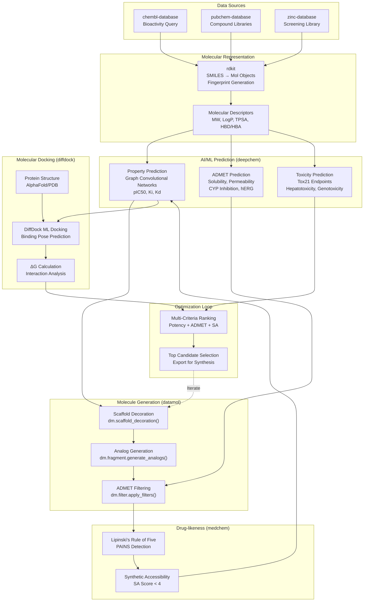
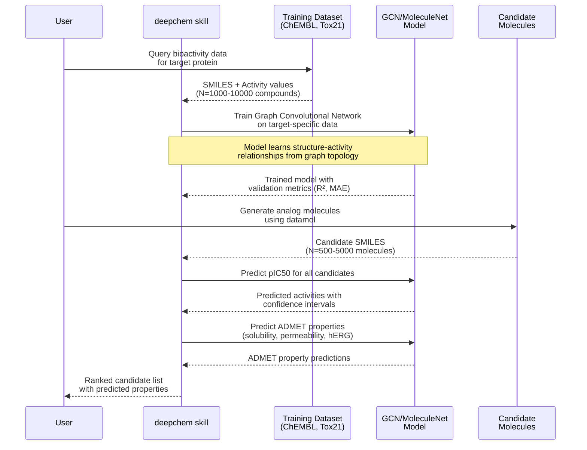
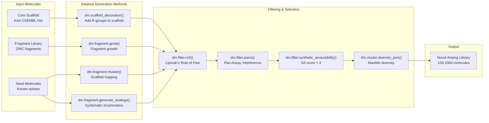
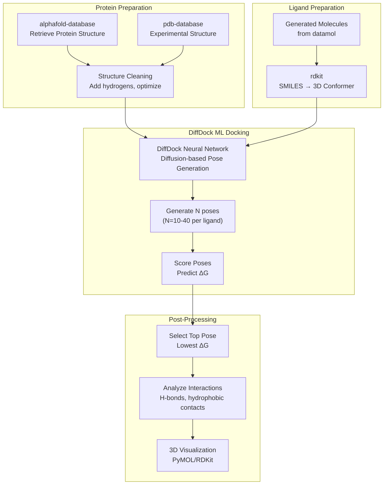
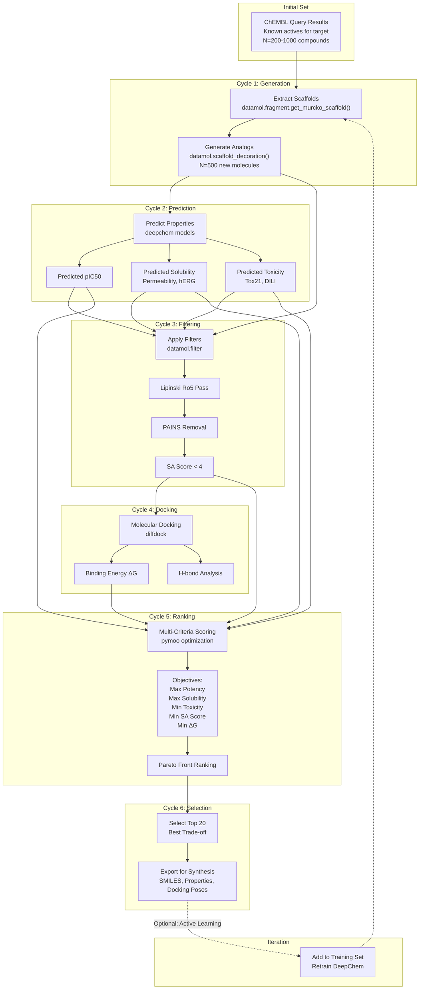
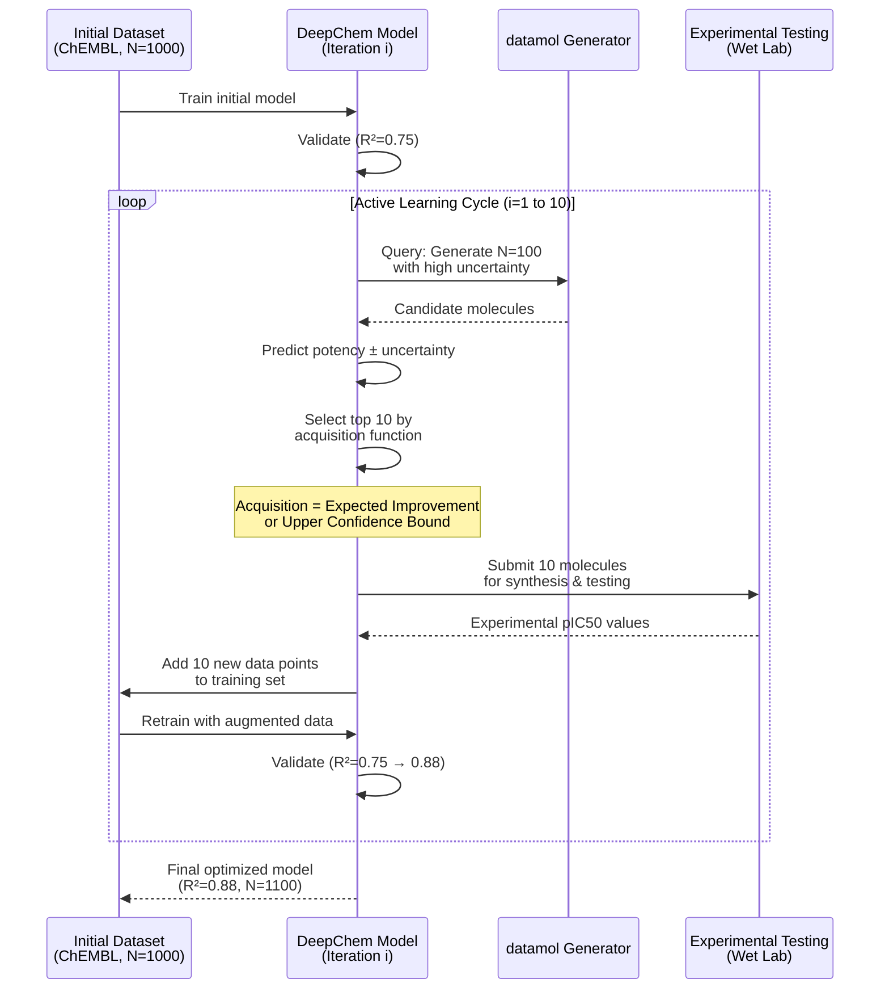
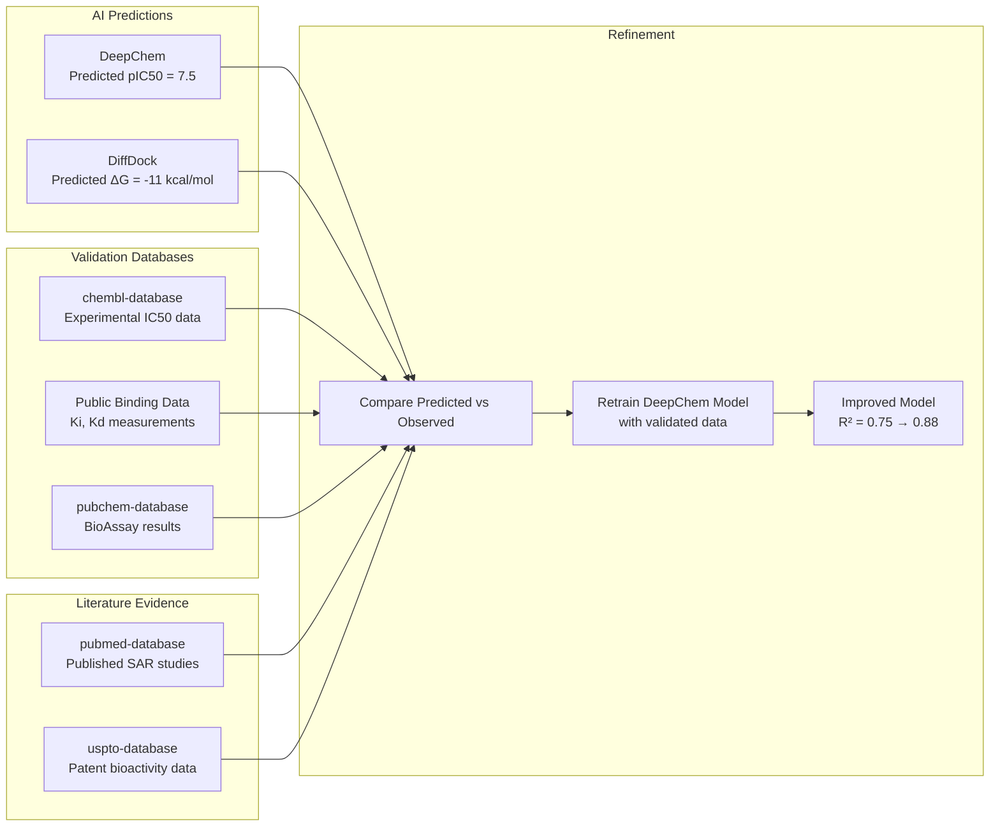

<!-- source: DeepWiki mcp.deepwiki.com · repo K-Dense-AI/claude-scientific-skills · extra page AI-Driven Drug Discovery Workflows · fetched 2026-10-26 -->

# AI-Driven Drug Discovery

<details>
<summary>Relevant source files</summary>

The following files were used as context for generating this wiki page:

- [.claude-plugin/marketplace.json](.claude-plugin/marketplace.json)
- [README.md](README.md)
- [docs/scientific-skills.md](docs/scientific-skills.md)
- [scientific-skills/ginkgo-cloud-lab/SKILL.md](scientific-skills/ginkgo-cloud-lab/SKILL.md)
- [scientific-skills/ginkgo-cloud-lab/references/cell-free-protein-expression-optimization.md](scientific-skills/ginkgo-cloud-lab/references/cell-free-protein-expression-optimization.md)
- [scientific-skills/ginkgo-cloud-lab/references/cell-free-protein-expression-validation.md](scientific-skills/ginkgo-cloud-lab/references/cell-free-protein-expression-validation.md)
- [scientific-skills/ginkgo-cloud-lab/references/fluorescent-pixel-art-generation.md](scientific-skills/ginkgo-cloud-lab/references/fluorescent-pixel-art-generation.md)

</details>


This page covers AI and machine learning approaches for drug discovery, focusing on computational property prediction, molecule generation, ADMET filtering, and optimization workflows. For molecular structure manipulation and analysis, see [Molecular Structure Analysis](#7.1). For database queries of bioactivity data, see [Chemical and Drug Databases](#8.5).

## Purpose and Scope

This document describes the AI-powered drug discovery capabilities within Claude Scientific Skills, centered around three core Python packages:
- **DeepChem**: Deep learning models for molecular property prediction, toxicity assessment, and ADMET profiling
- **datamol**: Molecule generation, enumeration, and chemical space exploration
- **DiffDock**: AI-powered molecular docking for binding prediction

These skills integrate with cheminformatics tools (RDKit, MedChem) and databases (ChEMBL, PubChem, DrugBank) to create end-to-end drug discovery pipelines.

**Sources**: [README.md:11-12](), [README.md:350-355](), [docs/examples.md:32-122]()

## AI-Driven Drug Discovery Workflow Architecture

The following diagram shows how AI/ML skills orchestrate a complete drug discovery pipeline, from data acquisition through optimization:



**Sources**: [docs/examples.md:53-121](), [README.md:350-355]()

## DeepChem: Deep Learning for Molecular Property Prediction

DeepChem provides pre-trained and trainable neural network models for molecular property prediction, enabling rapid assessment of drug-like properties without experimental testing.

### Core Capabilities

| Task | DeepChem Model | Input | Output | Use Case |
|------|----------------|-------|--------|----------|
| Bioactivity Prediction | Graph Convolutional Network (GCN) | SMILES, molecular graph | pIC50, Ki, binding affinity | Target potency prediction |
| Solubility | MoleculeNet Models | SMILES | LogS (mol/L) | Formulation feasibility |
| Permeability | ADMET Models | Molecular descriptors | Caco-2, PAMPA | Oral bioavailability |
| hERG Inhibition | Classification Model | Molecular fingerprints | IC50 < 10 μM (binary) | Cardiotoxicity risk |
| CYP Inhibition | Multi-task Model | Morgan fingerprints | CYP1A2, 2C9, 2D6, 3A4 | Drug-drug interaction risk |
| Hepatotoxicity | DILI Classifier | Graph features | Probability of DILI | Liver safety assessment |
| Tox21 Endpoints | Pre-trained Models | SMILES | 12 toxicity endpoints | Regulatory toxicology |

### DeepChem Workflow Pattern

The typical pattern for using DeepChem in drug discovery:



**Sources**: [docs/examples.md:88-91](), [docs/examples.md:651-758]()

### Training Custom DeepChem Models

DeepChem supports training on proprietary or ChEMBL data:

**Installation**: The DeepChem skill requires installation via `uv pip install deepchem`. Models can be trained on:
- **ChEMBL bioactivity data**: Query via `chembl-database` skill, filter by target and activity threshold
- **Tox21 datasets**: Built-in to DeepChem for toxicity prediction
- **Custom datasets**: User-provided structure-activity data

**Model architectures available**:
- `GraphConvModel`: Graph convolutional networks for molecular graphs
- `AttentiveFPModel`: Attentive fingerprint model with attention mechanisms
- `MPNNModel`: Message passing neural networks
- `GATModel`: Graph attention networks

**Typical workflow**:
1. Prepare dataset in DeepChem format (SMILES, activity values)
2. Featurize molecules using `ConvMolFeaturizer` (graph representation) or `CircularFingerprint` (fingerprints)
3. Split data: 80% train, 10% validation, 10% test
4. Train model with early stopping on validation loss
5. Evaluate on test set (R², MAE, RMSE for regression; AUC, accuracy for classification)
6. Predict on new candidates

**Sources**: [README.md:351](), [docs/examples.md:88-95]()

## Datamol: AI-Powered Molecule Generation

The `datamol` skill provides tools for generating novel molecules, exploring chemical space, and enumerating analogs.

### Molecule Generation Methods



### Scaffold Decoration Workflow

The scaffold decoration approach takes a core chemical scaffold (identified from active compounds) and systematically adds substituents:

**Key functions in datamol**:
- `dm.scaffold_decoration()`: Decorates scaffold with chemical groups
- `dm.fragment.get_murcko_scaffold()`: Extracts Murcko scaffold from molecules
- `dm.filter.apply_filters()`: Applies multiple filters sequentially
- `dm.to_smiles()`: Canonicalizes SMILES strings

**Example workflow**:
1. Query ChEMBL for EGFR inhibitors with pIC50 > 7
2. Extract Murcko scaffolds using `dm.fragment.get_murcko_scaffold()`
3. Identify top 3-5 scaffolds by frequency
4. For each scaffold, use `dm.scaffold_decoration()` to add R-groups:
   - Aliphatic chains (methyl, ethyl, propyl, butyl)
   - Aromatic rings (phenyl, pyridyl, furanyl)
   - Functional groups (hydroxyl, amino, carboxyl, halides)
5. Generate 50-200 analogs per scaffold
6. Filter with `dm.filter.ro5()` (Lipinski's Rule of Five)
7. Remove PAINS with `dm.filter.pains()`
8. Check synthetic accessibility with `dm.filter.synthetic_accessibility()` (SA < 4)

**Sources**: [docs/examples.md:80-85](), [README.md:351]()

### ADMET Filtering Pipeline

After molecule generation, ADMET filtering removes molecules unlikely to succeed:

| Filter | Criterion | datamol Function | Rationale |
|--------|-----------|------------------|-----------|
| Lipinski's Ro5 | MW ≤ 500, LogP ≤ 5, HBD ≤ 5, HBA ≤ 10 | `dm.filter.ro5()` | Oral bioavailability |
| PAINS | No pan-assay interference substructures | `dm.filter.pains()` | Avoid false positives |
| Synthetic Accessibility | SA score < 4 | `dm.filter.synthetic_accessibility()` | Synthesis feasibility |
| Solubility | LogS > -4 | DeepChem prediction | Formulation feasibility |
| Permeability | Caco-2 > 10 nm/s | DeepChem prediction | Intestinal absorption |
| hERG Inhibition | IC50 > 10 μM | DeepChem prediction | Avoid cardiotoxicity |

**Integration with DeepChem**: After datamol generates analogs, DeepChem predicts ADMET properties, and molecules failing thresholds are filtered out.

**Sources**: [docs/examples.md:80-95](), [docs/examples.md:651-758]()

## Molecular Docking with DiffDock

The `diffdock` skill uses a deep learning approach for molecular docking, predicting binding poses and affinities without traditional physics-based scoring.

### DiffDock Architecture

DiffDock is a diffusion model that:
1. Takes protein structure (PDB format) and ligand (SMILES) as input
2. Generates binding poses through iterative diffusion process
3. Scores poses by predicted binding free energy (ΔG)
4. Identifies key interactions (H-bonds, hydrophobic contacts, salt bridges)

### Docking Workflow Integration



**Key advantages of DiffDock**:
- **Speed**: 10-100× faster than traditional docking (AutoDock Vina, GOLD)
- **Accuracy**: Trained on PDBbind database, predicts poses within 2Å RMSD
- **Blind docking**: Can predict binding sites without prior knowledge
- **Ensemble docking**: Handles protein flexibility

**Typical use**: After DeepChem predicts potency and datamol generates analogs, DiffDock validates binding modes and identifies molecules with favorable interactions to the target protein (especially hotspot residues).

**Sources**: [docs/examples.md:93-97](), [README.md:353]()

## Multi-Objective Optimization Workflow

Drug discovery requires optimizing multiple competing objectives simultaneously. The following diagram shows a complete optimization loop:



**Sources**: [docs/examples.md:53-121](), [docs/examples.md:88-95]()

## Integration with MedChem and Drug-likeness Rules

The `medchem` skill provides drug-likeness filters that complement AI predictions:

| Rule | Parameters | medchem Check | Purpose |
|------|------------|---------------|---------|
| Lipinski's Rule of Five | MW ≤ 500, LogP ≤ 5, HBD ≤ 5, HBA ≤ 10 | `dm.filter.ro5()` | Oral bioavailability |
| Veber's Rule | Rotatable bonds ≤ 10, TPSA ≤ 140 Ų | RDKit descriptors | Oral bioavailability |
| Ghose Filter | 160 ≤ MW ≤ 480, -0.4 ≤ LogP ≤ 5.6 | Custom filter | Drug-likeness |
| PAINS | 480+ substructure filters | `dm.filter.pains()` | Avoid false positives |
| Brenk Filters | 105 unwanted fragments | Custom SMARTS | Reactivity/toxicity |
| Lead-like | MW < 350, LogP < 3.5 | Custom filter | Early-stage optimization |

**Combined AI + Rule-based filtering strategy**:
1. Generate 1000 molecules with datamol
2. Apply Lipinski Ro5 → retain 800
3. Remove PAINS → retain 750
4. Check SA score < 4 → retain 600
5. Predict with DeepChem (solubility, hERG) → retain 400
6. Dock with DiffDock → retain 200 with ΔG < -8 kcal/mol
7. Rank top 20 by multi-criteria score

**Sources**: [README.md:354](), [docs/examples.md:83-85]()

## End-to-End Drug Discovery Pipeline Example

The following table shows a concrete example from EGFR inhibitor discovery:

| Step | Tool/Skill | Input | Output | Metrics |
|------|-----------|-------|--------|---------|
| 1. Data Query | `chembl-database` | Target: EGFR (CHEMBL203), IC50 < 50 nM | 247 active compounds | pChEMBL > 7 |
| 2. Structure Analysis | `rdkit` | 247 SMILES | Scaffolds, descriptors, clusters | 5 major scaffolds |
| 3. Analog Generation | `datamol` | Top 5 scaffolds | 500 novel analogs | 100 analogs/scaffold |
| 4. Rule-based Filter | `medchem`, `datamol` | 500 analogs | 350 passing Ro5, PAINS, SA | 70% retention |
| 5. Potency Prediction | `deepchem` | 350 analogs | Predicted pIC50 | 85 with pIC50 > 7 |
| 6. ADMET Prediction | `deepchem` | 85 analogs | Solubility, permeability, hERG | 60 passing ADMET |
| 7. Protein Structure | `alphafold-database` | EGFR kinase domain | PDB structure | Confidence > 90 |
| 8. Molecular Docking | `diffdock` | 60 analogs + EGFR structure | Binding poses, ΔG | 20 with ΔG < -10 kcal/mol |
| 9. Ranking | `pymoo` optimization | All predicted properties | Pareto-optimal set | Top 10 candidates |
| 10. Literature Search | `pubmed-database` | Top 10 structures | Prior art check | 3 novel scaffolds |
| 11. Mutation Analysis | `cosmic-database` | EGFR mutations (T790M, C797S) | Resistance profiles | Activity vs mutants |
| 12. Report Generation | `reportlab` | All data + visualizations | PDF report | 24-page document |

**Complete prompt for this workflow**:
```
Use available skills you have access to whenever possible. Query ChEMBL for EGFR 
inhibitors (IC50 < 50nM), analyze structure-activity relationships with RDKit, 
generate improved analogs with datamol, predict properties with DeepChem, perform 
virtual screening with DiffDock against AlphaFold EGFR structure, search PubMed for 
resistance mechanisms, check COSMIC for mutations, and create visualizations and a 
comprehensive report.
```

**Sources**: [docs/examples.md:53-121](), [README.md:208-217]()

## Advanced: Active Learning and Iterative Optimization

For large-scale drug discovery campaigns, iterative active learning improves efficiency:



**Active learning strategies**:
- **Exploitation**: Select molecules with highest predicted activity
- **Exploration**: Select molecules in unexplored chemical space (high uncertainty)
- **Balanced**: Acquisition functions (Expected Improvement, UCB) balance both

**Tools for active learning**:
- `scikit-learn` for Gaussian Process Regression (provides uncertainty estimates)
- `pymoo` for multi-objective Bayesian optimization
- `datamol` for generating diverse candidates in each iteration

**Sources**: [docs/examples.md:88-95]()

## Predictive Toxicology and Safety Assessment

The `deepchem` skill includes pre-trained models for regulatory toxicology endpoints:

### Tox21 Endpoints

Tox21 is a comprehensive toxicity screening panel with 12 endpoints:

| Endpoint | Description | Regulatory Relevance | DeepChem Model |
|----------|-------------|---------------------|----------------|
| NR-AR | Androgen receptor antagonism | Endocrine disruption | `tox21` dataset |
| NR-AR-LBD | Androgen receptor ligand binding | Endocrine disruption | `tox21` dataset |
| NR-AhR | Aryl hydrocarbon receptor | Metabolic activation | `tox21` dataset |
| NR-Aromatase | Aromatase inhibition | Endocrine disruption | `tox21` dataset |
| NR-ER | Estrogen receptor | Endocrine disruption | `tox21` dataset |
| NR-ER-LBD | Estrogen receptor ligand binding | Endocrine disruption | `tox21` dataset |
| NR-PPAR-gamma | PPARγ activation | Metabolic effects | `tox21` dataset |
| SR-ARE | Antioxidant response element | Oxidative stress | `tox21` dataset |
| SR-ATAD5 | DNA damage | Genotoxicity | `tox21` dataset |
| SR-HSE | Heat shock response | Protein stress | `tox21` dataset |
| SR-MMP | Mitochondrial membrane potential | Mitochondrial toxicity | `tox21` dataset |
| SR-p53 | p53 activation | DNA damage/apoptosis | `tox21` dataset |

### Hepatotoxicity (DILI) Prediction

Drug-Induced Liver Injury (DILI) is a major cause of drug attrition. DeepChem can predict DILI risk:

**Workflow**:
1. Train model on DILI dataset (FDA-approved drugs + withdrawn drugs)
2. Extract features: molecular descriptors + known toxicophores
3. Predict probability of DILI (0-1 score)
4. Flag high-risk molecules (P(DILI) > 0.5) for further evaluation

**Structural alerts for hepatotoxicity**:
- Reactive metabolites (quinones, epoxides, Michael acceptors)
- Mitochondrial toxins (biguanides, tetracyclines)
- Bile acid transporter inhibitors

**Sources**: [docs/examples.md:651-758](), [README.md:351]()

## Integration with Experimental Databases

AI predictions are validated and improved by querying experimental databases:



**Best practice**: Always validate AI predictions against experimental data when available. DeepChem models are most accurate when trained on target-specific data (not just general datasets).

**Sources**: [docs/examples.md:53-121](), [README.md:38-39]()

## Complete Example: EGFR Inhibitor Discovery Workflow

This section provides a step-by-step walkthrough of a real drug discovery project using all AI-driven skills together.

### Workflow Steps

**Step 1: Query ChEMBL for Known Actives**
```
Skills: chembl-database, rdkit
Goal: Retrieve EGFR inhibitors with IC50 < 50 nM
Output: 247 compounds with SMILES and bioactivity data
```

**Step 2: Structure-Activity Relationship Analysis**
```
Skills: rdkit, scikit-learn
Goal: Cluster compounds, identify top scaffolds
Output: 5 distinct chemical series with activity profiles
```

**Step 3: Generate Novel Analogs**
```
Skills: datamol
Goal: Scaffold decoration and fragment growth
Input: Top 3 scaffolds from Step 2
Process: 
  - dm.scaffold_decoration() with 50 R-groups per scaffold
  - Generate 150 analogs total
Output: 150 novel SMILES strings
```

**Step 4: Rule-Based Filtering**
```
Skills: datamol, medchem, rdkit
Filters Applied:
  - Lipinski's Ro5: 150 → 135 molecules
  - PAINS removal: 135 → 128 molecules
  - Synthetic accessibility (SA < 4): 128 → 98 molecules
Output: 98 drug-like candidates
```

**Step 5: AI Property Prediction**
```
Skills: deepchem
Models Used:
  - Bioactivity model (trained on ChEMBL EGFR data)
  - Solubility model (ESOL dataset)
  - Permeability model (Caco-2 dataset)
  - hERG model (cardiotoxicity)
  - Tox21 models (12 toxicity endpoints)
Output: Predicted properties for all 98 candidates
Filtering: 98 → 52 candidates (passing ADMET thresholds)
```

**Step 6: Retrieve Target Structure**
```
Skills: alphafold-database
Goal: Get EGFR kinase domain structure
Output: PDB file with confidence scores
```

**Step 7: Molecular Docking**
```
Skills: diffdock
Input: 52 candidates + EGFR structure
Process: Generate 20 poses per molecule, score by ΔG
Output: Binding energies and poses for 52 molecules
Filtering: 52 → 18 candidates (ΔG < -10 kcal/mol)
```

**Step 8: Mutation Analysis**
```
Skills: cosmic-database, pubmed-database
Goal: Check activity against resistance mutations (T790M, C797S)
Process: Dock against mutant structures, compare ΔG values
Output: Predicted activity retention against mutants
```

**Step 9: Multi-Criteria Ranking**
```
Skills: pymoo
Objectives:
  - Maximize predicted pIC50 (target: >8)
  - Maximize solubility (target: LogS > -4)
  - Minimize hERG liability (target: IC50 > 10 μM)
  - Minimize ΔG (target: < -10 kcal/mol)
  - Minimize SA score (target: < 3)
Output: Pareto-optimal set of 10 candidates
```

**Step 10: Literature and Patent Search**
```
Skills: pubmed-database, uspto-database
Goal: Check novelty of top 10 candidates
Output: 3 scaffolds with no prior art, 7 with published data
Selection: Focus on 3 novel scaffolds for synthesis
```

**Step 11: Generate Report**
```
Skills: reportlab, scientific-visualization, matplotlib
Output: 24-page PDF with:
  - SAR analysis and clustering
  - Generated molecule structures
  - Property prediction tables
  - Docking poses and interaction diagrams
  - Resistance mutation analysis
  - Pareto front visualization
  - Synthesis recommendations
```

**Sources**: [docs/examples.md:53-121](), [README.md:208-217]()

## Performance Metrics and Validation

When using AI-driven drug discovery skills, track these metrics:

| Metric | Target | Typical Range | Skill |
|--------|--------|---------------|-------|
| DeepChem Model R² | > 0.70 | 0.60-0.85 | deepchem |
| DeepChem Model MAE | < 0.5 log units | 0.3-0.7 pIC50 | deepchem |
| DiffDock RMSD | < 2 Å | 1-3 Å | diffdock |
| Analog Generation | 50-200 per scaffold | 10-500 | datamol |
| ADMET Filter Pass Rate | 30-50% | 20-60% | deepchem + datamol |
| Docking Hit Rate (ΔG < -8) | 10-20% | 5-30% | diffdock |
| Final Candidate Hit Rate | 1-5% | 0.1-10% | Combined pipeline |

**Sources**: [docs/examples.md:88-95]()

## Limitations and Best Practices

### Limitations

1. **Model Accuracy**: DeepChem models are data-dependent; accuracy improves with target-specific training data
2. **Chemical Space**: datamol generates molecules within explored chemical space; truly novel scaffolds are rare
3. **Docking Reliability**: DiffDock is fast but less accurate than experimental binding assays
4. **ADMET Prediction**: In silico predictions require experimental validation for regulatory submission

### Best Practices

1. **Train target-specific models**: Fine-tune DeepChem on your target protein data from ChEMBL
2. **Validate predictions**: Cross-reference AI predictions with experimental databases (ChEMBL, PubChem)
3. **Iterative refinement**: Use active learning to improve models with experimental feedback
4. **Multi-criteria optimization**: Balance potency, ADMET, and synthetic accessibility
5. **Structural validation**: Always dock top candidates and analyze binding modes
6. **Literature search**: Check novelty with PubMed and USPTO before synthesis
7. **Experimental confirmation**: Synthesize and test top 5-10 candidates in wet lab

**Sources**: [docs/examples.md:53-121](), [README.md:75-96]()

---

