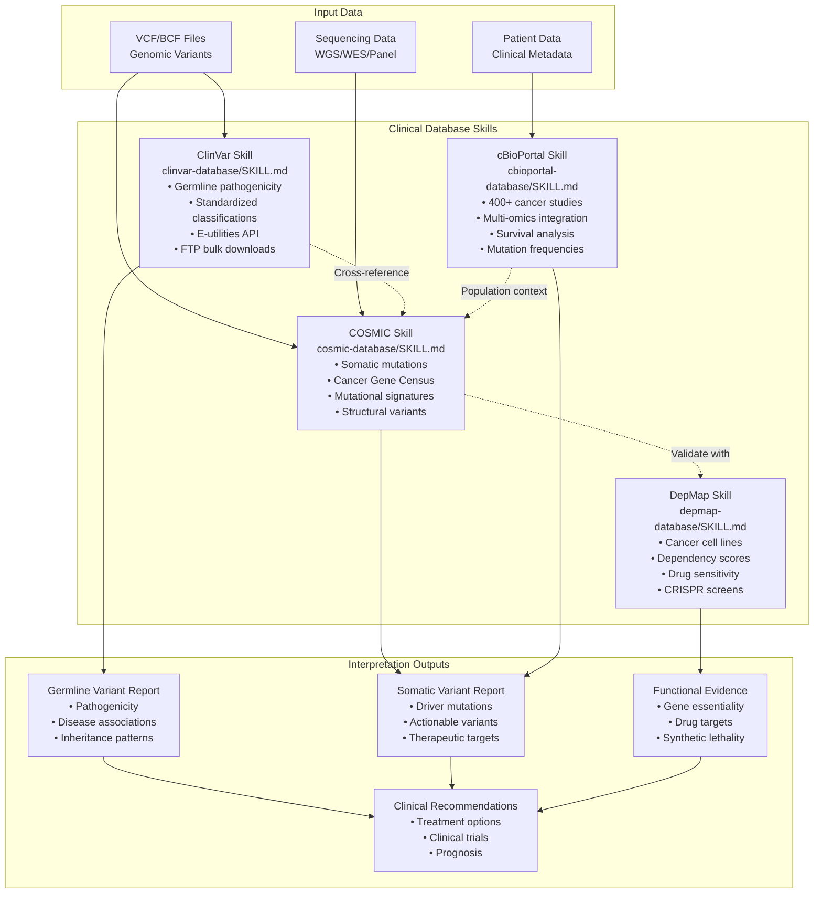
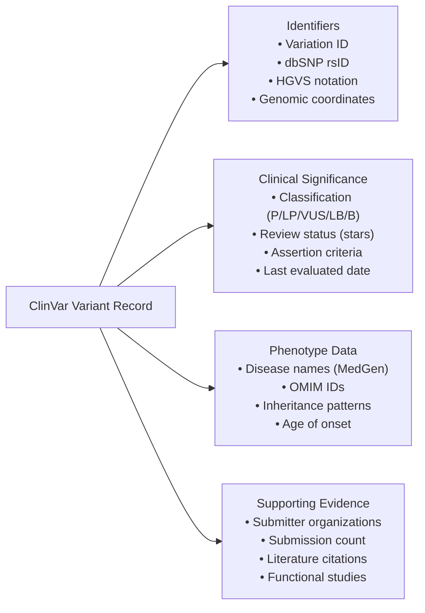
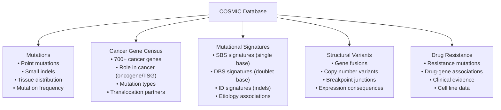
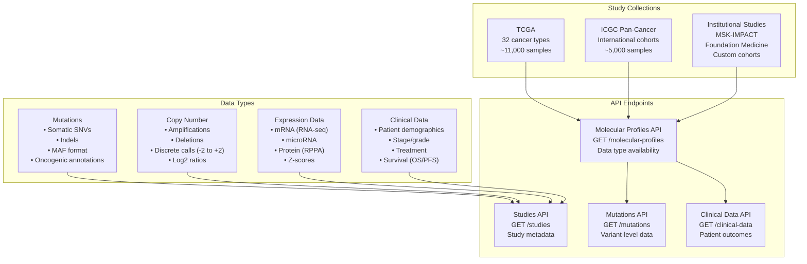
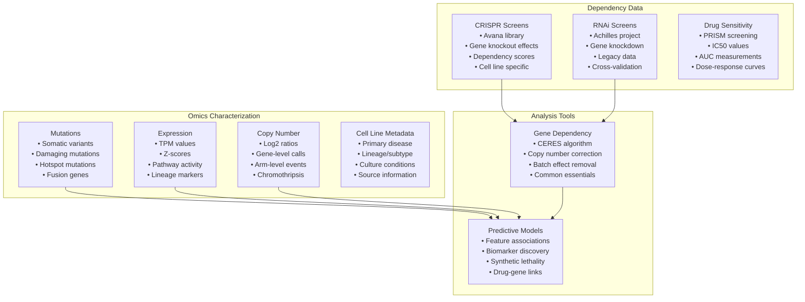
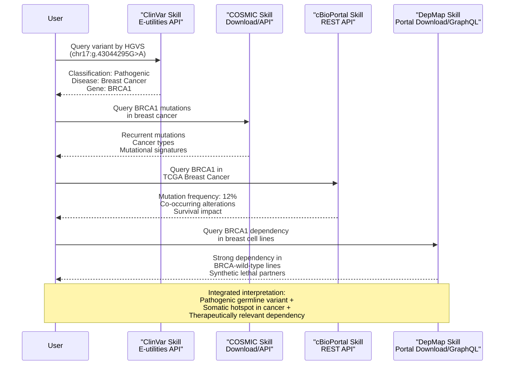
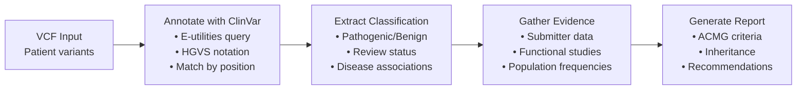
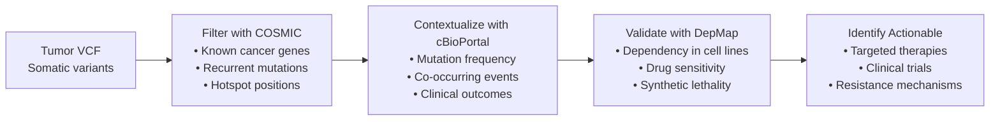
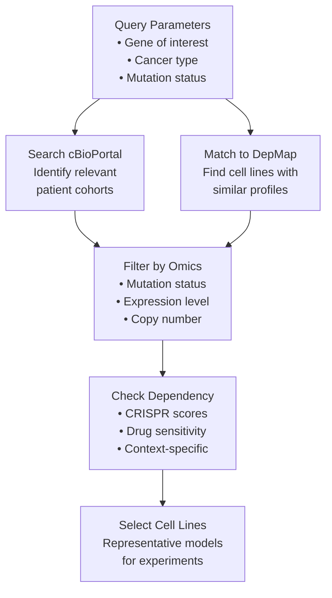

<!-- source: DeepWiki mcp.deepwiki.com · repo K-Dense-AI/claude-scientific-skills · extra page Clinical Databases and Variant Interpretation · fetched 2026-10-26 -->

# Clinical Databases and Variant Interpretation

<details>
<summary>Relevant source files</summary>

The following files were used as context for generating this wiki page:

- [.claude-plugin/marketplace.json](.claude-plugin/marketplace.json)
- [README.md](README.md)
- [docs/scientific-skills.md](docs/scientific-skills.md)
- [scientific-skills/ginkgo-cloud-lab/SKILL.md](scientific-skills/ginkgo-cloud-lab/SKILL.md)
- [scientific-skills/ginkgo-cloud-lab/references/cell-free-protein-expression-optimization.md](scientific-skills/ginkgo-cloud-lab/references/cell-free-protein-expression-optimization.md)
- [scientific-skills/ginkgo-cloud-lab/references/cell-free-protein-expression-validation.md](scientific-skills/ginkgo-cloud-lab/references/cell-free-protein-expression-validation.md)
- [scientific-skills/ginkgo-cloud-lab/references/fluorescent-pixel-art-generation.md](scientific-skills/ginkgo-cloud-lab/references/fluorescent-pixel-art-generation.md)

</details>


## Purpose and Scope

This document covers the four primary clinical database skills for cancer genomics and variant interpretation: **ClinVar**, **COSMIC**, **cBioPortal**, and **DepMap**. These skills provide programmatic access to clinical variant annotations, somatic cancer mutations, multi-omics cancer studies, and cancer cell line dependency data.

For medical imaging analysis, see [Imaging Data Commons](#4.3.2). For general genomic databases (Ensembl, NCBI Gene, UniProt), see [Protein and Genomics Databases](#5.3). For pharmacogenomic variant interpretation, see [Clinical and Healthcare Databases](#5.5) for ClinPGx.

**Sources**: [README.md:1-933](), [docs/scientific-skills.md:1-150](), [.claude-plugin/marketplace.json:1-194]()

---

## Clinical Variant Interpretation Ecosystem

The clinical database skills form an integrated ecosystem for variant interpretation spanning germline variants (ClinVar), somatic cancer mutations (COSMIC, cBioPortal), and functional validation (DepMap).



**Sources**: [README.md:425-434](), [docs/scientific-skills.md:9-11]()

---

## ClinVar Database Skill

### Overview

ClinVar (`clinvar-database`) provides access to NCBI's public archive of genomic variants and their clinical significance. Contains standardized variant classifications (pathogenic, likely pathogenic, benign, likely benign, variant of uncertain significance), disease associations, and evidence summaries.

**Location**: [scientific-skills/clinvar-database/]()

### Access Methods

| Method | Description | Use Case |
|--------|-------------|----------|
| **E-utilities API** | NCBI Entrez Programming Utilities | Programmatic queries, real-time lookup |
| **FTP Bulk Downloads** | XML/VCF/TXT files | Large-scale analysis, offline work |
| **ESearch/ESummary** | Search and retrieve variant summaries | Variant annotation pipelines |
| **EFetch** | Detailed variant records | In-depth clinical interpretation |

### Key Data Fields



### API Access Pattern

Typical workflow using E-utilities:

1. **ESearch**: Search variants by gene, HGVS, or phenotype
   - Endpoint: `https://eutils.ncbi.nlm.nih.gov/entrez/eutils/esearch.fcgi?db=clinvar`
   - Returns: List of ClinVar Variation IDs

2. **ESummary**: Retrieve variant summaries
   - Endpoint: `https://eutils.ncbi.nlm.nih.gov/entrez/eutils/esummary.fcgi?db=clinvar`
   - Returns: Clinical significance, review status, phenotypes

3. **EFetch**: Get detailed XML records
   - Endpoint: `https://eutils.ncbi.nlm.nih.gov/entrez/eutils/efetch.fcgi?db=clinvar`
   - Returns: Full variant annotation with evidence

**Rate Limits**: 3 requests/second without API key, 10 requests/second with API key

**Sources**: [README.md:9](), [docs/scientific-skills.md:9]()

---

## COSMIC Database Skill

### Overview

COSMIC (`cosmic-database`) provides access to the Catalogue of Somatic Mutations in Cancer, the world's largest database of somatic cancer mutations. Contains millions of mutations across thousands of cancer types, Cancer Gene Census (CGC), mutational signatures, structural variants, and drug resistance data.

**Location**: [scientific-skills/cosmic-database/]()

### Data Categories



### Access Requirements

| Access Type | Authentication | Rate Limits | Data Coverage |
|-------------|----------------|-------------|---------------|
| **Web Interface** | Free registration | N/A | Full browse access |
| **Download (Academic)** | Free account | N/A | Full dataset downloads |
| **Download (Commercial)** | License required | N/A | Full dataset downloads |
| **API (Academic)** | Free account | Moderate | Programmatic queries |

### Key File Formats

- **CosmicMutantExport.tsv**: All coding mutations
- **CosmicNCV.tsv**: Non-coding variants
- **CosmicStructExport.tsv**: Structural variants
- **Cancer_Gene_Census.csv**: Curated cancer gene list
- **COSMIC_Mutational_Signatures_v3.xlsx**: Signature definitions

### Integration with Other Databases

COSMIC cross-references with:
- **ClinVar**: Germline vs somatic distinction
- **cBioPortal**: Study-level mutation frequencies
- **DepMap**: Functional validation in cell lines
- **UniProt**: Protein-level consequences

**Sources**: [README.md:11](), [docs/scientific-skills.md:11]()

---

## cBioPortal Database Skill

### Overview

cBioPortal (`cbioportal-database`) provides access to multi-omics cancer genomics data from 400+ studies. Supports queries for somatic mutations, copy number alterations (CNAs), gene expression, methylation, protein expression, and clinical outcomes including survival analysis.

**Location**: [scientific-skills/cbioportal-database/]()

### Data Architecture



### API Access Pattern

**Base URL**: `https://www.cbioportal.org/api/v2/api-docs`

Common query workflows:

1. **Get Available Studies**:
   - Endpoint: `GET /studies`
   - Returns: List of study IDs, names, descriptions

2. **Query Mutations by Gene**:
   - Endpoint: `POST /mutations/fetch`
   - Parameters: `studyIds`, `molecularProfileIds`, `entrezGeneIds`
   - Returns: Mutation details with annotations

3. **Get Survival Data**:
   - Endpoint: `GET /studies/{studyId}/clinical-data`
   - Filter by: `OS_STATUS`, `OS_MONTHS`, `PFS_STATUS`, `PFS_MONTHS`

4. **Enrichment Analysis**:
   - Endpoint: `POST /molecular-profiles/{molecularProfileId}/mutations/fetch`
   - Returns: Significantly altered genes

### Study Types

| Study Type | Examples | Sample Sizes | Data Availability |
|------------|----------|--------------|-------------------|
| **Pan-Cancer** | TCGA Pan-Cancer Atlas | 10,000+ | Mutations, CNA, Expression, Methylation, Clinical |
| **Cancer-Specific** | TCGA Lung Adenocarcinoma | 500-1,000 | Full multi-omics |
| **Targeted Panels** | MSK-IMPACT | 10,000+ | Mutations (targeted), Clinical |
| **Metastatic** | GENIE (AACR) | 100,000+ | Mutations (targeted), Limited clinical |

**Sources**: [README.md:427](), [docs/scientific-skills.md:427]()

---

## DepMap Database Skill

### Overview

DepMap (`depmap-database`) provides access to the Cancer Dependency Map, containing genome-scale CRISPR and RNAi screens across 1,000+ cancer cell lines. Includes dependency scores (gene essentiality), drug sensitivity data, and multi-omics characterization (mutations, expression, copy number, methylation).

**Location**: [scientific-skills/depmap-database/]()

### Data Components



### File Formats and Access

**DepMap Portal**: `https://depmap.org/portal/`

**Downloadable Datasets** (quarterly releases):

| File | Description | Format |
|------|-------------|--------|
| `CRISPR_gene_effect.csv` | Gene dependency scores (CERES) | Cell line × Gene matrix |
| `CRISPR_gene_dependency.csv` | Binary dependency calls | Cell line × Gene matrix |
| `primary-screen-replicate-collapsed-treatment-info.csv` | Drug sensitivity (PRISM) | Cell line × Compound matrix |
| `OmicsSomaticMutations.csv` | Damaging mutations | Cell line, Gene, Variant |
| `OmicsExpressionProteinCodingGenesTPMLogp1.csv` | Gene expression (TPM) | Cell line × Gene matrix |
| `OmicsCNGene.csv` | Copy number (log2) | Cell line × Gene matrix |
| `Model.csv` | Cell line annotations | Metadata table |

### API Access

**DepMap GraphQL API**: `https://depmap.org/portal/api/`

Example query for gene dependencies:

```graphql
query {
  gene(geneId: "BRCA1") {
    symbol
    name
    crispr {
      cellLine
      dependencyScore
    }
  }
}
```

### Dependency Score Interpretation

| Score Range | Interpretation | Biological Meaning |
|-------------|----------------|-------------------|
| **< -1.0** | Strong dependency | Gene essential in this context |
| **-1.0 to -0.5** | Moderate dependency | Gene important but not essential |
| **-0.5 to 0** | Weak/no dependency | Gene not required |
| **> 0** | No dependency/growth advantage | Gene knockout beneficial |

**Common Essential Genes**: ~700 genes with dependency < -1 across >90% of cell lines (ribosomal proteins, spliceosome, proteasome)

**Sources**: [README.md:427](), [docs/scientific-skills.md:34]()

---

## Data Integration Architecture

The four clinical database skills integrate to provide comprehensive variant interpretation from germline variants through somatic alterations to functional validation.



**Sources**: [README.md:289-302](), [docs/scientific-skills.md:9-11]()

---

## Common Workflows

### 1. Germline Variant Interpretation

**Goal**: Classify a germline variant's pathogenicity and clinical significance



**Skills Used**: `clinvar-database`, `ensembl-database`, `ncbi-gene-database`

### 2. Somatic Cancer Variant Analysis

**Goal**: Identify driver mutations and therapeutic targets in tumor samples



**Skills Used**: `cosmic-database`, `cbioportal-database`, `depmap-database`, `opentargets-database`

### 3. Cancer Cell Line Model Selection

**Goal**: Choose cell lines for functional studies based on genomic features



**Skills Used**: `cbioportal-database`, `depmap-database`, `cosmic-database`

**Sources**: [README.md:289-319](), [docs/scientific-skills.md:373-377]()

---

## API Rate Limits and Best Practices

| Database | Authentication | Rate Limit | Best Practice |
|----------|----------------|------------|---------------|
| **ClinVar** | Optional (API key) | 3 req/s (10 with key) | Batch queries with ESummary |
| **COSMIC** | Required (account) | Moderate | Use bulk downloads for large queries |
| **cBioPortal** | None | Unspecified | Paginate large requests |
| **DepMap** | None | Unspecified | Download quarterly releases for bulk analysis |

### Optimization Strategies

1. **Bulk Downloads**: For large-scale analysis, download entire datasets rather than API queries
   - ClinVar: FTP downloads of VCF/XML
   - COSMIC: Full data exports (requires registration)
   - DepMap: Quarterly release files

2. **Caching**: Cache API responses locally to avoid redundant queries
   - Store ClinVar variant classifications
   - Cache COSMIC gene-cancer associations
   - Local DepMap dependency matrices

3. **Batch Processing**: Group related queries together
   - ClinVar ESummary accepts multiple IDs
   - cBioPortal POST endpoints for bulk mutations
   - DepMap file-based analysis for gene sets

**Sources**: [README.md:9-11](), [docs/scientific-skills.md:9-34]()

---

## Integration with Other Skills

### Upstream Skills (Data Preparation)

- **pysam**: Parse VCF/BCF files → [scientific-skills/pysam/]()
- **ensembl-database**: Annotate variants with VEP → [scientific-skills/ensembl-database/]()
- **ncbi-gene-database**: Gene-level annotations → [scientific-skills/gene-database/]()

### Downstream Skills (Analysis and Reporting)

- **opentargets-database**: Therapeutic target validation
- **clinicaltrials-database**: Match patients to trials
- **pubmed-database**: Literature evidence
- **scientific-writing**: Clinical report generation

### Complementary Skills

- **gnomad-database**: Population allele frequencies (germline context)
- **gtex-database**: Tissue-specific expression (functional context)
- **uniprot-database**: Protein-level consequences

**Sources**: [README.md:370-377](), [docs/scientific-skills.md:14-34]()

---

## Example Use Cases

### Case 1: Hereditary Cancer Risk Assessment

**Scenario**: Patient with family history of breast cancer, VCF from clinical exome sequencing

**Workflow**:
1. Parse VCF with `pysam`
2. Query ClinVar for pathogenic variants in cancer genes (BRCA1/2, TP53, PTEN, etc.)
3. Cross-reference with COSMIC to distinguish germline vs somatic
4. Check cBioPortal for variant prevalence in cancer cohorts
5. Generate clinical report with actionable recommendations

### Case 2: Tumor Profiling for Targeted Therapy

**Scenario**: Lung adenocarcinoma tumor, targeted panel sequencing (EGFR, ALK, KRAS, etc.)

**Workflow**:
1. Identify somatic mutations in COSMIC Cancer Gene Census
2. Query cBioPortal for mutation frequencies in lung adenocarcinoma
3. Check DepMap for drug sensitivities associated with detected alterations
4. Match to clinical trials via `clinicaltrials-database`
5. Prioritize targeted therapies based on evidence

### Case 3: Cancer Functional Genomics Study

**Scenario**: Identify synthetic lethal interactions for TP53-mutant cancers

**Workflow**:
1. Query cBioPortal for TP53 mutation status across cancer types
2. Download DepMap CRISPR dependency data
3. Identify genes with strong dependency specifically in TP53-mutant lines
4. Validate targets in COSMIC for druggability
5. Query `chembl-database` for existing inhibitors

**Sources**: [README.md:289-302](), [docs/scientific-skills.md:373-377]()

---

