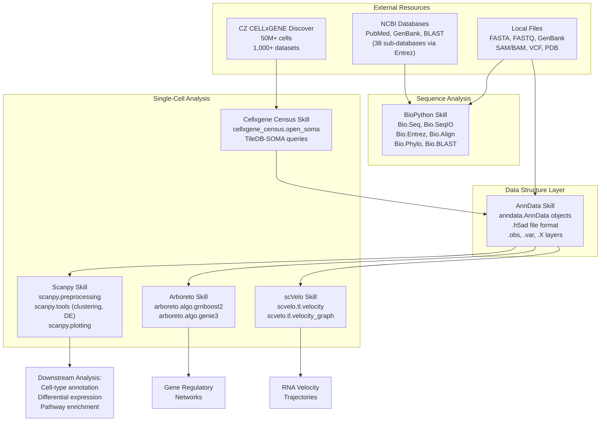
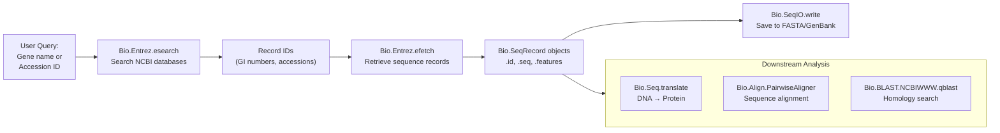
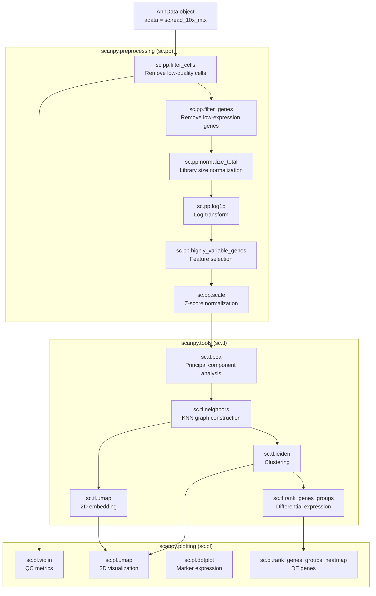
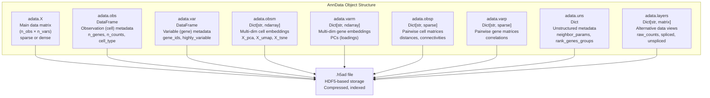
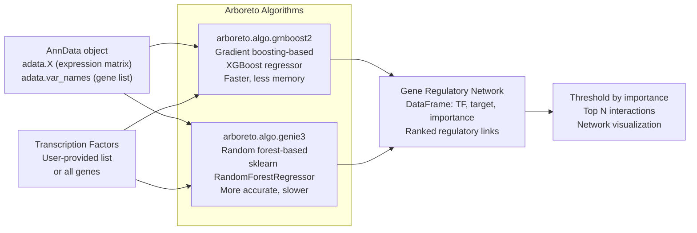
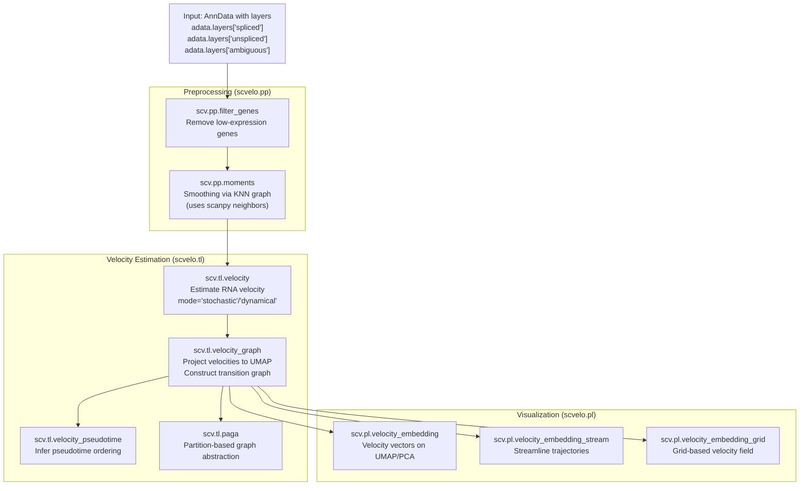
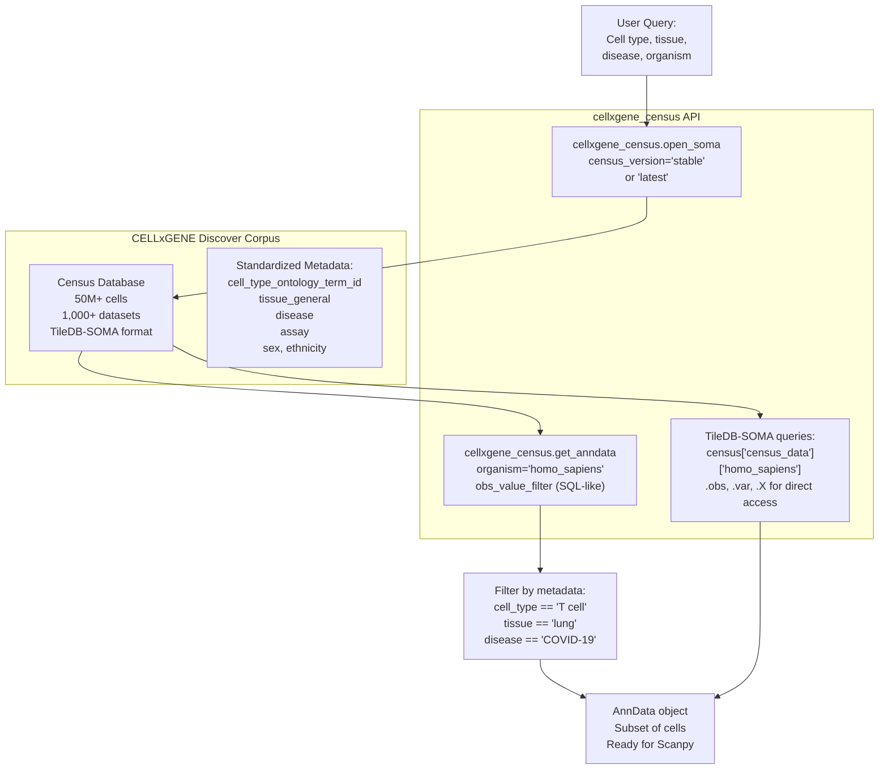
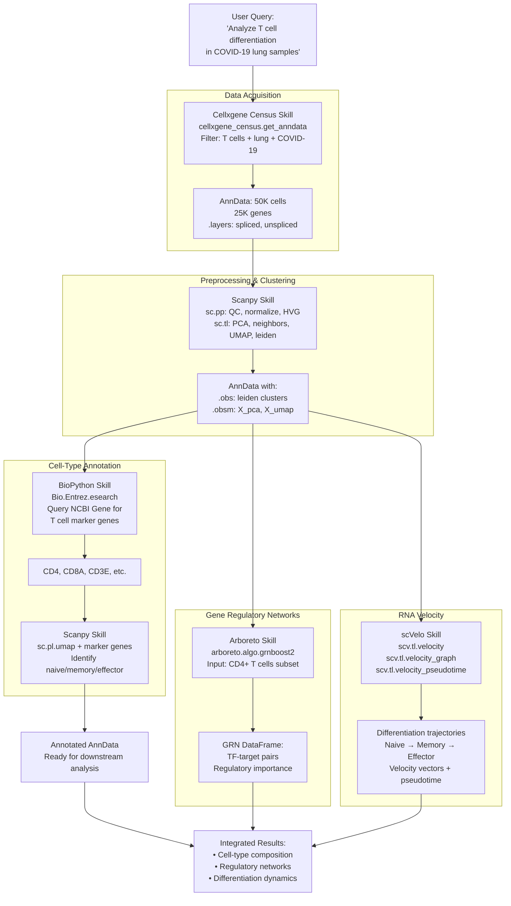

<!-- source: DeepWiki mcp.deepwiki.com · repo K-Dense-AI/claude-scientific-skills · extra page Core Bioinformatics Skills · fetched 2026-10-26 -->

# Core Bioinformatics Skills

<details>
<summary>Relevant source files</summary>

The following files were used as context for generating this wiki page:

- [.claude-plugin/marketplace.json](.claude-plugin/marketplace.json)
- [README.md](README.md)
- [docs/scientific-skills.md](docs/scientific-skills.md)
- [scientific-skills/ginkgo-cloud-lab/SKILL.md](scientific-skills/ginkgo-cloud-lab/SKILL.md)
- [scientific-skills/ginkgo-cloud-lab/references/cell-free-protein-expression-optimization.md](scientific-skills/ginkgo-cloud-lab/references/cell-free-protein-expression-optimization.md)
- [scientific-skills/ginkgo-cloud-lab/references/cell-free-protein-expression-validation.md](scientific-skills/ginkgo-cloud-lab/references/cell-free-protein-expression-validation.md)
- [scientific-skills/ginkgo-cloud-lab/references/fluorescent-pixel-art-generation.md](scientific-skills/ginkgo-cloud-lab/references/fluorescent-pixel-art-generation.md)

</details>


## Purpose and Scope

This document covers the five foundational bioinformatics skills for sequence analysis, single-cell RNA-seq, and gene regulatory network inference: **BioPython**, **Scanpy**, **Arboreto**, **scVelo**, and **Cellxgene Census**. These skills enable AI agents to perform DNA/RNA/protein sequence manipulation, NCBI database queries, single-cell transcriptomics analysis, RNA velocity calculations, and access to public single-cell datasets.

For genomic variant storage and population-scale VCF analysis, see [TileDB-VCF Genomic Variant Storage](#4.1.2). For additional bioinformatics tools (pysam, gget, BioServices, phylogenetics), see the broader [Bioinformatics and Genomics](#4.1) domain overview.

**Sources:** [README.md:407-410](), [docs/scientific-skills.md:64-74]()

---

## Core Skills Architecture

The five core bioinformatics skills form a layered architecture: BioPython provides fundamental sequence manipulation and NCBI database access; AnnData serves as the data structure standard for single-cell analysis; Scanpy, Arboreto, and scVelo build on AnnData for specific single-cell workflows; and Cellxgene Census provides pre-integrated public data in AnnData format.



**Sources:** [docs/scientific-skills.md:64-69](), [README.md:407-410](), [.claude-plugin/marketplace.json:20-28]()

---

## BioPython: Sequence Analysis and Database Access

BioPython provides the foundational toolkit for biological sequence manipulation, file format parsing, and programmatic access to NCBI databases. The skill centers on three core modules: `Bio.SeqIO` for reading/writing sequence files, `Bio.Entrez` for querying NCBI's 38 sub-databases, and `Bio.Align` for sequence alignment.

### Core Modules and Code Entities

| Module | Key Classes/Functions | Purpose |
|--------|----------------------|---------|
| `Bio.Seq` | `Seq`, `MutableSeq` | DNA/RNA/protein sequence objects with biological alphabet validation |
| `Bio.SeqIO` | `parse()`, `read()`, `write()`, `convert()` | File I/O for FASTA, FASTQ, GenBank, EMBL, Swiss-Prot formats |
| `Bio.Entrez` | `esearch()`, `efetch()`, `einfo()`, `elink()` | NCBI E-utilities API for PubMed, GenBank, BLAST, Taxonomy |
| `Bio.Align` | `PairwiseAligner`, `MultipleSeqAlignment` | Pairwise and multiple sequence alignment |
| `Bio.Phylo` | `read()`, `write()`, `draw()` | Phylogenetic tree construction and manipulation |
| `Bio.BLAST` | `NCBIWWW.qblast()`, `NCBIXML.parse()` | BLAST searches and result parsing |
| `Bio.SeqRecord` | `SeqRecord`, `.id`, `.seq`, `.features` | Annotated sequence container with metadata |

### BioPython Workflow: Sequence Retrieval to Analysis



### Supported File Formats

BioPython's `Bio.SeqIO` module supports 20+ file formats through a unified interface. The most commonly used formats for bioinformatics workflows:

| Format | Extension | Read/Write | Use Case |
|--------|-----------|------------|----------|
| FASTA | `.fasta`, `.fa`, `.fna` | Read/Write | Sequence storage, database submissions |
| FASTQ | `.fastq`, `.fq` | Read/Write | NGS raw reads with quality scores |
| GenBank | `.gb`, `.gbk` | Read/Write | Annotated sequences with features |
| EMBL | `.embl` | Read/Write | European sequence database format |
| Swiss-Prot | `.sp` | Read/Write | Protein sequence database |
| PDB | `.pdb` | Read/Write | Protein structure coordinates |
| SAM/BAM | `.sam`, `.bam` | Read | Sequence alignments (via pysam) |
| VCF | `.vcf` | Read | Genomic variants |
| GFF | `.gff`, `.gff3` | Read | Genome annotations |

### NCBI Database Access via Entrez

BioPython provides access to 38 NCBI databases through the `Bio.Entrez` module. Key databases:

- **PubMed** - 35M+ biomedical literature citations
- **Gene** - Gene-specific information with 500+ organisms
- **Nucleotide** - GenBank nucleotide sequences
- **Protein** - GenBank protein sequences
- **Structure** - 3D macromolecular structures
- **Taxonomy** - Organism taxonomic classifications
- **BLAST** - Sequence similarity searches
- **dbSNP** - Single nucleotide polymorphisms
- **ClinVar** - Clinical significance of variants
- **Assembly** - Genome assemblies

**Sources:** [docs/scientific-skills.md:66-67](), [README.md:407](), [.claude-plugin/marketplace.json:23]()

---

## Scanpy: Single-Cell RNA-seq Analysis

Scanpy is the Python ecosystem's standard for single-cell transcriptomics analysis, built on top of AnnData data structures. The skill provides preprocessing (`scanpy.preprocessing`), dimensionality reduction (`scanpy.tools`), clustering, differential expression, and visualization (`scanpy.plotting`) for single-cell RNA-seq workflows.

### Core API Structure



### AnnData Object Structure

Scanpy operates on `AnnData` objects with a specific structure for single-cell data:

| Attribute | Type | Content | Scanpy Usage |
|-----------|------|---------|--------------|
| `.X` | sparse matrix | Raw or normalized counts (cells × genes) | All analysis functions |
| `.obs` | DataFrame | Cell metadata (n_genes, n_counts, leiden, louvain) | Clustering results, QC metrics |
| `.var` | DataFrame | Gene metadata (highly_variable, means, dispersions) | Feature selection results |
| `.obsm` | Dict | Multi-dimensional cell embeddings (`X_pca`, `X_umap`, `X_tsne`) | Dimensionality reduction |
| `.obsp` | Dict | Pairwise cell distances/connectivities | KNN graph from `sc.tl.neighbors()` |
| `.uns` | Dict | Unstructured metadata (neighbor params, DE results) | Analysis parameters, results |
| `.layers` | Dict | Alternative data matrices (raw counts, imputed) | Multiple data views |

### Standard Single-Cell Analysis Workflow

The canonical Scanpy workflow follows this sequence:

1. **Data Loading**: `sc.read_10x_mtx()` or `sc.read_h5ad()` → AnnData object
2. **QC Filtering**: `sc.pp.filter_cells()`, `sc.pp.filter_genes()` → Remove low-quality data
3. **Normalization**: `sc.pp.normalize_total()`, `sc.pp.log1p()` → Comparable expression
4. **Feature Selection**: `sc.pp.highly_variable_genes()` → Reduce dimensionality
5. **Scaling**: `sc.pp.scale()` → Z-score normalization
6. **PCA**: `sc.tl.pca()` → Linear dimensionality reduction
7. **Neighborhood Graph**: `sc.tl.neighbors()` → KNN graph construction
8. **UMAP Embedding**: `sc.tl.umap()` → 2D visualization
9. **Clustering**: `sc.tl.leiden()` or `sc.tl.louvain()` → Cell-type identification
10. **Differential Expression**: `sc.tl.rank_genes_groups()` → Marker gene discovery

**Sources:** [docs/scientific-skills.md:64](), [README.md:408](), [.claude-plugin/marketplace.json:87]()

---

## AnnData: Single-Cell Data Structure Standard

AnnData (`anndata.AnnData`) is the data structure standard for single-cell analysis in Python, serving as the foundation for Scanpy, scVelo, Arboreto, and other single-cell tools. The skill focuses on the `.h5ad` file format, efficient I/O operations, and integration with sparse matrices for memory efficiency.

### AnnData Architecture



### Key AnnData Operations

| Operation | Code Entity | Purpose |
|-----------|-------------|---------|
| Create from matrix | `adata = anndata.AnnData(X=counts, obs=cell_metadata, var=gene_metadata)` | Initialize from NumPy/sparse matrix |
| Read from file | `adata = anndata.read_h5ad('data.h5ad')` | Load from disk |
| Write to file | `adata.write('data.h5ad', compression='gzip')` | Save with compression |
| Subset cells | `adata_subset = adata[cell_mask, :]` | Filter observations |
| Subset genes | `adata_subset = adata[:, gene_mask]` | Filter variables |
| Add layer | `adata.layers['raw'] = raw_counts` | Store alternative data matrix |
| Add embedding | `adata.obsm['X_pca'] = pca_coords` | Store dimensionality reduction |
| Concatenate | `adata_combined = anndata.concat([adata1, adata2])` | Merge datasets |
| Convert to DataFrame | `df = adata.to_df()` | Export to pandas |

### Integration with Sparse Matrices

AnnData uses `scipy.sparse` matrices for memory efficiency with single-cell data (typically 90-99% zeros):

- **Input**: `adata = anndata.AnnData(X=scipy.sparse.csr_matrix(counts))`
- **Storage**: `.h5ad` files preserve sparsity via HDF5 compression
- **Operations**: Most Scanpy functions operate directly on sparse matrices
- **Memory**: 10-100× reduction vs. dense arrays for typical single-cell datasets

**Sources:** [docs/scientific-skills.md:64](), [README.md:408](), [.claude-plugin/marketplace.json:20]()

---

## Arboreto: Gene Regulatory Network Inference

Arboreto implements ensemble tree-based algorithms for inferring gene regulatory networks (GRNs) from single-cell RNA-seq data. The skill provides two core algorithms: `arboreto.algo.grnboost2()` (gradient boosting) and `arboreto.algo.genie3()` (random forest), optimized for large-scale single-cell datasets with parallel processing.

### Core Algorithms



### API Usage Patterns

The core workflow for both algorithms follows the same pattern:

```python
# Input: expression matrix (cells × genes) and TF list
import arboreto.algo

# Option 1: GRNBoost2 (gradient boosting, faster)
network = arboreto.algo.grnboost2(
    expression_data=adata.to_df().T,  # genes × cells
    tf_names=transcription_factors,    # list of TF gene names
    verbose=True
)

# Option 2: GENIE3 (random forest, more accurate)
network = arboreto.algo.genie3(
    expression_data=adata.to_df().T,
    tf_names=transcription_factors,
    verbose=True
)

# Output: DataFrame with columns [TF, target, importance]
```

### Output Format

| Column | Type | Description |
|--------|------|-------------|
| `TF` | str | Transcription factor gene name |
| `target` | str | Target gene name |
| `importance` | float | Regulatory importance score (0-1 range) |

Results are ranked by importance, enabling threshold-based filtering:
- Top 10K interactions for focused analysis
- Importance > 0.5 for high-confidence edges
- Cell-type-specific networks by subsetting AnnData before inference

### Performance Characteristics

| Algorithm | Method | Speed | Memory | Accuracy | Best For |
|-----------|--------|-------|--------|----------|----------|
| `grnboost2()` | Gradient boosting (XGBoost) | Fast | Low | Good | Large datasets (>10K cells, >10K genes) |
| `genie3()` | Random forest (sklearn) | Slower | Higher | Better | Small-medium datasets, high accuracy needed |

Both algorithms support parallel processing via Dask distributed scheduler for scaling to millions of cells.

**Sources:** [docs/scientific-skills.md:65](), [README.md:408](), [.claude-plugin/marketplace.json:21]()

---

## scVelo: RNA Velocity Analysis

scVelo performs RNA velocity analysis to infer dynamic cellular transitions from single-cell RNA-seq data by modeling spliced and unspliced mRNA abundances. The skill uses `scvelo.tl.velocity()` for velocity estimation and `scvelo.tl.velocity_graph()` for trajectory inference, integrated with Scanpy's AnnData format.

### RNA Velocity Workflow



### Key scVelo Functions

| Function | Purpose | Key Parameters |
|----------|---------|----------------|
| `scv.pp.filter_genes()` | Remove genes with low counts | `min_shared_counts`, `min_counts` |
| `scv.pp.moments()` | Compute moments (mean, variance) from KNN graph | `n_pcs`, `n_neighbors` |
| `scv.tl.velocity()` | Estimate RNA velocity | `mode='stochastic'` or `'dynamical'` |
| `scv.tl.velocity_graph()` | Construct Markov transition matrix | `n_jobs`, `approx`, `mode_neighbors` |
| `scv.tl.velocity_pseudotime()` | Compute velocity-based pseudotime | `root_key`, `end_key` |
| `scv.pl.velocity_embedding()` | Plot velocity arrows on UMAP | `basis='umap'`, `arrow_length`, `arrow_size` |
| `scv.pl.velocity_embedding_stream()` | Plot streamlines showing trajectories | `basis='umap'`, `density`, `linewidth` |

### Velocity Estimation Modes

scVelo supports three velocity models via `scv.tl.velocity(mode=...)`:

| Mode | Description | Use Case | Computation |
|------|-------------|----------|-------------|
| `'stochastic'` | Steady-state assumption (constant transcription) | Default, fast | Solves moment equations |
| `'dynamical'` | Full dynamical model (time-varying rates) | Complex dynamics, high quality data | EM algorithm, slower |
| `'deterministic'` | Simplified steady-state | Legacy, rarely used | Linear regression |

### Data Requirements

scVelo requires AnnData objects with spliced/unspliced layers:

```python
# From 10X Genomics data with velocyto preprocessing
import scvelo as scv
adata = scv.read('data.loom', cache=True)

# Layers expected:
# adata.layers['spliced']     - mature mRNA counts
# adata.layers['unspliced']   - nascent mRNA counts
# adata.layers['ambiguous']   - ambiguous reads (optional)

# Integration with Scanpy preprocessing required:
import scanpy as sc
sc.pp.normalize_total(adata)
sc.pp.log1p(adata)
sc.pp.highly_variable_genes(adata)
sc.tl.pca(adata)
sc.tl.umap(adata)
sc.tl.leiden(adata)  # for cluster annotations
```

**Sources:** [docs/scientific-skills.md:64](), [README.md:408](), [.claude-plugin/marketplace.json:91]()

---

## Cellxgene Census: Large-Scale Single-Cell Data Access

Cellxgene Census provides programmatic access to the CZ CELLxGENE Discover corpus—50M+ cells across 1,000+ single-cell RNA-seq datasets with standardized annotations. The skill uses `cellxgene_census.open_soma()` for TileDB-SOMA-based queries, enabling efficient subsetting by cell metadata before downloading data.

### Census Data Access Architecture



### Core Census Functions

| Function | Purpose | Returns |
|----------|---------|---------|
| `cellxgene_census.open_soma()` | Open census database connection | Context manager for census access |
| `cellxgene_census.get_anndata()` | Query and download cells as AnnData | `AnnData` object with filtered data |
| `census.get('census_data')` | Access census data collection | SOMA collection with organisms |
| `census['census_data']['homo_sapiens']` | Access human single-cell data | SOMA experiment object |
| `census['census_data']['mus_musculus']` | Access mouse single-cell data | SOMA experiment object |

### Querying by Cell Metadata

The `obs_value_filter` parameter uses SQL-like syntax for metadata filtering:

```python
import cellxgene_census

with cellxgene_census.open_soma() as census:
    adata = cellxgene_census.get_anndata(
        census,
        organism="homo_sapiens",
        obs_value_filter=(
            "cell_type_ontology_term_id == 'CL:0000084' and "  # T cells
            "tissue_general == 'lung' and "
            "disease == 'COVID-19'"
        ),
        var_value_filter="feature_name in ['CD4', 'CD8A', 'IL2', 'IFNG']",
        column_names={
            "obs": ["cell_type", "tissue", "disease", "sex"],
            "var": ["feature_name"]
        }
    )
```

### Standardized Census Metadata Fields

| Field | Type | Description | Example Values |
|-------|------|-------------|----------------|
| `cell_type_ontology_term_id` | str | Cell Ontology ID | `'CL:0000084'` (T cell) |
| `cell_type` | str | Human-readable cell type | `'T cell'`, `'B cell'` |
| `tissue_general` | str | High-level tissue category | `'lung'`, `'blood'`, `'brain'` |
| `tissue` | str | Specific tissue/organ | `'lung parenchyma'` |
| `disease` | str | Disease condition | `'COVID-19'`, `'normal'`, `'lung adenocarcinoma'` |
| `assay_ontology_term_id` | str | Experimental Ontology ID | `'EFO:0009922'` (10x 3' v3) |
| `assay` | str | Sequencing technology | `'10x 3' v3'`, `'Smart-seq2'` |
| `sex` | str | Biological sex | `'female'`, `'male'`, `'unknown'` |
| `organism_ontology_term_id` | str | NCBI Taxonomy ID | `'NCBITaxon:9606'` (human) |
| `dataset_id` | str | Source dataset identifier | UUID |

### TileDB-SOMA Integration

Census data is stored in TileDB-SOMA format for efficient cloud-native access:

- **Lazy loading**: Only requested cells/genes downloaded
- **Cloud storage**: Data served from S3 without full download
- **Compression**: 10-100× reduction vs. uncompressed matrices
- **Incremental updates**: Census versions updated monthly

**Sources:** [docs/scientific-skills.md:68](), [README.md:408](), [.claude-plugin/marketplace.json:25]()

---

## Integrated Single-Cell Workflow Example

The five core bioinformatics skills compose into end-to-end single-cell analysis pipelines. This example demonstrates data retrieval from Cellxgene Census, preprocessing with Scanpy, gene regulatory network inference with Arboreto, and RNA velocity analysis with scVelo.



### Typical Skill Composition Patterns

| Workflow | Skills Used | Purpose |
|----------|-------------|---------|
| **Public data analysis** | Census → Scanpy → BioPython (markers) | Explore existing datasets with annotations |
| **GRN inference** | Scanpy (preprocessing) → Arboreto | Identify regulatory relationships |
| **Trajectory inference** | Scanpy (preprocessing) → scVelo | Infer developmental/differentiation paths |
| **Multi-dataset integration** | Census (multiple queries) → Scanpy (`sc.external.pp.harmony_integrate`) | Batch correction across studies |
| **Sequence-guided analysis** | BioPython (sequence retrieval) → Scanpy (expression) | Link sequence features to expression |

**Sources:** [README.md:238-249](), [docs/scientific-skills.md:64-69](), [.claude-plugin/marketplace.json:20-28,87,91]()

---

